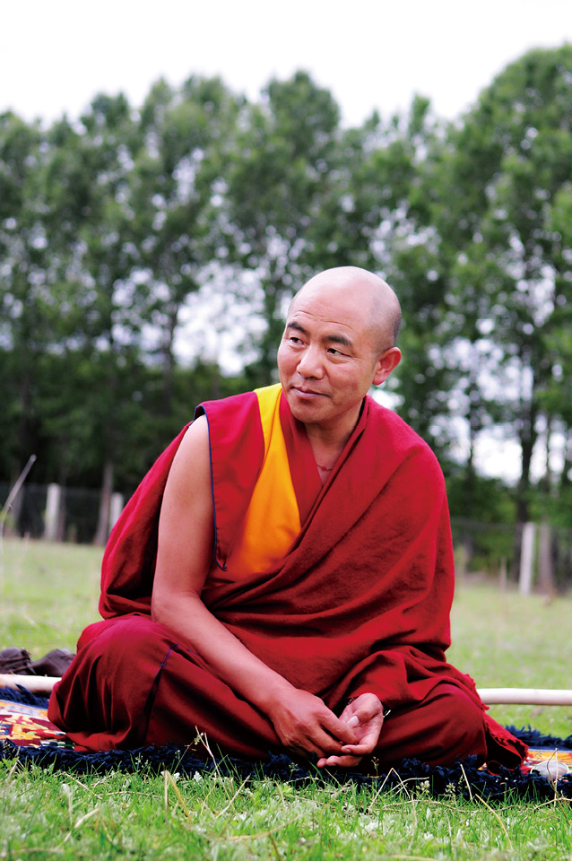
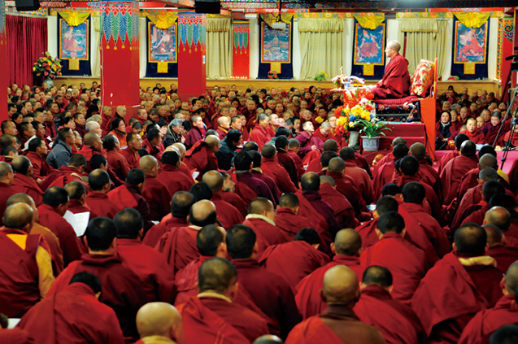
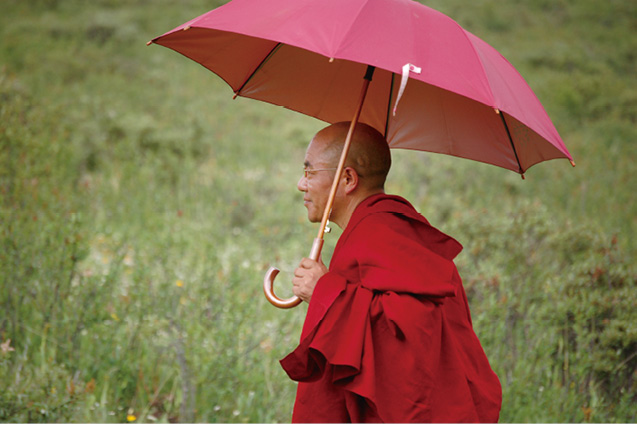

## 谈谈“快乐的人生”

2010年8月29日

今天因为时间关系，我讲得不太多，中间会念21度度母的传承，最后大家如果有问题，可以提出来。争取在一个小时内结束。

首先和大家谈谈“快乐的人生”。上世纪50年代，藏地著名的大德根登群佩曾经说过：小至蚂蚁蚯蚓，大至人类，上上下下的众生每天都在为快乐而奔波。这句话引起了藏地一些学者、智者和修行人的重视。

的确，生活在这个世界的所有众生，日日夜夜都为了自己的快乐而奋斗。各位活在这个世界上，也都希求快乐。但大多数人根本没想过，我们身边的众生也同样希求快乐。今天，我以个人的劣见，和大家探讨一下这个问题。

## 一、过一个快乐的人生

学佛的人，要有一个快乐的心态。如果没有，在这个世界做任何一件事都不会圆满。而要想拥有快乐，就得用佛法的智慧调整心态。这一点很重要。

生活中有两种人，一种对痛苦不太执著，经常处于快乐的状态。另一种情绪不稳定，经常遭受痛苦的折磨。后一种又分为两类：一类是即使听过甚深的教诫，也无法摆脱痛苦；另一类是一旦值遇高僧大德的甚深窍诀，以这些窍诀调整心态，就会趋入快乐之道。

### 1．认识业因果

我今天的开示，主要针对经常遇到痛苦的佛友。我想告诉这些人，当你遇到不悦意时，应该认识到这一切都是因缘所成，障碍和痛苦不是凭想象就能解决的，今生的苦乐与自己的前世紧密相联。

我们讲因果不虚的时候，会讲到等流果。所谓的等流果，又分为感受等流果和同行等流果，意思是，我们今生的种种感受，都与前世种下的业因有密不可分的关系。所以各位佛友应该明白，今生所有的快乐和痛苦都不是无缘无故产生的，也不是遇到某些违缘所导致的，而是与自己前世的善恶业有关。

因此，当我们感受痛苦的时候，一定要依照佛陀的教言，努力忏悔往昔所造的罪业，并发愿改邪归正，从根本上断除不如理、不如法的行为。这样的话，你前世的罪业会逐渐减轻、耗尽。当然，除了过去所造的恶业外，今生偶然的因缘也会起一定的作用。

### 2．放下希忧

人们的很多痛苦，都源于内心的期望没有实现——想做的事不成功，为此伤心落泪，或担忧将来的生活不如人意。大圆满中经常讲，当修行达到一定境界的时候，内心将不会再有希求和担忧。所以，作为已经学佛的人，尤其是大乘修行人，对当下的许多事情不要刻意去执著。无垢光尊者曾经说过：“执著愈强，痛苦愈烈，痛苦和执著是成正比的。”

任何一件事，无论是钱财、感情，还是地位、名声，乃至饮食、住处、一个简单的行为等区区小事，只要去执著，就会给你带来巨大的痛苦。印度的一位尊者说过，即便是芝麻许的执著，也会引来须弥山般的痛苦[^1]。

世上的每个人虽然都想得到快乐，但绝大多数不知道快乐的窍诀，所作所为在造下痛苦之因，像毁灭仇敌一样把快乐毁灭了，一直在间接地积聚痛苦。这就是我们人类的无知和愚蠢。

### 3．少欲知足

许多人根本不知道怎样调心，尤其是没受过佛法教育的人，一味地把自己的希望建立在物质上，甚至建立在其它众生的痛苦上——比如为了享受美食，残忍地掠夺动物的生命。

有些人虽没有造这样的恶业，但深受西方的影响，错误地认为物质是一切快乐的根源。三四百年前，西方学者提出人类的快乐源于金钱，后来这个理念逐渐遍及全世界。其实这种价值观很片面，如果真像他们所说的那样，有钱人应该永远快乐才对，而事实却并非如此。这一点，我们从许多富翁的身上就可以发现。

所以，我今天想告诉大家，快乐不一定是拥有财富，也不一定是吃得好、穿得好，而是有一颗知足少欲的心。这是最最关键的。

什么是知足少欲呢？名声也好，财富也好，你向往或得到的任何东西，都要懂得随缘，有也可以，没有也可以，不要因为得到而骄慢，也不要因为失去而痛苦。这不是我的胡言乱语，而是宁玛派和噶当派的无数大德经过多年修行而得出的甚深窍诀。

### 4．观清净心

不管在热闹的城市还是寂静的山林，我们要学会对所有人观清净心，把他们看成本尊，看成佛菩萨。如果认为“这是坏人，那是恶人”，自己以外的所有人都视为怨敌，这不仅不合理，而且是一种心理疾病。如果能把所有人都看成佛菩萨，那他们对你说的每一句话，甚至对你恶口相骂，你也会当做教言和窍诀，修行境界会越来越提升。

### 5．远离执著

不管是财产、名声，还是你希求的其他任何东西，如果毫不费力地得到了，那就随意地享用。如果这一个个都离你而去，也没必要痛苦不堪，不要抱怨不公平。这是我们调心的关键。

当然，对于人、财、物的执著，一开始很难彻底断除。我们并不是修一两天就成了修行人，也不是修一两次就有立竿见影的效果。应该日积月累，长时间地努力，持续地下工夫，这样才能得到修行的成果。

### 6．认清梦幻泡影

在这个世间上，如果没有知足的心，没有满足感，就会奔波不止，永无停息之时。我刚才喝茶时在想，我现在用的是纸杯，上世纪七八十年代，有钱人用的是搪瓷茶杯，开会等正式场合都会用那样的杯子。在此之前，不管藏地、汉地，茶杯又是另一种材料。短短几十年时间，我们的生活方式发生了巨大变化。

每一代都有每一代的执著，这种执著在当时都能起到作用。过去人们执著搪瓷茶杯，到了22世纪，我们现在的这些生活资具，可能也会消失，人们会执著另一些事物。可是，所有一切执著，对我们获得解脱，对获得永恒的快乐，有没有利益呢？没有。

前辈的高僧大德，对自己的财物或亲友是什么态度？大家看看他们的传记就知道了。我们执著的很多东西，都是虚幻不实的，如幻、如梦、如泡影、如阳焰，就像在梦中寻找大象，根本没有一点实义。遗憾的是，无数众生不能领悟这样的道理。

我们应该认真想一想：尽管每个人都执著自己喜欢的对境，可这样的执著到底有没有意义？上学的时候，我们执著各种荣誉，期末没评上三好学生，心里非常地痛苦。到了现在这个年龄，再回头看看孩童时代的执著合不合理？你肯定说不合理。既然如此，那你现在特别执著的房屋、钱财、父母、儿女、朋友等，也是一样。如果你依靠佛教的理论进行实修，豁然证悟心的本性，那时就会发现，自己在迷乱显现中执著的一切都没必要。

在现代社会，尤其是年轻一代，由于没有受过调心的教育，对很多东西特别执著。越是执著，越得不到快乐。我遇到过很多生活在山洞或寂静地方的修行人，他们脸上的皱纹很少，头发也没有一天比一天白，过得非常快乐。原因是什么呢？他们不为琐事操劳，不像大城市里的人那样陷在执著里，整天活在痛苦中。

### 7．该做的做，该修的修

有些人可能会问：“难道我们活在城市里的人，一点都不能执著吗？”也不是。佛教对这件事有很好的剖析。人活在世上，需要吃饭，需要穿衣，需要工作，这些都是正常需要，应该得到满足。不能因为今天学佛了，就把这些全部抛弃，到山里去修行。这样做其实是不对的，也是不现实的。

学佛以后，该做的事情，依然要做。但在做的过程中，不要违背因果，不要为非作歹，也不要执著。无论做生意、上班，还是维护家人，都是你们不得不做的事情，也是你们不可推卸的社会责任或家庭责任。

对生活和修行，我们要走中道，不堕两边。但有些人过于极端，要么什么都不执著，全部放下，结果生活一团乱，修行也上不去；要么执迷不悟，整天沉醉在迷幻的世界里，一直奔波。

因此，我特别希望在家人能对自己的人生做一个调整。大家在短暂的人生中，千万不要放弃修行。如果放弃，成天忙于琐事，自己什么时候闭上双目、离开人世很难说，到时所有的财富和亲友都带不走，唯有活着时造下的善业和恶业，会生生世世跟随自己。如果此生不尽量行持善法，是非常遗憾的一件事，也是极其愚痴的一件事。

从现在起，希望你们对自己的工作和家庭做适当的安排，在每天、每个月或者某一段时间，抽出适当的时间来修行。有了修行，一方面你们今生的心态可以得到调整，不会被很多烦恼染污；另一方面，也能为漫长的来世做好充分准备。我觉得这样的人生，才是有价值的人生。

### 8．修行要落到实处

今天你们来这个讲堂闻法，都想得到一种利益。我看过许多佛教经论，听过上师们的很多教言，也曾经认真思维过甚深的教义。我自己的体会是，这颗心一旦真正和佛法相融，一定会有所收获。

我认识的许多人，通过学习佛法，重新认识了自己的人生，重新调整了自己的生活。以前没有学佛的时候，他们造的恶业像须弥山那样大，做的坏事超乎常人想象。学了佛以后，依靠上师、法本和善道友的帮助，行为上有了很大的改变。

但这个时候，如果自己不注意，很可能又回到原来的状态。现在经济社会的浪潮非常可怕，我们身边有许多持邪知邪见的人，其诱惑力相当强大。我们微薄的善根，虽然暂时依靠上师三宝的加持，像闪电一样在心里闪烁，但可能很快就像秋天的鲜花被秋霜毁坏、空中的白云被狂风驱散一样，转眼间就被恶友或恶劣的环境毁坏无余。

为了避免这样的情况，大家一定要经常祈祷上师三宝，这是古大德们的甚深教言。经常祈祷上师三宝，祈祷释迦牟尼佛，祈祷观世音菩萨，祈祷二十一度母，祈祷莲花生大士，祈祷传承上师们：愿我生生世世不离佛陀的妙法，生生世世不造十不善为主的一切恶业，生生世世不退失菩提心，生生世世不舍弃众生……要长期发这样的善愿。

今天我想什么就说什么，虽然你们听起来不一定全部接受。当然，我实际的修持并不好，和老一辈修行人以及了不起的大成就者比较起来，确实感到惭愧。但不管怎么样，只要讲的道理对个别人有点滴的利益，我也愿意付出一切。

各位应该好好想一想：人生如此短暂，遇到佛法如此不易，如果现在不希求正法，不认真修持，什么时候才能再次得到这样的暇满人身呢？这一点，一定要好好去思维。如果不认真思维，学佛就像学气功一样，态度肯定不对。

看一看古今中外大德的传记，想一想历史上那些成就者的学佛精神，再对比一下我们自己，有时候应该生起惭愧心。大德们为了修行佛法，为了获得成就，放下万缘，抛弃一切，日日夜夜，孜孜不倦，废寝忘食。可我们是怎么学佛的呢？完全停留在表皮上，是一种外在的表演、一种造作的戏剧。这样学佛，终究不能深入经藏，更不能入于三宝之海。

这是我今天讲的第一件事：我们要想过一个快乐的人生，不管遇到怎样的坎坷，都要明白如幻如梦，不要当真。过段时间，它就会像空中的白云一样无影无踪，没有什么可执著的。而当你得到三宝的加持，内心有所感应时，当你真正生起信心和菩提心时，应该欢喜地将善根回向给一切众生。

总之，快乐的人生要从根本上调整自己的心，不能太执著。

## 二、珍惜传统文化

接下来讲一下传统文化。在我们藏地，自古以来重视佛教教育，佛教和藏文化融为一体，就像水和湿性不可分离。如果撇开佛教去研究藏文化，是根本找不到答案的。

同样，汉地的传统文化，跟你们的环境、教育和生活习惯有一定关系。它其实是儒教、佛教和道教相互融合的结果，尤其是儒教，自春秋战国以来，一直流淌在在整个汉民族的血液当中。可是到了今天，大多数知识分子歧视本民族的文化，甚至根本不愿去了解，以致整个汉地已经被西化。对于这样的现状，希望各位学者能好好地反思一下。

在西方，美国文化有将近400年的历史[^2]。对于这样的新文化，我们可以借鉴其中的先进理念。但它和儒教、佛教比较起来，究竟有什么样的文化优势，可能值得我们去观察。

现在许多人丢弃自己的民族文化，而去希求其他文化，这种舍近求远的做法不可取。我们应该通过各种努力，让每个人接受自己固有的传统文化。这方面，我也通过各种方式在尝试。

藏文化如今也面临这样的危机。当汉地和欧美的知识分子，纷纷来到雪域高原，不畏严寒，不怕吃苦，一心希求藏文化和藏传佛教时，我们藏地的很多知识分子，甚至包括一些出家人，却不重视本民族的文化，反而崇尚外来的垃圾文化，真的特别可惜。

面对这样的现状，我虽然起不到什么大的作用，但也希望尽量做一些努力。为了继承和发扬藏地固有的文化，9月4日左右，我会在网上开一个藏文化博客，希望与汉藏两地的知识分子，在网上用汉语或藏语进行交流，以此推广藏地的文化，希望它一直生存在自己的土地上。

我也希望汉地佛友在学习佛法的同时，好好研究一下自己民族的文化。看一看它究竟是什么，到底有没有价值。如果有价值，那就应该继承下去。

前段时间，我们开了一些德育课，主要学习《弟子规》《三字经》《千字文》《德育启蒙》等传统文化。个别不明事理的人居然歪曲事实，说我们不让孩子学习文化知识。我们从来没有说过这样的话，我们对自己所说的话、所做的事，都有自知之明，既不敢违背佛法，也不敢违背国法。而在不违法的基础上，各民族都有学习和继承文化传统的自由，这与政策及法律法规并不相违。

今年，我要求各地学《弟子规》的儿童参加考试，各地德育课的负责人要通知安排。考完试后，我们将通过各种方式给大家发奖。希望汉地的孩子不要舍弃儒教和佛教的传统思想，同时要把接受科学技术当作主要的学习任务。

## 三、加行组和净土组的考试

再过一两个月，加行组和净土组将举行考试。考试通知和复习范围近期会公布，希望大家收到后认真学习。各地负责人也应该及时通知大家，不要拖延时间。为了参加考试，每个人都需要调整好生活和工作，提前抽出一定的复习时间。

给大家提供这样的学习平台，要花费很大的人力、财力和物力。不要说日常的课程学习、学修管理，光是为这一次考试，包括出考试题、安排考试、收发试卷等，都有那么多发心人员参与，我个人也前前后后忙了很多天。如果你们把它当做一件小事，我会有点想不开。为什么呢？农民辛辛苦苦了一年，到了秋天，心里肯定渴望丰收。你们学习了这么长时间，本该用好的成绩做法供养，但如果不遵守纪律，考场作弊，负责人擅自改变考试时间，上上下下出现种种不如法的行为，真的会让人不舒服。

如果有这样的行为，虽然不要求你离开学会，但通知里说得很清楚，负责法师会把这些人员的名单交给我，我会一个一个地保存。以前闻思组考试时，有些道友本来已报了名，可考试时找不到人，无缘无故退下去了。这种人不要说发菩提心，连考试的发心都不能长久。有的人刚开始不报名，临近考试才匆匆忙忙补报，让我们很难管理。所以，今年的考试我要求比较严格。虽然考不考是你的事，但将来的证书、奖品、是否有资格听密法等，都与你的出勤率和考试成绩密切相关。

道友们如果真想学习，该报名的还是要报。报名时间一个月左右，截止后，大家就开始复习，我们也会做一些准备。再过一月时间，考试就正式开始了。这次不允许临时参加考试。我的要求不高，只要你们态度认真，好好考，哪怕只有五六个人也行。如果有六个人参加考试，三个人得前三名，另外三个没有名次，我也给这六个人发奖。

想学习佛法的道友，希望你们认真复习，也希望各地负责人协助我们组织考试。为了你们学习佛法，我一直以来都很辛苦，这里许多发心人员也很辛苦。这么多人在为你们付出，你们的学习不管好坏，都应该有一个结果。希望大家根据指定的复习范围认真复习。指定范围以外的内容，只要是你学过的，也要好好看看，这样才能获得比较理想的成绩。

我非常重视和关注这次考试。希望各地有紧迫感，不要敷衍了事，不要糊里糊涂地拖延通知，耽误很多人的学习机会，否则，你会有很大过失。即使再忙再累，作为一个大乘佛子，做这么一点事也是应该的。大家一定要认真执行各项考试规定。

这次主要讲报名和复习的问题，考试前再给大家讲考场纪律等事项。

## 四、参加讲堂辅导

为了帮助大家更好地理解法义，菩提讲堂从周一到周五都有法师辅导——辅导的内容可以从佛网上了知，星期六有法师研讨，周日有法师答疑。每晚讨论课以后，法师还会和大家交流，希望你们积极参与。

山下的有些道友，虽然不能到藏地求法，但这几年通过网络，也学得特别好。最近我了解到，有些网上的道友，即使跟我们学院的人相比，也算学得不错。他们虽然身处繁杂的城市，但经常利用网络学习，非常了不起，是真正的火中莲花。

大家不要把网络变成解脱的障碍，不要把电脑变成散乱放逸和增长贪嗔痴的因，而应该通过网络，通过菩提讲堂，充实自己的生活，提升戒定慧三学，真正发起世俗和胜义两种菩提心，利益无量无边的众生。那个时候，你个人的利益自然而然也会成办。

## 五、修度母法遣除违缘

下面给大家念二十一度母的传承。末法时代，遣除违缘很重要。如果你会念《二十一度母赞》，可以多念度母赞；如果不会念，只念度母心咒“嗡达瑞度达瑞度瑞所哈”也可以。二十一度母的祈祷文概括起来，可以用度母心咒代替。

我五六岁就能背诵度母赞，大一点以后，放牛时更是天天念度母心咒。上学以后，无论小学还是中学，每天都不间断地念。出家后，因为闻思背诵的内容比较多，略有间断。在家的时候很精进，出了家反而变懈怠了。尤其是最近，因为要监管学院的建筑，比如汉僧综合楼、觉姆大经堂、居士林经堂等，还要在外面建学校，资助很多大学生……一般要忙到晚上近12点，才开始念自己的功课。度母心咒也是时而念时而不念，非常惭愧。但我对度母特别有信心，觉得自己上半生的修行没遇到什么违缘，也是依靠度母和莲师等本尊的加持。

但愿今晚听课的人，都能生起无伪的菩提心，也愿大家的修行没有违缘。末法时代要遣除违缘，就要祈祷度母和莲花生大士等，依靠本尊的加持才能成办。障碍，可以是有形的，也可以是无形的。无形的障碍需要依靠无形的力量，比如依靠本尊、护法神和上师三宝的加持力来遣除。下面，我以极大的恭敬心给大家传授《二十一度母赞》。

（堪布念《二十一度母赞》传承）

今天还有一些人想皈依。大家应该知道，皈依有三种，一种是为了自己来世得到快乐，一种是为了自己从轮回中得到解脱，一种是为了一切众生究竟成佛——这是大乘的皈依。希望大家要有大乘的皈依，不是为了今生来世暂时的人天福报，也不是为了个人的解脱，而是为了天下无边的一切众生成佛。下面，我给大家念三遍皈依偈。最后一遍的时候，你们要想：我已经得到了皈依戒的戒体。

（堪布为部分道友做皈依）

刚才皈依的道友，法名都叫圆度，度化的度，度母的度。今天的网络不是很好，也许大家听得不是很清楚。如果没听清，过两天网上会有今天开示的文字，到时大家可以再学习一下。接下来还有十分钟时间，你们可以提一些问题。

现场互动

⊙ 问：小组共修的时候，大家会在一起辩论，但有时候不知道怎么把握尺度。请问，我们应该以什么样的尺度为准？

堪布：大家共修的时候，相互提出疑问并进行探讨，这是很重要的学习方法。藏传佛教对此非常重视，道友之间如果经常开展辩论，相续中的怀疑和邪见可以全部摧毁。汉地由于没有辩论的传统，很多人尽管有邪见，有怀疑，甚至不太明白法义，却没有跟道友沟通和请教的机会。所以，有智慧的人共同集聚讨论，对遣除怀疑很有必要。

这个时候，需要掌握什么样的尺度呢？看谁的理由更充分。如果自己的理由不充分，光是声音大，或只知道夸夸其谈，在辩论场上是没有用的。一般平时学得好的人，辩论语言非常有说服力。有些学得不是很好，这样那样地说一大堆，却根本说不到要点，这样也不行。我们在学院辩论的时候，谁的因明和中观学得好，谁讲得有道理，大家就服谁，而不是以其他原因作为分界限和衡量尺度。

总的来讲，学佛小组共修结束以后，如果有怀疑或邪见，可以当场剖析、讨论。如果道友没办法回答你的问题，可以在网络上听法师的辅导。如果对法师的辅导仍然不满意，可以通过博客发给我——哦，我的博客现在不能发。

有些人邪见很重，法师本来回答得很好，他却不怎么认可，这种人我们是不接受的。除此之外，自己对某些理论如果真的心存怀疑，一定要在别人面前寻求帮助，彻底遣除。大家由于成长环境和教育的原因，经常对佛法的道理产生疑惑，我们也能理解。但理解归理解，大家心中的疑惑一定要根除。如果没有根除，最后变成“癌症晚期”，就无可救药了。

⊙ 问：教孩子们学《弟子规》时，有些家长只管把孩子送过来，却不配合老师的工作，应该怎么跟他们强调：他们自己对孩子也要负一定的责任？

堪布：家长如果能和孩子一起学传统文化，是最好的。如果只管把孩子送老师那里，自己什么都不管，老师什么责任都要付，那是不合理的。公立学校收那么多钱，老师也不会负全部责任。

而且，孩子学传统文化的价值，从某种意义上，远远超过公立学校所传授的知识，按说我们也应该收钱。可是，我们一分钱都没有收，免费给孩子提供教育，家长却一点责任都不负，我觉得说不过去。为了孩子，大家应该共同努力。

⊙ 问：莲师的上师瑜珈，是按《开显解脱道》里的上师瑜珈来修，还是按麦彭仁波切《上师瑜珈降加持雨》的仪轨？

堪布：都可以，根据自己的情况来定。仪轨本身没有什么差别，都有很大的加持。

⊙ 问：作为佛教徒，虽然不能随便评价僧人，但我们私下里却认为，少林寺僧人习武，会成为社会诋毁佛教之因。比如，一些影视作品中含有的佛教元素，存在明显不如法的情节，好像跟这个也有关系。怎么看这个问题？

堪布：我以前在其他课上讲过，佛教度化众生有种种的方便方法。法王如意宝在世的时候，也让道友们演释迦牟尼佛的传记、跳金刚舞等，目的是让大家趋入佛门。当然，佛教和政治、商业等世间法融在一起的时候，可能会丧失本有的一些传统和意义。

作为在家人，对凡是穿着僧衣的出家人，都应该有恭敬心。如果他们有些地方做得不合理，可以直接或间接地提出来，共同交流，并以戒律和经藏作为标准，得出大家都认可的结论。但不管怎么样，自己没有必要生邪见。

⊙ 问：在修习佛法的过程中，越精进，越会起一些不清净的念头；越修，信心和恭敬心反倒越退步。自己为此很苦恼，怎么对治这个问题？

堪布：这应该是个人的问题，因为并不是所有人都越修，越对上师三宝不起信心。通过历史上或我们学院一些成就者的修行境界，可以证明这一点。大多数人应该是越修越有信心的，因为我们所修的法完全符合世间万物的真理。一个真正懂得佛教教义的人，越闻思，境界会越高。

极个别的人，刚入佛门时很有欢喜心，慢慢对上师三宝的信心会有所退失。这是什么原因呢？要么刚开始特别冲动；要么最初学得不踏实，没有深入真正的教义；要么因为前世的各种因缘，出现了一些违缘。这个时候，一方面要一如既往地努力，另一方面也要多祈祷上师三宝。

⊙ 问：我学佛有一段时间了，但对佛教说的六道依然无法相信。怎样才能证明轮回是真实存在的呢？

堪布：对生死轮回的存在没有信心，可能是佛教的基础打得不好。如果认真学习关于三界轮回的教理，不可能不生信心。比如，在六道众生当中，佛教对人类和旁生痛苦的描述，和大家在现实生活中的感受完全是相符的。以此可以推知，我们看不到的地狱和饿鬼，也应该成立。

事实上，佛教关于三界轮回存在的道理，有许许多多的证据和教理，我们却没有可靠确凿的依据来驳斥轮回不存在。如果有这么一个道理，一方面拥有可靠有力的证据，另一方面却没有推翻它的理由，那我们就不得不承认。

你学佛的时间不长，对佛教的基础学习不够，平时也没有修行，再加上和佛教团体中有正知正见的人接触得不多，所以对佛教只有偶尔的信心，只是偶尔做个皈依，学一点佛法，难免会产生这样的怀疑。其实，你不仅对三界轮回的道理，对佛教讲的因果观、前生后世、佛的功德等其他很多道理，可能也会产生怀疑。不过不用担心，这些怀疑通过长期的闻思是可以一一消除的。

⊙ 问：我目前面临着很多课程，有净土、闻思、前行、般若，还有其他上师的课。自己既要工作，又要照顾家庭，时间有限。该怎么选择？目前只想修好加行，好好地完成修量。

堪布：同时学很多课程也是可以的。我们读中学的时候，也同时在学语文、数学、化学、政治、物理等很多课程。你可以把这些课程分成主科和副科，首先保证前行的质量，其他课程的学习尽量完成，能完成多少是多少。

面临很多课程的时候，完全没有主次肯定不行，需要抓住最主要的那个。我们原来给大家分班的时候，也是分为主修前行、主修般若等。

⊙ 问：我发了世俗菩提后，看到蚊子、蟑螂等小众生，是发大悲心跟它们相处呢，还是用一些善巧办法把它们清除出去？

堪布：发了菩提以后，凡是有生命的众生，不管大小，都要视为自己的母亲。国外一些法师认为，做事要以人类为主，不能以动物为主，所以应该用善巧方法把它们除掉。这种做法我是不赞成的。不管什么众生，都是一条生命。发了大乘菩提心的人，应该想尽一切办法保护它们的生命。所以，不管怎么做，都不能杀害任何一个众生。

## 结语：踏踏实实，善始善终

外面的道友，有些在学前行，有些在学净土，有些在学其他上师的课。不管跟随哪一位上师，学习哪一门课程，只要是如理如法的，我们都非常赞叹，非常随喜。因为每个众生的缘分和根基各不相同，不一定非得聚集在一个上师那里。

但不管学什么法，都希望大家不要学到中途就奄奄一息。《般若摄颂》再过几天就讲完了，但《大圆满前行》和《藏传净土法》的内容比较多，还有一段时间才能结束。尤其是《大圆满前行》，还需要特别长的时间。不管你主修哪一个法门，这对我们的一生都特别重要，因此我才特意花那么长时间给大家讲授。虽然大家今天学前行，明天学净土，翻来覆去就这两样，不一定有新鲜感，但再过几十年，当你们回顾自己的一生时，会发现现在打下的佛法基础，对人生有着非常重要的意义。

在我们没有打新法的广告前，希望大家不要对旧法生厌倦心。以前，藏地很多高僧大德传讲无垢光尊者的《大圆满心性休息》，要讲六七年。我这次讲《大圆满前行》，是历史上讲得最广的一次，能善始善终的人不一定很多。但不管怎么样，只要生命没遇到大的违缘，我发愿一定要完成。

希望今晚听法的人也发愿圆满所学的课程。以前没有听课的，希望你们从现在开始，通过网络和光盘好好学习佛法。如果没有系统而有针对性地学习佛法，只是偶尔来听一两堂课，恐怕不能真正进入佛教徒的行列。

学习佛法对我们的一生来讲，比什么都重要。它关系到我们未来生生世世的利益，关系到自己和所有众生暂时和究竟的安乐。因此，大家学佛不要流于形式，不要把佛法变成口头禅，而要根据工作和生活的实际情况，妥当地安排闻思和修行的时间，踏踏实实地学修。这样的话，不仅可以暂时遣除人生的痛苦和烦恼，还可以往生极乐世界等清净刹土。

最后，祝愿大家能获得真正的快乐。修行人的心情，和世间人完全不同。在这个世界上，没有什么能真正损减修行人的快乐。

下面把今天共同所造的善根，回向给天边无际的老母有情。

[^1]: 印度八十四大成就者之一的萨绕哈巴尊者：“贪执纵有芝麻许，竟引痛苦无边际。”
[^2]: 美国只有200多年的历史，但17～18世纪爆发于欧洲的启蒙思想被带到了北美，建国后的美国将其实践得非常彻底。启蒙运动的思想精华，比如自由、平等，天赋人权、三权分立、契约论等，深入美国社会的各个阶层。从这个意义上讲，美国文化的历史可以追溯至17世纪，至今有近400年。
