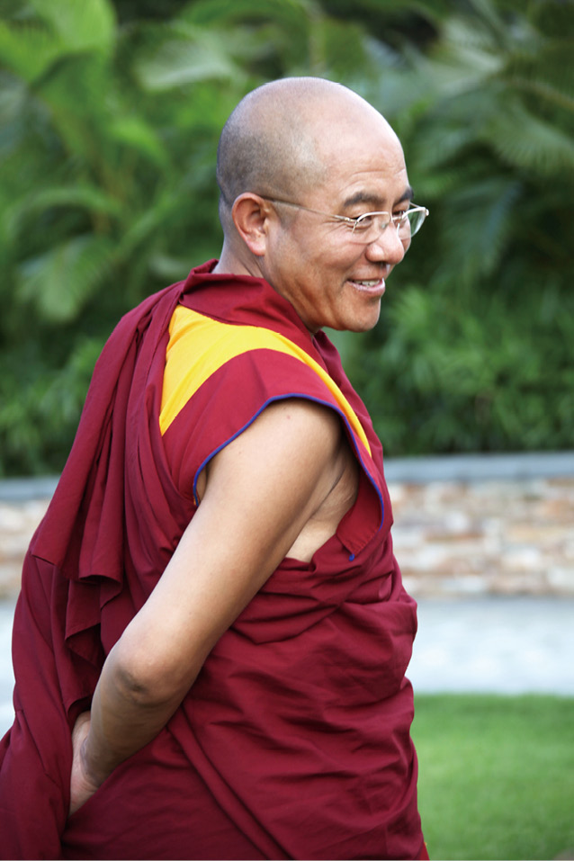
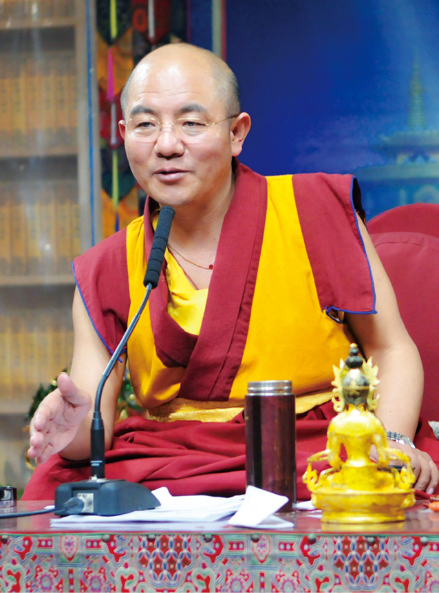
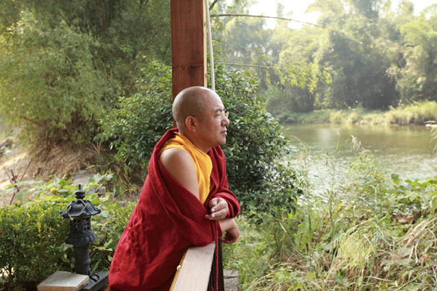
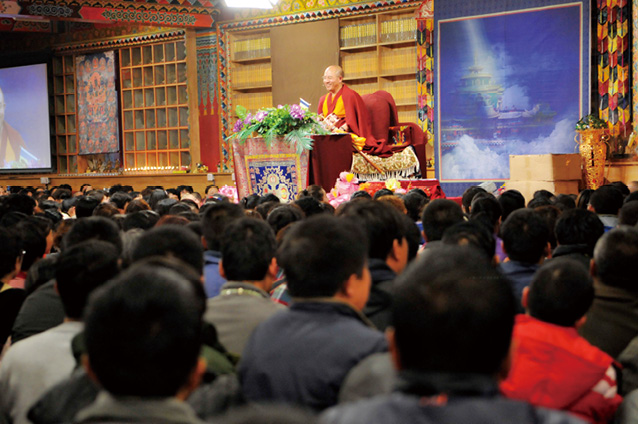

## 过新年 发善愿

——2011年除夕开示

2011年2月2日

今天，我们大家集聚在智悲讲堂，共度新春。虎年刚刚过去，兔年即将来临，在这新旧交替之际，跟这么多同行道友一起探讨佛理，真的很开心。

这是一个欢庆新年、喜迎新春的激动时刻。大家以信心和欢喜心，共同研讨佛教的真理，非常有意义。

每到过年，人们都会按照自己的喜好，以各式各样的方式度过：有些在雪地滑雪，有些在海里游泳，有些在游山玩水……我们作为佛教徒，应该以怎样的方式共度新年呢？

接下来，我会将自己的心得和感受，跟大家作个分享，同时祈祷三宝，给大家带去身心的安乐。这算是我送给各位的新年礼物。如果你们能生起一刹那的欢喜，脸上能露出一分的微笑，我今天所做的一切就没有空耗。

本来，在座每个人的时间都非常宝贵。大家都知道，世上最珍贵的并不是金钱，而是时光和生命。在这个家家欢聚、户户团圆的时刻，你们却怀着热情和渴望的心，来到智悲讲堂，和大家一起共同探讨佛法。这种精神，我非常随喜。

## 最究竟的愿望

在这个世界上，每个人的价值观都不相同。有些人的快乐，重在分享精神的甘露美味；有些人的快乐，则建立在被杀众生的痛苦之上。对在座的众多佛教徒而言，禁止杀害一切生命，这是真正值得欢喜和随喜的。我可以在世界上任何一所学府、任何一位学者面前，大胆地宣称：这就是我们佛教的大悲心，也是我们佛教的伟大之处。

为什么这么讲呢？因为生存在这个世界上的任何一个人，任何一个动物，最最珍爱的，就是自己的生命，绝不愿意任何人或任何因缘，摧毁、夺取或损害自己的生命。

佛教在这个基础上，建立了一套颠扑不破的学说，并要求每个佛弟子全力培养忘我和利他的精神，以爱护整个世界、爱护所有生命。这样的精神如果能够推广开来，将令无量无边的众生获得快乐、宁静和真正的解脱，也将直接或间接令世界和谐，令人间美好。

可以这么说，佛教提倡的慈悲心，对每一个人都有不可估量的意义，对每个家庭、每个团体、每个民族乃至每个国家，都有不可言说的利益和价值。

在这样的节日，把佛教的大悲精神推广到世界的各个角落，已成为我心中最究竟的愿望。

## 物质与精神的反差

如今，虽然外在的物质和生活条件，有了很大的改善和提高，但人们的内心和行为，与老一辈相比，却有所退化。这让我想起了八九岁时，一次过年的经历。

那时，我还没有读书。虽然宗教政策还没有开放，但按照藏地的传统，在大年三十的时候，家家户户仍然要念《心经》，或者念莲花生大士心咒、观音心咒；在新年的第一天，都要穿最好的衣服，吃最好的食物，说善妙的语言。

当时是上个世纪70年代，生活条件非常艰苦。我们村以放牧为生，我家附近还有六七户人家。热嘎家是我们那里最富裕的，听说他家过年要请客，我们都非常兴奋，期待着这一天的到来。

后来，那一天真的到来了。我父亲虽然是文盲，但比较有慈悲心。他说：“今天全村的人都聚在一起，好好地过年。我代你们去放牦牛！”然后一大早，他就去放牦牛了。

其他人都集聚在热嘎家里，开始过年。热嘎和当地领导的关系比较好，买到了大米，给我们煮了一大锅稀饭。全村七八户人，都大口大口地喝着稀饭，非常非常地欢喜。我们几个小孩子也很开心，边玩边吃。

那个时候，可能是我第一次吃稀饭，我觉得特别美味。后来吃的稀饭，再也没有那么好的味道了。

热嘎家有位年纪很大的老太太，常年卧床不起，她一直喊她的媳妇：“你们这么多人，大口大口地吃，快要把稀饭喝完了！优博为了全村的人，今天一早就放牦牛去了，你们最好给他留一碗！”老太太还惦记着我的父亲。

她家媳妇脾气不太好，和婆婆的关系也不好，所以一直不理她。老太太就一直不断地大声喊。

我们虽然是小孩子，但经常听说她俩吵架的事情。所以，我心里想：“我父亲没喝到稀饭，倒不要紧，老太太最好不要闹。今天大家喝得那么开心，如果婆媳两人因为这件事，再次爆发战争，这个年就过得不成功了。”后来，她家媳妇勉强给我父亲留了两碗稀饭，并对老太太说：“你不要再嚷嚷了，我已经给他留了。”老太太这才不说话了。

那天，每个孩子都分到一颗水果糖。水果糖的糖纸，是那么美丽，我们把糖纸贴在牛粪墙上，心中充满了喜悦。

五六十年代出生的人，或者年龄比我大，或者跟我相仿，应该都经历过那样的岁月。当时的生活条件，与现在相比有很大的差距。然而，外在的条件艰苦，人们的内心却很快乐，造恶业也没有现在这么可怕。

现在过年，每一家餐厅，每一个家庭，都要杀害许许多多生命。刚才，我和几个佛教徒一起用餐，吃的都是素斋，我心里很高兴。如果和不信佛的人一起吃饭，就会杀害无量的众生。

不管以什么样的理由，杀害众生都是不合理的。但外面的一些道友要完全吃素，不杀害任何众生，恐怕也不太现实。如果你迫不得已，不得不做某些事情，也要尽量地忏悔。懂得忏悔是一种智慧，是一种明智的选择。

这是我今天想表达的一个观点：我们的物质生活和以前相比，有了一定的发展和进步，但是，我们造恶业的途径也变得越来越多，造恶业的现象也变得越来越严重，这方面值得大家深思。

## 总结与发愿

世间的人，除了极个别具有远大目标者以外，绝大多数人过年都是吃喝玩乐，以各种方式消磨时光。我们作为佛教徒，应该与世间人有所不同，应该好好总结过去一年所造的善业和恶业，比如积累了哪些资粮，闻思修行有无进展，罪业忏悔得如何，等等。

如果在过去的一年，自己造恶业的情况比较严重，一定要进行自我批评和检讨。比如，我们遇到上师、遇到大乘佛法以后，在不同的场合发过不同的誓言，但却没有如理如法地行持。对此，我们应该感到惭愧，应该严厉地呵斥和谴责自己。实际上，即便我们不进行自我谴责，也会受到诸佛菩萨和一切护法天尊的呵斥和讥笑。

作为凡夫人，要在短时间内积累广大善根，有一定的困难。在回顾过去的时候，如果自己在近几年或某一段时间当中，行持了不少善法，则应该生起欢喜和信心，从内心随喜自己，并把功德回向给一切有缘的众生。

像这样，一方面对罪业进行忏悔，一方面对功德进行回向，在新年来临之际好好地总结过去。

从明天起，新的365天又要开始了。佛陀告诉我们：寿命无常，生命在刹那刹那地灭尽；明天我们是否会突然死去，谁也不知道。所以，我们应该珍惜生命，对未来立下誓言——如果能顺利度过明年，自己要努力行持什么样的善法。

发愿的力量非常强大，新年一定要好好发愿。

## 最可怕的两件事

人最可怕的是什么呢？

第一是散乱。一个人如果成天散乱，珍贵的时日会很快在浑浑噩噩中耗尽。

第二是没有目标和计划。

有智慧的人，应该给自己制定未来的计划和目标：在新的一年，我要修哪些加行？学哪些论典？行持什么样的善法？或者，我要念诵哪几种咒语？每种念多少？看多少经论？学多少法门？等等。

除了学会或其他的规定之外，自己对自己如果有一个最低的要求，坚持到年底，多多少少会有一些效果，甚至会有明显的改善。所以，在行持善法方面，大家最好有一个未来的计划。

世间人追求的名声、地位和快乐，对修行人来说并不重要。修行人最看重的，是在自己的一生当中，应该以什么样的方式、造什么样的善业。如果希望今生来世都获得真实吉祥的快乐，则尽量不要在相续中染上可怕的乃至生生世世对自己不利的恶业，这一点我认为特别关键。

## 阅藏

最近，我和一些道友探讨时说：“修行人一定要阅读《大藏经》。”

汉地的蕅益大师从30岁开始，阅藏27年，最后写成了30多万字的《阅藏知津》[^1]。很多高僧大德用短暂的一生，成就了非常伟大的事业。我们不是高僧大德，短暂的人生不一定全部用于善法，也不一定能取得他们那样的成就，但是，他们能做到的事情，我们能不能做到六分之一、七分之一或十分之一？

其实，他们的身体也是骨肉组成，显现上和我们一样，需要吃饭、睡觉，那我们具足他们的部分功德，又有什么不可以呢？

## 快乐之因

我到佛学院以后，每天都在闻思修行，根本不知道什么时候过年。直到上师如意宝圆寂前两年，佛学院才在过年的时候，休息一两天。当时的学院不像现在，交通、信息都不发达。在这个山谷中，我们除了闻思修行，没有什么别的事。外面发生的一切，我们都完全不知道。

有一次过年，上师说：“明天是新年，我们每一个人，都向死亡迈近了一步。”确实是这样。不管是谁，过一年肯定老一岁，更接近死亡。

所以，世间人过年欢欢喜喜，完全是颠倒的。第一个颠倒：本来，每个人都特别怕老、怕死，城里人每天化妆，就是想把脸上的皱纹擦掉。而老一岁，脸上的皱纹就会多几根，过年有什么值得祝贺、值得欢喜的呢？

第二个颠倒：人类一过新年，很多众生就会失去宝贵的生命，这样的悲惨世界，有什么好欢喜的？

不过，佛教徒过年，会带家人或亲友到寺院烧香、拜佛，到外面放生、行善。从这个层面来讲，过年还是值得庆贺的。

做了善事，一定会成熟快乐的果报。不论是人，还是非人，只要能得到快乐，都值得欢喜，值得庆贺。

今天说了很多，但却没什么次第。我真正想表达的是，大家如果想要快乐，就得行持快乐的善因。

## 如何获得吉祥

过年时，家家户户都喜欢买春联，门上贴着各种各样的“吉祥”。佛教徒想了解因果，可以多看《吉祥经》。《吉祥经》好像有三个版本，有小乘的《吉祥经》[^2]、《法句经》里的《吉祥经》[^3]和日本的《吉祥经》。这部经宣说了造何种善业、得何种吉祥的道理。如果具足《吉祥经》中所说的因，就会得到吉祥。

我们应该祈祷诸佛菩萨。当诸佛菩萨不可思议的功德力、自己的信心力和法界的不变力等因缘具足，我们一定会获得吉祥和快乐。

新的一年，每个人都想健康、快乐、长寿、诸事圆满，不愿意面对痛苦、烦恼和违缘。可是，如果没有行持吉祥的善因，则不一定得吉祥的善果。

希望大家过新年时，多念一些与吉祥有关的经文，尤其是《喇荣课诵集》中的《八圣吉祥颂》。《八圣吉祥颂》是全知麦彭仁波切的智慧流露，全是金刚语，具有特别的加持和力量，非常重要。

按照传承上师的传统，每天早上都要念一遍《八圣吉祥颂》。出门或做任何事之前，以及过新年的时候，也要念。在家人举行婚礼，还会专门请出家人去念《八圣吉祥颂》。如果找不到出家人，大家就共同念诵。我本人不论在家还是出门，天天都要念。

接下来，我给大家念一遍《八圣吉祥颂》的传承，也算是给大家送吉祥，为大家祈福。以此功德，祈愿讲堂成千上万的听众和观众，得到世间和出世间的吉祥，相续中真正生起出离心、菩提心和无二慧的觉性。

《八圣吉祥颂》中，宣说了东方八大如来的名号，以及普贤菩萨、弥勒菩萨等八大菩萨的名号，还有八大天女和八大护法神等。口中念诵或耳边听到这些名号，也会给我们带来无比的加持和吉祥，让我们获得无比的快乐。

我讲的这些话，只要是符合真理的，一定与吉祥佛和吉祥菩萨的加持相吻合，一定会给你们和家人带去祝福和福分，这一点我很有信心。

当然，在座一些证悟比较高的人，不一定想获得吉祥，而愿意把痛苦转为道用，这种境界也值得随喜。

不管怎么样，今天大家一定要发善愿。你们连新年晚会都不看，跑到网上来收听直播，我们只有共同发下善愿，这段时光才算过得有意义。

（堪布念诵传承）

麦彭仁波切说过：做任何一件事情前，如果先念一遍《八圣吉祥颂》，所做之事一定会吉祥圆满。希望大家经常念诵《八圣吉祥颂》，并阅读《吉祥经》。

## 祈愿和希望

今天是除夕，大家都特别忙，我不敢耽误太多时间。

新年伊始，我给大家提三个希望：

第一，希望大家在新的一年里，尽心尽力、好好修行，不损害众生。

第二，希望大家在力所能及的范围内，好好弘扬佛法。哪怕给有缘众生宣说佛法的一个偈颂，也算。“诸恶莫作，诸善奉行”的精神，如果不方便以佛教的名义推广，也可以用世间理念的善巧方便，在学校或企业内部进行传递。只要能将佛陀的精神传播到世间，就是在弘扬佛法。

第三，希望大家把佛法的精神，作为自己的行为准则，同时尽量感化身边的人，让他们得到这种精神的快乐，暂时种下善根，究竟获得无上菩提的果位。

另外，今天有个别人想要皈依，下面我再念一下皈依的偈颂。

（堪布授皈依戒）

最后，我祈祷诸佛菩萨加持你们，快乐吉祥，修行圆满，相续中生起真实无伪的菩提心，饶益无量无边的众生！

新的一年，愿我们的修行不要有违缘。即使有违缘，也愿它成为消除罪障的根本因，成为自他获得暂时和究竟利乐的增上缘。以此因缘，愿我们都能利益无量的众生！

这是我们最后的发愿。

现场互动

⊙ 问1：我们是新西兰菩提学会的。共修的教材，目前有点缺。有什么办法吗？

堪布：新西兰过新年吗？

问2：新西兰过阳历的新年。

堪布：好的。共修的教材，以后我们会想办法，通过合理的途径解决。

⊙ 问：什么叫烦恼即菩提？

堪布：烦恼即菩提的真正意思，是认识到贪嗔痴烦恼的本体是远离四边八戏的大空性，从而断除烦恼，令其不复再生，就像纯银通过特殊处理之后，再也不会生锈一样。

⊙ 问：应该如何对治散乱？

堪布：现在，很多人的散乱都特别严重，不愿好好修行。借口是什么呢？太忙了。忙些什么呢？忙着吃饭，忙着聊天，忙着做一些无意义的事情。

如果知道自己很快会死，或总有一天会死，死亡来临之际，除了唯一依靠佛法以外，没有其他任何办法，自己一定会断除散乱，好好修行。

所以我认为，断除散乱唯一的因，就是观修无常。无常修得越好，越会想办法精进修行。

⊙ 问：恶念初生的时候，马上断除它，然后恶念不断地生，我们就不断地断，如此反复，恶念会真正地断除吗？

堪布：对，按照前辈高僧大德的教言，坚持与恶念不断作战，最终是会断除恶念的。这一点，不仅仅文字上这样讲，我们自身通过修行，长期以正知正念观察和对治，最终确实会将恶念断尽无余。

⊙ 问：去年，您让我们报堕胎的名册，然后超度过一次。这种超度，我们以后还需要做吗？

堪布：去年，我让大家报名，不单是为了超度，最主要是让你们以这种方式，忆念和忏悔罪业。对于这类罪业，以后还要不断地念经，不断地忏悔和超度。遇到居士共修、僧众念经或者开法会，忆念回向也很好。

⊙ 问：修金刚萨埵、修上师瑜伽，后面都说要入定一会儿，怎么修这个入定呢？

堪布：对这个问题，我以前讲《入菩萨行论》第八品的时候，讲得比较清楚，你最好去看看。

⊙ 问1：今天晚上，皈依的法名是什么？

堪布：今晚上皈依的法名，叫“圆悟”，圆满的“圆”，开悟的“悟”。你戴的什么帽子？

问2：我戴的是一个小套帽。我把自己的头发染了，但染的颜色不好看。我害怕上师看到，所以——

堪布：哈哈哈，你把自己的头染得红红的，很好看。你是东北人吗？

问3：我是东北人，是理发师。

堪布：你理发能挣钱吗？

问4：养家糊口还可以。

堪布：挺好的，挺好的，一个很清净的赚钱途径。

⊙ 问1：上师，我终于跟您讲上话了！弟子没有什么问题，就是心里感激上师。祝上师法体安康，长久住世！我在这里给上师拜年，给上师顶礼！能够跟上师说上话，我太高兴了！（哽咽）

堪布：你是哪里的？

问2：弟子在贵州贵阳。

堪布：你们怎么过年呢？

问3：我们全家都吃素，食物挺清净的。

堪布：很好，很好。

问4：能遇上上师，学您的法，真的是太高兴太高兴了，谢谢上师！

堪布：很好，学习佛法确实很有意义。

⊙ 问：顶礼上师，我是东北长春的，请您一定要加持这个地方，让佛法在这里弘扬开来……

堪布：好好好。

现场还有好多道友在排麦，但因为时间关系，就到这里吧。我今天该说的话、该念的经、该诵的传承，都已经圆满。以后可以通过其他方式，跟大家结缘。

我今天在微博上说，祈祷八大如来和八大菩萨，加持大家获得真正的快乐。尤其像刚才有些道友讲的那样，新的一年，如果全家都能过清净的生活，那是最好的；如果实在做不到，那就自己做一个清净的佛弟子。

如果因为往昔的习气和烦恼现前，不得不造恶业，请大家不要忘记忏悔。前两天，我遇到一个道友。他以前的有些行为不是很如法，遇到佛法后，十几年从来没有间断过忏悔。听到这些，我觉得很欣慰。

我们大都是凡夫人，不可能没有烦恼。有了烦恼和障碍，该怎么办呢？经常忏悔。我们有最好的忏悔法门，这是很值得高兴的事。

今天，已经跟大家结上善缘。我后面还有一些事情要处理，道友们也有不同的工作和事情要做，还要修持一些善法，所以就不耽搁时间了。

最后，我祝大家新年快乐，吉祥如意！今天的UC开示到此结束，所作的善根回向给一切众生！

我看到一个教言：重要的话说三遍。所以，我再三跟大家强调：念40万遍金刚萨埵心咒忏悔罪业，特别重要！

[^1]: 《阅藏知津》：凡四十八卷，明末天台宗蕅益智旭（1599年-1655年）著。收于大正藏法宝总目录第三册。本书将大藏经所收1773部佛典分成经、律、论、杂等4部，并加以扼要解说。
[^2]: 《吉祥经》（小乘版）：“如是我闻。一时，佛住舍卫祗陀园给孤独精舍。时已深夜，有一天神殊胜光明遍照园中，来至佛所，恭敬礼拜，站立一旁，以偈白佛言：‘众天神与人，渴望得利益，思虑求幸福，请求最吉祥？’世尊如是答言：‘勿近愚痴人，应与智者交，尊敬有德者，是为最吉祥！居住适宜处，往昔有德行，置身于正道，是为最吉祥！多闻工艺精，严持诸禁戒，言谈悦人心，是为最吉祥！奉养父母亲，爱护妻与子，从业要无害，是为最吉祥！布施好品德，帮助众亲眷，行为无瑕疵，是为最吉祥！邪行须禁止，克己不饮酒，美德坚不移，是为最吉祥！恭敬与谦让，知足并感恩，及时闻教法，是为最吉祥！忍耐与顺从，得见众沙门，适时论信仰，是为最吉祥！自治净生活，领悟八正道，实证涅槃法，是为最吉祥！八风不动心，无忧无污染，宁静无烦恼，是为最吉祥！依此行持者，无往而不胜，一切处得福，是为最吉祥！’”
[^3]: 《法句经·吉祥品》：“吉祥品者，修己之术，去恶就善，终厚景福。佛尊过诸天，如来常现义，有梵志道士，来问何吉祥？于是佛愍伤，为说真有要，已信乐正法，是为最吉祥；若不从天人，希望求侥幸，亦不祷祠神，是为最吉祥；友贤择善居，常先为福德，敕身从真正，是为最吉祥；去恶从就善，避酒知自节，不淫于女色，是为最吉祥；多闻如戒行，法律精进学，修已无所争，是为最吉祥；居孝事父母，治家养妻子，不为空之行，是为最吉祥；不慢不自大，知足念反复，以时诵习经，是为最吉祥；所闻常以忍，乐欲见沙门，每讲辄听受，是为最吉祥；持斋修梵行，常欲见贤圣，依附明智者，是为最吉祥；以信有道德，正意向无疑，欲脱三恶道，是为最吉祥；等心行布施，奉诸得道者，亦敬诸天人，是为最吉祥；常欲离贪欲，愚痴嗔恚意，能习诚道见，是为最吉祥；若以弃非务，能勤修道用，常事于可事，是为最吉祥；一切为天下，建立大慈意，修仁安众生，是为最吉祥。欲求吉祥福，当信敬于佛；欲求吉祥福，当闻法句义；欲求吉祥福，当供养众僧。戒具清净者，是为最吉祥；智者居世间，常习吉祥行，自致成慧见，是为最吉祥。梵志闻佛教，心中大欢喜，即前礼佛足，归命佛法众。”
