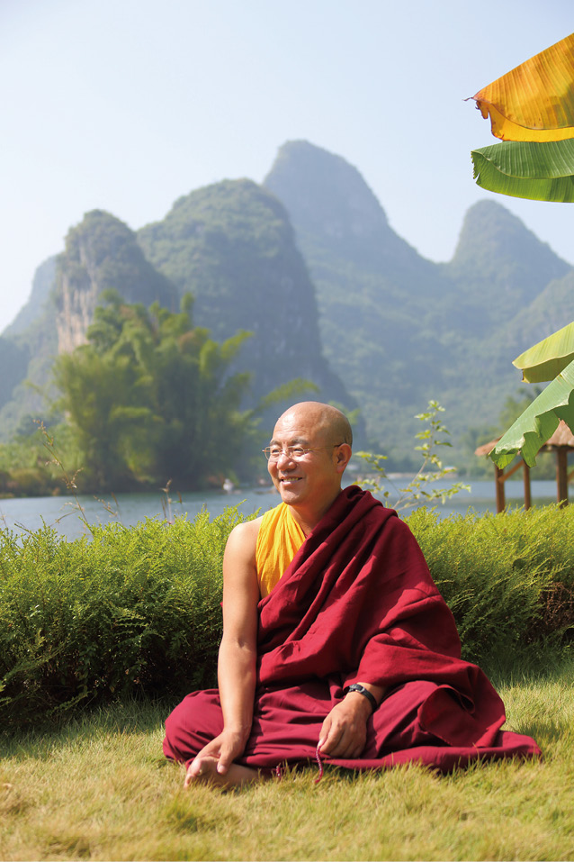
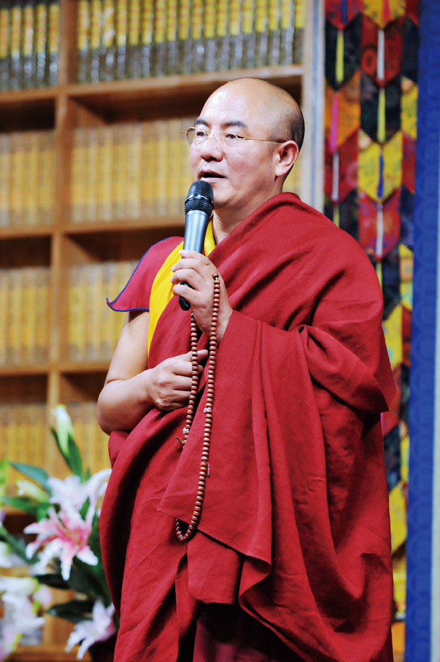
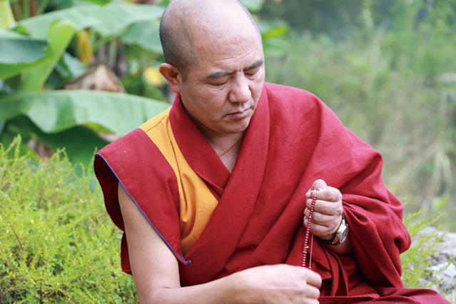

## 重视加行 终身修行

2011年10月28日

在座的四众道友和网络上UC讲堂的道友，今天晚上主要针对学会做一些开示，因此特意在UC讲堂跟大家见面。

## 如何承诺，即如何兑现

从这一期新班开始，学会在学习和管理上都有所调整。如果你不愿被管理另当别论，如果愿意，希望好好学习我们的规定，并身体力行地行持。

这6年间，我给大家写过几封信。我以前是怎样承诺的，现在就会怎样兑现——我一直朝着这个方向在努力。如果实际操作确实有困难，我会及时和大家解释。几年来，学会大的原则基本上没有变，这一点你们心里应该有数。

一般来讲，做不到的，我不会承诺；能做到的，我也要经过深思熟虑，才会落在文字上，公布给大家。

学院的法师和道友比较熟悉我的性格。已经定下的课程内容，只要不遇到特殊情况，我都是不会改变的，一直以来都是如此。外面的道友对佛法、对我们，可能不太了解，所以经常变来变去。虽说人都是不断变化的，但你们既然加入了我们的团队，就应该接受我们的管理。对我们来说，远程管理需要投入的人力、财力、物力等更大，不是那么容易的。

我们的目的是什么呢？希望以佛法利益大家。除此之外，我个人没有任何目的，我们的发心人员也一样。这么多年来，你们对此应该非常清楚。我以前说了什么话、写了什么信，希望你们对照自己，力求做到，不要怨天尤人。

今天的开示，主要讲以下几个内容。

## 不修加行，修行无法成就

现在，很多人不重视共同外前行，也不修加行，就想随随便便修密法。如果你们不修加行，也能毫不费力地修行成功，我会为你们高兴。但是，这样的人基本没有。

而且，这种做法，与传承上师们的规矩和行为也不相符。前辈的许多祖师大德们，修了多少遍加行？我们不敢说修15遍、21遍或是25遍加行——末法时代的人不具备这样的精力和时间，但对一个真正想修密法的人来说，至少保质保量地修一遍五加行，我想这个要求不算特别过分。

两三年前，我开始传讲《大圆满前行引导文》。截至现在，大家基本完成了共同前行的学修。按照我们的规定，从11月起，以学会为主，不管是网络小组还是地方小组的道友，都要按《开显解脱道》或宁提派的传承，共修一遍五加行。因此，你们需要在100天内完成皈依的修法，最多延长到150天。如果修不完，就赶不上后面的进度。

如果你们以前按照《开显解脱道》修过加行，我也不排斥，但我希望你们以前修的数量，不要算在这次共修的修量之内。虽然时间很紧，但我会给大家提供学习的资料和其他助缘。

有些人马马虎虎修过一两遍加行，现在就开始偷懒。没有必要这样。希望你们修加行的速度不要太快。听说学院个别人，修曼茶的速度特别快。我对此非常怀疑：偈颂的每一个字念了没有？观想到位了没有？

有些人，不要说念一个偈颂，甚至念一句偈颂的时间都没到，就计一次数；还有些人，只在基盘上不停地撒米，这又不是推磨！连基本的动作都没有，内心的观想就更不用说了。

这样的人，只是把表面动作完成了，就自以为修完了。这其实不叫修完，只是“耍完”了而已。真正的修曼茶，应该是念一个偈颂，供一遍曼茶。

同样，你们修皈依的时候，也要圆满地念诵10万遍皈依偈。虽然每个人的根基不同，不一定所有人都达到标准，但偏差也不能太大。

这件事情，我今天先在口头上通知大家。相关人员应该都到场了吧？如果没有听到，过后可以看文字的通知。

修加行一定要下功夫。否则，每天庸庸碌碌、迷迷糊糊，不可能完成。我们不会一直等你，等很多年。这次大家一起共修加行，本来花的时间就比较长，如果还不能在规定的时间完成，那我只能说：希望你最后不要后悔。你自己不努力，我说再多也没有用。这是我今天说的第一件事。

## 终身学员，嘉奖真正的闻思者

关于终身学员的事，我考虑了很长时间。有些道友，我们在他身上花了大量的人力、物力，包括给予窍诀和珍贵的法宝，但他却并不珍惜，今天学，明天不学——性格不稳重。这种现象，现在比较普遍。学修密法是有条件的，这样敷衍肯定不行。

在将近一年的时间里，我和有关法师、负责人以及审批组，开了无数次会。经过观察和了解，最后就终身学员的事宜，制定了一系列的规定，并给大家发了通知。

关于终身学员的条件，我们专门发了一个文件。审批组是根据我们的规定和要求，一个一个审核通过的。

就具体情况而言，各个地方的差别很大。有些城市报上来的申请，基本上都通过了。因为这些学员非常稳重，几年来，从修量到考试成绩，各方面的表现都一直很好。有些城市的学修管理，一直拖拖拉拉，除了获得加持品时很激动，在其他方面，不管是修量统计、考试成绩，还是内部管理、与教务处的合作态度等，表现都不好，都很差。对这些城市的人，我不愿批评很多。

哪些地方的人素质不错，哪些地方的人表现很差，我们心里都是知道的。就像胜论外道的“大我”一直在背后看着一样，我对每个城市的情况也一清二楚。

也许你会怨别人对你不公平，但审批组有那么多人，不可能每个人都和你过不去。平时不造善业，最后肯定不会万事顺意，因果决定是不欺的。

条件不够的人，希望不要伤心，如果你真的想成为终身学员，只要不出现无常，以后一定会有机会。从报名到现在，你每次考试的成绩、共修的出勤率以及平时的发心，各项考核成绩如果都达标，我想，获得终身学员的资格应该不成问题。

如果你都做到了，却没有通过审核，希望你把理由汇集起来，发给主管法师，由审批组复审。一定要有书面的依据，不能口头申诉。只要你提供的依据和我们的存档一致，下一年审批一定会考虑你。

当然，给大家发终身学员证，不是要你们终身跟随我，不是这样的目的。作为一个管理者，我只是希望给真正闻思修的人，提供一些特殊的待遇。世间也是如此，会用各种方法鼓励和嘉奖好的职员。

终身学员的待遇包括证书、密法的法本等。有些终身学员没有得过灌顶，可以把密法法本供在佛堂上。终身学员离开世间后，包括我在内，学会的每位道友都为他们念108遍观音心咒。也许你认为不公平，应该给每一个离世的人念。这不太现实，因为有些人心中疑惑重重，不一定有信心。

近年来，不管闻思还是修行，有部分道友都表现得非常出色。为了奖励这样的道友，我们定了制度，评选了终身学员。结果出来后，有些人心里也许不舒服。人都是这样，得到了就不重视，没有得到则耿耿于怀，自己把自己看得很高。但是，这样的素质，自己像不像一个修行人？

听说在我们这里，因为一个小土房的归属问题，今天有两个人从很远的城市，专程赶到学院协调，还带着20多人的签字。要知道，这仅仅是一间空无所有的土坯房子。按理说，除了学院的人，没有人想要。但是，有些人对这样的无聊小事，就是特别较真，对真正有意义的大事却一点不重视。对闻思修行的态度，如果连负责人都是这样，学员就更不用说了。

这一次，通过对终身学员的评审和其他的一系列考核，我希望尽量精简人员，剔除不好好闻思修的人。我们不需要很多人，不需要那些表面上学习佛法、背后欺骗管理人员、不配合管理人员的人。我只希望通过大家的共同努力，能为真正闻思修的人，创造一些顺缘。

按照印藏前辈大德的传记，求法应该有什么样的态度和要求？应该有什么的苦行和付出？现在真的是末法时代，什么都是颠倒的。传法者、管理者提供了一切方便，还恳求你们听法、报数……

前一段时间，我和管理人员说了：你们实实在在地观察一下，如果哪个地方不合格、不合作，可以全部取消。也许有人想：这可是众生的善根啊，怎么能说取消就取消呢？但我们也没办法，我们的能力和条件有限，不能毫无意义地浪费。

学会有什么要求，如果你想重视，就一定会重视。这对你的学习、对我们的管理，都有利。如果你不重视，我们也不可能一直求你。而且最终受害的，不是我们，而是你自己。

我们会尽量做到，以前承诺了什么，就兑现什么。但如果我现在许诺，未来却不能兑现，那我肯定有过失。对此，你也许根本就无所谓，也许觉得不公平、不合理。如果是后者，那请你选择另一个你认为公平、合理的团体。社会上经常说，要公开、公平、公正，所以你可以自由选择。

如果没有出现无常，以终身学员为主的学会管理和学习，都不会变。

有些道友抱怨，说我总是讲无常。其实，我并不知道自己什么时候会死，只不过心里经常想：“还能不能再活10年、20年？”这样的血肉之躯，还能住世多长时间，谁也不知道。我们每个人的身体，都和水泡一样，不可能驻留很久。

我并不是发现自己有死亡的征兆，才这么说。实际上，我现在的身体很健康。但是，我觉得有必要提醒大家：作为一个大乘修行人，应该经常观想无常。

只要我没有出现无常，大家的闻思修行都会照常进行。这一点，我以前书面传达过，你们也不要想得太多。

只不过，有时候需要给大家搞一些活动。如果过了很长时间，我都没有任何动静，你们会不会都“睡着了”？所以，为了不让你们睡着，也为了让你们生起欢喜心，我偶尔会给你们抛“一颗糖”。

## 修行好的人，一定会发心

今年年底，学会将给加行组、净土组和发心人员颁奖。加行组和净土组的修行奖，是根据学修统计等评定的。得到的人不要傲慢，没有得到的人也不要伤心。

如果有不合理的地方，你们可以书面反映。但多半没有这个必要，因为对于这类奖项，我们通常都是非常认真的。发心人员也有差别，有些很累，有些一般，因此年底的加持品也分两种类别。

说实在的，对我们来说，每一次发奖都非常不容易。教务处投入了很多的资源，十方信众的发心也十分给力，这才有了暂时的因缘和能力，给大家一些鼓励。如果你对奖品无所谓，只当作普通的物品，也没事。但我认为非常珍贵，确实具有特殊的加持力。

在称呼上，大家都被称为修行人，但我们有极少数的修行人，修量却含有虚假的成分。对此，我的原则是：要做到百分之百准确，很困难，只要百分之八九十是合理的，就要坚持做下去。毕竟，要让所有众生都满意，不太可能。

大家既要重视发心，又要重视修行。尤其要通过发心和修行，把大乘佛法的意义，融入自己的相续。

最近，有个别道友问我：“发心和修行发生冲突的时候，怎么办？”说这话的人，只想自利。像前辈高僧大德那样，彻底抛弃红尘，到寂静处修行，是另一种修行方式。而一般来说，相续中具有菩提心的人，只要弘法利生的机缘现前，就一定会去做。修行好的人，一定会发心。

藏地的出家人也有两种情况。有些人在印度求学多年，拥有很高的学位。回到寺院后，却高高在上，什么弘法利生的事也不做，没有将所学的知识回馈给社会。

有些人虽然没有出国，也没在著名的佛学院求学，只在一些普通的寺院闻思修行。但因为相续中生起了真正的菩提心，他的发心却非常殷切，自己一面学习，一面融入社会、帮助他人。

在这次开示之前，有一位世间领导对我说：有些人表面上是出家人，坐在高高的法座上，心安理得地接受别人的恭敬，其实相续中并没有菩提心。有些人虽然没有坐什么法座，但却特别喜欢帮助别人。

当大乘佛法的理念真正融入自心的时候，就不得不发心，无论如何都会找一个发心的机会。人身难得，如果你十几年、二十几年都不发心，天天自己修行，那你这辈子可能就没有利益众生的机会了。

利益众生，不一定要把很多人集中起来，搞很大的场面。只要你想，任何时候都有帮助众生的机会。

有些人发了一两年的心，累了，说：“现在我要休息了。”然后把工作推给别人，自己像得到了佛果一样欢喜。这说明了什么？说明他相续中没有菩提心。

当然，如果以发心为借口，一点不闻思修行，也不合理。我自己发心很多年，虽然修得不好，但觉得发心对修行并没有很大的障碍。因为，一个人不可能一天24小时都在发心。你数一数，自己一天有多少个小时在发心？又有多少个小时可以修行？

其实，很多人闻思修的压力并不是很大，他们只是有时间散乱、没有时间发心而已。散乱时，他不会说“我没空散乱，我要修行”，但在发心的时候，却说“我要修行，没时间发心”。实际上，即使不发心，他的时间还是在散乱中度过的。

## 不违犯法律，不杞人忧天

今年第二届预科班已经开始报名。截止时间为11月5日，12月1日开学。具体时间我记得不是很清楚。

前一段时间，我写了一封《面向未来》的公开信。希望相关人员好好看一下，如果因缘具足，每年会收两个新班，方便大家学习。虽然工作上有一些困难，但我觉得还是可以承受。

大家学习佛法，只要不违背相关政策，就没必要杞人忧天。宪法明确规定，每个人都有信仰的自由。我和很多领导都说过：侵犯公民学佛的自由，是违犯法律的，如果情节特别严重，可以判两年有期徒刑。

佛教是世界著名的四大宗教之一，每个人都可以学。无论是通过网络，还是自学，只要不危害国家和人民的利益，信仰就是自由的。但现在一些执法的人，自己并不懂法律。在一个法治国家，文明执法非常重要。

世间人只要不杀人放火，甚至到酒吧吃摇头丸也可以。如果这些行为都不制裁，而学佛不损害任何人的精神和物质利益，并且有那么多顶尖的哲学家和科学家赞叹景仰，却不允许大家接受，这样的观念是不是有问题？

佛陀的教育，对提升整个社会的精神道德，有很大的帮助。在我们学院，几千上万人经常在一起开法会，地方领导却基本上不用管理。为什么？因为大家信仰佛教，纪律都在我们心中，不用他们天天拿着电棒，管来管去。

学院有这么多人，大家都能和睦相处。这么多年来，从来没发生过什么大的事情。这，就是信仰的力量。

我希望大家的行为如理如法，在不违背国家相关法律和制度的情况下，好好地学习佛法，不用害怕、担忧和伤心。你做坏事一点都不担忧，而学佛，是要把自己变成好人，为什么要担心呢？

原来我有一个朋友，是一位政府官员。他特别害怕宗教——白天不敢和我接触，只在半夜三更见我，但他却不怕贪污。我好心提醒过他几次：“你不用害怕宗教。宗教再怎么样，也不会害你。但是，听说你有些行为不是很好，你要引起注意，不要贪污哦。”他一直不听，后来果然出事了。他不是被宗教害了，而是被贪欲害了。

我们学会的人，只要没有违法违规，正常学习佛法，能有什么危害呢？打开网络，有多少人以清净的方式，做贸易、搞金融以及行持其他有意义的事？我们这样小小的群体，在一起共同学习佛法，有什么不好呢？如果你不认可，正好我也喜欢辩论，我们可以面对面或通过其他方式，进行深入的沟通。

总之，我希望你们了解相关的法律和政策，以轻松愉快的心情学习佛法。如果个别执行人员不理解我们的信仰，我们可以和他们沟通、解释。

## 共修怀业，是一种方便法

法王如意宝这一生，经常奉劝人们：每天念5遍《大自在祈祷文》。最近，学院也在共修《大自在祈祷文》。上等者一天念100遍，中等者念50遍，下等者念10遍。100天以后，下等者也能念满1000遍。如果能念1000遍，我会奖励一面“大自在祈祷文”的旗子。上等者和中等者的奖品，会在旗子的基础上，加上其他奖品，比如中等者加一颗“糖”，上等者再加一块“饼干”，到时视情况而定。外面的道友，可以从11月1日开始念。在100天之内，每天念10遍、50遍、100遍，都可以。

如果我们发愿生生世世利益众生，却光是拍胸口、喊口号，不一定能实现，一定要有一种方便法。共修《大自在祈祷文》，就是这样的方便法。

很多人都在担忧2012年是世界末日。其实，2012年并不会像电影演的那样，出现整个世界坍塌的景象。但整体来看，在末法时代，各种灾难会频频发生，众生心里的恐惧、紧张等痛苦，也会不断加剧。

而依靠《大自在祈祷文》的金刚语，自他的一切违缘都能遣除。

## 辅导员，多在法义上下功夫

10月26日，我们在智悲佛网发布了“智悲讲堂讲考与考勤管理条例（二）”。希望小组辅导员认真听从学院法师的管理和辅导，至少，你们的佛学水准要得到我们的认可。

现在，有些地方组的辅导员相当不错，有些地方组的却怪模怪样，连光盘都不听，就凭嘴巴会说，用自己的分别念胡乱引导。我们发布第一个管理条例时，有些辅导员报了名，后来又销声匿迹了。

不管怎样，如果自己不具足智慧，就多听听别人的辅导。很多辅导员都在听学院法师的辅导。大乘佛法的意义非常深邃，需要大家共同学习和研讨。如果不下功夫，不一定有辅导他人的能力。因此，我希望小组辅导员服从我们的管理，参加法师的辅导。

即使不能每堂课都听，至少也要与我们的法师互相交流，并参加讲考。对你们来说，这是一个难得的机会。未来，智悲讲堂可能还会采取一些其他的管理方式，希望辅导员们引起重视。当然，你要是不重视，我也不可能一个一个地把你们拽过来。不过呢，你要引导别人，自己应该先弄懂基本的佛理。

## 不团结的人，学不了佛

团结和合、闻思修行、清净戒律，是法王在世时强调的三大重要原则。现在有的地方，金刚道友能够和睦相处；而有些地方，则因为这个上师，因为那个上师，出现了很多的是是非非。

不管你依止的是哪个上师，只要是佛教徒，只要愿意学习，我都欢迎。如果你不愿意留下来，我也赞同。学会是一个很小的群体，来去都是自由的。

但是，我们毕竟在资源、管理等各方面，都投入了一定的精力，你既然进来了，就希望你能珍惜。世间人也说：“团结就是力量。”如果没有团体的力量，大家学习的气氛和勇气都不会有。

有些上师希望自己的弟子，到这里好好地闻思修行。也有一部分人，并不是这样的目的，而只是为了利用我们。我对两边都没有什么表示，以一种微笑的态度，静静地看着。如果你是真正来学习的，也可以；如果你不是真正来学习的，也可以。相续中有没有得到佛法的利益，大家慢慢地会发现。

另外，我希望你们反映情况时，一定要实事求是。前两天，我和相关人员开会时也说：“对任何一个问题，都要认认真真地观察，不要只听一面之词。有些人，如果一直在中间挑拨离间，不管他们高兴还是不高兴，他们的学习资格只好撤销。”希望有些地区的学习小组，做好两手准备。

从整体看，人的综合素质相差很大。有些地区的学员，闻思修特别差劲，每天都讲是非，最终得到的利益非常有限。有的地方，无论是管理人员、辅导员，还是下面的道友，都配合得非常好。几年来，一直认认真真地学习，没有什么是非。

当然，小的摩擦，不要说在学习小组，即使在夫妻关系中，也会有。世间的夫妻关系，是两个人在这个世界上，经过反复寻找，反复观察——像观察善知识一样，最后才确定下来的。原以为选择了世界上最好的人，结果两个人一点不投缘——“啊，错了错了！我选错了！”

而小组中的人，比如有10个，每个人的性格、业力都不一样，要大家像极乐世界的众生一样和睦友爱，是不太可能的。只要没有大的冲突和矛盾，就已经不错了。

当然，大的冲突和矛盾，有些城市是没有的，而有些城市却没完没了。比如有些城市的负责人，一问他们的学习，一脸茫然；一说是非，“哇……”所以，我对这边的管理人员说：不要听是非、讲是非；越是讲是非的地方，闻思修行越差。

我们不是来处理你们的是非的。如果你们是一个自觉、认真的团体，虽然我压力很大，但不管光盘还是法本，我都会尽量提供资源。如果连团结和合都做不到，那你们就自己解决法本和光碟的问题。如果解决不了，那你们就吵吧。等吵完以后，明年再说。这是我们的原则。我们没时间做你们的公证人、法官、裁判员。实在对不起，Sorry。

今天，我特意为一些学会、寺院、佛学院和佛教中心等佛教团体祈祷，祈祷大家在团结和合的基础上，好好闻思修行。如果连团结的精神都没有，不可能学好佛法。

释迦牟尼佛在经中也讲，要远离诤斗之地一由旬或百由旬。哪里有争论，就要远离哪里。所以，希望你们不要有任何矛盾。否则，不要说密法，就连基本的法要也无法给你们传授。

总之，我希望各地都有和合的气氛，自觉完成相关的要求。如果实在做不到，也要考虑管理人员的困难，我们之间要相互尊重和共同合作。只有这样，你们的闻思修行才能顺利地进行下去。

## 天降月，当尽量行善

再过半个月，学院将举行极乐法会。我建议外面的人最好不要上来。学院今年特别冷，而极乐法会又在露天举行。往年，有些人千里迢迢而来，却因为天寒、地冻、缺氧，在学院的医院里输了几天液，就回去了。这就是他们赴藏地求法的全部经历。如果你们真的想来，夏天来学院参加法会，情况会好一些。

极乐法会能否直播，现在还不能确定。极乐法会不像金刚萨埵或其他法会，如果要直播，就得去居士林拍摄，发心人员会特别累。再加上冬天经常断电断网，直播确实有一定困难。不过，没有直播也不要紧。

释迦牟尼佛为报答母亲的恩德，曾去天界为母亲讲法，并于9月22日（藏历）回到人间。所以，人们称这个月为天降月。

天降月做任何善法，功德都会成千上万倍地增长。刚才，我遇到一些藏族居士。他们在天降月，有的发愿吃素一个月，有的发愿守八关斋戒，有的发愿闭关。

学院从公历的11月13日起，会举行为期8天的极乐法会。如果你在天降月做不到以上善法，也可以在法会的8天，好好祈祷阿弥陀佛，念30万遍阿弥陀佛心咒。

学院开法会时，我也去过外面的道场。他们也在开法会，而且做得相当不错。不过，虽然法会很殊胜，但对有些人来说，最重要的还是吃。他们说：“这次法会太殊胜了！”我问：“为什么？”“吃得特别好！”我希望大家不但吃得好，而且更要修得好。这是我们的原则。

法会期间，大家最好能念乔美仁波切的《极乐愿文》。如果实在不行，念《阿弥陀佛修法极乐捷径》和《普贤行愿品》也可以，功德也特别大。如果连这些也做不到，各地在藏历9月22日，释迦牟尼佛天降日那天，尽量组织法会。大家共同祈祷阿弥陀佛，为往生西方极乐世界，多积累一些资粮。

今天的时间稍微延长一点。接下来，我还要给大家念《佛子行》、《大自在祈祷文》、《开显解脱道》以及《阿弥陀佛修法极乐捷径》的传承。

（堪布念传承）

网络上有个别人想皈依，学院一些新来的人也想皈依。下面给他们传个皈依戒。凡是皈依的人，心里都要想：从今天开始，为了利益一切众生，我要皈依佛、皈依法、皈依僧。

（堪布传皈依戒）

以前已经皈依过，并且已有法名的，不用重新取名。从来没取过皈依名的，我现在统一取。今天，我提倡大家念《大自在祈祷文》。任何一个人，若能如理如实地念诵这个祈祷文，或将它做红色经旗，都会自在成就怀业。以这个缘起，这次皈依的人，都叫“圆怀”。
