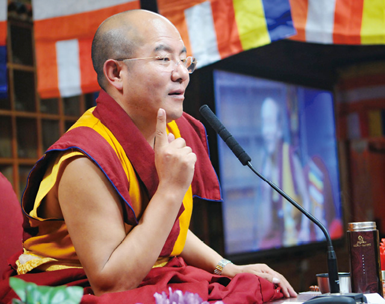
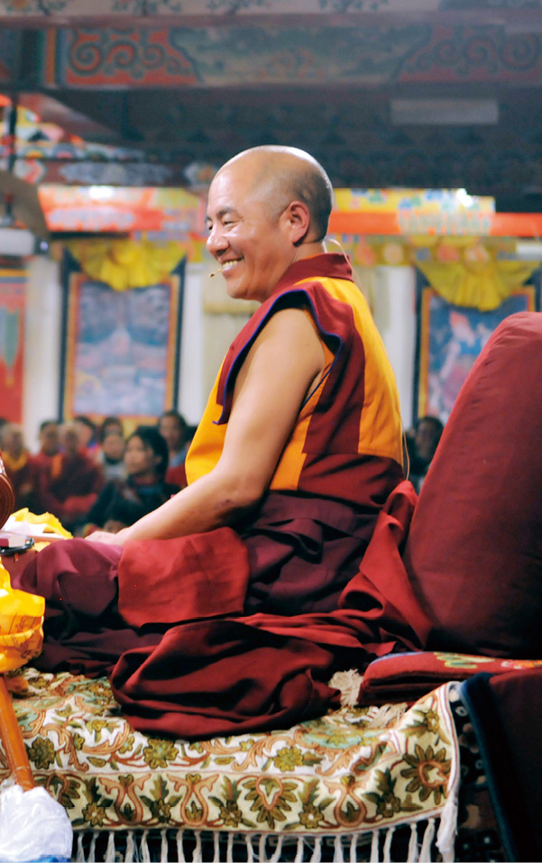
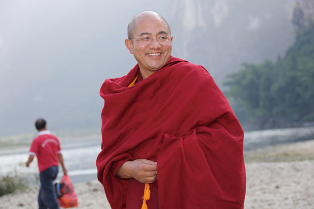

# 鼓足勇气 修学利众

2012年2月12日

今天，我通过网络先跟大家说一些话，再给大家传授《四臂观音修法》的传承，最后做一个简单的答疑。大概需要1个小时。

## 新的理想，新的发心

今天，是2012年的第一次UC开示，我希望每一个佛教徒、每一个修行人，都能有新的理想、新的发心。

因为，我们是佛教徒。佛教徒的所作所为，跟没有任何信仰的人，应该有所不同。在座的每个人，都要详细、冷静地思考：作为佛教徒，自己在新的一年到底应该做些什么。这是我们佛教徒过新年，非常重要的一环。

今天，来自五湖四海的人，依靠高科技的手段，聚集在UC讲堂共同交流佛法。这既是诸佛菩萨的加持，也是善缘众生福德力的直接呈现。

趁此机会，我想把自己经常思考的一些事情，告诉大家。虽然我不敢说，自己心里想的全都是弘扬佛法和利益众生的事，但大多数分别念确实属于此类。长期以来，我对佛法有着无比的信心，唯一的理想和梦想，就是把佛法如意宝的精髓，跟有缘的人分享，让大家不同程度地获益。

在座的各位，虽然在信心、悲心、智慧以及因缘等方面有所差别，但根本而言，都想从无边的轮回获得解脱。既然如此，就不要过分沉溺于虚幻不实、虚无缥缈的色声香味触等种种外境当中。一定要利用短暂的人生，修持最有意义、最有价值的佛法要义。

本来，我今晚准备通过网络视频给大家做开示，但因为最近藏地很多地方下雪，网络信号不太好，只能通过音频，给大家提一些希望。下面，我针对不同身份的道友，做不同方向的开示。

## 山上的道友，要一如既往地闻思

我离开学院，大概已有一个月时间。学院的道友正在放假，再过一个月才会开学。

现在是冬天，学院非常寒冷。但是，有的道友由于具足信心，具备坚忍的耐力和坚强的意志，很能吃苦。不管怎么样，寒冬腊月已经过去，春暖花开的日子，离我们已不太遥远。

我听说，放假期间，很多道友在不同的法师面前听课，学得非常认真。也听说极个别的道友，睡得特别舒服——因为天冷，盖了五六床被子，也算是高原上的另一种温暖吧。不管怎么样，有不同的享受，就有不同的开心。

过一段时间，学院正式开学以后，我希望每个班、每个道友，都能投入正规的闻思修行中去。人，一定要有正确的观念和明确的志向，否则就不能称之为高级物种、万物之灵了。

管理人员应该提前做好教学计划和安排，为道友们新一年的闻思修行，做好充分的准备。不要到了开学，才急急忙忙地安排法师和课程，急急忙忙地公布这样那样的事。

基本上，开学的时候我会回去，也可能晚几天。不管怎么样，大家要一如既往地闻思修行，不要间断。也不要受各种谣言、各种说法的影响。我们都是修行人，不能因为一些简简单单的语言，动摇自己的道心。

我们的修行不会出现不可逾越的障碍。学院有那么多出家人，大家都过着开心、自在、轻松的学修生活。个别人如果依靠自己的分别念，在迷幻、迷乱的显现中，产生一些执著，那只是他个人的事情。希望大家安心地闻思修行，不要受影响。

各个部门的发心人员，也不要因为法师不在、管理人员不在，就开始放松。如果没有人经常提醒，无论生活还是工作，自己都比较松懈，这样非常不好。每个人都应该有一种自觉性，要学会约束自己、控制自己，这一点特别重要。

## 山下的团体，尽快恢复闻思秩序

汉地的一些佛教团体，比如各地的寺院、佛教道场、学习小组等，希望你们也恢复正常的工作和管理。

春节期间，我大多数时间都用于翻译，把《观经》从汉文译成藏文，并且把其他一些藏文经典译成汉文，很少跟外界接触。但我发现，很多道友春节期间比较散乱。

## 用严肃的态度，对待生命每一天

前一段时间，我也跟相关人员沟通过，要求大家恢复正常的闻思修行和管理方面的各项工作与流程。今天在场的，有住持一方的大法师，有佛学团体的负责人，还有学会大大小小的管理人员、组长和理事会成员。希望你们发挥实际的作用，不要做表面的形象工程。只管跟上面有个交代就万事大吉，这叫作敷衍了事，非常不好。

各层管理人员，包括小组长以上，都要尽快恢复闻思修行的正常秩序。大家共同学习的机会，确实来之不易。世间有办学经验的人，都觉得我们这样的共修极其难得。但它还能持续多少年，什么时候出现无常，却很难说。具体我不多讲，有智慧的人知道提前做好准备。

在座的很多人，不要把学习佛法看作不重要的事。不但不关心闻思修行，甚至把学佛只当作茶余饭后的谈资，我觉得特别不应该。大家既然加入了佛教的团体，对上师三宝就应该有一种责任感。而且，在这个团体中，你自己应该是有所受益的。如果有所受益，还半途而废，的确是人生的最大损失。

当然，我们的学习要圆圆满满、善始善终，中间需要承受各方面的压力。人类很多智慧的产生，其实都来自压力。在压力下迸发出的智慧，是特别有价值的思想精髓。

如果什么压力都没有，天天轻轻松松、浑浑噩噩、得过且过，整个人生就像昨天的一场梦，除了造恶业，基本上不做什么善事。这一点，无论你活了三四十岁，还是五六十岁，当你回顾自己的人生时，会有非常明显的感受。

因此，从现在开始，我们应该用严肃负责的态度，对待每一天的生命。不要把学习佛法，当作一种简单的形式。

我看到，个别人虽然表面上在学习，但学得并不深入，或者经常不配合管理人员。也有很多人，只顾自己学习，基本上不关心佛教的未来，这也不合理。

这么多佛教徒，将来要怎么样生存？现在的佛教团体，该怎样面对未来的现实？这些问题，关系到我们每个人的利益，应该引起大家的重视。

## 考察小组的火眼金睛

这次，我派了一些考察组，到各个寺院、各个道场，去了解现在佛教的状况。通过考察，发现了管理上的一些漏洞。希望各地学会的负责人，经常召开大小会议，通过集体的商量，解决管理中存在的问题。

以后，我们不会只在口头上说一说，每过一两年，都会安排一些法师，到藏地和汉地考察，了解实际情况。一旦发现不符合管理要求的行为，比如虚报、谎报等，我们将不再提供免费法本。

我们这边制作法本和光盘的法师，背后付出了很多的血汗。大家学习用的每一本书，都来之不易。

对此，很多人可能不了解。但你们自己可以对比一下，如果在世间参加一个为期7天的正规培训，需要付出什么样的代价，需要面对什么样的困难和压力。

现在，我们给大家提供这么多便利的学习条件，但有些人好像越学越没有动力。这可能是个别人的业力所感。就我本人而言，虽然学得很差，信心也不够，但是这么多年来，一说到学习佛法，从内心、从骨子里，一直有一种勇气。我一生不可动摇、不可改变的习气，就是喜欢闻思修行。

法王如意宝讲过：佛法的基础是清净戒律，佛法的核心是闻思修行，佛法的结果是利益众生。希望我们大家也能这样想。

如果你承认自己是佛教徒，就应该有严格的做人标准，至少要跟那些天天抽烟喝酒、做非法行的不三不四的人，划清界限。在我看来，有些非佛教徒的生活实在太没意义，特别可怜，经常对他们产生怜悯心。当然，我是佛教徒，从我的价值观来看是这样，但其他人不一定，也许觉得我的眼睛有问题。

说实在的，人生这么短暂，我们的生命过了今天，也许明天就结束。当我们真正经受疾病和死亡的时候，将如何面对？包括佛教徒在内的很多人，为了短暂的晚年，也会买养老保险和医疗保险，但面对来世乃至生生世世的长远未来，却竟然没有压力。这就是没有深入学习佛法的结果。

管理方面，我希望各个团体的负责人，重视上下之间的沟通工作，这对自身的发展有很大的利益。

过一段时间，去藏汉各地考察的小组回来以后，我们对大家会有不同程度的奖惩。做得好的，嘉奖和赞叹；做得不好的，有一些惩罚；非常不如法的，则会取缔。我们不需要人多凑数，我们需要的是虔诚的佛教徒。

我说话算话。一般来讲，实在做不到的事情，我不会说出来，一旦说了，就会尽量做到。古人云：“君子一言，驷马难追。”虽然我没有那样坚定的意志，但还是会尽量把自己承诺的事情付诸行动。这一点，凡是参加过学习的人，凡是近年来为大家付出的发心人员，都应该清楚。

但到目前为止，有些管理人员还根本不知道我们的基本精神。比如对《菩提路灯》所讲的内容、我以前给大家写的信、管理上的相关安排等，有些人依然是糊里糊涂的。这些都是不太好的方面。

## 特别的希望

当然，好的方面也非常多。比如，大多数道友基本上都把星期六和星期天用在了学习上。按常理来讲，周末是一个礼拜的休息日，在家人的生活压力又特别重，大家在这种情况下，能坚持五六年不间断地学习，甚至连一堂课都没有落下，非常不容易。好的方面的确很多，但我今晚不着重赞叹。

我特别希望，大家在好的方面相互交流、相互学习、相互借鉴。都是人，都在学习，为什么有些学得那么好，有些却学得那么差？你也在星期天学习，我也在星期天学习，但你的组每次都在聊天、喝茶，学习上马马虎虎，我的组却把所有的时间都用来学习佛法。同样是耗费了半天时间，效果却有天壤之别。所以，希望你们好好地交流、学习。

在这个国际化的社会，要成办世间任何一件事情，都需要互相的合作与学习。只有这样，才能获得发展和进步。我们作为佛教徒，互相学习、取长补短，也是非常有必要的。

我特别希望，每个道友对我们的管理和安排都认真对待。前一段时间，我跟大家说了终身学员的问题。做这件事情，并不是因为我个人需要弟子，而是我们经过观察，发现有些道友在学习时间、考勤、成绩和发心等方面比较突出，因此希望他们在弘扬佛法、利益众生方面，能发挥一些作用。

因此，已经评定的终身学员，以后的态度和表现应该积极一点。如果能够这样，其他道友没有的优惠待遇，你们也会有。

但这次，我们在观察中发现，有些人虽然是终身学员，但在发心等很多方面，却一直躲躲藏藏。这方面以后要注意。当然，针对这种情况，我们将来还会另外作一些安排。

我也特别希望，发心人员的发心时间再长一点，发心的时候再自觉一点、主动一点。不要有人提醒，就稍微动一动；没人提醒，自己在很多方面都不作思考，也没有行动。这样不好。

以上都是我们当前管理方面存在的问题，值得我们去详细地了解、慎重地考虑、认真地解决，所以在这里特别地说一下。

## 生命的力量，当尽于闻思

学会个别道场的人，没有把时间和精力放在学习佛法上，经常请这个上师、那个上师，搞各种各样的活动。后来发生了不愉快的事，又开始各种议论。

一方面，希望你们遇到一些上师的时候，要多做些观察。另一方面，也希望大家对所有的高僧大德或出家人观清净心，没有必要议论很多。我们对一般的众生，甚至旁生，都应该观清净心，更何况是大德、正士、善知识、智者们呢？当然，分寸一定要掌握好。

学会不排斥任何高僧大德，但也有自己的规矩和纪律。希望你们不要利用这个平台，搞各种各样的非法宣传。

据了解，汉地一些佛教中心的成员，虽然进了学会，但并不完全是为了学习佛法，而是有一些其他的目的。你们很聪明，但我们也不傻。这样的手段，不是很好。

还有一些人，经常组织大家放生、搞慈善、唱诵以及做一些其他善事，甚至把闻思修行的时间全部占用了。我原来一而再、再而三地强调，虽然大家也需要做一些佛教的仪式和活动，但最重要的还是闻思修行。

现在有些地方，经常以这样那样的理由，把学习时间改来改去。实际上，对闻思修行的时间，谁都没有权力取消或占用——任何人都没有这个权力。

组长因为个人的琐事，耽误大家的学习，也是不合理的。比如，我今天要去朝圣，所以大家在半个月或一个月当中，要停止学习；我今天要出差，所以闻思的道场暂时关闭，等我回来以后再开。有些地区，确实存在这类不尽如人意的现象。有些人的胆子特别大，让下面的人总没有安全感。

就我个人而言，也有很多的琐事，但我在佛学院讲课这么多年，印象中从来没有以个人的原因，把今天的课推到明天、明天推到后天。除非我病得很严重，或接近涅槃了，否则我生命中最有意义、最值得重视的事情，就是闻思修行佛法。我可以把自己的所有力量，都用在这件事情上。做任何一件事情，如果没有付出，不一定能获得丰硕的成果。

我特别希望我们的发心人员和管理人员，不要随意更改我们给大家规定的学习时间、学习方法、学习内容和管理制度等。全凭自己的分别念来做事，是不太合理的。如果不遵从我们的管理要求，很多地方可能都没办法继续学习。对你们来说，这也许是很大的损失。

我再次提醒大家，闻思修行是最重要的事情，不要以个人的原因影响大家的学习。在保证闻思修行正常进行的情况下，其他的佛事活动如果对大家有利，又是合法的、如法的，也可以去做。

## 真正的佛法，谁都可以学

有极个别的道友，对于学佛，整天都胆战心惊的，听到一点风言风语，心里就产生各种顾虑，出现各种担心。我个人认为，只要我们的学习是合法的、如理如法的，谁都不会干涉。

实际上，任何地方都有信仰的自由，真正的佛法谁都可以学。何况这么多年来，世间各种各样的非法活动，大家都没有参与。

只要我们学的是释迦牟尼佛的法，学的是真正的传统文化，谁都不会干涉。但如果以佛教为借口，搞各种不利于国家、不利于人民、不利于社会的非法行为，则很难继续下去。

所以，在符合国家法律法规、符合学会规章制度的前提和条件下，大家完全可以放心、大胆、自由、开心地学习，各种担心和顾虑都没有必要。但有些人很颠倒，学习佛法胆子很小，贪污受贿却一点不怕。

我经常想，如果去贪污、去做特别不合法的事，对自己是一种损害，对人民也是一种危害。而学习佛法，不管从哪一个层面观察，对国家和社会都只有好处，没有害处。如果不信，我们学习的内容是公开的，网上有全部的法本，任何人都可以去观察、去剖析。

印度佛教、藏传佛教、汉传佛教，都是释迦牟尼佛传下来的，都可以学。就像水，不管是藏地的水，还是汉地的水，或是印度的水，人们都可以喝。如果有人说：这个水不是本地的，不能喝，说明他根本不知道水的力量。

所以，大家应该放松，轻松地学习佛法。

不过，在学习佛法的过程中，有时还是需要跟各个部门协调，遣除一些误会，达到互相理解、相互尊重的目的。

就像法王如意宝传记所讲的那样，做事情需要一些善巧方便。至于善巧方便能否运用得当，要看佛教徒自己的智慧。世间的成功人士，因为有许许多多的善巧方便，最后各方面都很圆满。我们佛教徒也应该动动脑筋，不要天天迷迷糊糊的，处于不安定的状态，以致失去学习佛法的重要机会。

其实，人的意志非常重要。如果有坚定不移的毅力和精神，所做的事情一定会圆满，一定会成功。

## 机会就像流星

前行第7学期的课程，很快就要学完了。在这之后，我们将安排大家学习《梦中佛事》、《红尘中的净土》和《心病还须心药医》这三本书。加行组、净土组和闻思组都要学。当然，这并不影响大家学习前行、净土等课程。这三本书学完以后，前行、净土等课程会继续安排学习。

时间过得很快，大家不要一直等，不然赶不上进度。就像小学本来有6年，如果耽误了一年，就只能学5年的课程，我们给大家安排的这些内容，希望大家这一生，能次第性地全部圆满。

在学习的过程中，不要拖拖拉拉，不要听了一两堂课，就因为这个事、那个事而中断。个别人做一些非法的事情，从不耽误；做合法的事情，却经常耽误。我觉得这是不合理的。

实修方面，我们也会逐步地安排。按照我们的要求，从2月8日开始，大家念修发菩提心的内容，100天之内完成。发菩提心修完以后，要念修金刚萨埵百字明。

按一些上师的传统，最好得了灌顶，再修五加行。但如果没有得过，也不要紧。前面的皈依，按进度已经修完了，大家不会不知道吧？如果连这个都不知道，还学啥子佛法哟？（众笑）

在我们学院，基本上99.9999%的道友，已经圆满完成五十万加行，只有0.0001%的人没有圆满。你们外面的人，要面对生活的压力——大城市里没有一个地方不堵车，但是在压力之下，也同样可以挤出很多的智慧、精进和大悲心。

都是活在这个世界上，都是在大城市里忙碌，为什么有些人修量能完成，闻思能完成，工作也做得圆满，而有些人无论在哪方面，都是拖拖拉拉的？可能是前世的因缘和今生的心力有差别吧。

加行组的道友，要尽快修完发菩提心的数量，时间不等人。机会就像一颗流星，一旦穿过苍穹，照亮整个山川，就不可能再回到从前。就像读书，小学、中学、大学，人生只有一次。同样，我们学习佛法的机会，也只有这一次，希望大家珍惜。我已经次第性地给大家讲了这些法要，你们要抓住机缘，精进学修。

闻思B组以及新班这边，也有一些安排，但我在这里不细说。总之，你们想学佛法，最好一如既往地按照我们的要求去做。

我这边讲完以后，会尽量给大家提供所有的学习资料。你们自己应该珍惜机会，不断地学修。这是我说的第二点。

## 一两岁开始学，一辈子都在修

现在离今年的持明法会，还有10天左右的时间，我听说极个别的道友想去学院。如果你们真想去，我也不阻挡。但现在上去，一是交通不方便，二是天气不太好，三是今年持明法会没有灌顶的安排，四是持明法会的仪轨相当复杂，你们念诵起来有一定的困难。所以我建议大家，最好根据实际情况，在自己的寺院、道场或家里，开一些小型的共修法会。

持明法会一般会开15天。对城市里的人来讲，要拿出15天的时间，是很困难的。我想，如果你们有条件，开一个礼拜的法会，应该比较方便。

在神变月做任何善法，功德都会成千上万倍地增长。在这个特别有加持力的时段，大家最好开7天、3天乃至1天以上的法会。

这次法会，由于网络和信息不通，学院没有同步直播的计划。你们自己念持明法会的仪轨，也有一定的困难。我想了很长时间，最后建议大家举行观音法会，念修《四臂观音修法》仪轨。这个仪轨，在我们藏地家喻户晓，是几百年前一位大德所取的伏藏，《西藏佛教史》中有记载。藏传佛教的许多寺院，包括我们学院在内，多年来一直念这个仪轨。

如果按持明法会的要求，念诵观音九本尊心咒，对你们来说字数比较多，而且很多人也没有得过灌顶。但在7天当中，完成10万遍观音心咒，城市里的人应该能够做到。

其实，持明法会就是修观音九本尊，而观世音菩萨和观音九本尊的本体是一味一体的。所以，我们修四臂观音，和修观音九本尊也没什么差别。

从今年开始，学院开持明法会的时候，大家就在各地主要共修四臂观音。前后的念诵内容，可以跟平时一样。等一会儿，我先给大家念一遍传承，然后用藏地通用的音调诵一遍。以后，你们就用这种音调来念。

具体的修法，我今天晚上不广讲。《金刚萨埵修法》《阿弥陀佛修法》我都讲过，但观音菩萨的修法是否讲过，我记不清了。如果讲过，法本中应该有；如果没有讲过，你们自己看也可以。过一段时间，网上会给大家公布仪轨，《喇荣课诵集》里面也有。

它的观想方法：安住在等持中，一刹那间，将自身观想为四臂观音，身色洁白，如皎洁的明月，一面四臂，一双手合掌在心间，另一双手，左手持莲花，右手持水晶念珠。整个装饰，就像我们经常看到的四臂观音像那样。

观音菩萨的头顶，有怙主阿弥陀佛的像，心间有“嗡玛呢巴美吽舍”的藏文咒轮。念诵观音心咒的时候，观想咒轮发光，照耀整个世界，利益无量无边的众生，供养无量无边的诸佛菩萨。光中出现各种各样的身相，全部都是观世音菩萨的显现；发出的声音，全部观想成是观音菩萨密咒的自然之声；产生的所有分别念，全部都是远离一切戏论的空性妙力。在这样的等持当中，无有散乱而安住。明观六字大明咒，不失音调，清晰地念诵“嗡玛呢巴美吽舍”。

这样念诵的功德非常大。以前，我专门讲过观音菩萨心咒的功德。如果你们有时间，最好看看《大乘庄严宝王经》，汉地《大藏经》里有。

念六字真言的功德，特别特别大。我们藏地的很多老人，都念过1亿遍观音心咒。如果你觉得自己修行不好，或没有其他闻思修行的能力，可以一心一意地念阿弥陀佛，一心一意地念观音心咒。当你离开这个世界的时候，一定能往生极乐世界。

从今年开始，我着重弘扬《大自在祈祷文》。大家如果多念《大自在祈祷文》，修行会顺利，身体会健康，身心都获得自在，各方面的发愿会圆满成就，一切所欲皆如愿以偿，等等，有很多很多的加持和功德。

（堪布传授《四臂观音修法》的传承）

这个仪轨，我小时候就会背。在我很小的时候，母亲不识字，我也不识字，但她却教会我背诵全文。等我识字以后，再看仪轨的原文，发现我的发音不够准确，与原文有一些出入。但不管怎么样，我觉得家庭教育还是很重要。我最初学这个法门时，只有一两岁，然后一辈子都在念修。虽然不敢说修得很好，但一辈子都在这样的信念中度过。

你们开法会的时候，前面先念皈依和发心的偈颂，用平时修金刚萨埵或其他法门的皈依和发心偈就可以。正式念诵观音修法仪轨时，用这样的音调：下面，我演示一遍……

（堪布示范《四臂观音修法》仪轨的音调）

## 勇敢一点，扛住压力

这样的共同学习和交流，对我个人来讲，非常有必要。我也希望汉地的佛教徒，不要经常在网络上看一些没有任何意义的无聊的东西，而应该经常看一看佛法的教理，相互传递一下对佛教的信念。这，才是对自他都有利益的事。

大家除了好好地闻思修行，还要尽量地利益众生。在新的一年，每个人应至少帮助一个众生。哪怕在一个众生的心相续中，种下一点一滴的善根，我们活在这个世界上，也是非常有意义的。所以，我希望大家在利益众生的时候，能尽力而为。

另外，自己的修行也不能耽误。前一段时间，我遇到了一些马上要离开人世的年轻人和中年人。在临终的那一刻，他们看起来有很大的后悔心。为什么呢？因为遇到了这么好的佛法，但却从来没有思维过它的意义，也没有好好地修持。现在后悔莫及，但已经没有办法弥补。所以，我们还是需要修行。人身真的很难得！

不过，道理上虽然很明白，但我自己却修得特别差。有时候身体不好，对什么都没有兴趣，连每天的课诵都很难完成。

对我来讲，除了身体不好以外，没有更多的违缘。但对你们而言，面对的压力确实很多。无论是家庭的压力、社会的压力，还是工作的压力、生活的压力，都非常沉重。

但是，大家一定要鼓足勇气，把佛教的闻思修行和利益众生，放在生命最重要的位置。这样的话，你一定会在实际行动中，做出一些成果来。

## 从现在开始，皈依三宝

听说个别人还没有皈依，下面我给大家做一个皈依。

你们在心里观想：从现在开始，我要皈依释迦牟尼佛，皈依释迦牟尼佛传讲的佛法，皈依释迦牟尼佛的追随者和传承者，也就是僧众。这三者，是我们公认的三宝。从现在开始，我们一定要皈依三宝。而且，我们皈依三宝的目的，不是为自己的利益，而是为了度化一切众生。

（堪布传授皈依戒）

今天，我就讲这么多，非常感谢大家。感谢的原因是什么呢？一切万法，胜义中都是空性的，世俗中都是如梦如幻的。懂得这个密意没有？

下面，我看看现场的气氛，做一个简单的答疑。

现场互动

⊙ 问：我目前在德国工作和学习。非常感恩上师三宝，在这么遥远的地方，还能有这样的机会，系统地闻思佛法。我们欧洲组的加行组，已经修到了发心，入行论组学到了《智慧品》。

我所在的地方，佛教基础很差，基本上没什么人学佛。为了让佛法在这里得到弘扬，我也做了一些努力。但我发现，自己的修行和生活，会有一些矛盾。请问，应该怎样处理？

堪布：这位道友身在海外，却通过网络跟我们交流。大家在开放的条件下，利用各种因缘，得到学佛的机缘，很好。

很多人在生活和修行上，都面临一些矛盾。不仅是你，包括国内的很多道友，生活与修行也经常发生冲突，家人的三观和自己的信念也时常出现碰撞。这个时候，我们需要一种善巧方便来面对。我觉得，为了学习佛法，我们需要尽量随顺家人，随顺亲戚，随顺朋友。懂得随顺很重要。

我以前在课堂上讲，佛教徒不能过于注重打扮，生活应该清净一点，纯朴一点。但我后来又想，佛教徒其实也需要打扮，需要行持一些世间的行为。不然，学了佛法以后，马上变得特别邋遢、难看，每天都穿同一件衣服，也不梳头、不打扮，尤其是年轻一代这样做，会让很多人看不惯，会给世人留下不好的印象。他们会认为，学佛让人变得邋遢、落伍，最后谁都不敢学了。所以，我原来说的那段话，应该是专门针对山里的修行人而讲的。

因此，只要不过分地跟世人同流合污，当修行和生活发生冲突时，我们要尽量考虑长远一点。为了把自己的学佛之路坚持下去，应该去尝试各种各样的方法。

无论是这位道友，还是各个地方的其他道友，我都特别希望你们把学习佛法和实际生活结合起来，适当地随顺众生、随顺家人、随顺领导，等等。

⊙ 问：我们在国外修完加行，应该怎样学修密法？

堪布：国外修密法的人特别多。1993年，法王如意宝就在国外传过《文殊大圆满》《杰珍大圆满》等很多密法。当时传法和灌顶的录像都有，但是通过录像能不能得到灌顶，不好说。我们以前在法王面前，都得过这些灌顶和传承。

学修密法，一方面要依止具有法相的善知识，另一方面，国内的一些密法法本，比如《大圆满心性休息大车疏》等，要经常看。这样的话，学修会圆满的。

⊙ 问：我们是英国学会的学员，今天刚好在一起学习《入行论》，大家都很想念您。

在弘法的过程中，我们很想把其他道场的道友引入我们这里学习，而其他道场的道友又想让我们去他们那里学习。这种情况下，我们该怎样面对呢？

堪布：从佛教的本体上讲，大家都可以享用佛法。而且，佛教团体之间互相交流和学习，也是可以的。当前的佛教团体，既需要合作，也需要有各自的特色。

但是，今天这座寺院的人全部到另一座寺院去学习，那座寺院的人又跑到其他寺院去学习，这种方式在汉传和藏传佛教的历史上，可能都是没有的。

作为一个佛教徒，不管你在哪个道场学习，都没有什么大的问题。你今天在这个道场学也可以，明天到那个道场学习也可以。但是，这种学习方式的效果如何，可能还需要观察。

前一段时间，汉地个别道场的道友，互相之间也在拉人，为各自的上师搞一些宣传。我觉得这样不是很好。我一再地强调，学会的道场不要诽谤任何高僧大德，也不要专门跑到别的地方去，把其他上师的弟子拉进来。

你们那边的情况，我不是特别清楚。自己不了解情况，还告诉你们怎么做，不是负责任的态度。所以，我希望你们相关的负责人，遇到问题要以智慧观察，认真分析利弊。大家先共同商量，然后再做决定。不能以一两个人的主观想法为准，然后所有的人都跟着他们转。这样做的后果，对大家不一定有利。

我们对大家的管理，都有一定的灵活性。效果好的，就继续延用；效果不好，再出台一些硬性规定。你们也可以这样，大家先共同商量，然后根据效果再做调整。

我今天说这个问题，不仅仅是针对你们地区，也针对汉地的很多道场。对所有的上师，都要观清净心，坚决不说过失，这是我们的原则。但是，我也不赞同任何人利用我们的平台搞宣传，尤其搞一些非法的活动。

当然，如果对众生有利益，我们也可以跟所有的佛教团体，甚至跟其他的宗教团体，进行某种程度的交流与合作，共同成办有意义的事情。

⊙ 问：在学修的过程中，应该如何平衡自他二利？

堪布：佛教虽然强调自我解脱，暂时会讲到自利，但最终都会归结为利他。利他是大乘佛教的心髓。小乘法以自利为主，大乘法以利他为主，归根结底，大小乘的区别就在于：修解脱法是为了自利，还是利他。因此，在座的各位，不管怎样都应发利他的心。

不过，利他确实很难。有时候，我们也想修自他交换，希望所有众生的痛苦都成熟在自己身上，但实际上，不要说所有众生的痛苦，仅仅是自己的病苦，我们就已经很难承受了。

前一段时间，我身体不好，别人给我输液治疗。我当时有一些痛苦的感受，心里在想：大乘佛教的精神的确很伟大，自己也天天在念发心仪轨，但真正要做到代受一切众生的痛苦，确实还有一定的距离。

在这个世界上，大乘佛法的思想是无与伦比的。所以，不管路途多么遥远，我们的信心都永远不要退转。

⊙ 问：您经常教导我们，要随顺众生。但很多时候，随顺众生就是随顺他们的恶业。比如，我爸爸硬要我吃肉，我应该怎么办？

堪布：随顺也要根据情况。如果是造大的恶业，那确实不能随顺他们。比如别人让你杀生，你肯定不能随顺。

如果不违犯大的戒律，同时，如果不做随顺，会对我们学佛造成障碍，那为了自己能长期学习，暂时随顺他人，做一些没有太大罪业的事情，过患可能不是很大。

⊙ 问：解脱需要依靠对上师和佛菩萨的信心，与解脱依赖于自己，如何圆融？

堪布：解脱主要依靠自己，同时也需要诸佛菩萨的加持。

比如学修净土法门，如果没有阿弥陀佛的加持和发愿力，我们是不可能往生的。但是，光有阿弥陀佛的发愿力，自己一点信心都没有，也不愿意发菩提心，同样不能往生。所以，诸佛菩萨的加持是一种缘，而自己努力修行，才是根本的因。

佛陀在不同场合说的金刚语，我们应该用智慧进行观察，不能断章取义。否则，就无法彻底了解佛法的本意。所以，佛法一定要长期学习。通过长期学习，潜移默化，佛教的很多内涵和密意都会明白。像有些人那样，看了一两本书，就开始随便评价，是极其不合理的。

我在任何场合，都要求大家长期学习。如果没有长期学习，你成天待在大城市里，世俗分别念很快就把你微弱的善心压伏了。所以，我特别希望大家经常“充电”——一定要不断地闻思，才能知道这些金刚语的真正奥义。

UC讲堂还有很多人申请排麦，但是网络信号不太好，声音听不清。也因为时间关系，下次再跟大家一起交流。今天的网络开示算是圆满了。
