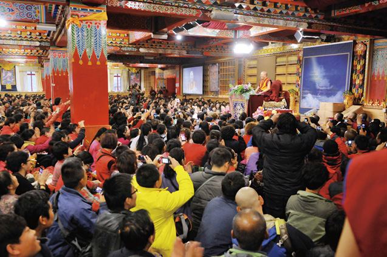
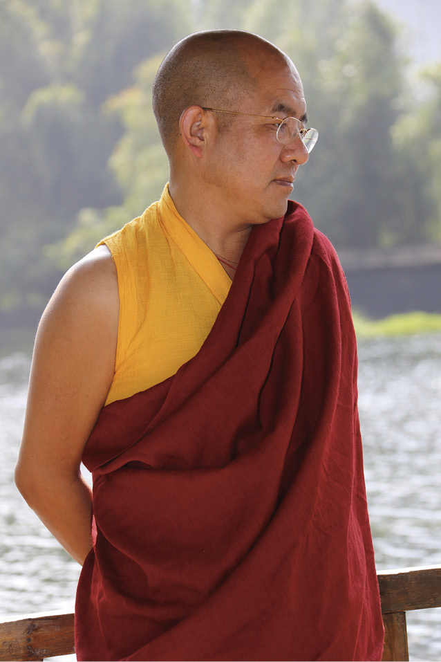
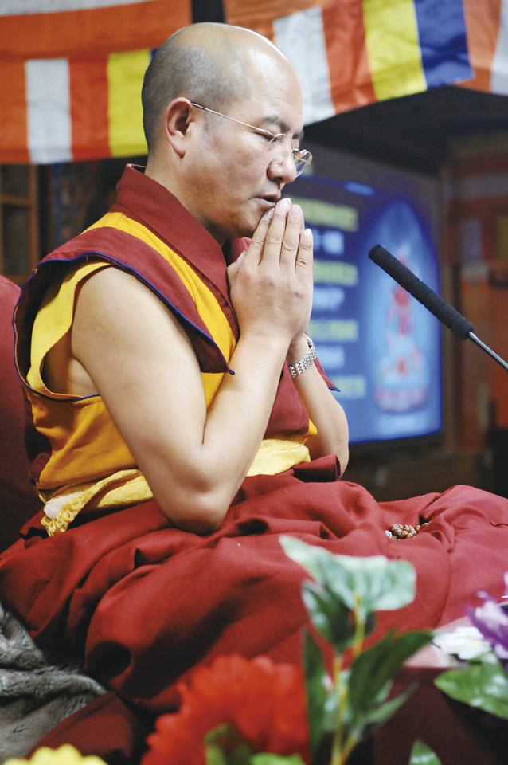

# 一息尚存 不忘众生

——2012年第二届预科班开学典礼

2012年12月1日

今天是12月1日，是我们2012年第二届预科新班的开学典礼。非常感谢大家抽出时间，参加我们的网络聚会。原本打算以视频的方式，在法音频道给大家做开示，但因为色达地区网络中断，只能改用音频。今天除了现场开示，我还会传授皈依戒，并念诵几个传承。

## 既来之 则安之

在座的大多数人，今年都刚刚加入学会，在正规、系统地学习我们的相关课程。我希望新班的每一位道友，都能通过学习，明白佛法的甚深含义。这是我个人的一点想法和期望。

学会创建这么长时间，加入的每一个人，可以说都有不同程度的收获和提升。从简历上看，在座诸位的文化水平和综合素质都非常不错。我相信，你们每个人都是经过深思熟虑以后，才选择了学会这个团体的。既然你们的加入，是有原因、有目的、有思想、有打算的，就应该更进一步，努力适应我们的管理制度和学修课程。

很多人以前学过佛，也有些没学过。但不管怎么样，大家对佛理的了解，对修行的认识，都不一定很深。既然加入了学佛小组，你们的生活方式和生活习惯都要有所改变。如果还像以前一样，没有节制地在世间散乱，就和学佛的初衷不太符合了。

我首先想告诉大家的是，既然已经来到这里，就不要轻易地退失，至少学三年以上。世间人也讲，“既来之，则安之”。我们这里的课程很多，有三年的、五年的、六年的、八年的、十年的。有相当多的佛教徒，在这里有规律、有次第、有系统地认真学习。他们的心态，与刚加入时相比，已经有了非常大的变化，甚至可以说是天壤之别。

我相信，在这里学习几年以后，你们的佛教素养、思想境界等，一定会有所提高。虽然我个人的能力有限，但我所讲的法，我们共同学习的内容，都是前辈高僧大德和诸佛菩萨的教言。这些教言极其珍贵，绝对是有价值的。

总之，大家都是有智慧的人。既然已经报名参加，就不要在一两个月或一两年之后退失，也不要自由散漫、不服从管理，这样没有任何必要。这是我今天讲的第一层意思。

## 人生开学的第一天

第二层意思，大家既然加入了学佛的团体，就一定要珍惜学习的机缘。

大家在世界的任何一个学府上学，都需要上课、考试，服从学校的管理。只有这样，才能完成自己的学业。我相信在座的人，都读过小学、中学或大学，甚至取得了硕士或博士学位。但学习佛法，很多人都是第一次。所以，今天才真正是你们人生开学的第一天。

前几天，我们这里有一个毕业于北京大学的出家人，因为才出家一年多，他自认为是小学一年级的学生。从世间学问的角度，他是北大的毕业生，很了不起。但从佛教的层面而言，也可以说是小学一年级的学生。

所以，不管你在世间有多么了不起，现在开始学佛了，就要遣除从前的一切傲慢心，放下从前的一切嫉妒心，断除从前的一切嗔恨心，放下诸如此类的各种染污、烦恼和不清净的心态，以虔诚、恭敬、欢喜或随喜的心态，接受我们的课程。

我不是自夸，这么多年来，无论是为大家提供学习资料，还是为大家制定管理架构，我个人和发心团队的服务都做得不错。

今天，你们虽然不能通过视频看到现场，但我这边的主要法师和管理人员都全部到场了。前一段时间，为了你们的小组，为了你们的考试，为了你们的管理，大家经过多次的商量和探讨，做了各方面的准备。包括今天，也开了一天的会。也许你们觉得今天的聚会很简单，可实际上，现场有很多人在背后默默地付出。

我这么说，并不是抱怨我们的付出，或索取你们的感激。只希望各位知道，我们不是像普通的气功组织或民间的传销团伙那样，而是按照真正的高等学府的学习方式、正规的佛学院的推广理念，向大家推广佛教慈悲和智慧的真理。大家既然来到了这个平台，就应该一步一步地，适应它的课程设置和管理方式。

从今天开始，我们每周给大家提供的课程，你们每年需要跟大家一起学习的课时，都希望各位按时完成。在此过程中，各个小组都有管理人员，他们在组织学习、统计学修情况等的时候，希望大家能够配合。

有个别的人，从来没有上过真正的佛教课，从来没有受过这样的管理和约束。现在突然被要求这样、被要求那样，可能会质疑：佛教徒怎么还需要管理？从而否定甚至推翻我们的管理架构。与其这样，不如最开始就不要参与。

也有些人，抱着试探的心态，来这里找感觉。只听一两天的课，就期望有明显的感觉，否则就不听了。这种想法有点幼稚。学习世间的任何一门知识，都不可能一蹴而就，更何况是出世间的佛法？

比如，你读小学的课程，光是听一两节课，能不能就小学毕业？不可能。你学习大学的课程，能不能先读两三天找找感觉，如果没有感觉，大学四年就不读了？也不可能。因为蜻蜓点水般的试探，永远不可能把你变成有智慧的人。这样的道理，大家可以用推理了知。

不论学佛，还是学习其他知识，都需要长期坚持。要有耐心和忘我的精神，才能真正有所收获。否则浅尝辄止，只听一两天，只听一两个月，只听一两年，没有很大的意义。

在座的各位，有些从来没有皈依过，有些皈依多年，却从来没有系统性、次第性地学过佛法。所以，新班的辅导员和负责人，最好就学会的学习模式、课程安排等内容，提前做一个培训。学会的管理制度不同于其他团体，希望大家认认真真地学习。

## 路遥知马力，日久见人心

在座的各位，无论是以前从来没有皈依的，还是曾在其他上师面前学过很长时间的，到这里都要接受统一的管理。我们虽然不排斥任何一位上师，但是，如果没有按照学会的课程来学习，没有按照学会的管理来做事，我们也是不允许的。

我们有一个原则：即使是我个人，或是学院公认的大德，也不要在学会中搞宣传。因此，新班的道友不要故意在学会发放资料，宣传自己的根本上师，或是想尽一切办法，为自己的上师拉人。这是我们的规定，希望大家不要把个人的情绪和想法，加在管理人员的身上。

学会是大家闻思修行的平台。除了闻思修行，其他的事情我们都不重视。不要在学会发各种各样的宣传品，更不要利用学会搞经济，给上师们化缘。我个人也好，学院也好，都从来没在学会化缘一分钱。

我们这么多人，日日夜夜地操劳，付出这么多时间和心血，但从来没有想过，依靠你们获得名声、财富和地位等；也从来没有想过，依靠你们获得任何一种经济或政治的非法目的。

退一万步讲，即使我个人需要名声，你们恐怕也无法让我的名声有什么提升。至于其他的，就更不用说了。依靠你们得到点什么，我根本就没有这样的想法。

那我的目的是什么呢？我身边所有发心人员的目的又是什么呢？召集大家共同学习，通过管理监督大家、提醒大家，让大家的学习一步步提升，最终学好佛法知识。这是我们共同的目的，也是我们唯一的目的。

现在，很多佛教徒不懂佛理，这是佛教团体最大的缺失。我们希望能在这方面做一点事情。并不是对你们说好话，诱导你们进来，然后过一段时间，就安排你们做这件事情、做那件事情。

在座各位心里要清楚，不是我们需要你们所学到的知识，而是你们需要学好佛法知识，利益自己。所以，对学会的所有管理，一定要好好配合，不要把学习当成是我们的事情。如果实在不愿学习，也要守规矩，不要搞破坏。对规规矩矩的人，我们即使再辛苦，也会想尽一切办法，提供各种学习方便。

如果你不但不好好学习，还怀着各种各样的目的，做各种各样的事，“路遥知马力，日久见人心”，总有一天会暴露的。现在这个时代，有智慧的人这么多，了解信息的渠道也这么多，任何人的任何行为，都不可能长期隐瞒。

总之，学会没有任何经济目的、政治目的或其他的非法目的。希望大家合理合法、如理如法地对待这个团体。既然已经加入，就不要怀有其他的目的，不要利用学会。当然，我们也不会利用你们为我们做事。

有些人，因为在世间具足很高的地位、富有的身家和庄严的相貌等诸多优势，不愿意服从管理，加入学会跟没有加入一样，行为没有任何约束。这样的人，希望你们不要加入，我们不愿意录取。

我说这些话，你们不一定喜欢听。因为不论是当面也好，背后也罢，如果被赞叹，被歌功颂德，我们心里会非常舒服、非常欢喜。相反，如果有人不但不赞叹自己的功德，反而击中自己的要害、刺入自己的心脏、撕裂自己的伤口，我们便感觉刺痛，甚至自我辩护。

总之，多培养一个人，我们所付出的时间和资源，都会多增加一分压力。今天是开学的第一天，跟大家开门见山地讲清学会的管理和教学原则。

## 快乐和幸福的源泉

2012年第二届预科班刚刚组建，总负责人和各地的辅导员都很辛苦。我在这里，要特别感谢所有的发心人员，特别感谢给大家提供道场、为大家创造顺缘的所有大德、信士和善男善女。

任何一个国家、任何一个民众，都希望过得快快乐乐、幸福美满。现在的很多媒体记者，经常采访人们：你的生活幸福吗？其实，如果内心不安宁，外在的物质再富足，也不一定有幸福感。

而学习佛法，的确能给我们带来幸福。学会有成千上万的人，通过学习佛法，减少了压力、痛苦和烦恼，增长了安宁、快乐和幸福。学习佛法的人，随时都有一种安全感、舒适感和欢喜感。这是世间任何财产和地位，都无法给予我们的。

所以说，大家共同学习佛法，大到对整个世界和国家，小到对家庭和个人，都是非常有必要的。

## 只要一息尚存，就要帮助众生

这里所有的发心人员，为了新班的成立，都付出了很多的精力、财力和时间。而大家的学习也很精进，虽然家庭和工作的事特别多，但却抽出时间，上网来听受我的开示。对此，我非常感恩。

我用什么方式，来表达自己的感恩之心呢？我发愿，从现在开始，哪怕只有一点一滴的力量，只要一息尚存，就要尽量帮助众生。大家如果愿意，也可以和我一道发愿。

今天是“世界艾滋病日”。我们在这个特殊的日子，举行开学典礼。

也许有人会想：“在世界艾滋病日举行开学典礼，是不是不太好？”这其实是很好的。为什么呢？因为国际社会认为，在今天这个日子，世界上有许许多多需要帮助的人。我也希望通过今天的互动，帮他们解决更多的问题。

世界上，每天都有成千上万的人得艾滋病，非常可怜。由于没有防范的意识和措施，少数民族居住的一些偏僻地区，现在艾滋病传播得非常厉害。

今天，我在微博上发了愿，也跟藏传佛教的个别大德一起发了愿：自己虽然做不了什么大事，但从今以后，在我力所能及的范围内，不管看见众生得什么样的病，不管众生得的病有多么严重，都要尽量地利益他们。

在国际上，也有许多宗教人士、慈善人士和众多明星发了这样的心：尽量帮助这些可怜的人。

我们的预科班开学，也在这样一个特殊的日子。希望我们每个人，通过学习《入菩萨行论》，学习《大圆满前行》，学习其他一些教言，都能有一定的收获。

## 人格稳重，持之以恒

在学习的过程中，大家要有长期坚持的耐心和毅力。我现在看到，很多佛教徒最缺少的就是稳重。今天想这样，明天想那样；今天依止这个上师，明天依止那个上师；今天学这个法门，明天学那个法门。像这样辗转变换，人格不稳重，不要说学习佛法甚深的教言，就连成就一分世间的事业，也相当困难。

所以，我今天要郑重地提醒大家，既然你选择了这门课，至少这几年要安定下来，认认真真地学习。这是最最关键的问题。

大家都知道，要在世间的高等学校学习一门课程，需要花很多钱。我去过上海、北京的一些高校。在有些学校，只是学两年的函授课程，也要交二三十万的学费。花这么多的钱，一年只培训半个来月或二十几天。结束之后，得到的只是一个证书。除此之外，什么都没有。但是，为了完成这样的学业，却有成千上万的人去报名。

学会不收大家一分钱，我们却想尽办法，为大家提供一切所需。我并不是因为需要你们，所以在这里打广告，不是这样的。对各位，我有一句肺腑之言要讲：学习佛法，真的能带来世出世间的利益和今生来世的快乐，如果不学，的确有点遗憾。

一般来说，我们的态度越开放，大家越不愿意进来；我们越保密，越不让大家学，大家却越想进来。人都有这样的习气和习惯。

我今天的讲话，没有提前做准备。我想，也不需要做什么准备，因为我们的心是坦坦荡荡的，学会的目的也是显而易见的。

## 日积月累，必有所成

具体而言，你们需要怎么做呢？很轻松，每周只需要学习一两堂课，每月完成五六堂、七八堂课的学习就可以。我们不会安排你们无法承受的课业，所有的课程内容、管理方法和学习方式，都是为大城市的人专门设计的。如果你们足够自律，经过日积月累，渐渐地，一定会有所收获。

因此，你们进来以后，没有必要说是道非。只要认认真真地学习，认认真真地听从管理，最后一定会学到知识。毕业的时候，你们也不用给我们多少钱，学到的知识也不用交给我们。作为一个佛教徒，你所收获的，是今生来世对佛教的教理和修行有所认识、有所了悟，这是你们的成就，也是我们的心愿。我们不会扣下百分之多少，也不需要拿你们的“股份”。

你们在学会所做的一切，都是为了你们自己。所以最好不要调皮，不要经常给负责人和管理人员添麻烦。包括打考勤、报学修，都应该按时完成。

实际上，对懂规矩的人、有水平的人、综合素质较高的人，我们管理起来是非常轻松的。而那些特别散乱的人、贪嗔痴极其严重的人、不懂人规和法规的人，连世间普通学校的纪律也难以忍受，不一定适应我们的学修管理。

大家的心态很重要。千万不要把学习当作生活之余的事情——做也可以，不做也可以，学也可以，不学也可以。

今天，我给管理人员开会时也说了：一般来讲，我们做任何事情，学习也好，管理也好，心态都非常重要。如果连学习的兴趣都没有，连承受管理的能力都没有，那暂时来讲，是不可能学有所成的。对这样的人，我们没有必要付出太多。

我在这里，当着所有学员和管理人员的面，把想说的都说了，也说得比较严，希望你们每个人心中都有点数。以后，相关的管理人员和法师，还要定期或不定期地继续给大家讲解。

希望从今天开始，每个人都能认认真真地学习佛法。现在，很多佛教徒对佛教的认识非常欠缺。我说这样的话，并不是在诽谤。当你们认真学习两三年、五六年以后，再回忆我今天说的这句话，才会明白其中的密意。

## 传授皈依与传承

在座的人，如果以前皈依过三宝，不用重新皈依。如果你想再次皈依，也不是不可以。但今天的皈依，主要是针对没有皈依过的人。

皈依的时候，大家要想：今天，我要皈依佛陀，皈依佛法，皈依十方僧众。从此以后，我就成了真正的佛教徒。

皈依的目的有三种：最上等的皈依，是为了利益一切众生；中等的皈依，是为了自己从轮回中获得解脱；最下等的皈依，是希求自己今生的健康、快乐、圆满。不管你发哪一种心，都可以。

下面，我给大家念诵皈依三宝的偈颂。这是诸佛菩萨传下来的金刚语。

（堪布传授皈依）

虽然我们看不到彼此的面容，但在同一个时间，我有授的心，你们有得的心，仍然可以得到戒体。

皈依的法名，第一个字是“圆”，后面是自己名字里的一个字。比如，你名叫“光明泰”，你如果特别喜欢“光”字，就叫“圆光”；你喜欢“明”的话，就叫“圆明”；你要是喜欢“泰”，那就叫“圆泰”。

今天的法名，一方面有我的一分——我提供了一个“圆”字，你们自己也有一种选择的自由。大家都是“圆”字辈。以前有法名的，不用重新取。没有法名的，就依照这种方式取一个。

皈依以后，应该守什么样的皈依戒呢？大家下来要多看《大圆满前行引导文》的皈依部分，里面专门讲了怎样守皈依戒。我今天在这里不广说。

下面，我给大家念《怀业祈祷文》，又叫《大自在祈祷文》的传承。这个祈祷文的加持力非常大，能令我们的身心获得自在，有许多的功德。

这里还有前行班的道友。他们在一边学习《大圆满前行》，一边修加行。《大圆满前行》的加持和功德非常大，我以前在上师如意宝面前得过很多次。尤其是麦彭仁波切的《开显解脱道》，上师在很多地方都传过，我在上师面前也得过很多次。

以前，我也通过电话，得过国内外很多大德的传承。我今天通过音频念传承，大家也同样可以圆满得到。

下面，我用藏文念诵《开显解脱道》的传承。需要四五分钟，请大家耐心听受。

（堪布念诵传承）

## 发自内心的欢喜

刚才，我给大家做了入班必要以及如何配合管理的开示。最后，我还想简单强调一些事。

在座的大多数人，都是新生，都是刚开始学习佛法、皈依佛门的。你们中的一些人，也愿意长期学习佛法。虽然我待在寒冷的藏地高原——现在的气温是零下二十多度，你们待在繁华的现代城市，但我们都有一个共同的心愿：人身非常难得，寿命极其无常，既然已经获得了人身，就应该利用短暂的人生，认真地学修佛法。

不管什么年龄的人，到一定的时候，都会独自离开世间。我们今天拥有的一切，身体也好，财富也好，临终之时什么都带不走，只有我们的心识，会不断地流转来世。

在可怕的轮回中，唯一对我们有用的是什么呢？佛法。这方面，无论是理论体系，还是个人体悟，我都有很多话可以说。但是今天因为时间关系，暂且不多说。

总而言之，我希望在座的各位能真正认识到，学习佛法，不但是为自己解脱，而且还要度化众生，帮助众生解脱。除此之外，我们的人生也没有其他的事情了。

我个人经常东奔西跑，形象上给别人讲经说法已经接近30年。应该说，我有一种相似的发心，唯一希望大家认清轮回的恐怖，认识人生的真理，了悟解脱的快乐。你们学习佛法的目的，也应该是这样的。

今天在座的各位非常荣幸，因为有了学习佛法的新的开端。对此，我发自内心地欢喜。

## 做勇敢而无私的佛教徒

大概在2005年和2006年，我都给大家讲过，要组织一个学习佛法的小组。当时的目标不高，哪怕只有十几人、二十几人，我也心满意足。因为自己的能力有限，也因为佛法的深奥难懂，所以不能要求全世界的人都学佛，也不能要求一个城市的好几百万人都学佛。实际上，要让很多人接受佛法，并获得真正的利益，基本上不太现实。

随着各方面的因缘成熟，以及各地发心人员的愿力和能力，如今，我们已经拥有一群特别善良、有思想、有文化的佛教徒。

从个人的角度来讲，我对你们的加入非常欢迎。为什么呢？因为你们将从中得到人生的真理。虽然我这个讲者非常普通，但我所学的知识和所讲的佛法，都是藏传佛教极其珍贵、极具价值的真理。我们的共同学习，对大家的生活和修行都会有所帮助。这一点，不仅前面有那么多人的经验和体会可以证明，而且以我讲经说法这么多年的人生经验来看，佛法对众生确实是完全有利的，绝对不会有半点损害。

不过，你们在学佛的过程中，可能会遭遇家人的不理解、工作的不方便和生活的不顺利等困难，甚至自己的身体和精神都会面临很大的压力。俗话说“道高一尺，魔高一丈”，你越来越精进的时候，魔王波旬对你制造的违缘可能会越来越多，你在家庭和工作上需要面对的问题也许会越来越繁杂。

但是，藏传佛教和汉传佛教历代的高僧大德和众多虔诚的佛教徒，都顽强地排除了一切万难，取得了最后的胜利，世出世间都获得了超胜的境界。

你们可以想一想，为什么这里的发心人员和管理人员愿意给大家提供道场？这并不是一件容易的事，需要排除家人的阻碍，破除自己对金钱的吝啬等。作为一个凡夫人，如果没有一定的租金，不要说长期给大家提供道场，哪怕只提供一月、一日，也是不容易的。

但是，为什么有这么多人愿意为我们提供道场、提供许许多多的学习方便？因为他们有爱心，有利他的菩提心。同时也说明，佛教的利他心，对人类乃至对整个世界的群生，都有不可估量的价值和利益。

我们这里有许许多多的有识之士，和非常了不起的善知识。他们给我们提供了丰富的资源和便利的条件。对此，我们每一个人都应该珍惜。

我们给大家提供学习的条件，时间不一定很长，也许只有三五年。你们学习佛法的因缘成熟之时，一定要当机立断，立即发心去做。否则一旦错过，这样的机缘百千万劫也不一定遇得到。

我们这边的发心人员，今天一天都没有休息，个别发心人员甚至一整天都没吃上饭，脸色特别苍白。尽管这样，我们还是愿意做大家的仆人，为大家服务。也希望各位能配合我们的管理。

我们这样做的目的，就是想让你们学到真正的佛法，比如人身难得、寿命无常、轮回痛苦、因果不虚、依止善知识、皈依、发心、忏悔等《大圆满前行》中非常关键的基本要义。此外，还有《入菩萨行论》中讲到的，发菩提心的功德，怎样受菩萨戒，怎样保持正知正念，如何利益众生、行持六度万行等诸如此类的甚深道理。将来从学会毕业之后，如果你们愿意，还会安排你们加入禅修班，学习密宗，或者进一步学习中观、因明、俱舍等五部大论。

学院现在有相当多的年轻人，有些在学五部大论，有些在研究密宗，有些专门为大家发心、利益众生等。他们要么精进闻思，要么利益众生，不会整天说别人的是非长短，不会以自私自利的心，做各种对自他都没有利益的无聊之事。他们的身口意非常清净，所做的事情非常有意义。

人需要有压力，有了压力才有动力，才会对弘法利生作出巨大的贡献。

各个地方的学习小组，需要在学修安排、学习方法等方面，对新学员做一些培训。新学员对闻法轨理还不太懂，以后想要如理如法地听课，一定先要如理如法地接受培训。不要自欺欺人，只是在表面上走走过场，这样对大家都没有意义。

今天，我们2012年第二届预科班的开学典礼，我既是主持人，又是主讲者，给大家简要地讲了一些话。从早上到现在，我今天一直在外面，参加各种各样的会议，所以没有备课。但是没关系，也许没备课我会讲得更好，备了课反而讲得不好。不过以后的课，我还是会提前备好。

不管怎么样，我们今天聚集的目的，就是“学习佛法、利益众生”这几个字。非常感谢大家参与我们今晚的共同探讨和交流，谢谢！
