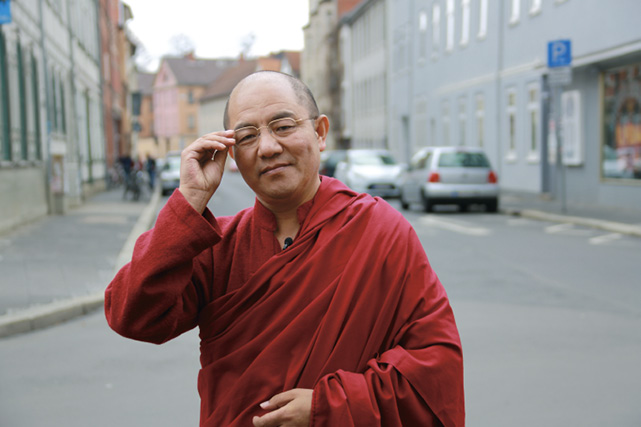
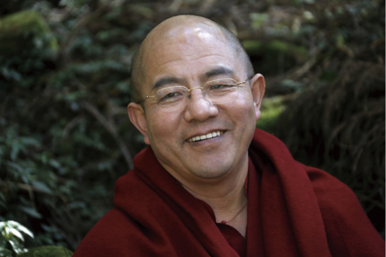
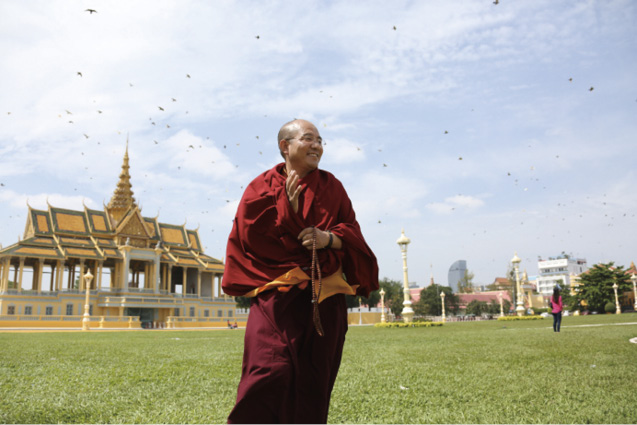

## 佛教管理的科学性

——江西云鹏大酒店开示

2013年11月2日

主持人：

非常感谢大家牺牲周末的时间，来与我们共同探讨佛教的管理思想。

为什么要选择这个主题呢？众所周知，任何企业想做成百年老店并不容易，而佛教已在人类历史上存在了两千多年。那么，佛教为何有如此顽强的生命力？在管理方面有什么科学性呢？恭请索达吉堪布为我们开示——

今天下午跟各位老师、同学们，以及企业家们，一起探讨佛教管理思想科学性的话题。我作为一名出家人，不如成功的企业家们有先进的管理方法，但从佛教的角度有些理论上的了解，在此与大家分享、共同交流。

佛教来到这个世界已经两千五百多年，在这两千多年的时间当中，人类的历史、思想等方方面面有着翻天覆地的变化。在两千多年后的今天，去回顾、探索佛教中的思想时，我仍然感到很惊讶——无论是天文学、地理学，还是管理学，都能从佛法中找到非常惊人的发现。这些佛法智慧完全可以与时俱进，不仅与现代文明的部分理念十分吻合，而且对当今社会具有非常重要的意义。

佛教僧团有非常完整的管理体系，早在两千多年前的僧团管理，就可以算得上是一种组织管理。在历史上，包括在汉地的孔孟思想中，真正的组织管理、组织架构，几乎是看不到的，但在佛教当中可以看到。僧团管理特别相应现代人的理念，《阿含经》中的“六和敬”，在汉传佛教和藏传佛教也经常引用，现在可称为“六合管理”，这种管理理念对现代社会而言有一定的借鉴性。

## 一、两千多年前的管理智慧

1．身和同住。在任何一个组织中，与大家共处时要和合，不要互相起摩擦。有些人时常跟这个人碰撞、跟那个人冲突，似乎“一山不能容二虎”，在任何单位与他人的合作能力都很差，因此无法在任何一个组织安心工作。所以，身体不论处于何种环境，都要随顺他人、和合共住。

2．口和无诤。很多冲突、矛盾都是由语言造成的，所以，在一个团体中，口不能说粗语、恶语，也不能说狡诈或欺骗之语，要说真实语，说话要和蔼、温和。

3．意和同悦。在团体中要有一种欢悦心、慈悲心、善良心，自己的欢喜心要与人共享，不能为了自己开心而让别人痛苦，或者因自己的某种行为，让所有人忧愁、烦恼、伤心，这不合理。要尽量让周围的人获得快乐。我们佛教不仅提倡自己幸福，还要让别人幸福；不仅是今生幸福，还要来世幸福，生生世世幸福。如果我们对别人慈悲、慈爱，那别人对你自然也是同样的态度。

4．戒和同修。不管什么身份的人，都需要一种戒律，没有戒律就没有道德规范。为什么现在很多人对家庭没有安全感？夫妻之间互相不信任？因为没有“戒”的约束。我们藏地很多在家男女都受五戒，受五戒后彼此都非常放心，从来不会怀疑。不像现在城市里很多人，手机都要监视，藏地有些人将手机称为“家庭吵架机器”，手机成了吵架的主因。如果有戒律的约束，这在修行、做人方面是最好的助缘。在现代社会团体中，可以将“戒”理解为需要共同遵守的规矩。

5．见和同解。在一个组织、一个集体中，必须要有共同的见解。比如要学管理的话，大家都对管理学有兴趣；如果是学佛的话，对学佛有共同的爱好。否则，在一个部门中，你是学佛的，我是反对佛教的，在思想上经常互相冲突，这样很痛苦。有些部门同事之间因为没有共同的见解，经常争斗。

不仅是一个组织需要共同见解，家庭也需要有共同的见解，有些家人没有共同的思想，经常为了一点小事吵架，非常痛苦。按照佛教的说法，夫妻是由前世各种好与不好的因缘交织而组建成了一个家庭，佛教的《善生经》中讲到，家庭成员之间需要相互忍让。听说有些人在吵架的时候很想把对方掐死。人生嗔恨心时，觉得“我为什么这么倒霉，碰到这样的人”，其实也并不完全是对方的错，自己也有错误。自己对别人不忍让，那别人对自己也不会忍让，所以在家庭中经常有各种战争，有冷战、有热战。当然，这方面我也没有经验，但是很多人说起来的时候栩栩如生，说者把自己最真实、最隐秘的心态用语言来表达的时候，听者好像也进入了这个世界一样。

6．利和同均。在一个组织架构下的人们，由大家的共同努力获得的利益应该共同分享、共同分配。

两千多年前的人类组织，从身体、语言、心理、见解、行为、收入分配等各方面有这样细致的分析，在当前来讲也有值得借鉴的地方。

佛教中还有羯磨仪式，它象征着民主。在对一件事情进行判断、抉择时，如果意见不统一，或者没有主要的决策者，那就要少数服从多数。很多人认为，民主是从美国等西方国家传过来的，其实也不是，东方文化早就有民主的说法。

总之，佛教这种管理方法，我们可以借鉴其科学性。

## 二、最高级的管理

最好的管理方法，其实是心的管理。印度有位非常有名的佛教论师，叫做寂天菩萨，他曾经讲过：“调伏此一心，一切皆驯服。”也就是说，如果能将心管理好，一切都可以圆满成功；反之，如果自己的心管不好，恐怕什么都管不好。人的身体主要是依靠心来支配，如果心能调伏的话，那一切都能调伏。这是很早以前的一句教言，现在的我们也很需要。

日本的稻盛和夫，不知道你们是否了解他的思想？我看过他的一些书，从世间角度来讲，他管理两家世界500强的企业，很了不起。当时日本的一家航空公司在面临倒闭时请他出山，他接手后不久便跻身世界500强。他的管理方法就是管心。他是一个非常虔诚的佛教徒。他认为，其他人在管理时，主要是通过制度进行约束，通过技术和知识来协助管理，但他觉得，更可行、更关键的是心灵管理。

心灵相当于花园，心灵管理如同园丁照料花园，平时要看看里面有没有杂草，如果有，就要把它拔掉。同样，这颗心真正想让它得利的话，需要经常观心。世间任何企业、学校，只要是一个组织和机构，对自心的教育和对自心的探索都很重要。

制度化有没有必要呢？有必要，但完全依靠制度化或者奖惩措施，除此之外没有任何人心的教育，这样的企业恐怕不会长久。我发现有很多集团和企业，将佛教中《般若心经》《金刚经》等个别典籍的思想，作为自己的企业文化，这样有非常殊胜的加持力。

如果长期注重自心的管理，也许虽然你身在红尘，但是自己的心到一定时候已经调伏得很好；如果自心调伏得很好，即使环境恶劣，也不会有很大的危害。

我以前看过国外发生的一个故事。有一对双胞胎兄弟，在两天之内相继登上报纸。哥哥上报的原因，因为他是参议员，为国家做出了贡献；弟弟是因为犯了杀人罪，被判处无期徒刑。新闻记者采访这两个人时，哥哥说：“我父亲好赌，回家后常常醉酒打人，在这种环境下，我只能靠自己奋斗努力。”

记者采访被关在监狱里的弟弟时，他说：“我父亲好赌，回家后常常醉酒打人，在这样的环境下，难道我不会受影响吗？”

人心想要朝好的方向发展，确实需要好的环境，能在恶劣的环境中自强的人，毕竟是少数。这个案例中，在同样的家庭长大，当参议员的哥哥依靠自己的努力而成功，而弟弟却以此而沦落。可见，如何管理自己的心很重要。

## 三、言教不如身教

管理者自己能够以身作则，这很重要。现在有些人口头上说得非常好听，实际上做的时候比较差，这样的管理效果就不是很好。

按照现在一些观点，有两个我：一个自我，一个真我。真我是利他心，经常为他人着想的我，叫真我；自私自利的丑恶心叫自我。真我和自我发生冲突的时候，还是要尽量把他人放在首位。

现在社会很多不文明、不道德、不善良的行为，就是源于自我，源于自私自利之心。用大乘佛教所讲的菩提心、利他心，来摄持真我，的确非常重要。

当然，这种修行需要长期努力。今天在座的各位里面可能有些佛教徒，佛教徒要有恒常的信心。这次我来江西之后，遇到一些在20年前就见过面的大学教授，那时他们是佛教徒，现在还是不断在学习，这非常好。很多人喜新厌旧，今天遇到一个新文化很开心，马上接受，过段时间马上抛弃，对家人、对事业，为了追求新鲜感，不断在换，我觉得不是很好。这里人的思想很平稳、很踏实，这非常重要。

## 四、佛教徒的修行次第

现在部分佛教徒可能仅仅停留在一个简单的层面，只是皈依了，但很多年没有进步，比较遗憾。所以特别希望佛教徒应该认真修学一些系统的佛理，比如宗喀巴大师讲过的出离心、菩提心、无二慧，这确实是解脱的要点。

### 1．出离心

如果没有生起真正的出离心，无法从三界轮回获得解脱。想生起出离心，要先对三界轮回的本质完全明了，然后看到世间一切万事万物是无常的，是痛苦的，是无我的。在这个时候，虽然不得不随顺世间，该做的事情还是要尽力去做，但内心知道这并不是最究竟的实相，要寻找最究竟的安乐。这时你相续中才算是生起了真实的出离心。

### 2．菩提心

如果光有一个出离心，没有大乘菩提心，所作所为就会只为了自我。按照大乘佛教来讲，利益一切众生的菩提心非常重要。如果没有菩提心，就没有度化众生的动力。你相续中要有无条件利益众生的心，这从世间的角度来讲，是非常纯真、珍贵的利他心；从佛教来讲，没有菩提心，则不成为大乘佛教徒。如果是像一些南传佛教徒那样希求自我解脱，不重视菩提心也可以。而汉地很多人自认为是大乘佛教徒，那你观察一下自相续有没有菩提心。

### 3．无二慧

有了菩提心够不够呢？还不够，最根本的就是要证悟一切万法的真相，具有无我的智慧。世间的智慧，是对事物的表象、分类、作用等各方面的了解；佛教中的智慧，并非停留在浅层，而是观察其本体。比如，我们分析这个杯子的时候，佛教承不承认杯子的现象存在呢？现象肯定是存在的，如果不承认现象，那就已经完全诽谤世间的一切法了，佛教的观念不会如此粗浅。

很多人经常说：你们佛教说“万法皆空”，如果万法皆空，那我看到的这些事物是怎么存在的？其实佛教根本没有说，现相当中眼耳鼻舌身的五根面前所有的法不存在；物理学家也没有说“这个瓶子表面上看起来全是分子、夸克”，而是说表面上看它是一个完整的瓶子，但对它进行剖析、进行分解时，它就变成了一种能量场。我们佛教再进一步观察更细微的法，这个时候，就不得不承认万法皆空。

万法皆空是不是实相呢？确实是实相。你和我，以及我们所居住的任何环境，这些如果用最细微的智慧来剖析的时候，只不过是人的一种错乱的感觉。我们经常说“这是瓶子、这是茶杯”，其实茶杯的概念是我们创造的。那这是不是茶杯呢？是茶杯，但“茶杯”只不过是一个名称。那什么是真正的茶杯呢？在它的上、中、下、内、外，一直去观察，最后会发现，所谓的“茶杯”只是世俗中的假名安立。

同样的道理，每个人认为“我”存在，认为“我”就是自己的身体。如果身体真是“我”的话，那么晚上做梦时身体睡在这里，还有另外一个“我”在别处漂泊？现在通过催眠回忆前世，人在不同维度有不同的自我意识，那到底“我”在哪里？或者对当下的“我”，我的手、我的脚、我的头……全部一一分析的时候，哪个才是我呢？佛教的观点认为：并没有真正的“我”，这只是轮回众生的一种错觉，将组合在一起的假象执为真实存在的“我”。

所以，佛教的这些理论观察方法，对现代人也很重要。你们有些人可能认为，佛教认为我不存在的话，“我今天在这里修学，我今天在这里奋斗”，这是谁在做呢？

现相中假立的我是存在的，就像汽车、茶杯是存在的；实相中、本质中我是不存在的。这方面的分析跟现在的物理学不会有冲突，他们也认为宏观层面的粗法概念存在，但实际上物质、空间、时间都是一种错觉。爱因斯坦也是这样认为的。

在佛教中确实会找到很多以前在学校里、在课本里找不到的深奥的知识。当你真正得到的时候，如人饮水，冷暖自知。

我在九几年时，特意到江西朝拜禅宗、净土宗的祖庭。在汉传佛教当中，江西这片地域跟佛教非常有缘，有很多禅宗、净土宗的高僧大德都驻锡于此。所以我想，这片土地上的人们，也许与佛法有着不解之缘。因此，特别希望在短暂的人生中，你们能或多或少得到一部分佛教的窍诀、甚深的教言，并对人生如梦的道理有所认识。

刚才讲到，若人生是空，那是谁解脱、是谁流转轮回呢？在迷乱的现相中有流转、有轮回、有痛苦，而在实相中虽然不存在，包括我们今天所做的一切全都不存在，但当我们没有证悟这种境界之前还是存在——地狱的痛苦存在，天堂的享乐也存在，当你最后真正通达心的本性时，完全获得解脱，这就是永恒的安乐。

刚才有些教授也在说，现在很多人自认为的快乐并非真正的快乐，只是“快感”，一瞬间就消失了。我们应当追求永恒的快乐，这是人类最美好的前程。

## 结语

今天特别感谢举办此次讲座的因缘创造者——这里的很多教授等，特别感谢大家！希望通过这样的共同交流与学习，让每个人的心灵得到提升，生起利他之心。若能如此，这个世界会变得越来越美好，谢谢！

现场互动

⊙ 问：我在学《入行论》，有些教言讲到修安忍，在管理的时候，世间法和出世间法肯定会有冲突，俗话说“慈不掌兵”，想请问一下堪布，作为大乘修行人，怎样有效管理好团队？

堪布：现在很多人学习佛法之后，认为修行跟世间法有冲突，好像世间法当中没有冲突一样，实际上也不是。在工作中、家庭中，思想的冲突、观念的冲突非常多。在这个时候，大乘佛教中讲的修安忍有没有必要呢？要修。但是修的过程中，要跟管理理念结合起来，用自己的智慧、善巧方便寻找真正的利他方式。

比如，佛教里说老师为了教育好学生，也可以相应地给予惩罚，而惩罚的动机、发心就是要利益他、帮助他，并没有说所有的老师任由学生调皮捣蛋，老师要这样修安忍，没有这么讲。

所以，作为管理者，如果并非为了自己的利益，而是为了整个集体的利益，在有些时候，该说的要说、该做的要做，但不能从根本上伤害别人，因为伤害他人跟佛教教义相违，与世间的道德也相违。如果没有这种行为，在利他心的前提下，该管理的必须要管理。

我的原则是如此，佛教的管理方法也是如此。我们在佛学院，管理规则先知会大家，如果谁不遵守，或者该具足的条件不具足，那么学院的管家可以根据规定开除这个人。那这是不是不够人性化或违背慈悲心呢？并不是。佛陀在《毗奈耶经》中讲过，不符合僧团共住条件的人就可以摈除。同样，在一个企业，首先要让大家知晓企业的管理理念，如果有些人实在不遵守，我们也有权让他离开。所以在利他心的摄持下，该执行的要执行，这也是佛教允许的。

⊙ 问：作为初学者，应该如何闻思、如何修行？修学次第是怎样的？

堪布：佛学院的修行次第分两种：如果你的佛教见解没有任何问题，就先修基本的内加行，然后学习戒律、俱舍、因明、中观、般若；如果对修行还存在很多疑惑、邪见，那你可能不适合马上修行，可以先学习佛教中因明、中观等理论，通过辩论遣除疑惑，进而才能知道如何修行。

所以，修行次第根据人的根基不同，有不同的阶段。

⊙ 问：佛教一直强调“万法皆空”，但佛教又经常说“万法皆空，因果不空”，该怎么理解？

堪布：这个问题我以前也解释过。实际上，佛教的经典中并没有说过“万法皆空，因果不空”，因为因果也是一种法，万法当中也包括了因果。只是后来的个别大德经常讲“万法皆空，因果不空”，这是为了强调因果在世俗谛中的重要性。

万法皆空是说，释迦牟尼佛第二转法轮中讲到，从色法乃至一切智智之间的万法全是空性，根本没有不空的东西。所以从本质上或是从第二转法轮来讲，就是万法皆空，包括因果也是空的。那因果在什么场合不空呢？在一转法轮的场合，也就是说，在世俗的显现中因果不空，万法也不空。

那有些人说“因果不虚”是什么意思呢？在迷乱显现中，善有善报，恶有恶报。我们种下的种子，没有特殊遭遇的话，一定会开花结果。所以，对个别大师的说法要用其他方式解释。

⊙ 问：有没有可能通过因果的关系，让某人做的好事在这一世就尽快显现出好的结果？

堪布：佛教讲的报应，有些是现世报，有些是来世报，有些是再过很长很长时间以后才有报应，除了特殊情况之外很难提前。

比如有些农民刚把种子种下去，就要求没过夜便马上得到丰厚的收成，恐怕这是很难实现的。但如果遇到了特别殊胜的对境，比如三宝，不管是造善还是造恶，即生也有成熟的可能性，这种案例在佛教里相当多。

⊙ 问：我是从事素食经营的。我有一个愿望——把素食推广到全国更多地方，希望您给我一个指引。另外，如何处理好经营企业与自身贪心的问题？

堪布：第一个问题，我特别希望更多人在不同城市提倡素食，众生的生命非常可贵，因此，有善心的人，一定要知道素食的重要性。不要把我们的快乐建立在其它生命的痛苦上，其它众生付出生命的代价，只为我们的舌尖得到一时的快乐，这不合理。

而且，世间很多人的健康确实是依素食而来，不健康是自己吃出来的。因此，从自身的健康来讲，素食也很重要。为什么美国前总统奥巴马、克林顿都吃素，爱因斯坦、爱迪生等科学家也偏爱素食？这种现象值得深思。有些人觉得吃素营养不够，其实营养应该够的。大家经常吃牛肉和猪肉，而猪和牛也吃素，它们吃得那么胖，所以我们吃素是没有问题的。

第二个问题，关于企业发展跟自己的贪心之间的关系，我的建议是，不能让欲望过于膨胀，要根据自己的规划、原则适当追求。在印度的佛教故事当中，佛陀在世时也允许信徒经商，而且经商所获得的利润的安排，在《阿含经》以及其他经典中都有明确说明。所以，你也可以根据自己的情况来调节。

⊙ 问：我是做企业的。我想问一个比较实际的问题：现在中国社会的很多行业都有些潜规则，做企业的如果离开了潜规则，将会对企业带来一些后滞性的影响，阻碍企业的发展。您是怎么看待这个问题的？

堪布：企业有远大的理想和可持续发展的计划很重要。所谓的潜规则，有不同的分析方法，如果是违背社会道德和伦理道德的潜规则，即使你是为了企业，也尽量不要参与。

学习佛法的人可不可以做生意？完全可以。佛陀时代，很多人也是靠农业、牧业、商业等方式生存的。但是，这应该以良心、善心、利他心为前提。

当然，要想完全不造任何恶业，现在的社会做不到，以前也做不到，做任何事情，多多少少都会有些罪业。但有些罪业是轻罪，通过忏悔可以清净。因此，在做企业的过程中，应以智慧进行抉择。

⊙ 问：我是一名藏族学生。我们从小就在外面读书，很少接触到佛教文化，不能按照藏族原本的方式生活，各种传统消失了很多。请问，怎样在物质生活特别丰富、诱惑特别多的城市中，保持自己的传统？

堪布：你提的问题代表了很多孩子的心声。其实现在藏地有很多这样的年轻人，虽然生在信仰佛教的藏族家庭中，但后来随家人搬迁到汉地生活，小学、中学、大学都在汉地读书，提起藏文化、藏传佛教时，很多人一窍不通。

如今很多汉地的知识分子，经常前往西藏、四川、云南、青海等地，他们去的目的，有一部分是喜欢藏地的风光——蓝天、白云、草原等，但也有相当一部分，是被藏传佛教和藏文化的魅力所吸引。从1987年到现在，无数汉族人前往我们佛学院求学，在藏地修行10年、20年，这正是因为藏传佛教有一种不可思议的加持力。

我们藏地的很多学生、老师，因为环境的变迁，不一定了解藏族本有的文化，但你们还是需要学习，这很重要。藏族人口本来就少，大概五六百万，是汉地一个城镇的人数。我经常跟藏族人说：“你们如果没有好好保护自己的藏文化，到一定的时候这些就会消失，这对全世界来说是一大损失。很可惜！”

现在很多藏族学生不会说藏语，也不会写藏文，这样的现象在大城市中非常多。所以，特别希望你们好好学习藏语。同时，大家都有责任关心和学习藏文化，这非常重要。

⊙ 问：在寝室看一些佛教相关的书，同学们都认为这是迷信，请问该怎么办？

堪布：这也是我现在担忧的。我去很多汉地的大学，大学生和老师们对藏传佛教都有一定的了解，反而我们藏族一些大学生对本民族的传统文化和藏传佛教一无所知。有一批人不仅不承认，还认为这是前进道路上的障碍。

迷信的定义是什么？梁启超说，佛教是智信，不是迷信。他认为如果中国有一个国教，最好是佛教，就像唐朝一样。其实元朝和明朝时，佛教基本上也是国教。

关于这个问题，我以前在《佛教科学论》中分析过，希望你跟同学、朋友多讲一下。那么多科学家都相信佛教，难道他们都是迷信吗？所以，有些问题你自己也要学习，然后去跟他们辩论。辩论之后，我相信你一定会赢的。
