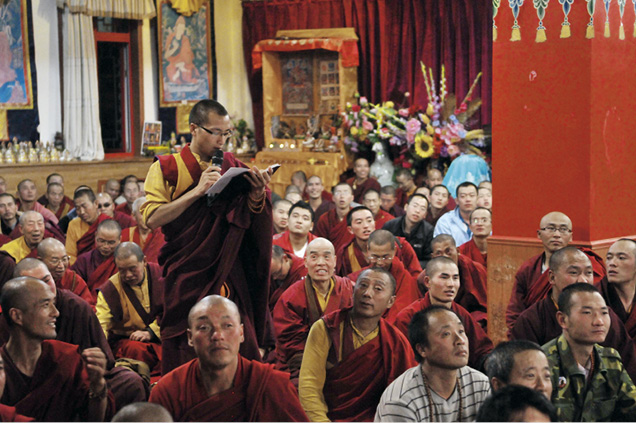
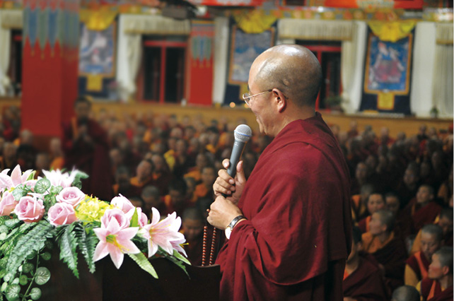

# 净化自相续 前行为基石

2013年5月24日

此次金刚萨埵法会，无论是通过网络还是在经堂现场参与共修，大家相续中的罪业确实清净了很多。希望各位回到城市后，在工作和家庭中，也尽量不要以烦恼造作罪业。当然，说起来很简单，但当你遇到贪嗔痴的对境时，确实相当引诱人，很难控制。

但是，我们要有希求解脱的心，每个人都应想：人身那么难得，而且好不容易遇到了殊胜的大乘佛法，自相续也已清净，在这么好的机缘下，如果没能继续保持，今天好好忏悔，明天又开始不断地造严重的罪业，非常可惜。

当然，由于每个人前世的善缘和业力不同，有些人今生做善事、修行善法很费劲，有些人稍微点一下就可以。

## 不要仅仅做形象上的佛教徒

我在不同场合再三讲过，我们佛教团体的整体素质并不高。不能仅仅做一个形象上的佛教徒。作为一名佛教徒，你在一个月当中听了多少堂课？看了多少本书？希望我们还要不断学习，巩固自己的佛法知识，提升自己的佛教水平，这在当前来讲很重要。

国内外的很多人跟我说，在所有居士学佛的团体中，如今最有系统性的、最有完整次第的就是我们菩提学会。也许只是赞叹之语。不过，放眼整个世界，我们的学习方式也确实有一定的系统性。但菩提学会以后会减少和控制新学员的报名人数，真正参加的人，要从理论上完全明白佛教的基本道理，修行上每个人要尽量圆满五十万加行，而且终生很认真地修行。

我们并非追求人多，人多了以后有些事情很复杂，管理起来也有困难。所以，以前参加了的，如果想退也可以，但我今天清楚地声明一点：学会从制度上会一年比一年更严格，将来想要加入学会可能比较难，但出去很容易，因为我们也没跟任何人签合同。

目的是什么呢？我希望学院传承的人不要只做形象上的佛教徒。虽然烧香拜佛、做善事功德很大，但这在当前来讲并不足够，应该既要有一定的佛学知识，又要有一定的修行。希望佛教徒一定要提升自己的佛教理论和实际修持。

我今天郑重提出：希望大家不要仅仅满足于办个皈依证，不要只做形象上的佛教徒。很多人认为办了皈依证就成了佛教徒，对皈依证、取法名很重视。其实皈依证不是很重要，这些有也可以，没有也可以。记得《毗奈耶经》中说过，皈依不一定要取法名，心里皈依就可以了。最根本的是什么呢？就是要懂得佛教基本的因果观念、前世后世、对经书的恭敬等。我这次发现部分居士的佛教水平很不错，而有些居士连基本的道理都不懂，对经书、转经轮一点都不在乎，在经书上跳来跳去，很可怕——也许是刚刚皈依佛门。

## 好好学习《大圆满前行》

如果想要真正成为一名佛教徒，我给大家推荐一本书——《大圆满前行》。在本书中，关于人身难得、寿命无常、业因果，还有怎样发心、怎样皈依、怎样忏悔、怎样修往生法等，今生来世所有的法都非常完整地讲了。这本书老学员都知道，有的人每年都看一两遍，但很多新来的居士都不知道。刚接触佛法的、刚皈依的人要多看。

初学佛法的人要学《大圆满前行》，有些已经学了七八十年的、从小修行的老和尚，活到100岁左右还在学修《前行》的内容。我学习佛法这么多年，真正要想修行的时候，归根结底就落在《大圆满前行》上。所以，老佛教徒也不能轻视。“《前行》我看过了，我已经有了”，光是有了还不行，虽然你有法本，但法本中的法义，你自相续不一定有，一旦遇到问题的时候，法本就是法本，你就是你，法本里面的内容你无法用上。所以，以前看过的人要再三看；没有看过的、没有学习过的人，要慢慢不断学习。

经常有人跟我说：“你可不可以给我写一个教言？”我最多写个“佛”字，但这也不能称为教言。如果你真的想听我的教言，《大圆满前行》中有甚深的道理，以及我写的书《苦才是人生》，虽说其中的内容浅显易懂，但也是凭我的智慧和能力很认真地写的，这就是教言。希望这些书能让更多有缘者看到。

这次很多人都得了金刚萨埵四级灌顶，确实很好，以后如果五十万加行修完了，有些密宗的包括大圆满的书，你自己学一学、看一看也可以。只得过这次的灌顶，五十万加行没有修可不可以看呢？看是可以看，但一般来讲，传承上师的智慧不一定能融入你的心。现在很多人不修加行就把大圆满正行部分拿来看，看也看不懂。自相续没有净化之前，基础没有打好之前，再怎么看也看不懂。所以，如果想看大圆满的书，最好先好好修加行。

我今天给大家讲的内容都包括在这三句话中：不断发愿；认真、系统地学习；如果实在没有时间，好好学一学《大圆满前行》。这也是我自己多年以来学习的经验。

现场互动

⊙ 问：请问有没有一些空行母的传记？还有门措上师，她很伟大，我也很想看她的传记，这样就可以了解得更多。

堪布：空行母的传记很多，有空行母益西措嘉的传记、曼达拉瓦的传记、玛吉拉准的传记，还有西琼堪卓玛的传记，国外也有一些英文版的空行母传记。

在美国哈佛大学时，我有一次去听一堂课，他们当时正在讲益西措嘉空行母的传记，这是以前一位伏藏大师取出来的伏藏，他们用来给博士生和硕士生上课。其中有些情节，是益西措嘉空行母在莲花生大士面前获得了《空行心滴》的法要。当时那位老师给学生们讲，益西措嘉空行母有一次被世间一些坏人强奸，但这不但没有损坏她的名声，反而变成了助缘，而且她的信心也没有毁坏，没有产生任何嗔恨心。

后来各个国家的学生讨论时说，有一个人在尼泊尔也遭遇到了类似事情，但因此对生活失去了信心，之后对整个世间特别反感。

学生在课堂上针对这件事情提问：为什么一般世人很难以承受的事情，没有变成益西措嘉空行母的违缘？老师回答说：因为益西措嘉空行母修习大乘佛法，而像这么严重的违缘，依靠大乘佛法可以转为道用，不会变成她修行和生活中的障碍。然后他们共同认为，藏传佛教确实很伟大。

这堂课我印象很深刻。表面上看好像是女人的故事，实际上在讲修行人跟世人的生活态度完全不相同，不同之处就是佛法的作用。我们同样在生活，但修行人在他的生活领域有其不共的诀窍。

门措上师有传记，但不是很广，应该有汉文，也有藏文。我想以后肯定会有比较广的传记。

⊙ 问：佛教说：“诸恶莫作，众善奉行，自净其意，是诸佛教。”请问“自净其意”是什么意思？“自净其意”的次第如何？

堪布：“诸恶莫作”是不要造作任何恶业，属于小乘道的内容，小乘道着重强调不能造恶业；“众善奉行”是讲大乘，大乘不但不造恶业，而且还要广行善法，利益众生；“自净其意”，藏文中就是调伏自己的心，怎样调伏呢？就是认识自心的本性，可以对应大乘中的密宗。密乘在不造恶业、行持善法的同时，通过窍诀真正认识自己的心，将烦恼转为道用，也就是“烦恼即菩提”，那时你的心就能得到真正的净化。

这四句实际上已经包含了显宗、密宗所有内容，这就是佛教的要义。

⊙ 问：我想问一下发愿与回向的区别？

堪布：发愿是这件善事还没有做，自己发誓愿将来要做；回向就是将已造善业的功德，赐给其他众生。我们念《普贤行愿品》时，既可以发愿我将来如何利益众生，又可以将已经产生的善根全部回向或布施给众生。所以，一个是过去，一个是未来——发愿是对应未来要做的善根，回向是对应过去已有的善根。当然，回向中也有以三世善根作回向，但一般来讲是指过去的善根。

⊙ 问：谢谢大恩上师，我是来自石家庄的您的弟子。我不是为自己提问题，有一位您的老弟子，他曾在1998年时背着干粮来学院求学，现在年纪大了，腿走不了路，他让我转告上师：法王和您的法他没有荒废，传承没有断。他想请上师为他开示几句。

堪布：请转告他：第一，要经常祈祷法王如意宝；第二，所得到的法一辈子不能放弃，因为法很难得，得到之后放弃的话太可惜了；第三，要精进地修行，人生很无常，何时死亡谁都确定不了，所以，在临死之前不要做后悔的事。
