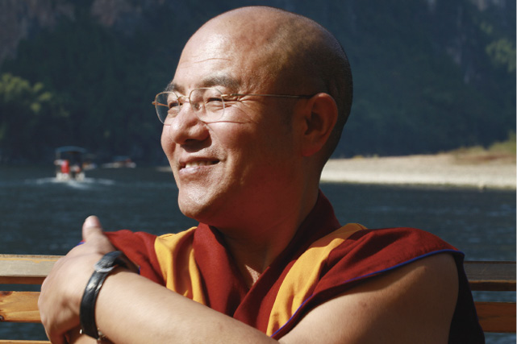
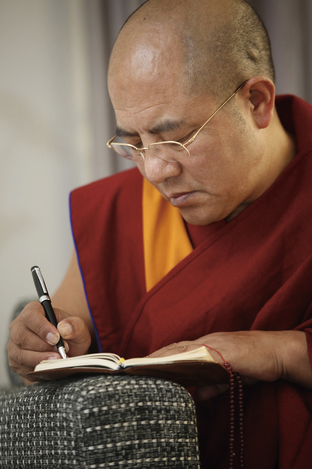
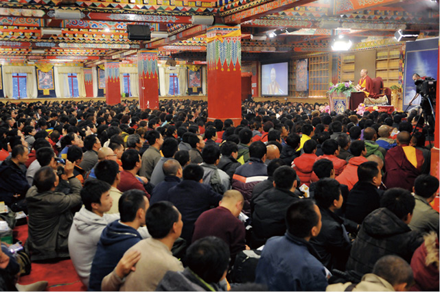
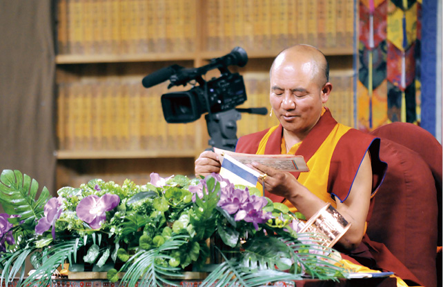

## 培养佛学人才 利益社会众生

2012年9月1日

今天，在UC讲堂跟大家做一次佛法交流。

众所周知，21世纪网络极其发达，每个人都可以畅游网络，追求自己的喜好。就我个人而言，作为一名佛教徒，我很喜欢学习佛教方面的知识，也喜欢跟有缘人交流佛法——通过当面讲课、网络交流、著书立说等方式，跟大家结上善缘。

今天，我除了跟大家交流佛法，还会给大家念《二十一度母赞》《大自在祈祷文》的传承，并为现场道友的佛像、佛珠等做加持和开光，最后再做一个简单的皈依。

## 因佛缘相聚

我们在此共聚一堂，是一种因缘聚合，更是一种佛缘和合。大家不管抱着什么样的目的，到这里来都和佛有缘。佛经教典中说，如果没有这样的因缘，像本师释迦牟尼佛、宝髻佛、阿弥陀佛等名号，是不可能听到的。

无论如何，在今天的讲堂，有一部分人对佛教有虔诚的信心，是名副其实的佛教徒；有一部分对佛教有点好奇，想要探寻一下，佛教到底是什么；还有一部分人，认为佛教所说的也许是谬论，想要找机会驳斥；剩下的一部分，没有什么真实的目的，只是随波逐流来看看。诸如此类，现场的人有各种心态。

但不管怎么样，在座各位都想探寻世界万物的真相，都对积累智慧和寻求真理有一定的爱好和兴趣。

## 十年树木，百年树人

那天，个别佛教徒希望我给大家讲一讲，如何培养佛教人才的问题。其实，大家都知道培养人才有多么不容易。所谓“十年树木，百年树人”，佛教的人才并不是我今天讲一堂课，就能培养出来的。

学习世间任何一门专业，只听一两节课，能不能培养出人才？有一定的困难。佛教比世间任何一门学问，都更深、更广，培养人才的难度就更不必说了。

我相信，在座各位至少有小学以上文凭。否则，依靠网络来听今天的现场直播，可能有一定的困难。

我小的时候，小学是五年制，现在是六年制。也就是说，我们光是读个小学，也需要五六年。再加上初中、高中、大学、研究生、博士、博士后，一路读下来，起码也要10到20年。这是培养一个世间人才所需的时间。而佛教人才的培养，最少也要这么长的时间。按照藏传佛教培养人才的规矩和传统，从佛教的基础知识，到学完密宗的最高教义，至少需要25到30年。

所以说，并非像有些人想的那样，今天听了一节课，自己就成了真正的佛教人才。

## 时代在呼唤

在如今这个时代，佛教人才对整个社会、整个国家，乃至对整个人类的生存和发展，都有着举足轻重的作用。

我是一个佛教徒，如果从我在学校研究佛法算起，到现在已经有30多年时间了。在这30多年里，我不敢说夜不倒单、日夜精进，但也花了大量时间，翻阅了佛教的显宗、密宗，小乘、大乘，藏传、南传和汉传佛教的许多经典和论典。在这个过程中，我感到特别荣幸、特别欢喜。

如今这个时代，纷乱浮躁。东方也好，西方也罢，包括欧美的许多国家，随着科学越来越发达，物质生活越来越丰富，人们的心也变得越来越烦躁，智慧越来越倒退，自杀率也越来越飙升。我说这些，并不是抱怨社会，而是描述一种社会现象。

遍观现在的整个世界，人们都很需要宗教，尤其需要佛教。为什么这么讲？因为佛教提倡彻底的博爱，不只对人类，乃至对一切生命，都有一颗慈悲、包容和开放的心。所以不管什么身份的人，如果懂得一些佛教的道理，自己的身心、生活和工作都会得到巨大的力量。

希望今天在座的知识分子，能重点关注佛教的教育理念，不要满足于表面的佛教仪式。现在很多佛教徒，到寺院里烧烧香、拜拜佛、做做供养、做点简单的佛事，就认为自己成了佛教徒。甚至有些人将皈依证时时刻刻带在身上，就自认为是佛教徒。

当然，这些也算佛教徒的某种象征，可以有这样的行为。但佛教最主要的意义，在于它是一种非常圆融的教育。作为一个佛教徒，无论是出家人还是在家人，都应该长期地学习佛教的教义。用佛教的专用名词来讲，就叫闻思修行。

什么是闻思修行呢？自己先从老师或者上师那里听闻教义，然后再慢慢去思维、研究、观察。而且，所闻思的教义不能停留在口头上，还要用自己的实际行动，去切实地串习和践行。这样的过程，就叫作闻思修行。当今社会的佛教徒，特别需要系统而深入的闻思修行。

我经常在想，东方和西方的社会，比如阿拉伯国家和欧美国家，人们的综合素质有很大的差别——这个不用我评论，你们自己去世界上不同的国家看看，就会知道。有些国家的民众，综合素质非常高，觉悟非常高，民风非常淳朴，会自觉遵守社会的秩序和治安，不需要每次都动用法律或高压政策来管控、压制。

同理，不同背景下成长的佛教徒，综合素质也有很大的差别。藏传佛教一些寺院的出家人，从小就受到大乘佛教的教育，一直在严格的教学制度下成长，所以综合素质稍微高一点。

另外一些地方的佛教徒，综合素质的确有待提高。现在这个时代，在家人看得多、听得多，各种诱惑也特别多，能静下来好好闻思修佛法的佛教徒，不是很多。

因此，我们需要通过不同的途径，经常给大家传递佛陀的教义。就我个人而言，这是自己有生之年不可推卸的责任。

我作为一个佛教徒，活在这个世界上，想凭一己之力改变很多人的命运、改变很多社会乱象，确实无能为力。虽然对社会做不了什么伟大的壮举，但至少，自己懂得一些佛教道理，哪怕身边只有一个人，我也愿意传授。

有些人可能会怀疑，我传授佛法的目的，是不是为了自己得到名声、财富等？有各种想法。其实读书的时候，在潜心研究佛法之前，我对名声都看得很淡——佛教常说，名声是虚假的空谷声。我对财富也一样，从来没有像现在一些人那样，以佛教为借口，做敛财的事。

说实话，出家人的生活非常简单，如果没有做对社会有意义的事情，钱财根本没有办法用上。我经常在想，现在佛教内部有个别行为不如法的人，或者世间一些奸商、贪官，虽然控制了很多的资源、钱财，但却没有对社会做有意义的事情，非常可怕，也非常悲哀。

我个人的想法是，只要因缘具足，自己就会跟藏汉等各民族的佛教爱好者一起，共同交流——交换意见、交流心得，共同学习、共同探讨。并在这个过程当中，好好培养佛教人才。但这不是一天两天、一年两年的事情，需要坚持不懈的长期努力。

## 佛法比警察管用

按照大乘佛教的教义，佛教徒应该担负起利益天下一切众生的责任。为了让天下所有的众生得到幸福和安康，我们可以付出自己的身体，付出自己的生命，乃至付出自己一切的一切。大乘佛教的教育和精神的确是这样的。

对于这一点，有些佛教徒做得不错，有些佛教徒不但做不到，反而利用佛教，扰乱社会秩序，伤害众生生命。尤其杀害众生的行为，是佛教最为呵斥和反对的。因此，作为佛教徒，我们一定要行持善法。

在行持善法的过程中，首先应该懂得自我约束，即所谓的自律。没有自律，行持善法根本无从谈起。佛陀在《增一阿含经》中讲：“诸恶莫作，诸善奉行，自净其意，是诸佛教。”不要做坏事，而要做善事，最终调伏自己的心，这才是佛教真正的教义。

不要经常抱怨社会，不要经常发脾气，不要经常因为一些鸡毛蒜皮的小事，跟家人吵架，跟亲朋好友吵架，搞得鸡犬不宁。如果家庭不安宁，社会就不安宁；社会不安宁，国家就不安宁；国家不安宁，世界就不安宁；世界不安宁，地球上的所有生命，包括人类自己，都会遭到威胁和损害。所以，大家应该从面对自己开始、面对家庭开始，学会运用佛教的智慧和包容。

我看到，很多家庭在学佛之前，丈夫和妻子关系不好，经常发生争斗，每天都吵吵闹闹，家庭成了小小的战场，孩子没有安全感，周围的人也觉得他们过得特别糟糕。

自从他们学了佛、懂得了因缘的道理，情况就有了很大的改善。比如，就算家人跟自己关系冷淡，也不会强求对方对自己好；即使和家人的观点出现分歧，也会互相包容和理解。

因为，佛教讲前世后世、因果轮回，也许在前世，家人是欧洲人，我是东方人，现在一起组建家庭，两个人的生活习惯、兴趣爱好、行为方式等存在差异，是理所当然的事，出现矛盾冲突也在所难免。因此，当对方的所想、所说、所做不符合自己的心意时，不会要求对方必须按自己的想法来。“我有我的思路，他有他的想法”，虽然都是家庭的一分子，但彼此的观念存在差异，应该彼此尊重，相互理解。

所以我想，如果从家庭、从小小的社会群体开始，逐渐推广学佛，比雇佣很多警察来维护社会秩序，效果可能好得多。因为给治安人员提供大量的工资，支出比较多，对社会资源是一种消耗。而佛教讲“自净其意”，只要人们的心得到了调伏，懂得调整心态，对什么事情都想得开，什么时候都快乐，社会的正能量一定会足足的。

## 人不学习，与旁生何异

因此，大家在不同的城市、寺院或佛教的小团体中学习佛法，我觉得很有必要。

当今时代，通过网络平台，利用各种科技手段，全世界的很多知识，我们都可以学习。这样一个开放的环境，这样一个国际化的趋势，谁也控制不了，也不需要控制，越控制越没有意义。

特别希望有更多的佛教徒，学习对自己、对亲朋好友、对社会群体都有意义的相关知识。否则，每天沉迷于网络上各种各样的贪嗔痴中，沉迷在不利于身心健康的各种资讯中，给自他都带来损害。

我总觉得，应该通过网络，学习一些能提升道德水准的思想，比如学习中国传统的儒教和道教，学习西方柏拉图、亚里士多德等人的哲学，学习佛教、基督教等东西方的宗教，等等。这些思想、学说和宗教，对世道人心都非常有帮助，值得我们学习。

可是，现在的很多年轻人喜欢什么呢？喜欢金钱和地位，希求各种各样的社会目标。虽然随着年龄的增长，随着社会和家庭的需要，大家难免要在这方面投入精力，不能一概排斥，但不管怎么样，我认为人一生最重要的是学习知识。如果不学知识，每天除了吃喝玩乐，再没有其他可想、可做的事，那人类就跟旁生没多大差别了。

## 非为惜财，缘惜福

现在大城市里，食物浪费非常严重。那些食物，如果是自己吃喝了，受用了，也无可厚非。但城里一些年轻人，特别喜欢讲排场。请客吃饭，本来花100块钱就够了，但为了面子，可能要花1000块钱。多出的900块钱食物，全部剩在餐桌上，白白地浪费。这样有什么必要？大家扪心自问。

还有很多人，特别喜欢昂贵的名牌。其实，不管你花多少钱买名牌衣服，穿了，对自己的身体也不一定真的好。自己如果只穿普通的衣服，省下买名牌衣服的钱，捐给偏僻地区那些读不起书、看不起病、生活拮据的穷苦人，那该有多好！

一个富裕的人，一件衣服可能花几万，甚至花十几万、几十万。如果能把这些钱，用在非洲国家，可以帮助很多很多的人。大家都清楚，现在那些国家闹饥荒已经闹成什么样了。其实在任何一个地方，都有很多贫穷的人需要帮助。

过多的浪费，是对整个人类资源的破坏。不仅如此，城里那些喜欢穿名牌、讲排场、过度消费的人，消耗的也都是自己的福报。即生浪费的资源如果太多、太过分，来世一定会变成非常贫穷的人。因果的规律就是如此，谁也没有办法推翻。

在西方许多国家，或者其他一些文明的国度，人们都非常注意节约。现在很多餐馆都提供自助餐，能吃多少，就拿多少，这样很好。其实很多城市里的人，包括一些政府官员和商人，还是很节约的，除了基本的吃穿以外，他们也会把多余的资源留给他人。

人生很短，只有几十年。有些人很有福报，独霸很多财富和资源，不仅这一辈子吃不完，下一辈子也吃不完，甚至子子孙孙都吃不完、用不完。这其实非常不合理。我们来到这个地球，是独自一人，最后离开的时候，也只有一个人。你活着坐拥权力，独霸资源，但一不回馈社会，二不支援穷人，等这一期生命结束，等待自己的将是什么呢？也许变成人，也许就变成动物。有时候，人类真的很愚痴！

现在很多人，对身边的人基本上漠不关心。大家都认为，成功就是有权力、有地位、有财富，实际上，衡量成功的真正标准，应该是看对社会做了多少贡献。

我发现，有些人刚刚得到一份工作、进入一家企业时，会拼命地帮助别人。但一段时间以后，原来的爱心就消失无余了，开始往自己的家庭、往自己的身上，拼命地堆积财富。

所以，我今天在这里呼吁，大家一定要树立正确的财富观，尽量节约，不要浪费。过多的浪费，既不利于个人的发展，也不利于社会的发展。现在的多数浪费，一个是在餐桌上，一个是在无用的名牌上。这两个方面，佛教徒以后都要注意。

但是，佛教徒也没有必要为了节省，穿得特别破烂，既不梳头，也不洗脸，把自己搞得蓬头垢面、面黄肌瘦的。佛教的生活观要走中道，不用过于奢侈，也不用过于苦行。

中道，是现代社会很需要的一个发展理念，也是现代人很需要的一个生活观念。现在很多人太穷了，连基本的生活保障都没有；有的人又太富了，奢侈浪费，一个晚上的消费，偏僻地方的人一年都花不完。所以在惜福方面，大家一定要重视。

## 学佛需要系统训练

今天的话题是培养佛教人才。早在30年前，法王如意宝就给学院制定了一个非常合理的学习架构：法王如意宝讲完一部法之后，先是法师给大家引导，再是辅导员辅导。

所谓的辅导员，是法师挑选出来的、有资格给别人辅导功课的佼佼者。但外面有些辅导员，自己本身学得特别差，只不过世间口才比较好，经常在居士群体中讲得天花乱坠。实际上，他讲的内容非常离谱，根本不符合佛教的教义。这样的辅导员，是不具备辅导资格的。

所以，相关的寺院和佛教团体、组织，希望以后也像佛学院一样，系统地学习佛教的教理。

其实，学习任何一门宗教，跟随任何一个派别，都要有系统的训练方式。我们在学校里学习，老师也要先讲课，之后给大家布置作业，过一段时间，再通过期中、期末考试等，检验学生的学习效果。

最近，佛学院也给四众弟子安排了一次考试。有些人学得特别不错，考得很好。过一段时间，我们准备给这些人发奖。也有一部分人，学得不是很理想。但不管怎么样，参加考试是对自己的鞭策和鼓励，非常好。所以，我花了大量的时间，参加了所有的讲考和批卷。

## 不要只做名相上的佛教徒

很多佛教徒都不是从小就信佛，而是长大后才遇到佛法的，所以需要进一步学习。在你十几岁、二十几岁或三十几岁时，因为家庭或工作出现变故，到一座寺院去，遇到了一位上师，觉得这个胖胖的仁波切与自己特别有缘，或者遇到一些与自己很有善缘的佛教徒，由于诸如此类的因缘，才慢慢开始学佛——但只是了解一点粗浅的佛理，并没有系统地学。

我特别希望，所有的道友都不要只做名相上的佛教徒，不要认为在某某上师那里皈依过，得过皈依证，就是真正的佛教徒了，然后以此为足。自己是不是真正的佛教徒，最重要的是看心中有没有教法和证法。

藏传佛教的五部大论，寺院的僧人们每学一部，都要花好几年。虽然很多人没有这个时间，但一些有智慧的知识分子，比如教师、大学生等，最好多多地学习俱舍、因明、现观、中观和戒律。这些论典学过之后，对世界万事万物的真相，会非常容易明白。

显宗学完以后，就可以进一步学习密宗。现在很多学密宗的人，以为只要得过灌顶，就可以称为密宗的修行人。从某种意义上讲，得灌顶可以说迈进了密宗的门槛，但还不能算真正的密宗修行人。

## 辅导员的戒定慧

一位老师，在接受正规的师范教育之前，能否从师范学校毕业呢？很困难。同样的道理，佛教的辅导员如果没有经过正规学习，给别人辅导佛法也有一定的困难。所以，各个地方的寺院和佛教团体，都需要培养一批对佛教真正有造诣、戒定慧三学都比较出色的人才。

什么是戒定慧呢？

所谓的“戒”，是指基本的行为要达到要求。作为在家的佛学辅导员，至少三皈五戒要守得好，行为无有欺惑或偏袒，有比较高的素质和修养。

所谓的“定”，作为辅导员，至少要修习禅定，内心安宁，而不是飘荡不定，游手好闲，或者做一些非法的行为，最后将自己卷入监狱。如果做了危害国家和人民的事情，那就谈不上禅定。

所谓的“慧”，即是要掌握世间和出世间的种种知识。世间智慧方面，怎么样做人，怎么样做事，都要认真学习。而且，还不能违背当地的政策、法律和基本的行为规范，否则根本没有办法做下去。出世间智慧方面，至少要对佛教的教理有所了悟。如果对佛教的教理一无所知，又怎么能辅导别人呢？

现阶段，我们佛教徒的水平还远远不够，所以我经常呼吁佛教团体要培养人才。但真正的人才，不是一天两天就能培养出来的。希望大家通过网络、光盘和书籍等，长期地坚持学习。现在国内外的很多高僧大德，包括一些大学教授，对宗教的研究水平都蛮高的。在这个信息时代，只要有兴趣，你在网络上听任何一个教授的课，都没有问题。

希望大家不要做对家庭和社会毫无意义的乱七八糟的事，而应该以开放的心态，多接触一些对社会、对自身有利的知识和思想。

## 欲望的坑，用佛法可以填满

我一个人的能力毕竟有限。我自己常常想，如果这个世界有更多的知识分子，懂得佛教真正的理念，那就能利益更多的人。

在我去过的学校里，有些教授和老师自己通过各种方法，深入地学习，已经真正懂得佛教等宗教的教义。他们带的学生也不同寻常，素质都特别高。

如果老师的佛教素养不错，那他带出来的学生，一定会对社会有用。但现在很多老师，只给学生讲知识和技能，不讲怎样做人。所以，我们的社会需要更多有爱心、具足善良品格的老师。否则，学校培养出来的全是自私自利或者破坏公共秩序的人，必定会导致社会问题不断地出现。

佛学院的人虽然比较多，但大家都守持戒律，认真地闻思修行，从来不做违法乱纪的事情。这是因为，法王如意宝从一开始就是这样要求大家的。

我们在学院，除了学修佛法、研究佛法、学习藏传文化以外，从来不做其他的无义之事，也从来不以佛教的名义到处化缘，损害自他。佛学院培养出来的人才，无论走到哪里，都对社会、对人类有一定的贡献。这一点，无论在汉地、藏地，还是其他的地方，大家都是有目共睹的。

我并不是在这个场合自赞毁他。我从来不喜欢评价其他的人和事，只喜欢一个人默默地学习佛法、研究佛法，一生的志向和责任也致力于此。除此之外，我对其他事情都兴味索然。我之所以跟大家再三强调以后应该怎样学习佛法，是因为佛法的正理确实能给很多人的身心带来巨大的利益。

你们当中，有些人已经学佛多年，有些人却从来没学过，今天才刚刚听到。不管怎么样，你可以来试一试，也可以去看一看：21世纪，为什么有这么多人在学佛？

现代人很聪明，如果对身心没有一点意义，大家是不会学佛的。既然有那么多人在学，说明佛法对我们的人生和生活肯定有意义。

当前的社会，确实非常需要佛法的教育。现在人们的欲望普遍比较大，内心的坑怎么也填不满。如果有了佛教的理念，大家会更多地关注社会，关心需要帮助的人，自己经常会有安全感，不会时时恐慌、处处担忧、常常伤感。

很多人来到这个世界，不管是有地位、没有地位，有钱财、没有钱财，都有不同程度的痛苦和担忧。而学了佛以后，有了无常观和随缘的心态，情况会改善很多。

一个真正的佛教徒，他的内心虽然怀着美好的希望，但同时也会作最坏的打算。他随时都会提醒自己：明年的此时，自己可能已经不在人世，甚至明天就可能死去，所以无论发生任何事情，都是可以接受的。

确实如此。我们谁都不能百分之百地保证，今天听课的所有人明天不会死。如果明天不会死，后天也不会死，照这样推下去，全世界的人永远都不会死。佛教的理念，并不是让大家一直处于盲目乐观当中，而是一再地教导我们，对人生无可避免的灾难和违缘，应该早做准备。

## 学佛没有副作用

以后，佛教方面的人才要怎样培养？各个地方的佛教人士都应该好好地想一想。对我个人而言，坚持通过网络跟有缘人沟通交流，已经接近十年。大家有什么想法和建议，可以积极地提出来。对大家分享的真理和知识，我非常愿意学习。

学习佛法非常重要。如今，大家有这么好的机会，在一起共同学习，非常难得。以后还能不能这样，很难说。我们的身体，只是四大组成的。今天很健康，可以跟大家一起共同学佛，但再过两年，还会不会这么健康呢？谁也不敢保证。我们的心，也随着因缘而不断地改变。今天我想好好地学佛，明年还想不想学呢？不一定。也许再过五六年，回头一看，自己当初那么想学佛，后来却没有很好地坚持。

佛教讲人身难得、佛法难遇，所以在座的各位，一定要抓住机遇，好好地学习。这对个人、对家庭、对整个社会，我敢百分之百保证，不会有任何的负面作用。因为学佛，自己变得不健康、不快乐，这是绝不可能的。

只不过，社会上有些人对佛法的教义不太了解，由此生出各种担忧。其实，越是偏僻的地方，对佛教的教义越不理解。东西方一些思想开放的开明人士，对佛教是完全认可的。

我特别希望，在座的每个人都好好学习佛法。同时，各个寺院、佛学院、居士林、学会、小组、中心等佛学团体，都应该努力培养佛教人才。任何一个国家，如果觉得教育重要，就一定会培养人才。十几二十年前，有些国家重视建筑，有些国家重视科研，有些国家重视教育。多年以后，重视教育的这些国家，都成为全世界拥有最大人才资源的国家。所以，任何一个宗教、任何一个民族，如果想真正利益社会，培养人才是非常重要的。

我今天很想讲培养人才的重要性，但刚才可能没有说到核心。现在佛教徒的综合水平，确实不算特别高，还有待进步，有待提升。有智慧的人应该知道，佛教人才的培养，需要依靠大家共同的力量，并不是我在这里要求大家怎样做。

对这个问题，我们也应该以包容的心态来对待。现在的世界已经变成地球村，东西方的国家、全世界的人类，都在互相学习，互相沟通。所以，不要有太多的担忧、顾虑和恐惧。

人与人之间，应该有一种团结和合的气氛；面对未来，我们应该有与时俱进的发展理念。这样，人类的整体素养会有提升的机会。相反，我们如果总是紧张、恐惧和自我束缚，不仅个人得不到轻松、开放的心态，世界也会处于紧张不安的状态。

## 开光、传承与皈依

今天我就讲这么多。前两天，我刚在学院给大家讲了《二十一度母赞》。不知道今天的UC讲堂有多少人。有多少算多少吧，不需要很多，多了反而麻烦。我现在喜欢人少一点，做事踏实一点、低调一点。下面，我给大家念《二十一度母赞》的传承。

今晚，还有一些人想让我给加持品开光。以前的高僧大德，都是通过意念来开光，道理跟现在的无线电话、无线电波一样。佛经里讲的咒语力量，也跟现在的电波或者无线通信的原理相同。下面，我念一些咒语，也就是按照佛教传统的仪轨，给大家的加持品做开光和加持，然后再念《二十一度母赞》的传承。

（堪布开光，念《二十一度母赞》传承）

有人可能得过这个传承。没关系，这个传承得的越多越好。除了前世业力深重的人，不管是谁，只要经常祈祷二十一度母，不管有什么希求，都能如愿以偿。

还要念一个《大自在祈祷文》的传承。这个祈祷文是麦彭仁波切一百多年前造的，能令身心获得自在，也能弘扬佛法、利益众生，所以又可以叫“世界和平祈祷文”。我最近也在提倡大家念诵。

前一段时间，我在五台山发愿，一年半之内念一万遍。如果你们发愿和我一起念，也是很好的，念汉文或藏文都可以。如果不愿意发愿，我也不勉强。

下面给大家念一下传承。传承的来源是上师如意宝，我在老人家面前得过很多次。

（堪布念《大自在祈祷文》传承）

这个《大自在祈请文》，如果用藏文印在红色绸缎上，做成经旗，挂在山上、房顶，乃至任何一个地方，都会令一切顺利。以后你们如果有兴趣，也可以把它做成转经轮，比如风力转经轮、水力转经轮、火力转经轮，或手摇转经轮等。

这个祈祷文，我们佛学院的传承弟子都会念。希望以后有更多地方的佛教徒、非佛教徒参与进来。非佛教徒念了可能更灵验，不信你们念一万遍试试。

这次开示大概用了一个小时。今天是星期六，大家可能都累了。我在UC上做开示，只是自己单方面讲，没有互动，很多人可能都在打瞌睡。

我面前有少数的观众，他们有的在闭目思维，有的不但闭目，还打哈欠，甚至打呼噜。我面前极少数的人都有这种情况，离我千山万水的城市里的人，更可能这样。不过，这样的行为在所难免，也很可爱。（众笑）

希望大家通过各种方法好好学习，不断地充实自己。身口意尽量做到合理合法、如理如法。不要整天做一些没有意义的事，不要整天说一些没有意义的话，不要整天动一些没有意义的分别念。若能做到这一点，对自己、对他人，乃至对整个社会，都是有利益的。

本来，今天晚上还安排了答疑。但我刚才讲的内容比较多，占用了一些时间。最后再给大家做一个皈依，今晚就算结束。

下面，我给大家念三遍皈依偈，然后大家会得到皈依三宝的戒体。这是全知无垢光尊者等前辈高僧大德的传统，也是法王如意宝的传统。

（堪布传皈依戒）

以前皈依过、取过法名的人，不用重新取名。第一次皈依的人，法名统一取为“圆怀”。息增怀诛四大事业，其中一种叫怀业，以这样的缘起而取名。

今天开示的内容，老道友不一定有新鲜感。不管怎么样，作为开示者，我今天的心态和想法，就是强调现在特别需要佛教人才。另外，《大自在祈祷文》能摄受很多的有缘众生，我希望通过它，给全世界带来快乐和和平，减少地水火风的各种灾难以及疾病、战争等不安全因素，让全世界的人都获得今生来世的快乐和幸福！
