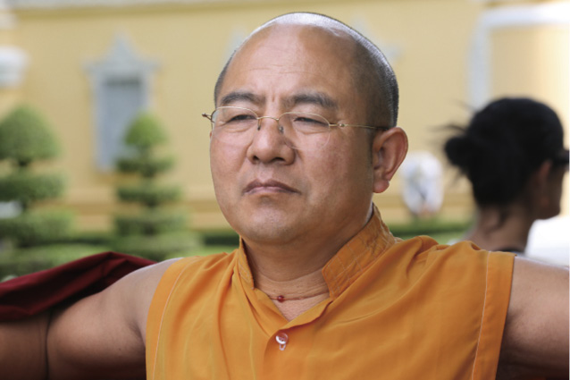

# 如何面对绝症

2013年8月8日

今天我们交流的主题是：如果即生中得了绝症，该怎样面对？

我想从佛教徒的角度，来跟大家交流这个问题。每一个人来到这个世界，迟早都会离开，只是时间长短而已，自己在这方面有没有做好准备？应该想一想。

癌症非常可怕，当有些人得知自己患癌症的消息时，就觉得人生没有希望了，当下昏厥。我认识某人8年了，他从来不敢去医院体检，因为担心万一被检查出癌症后，自己无法面对。这是什么心态呢？我们知道，现在艾滋病已成为“超级癌症”“世纪杀手”，而癌症如今已成为“第一杀手”。据世界卫生组织统计，世界上每年有800万人因癌症而死亡。在2012年，中国因癌症死亡的人数高达270万人，每一分钟就有6个人因癌症死亡！这些数据触目惊心。

很多人好像觉得自己永远都不会死，从来没有想过自己死亡的因缘会是什么，一旦得到患癌症的消息时，就深感绝望。我认识的一些出家人和在家人有不少人是因癌症而死，有藏族人，也有汉族人；有年轻人，也有老年人。

那么，假设我去医院检查，被告知得了癌症时，将会如何面对？虽然这个话题不是很吉祥，但每个人还是需要对不吉祥的事有所准备。如果没有受过这方面的心理培训，确实非常困难。

## 癌症的致病因缘与发现历史

按照中医的说法，致癌的因缘有几种：一是作息颠倒。本来应该白天工作、晚上休息，但如果晚上长期加班、熬夜，是致癌的一种因。

二是饮食不规律。正常情况下应一日三餐，饮食有度，但现在的年轻人，饮食缺乏规律。藏地因胃癌、食管癌而死的人特别多，原因也出在饮食上——原本应在晚饭两三个小时后再入眠，但我们藏地有个不太好的习惯，下午6点左右有一顿非正式的晚餐，到晚上9点多钟时，再吃正式的晚饭。我也经常跟他们讲，其实这种习惯很不好，吃完晚饭马上睡觉会增加肠胃负担，导致无法消化。还有个别藏族同胞用餐时不注意个人卫生，不洗手就揉糌粑。

此外，按照西医的观点，现在很多食物中含有添加剂和防腐剂，这也是致癌的因。

有些人认为，癌症是最近这几年新发现的一种疾病，但从历史上看，癌症并非现代社会才诞生的疾病。在一些传统文献中记载，汉武帝时期就有人得胃癌，当时癌症属于“疡病”；到宋朝、清朝时，人们对它的病因有了进一步的发现和认识。

藏医当中的《月王药诊》，是公元8世纪出现于藏地的一部非常出名的藏医著作，其中就讲述了人体解剖学。前段时间，我去了青海一所藏、西、中医相结合的红十字医院，那里有很多藏地以前关于解剖学以及原始的医学典故和理论知识。看后发现，藏医确实具有悠久的历史。按照藏医的观点，其实癌症早已被发现。

西医发现癌症的历史是：公元前400年左右，被尊为“西方医学之父”的希波克拉底，在他的医学著作中提出——癌症是最具危险性的疾病，肿瘤分为“无害性”肿瘤和“危险性”肿瘤，也就是现在人们所说的良性肿瘤与恶性肿瘤，恶性肿瘤即癌症。

因此，回顾历史可以知道，癌症并非最近才被人发现，而是一种历史久远的难以治疗的疾病。

## 调整心态很重要

如今社会得癌症的人越来越多，在已死亡人数中，约五分之一是因癌症而死，也就是说，每5个离世的人当中，就有1个是癌症患者。我们首先要知道，这种疾病一旦在自己身上，或是在身边人的身上被发现的时候，有一个良好的心态很重要。

对于癌症，西医有西医的治疗方式，比如开刀、化疗。所谓的化疗，就是通过化学药物摧毁、杀灭体内的恶性肿瘤细胞；西医还有放疗的方法，就是通过放射线照射到肿瘤处，消灭肿瘤。西医的治疗方法副作用很强，但很多人遇到这种病的时候，不得不接受这种治疗。少数人通过西医的吃药、化疗等，病情也能得以控制和稳定。但有些医院特别黑暗，明明知道病人根本没有希望，还是不断地对他进行化疗。这个时代很多人漠视生命，而对钱财特别重视，这相当可怕。当然，也有许多医德很好的医生关心病人、为病人着想，这样的人自古以来也相当多。我们判断任何一件事情的时候，要一分为二地分析和对待。

中医是通过调整饮食、心态，以阴阳五行相调和的方法进行治疗。听说现在还有一种“原始点疗法”，他们说癌症一点都不可怕，对有些病也有一定的效果。

还有就是不得不承认的佛教的调心方法，这是一种心理科学。在西方国家的有些医院和学校里，一直在尝试着心理疗法，但在俄罗斯、中国等国家不是特别受重视，相当可惜。我们以后不但要通过观察身体的神经、脉络、气脉等来治疗疾病，更重要的是调整心态。

我以前也讲过，有两个人去医院，一个人是普通感冒，一个人是癌症。医生把两个人的检查结果混淆了，癌症患者被告知只是感冒，而感冒患者却得到了患癌症的检查报告，结果得感冒的人因恐惧而死，得癌症的人觉得自己并无大碍，没有心理负担，后来他的癌症竟然奇迹般地好了。这是一个真实的故事，所以心态非常关键。

有学者也曾说过，成功的医生不仅要治病，更要疗心。以前有个老年人去医院看病，医生发现她已经到了癌症晚期，就跟她说，你回去吧，不需要住院。老太太认为自己没有什么病，就非常高兴地出院回家了。结果两年之后，她不但没有死，而且身体非常好。医生也很惊讶，问明原因以后，知道是她的心态起了作用。所以，心态的调整、心理的作用相当重要。

万一我们得了这种疾病，有两种可能：一种可能是，不管你如何调整心态，身体如何做各方面的治疗，都没有希望；还有一种可能，如果心态很好，疾病有可能慢慢不药而愈。

按照佛法来讲，麦彭仁波切有一个将疾病转为道用的窍诀；麦彭仁波切的大弟子——第三世多智钦仁波切有一个将痛苦和快乐转为道用的方法。这两个窍诀我以前都看过，在自己的实际生活中也用过，帮助非常大。

当你的人生遇到了难以逾越的鸿沟时，无论是否有信仰，都应知道怎样面对。英国前首相丘吉尔曾说过：“遇到苦难时，如果能战胜苦难，它就是你的财富；如果苦难战胜了你，它就是你的耻辱。”修行人也是如此，有些修行人在生活中遭遇痛苦时，完全能以修行来应对；有些人因为遇到种种违缘和困难而退失道心，这种现象也相当多。

## 佛教中六种对治绝症的修法

如果不幸得了绝症，佛教中有几种对治的方法：

1．一心一意地皈依、祈祷。如果我得了这种病，那就想：无始以来在轮回中，生生世世遇到过各种病魔、违缘、障碍，除了三宝，如今我在世间无有任何依处，祈祷上师三宝给予我加持与保护，如果对自己和他人有利，让我生病也可以，让我死亡也可以。这是一个特别好的修法。

2．修慈悲心。如果得了肺结核、肝癌或包虫病等可怕的疾病，内心特别绝望、痛苦时，要想到世界上还有许多众生也同样痛苦，进而对他们生起慈悲心。

《入菩萨行论》中讲过，苦害具有诸多功德：一是让我们对轮回产生厌离心。平时生活平平安安、快快乐乐的人，无法体会轮回的痛苦，当真正在感情上、身体上或心理上受到极大刺激和折磨时，才完全明白，这个世界上还有像自己这样特别绝望的人。我遇到过一个脚不方便的人，他在医院治好后，每次看到跛足者就深有体会，觉得这是最大的痛苦。有些人可能先天性眼睛不好、耳朵不好，或者肺不好、肝不好，经常有一种痛苦和恐惧感，这种痛苦能引发对其他众生苦受的了解，所以这也是生起出离心的因。

二是遣除傲慢。本来这个人特别傲慢，目中无人，但得了病，遭受了生活上的痛苦、违缘之后，心就特别调柔，不会傲慢。

三是对其他众生生起悲愍之心。如果没有感受任何痛苦，可能从来不会理解身边的人，一旦感受病痛之后，才会理解他人。

综上所述，痛苦可以帮助我们修习慈悲心，这是第二种方式。

3．忏悔。当真正得了这种疾病时，心里要想：也许此病是我离开世界的唯一因，也许我还有希望，但无论如何，这是我前世的业。

其实现在的中医和西医并不了知真正的病因，有些说是一种遗传，有些说是外在的饮食等，有各种判断方法。按照藏医和佛教来讲，即生实在无法救治的那些绝症，其根本因与前世密不可分，当然也并非与今生的因缘毫不相干。“此有故彼有，此生故彼生，此无故彼无，此灭故彼灭”，也就是佛陀讲的因缘。今天你的快乐、痛苦，其实都有因有缘的。

所以，得了这种疾病的时候，一定要有一种忏悔心：我即生痛苦的来源，应该是前世杀害众生等恶业，如果我即将离开人世，那么，死之前我在上师三宝面前一心一意好好忏悔所有的罪业。按照《毗奈耶经》中的观点，在临死前以猛烈忏悔心的力量和三宝的加持，一定会忏净一切罪障。有些人忏悔、忏悔、忏悔……最后病就不治而愈了。

4．自他交换。要想到世界上有无数众生也如我这般痛苦，愿所有众生的痛苦都由我来承受，将我所有的快乐、福德和财富都赐给他们。前辈很多大德都会如是修持。当我们一心一意这样观修时，身体很有可能会迅速康复。

这不是传说。梭巴仁波切有位中国弟子得了绝症，他特别伤心地向上师求助。经上师介绍，印度的朗塔仁波切对其传授了自他交换的菩提心修法。他偶尔修一下，后来去医院复查时，疾病竟然消失了。上师问他是否修持了很长时间，他说每天大概修4分钟左右——只有4分钟！

我所了解的一些汉藏道友也是，发现患了绝症后，就修持自他交换：无论自己最后是死是活，我现在这个色身所有的快乐都赐予众生，众生所有的痛苦都由我来承受。当然，这种心态有一定境界的人才能做到，否则可能会害怕。但这是一个非常好的方法。

5．改变理念。在我们原有的观念中，疾病很恐怖，死亡很恐怖，对于癌症，如果以前没有训练过，大家都很害怕。但在藏传佛教的有些窍诀中讲，遇到最害怕、最痛苦的事情，你不要认为它可怕而产生畏惧。

在我学生时代的很多电影中，日本是中国的敌人，然后我们每次玩耍时，一个孩子扮成日本人，另一个扮成中国人，对日本人又打又杀……修行人也应该这样：我最害怕的是什么呢？就是死亡！就是得绝症！那么，在还没有患任何疾病时，要默默地想：一旦我得了这种病，该怎么办？一旦死亡来临，我要怎样面对？在修行过程中，反反复复这样去训练。就像一个士兵，在还没有上战场之前的训练中，对各种应付敌人的方法都了如指掌，一旦敌人真正来临时，所有以前训练过的动作和技巧都可以用上，那时跟从来没有训练过的人完全不相同。

人的身体要训练，心理更要训练。因此，转变理念非常重要。真正的修行人不会认为死亡是件特别恐怖的事情。藏地一些七八十岁的老年人，他们一点都不害怕死亡，觉得我一辈子修行，死亡只是换一个客栈而已，我原来住在这里，下辈子就住到那里。但没有任何信仰、没有任何修炼的人，无论是领导、科学家、文学家……在面对死亡时都特别害怕。并不是他不能面对，而是没有这个机缘，没有这种训练的机会。

《西藏生死书》中写过，敦珠法王在1976年遇到一位病人，她特别伤心绝望：“我要死了，很快就要死了！”敦珠仁波切对她说：“不仅是你要死亡，我也已经被判了死刑，我也在等死，只不过迟早而已。”这句话说得很对，我们在座的人都已经被判了死刑。何时执行呢？可能有些人是20年以后，有些是2年，有些是3年，有些可能是10年、8年……在座的各位，绝大多数是20岁以上，如果活到100岁的话，在80年之内我们每个人都会死亡的。所以，实际上我们都在等死。这样改变观念之后，就觉得其实并不仅仅是我，所有人都会面对同样的问题。

因此，作为修行人，对疾病和死亡应提前有些心理准备。为什么现在有些佛教徒死时特别安详、快乐，而一些世间的智者，对人类社会很有贡献的人，死的时候反而特别伤心、绝望、痛苦、大声哀嚎？与观念有一定的关系。

6．念佛。念佛也相当重要。如果真的得了这种病，其他大量的佛教理论，都不一定要研究。我认识的一些出家人和居士，有在10年前、5年前或3年前发现得了癌症的，当时有些人觉得没有希望了，我跟他讲，一是要念40万遍金刚萨埵心咒忏悔，然后多念阿弥陀佛的心咒或名号。后来通过一心一意念佛、一心一意求解脱，确实完全好了。

这种实例相当多。东林寺的大安法师也讲过，他在10年前遇到过一位癌症病患，由于信仰佛教，得癌症后就开始一心精进念佛，一段时间以后在他的显现中见到阿弥陀佛对他进行加持，后来病就好了。10年后大安法师去那座寺庙打佛七，发现他还健在，非常奇妙。所以，这并不是传说，不是神话故事。

以这种非常奇妙的方式调整心态之后，很有可能癌细胞不会扩散、不会转移，病情完全好转；即使没有很快康复，也是在安详的状态中离开的。我刚才讲到的医学家希波克拉底，在他的医学书中也说，癌症的调整方法是“避免治疗、自然恢复”，也就是说，通过调整心态后可能会自然康复。

因此，虽然我不敢说佛教决定有治癌的方法，但跟其他治疗方法比较起来，大乘佛法确实有其不共的作用。

## 观修无常

修行人也好，非修行人也好，很有可能迟早会遇到一些无常，到那时，每个人心中有没有做好准备？以前我们藏地有位上师，在他的传承弟子中，很多人有一定的修行和境界，在死亡之际都用微笑来面对，并不会特别痛苦和烦恼。所以，希望大家好好修习死亡无常。

按照藏传佛教的传统，修死亡无常时，最好在寂静处——寂静的山谷、寂静的房子里一心一意观修，这很重要。如果不是寂静的地方，刚开始时很难进入这种境界。在寂静处修了一段时间，心的力量更为强大以后，在嘈杂的环境中也可以修。如果没有修行，光是口头上说也起不到作用。我虽然口头上讲“病转为道用、痛苦转为道用”，但如果你没有修的话，面对死亡也无能为力。

先从理论上了解，然后在实际行动中次第修持，直至真正生起无常的观念：本来一切万法就是无常的，我的身体与疾病也同样是无常的。《维摩诘经》云：“病不离身，身不离病。”意思是，人只要有了身体，肯定会有疾病。每个人生病时都特别痛苦、害怕，如果早就明白肉体很容易得疾病的道理，就会觉得这是正常现象。

有了一定的修行以后，心力会更加强大，一旦发现有病的时候，就不会产生十分强烈的恐惧感。现代医学和藏传佛教都说，心态对身体的正常运行起到非常大的作用，如果心态非常狂乱、恐怖，那身体的风脉明点都会被整体性扰乱，疾病会更加严重；如果心态很平静、很坦然，虽然身体上有些疾病，但是通过心态的调整，慢慢会好转。

所以，有一定临床经验的医生，本来病人的检查结果很不妙，他会说：“不错、不错，我跟你的家人沟通，你回去吃中药，慢慢调养。”如果西医说回去吃中药，你们要注意（众笑）。藏地也是，很多医生会善意地对癌症病人说：“没事，没什么大问题，回去吃藏药就可以了。”比较聪明的病人就很害怕：“是不是我得了什么大病？”

无论如何，如果心态受过一定的训练，面对疾病时会完全不同。

## 癌症带来的思考

其实，莲花生大士早就说过，末法时代各种疾病蔓延得非常快，像艾滋病、癌症……大多数是众生的业力病。

在现今时代，很多化学物、病菌等，通过各种方式进入人体。美国有位专家说，现在很多人得癌症的主要原因是吃鱼，因为鱼身体的里里外外有很多癌细胞，鱼吃得越来越多的话，鱼身上的癌细胞进入人体内的概率就会增大。还有研究发现，很多动物都会得癌症，可能在吃肉的同时，动物身上的癌细胞就直接进入了人体。素食者相对好一点。有种说法，素食者是碱性体质，防癌的免疫力特别强；肉食者的身体是酸性体质，防癌的能力相对较弱，再加上动物身上的疾病会通过饮食进入体内。

我们觉得汶川地震、玉树地震、雅安地震很可怕，在地震中失去生命的有六万多、两千多和两百多，但这给人类带来的并不是最具毁灭性的恐惧。像艾滋病、癌症等绝症每年夺走多少人的生命？我想医学界，包括联合国、世界卫生组织的数据是不会骗人的，因此，作为修行人也好，世间人也好，每个人都要关心这件事情。

首先最好在饮食上、在平时的生活上有规律，同时尽量少吃、不吃肉食。可能你觉得肉很好吃，但按佛教因果观来讲，我今天吃众生的肉，明天就会以疾病的方式反噬到自己身上，自己也可能因疾病而死亡。即使你不相信这样的道理，也要想想如果自己得了这种疾病，要用什么样的心态来面对。

现在世间很多人，每天都忙着挣钱、忙着竞争、忙着打扮，这些在短暂的人生中，如同彩虹一样虚幻，真正去寻找的时候，不但得不到，反而让自己非常痛苦。对于人生中有可能遇到的苦难，每个人心里要有所准备，若能如此，也许你会成为生命的英雄。
