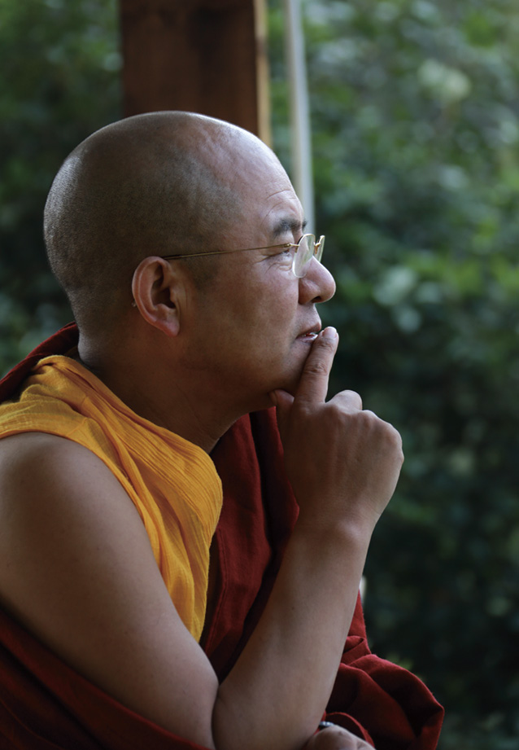
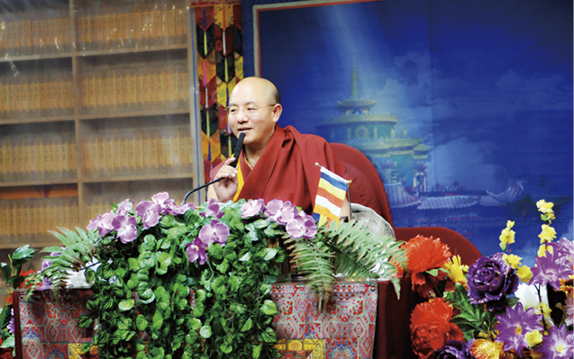
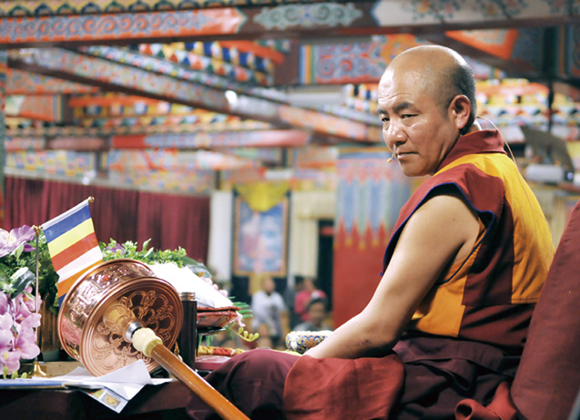
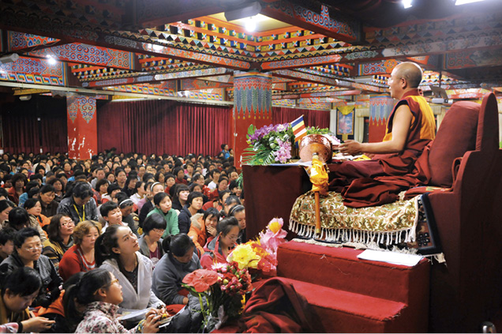

## 学佛犹如垦荒

——2012年金刚萨埵法会开示

2012年5月27日

今天经堂里的佛友比较多，在家听收音机的，在网络UC讲堂A、B、C、D等各个房间的，也比较多。依靠诸佛菩萨和传承上师的加持，道友们共同聚会，很开心。

我经常想：能让我们聚集一堂的，唯一是佛缘。因为我们都对佛有虔诚的信心，都想修学佛道、获得佛的果位。因此，我们应该感恩佛陀，感恩所有的佛菩萨和上师、善知识。

我是刚刚赶过来的，还没有吃晚饭。很多道友肯定也没吃。我和慈诚罗珠堪布为了学校的事情，今天出去了一下。路上时间比较紧，本来比较担心，还好赶上了。听说今天的人比较多，如果没赶上，让大家一直等着，不太好。好在诸佛菩萨加持，赶上了。

学院和各个城市，都有一些新学佛的人，今天算是一个开学典礼。缘起还不错。如果是一个学校的开学典礼，有这些人也满足了。

## 明天的灌顶

今天要说几个事情。第一个，诸位居士和个别出家人，来一次学院非常不容易。大家心里一定要清楚，来到这里的唯一目的，就是开金刚萨埵法会，好好地忏悔罪业。

明天大概10点钟，门措上师为大家灌顶，地点在喇荣宾馆后面的山坡上。灌顶的时候，希望大家不要挤在前面。不然的话，到时候你想换一个坐式，或者想出去一下，都不太方便。人总是喜欢挤在前面，到最后弄得很累。

那个山坡比较大，自己稍微放松一点，坐在后面，会好一点。因为人比较多，传加持品的时候，会比较挤、比较慢。反正大家能听到上师的声音，能得到加持品就可以。如果你们有收音机，就带上。有些人没有，可以和有收音机的道友坐在远一点的地方，一起听。

明天的灌顶有四种。第一种叫宝瓶灌顶，得到以后就获得了诸佛菩萨的身加持。第二种叫秘密灌顶，获得诸佛菩萨的语加持，第三种叫智慧灌顶，获得诸佛菩萨的意加持。我们的身、口、意获得诸佛菩萨的加持后，可以修持密法的生起次第和圆满次第。最后一种用水晶来灌。得到了这个灌顶，只要修完了五十万加行，最高的无上大圆满法都可以修持。这叫诸佛菩萨身口意无二金刚智慧灌顶。

明天上师念诵的时候，我虽然在现场翻译，但有时候不一定赶得上。大家要注意观想自己获得了金刚萨埵身、口、意和智慧的所有灌顶。这样的观想和意乐非常关键。如果当场什么都没有想，不一定能得到灌顶。

明天的灌顶，是针对在学院的道友，不会对外直播。以后有机会，网上的道友可以在其他上师面前得受这个灌顶。

把一粒种子放进土里，一定要多浇水，它才会慢慢地发芽、长大、成熟。灌顶所起到的，就是类似的作用。关于这些，密法中有详细的解说。

不管是藏族、汉族，都有很多人特别喜欢灌顶。问他为什么喜欢，他也说不清楚，反正就喜欢得灌顶。明天灌顶的时候，对身体不太好或年纪比较大的道友，希望年轻的居士好好关照一下。这次你们来学院，虽然是夏天，但色达的天气还是比较冷。有些人可能还有高反、感冒等情况。如果有这些不适，得完灌顶也可以回去，在家好好念40万遍金刚萨埵心咒。

这次，因为各方面因缘没有赶到现场的人，比如网上听课的道友，我特别希望你们能念金刚萨埵心咒40万遍。有关的续部讲，即使造了杀父亲、杀母亲等非常严重的五无间罪，念40万遍金刚萨埵心咒，也能得以清净。这对我们非常重要，因此我今天再次提醒大家，一定要尽量念诵40万遍。

这个月包含了释迦牟尼佛成道日、涅槃日等殊胜日，是一个非常特殊的月份。你们既然到了学院，就应该好好地念金刚萨埵心咒。

另外，我一会儿在网上做完开示后，现场新来的道友留一下，我还有事情要说。其他的道友可以先行离开。

你们从很远的地方来到学院，想见我，想供养我，心情我都理解。但是，我下面说的话，希望你们好好听：

不要给我任何的供养，包括钱。别人托你们带来的、这样那样的东西，你们自己想办法处理。我前两天刚把很多钱供养学院，如果又中转你们的供养，有点困难。以后，学院准备开几次教学交流会，以及建立医疗等方面的基金会。你们以后有钱，可以直接打在学院基金会卡上。

我只是一个普普通通的出家人，如果收的供养太多，就成了业障。我们藏族有一种业障的说法，意思是一个人接受的供养太多，他的业障很深重，寿命也很短。有这种说法。今天你们人比较多，所以我很担心。（众笑）

我今天第一个要交代的，就是不接受任何供养，希望你们好好地配合。如果你们想供养三宝，或做其他善事，以后有的是机会。

另外，因为人多，我这次没办法给大家摸顶、加持等。但明天门措上师有专门的灌顶。得了门措上师的灌顶，也就不需要我的摸顶和加持了。我自己的相续中，对大家如果有一点加持，那就是讲课。

以前，我讲过很多课程，包括《入菩萨行论》《大圆满前行》等，这里好多道友都听过。听了这些课以后，如果你的人生稍微有一些转变，就是诸佛菩萨的加持，也可以算是我一生的心血。以后，你们如果对我有一些好感或信心，就多听一听佛法课——我们会提供这方面的光盘和书籍。这些，都是我们在佛法方面的纯粹交流。这样的交流，让我心里很舒服。以上是我提前对大家说的。

## 为求法而苦行

不管你们来自什么地方，这次到学院都非常不容易。这里的住处、交通、卫生条件等，与大城市相比，都非常差。不过我刚来的时候，条件更差。

二十多年前，我第一次来开法会，山谷里还没有通路。白天，我们坐在色达的路边，晚上住在草地上。第二天，每个人背着自己开法会吃的糌粑，一个挨一个，走在小小的山路上。我第一次来的时候，是这样的状况。

我们当时从炉霍，早上大概7点钟出发，到这里已经是晚上8点左右。那个时候，从炉霍到色达的路特别不好，一会儿陷到这个坑里，一会儿又陷到那个坑里。我们是坐一辆货车上来的。

我刚才在路边看到很多小车，都是你们自己开过来的。也有些人是坐班车或中巴车过来的。不管怎样，与大城市比起来，我们这里的条件还是非常差的。

希望来学院的道友，能把这次的经历，当作为法苦行的一次人生体验。唐玄奘取经的时候，经历了怎样的苦行和磨难？和他经受的苦行相比，大家现在吃的苦，实在不算什么。不管怎么样，现在已接近夏天，大家不会冻死，也不会饿死。只要不发生这两件事情，就算是幸运的。

如果身体不好，男众、女众都有医院，医务人员都是24小时值班。前几年开金刚萨埵法会，学院的汉族出家人还要为大家做饭，累得实在不行。前两天，我们再三商量后决定，今年居士自己想办法，解决吃饭问题。我们出家人本来就不多，天天做饭，来的人又这么多，实在困难。住的方面，今年除了个别的经堂腾出来，给大家当住处以外，其他也没有办法。

这七天，你们如果有时间，就好好地开金刚萨埵法会，好好地念金刚萨埵心咒。如果没有时间，明天灌完顶就可以回去了。

总而言之，我们每个人都一定有各种各样的业力和障碍，最好的对治方法就是修金刚萨埵法门。所以，这次机会非常难得，大家应该以一颗特别难得的心，好好修法。以上，我是给上山开法会的道友讲的。

## 有了佛法，怎样都行

下面这一段话，主要给网络上刚刚学佛的道友讲的，希望你们认真地听。我说的话不算多，但对你们来讲很重要。

近几年来，大家都在认认真真地学习佛法。通过这样的学习，很多人的的确确有了很大的转变。你们也知道，现在皈依的人比较多，但真正学佛的人并不太多。

现场道友最好把手机关掉，或者调成静音，不然会影响大家。

我们这里有好多人，在背后默默无闻地发心，为大家的学习提供各种各样的条件和方便。刚开始学习的人，首先要有正确的认识：大家在这个平台上唯一的目的，就是好好地学习佛法。

这个过程中，我们会有一些要求，包括参加共修、好好闻思等，而且每次的修量都要上报。城市里的人，如果没有压力，可能谁都不会好好学。我也是这样，如果没有压力，不一定天天讲课。为了给自己增加压力和动力，我经常强迫性地给自己安排一些课程。

我们想了很多办法，只在你们的承受范围内，做了一些规定。凡是大家承受不了的课程压力，都没有安排。毕竟，你们不像出家人，学佛的环境比较单纯，各位有生活压力、家庭压力和工作压力，生活节奏又特别快，光是活着已经很不容易了（众笑）。真的，一个人能活到20岁，很不容易；能活到30岁，也不容易。在各种压力下，一直强撑着没有倒下，确实不容易。

近十年来，我们结合教学和管理的经验，给大家安排了一些课程。大家如果能利用空余时间，学习学习佛法，对自己的生活会非常有利。

我们对大家的学习，可以说是日思夜想，整天考虑的都是：有什么样的办法，能让你们在城市里，家庭、工作不受影响，还能过得更快乐、更幸福，同时利用短暂的人生，把学习佛法抓起来？

说实在的，人生非常短暂，十年过得非常快。离开人世的时候，所有的财产、名声、地位，包括你自己的身体，都根本没办法带走。而真正的善法，对我们每个众生来讲，是生生世世极为珍贵的。

我自己经常在想：生活在大城市里的人，有那么多，但他们的心里却是空虚的。如果他们相续中有一点佛法的信仰和智慧，对他们自己暂时和究竟的利益，都远远超过金钱和财富。

很多人拥有世间的荣华富贵，但这并不算什么，真正拥有佛法的智慧，才是最重要的。刚才在路上，我和慈诚罗珠堪布也很直白地讲：有了佛法，生活快乐也可以，痛苦也可以；顺利也可以，不顺利也可以，无论发生什么事情，心里都看得破，都有一种依靠和归宿。而没有信仰，或者即使有一点信仰，但不懂佛法的人，的的确确很可怜。这一点，并不是因为自己是佛教徒，才如何如何“自赞毁他”，不是这样的。

什么才是真正的幸福？有钱不一定幸福，有感情不一定幸福，有世间至高无上的名声，等等，也不一定幸福，因为这些都不究竟。但是，如果你通过真正的闻思修行，得到了佛法带来的快乐，那确实非常有价值。

如此有价值的知识，我们希望让更多的人拥有。因为学佛不是名相上皈依一下就可以，名相上得个法就可以，不是这样的。而要在实际行动中，一点一点去闻思，去实修，比如人身怎么难得，寿命怎么无常，轮回怎样痛苦，因果怎样不虚，我们应当怎样依止善知识，怎样皈依、发菩提心，等等。这些问题，每一个都非常重要，但却有很多人不懂。

近几年来，依靠三宝的加持，大家在城里也有学习佛法的机会。但我觉得，这并不是一件特别容易的事，以后还有没有机会，真的很难说。

在汉传佛教的历史上，有哪个时期，能同时有这么多人，真正深入地认识佛教？唐朝的人口虽然没有现在多，但受当时皇帝的影响，信仰佛教的比例非常高，至少有百分之七八十。这么多人信仰佛教，但真正学习佛法、懂得佛教正理的，有多少？你们可以翻开历史看看。

可以这么说，大家今天的学习机会千载难逢。所以，我特别希望每个人都好好地学习。为此，我们建立了佛学小组，每个人自愿参加。只要想学，都可以进来。

## 多一分坦然，多一分坚忍

佛学小组既不参与政治，也不参与经济，唯一的目的是闻思修佛法。也希望大家不要把很多事情，比如各种各样的佛教仪式等，混在学习里面，否则，真正的学习会受影响。

有一次，我在汉地放生。很多居士都借此机会，宣传自己的上师，到处发放上师们的照片。我给他们讲：最好不要这样，放生就应该单纯地放生，学习就应该好好地学习。除此之外，像化缘之类的各种各样的事情，最好不要夹在里面。否则，有关部门一定会关注，我们真正的学习会受影响。

如果我们不搞这么多事，只是自己认认真真地学佛，国家的相关政策是完全允许的，宪法也是完全允许的。今天信仰这个宗教，明天信仰那个宗教，除了共产党员以外，也是谁都可以的。所以，在合法的范围内，谁都可以信仰佛教，学哪个宗派也都可以。

如果每个人有佛教的慈悲观，对国家发展也好，对社会稳定也好，对各方面都有非常积极的作用。

像我们佛学院——有些道友以前没有来过，来了后可能会比较惊讶，这么多小小的房子，几千个人居住在这里，太壮观了！外面是很壮观，但内在的理念可能更壮观。是什么呢？清净戒律、闻思修行、利益众生。这是上师如意宝给学院制定的校训。

我们先要有清净的戒律，不管是居士，还是出家人，不守持清净的戒律，就没办法做任何善事。在清净戒律的基础上，我们要好好地闻思修行佛法。最后，当自己有了一点点成果，得到了一点利益，就应该尽量地帮助身边的人，好好地利益众生。除此之外，学院所有的人，都没有其他的事要做。汉地各个地方的学佛小组，也永远如此，除了这三点，再没有别的了。

现在个别佛学小组的人，比较紧张，害怕会不会被政府发现了？我经常给他们说：“政府发现了是好事，坦白地说明情况就好。我的发心很清净，你们的发心也不违背法律。我们都没有干坏事，不要有太多顾虑。”

还有些人担心自己的家庭。对此，我们也理解。但是，这样那样的顾虑太多，也没有必要。如果你对佛法生不起信心，那另当别论。除此之外，不要想太多，只管系统地学习佛法就好。

现在，很多佛教徒的言行都不规范，只是名相上的佛教徒。对佛教的道理，比如《大圆满前行》里讲的皈依、发菩提心，都不懂，只会说一些佛法名词。至于更高深的法义，像中观、因明、俱舍等五部大论，以及密宗续部的道理等，就更不用说了。

我们佛教徒现在最需要的是什么呢？提高自己的佛教知识水平。但这不是一天两天的事。见一个上师，做一次供养，请他给你加持一下，本来也很好，如果没有上师们的加持和摄受，我们不一定能和佛法结上善缘。很多上师是用这种善巧方便，令大家有修法的机缘。但最关键的是自己要系统地学习，如果你没有懂得佛法，上师再慈悲，你的理解也是有限的。

现在，有些寺院已经商业化，一些佛教团体变得自私自利，喜欢盲目崇拜。佛教徒的整体水平一直提不上去，佛法没有人了知，没有人弘扬，这是我非常担心的事情。

所以，我希望新班的道友，至少有六年以上的学习打算。六年当中，基本上一个礼拜学一到两次，一个月学四到八次，特殊情况可以请假。学习佛法并不是一天、两天的事情。十年育树，百年育人。如果你不遵守规定，肯定学不出来。

我院子里有一棵树。我天天观察，看它是不是长大了。但过了十年，才发现它长得不错。佛法人才的培养，短期肯定也没办法，至少需要六年。我们六年读完小学，也还没有完成九年的义务教育。佛教的知识更为深奥和广大，如果连短短的六年时间都没有，确实学不好。

## 学佛就像垦荒

已经学了很长时间的人，等修完加行，就可以毕业了。以后的课程比较自由，学也可以，不学也可以。如果你们修完加行，还有兴趣继续深入，那我可以继续给大家讲课。到时候可以通过直播，听一些密法。我心里有这样的打算。对没有修加行的人，我肯定不会传密法的。

当然，如果其他上师给你们搞特殊、开绿灯，让你们找别的捷径，我也没什么可说的。但是，一般来讲，按照传承上师们的要求，谁都没有资格开许不修加行就直接听密法。如果是世间的人，你多给一点钱，可能会得到自己想要的东西。但修学密法，至少要圆满五十万加行，才有资格，也才会成功。如果加行不圆满，即使得到了密法的传承，对你的相续也不一定有很大的利益。

我听说，一些老佛友学了一段时间，感觉比较累，想着什么时候毕业。其实，你们想什么时候毕业，都可以，都很容易。我每次都讲那么多，也比较辛苦。但对希望继续学习的人，我只要还有一口气，就会继续努力，坚持讲下去。

新加入的道友，一定要按照辅导员和负责人的要求，认真去做。最初的几步路，最好不要偏，否则不可能一直学下去。

刚开始学佛，有时候会激动、冲动。但也许过一段时间，热情就没有了。以前，我们给大家发过两本基础教材，第一本还没有学完，就有一半的人退失。

今年我们有一个计划：以后退失的人，最好把新法本还给我们。我们在背后做法本，花了很多的心血。你们拿到一本书，自己感觉很容易，实际上却并没有那么容易。我们这里有很多道友，为了做法本，为了满足大家的需要，付出了很多，特别辛苦，没有一定的发心根本做不到的。因此，希望新加入的道友，认认真真地对待手中的每一本书。

为了保证大家的学习，我们制定了一些制度，大家不要厌烦管理上的条条款款。所谓的制度，是为了让学佛的组织进一步规范，非常有必要。如果一个组织没有制度，就像大街上没有交通规则，没有红绿灯，那就乱套了，每个人都寸步难行。所以，世界上的每个组织都需要规范。

希望负责人不要对这些制度生厌烦心。有制度，说明大家的行为有约束，有保障。世间的父母养孩子，也会约束他们的言行，这个不行、那个不行。给孩子制定的规矩多一些、严一些，最后他们才能长大成人。

我们规定这个不行、那个不行，并不是嫉妒心太强，也不是有自私心。我毕竟也学了接近30年的大乘佛法，对人与人之间沟通和交往的基本理念，还是非常清楚的。我在这个山沟里面，专门研究大乘佛教的理念和精神，多少懂一些做人要宽容的基本道理。

既然这样，为什么还对你们有那么多的学习要求和规定，时间、方式、范围等都包括其中？因为，如果没有这样的规定，一味地随顺你们原来的心态，你们将永远放逸，永远不会进步。很多人不学佛的时候，整天都在造恶业，整天都在放逸、散漫，基本没有正知正念。这么放荡不羁的一群人，要入于正道，不制定一些纪律肯定是不行的。

就像一片荒野，要开垦出来，变成一块良田，里面的杂草必须全部拔除，否则不会长出粮食。而我们要拔除烦恼的杂草，让这颗心变成出生功德的良田，一定要有各方面的规定和措施。

其实，我们的管理人员每天都很累。他们并不愿意得罪你们，不愿意成天追着你们，“这个不行、那个不行”“这里要那样、那里要这样”。

前一段时间，我安排了几个法师，去各个地方考察。发现下面的负责人，有的特别配合我们的管理，有的则不一定。各位毕竟是在家人，来自家庭的压力特别大。但有些地方的负责人，扛着各种各样的压力，帮我们管理，我们一起弘法利生，确实很不容易。我听到一些感人的故事，心里觉得很惭愧。自己虽然坐在法座上，但却连一个居士的发心力都不如，真的太惭愧了。而有些负责人的心态有问题，始终觉得这个麻烦、那个也麻烦，什么都没办法接受。这种情况不太好。

我希望新来的道友不要厌烦管理制度。对你们来讲，有这些制度是好事。或许你现在不一定懂，再过十年，当你真正懂得了佛教的道理，回顾自己这几年走过的路，感受会和今天完全不同。很多老道友，刚开始什么也不懂，甚至反对制度，觉得没有意义，有各种各样的情况。现在回顾这几年学到的知识和法义，心里才完全明白。

我也是这样。刚来学院的时候，很多东西都不懂。现在一想，虽然自己没有很高的境界，但对佛教确实有了深刻的认识，心里特别感恩法王如意宝和当时的管家。

今天我着重强调的是，以后大家在纪律方面，一定要尽量配合管理人员。

## 皈依三宝，不是皈依个人

今天也有一些道友要皈依。以前在其他上师跟前皈依过的，不用重新皈依。而且，所谓的皈依，并不是皈依我个人，而是皈依三宝。我为你们念皈依三宝的偈颂，只是皈依的见证人。你今天在三宝面前皈依了，以后如果不承认，我这个见证人会出来说：“我知道你什么时候皈依的，不能随便、轻易地退。”我会这样说的。所以，我算是见证人，不是皈依的对境。

你们即使想皈依我，我好像也没有资格。但有也好，没有也好，我皈依的是三宝，你们皈依的也是三宝。我们共同发愿，按照大乘佛教的理念来传讲和闻思，是非常合理的。

印度真正的传承，并不是皈依某某上师，这个很重要。现在有些道友认为，这个是我的上师，那个是你的上师，为了上师，什么样的宣传都敢做。今天新加入的个别人，进来的目的不是学习佛法，而是为自己的上师拉人。去年就有这种情况。过一段时间，肯定有人对大家说：我的上师如何如何好，你可不可以到我们这边来？

作为佛教徒，我对这种行为不是很赞叹。我们都是皈依三宝的人，都是佛的弟子，而不是你上师的弟子、我上师的弟子。我们学院有那么多人，大家共同感恩的，是十方的诸佛菩萨、高僧大德。如果非要分“我是这个上师的，你是那个上师的”，那我们学院有几千个人，每个人都选一个上师，把这些上师拉来拉去，上师们的衣服恐怕都要扯烂了。

所以我觉得，这样做的人都是不懂道理的。说实在的，我们从来不会抢其他上师的弟子，也不会从别人那里偷东西。不管是人也好，东西也好，我们都不需要抢，也不需要偷。希望大家虔诚地皈依三宝，这个很重要。

如果你和某某上师有缘，帮助他弘法利生当然是可以的，但做事情要有智慧。现在有很多弟子，对上师的事业不但起不了好作用，反而损害上师的声望。你可能是好心，但如果行为不如法，做事跟佛法南辕北辙，反而对上师和佛教不利。

我们应该真诚地共同弘扬佛法。分什么“你的弟子、我的弟子”“你的上师、我的上师”，没有任何必要。我们都是佛教徒。

这方面，你们可以看看基督教是怎么做的。所有的基督教徒都信仰上帝，不像我们佛教徒，这儿一群、那儿一群，这一群反对那一群，那一群反对这一群。无论放生还是学习，这种现象以前非常严重。这几年稍微好一点，但在有些居士团体中依然存在。

有些居士，加入学会根本不是为了学习佛法，而是专门来搞是非的，每天都在宣传个人，这样不是很好。真正的佛教不需要打广告。实际上，无论哪一个上师、哪一个教派，都有真正的佛法，大家应该不分你我，相互护持。我们希望以正确的方式，引导大家步入正道。

大家皈依的时候，一定要有皈依三宝的虔诚心，到处拉人，并不是佛教徒该做的事情。我们共修小组的学习，任何一个上师的弟子都可以加入。只不过，我们以前说过，如果人太多，不好取舍。依止哪个上师，是你们个人的事情，我们这边一律以闻思修行为主，不负责帮你们辨别“这个是真上师，那个是假上师”。至于其他的事情，比如集体做火供等，我们也不允许用学会平台去组织。

学习小组是我一手建立起来的，能走到今天，特别不容易。说实在，你今天能在这里学习，看起来很容易，实际上没那么简单。我如果没有一定的发心力，你们待在城市，不可能有这样的学习机会。办学不是那么容易的事。如果不信，你自己可以办来看看。

今天在座的，有些已经皈依过，但再皈依一次也不要紧。就像我们每天都念发心仪轨一样，今天念了皈依仪轨，明天还可以再念一次。以前皈依过的人，可以再次观想：我以前皈依，是为了治病，为了健康，为了长寿，为了快乐，而今天的皈依，我不能再这样发心。

皈依可以分三种层次。上等的皈依是为了利益众生。如果你愿意为了利益无边的众生而皈依三宝，心里就这样想。如果没有达到这种境界，那就为自己皈依。暂时不考虑众生，希望自己先从轮回获得解脱，这是中等的皈依。最下等的发心，是为自己今生得到健康平安而皈依。没有其他的念想，只想自己这辈子快快乐乐，是不是皈依呢？也是皈依。

不管你们有什么样的皈依心态，都是可以的，毕竟每个众生的根基不同。如果你有一颗自私自利的心，却强迫你放弃自己、利益众生，暂时可能有点困难。不过大家最好为众生而皈依，无垢光尊者也是这样讲的。

大家坐着就可以，不用动。本来你们身体就不好，到这里又有高山反应，个个都在打哈欠。我以前高山反应时，会睡个两三天。但你们今晚可能睡不着，非常痛苦。大家的精神还是非常可嘉的。

在我们学院——上师如意宝的道场，有这么多僧众；在虚空中、网络上，也有很多的道友。现场和网络上的道友，现在都要这么想：今天，我在大小乘所有的僧众面前皈依，在释迦牟尼佛、阿弥陀佛等所有的佛陀面前皈依，在释迦牟尼佛为主的佛陀留下来的所有法宝面前皈依，三宝是我终生的皈依处。

下面，我念一遍皈依偈，你们重复一遍。我用藏文来念，意思是皈依上师、皈依佛、皈依法、皈依僧，一共四皈依。

（堪布传皈依）

今天人比较多。如果需要办皈依证，到时候登记一下。我们尽量在年底之前，想办法给大家寄过来。

法会要念的《金刚萨埵修法仪轨》，也给大家念一个传承。

（堪布念诵传承）

## 必须勇敢

念金刚萨埵心咒的时候，如果有生起次第、圆满次第的境界，可以按照麦彭仁波切的《金刚萨埵修法仪轨》进行观想。大多数人，则可按上师如意宝的《金刚萨埵修法·如意宝珠》所讲的，先皈依和发心，然后在自己的前面观想金刚萨埵佛尊，依靠四种对治力，忏悔自己无始以来所造的罪业。这个观想比较容易，我想这也是上师如意宝特意造这个仪轨的原因。如果以上两种观想都不会，可以参照《大圆满前行》里面的金刚萨埵修法。如果这个也不会，那就只在前面观想一尊金刚萨埵，然后在他面前忏悔无始以来所造的一切罪业，以猛烈的忏悔心念40万遍心咒。

法会期间，从早上7点到晚上7点，学院要求大家除了吃饭、休息以外，必须止语不说话，尽量不要在外面走来走去。你们很多人开法会的时候，天天买东西，到处乱跑，这样没有必要。可以坐在自己的家里，通过收音机参加，也可去经堂。明天上午先灌顶，法会从后天正式开始。

这次的UC开示就这样吧。希望UC讲堂和在座的道友，好好地共同学习佛法。自己稍微有一点能力的时候，则尽量地帮助众生、度化众生。在这个过程中，可能会面临生活的压力、家人的阻碍，或者单位的不理解等。这是正常现象，一定要勇敢。

学习佛法必须勇敢。如果不勇敢，无论你学什么法，稍微遇到一点违缘，就会被摧毁。每个人都会遇到阻挠，但不要害怕。我们一心一意学习佛法，这是合理合法的。

我最终的目的是，你们每个人的心相续中，都能得到佛教的智慧和悲心。而当你们真正拥有这些的时候，一定要帮助身边的人。这一点特别重要。

另外，今天是5月27日，6月3日我这边有课。具体讲什么，还没定，可能是《佛子行》。到时给大家念个传承，再简单讲一下。还是在这个经堂里面。6月3日晚上8点钟，没有皈依的做个皈依，然后给大家念《佛子行》的传承，再简单做一些讲解。在这之前，应该没有其他安排。

刚才我说过了，我不接受供养。我刚才念了传承，你们也得到了法，这是我给你的加持。学会的道友，包括6月份新班的道友，都留下来，我们有一些管理方面的话要说。还没有加入，但这次发愿参加的，也可以留下来。但你们回去以后一定要学习。不要现在填了表，过一段时间给你打无数电话，你都无踪无影，那就不太合理了。

很多道友来了以后，就开始有高山反应，肯定比较难受。早点回去休息。其他的道友可以慢慢离开了。

以前有法名的，法名不用改。这次皈依的法名是，在自己名字的最后一个字前，加上一个“圆”字。
