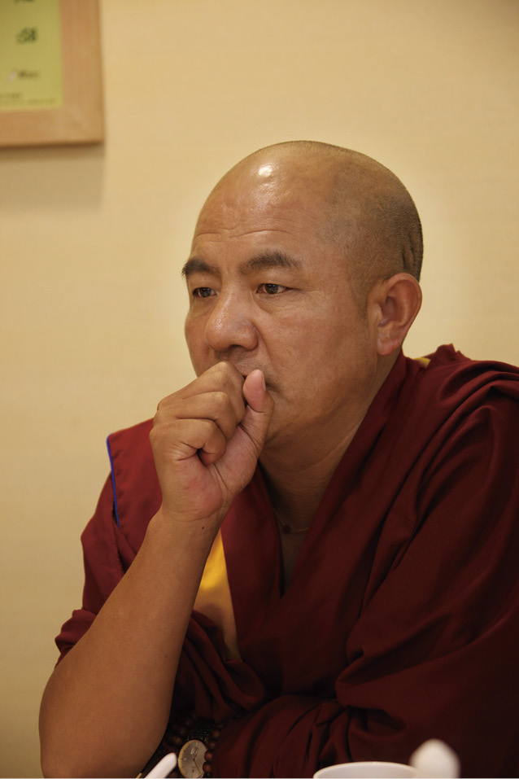
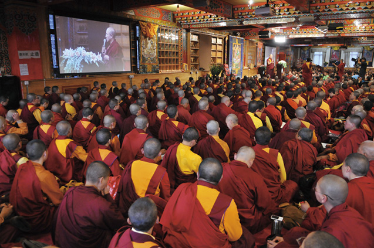
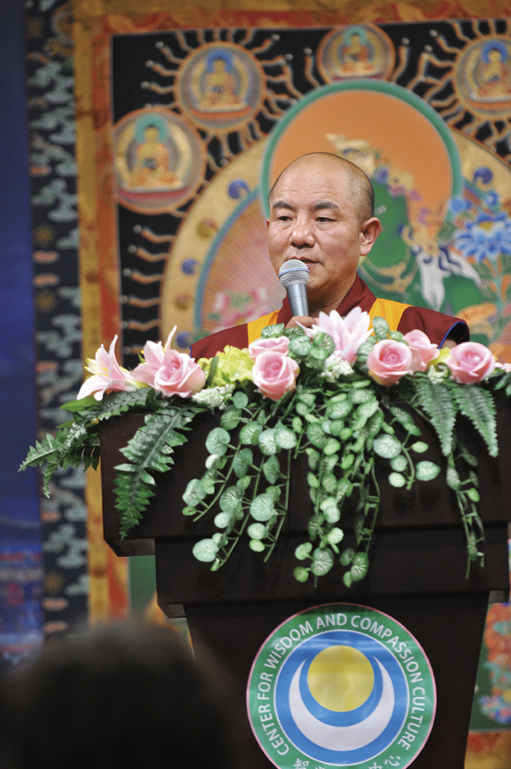
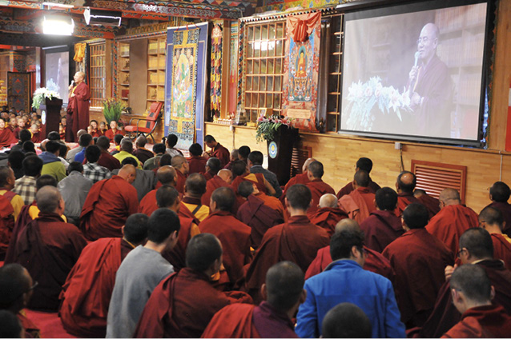
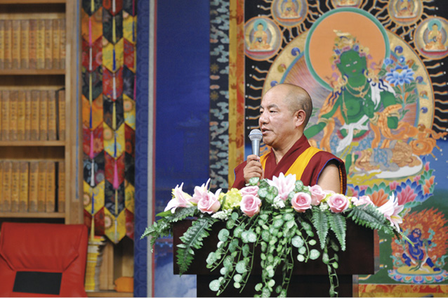
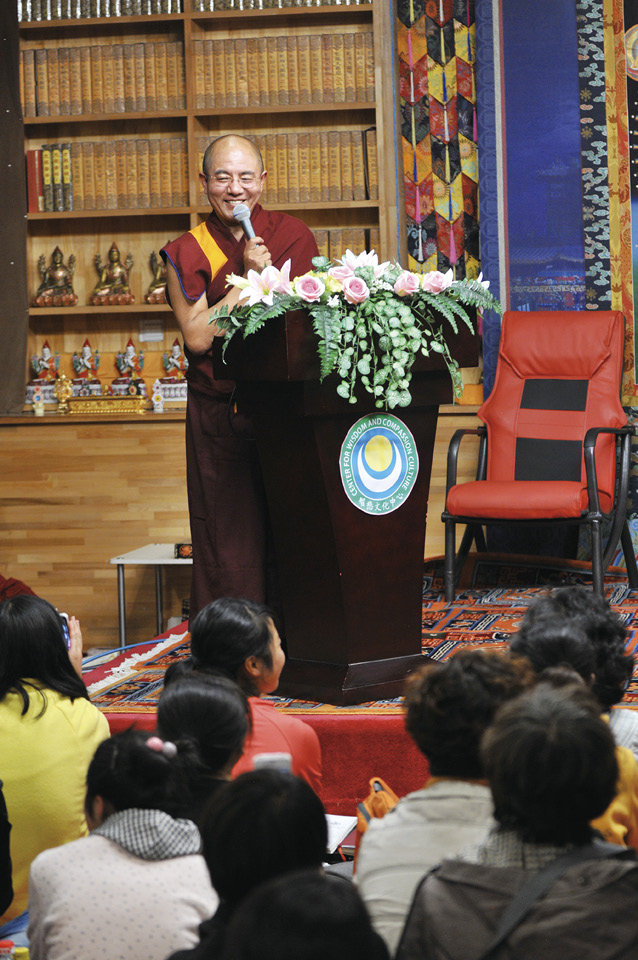
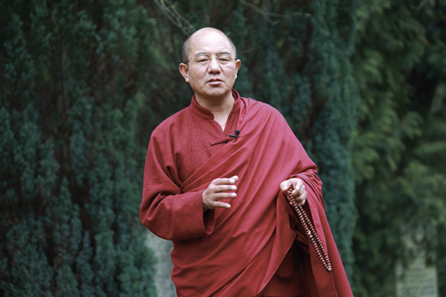

## 当代佛教徒的使命感

——2013年元旦开示

2013年1月1日

今天是2013年的第一天，在这个辞旧迎新的吉祥快乐的日子，我们通过网络，跟道友们在法音频道以及UC讲堂中聚会。我目前在杭州，身边有些佛教徒，还有学院的部分出家人和学员。我平时对自己的行踪比较保密，但今天因为特殊缘起，我要透露一下现在的行踪。

之前有人传言2012年是世界末日，从某种角度来说，2012年也确实是“世界末日”，因为它已经永远离开了，昨天之前的所有快乐、痛苦，一切的一切都变成了一场梦，从此之后，再也不会与它相遇。

这是一个特别明显的生命无常的提示。年轻人老了一岁，老年人朝更老又迈进了一步。按照世间习俗，今天亲朋好友互相祝福新年快乐，但用出世间的语言描述时，这是在提醒我们：一切都是无常的，离死亡又近了一年。也许世人会觉得这种思想比较悲观，但正是因为懂得了无常，所以我们更珍惜当下，其实这是更为积极的生活理念。

今天，我按照世间习俗祝福大家元旦快乐。同时，作为佛教徒，愿大家在新的一年中，修行一定要有所成就。世人更为关心身体健康、生活快乐、家庭和睦、事业有成等，不管怎样，我们要经常祈祷上师三宝加持，让每一个生命都能心想事成。

## 祈祷莲师 遣除违缘

今天是一个特别好的机缘。作为一名佛教徒，我一早起来就到佛堂祈祷莲花生大士，因为按照藏地很多高僧大德的传统，想在新的一年遣除修行和生活中的一切违缘、障碍，成办一切所愿，祈祷莲花生大士最有效，也最有力。

因此，我今天在微博也说，要念100遍以上的莲师心咒。其实100遍应该不够，最少也是300遍，1000遍以上最好，但世间人特别忙碌，而且看我微博的人大多数都不学佛，有些虽然信佛教，但也并不是特别认真地修学。无论如何，种下一个善根、遣除自身违缘也非常重要。

### 一、让佛法深入人心

今天是一年365天的开始。当然，按照汉地或藏地的传统，春节才算是真正过年，但世界上大多数人们都以公历新年作为一年的开始。新年第一天还没有结束，每一个人要在内心发善愿。

其实发愿很重要。我刚才在回忆，7年前（2006年）的元月一号，我同样在杭州，也发过一个愿，做了一期《新年访谈录》。当时我发愿：从现在开始，通过网络、现代科学技术，我要尽量地将佛法的殊胜道理传播给有缘者。后来以发愿力，以及诸佛菩萨和护法神的加持力，在这几年当中，可以说取得了前所未有的成功。

今天，我也在这里与大家共同发愿：依靠更先进的方式将佛法传播到全球，愿每一位与大乘佛教有缘的众生，心灵得到滋润，获得真正解脱的利益。

#### 1．细水长流 坚持不懈

希望无论是在网络上还是在现场，以及通过其他各种途径获得这些信息的人，从今天开始，每个人首先要发愿：我要行持善法、利益众生，同时坚持不断修学佛法。

也可以归纳为四个字——细水长流。

刚开始不要过于勇猛精进。很多刚学佛的人太积极了，废寝忘食，不眠不休，后面实在没有力气了，又慢慢放松下来，甚至半途而废。这种现象比较多。其实即使最初你跑得不是特别快，如果不断地走、不断地努力，一直不放弃，到一定的时候也会有所成就。

所以，希望所有佛教徒要长期坚持。想要在一两年或三四年中获得成就，确实有困难。一般世间的工作和事业也需要等到十年八年以后才有收获，而出世间的佛法，想在非常短暂的时间得到超越的心灵感应，有一定困难。因此，你们如果有智慧，且各方面因缘具足，应该从五部大论开始，系统、次第地修学显宗、密宗法要。

现在很多人坚持不下去，发心人员是这样，修学佛法的人也是这样，学着学着、修着修着，两三年以后，或者两三门课以后，或者依止一两位上师以后，又开始换口味。好多人的心态不稳定，最后导致自己的修学不圆满。

一生中最好不要换很多法门，也不要换很多上师、道场。如果你像阿底峡尊者那样真正具有清净心，拜访十方大德也是可以的，但这样的人在末法时代特别难见。因此，抓住一个法门后，一定要坚持走一段时间，至少也是走十年、二十年，这样必定会有所受益。

所以，我给大家的第一个建议是：应该细水长流，不要让佛法的修学成为生命中一个短暂的因缘。现在极个别道友分不清是非，学习佛法以后，在人际关系方面遇到一点点违缘，或者修法中遇到一个细小的障碍，就将很长时间学来的所有境界和法门全部抛弃，然后在别的地方重新开始，这样并不能真正成功。与你自己有缘的、能长期修学的道场非常难得，不要轻易舍弃。

#### 2．高瞻远瞩 共同担当

我要说的第二件事，佛教徒要高瞻远瞩。现在很多佛教徒都是自己埋头苦干、自己苦修，并没有用非常远大的目光来看世界、看所有众生。我身边其他的宗教徒站得更高、看得更远，尤其是他们中的很多人，有一种使命感和责任感，一直想着帮助所有的人，特别是世间各种无助的人。

其实，我们佛教的教义不仅能帮助世界上所有的人类，甚至包括旁生、饿鬼、地狱之类的一切众生都可以救度，可以度化，可是现代佛教徒在这方面的意识比较薄弱。不管是藏传佛教徒，还是汉传佛教徒，有些人只管自己的修行、只管自己的家庭，而在利益众生、帮助他人的问题上，缺乏长远的考虑。

还有些人以一种相似的“慈悲心”，什么事情都不管。佛教经常受到各个媒体的轻视，而其他很多宗教徒，媒体并不会因为他们一个小小的过失，马上在各个场合曝光。

为什么我们佛教徒这么好欺负？其实是因为在有些场合当中，佛教徒太不负责任，互相不团结，没有共同的凝聚力，没有对整个佛教负责的使命感和责任感。从世间层面来讲，一个团体、一个组织，如果在社会上过于脆弱，或者内部不团结的时候，不仅会受到外部的歧视，同时也会受到其他各方面的践踏或摧毁。

正因为这样，我看到许多事情并不是很乐观。从现在开始，希望大家合理合法地共同学习、共同努力、分清是非。大乘佛教徒一方面要慈悲为怀，以慈悲心来对待一切众生，但也要分场合，并不是遇到任何事情，所有的错误都属于佛教，所有的正面都不属于佛教，这是不可能的。佛教徒要团结起来，在必要的时候维护佛教的利益。

因此，从宏观层面看，佛教徒需要做的事情相当多。希望每一个佛教徒不要只想着自己小小的快乐，只想着自己内心的渴望。当然，我们自身的修行和修证也是不可缺少的。我看到很多道友，以真正佛教的传统、佛教的教义进行修持，从中获得无比的利益和成就，这样的人也相当多。

如果佛教想要在世间获得大家认可，最根本的，佛教徒不能做任何违背国家利益、人民利益的事，否则，无论是长期弘扬佛法，还是自身修行，都无法成功。但也不能过于“慈悲”，或过于没有信心，这样会错失很多机缘。

#### 3．跟上时代 广弘佛法

第三件事情，我最近经常去一些大城市，深深感到佛教的教义完全可以顺应任何时代。科学家爱因斯坦也说过：“在当今世界上，任何宗教如果有可以和现代科学共依共存的，那就是佛教。”他认为在所有宗教中，我们佛教的教义完全不落后于科学。

对于佛教的教法和证法，我们没有必要都与科学家的理念相吻合。但现在这个时代，百分之八九十的人都信仰科学。我本人是否信仰科学呢？确实也对个别科学理念非常认同，这不得不承认。那么，是用科学来证明佛教，还是用佛教来证明科学呢？我觉得是相辅相成。既然相辅相成，佛教就一定要跟上世界，这就是我想提出的四个字：跟上时代。

从佛教的教理和本质上讲，任何一个再先进、再快速发展的科学理念，都无法对它有丝毫摧毁或动摇。但是，佛教的发展前景与我们继承佛法、继承佛教的在家人和出家人自身的信念，以及对佛教真理掌握的程度有一定的关系。

如果佛教所有的教育都按照传统方式来做，在时代的道路上，我们没有把佛法传递到文人的心里，没有传递到有智慧的知识分子群体当中，那么，很有可能在21世纪末，佛教会因为无法跟上时代而被历史淘汰出局。到那时，佛教就成了极个别老年人，或是在寂静深山里极少数修行人的一种表面行为。这样一来，虽然佛法是极其珍贵的真理，可这种真理没有人了解，于是，它会跟不上历史前进的车轮，它会掉队，它会被扔在路边，有这种可能性。

因此，作为佛教徒，我们是佛教的继承人，用世间的语言来讲，也是佛教的建设者，对此，我们每一个人都有责任！有哪些责任呢？主要有两个责任：第一个责任，通过佛教的修行断除自己的障碍，增上自己的智慧，即自我完善；第二个责任，在自己略有成就时，要将所了解的佛法的教理传递给下一代，同时，不要让它被现代文化践踏，不要让它被现在世间的各种理论所淘汰。

所以，我们每一个人，作为佛教的继承人，要懂得将佛教的道理与现在世间的理念相结合。如果不会把佛教的理念同现代生活相结合，不会用现代的语言来表达的话，就无法让佛法深入人心。还有，现在人类使用的各种产品、科技化的机器日新月异，一代一代变化更新特别快，在这样的时候，如果我们一直故步自封，不去了解最新科技，佛法的传播形式将会跟不上时代。

那么，想令佛法融入人们的内心，要通过什么方式呢？现在世界上的其他宗教中，很多对自己的宗教特别负责任的人，在每个时代都会找最优秀、最出名的明星合作，拍摄与自己宗教题材相关的电影。目的是什么呢？他们想通过明星的表演，将现代人们的生活方式与他们的宗教思想相结合，将其宗教教理推广并传递给世人。

其实无论是20世纪还是21世纪，人们都特别推崇明星，在这样的时代背景下，如果佛教徒认为这种形式太开放了、不合理，进入一种保守的、不理世事的状态中，也许到最后所有人都去信仰其他宗教，或者人们内心已经被非任何宗教的另一种文化所占据。那时，佛教思想再想进入人们的内心，恐怕已经没有这个空间了。

可我们很多佛教徒还在沉睡当中，还在迷梦当中，根本没有觉察到，这个世界每天都在发生着翻天覆地的变化。

我们想到没有？我们看到没有？我们身边的人在如何关注时代、如何关注现代社会？作为佛教徒，并非要找很多人来填补或壮大我们的队伍，而是应该想到：这么好的教义，如果没有人了解，这样下去会怎么样？

在这样非常关键的历史时刻，我们需要思考，该以怎样的方式将佛法与人们的生活相结合，令佛法深入人心？我们佛教徒，尤其是大乘佛教徒，哪怕你只是昨天或今天才皈依，都有这个责任，都有这个义务。

我平时在与人交谈或是自己独自思维时，都有一种危机感。我们佛教的教法不可能被外道的各种运动来摧毁，在人类漫长的历史长河中都没有被毁灭，我想现在也不会。2012已经过去了，2013应该不会有什么大的危机。但现在最令人担忧的，就是我们佛教徒自己不珍惜，大家都不关心佛法的弘扬，这样一来，它会逐渐远离人们的视线，远离人们的注意力，到时，我们想把它捡回来也有一定的困难。

今天是一个特殊的日子，我说这些也许是杞人忧天，不会那么严重，但这也是该长期关注的一个焦点。

作为佛教徒，我们一定要团结起来，是不是团结起来破坏其他团体呢？绝对不是！我们要将慈悲与智慧的精神弘扬给全人类，这对世界上的所有生命而言都是不可缺少的精神良药，这种良药一旦消失、灭尽，对全人类将是一大损失。今天在座的各位一定要重视。

刚才我讲了三个方面：细水长流，主要涉及自身的修行；高瞻远瞩，是从维护我们佛教团体的利益，以及佛教徒应该发起广大菩提心的层面来讲的；跟上时代，也就是要考虑通过什么样的方法、途径广弘佛法，不要让全人类、全世界失去真理的明灯。

### 二、不可替代的佛教传承

今天是非常好的吉日，按照网络上的通知，要给大家念诵《圣八吉祥颂》《大自在祈祷文》的传承，还有开光、皈依。

《圣八吉祥颂》是麦彭仁波切用吉祥如来、吉祥菩萨、吉祥天尊这些名号写的，任何人念诵都会得到真正的吉祥。平时大家在手机上、微博上说“新年吉祥、新年吉祥”，我今天也跟很多人说“新年吉祥”，但以一般凡夫人的语言说100遍“新年吉祥”，也不如念一遍《圣八吉祥颂》祈祷文的功德大。

另外，从今年开始，不管你是佛教徒还是非佛教徒，都要尽量念诵《大自在祈祷文》。我认为《大自在祈祷文》也可以叫《世界和平文》——世界和平的发愿文，不论是想获得个人身心健康等世间成就，还是弘法利生等出世间成就，都要多多念诵《大自在祈祷文》，这非常有必要。

#### 1．以菩提心 皈依三宝

很多人以前都皈依过，但有些人之前可能是一种迷迷糊糊的皈依，并没有特别观想。藏传佛教是皈依四宝，皈依佛、皈依法、皈依僧、皈依一切三宝的总集——上师。不论皈依四宝还是皈依三宝，我皈依的目的是希求自己健康还是为一切众生而皈依？我有没有真正生起大乘皈依的心？这是我们在新年开始的第一天，应该扪心自问的。

皈依的发心分为上等皈依、中等皈依、下等皈依、极下等皈依四种。最下等的皈依是希求获得健康、快乐，或是发财、升官等，为自己得到现世的某种利益而皈依，这是最下等的皈依；下等皈依，就是希望自己从三恶趣获得解脱，不要堕入地狱、饿鬼、旁生，一定要转生人道或天道；中等的皈依，是只愿自己从轮回中获得解脱，就像“我要获得阿罗汉果位”，不管其他众生；最上等皈依是什么呢？就是为了利益一切众生而皈依。

今天要这样观想：虽然我还是凡夫，但我皈依的目的就是为了利益天下无边的一切众生。有些人虽然皈依三宝很多年，但还没有生起大乘菩提心，也从来没有做过与菩提心相关的大乘皈依，今晚，我们非常有必要在菩提心的摄持下重新皈依。

我现在给你们传皈依戒，大家要在利他的心态中皈依，要想：在2013新年的第一天，我真正发起菩提心，要为利益一切众生而皈依三宝！一边这样观想，一边跟我重复皈依偈。

（堪布传授皈依）

我们已经皈依了三宝。今天网络上的、学院的道友，以及其他任何角落所有听受的人，每一个人有必要观察自己的心，包括我自己在内。虽然我经常给别人讲课，但讲课的同时反观自己，有时觉得大乘菩提心离我非常遥远，有时又觉得有一点相似的菩提心。但无论如何，还是要不断地发心，否则，很容易在漫长的菩提路上退失。

因此，今天大家共同再次祈祷三宝，让我们的相续中真正生起利他的、以菩提心摄持的皈依三宝的戒体，这样以后，哪怕是吃饭、睡觉等散乱之时都有功德。就像把钱存入银行，利息特别高的时候，你的生活就不需要特别操劳。同样的道理，如果以发菩提心而皈依，即使你每天的修量不是很高，有时行为也不一定特别如法，但因为你的基础已经相当牢固，不仅是这一辈子，乃至下一辈子、生生世世直至菩提果之间，你的菩提心不会退。菩提心没有退失的缘故，你的功德、增上的善根也不会退，这对每位修学者非常重要。

最近学院在举办忆念上师如意宝圆寂九周年的法会，虽然我因为各种因缘没有参加的福报，但我在每天早上起来后都想到，我的心相续有一丝一毫的善根就是来自上师。如果上师当年没有讲菩提心的重要性，我不一定有出家的机会；即使有出家的机缘，我可能根本无法意识到菩提心的珍贵……想到这些，感恩之心就油然而生。

#### 2．心系解脱 珍惜因缘

在座的人，对世间的财富、地位等不一定特别重视，那么，对出世间的解脱是否重视呢？大家一定要想一想！

我最近遇到了一位在世间非常成功的人，他告诉我，他目前在读某商学院的MBA，在两年中读完MBA的课程，学费是53万元人民币。每年学习两个月左右，而且学习时所有的交通费、住宿费，全部自理，文凭拿到手需要70万人民币左右。我当时想，这个文凭在世间虽然能起到一定的作用，可是我们学习佛教、学习古代大德们的教言，从某种层面来讲，得到的价值远远超过他们多少倍！

现在学佛的机缘非常值得珍惜，这种机缘对每个人来讲不会很长，这一点大家一定要意识到。一旦这样共同学习的机会不复存在的时候，在短暂的时间内所学到的知识对你来讲也是非常重要的收获，与道友们一起学习的这段经历将是人生中一段最为难忘的美好时光。所以，希望大家在学习的过程中一定要倍加珍惜、格外重视。比如你考上了一所非常好的大学，应该会很重视大学四年的光阴，那么，你现在接受的是超越世间的教育，更不能用另一种心态随意敷衍糊弄，否则，这就是你福报的问题了。

所以，我今天以比较明确的态度给大家讲一下现在学佛的重要性。我看到一些老学员已经麻木了，认为：这种送上门来的学习佛法的机会谁都会有，应该不是很重要吧？愚笨的人不会认识黄金的价值，机会一旦失去的时候才会明白。当你身边的一些人真正已经获得了精神的超越、心灵的快乐时，你可能在旁边很羡慕，但是也没有办法，你已经与机会擦肩而过了。

因此，我今天提醒大家，不要将学习佛法与学世间一般的知识相提并论，这是心态上的错误。刚才主持人也说了，大家遇到这样的机缘，可以说是千载难逢，千百万劫当中都非常难遇。这并不是我们蓄意地赞叹，对我自己来讲，即使我的生命到了终点，我也会认为这是非常难得的机缘。

我昨天听说了杭州去年（2012年）发生的一件事：一位司机驾驶着客车正行驶在高速公路上时，一块突如其来的铁片飞过，将挡风玻璃砸烂，砸中他的身体。在这个关键时刻，他强忍着剧痛，用尽全身力气，将车在路边停稳，保护了车上二十多位乘客的生命。在生命的紧急关头，他没有想到自己，而是想到乘客。按常理来讲，没有超常的毅力根本做不到。这件事在当时被各大媒体争相报道，大家都认为这位司机非常了不起，令人敬佩。

作为大乘佛教徒，你即使没有遇到这样的死亡，在活着的时候，无论是利益众生、自我解脱，还是学习佛法，都应该有一种满腔热血的精神，但现在个别人的这种精神慢慢淡化了，这是我不太愿意看到的。

希望道友们珍惜这样难得的机遇。我今天说的是“学习佛法的机遇很难得”，而非“我说的话很珍贵”“我这个人很了不起，你们看到我很难得”，不是这个意思，这样的想法一刹那也没有过。见到我没有什么难得，但是听到这些佛教的教言很好。

昨天我跟一位科学家探讨，他说：通过科学证明，人类所获取的信息70%来源于听觉，30%左右来源于视觉等其他渠道。同样，我们佛教的真理70%是从听觉而来，刚好“闻思修行”里面有个“闻”字，佛法的学习要通过听闻。现在成立研讨班的时候，大家才知道，原来我学得并不好，法师们抽到我讲考的时候才明白，光是自己一个人看看书还是远远不够的。所以，很多人有必要更加精勤听闻、精勤学习。

与此同时，佛教团体如果要在世间长期存在下去的话，大家要共同合作、规范管理。我们现在是21世纪，不像19世纪或者5世纪一样，现在是人类理念趋向于规范化的时代。我刚才说千万不要被时代淘汰，原因也跟我们的管理有关系。

所以，希望大家不要想只是自己解脱就可以了，自己闻思修行就可以了……这些都是不成熟的想法。我们可以借鉴现在西方一些企业家管理企业的理念，将其用于佛教在家和出家团体的管理上，把爱与慈悲的理念传递给有缘众生，这对世界和平、对社会稳定、对整个人类的幸福都有非常大的帮助。

#### 3．共同回向 往生极乐

今天既是新的一年开始，同时是学院开法会纪念法王如意宝的特殊日子，大家共同念三遍《大自在祈祷文》，然后用汉语念《普贤行愿品》来做今晚的回向。

我们要发愿：在新的一年中，要将智慧与慈悲的佛法传递给世界上的所有众生，并将此善根与上师如意宝的善根合为一体，让人们今生获得一切自在安康，来世往生极乐世界。所以，念《普贤行愿品》时，大家要发愿往生极乐世界。
