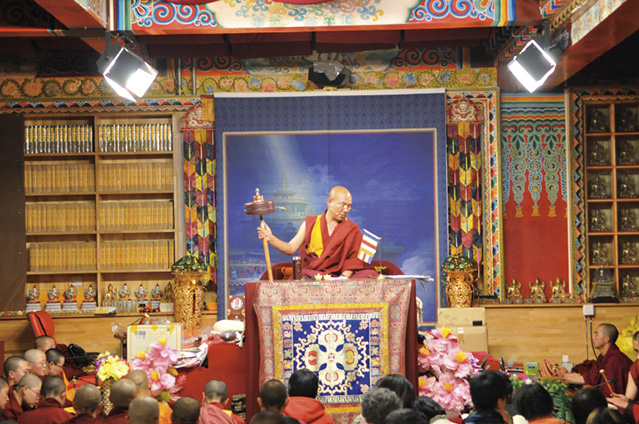
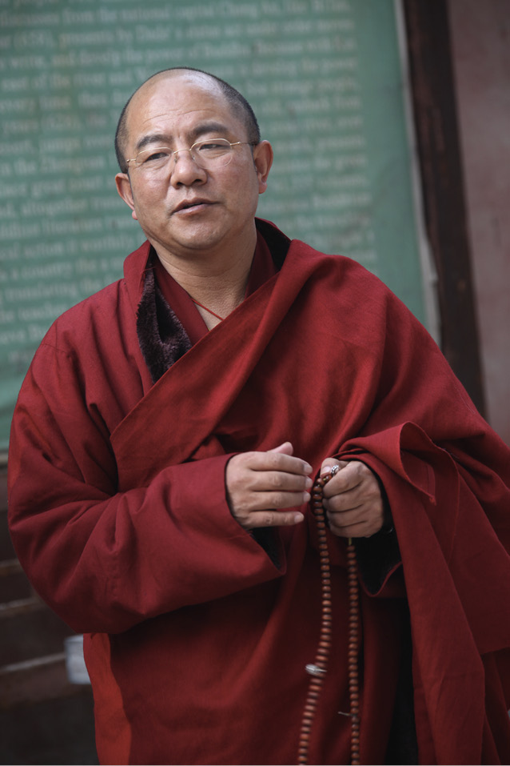
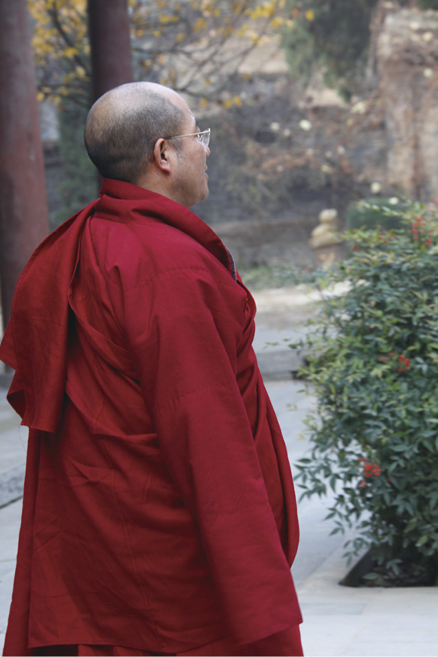
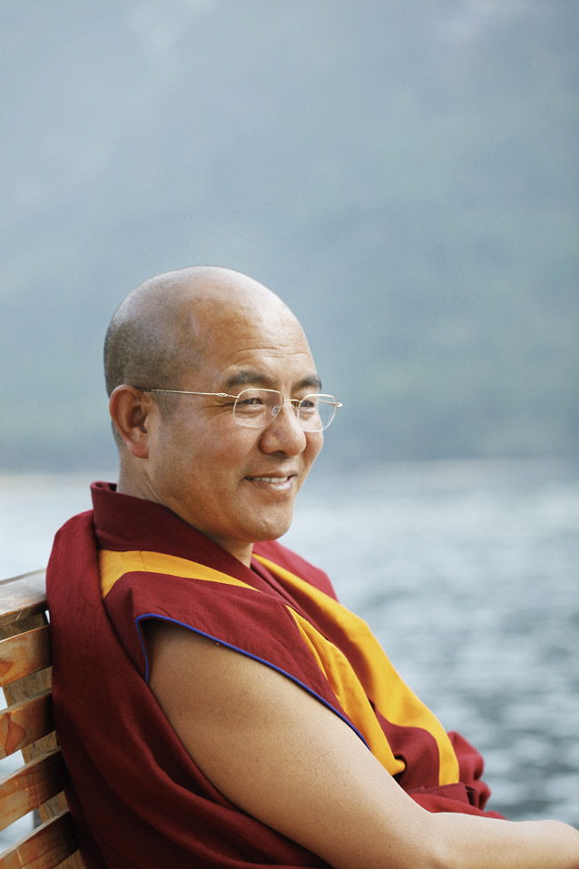

## 把修行融入生活

2012年11月6日

今天，我身体不太好，本来不准备讲，但后来又想：今天这场聚会，通知已经发出好长时间，一直拖着不讲，不太好。

今天是天降日，是释迦牟尼佛为了报答母恩，到三十三天为母亲说法，最后返回人间的日子。这样的吉祥日极为难得，其间做任何善事，功德都会千百万倍地增上。

最近，我外出讲课比较累，昨天和今天又一直住院。光是今天，就输了五六瓶液，所以现在跟大家讲话，气力有点不足。但不管怎么样，还是跟大家简单交流一下。

我没得什么严重的病，只是身体偶尔不好。凡夫众生有时候心情不好，有时候身体不好，有时候工作不好，有时候遇到里里外外的各种违缘。只要想真正地修行，就会有一定的障碍，这是非常正常的事。

我刚刚上网看了一下，智悲讲堂的每个房间，人都是满满的。按理来讲，这么多人的聚会，我讲话之前，应该有主持人出来做一些简单的开场白。我去外面的学校，做一场面对几百人的演讲，一般都有主持人出来，先把整个会场的气氛调动起来。虽然我讲得不好，但因为气氛调动得好，所以大家还是听得津津有味。今天人比较多，没有主持人，我说话又奄奄一息，大家可能没什么感觉。

你们大多数住在大城市，所做的善行、所积的善根，和真正的修行人相比，还是比较微弱。但今晚的这一两个小时，我们大家如果一起发愿、一起回向，就没有浪费，就是有意义的。

## 面对幼儿，不忍放手

对于大家的修行，我有很多话想说。即使是表面上的弘法利生，我也希望大家能够参与进来。

我个人的无常什么时候到来，很不好说。我在重病期间，心里经常想：如果我离开了世间，学会的道友会不会继续学下去？如果能继续学习，又能坚持多久？确实有这样的疑虑。至于其他方面，都没有想过。

现在，学会的道友就像幼儿，有的刚会走路，有的刚刚能爬，还有的连爬都不会——刚入门的道友就是这种状态。如果再坚持几年，大家的修行稳定了，以后修行就可以自理了。

我一直很关心大家的学修。有时候，我不光是身体不好，心情也不太好。原因是什么呢？我下面有相当多的人，非常辛苦，可以说除了吃饭、睡觉，时间基本上都用在大家的学习和管理上。其实，我们作为出家人，自己修法就可以，不需要考虑其他的事情，也没有必要参与别人的很多事。

但在这样的末法时代，很多人连基本的佛理都不懂，非常可怜。如果能让他们获得点滴的利益，我们哪怕付出再多，身心再累，都是值得的。为此，我在学院发动了很多的人，他们也都不顾一切地发心。

然而，下面有些地方的学员比较争气，有些地方的却很不争气，所作所为都让人生厌烦心。对我来说，如果下面的人不配合，我个人也没有多大的能力。

现在我们修学佛法、弘扬佛法，顺缘非常少，违缘特别多。如果没有大的发心，在如今这样的五浊恶世，要让佛法深入人心，不是那么容易。

有些人认为，这很容易，谁都可以成办。实际上，如果没有前世的因缘，即生没有护法神及众人的护佑和支援，心里虽然想把很多人发动起来，共同学修佛法，但实际操作时却不一定能做到。

我自己的生命什么时候结束，我从来没有考虑过，什么时候死都无所谓。但我很希望学会这个团体，能继续地发展下去。

很多人学佛以后，先不说生生世世的解脱利益，仅仅就现实生活而言，他们也拥有了一点“刹车的能力”。而从来没有学过佛的人，当生活、工作和家庭遇到事情时，不一定有面对的勇气。我遇到的很多人，都曾经感慨地说，自己如果没有学佛，如今还在不在这个世界都很难说。

所以，我们现在的学习、管理，虽然比较辛苦，比较累，但还是很值。

## 多一点压力，别混日子

我现在有两种想法。其中一种是：目前学会的学习和管理，已经不错了，慢慢地结束，最后打个句号就可以。大家能学习就学习，不能学习就随缘，什么时候结束都行。但有时候又想：在末法时代，还是要尽自己的一口气，多发动一些人，好好弘扬佛法。

前一段时间，我在学院发动了一部分发心人员，组建教研组。整个过程，我和发心人员都特别辛苦，他们还经常熬夜。光是开会，都开了好多次，制定文件更是反反复复地商量。最后，终于开设了菩提研讨班。

我这次先去东北，再去南方，华南、华东的很多地方都去了。在大多数城市，很多佛教徒都有一定的上进心，主动参加我们的研讨班，随时接受我们的辅导。从整体上看，研讨班的效果还不错。但是，也有一些地区让人很失望。所以，我要求某些地区的负责人，今天也来听我的讲话。

研讨班成立以后，我们对各地小组辅导人员的水平，基本上可以摸清。以前，有些人说起来是辅导员，但他到底在下面讲些什么，我们根本不知道。现在通过抽考，我们发现有些人给别人辅导之前，根本没有看光盘，根本没有听传承，根本没有看法本，自己加了很多很多的分别念，在那里随便讲。实际上，不仅是辅导员，很多人都有这样的毛病。

前几天，法师在网络上给大家讲解了怎样做辅导员、怎样讲考的重要内容。辅导别人的时候，围绕颂词和原文需要讲多少，自己可以发挥多少，都讲得很清楚。这些重要的方法，希望各个地方的辅导人员好好掌握。

菩提研讨班的资料和文件，各方面都很不错。希望研讨班的道友好好学习，随时做好讲考的准备。我听说，个别法师会在晚上睡觉的时间打电话抽考。很多人睡得正香，一点准备都没有，糊里糊涂地爬起来讲，最后法师打分很低。

大家在学习上，最好给自己一些压力。不然，在学会“混”了很长时间，最后却什么都没有学到。昨天有一个学员非常积极，虽然刚刚加入学会，有点不好意思，但为了给自己增加压力，还是决定参加研讨班的学习。

我希望，今年各个地方都认真地抓一抓学习。尤其是菩提研讨班，更要好好抓，每个人都要随时做好讲考的准备。

## 热情一点，别应付

现在，教务处经常下发文件，但这并不是没事找事。如果没有这些文件，学会以后就没办法管理。在世间，一个有十几、二十几人的小单位，也会有一系列的文件和规定。我们有这么多佛教徒，要统一管理，没有相应的文件和制度，是很难操作的。

但很多地方的发心人员，对教务处的文件，并没有认真执行，有的甚至连看都不看，也许觉得我们说得太多，写得太多，没有意义。如果三言两语就能把各项管理制度阐述清楚，我肯定愿意这样做，但实际上很困难。

学会从开始到现在，走的一直是这样的管理路线。必要的时候，我会给大家写公开信，或者做一些相关的开示。有些地区对我很尊重，我说的每一句话、做的每一件事情，都非常认真地对待。但有些地区热情不高——我不说大家心里也有数，对我们的发心人员基本上都是应付，对我们发出的文件也不认真执行。

我们给大家发的文件，可能是比较多。有时候，我也想尽量减少，但是没办法。现在外面的人很多，有各种各样的事要做。这么多人，如果没有管理，光给大家取个名字，而不对大家负责任，肯定是不行的。

实际上，我们也可以取一些响亮的名称，而不给大家学习压力。但如果没有压力，你们不一定有大的进步。

今天晚上，我有很多抱怨，原因很多，各种各样的。很多发心人员的心态和行为，看多了确实让人生厌离心。我有时想，大家对学会的发心，是不是都觉得累了？如果大家都累了，我一个人再怎么声嘶力竭地叫喊，也不一定起作用。反正，我该做的事，已经做了一部分，剩下的就随缘而转吧。我确实有这样的想法。

## 来菩提功德会吧，很宽松

考虑到学会的要求比较高，有些人做不到，我们现在开始建立菩提功德会。只要在一年之内，能学习一两本书，或者做一些善事，就可以参加我们的功德会。功德会的管理比较宽松，一年给我们汇报一次做善事的情况，或交一份读书报告，就可以。到时候，我们会给会员发一份加持品。

目前，我们已经给大家发了菩提功德会的通知。但是，很多人的积极性好像不是太高。不过也没什么。我刚开始建立学会的时候，心理预期是20个人，现在已经远远超过这个数。实际上，只要有20个人积极修行，我也心满意足。

## 占着位置，就得做事

我特别希望，对平时的学修管理，发心人员能尽心尽力。但现在的情况是，一些老的发心人员已经麻木，而新的发心人员又还接不上班。本来，在新学员里面，有一部分既有智慧，又有发心意乐，各方面的能力也都具足。但一些老的发心人员，自己占着发心的位置，却没有发心的热情；对新来的发心人员，也缺乏特别的关心和培养。所以，新加入的发心人员很难有机会发挥作用。

我有一种感觉，学会有很多人不太负责任。我想，老发心人员如果实在累了，可以退出。没必要占着位置不做事，最后让这么大的佛教团体慢慢消亡。

作为发了大乘菩提心，尤其是学过《入菩萨行论》等大乘论典的人，应该好好地考虑一下：在弘法利生方面，自己要不要做一些力所能及的事情？

有些道友，到现在已经发了三四年、五六年的心，但行为和发心依然一如既往，非常积极。有的人呢，发心一点儿也不积极，总是找各种各样的借口，反复地推脱。最后，自己的发心不成功，学员的学习也耽误了，当地的管理工作抓不起来，学会也发展不起来。

其实，学会有相当一部分学员是愿意学习的。他们有这样的意乐和因缘。但是，因为管理人员没有把学会的事当作自己的事，没有起到真正的作用，这些学员想学也学不好。

说实在的，学会办起来以后，各个地方的人都不同程度地获得了利益。但与学院道友的闻思修行相比，与学院道友的学习进度和所获利益相比，城里的人还是很散乱，并没有取得令我满意的效果。

另外，据教研组法师的观察，很多地方的学修进度跟学会规定完全不同。有些地方过于快，还没有到规定的时间，就已经学完了。有些地方又过于慢，规定的时间已经到了，他们还有一两本书没学。

因为各地管理人员的执行方式不同，所以各个地方的学习情况和管理效率也有很大的差异。就拿共修的时间来说，有些地方一个月共修一次，有些地方一个礼拜共修三天。表面看起来，大家都是人，实际行为却很不相同。甚至有极个别的发心人员，管理的时候凭自己的想象，凭自己的操控，在下面害了很多人。

我今天直言不讳地跟大家讲这些。本来，我不管是文字上的公开信也好，语言上的网络开示也好，都跟大家说得很清楚。但是东南西北的很多地方，都有很多管理人员——不是一两个人，在凭自己的想象做事，对教务处的法师经常有各种各样的误报，而没有汇报实际情况。

对各地辅导员的行为，教务处原来只有一个法师了解情况。现在不是一个法师，而是有好几位法师在参与调查，所以管理上的漏洞很容易发现。以后再想隐瞒，可能没办法了。

以上这些情况，都是我最近身体不好的原因之一，也是我心情不好的原因之一。

## 分文不收，却全力付出

最近我看了各地的学习进度、学习状况和管理方式，很多地方都不是很乐观，只有极个别的地方比较认真。但即使认真，也不像我们以前在学院那样。我刚到学院的时候，闻思修行都不是这样的。

现在很多大城市的人，可能烦恼比较重，业力比较深，各方面的违缘相当多。虽然有种种因缘聚合，但我们学佛的能力却如此薄弱，修行的进度也如此缓慢，利益众生的事业也如此困难。

不管怎样，今天我拖着生病的身体，给大家做开示，希望各个地方的管理能够有所改变。大家要好好配合教务处的工作，愿意学习的人要继续努力。不要认为，这些事情都是我们的，却每天都要求你们做，不要这样。大家应该主动配合管理，各方面都好好地行持。

如果各方面因缘实在不具足，任何一个地方的人想退，都是自由的。我没有收你们一分钱，也没有要求你们做任何一件事。

前一段时间，我去了一所大学。他们办的MBA函授课，两年要收二十多万。我想，这样一种世间学问，可能没有这么高的学习价值吧？而我们提供的，是出世间的真理，却一分钱不收——我们在这方面没有任何需要，还付出那么多的人力物力。如果你们不懂珍惜，真的很遗憾。

为了大家的学习，我需要在外面、在学院内部，组织上百人来发心。这不是一件容易的事。也许很多人认为简单，但如果让你来，你不一定撑得起。

希望发心人员之间，互相转告我今天的UC开示内容。大家想好好发心，那就好好发心；如果不愿意发心，那就明确地写一封辞职报告。大家如果想好好学习，那就好好地学，认认真真地学，按照我的要求去做；如果不愿意学，那就退出。你们报名时，我又没有扣你们的身份证。你们想退就退，很容易的。

我们所做的一切，都是为了你们好好学习，所以互相理解、互相配合好一点。否则，很多人可能会想：他是不是在利用学会搞名声？这是不可能的事，我在这方面看得很淡。

今天，很多负责管理的发心人员都在现场。希望你们最近开个会，从两个方面进行落实：第一个是学习方面，大家应该怎么进步；第二个是管理方面，应该怎样配合教务处的工作。最近，教务处给大家发了通知和要求，各地执行得怎么样，你们扪心自问。

另外，作为管理者，我对大家是怎么付出的，你们对下面的学员又是怎么付出的，大家也应该互相了解一下，并观察一下自己的心态。

## 30万遍的法会念修

今天是“天降日”，一个特殊的日子，我们佛教徒要好好珍惜。不过，我嘴上这样说，但却做得很不够。从早上起来，我就想好好发愿、好好念经，可是直到现在，既没有调整心态，也没有调整身体。在这里给大家开示，我其实是很不够格的。上直播之前，我观察自己的心，觉得像我这样的人，管理这么多人，跟大家宣说佛法，真的很惭愧。

今天大家聚集在这里，我说太多不开心的话，也没有必要。在这个世间，已经有许许多多的不满、伤心、痛苦和烦恼，这是轮回的本性。

整体而言，我对大家的发心和修行状况，还是有所了知的。在学院，很多道友顶着寒冷的天气，已经念完30万遍阿弥陀佛心咒。外面的很多人，要在短短的时间内，念完30万遍心咒，有一定的困难。所以，这次我们没有明确规定时间。

希望你们根据自己的生活、工作等实际情况，尽己所能，尽快完成。每年以这个法会为因缘，大家共同发愿，念30万遍阿弥陀佛心咒，功德非常大。关于法王如意宝的很多授记中都说，凡是与法王结缘的有情，都能往生极乐世界。

我们什么时候离开人世，非常难说。现在有这样的因缘共修极乐法门，对每个人而言，都特别珍贵。所以，我今天第一个希望是，大家以后在学院开四大法会时，都能参加共修。如果不能全部参加，最容易观修的两个法会，也就是金刚萨埵法会和极乐法会，应该是可以参加的。对大城市里的人来说，每年念40万遍金刚萨埵心咒，和30万遍阿弥陀佛心咒，并不是太难。

## 修行，不必单独安排时间

我还希望，大家能把修行和生活融合起来。以前，藏地一位大德这样说过：“千万不要单独安排时间修行。你如果试图这样，不一定成功。”现在有个别人认为，我现在要工作，要养家，没有时间修行，等我把家人安排妥当，从单位退休以后，再来说修行的事。如果一直这样等下去，最后不一定成功。

为什么呢？因为真到那个时候，你不一定有修行的意乐；即使你有修行的意乐，家人也不一定让你修；即使家人让你修，你的身体也不一定配合。

所以，修行不能等，现在就要修——学会在生活中修行。藏地很多佛教徒，都有这样的习惯。他们走路也好，吃饭也好，睡觉也好，平时的言谈举止也好，只要有空，就会修行。要么念咒语，要么观修，要么看书，把修行融入生活。

大家不要给修行限定时间——计划退休以后再修行，设想放假以后再闭关。我的希望是，大家的修行不要离开生活，生活也不要离开修行。如果能够这样，不管是在家里，在单位，还是在其他任何一个场合，你都可以随时修行。

现在汉地的学员，还是很轻松的。一个礼拜聚会共修一次，也许半天，也许一天。很多居士除了这一次共修，平时生活中根本不拿念珠。作为一个佛教徒，不念咒语，不看书，也不观想，跟不学佛的人一模一样，真的非常可笑。

藏地的修行人绝对不会这样。藏地虔诚的佛教徒，平时手里都拿着念珠。早上一起来，就会念咒、磕头，做很多善行。走在路上，也会念咒、观修、思维法义等。

现在汉地佛教徒普遍的状况，就是修行不能融入生活，这非常不好。实际上，在工作和生活当中，除了特别忙的时候外，很多时间都是可以用上的。

这一次，我特意观察了个别六年前就加入学会的人，感觉自己讲了那么多法，都好像没有意义。他们学了六年，却基本上没什么进步。从他们的行为上，根本看不出修行人的相。平时不念咒语，早上也不念课诵，也从来不磕头。上班就是上班，生活就是生活。只是在星期六那天，跟蜻蜓点水一样，到共修道场去看一看，聊一聊。这样的“修行”，根本算不上什么修行。

我的希望是什么？大家既然加入了学会，就要努力改变自己。在这里所有的学习，都是为了改变自己。如果做不到这一点，那就只是种个善根而已。

当然，藏地也不是所有人都在修行。现在，有好多藏地的年轻人，不但不学佛，而且诽谤佛教。这样的人，正变得越来越多。但藏地的在家人和出家人，也确实有一部分人格相当稳重，修行也相当好——随时随地都在修行，不需要单独安排时间。

我希望，听了今天的开示，大家都能学会在生活中修行。不要把生活和修行分开，把修行当作生活的点缀，跟看节目一样。你星期天去娱乐场所听歌星唱歌、看明星跳舞，听了就听了，看了就看了，最后都成过眼云烟，对生活没有任何影响。

现在汉地学佛的人，很多都是这样。在学会里“混”了六年，却没有任何进步。所谓的学佛，只是一个虚名，只是种些善根而已。

以后，我们应该跟不信佛、不修行的人区别开来。如果我们跟这些人一模一样，每天的生活除了吃喝玩乐，除了散乱，除了生贪嗔痴，丝毫没有提升和改善，学佛只不过是获得一些善根。

我说这些的原因，是因为最近看到个别人的行为，不是我所希望的。以前很多人给我汇报，“我已经学了六年了”“我已经成了终身学员”……这让我心里有一种满足感：哦，他们已经学了六年，肯定都很不错。

可实际上，他们所谓的学了六年，还不如一个真正学佛的人学六个月。学院的有些道友，认认真真地学六个月，就已经完全改变。

最近，我在外面也遇到一些曾经在学院待过的出家人。他们年轻的时候来到学院，但却没有好好地闻思修，如今非常后悔，非常伤心。我想，菩提学会的有些道友，现在如果没有抓住机缘，没有把修行和生活结合起来，没有改变自己的相续，以后也可能比较后悔。

今天是天降日，有这么多人聚集在这里。大家应该好好地观一观内心，看自己有没有一点改变。每个人都应该好好地扪心自问。

今天，我提了两件事情。第一件是管理和学习，希望引起相关人员的重视。如果你们自己不想改变，我再怎么呐喊，也只是个人无力的呻吟。第二件是把修行融于生活。这可以算是我在今年天降日的重要讲话。

## 共同的念诵和观修

在这个特别的日子里，让大家认真地打坐观修，可能有一定的困难。但不管怎么样，这么好的日子，我们还是应该象征性地观修一下。

首先，我们要在诸佛菩萨面前，发自内心地忏悔无始以来所造的罪业：以非常惭愧、非常内疚的心，一起念金刚萨埵心咒。

大家都修过金刚萨埵，如果能全部按仪轨观想，那是最好的。如果不能，就把释迦牟尼佛观在自己前面，然后在佛前祈祷，加持自己无始以来所造的诸多罪业，全部得以清净。一边这样观想，一边念金刚萨埵心咒。

（堪布带大家共诵金刚萨埵心咒）

念完金刚萨埵心咒以后，自己的心就安住在无生空性当中。在金刚萨埵的所有修法中，这是最高的、无有任何执著的大空性忏悔法。

安住的时候，自己如果有中观的境界，就安住在远离四边八戏的中观境界中；如果有大圆满境界，就安住在大圆满的觉性中；如果什么境界都没有，就安住在所观的金刚萨埵与能观的自己、能忏悔与所忏悔，一切的一切，全部远离戏论的意念当中。这样安住有很大的功德。

下面，大家共同安住一分钟左右……

听说，现在学院有好几万人在参加极乐法会。城市里的很多人，可能都没有这个时间。为了和大家结个善缘，也为了大家能在这么殊胜的节日里，获得跟学院众多僧众一起发愿的功德，下面我给大家念诵《极乐愿文》的传承。乔美仁波切的《极乐愿文》有点长，所以我念麦彭仁波切的《极乐愿文》，这个比较短。

（堪布念诵传承）

麦彭仁波切的《极乐愿文》，在《喇荣课诵集》里面有。这个很短很短，你们最好作为自己的课诵，每天念诵，每天发愿。仪轨里说：“当专一明观无量光佛法像、日诵圣号七遍等。”每天念七遍藏文的阿弥陀佛圣号，之后再念后面的愿文。学院极乐法会念的是乔美仁波切的《极乐愿文》，很长，你们念诵有一定的困难。

我们想往生极乐世界，就应该和极乐法会结上善缘。所以，大家以后要尽量念麦彭仁波切的《极乐愿文》。

刚才，我还念了法王如意宝在印度金刚座造的《愿海精髓》的传承。这也算我们跟极乐法会结了缘。

接下来，大家一起在心里观想：“当我离开世间的时候，依靠阿弥陀佛和法王如意宝的加持，一定要往生极乐世界！”如果自己没有信愿，极乐世界再殊胜，我们也没办法往生。

去年，我们刚刚讲完《净土五经》。我想，凡是学过《净土五经》的人，都应该知道怎么发愿。

这次法会，学院有那么多人念了30万遍阿弥陀佛心咒。他们中的大多数，肯定能往生。我们也应该以他们的善根为缘，发愿死后一定要往生极乐世界——跟他们一起往生。就像世间一个大的团体要前往某个地方，有因缘的人会跟他们一起去一样。

下面，我们一边这样观想，一边念阿弥陀佛心咒……

我们作为大乘佛子，要生生世世弘法利生，最好的方法就是多念诵《大自在祈祷文》。就全世界来讲，法王如意宝弘法利生的威力是非常大的。这里的很多道友，直接或间接都是法王如意宝的法子。就像父亲有什么特长，儿子也会有相同的特长一样，大家如果在天降日，发愿生生世世利益众生，自己将来弘法利生的能力和事业，自然会得到法王如意宝的加持。

在这样的殊胜日，发愿自己的身体如何健康、生活如何美满，当然也可以。但最主要的，还是要发愿生生世世弘法利生。这样的话，自己会自然而然地得到快乐。

所以，今天我们要念三遍《大自在祈祷文》。念的时候大家要观想：“依靠我自己的愿力和诸佛菩萨的威力，我即生乃至生生世世，一定要用佛法饶益众生！”如果我们真能发这样的大心，在未来的几十年，应该能把佛法广弘到世界的各个角落。

下面，大家一边这样观想，一边念《大自在祈祷文》……

## 我的微博两岁了

还有一件重要的事。你们可能没有发现，我的微博已经到了过两岁生日的时候了。刚开通微博时，我想：依靠小小的微博，人们不一定得到什么利益。但现在看来，城市里特别忙碌的个别人，还是得到了一点点好处。对此，我感到比较欣慰。

我的微博是两年前的今天，也就是前年的天降日开设的。当时，很少有佛教徒开微博。我抱着一种试探的心态，后来发现效果还不错。除了特殊情况以外，我基本上每天都会发一次微博。但今天我发了两次，不知道你们看了没有。

有时候，时间过得特别快。我自己开微博，不知不觉就已经两年了。今天，应该给我的微博送一个生日蛋糕，唱一首生日快乐歌。

## 一百天内，至少放一次生

前一段时间，我们通知各地举行“智悲百日放生活动”。今天，我再次呼吁大家参加百日放生。国内国外，菩提学会和菩提功德会的所有道友，除了老年人和小孩以外，100天之内至少参加一次放生，这是我最低的要求。我不要求你们连续100天，天天都放生。在这100天之内，无论你们放多少次生，我们都随喜功德。在当地放就可以，不要把钱寄到学院。

过一段时间，我可能会让下面的发心人员统计数量。如果你在100天当中，99天都做自己的事情，却连一次放生都没参加，我觉得不太好。你只要参加一次，所有人100天内放生的功德，你都能全部得到。

如果当地没有放生团体，你可以在自己方便的时候，买几条鱼、几只鸟，给它们念一些佛号，然后放掉。这样也算圆满。

## 念诵的音调，不能搞创新

以后，学会的道友在放生和共修的时候，前后念诵一定要按照学会课诵的发音来念。这是以前法王如意宝的念诵音调，非常有加持。对其他团体，我没有权力这样要求，但我们学会的道友，一定要按规定来。包括课前课后在内的所有仪轨，你们如果用藏文念诵，就一定要按照学院的藏文音调来念，各个地方不要自己搞创新，造出一些新的音调来。如果实在不会藏文念诵，我们以前编过一个汉文念诵的音调，用那个念诵也可以。

我这次出去，发现很多地方的放生仪轨，都已经按学会的规定改过来了，这是很好的。以后，我们佛教的很多行为，如果都能统一起来，会产生一定的力量。

刚才，我的心情不太好。但我前面坐着的几个人，态度还不错，我的心情突然又变好了，病好像也没那么严重了。

## 共修《普贤行愿品》

接下来是最后一个环节，大家要准备好汉文的《普贤行愿品》。很多人可能连一遍《普贤行愿品》也没有完整地念诵过。今天是天降日，所以我把大家召集起来，共同念一遍《普贤行愿品》。

我去年刚讲完《普贤行愿品》，听说现在很多地方都已经学完了，大家应该懂得如何观想。如果实在不会观想，那就总的观想一下：我发愿生生世世弘扬佛法、利益众生，与此同时，自己也能身体健康、心情快乐。如果能将所有的发愿，融入《普贤行愿品》，我们的愿力必定会实现。

下面大家观想，在本师释迦牟尼佛为主的十方诸佛菩萨面前，自己以清净心发愿，将自己所做的一切善根，回向给天边无际的一切众生，愿自他都能往生极乐世界。一边这样发愿，一边用汉语念诵《普贤行愿品》……
