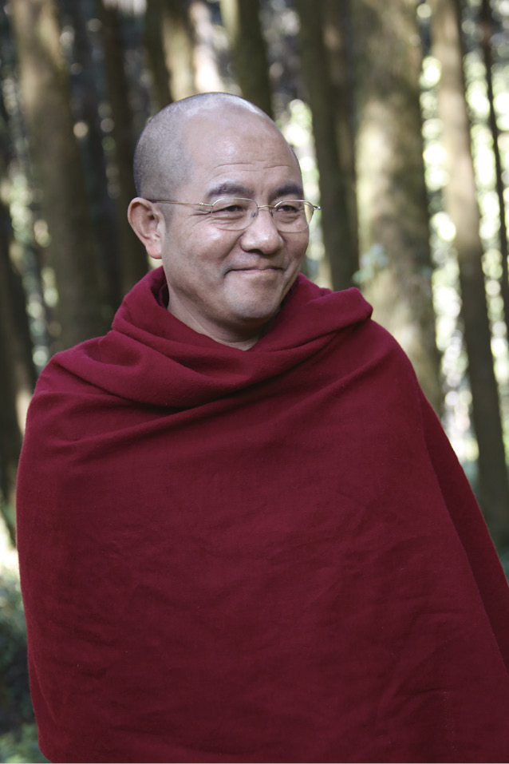
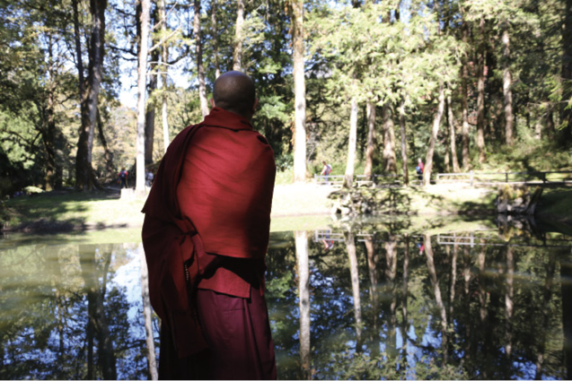

# 方寸之间 自有天地

——2013年第一届新班开学典礼开示

2013年6月8日

在这个吉祥的日子，学会迎来了2013年第一届新班的开学典礼。在新班初始学习的阶段，我们以直播的方式在网络上跟所有道友交流几个问题。

## 一、认真思考

此次新班的道友都是自愿、自发前来，我们并未邀请或强迫任何人来参加学习。报名之前，给大家预留了一定的时间反复思考，因此，各位做出这个决定，应该是经过深思熟虑的。既如此，大家对学习的计划、内容，包括为大家授课的老师——我本人，应该都有了些许了解。在21世纪的今天，作为知识分子群体中的一员，对于个人要选择什么样的人生道路，一定会有明确而清晰的认识，不可能非常盲目。

所以，我再次重申，这次参加学习的所有道友，完全是以一种自由、自愿的形式加入的。

希望在座的道友们，可以通过实际的体验，思考下以这样的方式学习佛法是否对你各方面有所帮助与提升。作为一个有学识的人，参加过一两次学习之后，相信你会有明确的感受。体验过后，如果你觉得对你没有帮助，或者认为这样的群体、组织不适合你，又或者觉得并不完全符合招生时所讲的，那么，你可以自行决定是否要继续下去。当然，希望你们慎重考虑后再做决定。最好不要退转。

## 二、珍惜机缘

我本人对汉地的出家人、在家人传授佛法已接近三十年，很愿意将多年来的经验、体会，与大家分享。此次大家能参加学会的学习，机会非常难得，难得的原因有二：

原因之一，现在缺乏信仰的世间人，往往非常苦恼、困惑、痛苦，但通过佛法的学习，许多人确实在自己的生活中拥有了满足感、幸福感和成就感。在如今的社会，能获得系统学习佛法和令心灵得以提升的机遇非常难得，很不容易！

原因之二，我们的学习完全免费。城市里学习各种知识，动辄需要几百、几千元的费用。我不能说世间没有完全免费的学习，但恐怕很难找得到，而学会是完全免费为大家打开了学习知识的方便之门。

所以，希望今天参加新班的所有道友都能珍惜这样难得的学习机会。如果你把它当成世间的聚会，或者觉得它只是一个普通的团体，就不会珍惜；没有珍惜，你就不会坚持；没有坚持，这在你的人生历程中将是一个缺憾！

学习机会难得，这一点大家一定要牢记在心！

## 三、闻思修行

城市里热爱学习的道友，可以通过免费的网络授课视频，在家中进行学习；也可去现场与道友共同学习、分享，一个星期集中一两次，或一个月集中三四次。如此，可以更好地学习和掌握佛法深奥的意义。

你们也许会有疑问：学会到底是一个怎样的团体或组织呢？准确地讲，学会的宗旨和目标是闻思修行——我们听受佛法，不断思考佛法的道理；思考后尽力修持；修持后尽量饶益众生。

在座的各位要再三考虑，如果真正想学习佛法、修习佛法、利益众生，你可以加入学会。我们这里不提倡天天只做会供、放生、迎请某某上师，或者只举办一些简单的佛事和法会，这些与学会的宗旨相违背；我们同样不允许每天只是化缘、建寺院、造佛像等以经济为目标的传销和广告活动，更不允许有其他政治目的的非法组织存在。有些人为了各自的企图参加学习，擅自对自己的上师和各种活动进行广告宣传，这些都是不允许的！新班学员要注意。

无论你信仰藏传佛教还是汉传佛教，只要愿意学习，我们都不排斥；只要对佛陀有虔诚的信心，愿意学习并研究佛法，不诽谤佛法和其他宗教人士，我们都予以接受；任何上师或传承，我们都不干涉，对自己的上师有信心、进行私人供养，都是允许的。但学会有学会的要求和宗旨，任何人不能以学会的名义，对任何个人进行宣传，包括我自己在内。我们的目的是希望每个人认真、有次第、有系统地学习佛法，除了学习佛法、修行佛法和饶益有情以外，任何以个人目的为出发点的不合法、不守法的行为，都是不被允许的。

所以，加入学会的学员一定要人格好，如果人格不好或者连世间善良的人品都没有，这样的人我们不需要；对上师和佛法没有信心的人，我们也不需要；学会有各种管理规定，虽然不是特别严格，但作为一个组织，一定有其基本的管理规范，不能遵守的人，我们也不需要。

你们要非常清净、虔诚，心地宽容，对人和事不要特别计较，不能稍微遇到一点事情，就产生各种矛盾。更不能利用自己的上师和传承制造教派矛盾。随着学会人员数量的增多，会给管理的各方面增加难度，我们需要的是认真学习和修行的学员，学好之后，将来帮助身边的人、帮助所有众生，这才是真正有意义的群体。

以上内容，本来由法师和管理人员给大家介绍就可以了，大家一定要明白，为什么新班开学时我要亲自讲解。因为前几年很多新班的学员，来这里的目的不是学习佛法，而是专门来进行不正当的传销和宣传推广，搞非法活动，这一切在学会都不允许！

我们不排斥任何教派、任何传承，现在学会也有藏传佛教中萨迦派、格鲁派、觉囊派等其他教派的弟子，同时也有汉地的净土宗、禅宗等宗派的弟子。出家人、居士都可以参加，有些人不愿表露自己的身份，以其他名字和身份参加也可以。

只要不搞政治、不搞经济，不违背佛教的相关戒律，不违背国家法律、法规以及相关政策，任何人都有宗教信仰自由。

所以，我们在这里明确地告诉大家，学会的宗旨主要是闻思修行，作为佛教徒，除了闻思修行、饶益有情之外，我们没有其他目的。这一点，学会的管理人员会进行监督，如果谁没有遵守学习秩序，有其他非法目的或私人目的，学会有权请他离开。

学会的规章制度是为了让你顺利、安全地将佛法学习圆满，并不是让你依靠学会来组织非法活动的，我们有能力创造这个平台，当然也有责任维护这个平台的和谐发展。我和所有的管理人员，完全有权制止任何不符合学会要求的非法活动。

## 四、团结和合

早先在汉地是没有菩提学会和金刚中心的。1990年，我从印度回国，途经香港时，在香港看到有很多白玉中心，我觉得汉地也应该成立菩提学会和金刚中心。就这样，汉地的菩提学会和金刚中心在1991年成立了。之后，我又走访了美国和英国，他们同样有各种学习显宗和密宗的佛教团体，我认为应该在国外建立一个佛教道场，于是，第一个喇荣显密中心1993年在美国建立。

菩提学会从1991年创办开始到现在，经历了20多年漫长的发展历程，就像一个企业一样，是成熟而有经验的。在此期间，我们遭遇过各种情况——不仅有来自佛教徒对我们的各种质疑，还有些政府官员和地方领导觉得我们是非法组织等，曾经有过很多误解。当然，在发展过程中也遇到了各种机遇，才有了如今学会的发展壮大。

因此，希望道友们在以后的学习过程中，应该运用智慧，遣除各种违缘和障碍。我们从来都不会违背释迦牟尼佛的教理，如果相违背，你们佛教徒会看得到；如果违背了国家的法律法规，政府和所有人都会看到。所以，我们在任何时候都能光明正大地学习佛法。

在佛教的教义上，我们很希望：凡是加入学会的人，都要懂得因果和佛理。有些已经皈依了十年八年的人，到目前为止也没有明白皈依三宝的根本理念；有些人受了菩萨戒很多年，但还是不明白发心的功德和不发心的过失、舍弃众生的过患等，这非常可惜。

现在有些小组人员比较多，十到二十个人；有些小组的人相对少一些，三四个或五六个。在学习过程中，大家一定要团结和合！刚刚加入的新班道友要与老班的佛教徒融洽相处。你们以前在各行各业工作，从来没有在一起学习过佛法，有些人以独立个体出现的时候人格很好，但进入团体之后，自身不好的行为和习惯就会全部暴露出来，这时一定要团结。

学会的发心人员，会按学会的各种规定，要求大家去执行，希望大家要理解、配合。我们这里学员众多，发心人员的工作量很大，发心人员中也有很多出家人和老居士，他们为了你们的学习和成长，也为了你们能逐渐增上对佛教的信心，把自己的修行、休息时间全部贡献出来，只为服务大家。而有些人没有感恩之心，不懂得恭敬，还用一些过分的言语中伤他们。

学会为什么要规范管理？因为团体需要有秩序地进行运转，学员需要拥有更好的学习环境和学习氛围。所以，大家一定要理解和配合。当城市的交通秩序出现混乱时，需要交警在现场及时管理和疏导，如果车辆不听从指挥、任意行驶，容易造成交通事故，会给大家带来很大的麻烦。学会各地管理员的重要性也是如此。所以，不要对他们的工作充满敌意或排斥，如果你这样做了，就同不懂遵守交通规则的人一样。希望大家能够支持、配合管理员的工作。

学会有一定的规章制度，还有闻思修行的次序、安排，这些并非为了约束你、控制你。我和每一位管理人员都不会把自己当成领导，限制你的自由。我们不会控制任何人，也从来不会让学员专门服务于我。我们在这里给大家传授佛法，完全是一种付出，创造方便让大家更好地学习。

与此同时，你们要在思想上提前做好准备：准备融入新的群体，准备接受新的生活。加入学会后，家庭、工作方面的时间调整以及生活习惯的改变，你是否有能力面对？如果没有面对问题的能力和智慧，恐怕很难坚持下去。

所以，一定要把这些问题提前考虑清楚。我们完全是一种教育平台，你要有耐心，要有学习的意乐。国家现在提倡共建和谐社会，而和谐需要从我们个人做起，从内心做起。通过佛法的学习能提升内在的幸福感，相信很多道友都深有体会。新参加学习小组的道友们，慢慢也会了解到，自己学习佛法对促进社会和谐方面将起到什么作用。

## 五、持之以恒

学习佛法不是一天两天的事情，它是一个漫长的历程。如果确实真心实意想学习佛法，那么，你要有长期坚持学习的打算，不要半途而废，一定要持之以恒。以前，有些新班的学员稀里糊涂地来参加学习，过了两天就没有了忍耐之心，觉得学习佛法很辛苦，就轻易放弃了。通过这种现象，可以看出其人格缺陷和稳重之心的缺失。缺少稳重心的人，既无法学习博大精深的佛法，也无法完成世间最基本的工作。所以，希望大家拥有持之以恒的心态，不要因为某些方面的不如意就放弃学习。

如果佛教知识按我们现在读书一样分阶段学习，达到初级的像小学级别的水平需要五六年时间；达到中等水平再需要五六年；达到较高水平还需要五六年。专门学习十几年、二十年，也不一定能达到很高的水平。我本人从出家到现在已接近三十年，还是很专注地在学习。虽然我不是特别聪明，也不是特别笨，但佛教知识浩如烟海，越学越深。

建议各位从现在开始，为自己制定10年或8年的学习规划。我们目前的学习方法和学习压力都很适中，一个月30天，只有4天用来学习，这4天也并非24小时都用在学习上，你可以选择一个上午或一个下午，甚至是在一个下午当中的一两个小时内，就可以完成学习。如果按照佛学院出家人的课程和要求进行专业佛教知识的学习，这是很难做到的，因为你毕竟需要在社会上生存，需要在忙忙碌碌的城市中生活。所以，学会的要求不是很高，这几年中，不需要每天24小时不间断地学，只要每个月空出一点时间学习就行。如果你不愿在一个月中抽出几个小时共同学习，那么，就错失了集体学习和共享佛法的机会。

有些性格比较孤僻的学员，当他们进入这个群体后，会显得格格不入，这时有些人会选择自学。但是，很多自学的人最终都半途而废了，没有坚持下去，这点很可惜！因此，我们需要群体的学习方式。

我本人在给大家传授一部论典时，我们彼此之间都有一种压力，大家会监督我的传法进度，我需要把智慧更好地融会贯通，传递给大家。所以，我要强调群体学习的重要性。希望大家一定要持之以恒，不要半途而废，珍惜你们学习佛法的第一个缘起。如果学习佛法的初始缘起遭到破坏，也许就很难再有好的缘起出现了。

今天这里的每位学员，你可以通过这两天的观察和学习，做出选择和判断。如果通过智慧反复思考，深思熟虑过后，觉得这个群体的水平与你个人的水平相比太低，或者“你们都是菩萨，我是凡夫，凡夫不跟菩萨学习”，或者觉得辛苦劳累等等，因为各种真实或相似的理由退出学习，都是可以的。

以前学习过一些佛法的学员，加入学会之后，也会涉及闻法方式的学习——要发菩提心，发菩提心的时候要将天下无边的众生观想为自己的父母；要发清净的心，观清净心时，密宗的方式是把上师观成佛，道友观成菩萨。遇到这种情况，个别智慧狭隘的道友就会选择退出学习。如果曾经真正深入学习过佛法，就会心胸开阔地面对这些。

大家在开始学习的时候，一定要有一颗包容的心。如果没有包容的心，会因为某些问题的干扰，结束在学会的学习，之后永远也没有这样的机会，同样是很可惜的。所以，我们在学习的过程中遇到困惑，可以暂时放到一边，或者与其他道友进行探讨，过段时间就会明白和接受。希望大家不要因为自以为是的一些观点和情绪，就永远退出学习佛法的舞台。这可能是你的损失。

在即将要开始学习之前，辅导员和新班的负责人，一定要多给新学员们介绍学会的相关规章制度，多分享在学习过程中面对困难时的心得，多传授佛教教义中的包容心。

这次新班的学员无论是从文化素质上，还是从个人的修养等各方面看，都非常不错，而且大多数都是年轻人。从根本上讲，我非常欢迎你们进入虚空的花园：一切诸法是如梦如幻的，要在如梦如幻的学习中，获得如梦如幻的果位。这是什么意思，听懂了没有？

## 六、发心利他

学会的发展需要大家持续不断地共同发心，所以，特别希望每个人都能发挥自己的智慧和力量，为佛教做出些许贡献。虽然做不了大的贡献，但也应该发挥一些微小的作用。在认真学习的同时，每个人应该担负起一些责任。有些学员如果有做辅导员的潜力，那么自己先学习一段时间，至少要一两年，如果什么都不懂也没有办法辅导；有些人如果有管理能力，希望你们当组长或者学习委员，哪怕当一个统计人员也很好。如果谁都不愿意做发心工作，那我们这个佛教团体以后不一定真正拥有广弘佛法的力量。

所以，我们现在很需要培养人才。培养什么样的人才呢？一是对上师三宝有信心的人，如果没有信心，满腹邪见，其相续不会有任何功德。二是通达佛教教理的同时，也具有世间法的智慧，假如不懂佛教的教理，就称不上是一个佛教徒，这个团体也就无法称为佛教的团体；同时也需要具备一定的世间智慧，因为我们毕竟生存在世间。三是需要有应对各种问题的能力，无论是弘扬佛法，还是自己面对一些问题时，不要表现得特别脆弱。有些人非常脆弱，本来想参加学习，但被家人说了一顿，或者遇到小小的违缘，就萌生退意，再也不敢来了。

我出家时也遇到了很多违缘，但我当时的心态很坚定。有些老师阻止我出家，有些亲戚也阻止我出家，甚至家人也说，如果你在当地寺院，可以给你提供日常生活所需资具；如果你去佛学院那么远的地方，就不会给你送任何口粮。后来，我依靠自己的智慧应对，坚持了自己的想法，直到现在。因此，希望你们在学习的过程中，假如遇到一些违缘和困难，要坚强！要有信心！

很多人都可以实现自己的理想和目标，我们为什么不能？每个人的家庭和生活处境都不相同，有些人学佛很顺利，家里也支持；有些人家里不支持，朋友不支持，单位也不支持。但我们做的事情对自他都非常有意义，问心无愧，所以，在处理有些问题时，要有智慧。

对上师三宝也要有虔诚的信心，因为上师三宝的加持不可思议，经常祈祷，修行一定会顺利的。我们学的是大乘佛法，如果修行稍微有所成就，一定可以利益无边无际的众生，而利益众生是我们最终的目标。

## 结语

今天给大家讲了六个问题，希望你们再三思考。虽然讲得不是很好，也没有一些好的修证、境界，但我的心是清净的，是为了大家顺利完成佛教的学业。如同学生刚进入大学校门时，校长或老师也会把学校的相关要求、教育方针给大家解释清楚，如果按照这样去做，就能完成学业；反之，也许无法毕业。

每一个人在学习佛法方面要把自己当作小学一年级的学生，如果我们有一颗谦虚的心，所能接受的知识就会越来越多。因此，你们要听从其他管理人员和辅导人员的安排，使自己逐渐成熟，直到将来有管理的能力、有辅导的能力，那时我们的思想就可以与别人分享和交流。在这之前，大家应很虔诚、很谦卑地把自己当成一个普通学生，这样学习是能成功的。

我身边有很多发心人员非常辛苦，希望你们好好配合他们。你们应该知道，这样的学习实际上都是为了自己，在这种心态下大家共同努力，一定是对自己有利的。同时，我们现在处于末法黑暗的时期，希望能把佛教的明灯传播到世界的各个角落。

非常感谢大家！大家共同回向。
