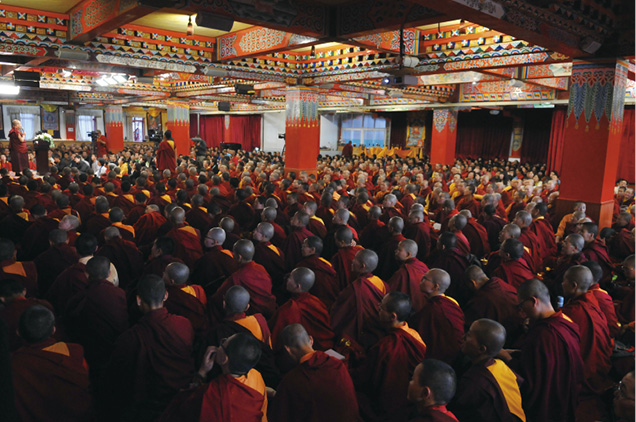

# 点燃菩提心灯

——不间断闻思修

2013年2月2日

今天与大家简单交流几句。首先，无论任何人都应该有一个人生规划，这很重要。

学会从2月4日到2月17日，放假两个星期。大家在新的一年中，修学上要有一个新的计划和安排。网络上和现场的道友，以及今天没能参加的道友们，不要让自己暇满难得的人身空过。时间过得非常快，希望大家一定要珍惜时间，行持善法。

很多佛教徒这几年以来确实比较不错，在闻思修行上有些突破。以前相当多的佛教徒对佛教的教理一窍不通，修行方面非常盲目、非常迷信，现在很大一部分人在闻思修行各方面进步明显。

也有个别道友不按照学会的要求，该闻思的不闻思，经常东奔西跑。今天来一个人，不经观察就随便通知很多人前往拜访，真正需要学习的道理不好好学，到最后一无所得时又诽谤这个、诽谤那个，毁坏自他。我不诽谤任何高僧大德，也不排斥任何人，但是，我们学会有学会的要求，希望大家能遵守。能按时完成修学课程的人可以在学会学习，如果任何一个人想利用学会，或者以学会为平台做各种非法行为，我也不愿意。所以，大家既然加入了学会，就应该按照学会的要求和规定，如理如法地学习。这非常重要！

新的一年，我唯一的希望：大家一定要好好地闻思修行，每天不要间断学习，无论到哪里，不要忘记自己是一个佛教徒。个别的非佛教徒，我也特别希望大家行持善法，非佛教徒也不能做坏事，否则今生来世确实有一定的报应，非常可怕。

已临近春节，喇荣山沟里仍然如同往常一样寂静。以前我们从来不知何时过年，现在虽是信息时代，但也只是知道，没有其他任何仪式。过段时间开持明法会，大家唯有修持善法。但城市里的人不同，希望过年期间，你们千万不要杀生，不要点杀。

## 重视传承 发菩提心

今天念诵《入菩萨行论》的传承。不管任何法，传承非常重要。汉传佛教极个别佛教徒到目前为止对传承还不是很重视。其实真正的传承比灌顶还重要，为什么呢？因为传承者只要以前在任何有传承的人面前听闻过，那么此法的传承就能接得上来；而灌顶，有很多自身和他身条件上的限制，若这些因缘和条件不具足，即使你在别人面前听灌顶，也不一定能够得到真正的戒体。所以我个人对传承非常重视。

《入菩萨行论》的传承，前段时间在汉地的时候我就想给大家念，后来想到可能我们学院有一部分人也没有得到过传承，而且当时学院的网络也不太好，如果在汉地念，学院里的很多道友得不到。所以，我今天在学院通过网络为大家念诵《入菩萨行论》的传承。

一般而言，在听传承期间，最好不要走来走去，如实在感觉困乏，开许看书，或默默念咒语，除此之外，听传承的时候不能说话，也不能做其他事情。

特别希望在座的每一个人，将《入菩萨行论》当作自己一辈子最主要的学修法门。无论你是什么身份的人，若想要成为真正的大乘佛教徒，最好系统学习一遍《入菩萨行论》。很多人学习《入菩萨行论》以后完全变成了真正的佛教徒。我以前讲过一遍，有200多堂课，从头到尾看视频可能有一定的困难，即使你没有这么长的时间，简单看一遍《入菩萨行论》的讲义也非常重要。

一旦相续中有了菩提心，修显宗、密宗的任何法都非常容易。即使你没有真实的菩提心，但有一种与菩提心比较相似或接近的心态，修行也一定会成功；反之，如果所作所为与菩提心背道而驰，修再高再深的法，恐怕也没有很大意义。

我还没有出家之前，有一次放牦牛时，偶然从一个人那里得到了有关人无我和法无我的只言片语，当时非常欢喜，后来慢慢知道这是来自《入菩萨行论》。所以，应该说很早很早以前，我就对这个法门有非常大的信心。

## 法本不离身

如果道友们得受了《入菩萨行论》《般若摄颂》《金刚经》《心经》等法的传承，希望这些法本最好有生之年都能随身携带。

我看到有些道友，不管是居士还是出家人，出门时乱七八糟的东西背得比较重，但唯独没有什么法本。其实那些东西有也可以，没有也可以，当你离开世间的时候，不一定能从外在的物质上获得什么力量，但菩提心的力量将生生世世跟随我们，我们要相信，利他心有不可思议的加持力！

今天给大家念传承的这本书是我特意借来的，是华智仁波切一辈子带在身上的《入菩萨行论》法本，有一种无形的加持力量。但愿凡是听到的、看到的众生都能得到加持，早日生起真实无伪的菩提心。
