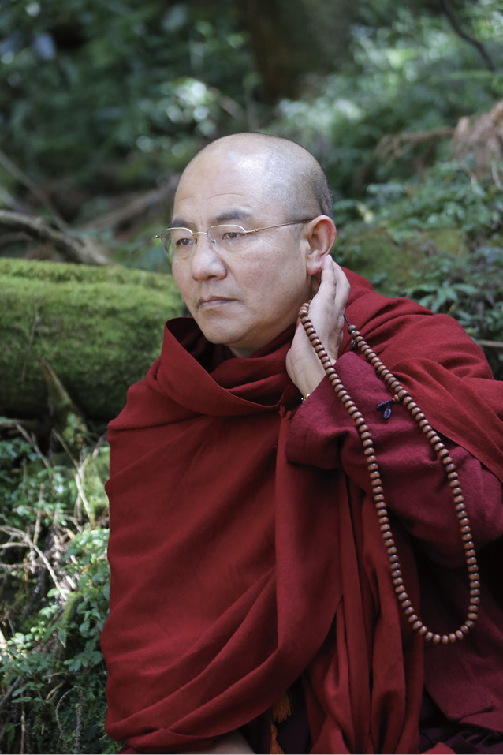
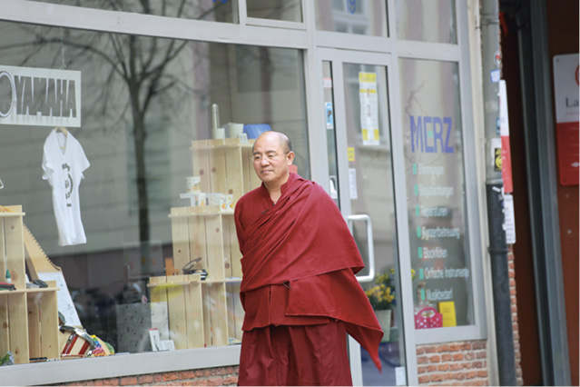
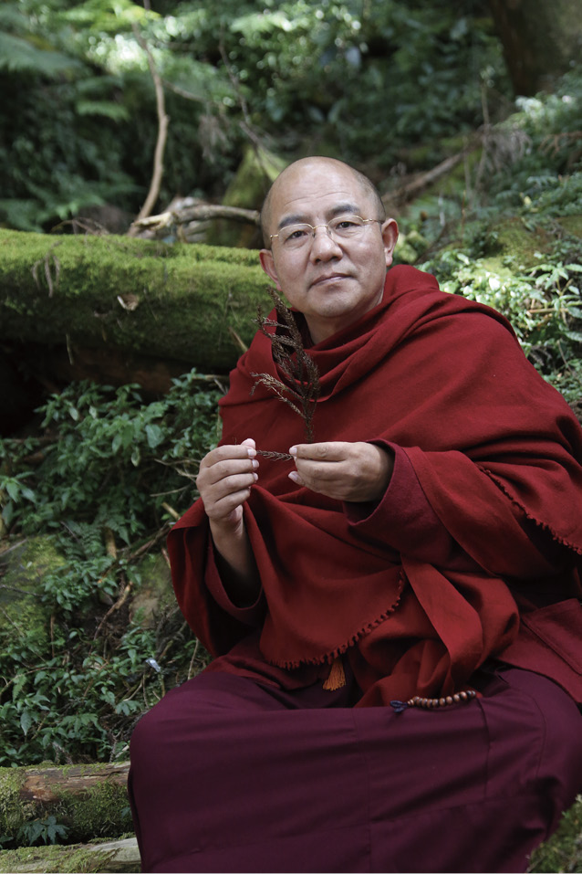

## 莫舍己道 勿扰他心

2013年10月9日

这个时代给人们一种危机感和强大的压力，许多人在压力下喘不过气来，极其痛苦。而两千五百多年前，本师释迦牟尼佛给大家留下来的非常珍贵的教言，正好成为人们心灵的妙药，这种心灵妙药由历代传承大师们通过口传一直传到现在。

尤其是佛法兴盛的藏地，毫不夸张地说，如今已经像当年的印度。这不是我作为一个藏族修行人才极力赞叹，如今东西方最顶尖的学者、修行人、成就者，他们都异口同声地赞叹着。我们用智慧去分析这种赞叹的时候，也毫无反驳的理由。

在座的各位，虽获得了暇满人身，然而人生短暂，在这短暂的因缘中，遇到了大乘佛法，遇到了这样殊胜的窍诀、教言，确确实实非常难得，但很多人不知晓其珍贵的价值，这样可能与它擦肩而过，甚至背道而驰。

在座的无论是在家人还是出家人，都一定要珍惜现在的机缘，你心灵的状态、身体的状态，以及现在各方面的因缘瞬息万变，可能很短的时间就会改变。因此，大家要有一种危机感或紧迫感，要知道当前的因缘极为殊胜，来之不易。

## 一、法王如意宝的临终开示

今天想跟大家宣讲的内容，是法王如意宝当年示现圆寂之前，留给大家最后的教言。

前段时间我在讲课时，曾引用释迦牟尼佛说过的偈颂：“诸行无常，是生灭法，生灭灭已，寂灭为乐。”此偈功德和加持非常大，后来国内外的道友们以各种文字书写下来，贴在包括办公室在内的各种场所。对我们修行人而言，若是哪怕一个偈颂、一句话，令自己的人生有了重大改变，这便可以称为修行。

时常在我耳边响起的法王如意宝最后的声音，就是今天要讲的八个字。这八个字在藏文中有不同的解读，但以我的理解，翻译成汉语就是：“莫舍己道，勿扰他心。”如何翻译这八个字，我考虑了很久，有些人说是不要舍弃自己的决心，有些说是不要舍弃本分，有些人说是不要舍弃自己的行为，但可能“道”字最合适——“莫舍己道”，就是不要舍弃自己的道，不要舍弃自己的道心，或是道德；“勿扰他心”，就是不要扰乱他人的心。

首先我简单讲一下，法王如意宝示现圆寂前宣说这八个字的背景与经过。法王圆寂的时间，是公历2004年1月7日上午。丹增活佛在法王如意宝圆寂后，采访了法王身边的一些人，记录了法王示现圆寂前后的具体状况。

法王如意宝在他圆寂之前的四年，第一年讲《百业经》，第二年讲《入菩萨行论》，第三年讲《大幻化网·光明藏论》，第四年讲《上师心滴》。这四年法王一直在说：“这是我最后留给大家的四大教言，也可以说是四部大法。”

作为弟子，在我的观察中，这四部法讲完后，法王如意宝就像一位随时准备离开的客人，之后的教言中经常流露出不会久住于世的打算。2002年到2003年间，法王又讲了《贤愚经》《大圆满前行引导文》，以及麦彭仁波切的《辩中边论释》《辨法法性论释》。之后开始讲麦彭仁波切的《宝性论释》，刚讲不久，法王的妹妹阿里美珠示现圆寂。

后来学院开极乐法会，法王在藏历九月二十二日天降日那天，来居士林给大家灌了顶——法王“阿弥陀佛灌顶”的视频，我给大家提供过，网上也有。你们没有跟法王结过缘的人，应该通过网络接受这个灌顶，缘起不可思议。

灌完顶后，法王给大众的开示主要有三点：

第一是往生极乐世界的重要性。那次四面八方来的人特别多，出家人也有上万人，法王让大家一定要共同发愿往生极乐世界，如果念100万遍阿弥陀佛圣号（藏文）的话，一定会往生极乐世界，不要有任何怀疑。

第二，希望大家尽可能守持戒律。出家人有比丘戒、比丘尼戒和沙弥戒、沙弥尼戒等；居士有多分戒和一分戒，哪怕其他不能守的话，至少应守持一条不杀生戒。现在藏地杀牦牛的现象越来越多了，非常可怕，希望以后尽量不要杀生。法王还说，曾经做过一个梦，梦中托噶如意宝讲了放生的功德和必要，所以，自己发愿今后多放生并且去各地宣讲杀生的过失，希望大家以后一定要在守持一分以上清净戒律的同时，用慈悲心来维护每一个众生。

后来佛学院在戒杀、放生方面起到了非常大的作用，很多堪布、活佛致力于这些工作。

第三，法王讲到：“也许这次是我们最后一次相逢，但愿不是，以后还有明年的持明法会、金刚萨埵法会。有些人说我能活60岁，有些说95岁，有些说70多岁。但不管别人说什么，我的身体，自己非常清楚，我不会活很长时间，有没有一头老山羊那样长的寿命也很难说。”

法王说，即使他不在人间，也会经常加持我们所有众生，尤其是会时时刻刻加持我们本传承的求法者。

此后，法王继续讲觉囊朵洛瓦的《宝性论释》。到了藏历十月十五日，法王说：“这次身体不太好，按我自己的想法，不愿出去看病，即使给100万，我都不想去。但去或不去，我还是随顺你们，由学院来决定。如果大家觉得有必要去，我也同意。”学院的相关负责人再三商量后，祈求上师下去看病，于是上师去成都做了心脏搭桥手术。

法王在成都看病期间，要求学院修金刚橛。记得当时法王说，他在尼泊尔取的金刚橛伏藏法，从来没有毁坏过缘起，具有特殊加持，而且法主是像顶果钦哲仁波切那样非常重要的世界级大师们。所以，此法对修行人遣除违缘有特别殊胜的缘起，要求学院进行大修。

法王开取伏藏时，当时有索顿喇嘛、热巴医生和我三个人在场，应该有比较殊胜的传承，所以法王让我们三个做主法上师，带领大家修法——藏地任何一个大修都需要有人主法。我们再三商量，不敢在僧众面前这样出现，但不坐在上面也不行——法王可能有些特殊密意和缘起。最后，我们三个人在大经堂的程控室里修了三天。

修完的那一天是藏历十一月六日，法王打电话让全学院的人集中，要讲一些教言。刚开始，法王给大家讲了要清净戒律、闻思修行、利益他众等，然后问我们三个在不在？程控室的人说我们三个都在，法王显得比较高兴，说：“这样很好，此法很殊胜，有特殊缘起。”

最后总结时，法王说：“莫舍己道，勿扰他心。”法王稍微解释了一下：“以后不要舍弃自己的道，也不要扰乱他人的心，无论你们依止我多少年，这就是我最终的教言。”当他这样讲的时候，我心里有种特殊的感觉：“这句话的意义好深哦，法王不会圆寂吧？”我产生了这种分别念，但又觉得不可能，平时法王也经常有类似的教言。

这八个字是法王于藏历十一月初六（公历2003年12月28日）宣讲的。藏历十一月十五日，法王示现圆寂，往生极乐世界。

老人家一辈子讲经说法，最后给大家留下来的就是这八个字。现在藏地不管哪所学校，都用藏文写着这八个大字，这是法王一生中留给大家最深、最妙、最有加持力的一句话。

这句话怎么解释呢？

## 二、甚深内涵

### 1．总义涵盖小乘道和大乘道

如果从总义上解释，“莫舍己道”实际上是讲别解脱道。别解脱道行者主要就是守持清净的戒律，维护自己的道，并且不会舍弃。虽然他没有广大利益众生的心，但一定会入于一条非常珍贵的道，持续修持，直至获得解脱。

后一句讲大乘道，“勿扰他心”。“扰”字有扰乱、损害的意思，如果说重一点，就是杀害、伤害；如果用简单的意思来解释，就是不要扰乱别人的心。相对自我的解脱而言，大乘道更为重视不伤害众生、不扰乱他人的心。按菩萨乘的观点，所有众生都当过自己的父母，哪怕以斜眼视众生，在菩萨戒中也是严格遮止的。所以，第二句讲的是大乘见修行果的所有要诀。

### 2．从各个角度剖析“莫舍己道”

从字面上解释，“莫舍己道”里面的“道”，与藏文相对应有多种含义——有本质、本分的意思，也有道德的意思，即不要舍弃自己的本分，不要舍弃自己的本质，不要舍弃自己的道德，不要舍弃自己的修道。总之，就是不要舍弃自己的道。

“道”也可以是一种思想体系，比如孔孟之道，这时，“道”指的是一种宗教或者文化，它的思想载体称为“道”。作为佛教徒，佛陀的见修行果就是道，这种思想和道德不能舍弃。

如果把“道”解释为道德，那么“道”有合理性的含义，“君子爱财，取之有道”，它是一种合理的道德，即不要舍弃自己合理的道心、合理的行为。

“道”也有方向、道路的意思，还有规律的意思。比如《易经》中说：“一阴一阳之谓道。”意思就是，阴阳是一种规律，是一种大道，这种道最好不要舍弃，如果舍弃了，则人不像人，鬼不像鬼。

从世间法的角度来说，也可以把“道”解释为我们的民族文化，包括语言文字和传统文化。现在很多藏族人，把自己固有的民族传统文化和修行完全舍弃，一直学习汉族人；而汉族人把本有的传统文化和道德规范基本上也舍弃了，转而开始学习西方文化。

我经常看到现在的年轻人头发染得红红黄黄，有些学者故意把头发染成白色，装作很成熟。甚至一些年轻人故意穿破破烂烂的衣服，把膝盖露出来。古代因为物资很缺乏，所以衣服上有很多窟窿，现在的人却认为这样很时髦。

很多藏族年轻人也这样，我前段时间去学校时，让他们不要穿那些破烂的衣服。外面有些居士供养的衣服他们都不喜欢穿，却很喜欢穿这种破衣服。现在很多年轻人看起来特别可怜，在修行、文化、道德方面，基本上已经失去了原有的传统。有些学生根本不像学生，按我们四川人的说法是“二流子”——原来我们在读书的时候，经常在街上看到那种人。这些都是已经舍弃了自己的道。所以法王的这句教言，确实有很多深意。

去年有一次，我去四川省藏文学校，有些老师要求我讲一堂课，我当时没有做任何准备，就想起了法王的这两句教言，不用说一堂课，就是三四堂课都可以讲。因为，那所学校虽然比较不错，但我也看到很多学生都舍弃了自己的道。

还有些父母也舍弃了自己的道。现在很多父母根本不想养孩子，不关心孩子学知识，而是整天闹离婚，搞很多非法的行为。这是作为父母舍弃了自己的道。

修行人也有修行人的道。出家人的道是什么？就是守持戒律，穿出家人的衣服……现在有些出家人不像出家人，在家人不像在家人，上半身穿出家的衣服，下半身穿在家的衣服；有些上半身穿在家的衣服，下半身穿出家的衣服。头发也长长的，不伦不类。这就是作为出家人舍弃了自己的道。

佛教有佛教的修道，道教有道教的修道，但很多修道的人舍弃自己的道，不好好修行，整天为了名声、利养、钱财而奔波，这样非常可怕。

不管是在家人、出家人，还是老年人、年轻人，什么样的人最好都不要舍弃自己的道——自己的本分、自己的规矩、自己的行为、自己的道德、自己的修行……

所以，此教言确实非常殊胜，它的藏文现已被包括国外大德在内的很多人当作人生信条，希望你们在这一堂课之后，将它作为自己的书签，指引自己今后的人生。

### 3．从菩提心的角度，剖析“勿扰他心”

现在社会确实很需要“不舍弃”，除了不舍弃自己的道，我们还要利益别人。如果讲得高一点，它完全是菩提心，这是大乘佛教真正的精髓。

因为菩提心不害任何众生，无论外在的言行，还是内心的作意，都要饶益有情，而不能损害有情。所以，在菩萨道中，我们应尽心尽力利益他人。哪怕用眼睛看人的时候，也不要用怒视、斜视或者不屑一顾的眼神；与人交谈时，不要说伤人的语言。

有些人出口伤人，基本上说不出一句好话，而且说别人过失时用很多成语，很有口才，很有天赋，可能当初“父母工厂”造他的时候，嘴巴造成了说恶语的嘴。当然，凡夫人说话时不可能完全不伤害、不扰乱别人，但如果以利他心说别人的过失，比如老师因特别爱自己的学生、父母因爱自己的孩子，责备一两句，可能当时令他心里有些不悦，但这不算真正的扰乱。

任何人都最好不要扰乱别人的心。如果一生中能做到这点，确实是“阿弥陀佛”了。

“勿扰他心”，这里的“他”，不仅仅指的是人类，而是包括动物在内的所有众生。一个真正的修行人，尽量不扰乱、不损害任何与我们共同生存在同一个地球上的众生，它们同样有感受，它们的生命同样珍贵，因此我们最好也不要扰乱它们的心。

生命平等，任何人都没有权力践踏其他众生珍贵的生命。只要有人类存在，自他平等这样的真理，其价值永远不会消失，利他心永远珍贵。除非在非常不道德、非常黑暗的社会，害人被当作是一种高妙的手段，或者杀害其他众生被认为是勇敢的行为，但这是不道德的，不符合人类的规范，这是极少数内心迷乱者颠倒的心态。

慈悲心在人类所有的心态中是最高尚的，具有无与伦比的价值。在21世纪的今天，人们逐渐发现，对人类也好，对地球上其他所有的生物也好，害他的心实际上很不好，而饶益别人的心、帮助别人的心在世间弥足珍贵。

### 4．修行路上的“方向盘”

法王临终的这八个字，对我们学院所有人来说，相当于一个“方向盘”，每个人以后都要尽量往“不舍弃自己的道，不扰乱他人的心”这个方向靠拢。我们学院整体的修行方向也是如此。

现在世间很多新文化、新思想、新潮流此起彼伏，不断涌现，在这时，我们都要想起：十年前法王如意宝给我们留下了一个教言——不要舍弃自己的道。学院是以闻思修行、讲经说法为中心的一个庞大的僧团，在这里，古老的思想和佛教文化，以及现代知识互相结合，法王在世时的传统是不能舍弃的。

在各种社会冲突频发的时代，我们都应谨记法王临终时给予我们的教言——无论在任何时候，对任何众生都不能有任何伤害的心，不能有任何扰乱的心。比如两个人因烦恼现起而发生冲突时，就要想到：法王以前讲过，我作为一个出家人，一方面无论是着装、说话、行为，尽量不要舍弃自己的道；另一方面尽量不要有害众生的心。

现在有很多害众生的行为，比如藏地有杀牛、杀人的行为，汉地也是。今天上午有一则新闻，一个年轻人杀了8岁的孩子；前段时间两个年轻人因为感情闹矛盾，女方要求分手，男方心生怨恨，刺了女方17刀，然后自杀。这种现象，以前汉地比较少见，但这几年经常发生。美国最近也出现这种新闻。现在世界上各个国家都有用武器来杀害别人的现象。

作为一个出家人，如果完全舍弃了自己的道，就会害别人、扰乱别人的心。因此我经常跟发心人员说，发心时要尽量使用温和的语言。现在个别发心人，可能修行不好、素质不够，说话时动辄刺伤他人的心。当然，有些是无意中让人起烦恼，但有些人说话害人，行为也害人，这样算不算一个出家人，算不算一个修行人？

世间任何一个人，如果始终都有害别人的心，自己迟早会吃亏的。谁也无法逃脱善有善报、恶有恶报的因果规律，自己种下的一颗种子，在因缘具足的情况下，它一定会生果，最后自己不可避免会感受或苦或乐的果报。

## 三、保护珍贵人类文化

从世间文化来讲，汉族有汉族的文化，蒙古族有蒙古族的文化，羌族有羌族的文化……希望今天在座的每一个人，无论是出家人还是在家人，藏族学生还是汉族学生，任何身份的人都不要舍弃自己的文化。在如今的时代潮流中，我们藏族很多人舍弃了自己的传统，这一点非常令人痛心。

现在，全世界的人都将目光投向藏地雪域高原，藏地的蓝天白云很美，但更美的是，在蓝天白云和绿草江河的中间，有一种古老神秘的、以佛教文化为主的深奥思想，这种思想，如今很多人都在挖掘，而我们本民族的许多年轻人不仅没有感受到，甚至以各种方式诋毁、诽谤。自己不去学习，就不知道它的价值、它的深奥、它的美味，当你没有品尝到它的甘露妙味时，就可能会抛弃。而法王的这句话已经明确指明：不要放弃自己的道。

现在很多年轻人根本不会说藏语，非常可惜。我前段时间去国外时，采访了很多教授：“你会不会说自己本民族的语言？现在世界上很多语言文字，有些已经完全消失了，有些正在消失。有些非常有价值，但因为我们后人不重视它，便消失了。你们有什么看法？”

我想，现在这个时代的人，一辈子不能只为了一点钱而忙忙碌碌，这不是人该有的样子。除了自己的衣食住行，我们还要考虑到：有这么多珍贵的文化宝藏正在我们手里消失，这样一来，无论你是什么民族的人，是不是成了历史的罪人？这点值得大家关心。
