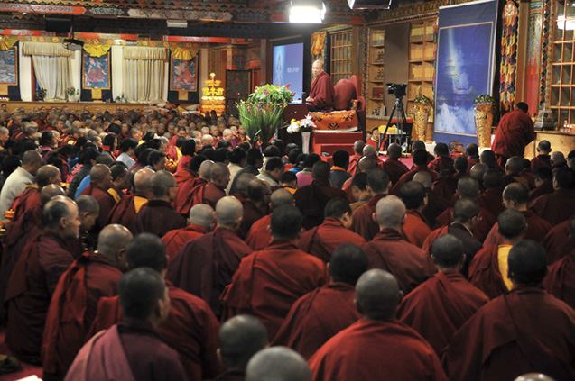
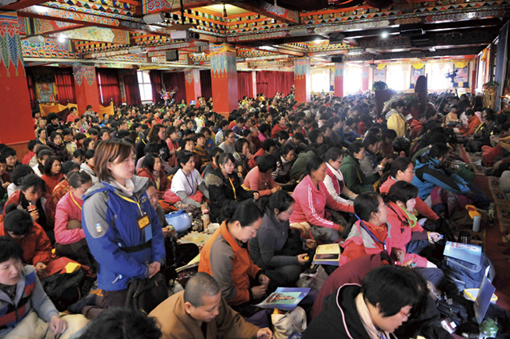
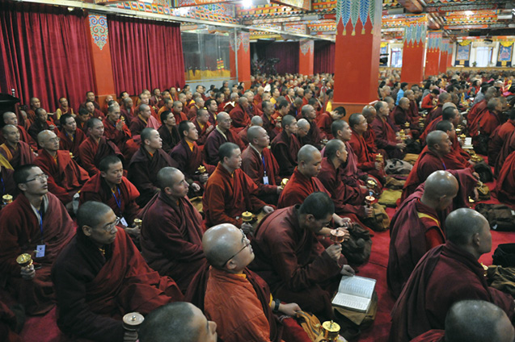
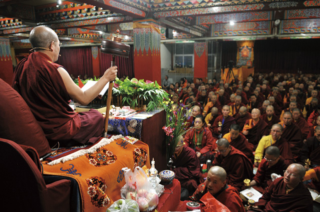

## 金刚萨埵忏悔法

2013年5月18日

今天跟大家简单讲一下忏悔法门。无论学修任何宗派，忏悔法门的确非常重要。

## 一、忏悔的重要性

### 1．前世今生 恶业累累

为什么要修金刚萨埵法呢？我们每个人，不管是什么身份，从无始以来直到现在，身口意三门造的罪业罄竹难书：身体造的恶业——杀生、偷盗、邪淫；语言造的恶业——妄语、恶语、绮语、离间语；意业——心里经常生贪心、嗔心、痴心等；受了别解脱戒后没有好好守持；依靠菩萨戒仪轨发了菩提心，但没有按菩萨戒的要求去做，经常舍弃众生；已经接受了灌顶，但由于对密宗的戒律一窍不通，导致密乘誓言不清净……

即生中有些罪业也许已经想不起来了，比如孩提时杀生；印象比较深刻的部分罪业可能想得起来——有些女众堕胎，男众杀害众生，或者欺骗别人等特别明显的过失。每当回忆起这些经历时，自己也觉得很愧疚，但因为当时不懂因果，烦恼深重，再加上其他各种压力，不得不这样做，最后内心非常痛苦、伤心。

现在城市里，尤其是沿海地区经常点杀活鱼、活虾，故意践踏其他众生的生命……杀害一个众生的果报也极为可怕，更何况我们以前造了这么多恶业。

我们不知道死亡什么时候来临，如果没有忏悔清净，这些罪业一定会等着你，因果绝对不会耗尽，不会凭空消失。所以，我们没有任何理由不需要忏悔。

另外，前世的业、再前世的业、再再前世的业……根本想不起来，这些恶业一直没有忏悔，仍然储存在阿赖耶上。一旦因缘积聚时，必定会感受痛苦。为什么有些病人再怎么吃药、再怎么治疗、再怎么做佛事、再怎么做功德都好不了？完全可以断定：这是前世或今生的业。

有人说：我今生做好事，为什么还会经历诸多不幸？如果人只有一世，你的疑惑确实难以解释，但我们已经轮回了无数次。即生你是一个善良的人，没有造过大的罪业，但不一定前世也很善良，再前世、再往前推的十几世、二十世、一百世、五百世，你都能断定自己是一个很善良的、没有造过任何罪业的人吗？我们谁都无法断定。

还有人说：我为什么要念金刚萨埵呀？我又没有造什么罪业，我很清净、我很善良呀……其实这特别荒唐！如果你真正是佛菩萨应世，那肯定不会造恶业，而作为一个凡夫人来到这个娑婆世界，我们的身口意在无数次的生死流转中，肯定造了无量无边的罪业。

所以，在座的人，首先不要认为自己很清净，一定要懂得为什么必须忏悔。你们每一个人扪心自问：从小到现在，不说前世的前世造了多少业，我们即生所造的业，如果没来得及忏悔清净就离开人间，以后有没有解脱的机会？

尤其汉地跟藏地不同，藏族人在全民信佛的大环境下，从小就信奉因果。我经常发愿：以后不要转生到不信因果的边地。否则，根据当时当地的教育、家庭和生活环境，造下诸多罪业之后，可能人到中年才知道原来不信佛教之前造了那么多罪业，有些是已经到了晚年七八十岁的时候才醒悟过来。这样非常可怕。

### 2．诚信因果 净障积资

无垢光尊者在《大圆满心性休息》中讲过：无论是出家人还是在家人，得菩提果之前，积资净障不可缺少。

我们千万不能说一些特别大的空话：一切万法都是空性的，一切都应无有执著，忏悔也是一种执著相……这样特别可怕！那吃饭也是空性的，如果不吃饭可能忍不住吧？如果你觉得是空性的，那你不要执著，中午不要吃饭试一试，等到了两点钟的时候，你可能忍不住，感觉上就不是空性了。

万法是不是空性？是空性，但我们没有达到这个境界之前，光口头上这样说起不到作用，罪业一定会成熟的，善业也一定会成熟的。

所以，大家一定要深刻地认识到，忏悔并不是要别人监督你，而是自己一定要有一种非常深刻的后悔心，真正对以前所造的罪业进行反省，觉得我不懂因果道理之前太可怕了！太愚痴了！如果有这样的心态，通过念诵40万遍金刚萨埵心咒，一定能忏悔清净。

有些人想得很简单：“上师呀！千万不要让我堕恶趣呀！我一切的一切全部都交付您、依赖您、依止您、皈依您、委托您，我一切都靠您了！”上师也说：“嗯嗯，好好，没问题！没问题！”其实不一定。比如一个犯了重罪的人，对一个熟悉的领导说：“领导呀，虽然我做了很多坏事，但请您一定不要让我进监狱。”领导回答：“没问题！没问题！”结果领导自己进了监狱也很难说。

因果是很可怕的。《百业经》中讲了各种情况，有些弟子在地狱里，上师也在地狱里。就像世间人说“法律面前人人平等”，在业果面前同样也是人人平等。所以，关键是要诚信因果，同时要发自内心地自我反省。

我也经常想，如果在一年中没有念完40万遍金刚萨埵心咒就死了，很害怕相续中尚未清净的罪障会影响自己的解脱与来世；每年念完金刚萨埵心咒40万遍后，就好像有了一种安全感。

### 3．伏藏法门 特殊加持

以前藏地的高僧大德，像宗喀巴大师等也非常提倡修金刚萨埵修法，但最注重此法的就是上师如意宝。上师如意宝用智慧的双目照见我们众生相续中无边的罪行，然后特别开取了金刚萨埵伏藏法门。我翻译了法王1995年在青海开取的金刚萨埵伏藏法，莲花生大士一千多年前就在伏藏的后文中讲了，此法与汉地众生有非常殊胜的因缘。上师开取此伏藏法门时学院人不是很多，但法王说：“未来汉地将会有无数佛教徒因此得到利益。”当时将此授记在学院的南山立成文字。

我最近受美国科罗拉多大学邀请，讲了关于伏藏方面——意伏藏、地伏藏等各种伏藏的道理。汉族弟子对伏藏法门缺乏研究，而美国人对伏藏法特别有信心，20年前就有很多美国人研究伏藏。对当今世界来讲，伏藏是一种非常新鲜、具有活力、有特殊加持的法门。所以，我们哪怕能稍作念诵，功德也不可思议。

这次法会用的是麦彭仁波切意伏藏的仪轨，学院在会供、上师圆寂纪念日时，念修的是上师如意宝的《金刚萨埵仪轨》，平时用的是法王如意宝以前造的那个短短的仪轨，这些你们都可以念。

### 4．终身修持 忏悔法门

希望各位以后把金刚萨埵法门作为自己终生修持的法。为什么呢？因为如果相续被特别大的罪障所覆盖，修法也修不起来。法王在《忠言心之明点》中讲过，我们的心相当于一面明亮的镜子，如果镜面被厚厚的尘埃所遮障，那镜子中根本显现不出任何影像；当我们用忏悔的白布，将所有尘垢全部擦掉后，镜面就会重新变得澄净，影像自然而然会呈现出来。

每个人身语意三门所造的罪业不可胜数，所以，忏悔在修行的过程中非常重要。以前智悲光尊者和华智仁波切的传承弟子经常念100万遍百字明。那天有个别汉族佛友在我面前发愿念100万遍百字明，我发自内心很随喜。这次开金刚萨埵法会时，不要只是以一种好奇心来参加，也不要认为这是别人的法会，与我无关。

特别希望参加这次法会的，包括在网络上共修的所有人，通过修持金刚萨埵法门都能有所转变——原来你的相续是不清净的、有染污性的，但通过修行忏悔法门，你的相续在临死之前真正能得以清净。若能如此，无论什么身份，得人身是有意义的，遇到忏悔法门是有意义的。如果只是形象上、表面上的修法，对清净自相续并无太大作用。所以，最关键的是，每个人是否实质性地进行了忏悔。

我们降魔胜利洲作为此次法会的主办单位，很多出家人非常辛苦，个别法师和接待人员好几夜都没有好好休息，一直在为法会服务。虽然我们做得不是很理想，但大家都努力在做。目的是什么呢？就是很希望大家实质性地、发自内心地忏悔，希望各位的相续得以清净。

生命太短暂了，世界上每一分钟就有两个人因为交通事故死亡，除此之外，每天因为癌症而死的人有多少？因为自杀而死的人又有多少？当然，正常死亡的人数更多。所以，我们的生命相当脆弱。当你到了生命的最后阶段，可能会想：我这辈子做了很多不好的事情，现在只有下地狱感受痛苦了。到时医院给你的家人下一个病危通知，有些表面上抢救一下，故意让你的生命再延续一阵，这样医院就可以多挣点钱。在这种死也死不了，活也活不了的状态中，你就需要多感受一段时间的痛苦。

在这样可怕的社会，谁都有可能会经历此类恐怖的现象。这时，如果自己修行稍微有点境界、有些把握，生命虽然是无常的，谁也无法避免，但我们在有生之年，通过自身的修行，在面对死亡时，确实跟一般浑浑噩噩、迷茫的人不同。这一点，希望每个人应该有所准备。

我昨前天遇到一个藏地的老乡，他的工作是替某单位守门的门卫。他说每月只有四五百块钱的工资，但是每年能念100万阿弥陀佛名号、100万金刚萨埵心咒，已经接近20年了，从未间断，因为害怕无常会突然降临，想在此之前多积资净障。我说，我要赶快念完40万遍金刚萨埵心咒。他说：“40万遍很简单，没有什么。”

我平时看到很多汉地的佛教徒，有些地方确实跟藏地佛教徒不同。藏地佛教徒，包括居士，不管在任何地方，手里都拿着念珠和转经轮；汉地不学佛的暂且不谈，但学佛已经十几年、二十几年的人，也从来不拿念珠，即使拿念珠也从来都不念。很多道友有时是心力不够，有时是散乱太多。

希望作为佛教徒，应该随时拿着念珠。个别人，比如大学老师，可能在某些环境中不一定方便，除此之外，如果没有什么特殊情况，要养成随时拿念珠的习惯。原来法王如意宝也讲过，拿着念珠说明你还是在念咒语，这样很好。前辈的这些大德们，在念咒语方面有很大的成就，大家一定要随学。

以上讲到了忏悔的重要性，接下来为大家略说忏悔的方式。

## 二、忏悔的方式

### 1．观想金刚萨埵

修忏悔法时，最好是将金刚萨埵作为本尊。麦彭仁波切讲过，金刚萨埵实际上就是时轮金刚、喜金刚等一切本尊，是大幻化网的本尊，是忿怒和寂静所有本尊的总集；过去、现在、未来诸佛，过去、现在、未来的所有上师、本尊，都可以观想成金刚萨埵。我们经常说金刚萨埵是百部主尊，什么叫“百部主尊”呢？按照观想的对境来分，像时轮金刚、药师佛、不动佛……全部结合起来，可以观想为金刚萨埵，他代表十方诸佛菩萨、十方空行护法众。

详细的观修方法，《大圆满前行》等已经讲得很清楚，但初学者如果不是特别明白，那就在自己前方的虚空中或头顶上观想一尊金刚萨埵即可。如果有密宗等净无二的境界，可以观想双运像的金刚萨埵本尊；但如果没有清净心或不具足密宗的甚深见解，就观想单身像的金刚萨埵。或者把金刚萨埵佛像放在前面，边念“嗡班匝儿萨埵吽”边忏悔自己无始以来所造的罪业。忏悔完毕，接近回向时，观想金刚萨埵的身体放光，降下甘露，自己无始以来所造的所有罪业全部得以清净。

如是在金刚萨埵面前，以一种极其虔诚的心进行忏悔。我从今天很多人念诵时的表情上看，他们真的在发自内心地忏悔。这并不是在别人面前故意显示一种什么形象。如果我们的自性罪业清净、障碍清净的话，智慧会增长，悲心也会增长，修行、背诵、学习经论等都很容易。

因此，这次喇荣圣地这么多僧众、信众，还有这么多菩萨，一起共同实修非常有功德。在网络上共修的道友们，虽然无法来到现场，但我们的心连在一起，意愿也连在一起。佛陀在《文殊刹土功德庄严经》中说：何人有如何的善愿，那么所发之愿必定会实现。所以，我们共同发愿一定会实现的。

### 2．四种对治力

在修金刚萨埵时，经常讲四种对治力：以金刚萨埵作为忏悔的所依对境，具足愿行菩提心，即是所依对治力；要认识自己的罪业，并对这些罪业产生后悔之心，即是厌患对治力；发愿从即日起尽量不再造恶（当然有个别罪业，比如不说妄语，爱说妄语的人立即完全断掉有一定困难，但我发愿以后尽量不做这样的罪业），是返回对治力；依靠念诵金刚萨埵心咒或百字明忏悔罪业，是现行对治力。以四对治力进行忏悔，罪业一定会清净。

在念诵咒语时，具有清晰观想的能力当然最好，如果实在没有观想的能力也不用痛苦，即使仅仅念诵咒语也有无量无边的功德。有些人跟我讲：“我观想能力太差了，什么都观不起来。不好的事情我观得特别清楚，观怨恨的敌人时，他的长相、他所做的坏事在脑海中特别清晰地浮现，但是观金刚萨埵观不出来……”

## 三、念修金刚萨埵的功德

麦彭仁波切讲过念修金刚萨埵的功德，他引用一些教证说[^1]：如果念10万遍金刚萨埵心咒，即使破密宗根本戒的罪业也能得以遣除。毁坏密宗根本戒是所有罪业当中最可怕的，破了以后很难恢复。原来法王说，续部中说念10万遍就能清净，但现在末法时代，要再乘以4倍，也就是念诵40万遍一定会清净。很多藏传佛教的大德也说，根据续部，念诵10万遍能够清净。以前我刚出家时，一位老出家人处理一件事情的时候说：“相关续部说，如果念10万遍，即使犯了密乘根本戒也一定会得以清净，更何况是40万遍。”这件事后来我印象很深。

所以，即使造的罪业比较多，但依靠念金刚萨埵心咒确实有清净的机会。法王如意宝在1997年说，以后学院和我们所有传承弟子，一定要通过念修40万遍金刚萨埵心咒来忏悔自相续的罪业，而且最好是每年做一次这样的佛事。从此之后，每年负责举办金刚萨埵法会的重要任务就交给了喇荣佛学院的汉族弟众。

学院的常住，基本上法会期间都完成不了40万遍金刚萨埵心咒，我也是其中之一吧——本来我可以跟其他喇嘛一样，自己好好参加法会，但我们这里开法会要涉及很多人的住处、饮食等方方面面。我也不断地在批评管理人员，说这个管家处理得不行，那个法师安排得不行……他们现在很多人都不接我的电话了。所以我们常住开金刚萨埵法会的时候，很多人不但不能忏悔罪业，还可能造了很多业，经常生嗔恨心等。但无论如何，人身很难得，来到这个世界遇到忏悔法门，有忏悔的机会，确实很幸运。现在有些人赚了几百万就觉得自己很成功、很幸运，但这到底成了罪业还是善业也不好说。

我确实这样认为，能值遇此忏悔法门，都是非常有机缘的，希望参加法会的人要珍惜时间。我前面也讲了，这个月是萨嘎月，释迦牟尼佛降生、成道、涅槃都汇集在本月。在萨嘎月做任何一件善事，功德增长的倍数相当高。所以，在萨嘎月，要把所有的琐事都处理好，全力以赴地念修金刚萨埵。

[^1]: 《金刚手续》云：“如能如理念诵十万遍心咒，则可清净毁坏根本誓言重罪。”
