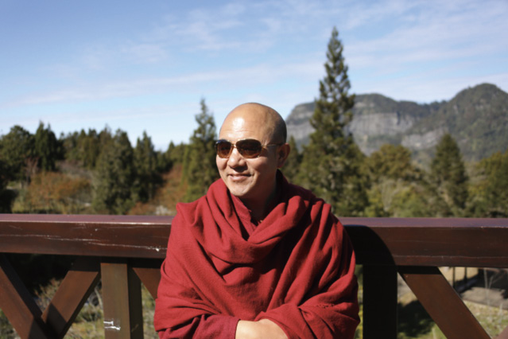
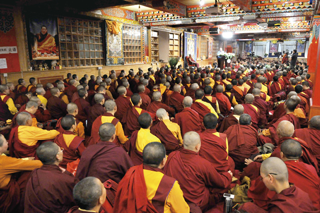
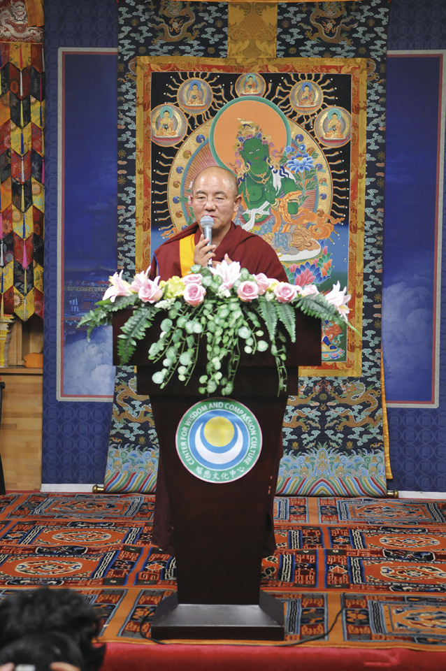
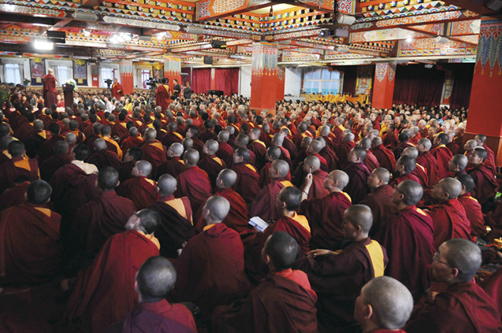

## 面向未来 走向光明

2013年10月20日

今天跟大家探讨的话题是“面向未来，走向光明”。今年学会的很多学员即将毕业，那之后是不是就永远不用学习了？其实不是。我特意安排今晚的时间，针对此问题与大家共同交流。

## 誓言坚定 继续闻思修行

大家顶着家庭的压力、工作的压力，忍着身体的病痛等，来到这里学习很不容易，非常辛苦，但我想，各位以后还应该继续不断地闻思修行。

今天想给大家提一些建议，教务处会根据这些建议的内容形成文字发给大家，希望大家认真思考，不要很草率地决定。我发现有人刚开始发愿很难，但一旦真正发了愿之后再也不会改变，一直非常坚定。《二规教言论》当中也讲了，誓言坚定非常重要，希望道友们都能做到誓言坚定。

汉地各个地方的佛教徒，在茫茫人海中，在各种世间学说云集的当今时代，你们邂逅并信仰藏传佛教，获得了系统学习佛法的机会，这对各位来讲十分难得，就像是在漆黑一片的夜晚出现的闪电一样，非常短暂且来之不易。但如果学习佛法没有任何计划，没有任何安排，仅仅依靠自学的话，末法时代的众生烦恼非常深重，根本无法完成。

所以我在接近七年前，给大家推行了一个共同学习的方式。在此过程中，有些人无论遇到什么困难和违缘都没有阻碍自己的道心与决心，一直在坚持学习，直至今天，学修仍然非常圆满。

今后，你是继续走这一条路，还是走另一条路？选择权在你自己手里。

今年我们在整体思路上有所转变，有一个三年或五年的计划。但我的寿命能不能那么长？很难说。我的修行是不是五年当中不会变呢？也很难说。不过，上师如意宝曾经说过，在修行上一定要有计划，而世间法最好不要有什么计划，否则，死时可能会留下很多遗憾。但不管我在也好，不在也好，有些密法教言这几年一直保存着，等你们修完加行真正进入密法班的时候，可以给各位分享。

今天没有转班的毕业典礼，但实际上也算是一次特别的开学典礼。这段时间，我们留了一个过渡期，希望学习预科班课程的道友，要继续好好学习，一两天、三四天学不了什么。现在很多人觉得看微博就可以了，其实微博只有140个字，根本提供不了很多知识。佛法浩如烟海，不可能仅仅依靠微博、博客就能通达。作为佛教徒，只有真正系统学习过，才知道到底什么是学佛。

## 提供平台 满足各类需求

在系统学习方面，我们经过了很多次的讨论和思考，然后提供给大家一个比较宽松的空间：

一部分人可以从预科班开始学习，一部分人继续学加行，你的五十万加行从质量上、数量上还不够，离密乘的正行班有一定的距离，还要不断修加行。我们宁玛巴很多高僧大德，像如来芽尊者、华智仁波切……他们一辈子修过很多次加行。

一部分人已经学了这么长时间，现在该离开了，可以跟我说拜拜了。你已经“熬”了这么多年，现在终于毕业，也很不容易。你现在想自由地放松放松，做个流浪者，我们也不反对。但是，在你流浪的过程中，一定要依止正知正念。

一部分年纪比较大、闻思实在有困难的人，可以进入念佛堂。虽然没有像其他闻思班那样严格地管理，但我们也会时常护持你们。

还有一部分人，现在加行也修完了，如果自己各方面的条件都不错，希望你们进入密法班。密法班是学习《大圆满三休息》《中阴窍诀》，还有《大幻化网》……我觉得，真正想学密法的话，如果不通达《大幻化网·光明藏论》，真的非常可惜。现在汉地学密的人比较多，但真正懂得誓言的人非常少，这是值得我们思考的。

有些人对密宗实在生不起信心，但认为藏传佛教的五部大论确实对自己开启智慧、修行、研究等各方面很有帮助，那就给你们开设五论班，学中观、因明、般若、戒律、俱舍。

从来没有学习过的，我们也给你提供一个机会，明年或后年可以一起学习。如果你实在没有学习的意乐，只是想参与我们的活动，那就加入菩提功德会。

## 珍惜因缘 继续共同学习

今年年底开始，学会以前的闻思修行在一些方式、方法上，会略微有所改变，这种改变，对你们来讲也许是有必要的，原则上希望你们不要退下来。也许再过几年，我们大家因为因缘已尽都不得不退。任何一个因缘不可能长期不变。我来到佛学院的时候，也想生生世世不离师，但后来上师如意宝突然悄然离开……到那时，即使我们愿意闻法也没有办法。就像无垢光尊者在《窍诀宝藏论》里面所讲到的那样，一切现象都没有恒常性和稳固性。

因此，大家共同学习几年，也许对你非常有意义。当然，这由你自己选择。

你们每一个人来到这里之后，我们都在很认真地对待。我身边好多发心人员日日夜夜操劳，因为长期熬夜给大家提供各方面的方便，现在他们有的身体不好，有的眼睛不好，有的经常感冒……这也是一种付出。你们认为每天获得这种加持是很随意的，其实这非常不容易。老班里面有些发心人员也特别积极，自己一切的一切都在为他人付出，使得自己没有修完加行。而有些人没有修完加行，可能是因为自己比较懒惰。但不管怎样，希望你们不要放弃。

我们学习《入菩萨行论》等经论，主要目的是什么呢？一方面净化自心，另一方面就是要利益众生。有利益众生的机会时，一定要珍惜。

在现今社会，我建立这样的平台让大家共同学习，对我来讲也很有困难。现在很多上师也有不同的学会、中心、寺院，我们都完全支持、完全赞叹，但是我们学会里面的发心人员不要拉帮结派。不管是藏传佛教、汉传佛教，甚至其他的宗教，所有的宗教徒和非宗教徒，大家一定要有一种互相尊重、互相学习、互相理解、互相团结、和睦相处、和蔼、和合的气氛，这样我们的学习才会成功。

有些发心人员非常积极，但有些发心人员并不是很真诚，他来这里的目的不是来发心，而是专门来拉人，这也没有必要。如果你真的要拉一部分人到某某上师那里，你告诉我，我给你一部分人也可以，但你要承诺——以后你一定要护持他们。如果你让他们的解脱有保障，不管是到其他上师或其他道友那里都可以；如果这个上师真的能够保护他们，让他们好好学习佛法，那我们也非常随喜，没有任何嫉妒心。可是很多人想在这里真正学习，但你不让他们学习，用各种花言巧语把他们拉走，拉到那边去了又不管，把他们扔在那里，没有人保护，他的解脱慧命从此就断送了。我不需要你们为我个人做任何事情，但是我非常关心你们每个人的解脱。

无论任何上师，如果能多建一些佛教中心，是非常好的，现在世界上有70亿人，但佛教徒那么少，所以，如果有更多人加入，我们不会排斥。但是，佛教徒与佛教徒互相之间争来争去、搞各种宣传、诽谤、经常在上师与上师之间挑拨离间，这些都没有任何必要。我们学会不分教派，无论汉传佛教、藏传佛教、南传佛教，只要是想认真学习解脱法都可以。甚至他并非虔诚的佛教徒，但还是有做善事的意乐，我们在功德会也给他提供了一个平台。

希望发心人员以后也应该很认真地对待这些原则。我们学会走过风风雨雨的路，总体来讲，我自认为是很成功的，如果今天之后学会不复存在的话，我也没有任何怨言和后悔。

但如果以后还有因缘，我觉得佛教徒非常需要系统学习、系统闻思，尤其是密法不可思议的加持对我们来讲非常需要。不过，密法并不是任何人想听就听，我的要求非常严格，必须修完加行。虽然有些上师连灌顶都不需要，让你直接听密法，这能不能得到利益呢？也许他们是成就者，有这个办法，但对我来讲没有办法。我把原则给大家讲清楚。

## 认真对待 闻思善始善终

我们把文字发给大家之后，希望你们很认真地考虑自己的将来，这相当于是一个孩子要读书，是去美国、英国，还是在清华、北大，自己要很认真地选择，父母也要认真地考虑。

这么多人当中，有些对密法有信心，有些对显宗有信心，有些对某某上师、某某大德、某某格西有不同的信心，这些都值得赞叹，但最重要的是，大家都要非常认真地闻思修行。确实现在很多佛教徒没有认真闻思修行，他们的行为已经变成了一种形象。

我特别希望，今年大家进入密法班之后以实修为主，到时也要给大家讲实修的课程。前面五年以闻思为主，后面五年以实修为主，这样你的人生大概有十年的闻思修行，这应该是一个很美好的历程。

要求大家这样共同学习，我唯一的目的，是希望你们懂得佛教的教义，在此基础上还要实际修持。所以，我们从今天开始是一个转变，以前主要是闻思为主，以后是以密法的修行为主；以前以显宗和加行为主，以后以密宗的正行修持为主。特别愿意实修的人，希望你们加入密法班；如果你们既想参加密法的实修，又想同时学五部大论的话，我们也特别开许，你可以兼学五部大论。

其实五部大论确实很重要，尤其是你们以前读过大学，水平比较高的人。有些人虽然没有读过大学，但特别聪明。今天在座的部分人，非常聪明、有才智，希望你们在短暂的人生中，还是要学一学五部大论。如果你学了五部大论，又学了密宗，那应该会变成一个很好的佛教徒。

我在这里苦口婆心、再三再四地说，主要目的是希望你们学习佛法能善始善终，不要闻思一两年就间断了、放弃了。希望你们还是系统地学习，只有通过系统地闻思修行，才能成为真正名副其实的佛教徒。

我本人也曾经在上师如意宝面前依止了那么多年，想在晚年的时候把这些道理尽量地传给别人，这是我一生中最主要的愿望。当然，要实现愿望，不是一天两天的事情。佛教的教育不像世间一个简单的厨师培训，或者简单的演讲训练，一个月或一个礼拜就可以，我们佛教的学习，至少也要十年八年。我们佛学院的学制要15年才能毕业。五明佛学院男众教务科规定的学制原来是6年，后来提高到12年。现在我们佛学院藏族男众的学制是多少呢？15年。

所以，你们前面学了四五年，后面再学四五年的话，整个显宗和密宗加起来的学制只有10年，10年对于一个佛教徒来讲，应该不算很久。世间的九年义务教育，再加上高中三年，专科或本科四年，研究生两三年，再加上博士、博士后，这样的话，获得世间的博士文凭要多少年？所以，学习佛法时你们不要认为：“我还要念？再学5年，那我都老了。我还是退了吧！”这种想法确实很幼稚。我们喇荣佛学院基本的学制是15年，15年算是中学毕业。

## 几点希望

今晚在座的人都是对佛教有爱好、有信心的人，有些不是学会的，但我也特别希望你们好好学习佛法，因为现在人们生活中各种压力相当大，而佛教对我们的人生、生命带来一种非常好的力量，所以很多佛教徒不管面对任何逆境或顺境时，都能泰然处之。佛教在当今时代确确实实非常重要。

因此我的第一个希望，各位对佛教要有一个正面的了解。我去过很多学校，学校里的师生们对藏传佛教有一定的学习和兴趣，我也特别希望你们多了解一下藏传佛教，这非常好。藏地虽然在经济等方面比较落后，但人心淳朴、善良，而且这里保留着非常传统的藏文化。

刚才有人跟我说，这么多年以来，佛学院在法王如意宝的加持和摄受下，培养了很多人才，我也确确实实这样认为。我们佛学院没有其他事情，就是培养人才。学院的所有经堂都是教室，除了做教室以外没有其他的用途。前段时间，有位印度来的格西说：“你们佛学院所有的这些经堂都是教室啊？”我说：“是。我们这里不管是觉姆经堂还是喇嘛经堂，除了做教室以外没有其他的用途。”所以，我们的目的是什么呢？就是教育——佛教的教育！今晚网络上的人很多，我特别希望大家对佛教不要光有一个爱好，还要去了解、去修行，修行之后自相续当中的烦恼会减少。这是我提的第一个希望。

第二个希望，现在是末法时代，很多人的修行经常出一些违缘，这个人身的“机器”经常出故障，这时，你要多祈祷度母和莲花生大士，同时自己的行为也要注意。法王如意宝接近圆寂时，给我们讲过两句教言：“莫舍己道，勿扰他心。”这是我们学院所有人的修行原则，希望各位也不要舍弃自己的道——自己的道德、自己的行为、自己的善良、自己的人格，同时尽量不要杀害众生，不要伤害众生，包括吃饭的时候，不要点杀。我看到有些饭店里面，动物活生生被吃下去，很可怕。一方面吃动物的肉会给身体带来疾病，另一方面，我们短暂的快乐建立在其他众生付出生命的基础上，非常不合理。这点大家一定要注意。

其实，从健康的角度来讲，最好不要吃肉。有一位叫叶曼的女士，在她10岁那年，母亲带她去饭馆，当她看到杀羊的惨状后，就发愿不再吃肉，开始吃素。她吃素已经90年了，今年刚好100岁，她的气色很好，在各地演讲时思路都很清晰。所以从健康的角度来讲，不要经常吃肉、点杀，那样对你自身不利。

我们每一个人要有慈悲心，否则，你的笑容实际上是罗刹的化身，不一定很庄严。如果你有慈悲心，即使表面上显现忿怒相，实际上也给他人带来快乐和美好。所以，希望每个人应该铭记佛教所讲的慈悲心。
