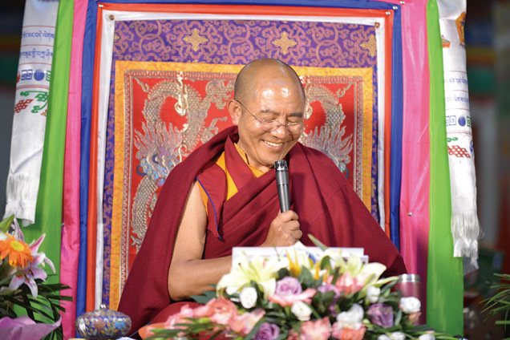
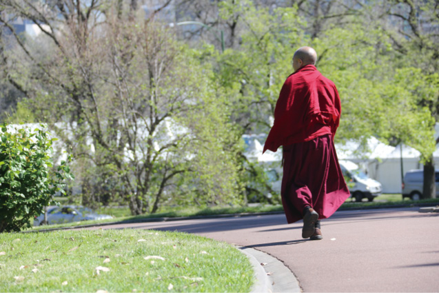
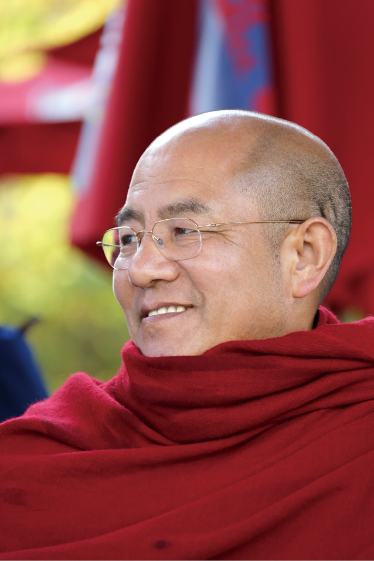
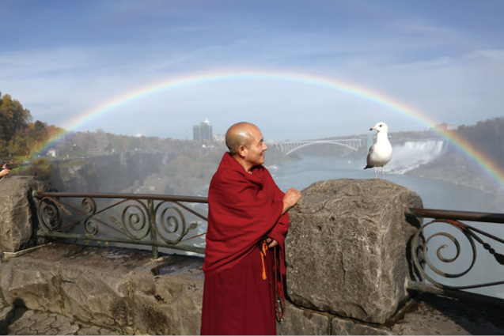

## 佛教徒的知与行

——2014年金刚萨埵法会开示（3）

2014年6月10日

今天，是我们金刚萨埵法会期间的第三次开示。开示之前，请大家把手机关闭或调至静音状态；开示期间，尽量不要走动，包括虚空中的天人、天女们，你们在三十三天和四大天王那里接受佛法就可以。

## 一、共修善举 圆满法会

我们今天在佛学院的甘多拉经堂给大家开示。甘多拉经堂是前两年开始重建的，在重建的过程中，汉地四众弟子以及各个地方的信众都参与了这个善举，付出了各自的人力、财力、物力。以前我也说过，对于甘多拉经堂，我是非常执著的，因为最初来到佛学院的时候，法王如意宝就在这里讲经，那也是我人生的一个转折时期，所以有些执著。这是一个非常有加持力的经堂。起初，这个经堂还很小，后来法王要求扩建，我们那时候就到处去背石头、背木头……去年甘多拉经堂在旧址上重建完成了，极乐法会的时候正式启用。今天我们在这里，一起发愿、一起念诵，我觉得非常殊胜。

不管是甘多拉经堂也好，觉姆大经堂也好，学院的任何一座建筑，都不同于外面的个别道场——虽然建得很大，但没有人使用，甚至没有出家人在里面。在这里，有成千上万出家人，日日夜夜都在闻思修行。这次能有如此多的佛教徒聚集于此，共同发愿，要特别感恩参与经堂建设的所有信士。学院的甘多拉经堂、觉姆大经堂、居士经堂等建筑，每年法会期间都会开放出来为大家提供方便。如果不是对大家的今生来世有特殊的意义，我们是不会轻易提供出来的。因此，我今天首先要感恩学院相关负责人给我们借用这个经堂。另外，建设经堂的资金，大多数都是包括你们在内的善男信女们通过各自的努力解决的，当然，其中也包括我。这也是我要感谢大家的。

金刚萨埵法会还要开几天，我希望无论是网上参加的人，还是在学院参加的人，法会期间都要认真念诵金刚萨埵心咒，要圆满四十万遍。我们每一个人，包括我自己，业力都很深重。或许比较起来，我还不算是罪业最严重的，因为我至少从小没有杀过生，而是从小就信仰佛教，一直对三宝有不共的虔信之心。但在别解脱戒、菩萨戒、密乘戒方面，我常犯许多戒条，同时我的身口意也造了很多的罪。所以，对于我们每个人，忏悔都是非常有必要的。

这次我也特别关注到了在网上听课、参加法会的道友们。有一部分人虽然没有亲自来到学院，但基本上与在现场无异，从早上七点一直到晚上七点，都在认真念诵。还有一些来到这里的道友，因为这次学院的住宿比较紧张，他们只能住到色达县上，每天早上五点从县城出发，赶到这里来参加法会，当天最后一座结束后，又回县城去，大概每天只能睡三四个小时，却一直这么坚持着。不知道你们明天会不会困得睡着？

还有一部分法会发心人员，包括许多负责行堂的出家人和当义工的在家人，他们都非常辛苦。我也“采访”了个别道友，他们说，两三天下来就累得爬不起来了。因为这次人比较多，他们每天都要负责所有人的餐饮供应。还有学院里的餐厅、宾馆服务，以及交通、人事、登记和身口意管理等方面，都有着许许多多的工作人员在辛苦付出着。

所以，大家应该有一种感恩的心，要知道这一切都来之不易。表面上看，所有人都在开法会，但实际上这里有很多有形和无形的服务员，这些人都是真正的活佛、真正的活菩萨。他们默默地为行持善法奉献着自己的身语意，从不为了表现什么。我觉得这也是一种非常好的忏悔方式。

还有各个地区的网络发心人员，他们也非常辛苦，从早到晚守着电脑，给大家提供许多方便。各地的学员现在可以在网上听课，如果背后没有这样一个优秀团队的付出，没有这样一群有智慧、有能力、有耐心、有精进、有禅定、有技术的人，我想现在这样伟大的事业是没有办法推进的。也许很多人都想做一番弘法利生的事业，但如果没有这种种因缘聚合、没有这么多人共襄善举，那任何事业也不可能光靠空想而成就，实际操作中的艰辛旁人难以想象。

大家都知道，现在这个时代，要聚集成千上万的人一起造恶业，方法非常多，但要聚集成千上万的人一起造善业，却并不那么容易。我们学院的管理人员，每天都要操很多心，从大家的安全到修行，方方面面，一刻都不敢放松。这几天我身体明显有点力不从心，刚刚还想为什么会这样呢？哦，原来是忙得忘了吃药，原来我也在默默无闻地付出着啊。——你们不用给我掌声，我对这些没有什么执著，要是有人给我批评的话，我倒觉得对我的修行更有帮助。

今天我利用这个时间，在甘多拉经堂给大家做个开示。在这个经堂里，我确实非常欢喜，因为这里有我依止上师如意宝的很多美好的回忆，但无法在此细说。

下面给大家说两点。第一，这次金刚萨埵法会，凡是报名参加四十万遍念诵共修的人，希望学院相关负责人统计一下，到时候我们会共同回向。包括在座各位的亲朋好友，还有网上参加的道友等，只要发愿念诵，都可以由僧众做统一回向。那时可能有些人还没有念完，但不管怎样，所有共修的总数，网上的也好、天上的也好、地上的也好，这所有善根，我们都要积聚在一起，在法会最后一天统一做大回向。

我还有一个小小的建议，法会还有两三天的时间，如果没有特殊情况，希望大家每一座都能圆满地念完。我看到极个别人，可能是刚开始学佛吧，连《普贤行愿品》都不念完就走了，这种现象网上也有，学院当中也有。一般来讲，我们念一个仪轨，最好是有头有尾。应该提前三五分钟安坐下来，从“嗡桑巴Ra桑巴Ra”开始到最后的回向都完整念诵，这样功德才算圆满。不仅仅是这次法会，希望大家以后不论听课还是做其他佛事，最好前后全部念诵圆满，这一点是很重要的。

这次法会非常难得，虽然你们很多人是从大城市来的，在生活上有些不习惯，但我觉得这都是很小的事。我们为了忏悔无始以来的罪业、为了佛法、为了修行，承受一点苦行是非常有必要的。大家可以看看高僧大德们的传记，相较于他们的苦行，我们现在根本不算什么。因此，后面的几天，希望大家不要像游客一样四处走动、拍照，这些都不重要，重要的是好好回向、好好发愿。

我以前也讲过，我们学会的人最好都按照佛学院的课前课后仪轨来念诵，当时还专门录了音频提供给大家。这次法会，我看百分之七八十的人对念诵都非常熟悉，包括前面的《圣八吉祥颂》、《大自在祈祷文》和皈依、发心仪轨，以及后面回向的《普贤行愿品》。上师如意宝在世的时候，他老人家每天讲课前后，我们都是这样念的，包括发音方式也是一样的。每天从“桑巴Ra”开始，到最后“达雅塔班赞哲雅阿瓦波达呢耶所哈”，我自己已经这么念了快三十年。长期以来，只要我在学院，每天至少这么念一次。我相信，将来的人生当中，不管我还能活多少年、多少岁、多少日子，都会把这个念诵作为自己的功课。我希望所有与学院相关的佛教徒都能照此念诵，即使只用这种发音方法，都有不可思议的加持力。这次你们在学院，有成千上万僧众亲自念诵、加持，这在末法时代是相当难得的。可能你们很多人没有意识到这点，觉得这类念诵到处都有。但其实你们应该明白，弘法利生是有缘起的。我希望学院的各位法师，在弘法和修行中都要注重这种缘起。依照传承上师的教言、法则、规矩来操作，将来的弘法利生事业也会非常顺利，自己的修行也会遣除一切逆缘，成就一切顺缘，因为这里面有不可思议的密意和缘起。

去年我发动大家念诵《大自在祈祷文》，每天如果念二十遍左右，一年多下来每个人就能完成一万遍。这样一来，对于个人，一定会获得身心自在，利益众生的能力也会越来越强大；对于佛教整体，各方面的兴盛和发展也需要有一种无形的缘起力。所以，我今天也特别要求大家，要多念《大自在祈祷文》。《大自在祈祷文》也是“怀业九本尊”的祈祷文，看上去很短，但是如果我们每天坚持念诵，一定会对自他产生非常大的功德和利益。这里面的很多道理，今天就不多说了。这是我今天要说的一件事。

开示结束后我还要给大家念《当日教言》《二十一度母礼赞文》等一些传承。今天现场和网上的人都非常多，是一种殊胜的因缘。我一般做开示不会特别长，从现在算起一个小时之内应该会完成。如果超过了一个小时，你们可以给我提示。有时候传讲者自己激动起来，讲了多长时间都不知道，下面的人都听累了。因此，一方面我不得不考虑大家的时间和身心状态，一方面又觉得这样的聚会是一种难得的因缘，如果没有抓住这次机会，你们一旦离开，今后不知道会在世界的哪个角落，要再寻找就有一定的困难。所以，我想利用这段时间，给大家提一些建议。

## 二、长期闻思 智信佛法

第一个方面，我想跟大家说，对于佛教徒而言，学习和修行是最为重要的，一定要坚持长期闻思修行。长期坚持当然是非常不容易的，对一般人来说可能比较枯燥，难以推进。但从整个佛教的人才培养和水平提升等各方面来看，我们作为佛教徒，每一个人都应该坚持长期学习。在我们佛学院中，有一些法师和道友，已经持续研究佛法二十多年了；这二三十年来，每天不间断来听课的也大有人在。而个别人刚开始的时候对学佛满腔热忱、激动无比，自信永远都会坚持下去，但过了几个月、几年，热情就慢慢消退了。

学会中也有个别跟我相识的老菩萨，起初对佛法的信心非常大，但现在却经常躲着我，即使见面也只是应付而已，我们佛教徒中有很多这样的现象。当然，人人都可能有喜新厌旧的过程，也有各自不同的修行因缘，这些都可以理解。而我现在比较担忧的是，大多数人如果没有足够长的时间投入于认真的学习当中，无论你是在家人还是出家人，佛法上的智慧都难以得到提升，因为真正的智慧并不是短暂的学习就能获得的。在世间，也需要花大量的时间，才能掌握一门专业知识，获得一个文凭。

所以，我们每一个人都应该扪心自问：我皈依佛门、学习佛法已经多少年了？现在的水平是否足以让我成为一名合格的佛教徒？我们的学习不是为了学院，也不是为了哪一位法师。如果想成为一个真正的修行人、成为一个弘法利生的人才，至少该对自己有一个评分，看看还需要下多少功夫。就像世间的小学老师、中学老师、大学老师，或者公务员、企业管理人员，分别需要怎样的水平才能胜任？首先应该具备基础通识，然后还要精研专业知识。学佛也是一样的，自己心中应该有一个衡量的标准。

所以，我首先要跟大家强调，用在学习上的时间不能太短。当然，我也不是要求大家非要在学会里待很长时间，要是学员太多，我们也没办法管理。我希望学会不断有人学成毕业，新的血液也有机会进来。你们毕业之后，可以开始自己的修行，也可以辅导别人、利益众生，这些都是我们的愿景。但从目前每个人自身来讲，一定要有一个长期学习的信念和习惯。在学会里浑水摸鱼、敷衍了事，都是不可以的。

总体看来，现在各大城市佛教徒的水平比起过去的确是有了全面的进步和提升，这一点毋庸置疑。同时，我也希望广大佛教徒不要停留在表面的行为上，特别是不能太迷信了。“迷信”是一个很难听的词，但有时看到极个别佛教徒的行为和信心，不得不说是一种迷信。有的人不管遇到什么人，都盲目地去依止；遇到什么法，都盲目地去接受；遇到什么修行机会，都盲目地去体验。这些都不是智信，而是一种迷信的表现。

我们不能不承认佛教徒中有一些迷信者，但更要知道，佛教真正的信仰和智慧，在人类文明发展长河中，从2500多年前一直流淌至今。佛教的理念，在整个人类的精神领域中，是多么伟大；对于全人类乃至一切众生，是多么宝贵！有了佛法，诸如怎样令身心真正健康快乐等今生来世的各种问题，都会迎刃而解。然而，现在还有那么多迷茫的可怜众生，根本不知道其中的甚深意义，这令我感到极其遗憾。因此，我们佛教徒在这方面有必要进一步研究、深入了解。

佛教徒应该有一种知识分子般的风范。对任何事物都要先进行观察，不要一开始就立马接受。一般有智慧的人都不会随便轻信他人，而是秉持一种理性的智慧。世间无论商业活动、文化事业、国际交流，都需要从理性出发，这种理性的智慧我们佛教团体也不可缺少。在上世纪七八十年代，汉地的佛教徒大多是一些迷信的老年人，倘若少数有智慧的学者或大学生信佛，大家就会很惊奇：怎么这个高材生也会去信佛？怎么这个名人也会去信佛？但是如今很多智者、很多高等学府的知识分子，都觉得拥有个人信仰是件很好、很正常的事。大众对于佛教的误解正在逐渐消除，正信越来越显发。所以我们佛教徒自身，更需要以一种理性的智慧来接受佛法。

当然，非佛教徒对信仰的态度主要靠他们自己，世间规则中，信仰应该是自由的。释迦牟尼佛对出家人和在家人都曾说过：因缘具足应当皈依三宝，若无因缘，不皈依三宝也可以。佛陀还强调：不要因为我是佛陀而对我的教言恭敬信受，你们应该像锤炼金子一样，再三观察我讲的法是否合理，然后再去接受[^1]。所以，我们对佛教徒和非佛教徒，都应该坦诚以待，因为这个世界上最需要的就是真理。如果真理存在于佛法之中，我们就该去接受它、崇拜它、尊重它、敬仰它；如果这种真理存在于其他任何宗教，或者是非宗教的任何文化领域当中，我们也应该去接受它、恭敬它、赞叹它。因为世界的真相值得我们每一个人去探寻、去追求。

有些人可能认为，佛教不过是一种宗教信仰，或者是一门哲学体系。但就我个人发自内心、深入骨髓、有生之年无论如何都不会改变的体会而言，世间的种种真理，其实早在2500多年前，就由我等本师释迦牟尼佛，以慈悲和智慧对我们三千大千世界的芸芸众生，从胜义谛和世俗谛的角度宣说透彻了。虽然后来世界上涌现了层出不穷的智者和学者，但实际上宇宙和人心的真正奥秘，或者说人生的终极意义，早就被释迦牟尼佛发现了。

总体上看，现在佛教团体的水平已今非昔比，各地基本形成了闻思的习惯。昨天我跟学会研讨班的学员交流的时候，态度可能不是很好，回去以后我有些后悔，心想是不是表现得太严厉了，光是指出很多不足之处，没有看到他们好的地方。后来我也自我安慰：毕竟多数人确实学得不够，即使连带到个别学得很好的人，那也可以帮他们遣除傲慢，摧毁不如法的心态。所以昨天我专门指出，现在一些佛教的研究者，以及学会的辅导员，虽然在各地算是精英人才，但实际上水平还有待提高。我这样说，并非不认可你们闻思修行的成果，是希望鞭策你们继续学习。

我依止上师这么多年，五部大论等经典都学过背过，现在虽然年龄大了，但只要有时间，还是很想重新学习一遍。因为我最感兴趣的就是好好修学显密教法。对我而言，这最能带来内心的宁静，也是人生中最有意义、最快乐的事。很多人可能跟我有同样的习气，只想泡上一杯茶，翻开前辈高僧大德的著作，享受他们智慧和悲心的滋养，云游在经典的海洋里，这就是人生当中最极致的一种乐趣。

因此，我希望大家学习佛法不要浮于表面，不要只为了给学会管理人员一个表面的交代，学修记录表过关就完事，这样是不行的。应该对自他负责，认真学习。这是我今天想说的第一件事情。

## 三、精进修行 三主要道

第二件事，我想提醒各位，光学习理论也是不够的。我们的生命和精力都是有限的，所以不能像某些世间学者一样，只停留在理论研究上，但实际上不会实践修行。我们的学习一定要落实到修行上。人身难得、寿命无常、轮回过患、对三宝的恭敬心、菩提心的功德，无二智慧等重要的法，都需要我们一一践行。要修行各种法门，令自相续中生起真正的出离心、菩提心、无二智慧，前提就是要修完五十万加行。加行完成以后，要观察自己相续中是否生起了出离心和菩提心，如果没有生起，再修两遍、三遍也是值得的。

虽然我们的时间精力有限，每修一次加行就要磕十万个大头，不一定有条件修很多遍，但无论如何相续中一定要生起出离心，这是学修中最为首要的。有些人学着学着就没感觉了，原因就是没有以真诚之心去学，所以学修没有成功。如果你真正学懂了人身难得和寿命无常，就一定能断除对今生的贪执；学懂了轮回过患和业因果，就会断除对来世的贪执。通过这样的学修，我们自然而然就会对三界轮回生起出离心。如若没有出离心，即使穿着袈裟，也算不上修行人。在家居士也一样，没有出离心的修行就是表面功夫而已，不管你念了几万佛号，也解脱不了轮回。如果一个人连解脱都不希求，那在佛教中就连小乘也够不上。

在三界轮回中，无论是转生到哪里，最终都是痛苦。有人觉得只要转生到富贵之家，就能过上应有尽有的生活，但实际上世间财富就像秋天的白云，一下子就被风吹散了；有人非常希望得到端严的相貌，但其实所谓的美貌就如夏天的花朵，不久就会凋零。世间的一切浮华，表面上看都很诱人，但是过不了多久，轮回的本性就会出现。因此，真正修行佛法的人，对轮回中的任何事物都毫无贪执，因为一切的一切，到了最后都会显露出痛苦的本性。我们认为干净的东西，会变得污浊；我们在世上指望的一切，最后都靠不住；就连我们特别执著的身体，最终也不得不舍弃。在这个时候，唯一可靠的是什么呢？就是永恒的解脱，就是出离心的果。所谓出离心，要的就是从三界轮回中走出、离开，获得究竟的解脱。

下一步修行的重点，就是菩提心。现在很多佛教徒对菩提心欠缺修习，虽然总是把菩提心三字挂在嘴边，但相续中并没有生起真正的利他之心，在各种场合下的言行依然受着自利心的驱动。佛教群体中确实存在这种情况，在这里也没什么说不得的。有些人学了佛，品行却还比不上没学佛的人。有些人嘴巴特别碎，整天搬弄是非，让人不敢接近。我很疑惑，佛教徒之间的矛盾、嫉妒、嗔恨、勾心斗角，如果比世俗中更加严重，那还配得上提菩提心吗？还配说自己学过大乘佛法吗？所以，今后在任何团体当中，我们学佛之人，都不可以对彼此起嗔恨、说是非。这是非常不好的。

就如阿底峡尊者所说，接受了佛陀的教义之后，按理来讲心应该变得平和，但有些人的心反而越来越粗暴。现在个别佛教徒的心态的确很糟糕，希望你们自己能明白，因为别人也是明白的。我们要改变不良的心态和行为，首先就是要践踏我执，一定要把我执踩在脚下！因为我们无始以来的所有痛苦全都是我执造成的。如果能把我执压制、减少，甚至彻底消灭，那我们的利他之心自然而然就会出现。

有了利他心，我们的人际关系会更加和谐，时时刻刻都能互相扶助。对于修行人而言，在群体中的利他心是不可缺少的。有了这种暂时的心态，就能进一步提升，把世俗中利益身边人的心，发展为极其殊胜的愿一切众生都成佛的心。这样便能令自己生起真正无与伦比的利他之心——菩提心。

所以，修行的第二步就是要想尽一切办法，让自己的心相续中生起真正的菩提心。要生起菩提心，首先应该学习《入菩萨行论》为主的大乘论典。《入菩萨行论》我以前讲过很多堂课，大家可以自己学习。作为大乘佛教徒，我们有必要参照《入菩萨行论》《佛子行》《学集论》等论典的教义，以大乘佛子的标准来对照自己、衡量自己、检点自己、监督自己。应该时常自我审视：学佛前后，我执有没有变化？自私自利心有没有减少？用什么办法才能更好地帮助众生？

我也看到很多居士和出家人，心地非常善良，宁愿自己承受极大的艰难和困苦，也要以利他心帮助别人。我以前也讲过，从世间角度来看，21世纪是以佛法饶益有情的最佳时期。大乘佛教徒应该珍惜这个机会。这个社会在很长一段时间中价值观都是狭隘的、个人化的，推广利他心，其实能令人人受益，但现在的人普遍很现实，他们注重个性化，更希望满足自己的需要。真正的利他心，也许暂时会被看作一种脆弱和无能，但随着人类社会的进步，利他心会慢慢体现出它的价值。在家庭、工作、生活等大大小小的任何群体关系当中，人与人之间的互利互助，都能使自他利益得到最大化。到时人们会发现，人类的和谐友爱源自利他心和菩提心，会赞叹佛教中有如此伟大的一种思想，这种思想正是解决人类心灵困境真正的甘露妙药。

因此，我希望大家，不要把菩提心放在口头上，应该想尽一切办法，真正去获得寂天菩萨所讲的这种心境。只要你的自相续中生起了一分世俗菩提心和胜义菩提心，那它的作用就无需多言了，如人饮水，冷暖自知，到时你自然会清楚的。

接下来，要讲讲无二智慧。通过学习《中观根本慧论》、《中观四百论》、《入中论》以及因明和大圆满的相关经典，大家会对这种智慧有所认知。事实上，我们只要坚持长期的闻思修行，最后一定会生起无我的智慧。现在许多人正通过网络和其他方式学修这些经典。大家积极听课的精神是很不错的，希望以后也要继续认真学习。

学习佛法的机会对每个人都是非常难得的。也许你们觉得中彩票很幸运，但实际上遇到佛法才是此生最幸运的事。刚才有人告诉我，他是在坐飞机的时候看了一本书，由此进入佛门的。当因缘具足的时候，依靠一个细微的缘起，一个人就成了佛教徒。在座的许多人，也许以前都不信佛，后来被一些好的书、好的朋友、好的信息，带上了解脱之道。

有些领导或访客来到佛学院参观，表示很震撼。我问他们为什么震撼，他们总说：“这里居然有这么多红房子，这么多修行人！”其实人多不多并不是关键，重要的是我们心灵的智慧有没有提升。学院的建筑也没什么值得震撼的，以我的感受，修行人内心的殿堂才真正令人震撼。这么多年以来，大家一直在下功夫，修造内心的宏伟建筑。法王如意宝曾作过一个偈颂，大意是说：几个僧人花两三天工夫盖起的小屋，很短的时间，就能填满整个山谷；我们日日夜夜闻思修行在心中建造的建筑，如果真有实体，恐怕整个地球都难以容纳。这是一种诗学的修辞方式，但我确实感到，正是因为这里的人白天晚上都在精进闻思修，依靠这样的因缘，才带动了如今乃至世界各地的佛教徒一同闻思修行。我们要知道，闻思修行就是佛法的核心，如果少了闻思修行，我们就只是一个形象上的佛教徒。不管你办了多少个皈依证，也证明不了什么。表面的形式虽然也有必要，但我们皈依的根本，就是要成为一名真正的三宝弟子、真正的修行人。在这方面，大家一定要下功夫！一定要下功夫！

## 四、吃素放生 爱护生命

讲完了出离心、菩提心、无二慧这三主要道，现在再给大家强调两件事情。

第一件事，汉地佛教徒长期以来有着吃素的传统，这是一种非常好的行为。但现在有个别汉地的出家人和居士，来到藏地之后，渐渐把原来的饮食习惯改了，不再吃绿色食品，改吃“红色食品”。这方面希望大家注意一下。

我经常在不同的场合中提倡吃素。大概二十年前，我就写过一些相关的文章，包括《藏密素食观》《放生功德文》等等，呼吁佛教徒在弘法和修行中尽量选择素食的方式。如今藏地大多数寺院也开始以素食为主。我们在不同的僧团中都会强调吃素，当然，极个别人由于身体原因，或私人的特殊情况，没办法完全吃素，我们也没有必要去诽谤和遮止。但从总体来讲，吃素是汉地佛教自古以来的一种良好传统，是我们应该遵循的。你们到了藏地，不能该学的闻思修行、因明辩论、大圆满法没学会，而把不该学的学会了。

其实，在藏传佛教的历史上，有很多大德，比如智悲光尊者、如来芽尊者、措珠让卓尊者，他们弘扬素食的观点都非常明确。我们非常希望藏传佛教以后逐渐吃全素，或者在有条件的情况下尽量吃素。因为，如果不涉及众生的性命，不管你爱吃什么食物，我觉得都不应该干预，但肉食的的确确是要剥夺众生生命的。各位想一想，如果大经堂里所有人都吃肉，那光这一天就要付出多少条生命的代价才能把我们喂饱！如果我们在座每个人都要吃一块肉，有多少头牛、多少头猪要被宰杀掉！如果我们是在海边，那一顿饭就要杀掉多少鱼虾呀！

现在有些人总说放生没有功德，没有意义，是把钱扔在海里。他们不懂因果的道理，这情有可原，对这样的言论我们只有生悲心而已。还有一些人认为，吃素会导致营养不足。其实，我以前研究过很多营养学家、医学家、生理学家的观点，合理的素食并不会影响身体健康。所以，希望大家尽量宣导素食观。如果实在不能长期素食，那也应该减少对肉食的贪心，否则将来可能真的会变成老虎之类的食肉动物。佛陀宣说的因果规律是不会欺惑的，吃肉的果报的确非常可怕！

所以，今天在此要跟大家强调：藏传佛教在历史上是由于交通、农业、气候等方面的限制，才会有吃肉这种不太好的习惯。其实按照真正的佛教理念，除了小乘佛教开许吃三净肉，大乘佛教不论是藏传还是汉传，都不应该吃肉。在《梵网经》《涅槃经》《楞严经》等大乘经典和论典中，都是明确遮止修持大悲心的人食用众生血肉的。

这次来了一些刚学佛的人，我听说有人吃了两天素斋，非常不习惯，迫不及待想要回成都现宰点肉来吃。还有人一边“嗡班匝儿萨埵吽，嗡班匝儿萨埵吽”念着金刚萨埵心咒，一边在脑海里不断垂涎众生肉，就连做梦也在点杀鱼，这是需要马上忏悔的。前几天我遇到一位初学者，他原本计划参加八天的金刚萨埵法会，但因为吃不惯素，实在是馋肉，只好在法会中途下山了。像这样连八天素食都受不了的，在我认识的佛教徒中颇有人在，不知他们的前世是什么样的。所以，我今天想对这方面再加以强调，希望大家重视起来。

## 五、求同存异 合作共事

过去汉地有些佛教人士对藏传佛教存有偏见，现在基本没有这种情况了，但在吃肉的问题上还有人对我们存有看法。我认为，学习藏传佛教的人，应该知道这种行为不好，在这方面有必要自我检讨。

至于其他教派可能对藏传佛教的某些教义不太理解，这是一种正常的现象。事实上，汉传佛教对于藏传佛教的不理解之处，如果我们反过来去找禅宗、天台宗等各派教义以理分析，会发现其实藏汉佛教教义完全是兼容互通的。所以，如今各派在教义上并没有什么大的矛盾，即使存在一些差异，我们也应该抱有求同的态度。我认为，不论藏传佛教还是汉传佛教，都应该站在平等合作的基础上，促进大家共同学习。我们在不同宗教和宗派面前，没有必要讨论各自教义，而应该探讨共同的愿景。如果藏传、汉传、南传佛教的人聚在一起辩论教义，难免会站在各自的观点驳斥别人，这没有多大意义。真正该谈的是我们共同的社会责任、共同的公共道德、共同的文化理念，以及我们能共同做出的行动。

这是一种交流的窍诀，今后遇到不同宗派、不同信仰的人，不必讨论我是佛教徒、你是无神论、他是什么主义者，不必去压制对方、说服对方，这是没有必要的。我们跟不同的人聚在一起的时候，应该要谈一些共同的事。我在跟基督教、伊斯兰教或其他宗教徒交流的时候，就保持着这样的原则，不谈教义，只谈共识。在这个全球化的时代，我们佛教徒不要跟谁都合不拢、格格不入，这样不是很好。我们应该探讨彼此一致的愿景，因为需要各个宗教共同努力的事业确实还有很多。这是关于我们佛教徒与异教、异宗合作的一种建议，在这里也跟大家分享一下。

## 六、经常祈祷 诸佛加持

还有一点我想在此提醒大家，就是要经常祈祷。这次法会，大家都在祈祷金刚萨埵。作为佛教徒，经常祈祷是非常必要的。当我们祈祷莲花生大士时，每个人面前都有莲花生大士降临加持；同样，祈祷释迦牟尼佛时，也会立刻得到佛陀的加持。如果我们不去祈祷，本尊就不可能显现，就像任何地方只有放置水器，月亮才会在那里投下月影一样。诸佛菩萨加持的月光无处不在，我们只需要祈祷，就能相应。

最近我把关于度母的重要窍诀和故事编成了一本书，叫《有求：二十一度母给你温暖》。我请了画家，把二十一位度母都画在了书里。我想现在末法时代的众生，特别需要度母、观世音菩萨、文殊菩萨、金刚萨埵的加持。将来学会这边也会给大家推广一些麦彭仁波切的简单会供和三根本修法——本尊、空行、护法还有上师。这类修行，我们作为佛教徒，都要掌握。修行人不能停留在理论上，自己一定要有本尊修法、上师瑜伽修法，还要念一千万遍莲花生大士心咒，这些都是必要的修行。

## 七、左手念珠 右手经轮

我希望凡是与我们喇荣的传承有关系的人，应该尽量多用转经轮。有些人也许刚开始不太会用，慢慢就会习惯的。有些人不理解转经轮的意义，也许会觉得很奇怪，看得晕头转向。这次法会期间，我们就要求大家念诵时用上转经轮。学会平时上课前后的念诵中也都在使用转经轮，这方面做得很不错。

另外，大家在念咒语时，用念珠是很重要的。我不管走到哪个国家、哪个佛教中心，只要看到有人手里拿着念珠，就会觉得这一定是位很虔诚的佛教徒。有些人身份实在不方便的话，用计数器也可以，自己悄悄按，别人也不知道。可计数器还是不如念珠好看。作为一个佛教徒，手里应该时刻不离念珠。希望所有与我们学院和学会传承相关的人，除非特殊情况，走到哪里都一定要随身带上念珠，不要等念咒的时候临时来找。

前阵子学院的一位堪布去了国外的一所大学。他说那里有一位仁波切，他的每个弟子都拿着念珠，看起来让人很舒服。我也深有同感。去年我在国外一个佛教中心，看到那里所有人手里都拿着念珠。我感觉，这样的人一定都很善良的，至少不是坏人，令人有一种安全感。即使这个人不念经，他手里拿着念珠坐在我旁边，我就很安心，这人肯定不会害我。因此，我们一方面要重视内心的修行，但作为佛教徒的一些行为标志也需要具足。

今晚就讲这么几点吧，包括了出离心、菩提心、放生、素食、平时手里要拿念珠，还有这次金刚萨埵法会的功德回向等等。下面给大家念几个传承……

[^1]: 《辨了不了义善说藏论》：“经云：‘苾刍或智者，当善观我语，如炼截磨金，信受非唯敬。’”
