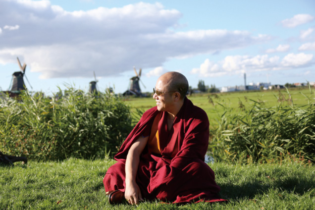
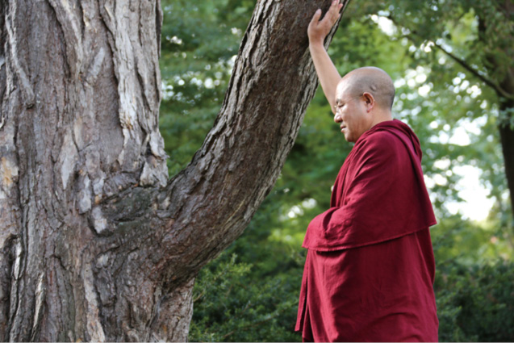

# 十年不离

——法王如意宝涅槃十周年纪念法会开示

2014年1月12日

## 一、发心的重要性

我经常强调发心的重要性。要求大家发心，并非为了我个人，而是为了我们的学院。我们喇荣五明佛学院如今屹立于世，享有盛名，并不是自然而然的，它的存续离不开众多因缘支撑，离不开大家共同的努力和持续的发心。

今年没有给大家评发心奖，这是我个人的决定，是一种不太满意的表示。你们发心确实很辛苦，但这次可能不太适合公开表彰。有些发心人员闻思修行特别精进，然而没有时间背考，但他们发心的贡献，其实比背诵几部论典还要大，甚至在世界范围都是有影响的。这次由于某些原因没有给你们公开发奖，是为了表明我的一种态度，明年应该不会这样了，但明年我还在不在也不好说。

今早下大雪，我去察看火灾现场时，在冰面上摔倒了。当时我倒在地上，差点晕过去，感觉快不行了。爬起来以后，耳朵里流了很多血。因为上午还有些重要的事必须处理，所以刚刚才有空请医生来检查，倒也没什么大碍。不过这让我感到，死亡是很容易随时降临的。也许就这么在路上摔一跤，眼一闭，就过去了，更不用说遇上火灾这样的大事故。所以，我们不必做什么长远的打算，因为一切只是短暂的因缘和合。

所以明年以后，如果我还在，希望我们的发心人员不要退失。我担心过段时间我去闭关之后，学院里一些重要的发心人员会不会就悄悄离开了。所以我在此特意强调，如果你们退失了发心，只剩一种相似的闻思修行，以我个人本意，不是很满意，不是很赞叹。我希望各部门的发心人员至少在一年内不要轻易退出。我并不是在为自己找发心人员，我自己的事不论因缘如何都没关系，但现在事关我们学院的正常运行，我不得不格外在意。所以，对于任何能为保障学院的闻思修行而发心的人，我都非常随喜；但要是有人对学院非但起不到作用，反而带来不良影响，不管他是什么身份，我都要表示不满。不管是在佛教界还是社会上，亲自做事的人总是很少，而在一旁挑毛病、说过失、搞是非的人却总是很多。虽然我们已经舍世出家，但对这类现象也可以看得一清二楚。学院要正常发展，需要大家真正齐心协力、共同配合。否则，光是口头上说喇荣五明佛学院有多么大的声望、是多么好的闻思修行道场、我们都是法王如意宝的继承人……这些统统只是空喊口号而已，应该落到实处才行。

这次我为什么没有对发心人员进行表彰，你们要是明白其中的原因，应该对此深刻反思。做出这个决定，不管过失还是功德，一切责任在我，这就是我一贯的行事风格。不能因为我们是修行人，就谁也不敢得罪。按照麦彭仁波切的《二规教言论》和《君规教言论》，以及《萨迦格言》中的教言，作为修行人，做事确实也需要是非分明。

这是我今晚说的第一件事，希望各位道友好好想一想：如果发心，应该发什么样的心？最近为了火灾的善后工作，各个部门都非常辛苦，很多人都已经两三天没有睡觉了，包括我自己在内。但我们做这些并不是为了个人，而是为了大家。在这个时候，有些人非常配合工作，而极少数人，可能怀着别的心思。针对不同的行为，我们也会采取一些奖惩措施，世间有世间的做法，修行人也有修行人的做法。为什么我们色达喇荣五明佛学院能发展得如此壮大？其实在处理世间法方面，我们也是有一些窍诀的，否则不一定能生存到现在。我今天是以一种很认真的态度来说这番话的，希望大家好好思考。

## 二、学院火灾情况说明

第二件事，要给大家通报一下火灾的情况。最近我们学院发生了一场火灾，受到了很多关注，网络上炒得沸沸扬扬。这几天慈诚罗珠堪布和我都在课堂上和微博上给大家做过情况说明。火灾刚发生之际，网上就有很多不实信息打着我的名义在流传，转发量都非常高。但实际上我当时一直在火灾现场，哪里有时间发这些？直到第二天，发现很多人好像比较恐慌，我才对公众声明：到目前为止，没有发现人员死亡，请大家放心。

这次火灾还是造成了很大的损失，学院有一百多位出家人受灾，她们的住所和法本全都烧没了。一些靠近女众经堂的公共建筑也有不同程度的损坏。还好在大家的共同努力之下，去年刚刚落成开光的尼众大经堂没有受到太大的影响。出家人的僧房受损较为严重，很多人现在都成了灾民——出家人应该叫“灾僧”吧。幸好那天有课，大部分人把法本和念珠带在了身上，还有人把身份证也带上了，而其他不少人连身份证都被烧掉了。这就是火灾的基本情况。实事求是地讲，这次学院受灾还是比较严重的，万幸没有人死亡，但有不少人受了伤，目前都在周边县市医院接受治疗，听说还好，伤得不太重。

其实，我们学院的火灾隐患仍然很大。我去了火灾现场之后，才发现情况如此可怕，这是给我们敲响的一记警钟。我刚才开会时，跟相关的僧众和领导也说了，这次火灾有两个原因：一方面与我们自身管理和建筑习惯有关，学院的房屋一直沿山坡往上建，容易造成火势蔓延；另一方面，自从相关部门对学院建房进行限制之后，所有人员只能全部集中在划定的区域居住，不能外扩，导致房屋过于密集，这也是一个原因。如果僧众的房屋能在周围的山上扩散开来，同时建造一些消防通道，未来火灾隐患应该就会大大降低。所以，我们正在通过各种渠道跟相关部门进行沟通，希望能对学院放开一些限制，否则，各方面的隐患还会存在。同时，我也希望道友们要加强安全意识。现在很多人对火灾的防患意识比较淡薄，甚至有人在衣物旁供灯，好像对火焰很信得过，对生命也缺乏敬畏。

这次没有人死亡，是不幸之中的万幸，这种情况万一再次发生，后果可能会更加严重。所以要吸取这次教训，一方面，人人都应该加强防火意识；另一方面，我们之后会统一从建筑布局上进行一些大的调整，否则还会存在安全隐忧。今天有一位记者来到这里，他说第一反应是很“震撼”，第二是很“吸引”，第三是很“担忧”。对于他给出的这六个字，我是非常认同的。

对于参与救灾的各位僧侣，以及外面关心学院的众多信士，我们也特别感谢。这次学院受灾，大家通过各种渠道给予了我们非常多的关心和帮助。在此我以个人和学院的名义，衷心地感谢大家。目前在大的方面上，我们基本已经没有什么问题了，大家可以放心。

有时候，我感到生命确实十分脆弱，十分无常。虽然这次遭了灾，但我们这些修行人反应却不同寻常。世间人笑的时候，比如节庆喜事期间杀死很多生命，开怀聚餐之时，修行人会为杀生的残忍而哀伤落泪。而世间人哭的时候，修行人却在笑。我们面对这次火灾，并不会像普通人那样痛苦绝望、伤心哭泣，这些情绪在修行人这里都不会有。昨天我半开玩笑半认真地说：这样也很好，房屋资具全都烧光了，相当于做了一场大型会供。因为大会供的时候，所有东西都会做火施烧掉。把自己执著的东西全部烧了，更利于修行。玩笑归玩笑，实际上很多人现在连回家坐禅的地方都没有了，这方面的困难我们也会尽快想办法解决。

希望外面的道友对我们不必特别担心。确实，这次火灾让我们感到十分无常，不仅仅佛教团体如此，其实世间万法都是如此。历史上，汉地、藏地许许多多宫室殿堂都是因火灾而毁灭的。这场火灾也是一种历史的痕迹，没什么大不了的。这对我们来讲也是一次很好的修行。这是我今天讲的第二点。

## 三、珍惜因缘 配合管理

第三点要讲讲学会今年的管理要求，希望道友们好好配合管理。我建立这个学习平台，说远一点最早是从1991年开始的，说近一点是从2006年开始的，到现在已经有六七年的时间了。要评价学会这些年做出的成绩，并非我们自夸，确实令一些人的命运发生了改变。如果各方面因缘具足，学会在两三年内还会继续办下去，那就需要更好的管理制度。

学会的法师都遵守着严格的要求，希望各地的学员们也能真诚地对待自己的学修。如果想要学好佛法，就要认真参与、接受管理、配合好教务处的相关规定和要求。如果不太愿意这样做，那最好先不要加入学会，不然我们要白白为你付出人力、财力，包括法本、光盘，以及许许多多其他资源。哪怕通一次电话，都需要管理法师付出珍贵的时间。我们都是用自己的生命在维持学会的，这可不是件容易的事。

学会里有些人，以为我们没有事做，可以随便浪费我们的时间，其实不是的，这里的法师都希求解脱，都有自己的修行要完成。法王如意宝以前也讲过，如果没有修行任务，想要好好休息一下也是应该的。然而很多法师不但顾不上修行，甚至顾不上休息，把自己像生命般宝贵的时间用来给你们打电话沟通，做管理工作。如果你们不好好配合法师，我觉得从良心上也是说不过去的，更不用说作为大乘佛教徒应怀有最无上的精神和理念。因此，如果大家想要好好学习，希望你们彼此要有一种尊重之心、难得之心、可贵之心。如果做不到，那干脆不要浪费我们的时间、人力、财力等资源。学会为你们提供的每一项服务，哪怕是颁发一个奖品，都来自许许多多道友的发心付出。

以前我曾给大家承诺过，凡是修完加行的学员，都会得到一尊莲花生大士的佛像。这对于在整个世界范围内弘扬显密佛法、遣除一切违缘、降伏一切魔众等等，都有不可思议的缘起。虽然我只是一介凡夫，但我也会观察很多缘起。凭借二三十年来对上师的虔诚依止、对佛法的潜心研究，我很清楚怎样做才更有利于弘扬佛法、利益众生。现在一个人在世间学问上研究五六年就能够成为专家，以这种标准来看，我在佛学方面可以算是专家之专家，这一点我可以非常自信地给大家说。我通过很多方法观察到，莲花生大士的身像对当今全世界和全人类，有着不可思议的缘起和加持力。过段时间我会把五年前承诺过的奖励发给大家，希望相关负责人能认真落实。我们作为佛教徒，按照佛法的教义来做事，应该要比一般人更加有道德、有水平。因此，我相信大家发奖时会如理如法。对于得到奖品的人，我非常认可你们认真学修的态度——正因为你们能一直坚守当年所发的誓言，所以最后能获得这样的成果。

过去这一年是比较特殊的一年，我们整个团队都非常辛苦，经历了种种艰难和委屈。但我们始终有一种齐心协力的精神，有一种坚韧不拔的意志，有一种坚定果敢的勇气。大家为了利益众生和弘扬佛法的目标，一直在共同发愿、共同努力。

## 四、法师巡访相关安排

过段时间，我会派出一百来位法师，到各地巡访考察。这么安排的原因，一是为了测试法师们的水平，看看我们这里的僧众团队到居士团体中弘扬佛法的成效如何，这相当于一种试验；二是想要了解居士们对出家僧人组织的学习、咨询、管理有怎样的态度和反馈。这是前阵子我们相关法师和负责人员共同商议的决定。在这次巡访的过程中，我希望僧人们一切行为要如理如法，千万不要做出不妥当的事。同时，希望居士们也在力所能及的范围内尽量配合教务处的相应要求。

我们很想开展一些弘扬佛法的事业，但目前尚在摸索阶段。在汉地，过去有不少高僧大德树立法幢，但如今佛陀真正的教法和证法，究竟弘扬到了什么程度？只要翻开历史看看，或者去全国各地实地了解一下，就会发现情况其实并不十分理想。

我并不敢说我们学会在弘扬佛法上有多么成功，也许根本就不成功。因为汉地跟藏地情况确实有很大不同。藏地一直以来都有信仰佛教的传统，在佛法的闻思修行和认知接受方面都有良好的基础。而在汉地的很多地方，并没有天然的佛法氛围，大部分人在学佛之前完全没有三世因果的概念，是由于一些特殊的因缘，才半道而来成了佛教徒。其中不少人内心仍然怀着疑惑、盲目、邪知、邪见……这些不适合修行的心态一直顽固不化，在他们心中酝酿、沉淀、牢牢地盘踞着。在这样的心态下，在这样的群体中，修行能不能成功也实在很不好说。另外，我们这里的一些法师，经验和水平也有参差，需要接受锻炼，所以做了这样的安排。希望相关的法师和道友们都认真地对待此次巡访。

以上所说的这些，并不仅仅是学院的事，而是与今晚听课的每个学员都密切相关。为什么呢？你们每个人都要想想，今天是为了什么原因来听我的课？是想从我这里得到一个保佑你升官发财或者家宅平安的窍诀吗？实际上不是的。每个人来听课，都是因为希求今生来世真正的快乐和解脱。你们所寻求的解脱之道，只能通过佛法来获得，除此之外，我无法提供你们任何其他办法。今天的听众绝大部分都是佛教徒，但是我今天想给大家讲的并不是宗教，而是一种人生的智慧，这一点大家要知道。

## 五、法王涅槃十周年纪念法会

接下来，我准备结合法王如意宝涅槃十周年的纪念法会，做一个简单开示，希望大家认真聆听思考。在座各位都看到了，我们学院已经准备了一系列的供品，从明天开始，在为期七天的时间当中，将要举办法王如意宝晋美彭措的纪念法会。

这是一次非常有意义的法会。我本来有很多事情要下山处理，但一直想等着参加完这次法会。我以前看过一些印度智者的传记，很多人在自己的上师圆寂之后，三年内都不离开上师的道场。他们认为这是一种缘起。还有一些成就者，甚至过了十年、十五年都没有离开。我们过去也想过，法王如意宝圆寂以后，可能不到一年，弟子们就会离开这里。但是没想到这一晃就过了这么久，我们已经十年没有离开了。到后天，上师离开我们就已经整整十年。为什么我们对上师仍然如此怀念？也许今天在网上听课的一部分新人会问，什么是上师？谁是法王晋美彭措？他是不是什么领导、什么名人？其实在我的心目当中，法王如意宝跟其他名人是完全不同的。虽然他的外在显现与普通人无异，没有让人看到三十二相、八十随好，但他的智慧、他的慈悲、他弘法利生的事业，是一般人完全无法相提并论的。

为什么这么说呢？有两方面原因。第一，我们今天听闻佛法的缘起，以及加持的来源，都与上师晋美彭措密切相关。在场的许多道友也许都与上师如意宝的法脉传承有所关联，此刻在网上听课的几万人，大多数也应该是这样的。或许有些人还没有意识到这层关系。我们可以回溯到1980年，当时正是十一届三中全会后宗教开放政策开始落实的阶段，那时候藏地佛法还是一片百废待兴的局面。在“文革”期间，许多前辈高僧大德或远赴海外，或舍报圆寂，年轻一代很多人根本不知道何谓教法、何谓证法，甚至不少人把佛教的形式当作佛法。在这样一个时代中，法王如意宝为我们藏地佛法的复兴扮演了什么样的角色，做出了怎样的贡献，但凡有智慧的佛教徒都应该知道。

第二，法王如意宝对汉传佛教的贡献也是有目共睹的。从1987年开始，法王如意宝就面向汉地众生广弘佛法。今天我们在座的很多人活在这个世界上，能够稍微懂得一点因果不虚、善恶取舍、发菩提心和皈依的功德、杀生的过患等种种道理，90%以上要归功于他老人家的发心。正是因为法王如意宝当年建立了这个道场，才有了现在这座盛名远扬的喇荣五明佛学院。有人称这里为“藏地的那烂陀寺”，也许有一些夸张，但如果站在公正客观的立场上评价，可以看看佛学院对汉地佛法的弘扬起到了什么样的作用。这些年来，有多少汉族四众弟子发自内心皈依三宝，成为真正的佛教徒，不再仅仅是从形式上办个皈依证，去寺院做做供养，而内心实际上并没有什么改变。

所以我在之前摘录上师教言时就说过，这是法王如意宝的人生开示录，任何一个人，不论有无信仰，不论信仰哪个宗教，不论有着什么身份，都需要拥有人生的智慧。这些宝贵的智慧，都是靠他老人家为我们点滴传下，才能令今天无数人得到佛法的甘露。如果用一种冷静的心态、客观的视角来剖析观察，我们会明白，这确实是一种菩萨的智慧。若非具有菩萨的智慧，一个凡夫人在如今这个末法时代，要做成一点好事尚且十分不易，想要有上善若水的境界就更困难了，更何况是改变这么多人今生来世的命运，这是怎样的一种菩萨行！尤其是在如今这个五浊横流的可怕时代，人们的贪婪、嗔恚、愚痴像大海波涛一样此起彼伏、汹涌澎湃，幸亏有这样一位能改变我们的心灵、给我们指引解脱之路的大菩萨来到过这个世界。我们很多人不仅面见过他，而且亲近过他。在我的人生历程当中，最有意义的就是以三门恭敬来依止过这位菩萨一段时间。有位记者曾经问我，人生当中最成功的是什么？我说，在我人生当中最成功、最幸运的经历就是依止上师的那些年，那一段历程对我来讲是最美好、最有意义、最可贵的。

上师法王如意宝留下来的教言、加持和力量，一直不断地在我们每个人的身心之中延续。因此，从明天开始，大家一定要用一种真诚的信心来这样思维：这位菩萨弘法利生的事业如是广大，我们每一个有缘者只要对他真诚祈祷，无论以前是否见过他，都能得到他的加持，远离一切痛苦，获得一切幸福。这也是我在《不离》这本书的前言中认真写下的。

我也特别希望，把《不离》这本书当作大家与法王结缘的一种方便。我看到这里很多道友以前没有机会见到法王如意宝，我替他们感到特别悲哀：这么了不起的大德、菩萨来到这个世界，这么多人却限于种种因缘，没有亲眼见到过，那该怎么办呢？其实，法王如意宝的肉身虽然已在所化众生面前显现隐没，但他的智慧法身仍然一直留存在这个世界。所以，从这一层含义出发，我把书名叫做《不离》。我也特别希望，依照菩提金刚等多位具有慧眼的前辈大德授记，能给没有亲见过法王的人们创造一种殊胜的缘起，同时也给大家提供一个学习法王教言的机会。我的发心和目的就是这样的。

因此，希望这次法会期间，大家每天都尽量修上师瑜伽，念诵《上师供》，以及法王如意宝1994年亲自从青海年宝湖中取出来的《金刚萨埵修法仪轨》。这次法会念诵仪轨的时间是每天早上七点半到晚上六点半。如果你们要去经堂念，一定要赶在这个时间之前，不要迟到。如果在大众念诵的中途开门进出，会对整个集体的修法不利。要是实在没有时间赶到现场，在家里听收音机念诵也是可以的。但如果你要来经堂，至少要提前五分钟入场。

我们做任何事都要有时间观念，比如乘飞机，至少也要提前一个小时到机场。我看到有的人好像不太情愿来参加法会似的，脸也不洗，穿着一件破烂的大氅，八点半了才兴致恹恹地来到经堂，坐一小会儿就走了。以这种态度，不要说修持佛法仪轨，就连世间的一个会议也开不成功的。现在很多企业开年会都要求员工穿戴正式，男士都要打领带，女士也要打扮得很讲究。参加一个世间活动尚且如此，对于参加佛教的仪式，更要有一种庄重的态度。

所以，希望大家在参加法会时要充满欢喜心和信心。有的人从表情上看，都能感到信心十足，这样的人来这里修行七天应该会很有收获。既然你们已经来到这里参加法会，就在这七天当中尽量如理如法地念修。如果觉得经堂太冷，那也可以在家里听收音机，但都应该认真地祈祷上师。

这七天法会中，大家一定要认真修一修上师瑜伽，诚挚地祈祷法王如意宝晋美彭措。我可以保证，你们绝对会得到不可思议的加持力，因为法王如意宝是莲花生大士弟子降魔金刚的真实化身，这可不是像现在某些所谓活佛的自我宣传那样。我原先也跟大家讲过，千万别挂我的像章、照片，你们这样做我会很生气。我想，放着上师如意宝、莲花生大士这些大德和本尊的像不挂，而要挂其他人的像，是不是不太合适？所以我希望大家还是多向上师如意宝那样的圣者去祈祷。

法王如意宝这种真正的圣者的加持，是末法时代遣除黑暗的杲日。他的发心力是其他任何人无法相比的，我从最初依止他时，就有这样坚定不移的信心。尽管在那个年代，有不少人与上师如意宝名气齐平，但我们可以毫不自夸地公正评价，像他老人家那样，对整个藏地和汉地，乃至全世界的佛法弘扬产生这么大影响力的人，在20世纪和21世纪的确非常罕见，这一点是大家有目共睹的。

我并不是因为自己是他的传承弟子而自夸自赞。从客观事实来看，为什么法王如意宝的传承有这么多追随者？为什么他所宣讲的教法、证法被如此推崇？为什么在社会各界，尤其是在汉地各大城市中，能形成这么大的影响力？不得不说，如果当初我们学院的佛法理念没有传承下去，那么现在汉地很多佛教徒都会非常可怜，包括在座各位。如果你们没有遇到这些闻思修行的法门，不知现在会是怎样的状态，也许有些人依然会有点信仰，但这种信仰很有可能变成迷信。

明天法会正式开始，大家一定要珍惜这段时间。我也跟城市里学会的道友讲过，如果各方面因缘具足，没有特殊的情况干扰，大家最好在这七天中共同参与法会。当然，现在是年底，城市里的人就像热锅上的蚂蚁一样特别挣扎，不知能否抽出这七天的时间。在一个人的生命中，要出现这样的七天机会，可能是很困难的；但要永远离开人世，却很容易发生。如果你们时间充足，希望尽量按照学院的《金刚萨埵仪轨》来念诵。这次我们没有特别规定要念多少，但我自己认为，最好在七天中念十万遍金刚萨埵心咒。如果每天跟着仪轨念诵，可能念咒的时间会比较少，因为仪轨内容很多；如果不能完全跟着仪轨念诵，那也可以早上先念一遍仪轨，后面就念诵金刚萨埵心咒，在七天当中尽量完成十万遍。

关于法王圆寂纪念法会到底要用什么样的仪轨，我们相关人员开会商讨了很长时间，最后选定了这个仪轨。因为法王如意宝生前特别重视金刚萨埵修法，同时，这个金刚萨埵的仪轨是法王如意宝亲自宣说的金刚语。有人可能会想，为什么要把法王如意宝离开的这一天作为一个重要的日子？这背后其实有一些非常甚深的缘起。《集密意续》《自生自成续》等续部经典中也说过：“上师在世时以三喜供，上师不在世以忆念供。”上师在世的时候应该以财供养、承侍供养、法供养来让上师欢喜。而一旦上师离开，要想进行财供养和承侍供养就再也不可能了。但法供养是在法界当中进行的，法王肯定会知道，只不过在我们面前不一定显现。所以，到了那个时候，按照续部的要求，我们就应该好好忆念上师。

因此，在这七天当中，大家无论身处城市还是学院，都应该供奉一幅上师的像，在法会期间尽量真诚祈祷。当你猛厉祈祷的时候，这种缘起就可以很快成熟，很容易便能加持你的相续。一旦上师和本尊加持了我们的相续，那我们就不用拼命地作意：“我一定要好好修行、一定要遣除违缘、一定要事业成功！”不需要太多勤作，很多事情就会自然而然地实现，这就是任运自成。如果我们没有得到上师的加持和护法神的保护，恐怕明天违缘就有可能突然出现，将你拥有的一切全部一网打尽，令你的功德瞬间荡然无存。因此，经过自己多年的修行，我确实感受到，祈祷上师是非常非常重要的。

祈祷上师，并不是在形式上举办一场花团锦簇的法会，当然，庄严的形式也是有必要的。宗喀巴大师的弟子克主杰，在上师圆寂以后，就经常陈设殊胜供养，供养之后上师便会现前。所以我们在法会上献一些供品是很重要的，但更重要的是，要以一颗虔诚的心如此观想：“上师您就是文殊菩萨，您与诸佛菩萨无二无别，请您一定要加持我的相续，让您所有的智慧、悲心、信心以及世间和出世间的一切功德，如满瓶倾泻般融入我的三门，最后我的三门所作所为全部与您老人家无二无别，能够利益无量无边的众生。”如果能这样去发愿、回向，即使只修这短短的七天，你的心态也会产生巨大的变化，今后的修行也不再会有任何困难，同时，你的一切所作所为都会成为利益众生和圆满修行的一种方便法。

## 六、假期不要松懈修行

我们佛学院即将开始两个月的寒假。有些道友在冬季身体不太好，也可以到汉地去看看病，调养休息一下，这样到了明年开学的时候，你们也会更有力气。世间的学校一般都有寒暑假，大家学习的时候非常认真，到了假期，也可以稍微放松。所以，学院内部经过商议，进行了这样的安排。明年开学时间定为3月24日，各班应该已经下发通知了。

学会也有两周的休息时间，大家如果有外出或休息的计划，可以利用这段时间来安排。虽然我们上课并不在一起，但学会也相当于一所正规学校。我要特别感谢大家，多年以来一直遵守学会的各项要求。我有的时候可能因为性格不太好，一个人犯了错误，就让全部人挨骂；而95%的人表现很好，我却不给他们赞叹。其实优秀的人不需要赞叹，也不在乎赞叹。大家可以利用这段休息时间放松放松，明年如果你依然真诚地想要学下去，我们大家就继续共同努力！

我经常观一种无常：今年会不会是最后一次？今天会不会是最后一次？这种无常观来自传承上师们的教言。这一天其实一定会到来。到了那个时候，也许大家都会留有遗憾——原来一切确实是无常的。这种无常在个人身上会发生，在集体层面也会发生。学院的道友们要珍视学习的机会，哪怕你只在这里学上两三年、五六年，也要发自心底把它当作生命中一个非常重要的阶段。学会这边的道友，也应该这样。想要永远拥有这种机会，我不可能做到，你们也不可能。我们都是靠着这么一个极其脆弱的身体来维持着生命，谁也无法让它一直长存下去。因缘是谁也留不住的，所以我们应该在因缘尚存的时候，尽量把握这种机遇，尽量珍惜这个非常殊胜的缘起。

经常提醒自己一切无常，其实是一种很好的心态。以前上师如意宝就经常对我们提醒无常，我刚开始还有点盲目，觉得有些事应该不会变。后来逐渐发现身边很多的无常确实发生了，我才深深地认识到，原来上师总有一天是会离开我们的，所以现在的机缘十分殊胜。后来，上师如意宝真的离开了以后，我回顾自己的心路，依止上师的每一天，我都在努力着，不要说一个月，即使一天故意懈怠、浪费也是没有的，所以我并没有任何遗憾和后悔。我想，今天我们大家聚在这里，也是一种机缘巧合，是大家前世共同的因缘。这种因缘何时会消散，谁也无法预知，因此，一定要把握每天，好好修行。

这次假期，大家出去弘扬佛法也好、自己修行也好，都应该如理如法。遇到任何事，一是要坚定，不要舍弃自己的见解、修行、行为；二是要时时祈祷，不论是下山还是留在学院；第三，永远都不能忘记利他；最后，要保有正念，正知正念的正念，为什么我这样强调，你们自己去思考。

今天之后，在一个多月内你们应该不会有我的消息，也不需要我的消息。大家现在各种消息已经够多了，人人整天抱着手机，在我们学院还好，世间人就特别可怜，几乎都成了手机的奴隶，没有了自己的时间。所以，希望大家好好修行，这很重要；要好好发心，这也很重要；最重要的，是时刻以利他心饶益众生。

## 七、以《不离》同法王结缘

在这七天法会期间，我要求学院的道友们都把《不离》这本书看一遍。这次法会是法王如意宝离开十周年的纪念，但在我心中，我所祈祷的是“不离”——上师虽已离开十年，但他的法身始终不离我们。大家要是已经看过那就不说了，如果没有看过，无论新老学员或者发心人员，都应该在七天中把这本书看一遍。我也在祈祷，希望法王特别地加持你们。城市里的道友，最好也在这七天之中看一遍这本书。我特别希望通过这次法会，大家不仅能做祈祷，而且能真正从内心当中获得上师如意宝的加持。这种因缘也许会使你成为一个真正的修行人，我们现在最需要的就是这种转变。在我们学院的流通处应该有这本书，以前没有的道友可以免费领一本。在法会结束之前，每一个人都要看一遍《不离》。

对于《不离》这本书，前段时间美国香巴拉中心反馈说他们非常地欢喜。我当时在前言中写了一些我的分别念，看来确实起到了一些效果。现在有好几个国家的翻译家，也纷纷表示想要翻译《不离》。在这本书里，有法王如意宝对大家的谆谆教诲和殊胜加持，对我们日常的修行非常有必要。所以在大家共同祈祷法王的这个时刻，读一读这本书，也许是跟上师如意宝结上善缘的一种密码。

我依止了法王如意宝很多年，虽然不想这样宣传自己，但在有必要的时候，我也很想告诉大家：经过多年来的学习，我认为对其他人有再多欢喜心和供养，都不如对法王这样的大菩萨生起哪怕一刹那的信心功德大。而且，这种功德在这个充满违缘的末法时代中，是对我们的修行最为有利的。作为一个佛学方面的专家，我很想用这个秘方来给你们开一副妙药。

所以，我希望、我呼吁、我恭敬地提醒大家，在这七天当中，要把《不离》作为这次法会的学习手册去认真阅读。我特别希望依靠这种缘起，真正让我们的分别念与法王如意宝的智慧海洋融为一体。虽然要讲起某些细节，就好像妄语一样，但我在翻译这本书的过程中，确实有一些奇妙的缘起。这本书在短短的时间中已经加印了很多次，现在还在不断地印。之前我就曾布置过，举行法王纪念法会的时候，会有一些特殊的缘起和加持需要提前准备。

希望我们学院里凡是听话的人，都好好看一遍《不离》。今天网上的所有人，不管是否有信仰，只要你想真正与大圣者结上善缘，这就是最好的一种缘起。世间万法离不开缘起，这是我们都要承许的。而说到观察缘起，我是很有能力的。因此，希望各位通过这种缘起，真正成为一个对众生非常有利、自己修行也非常成功的人。
