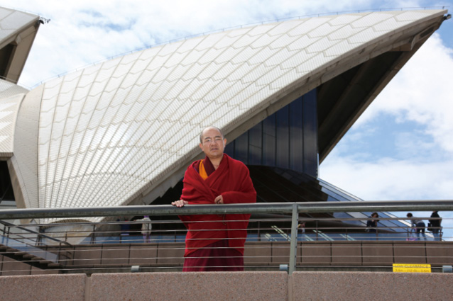
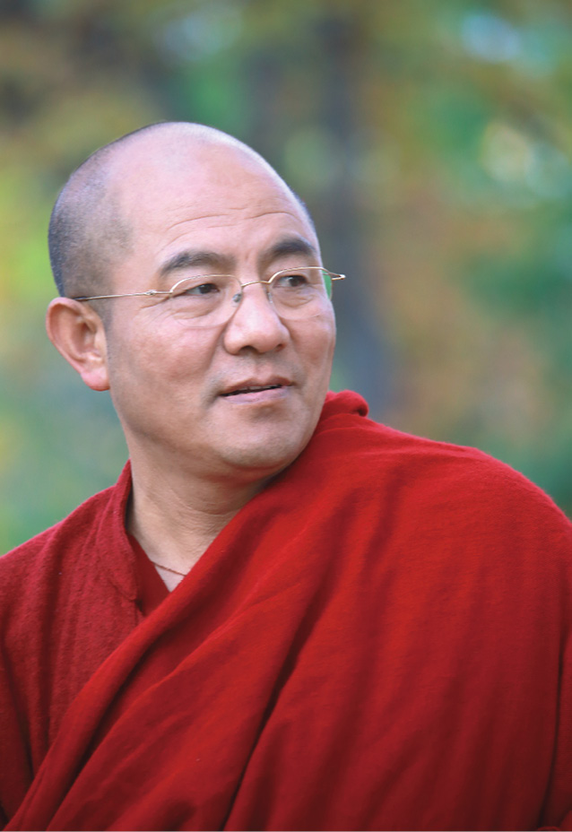
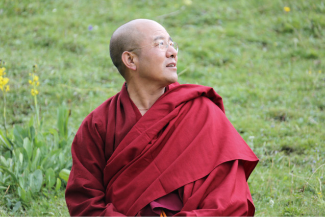
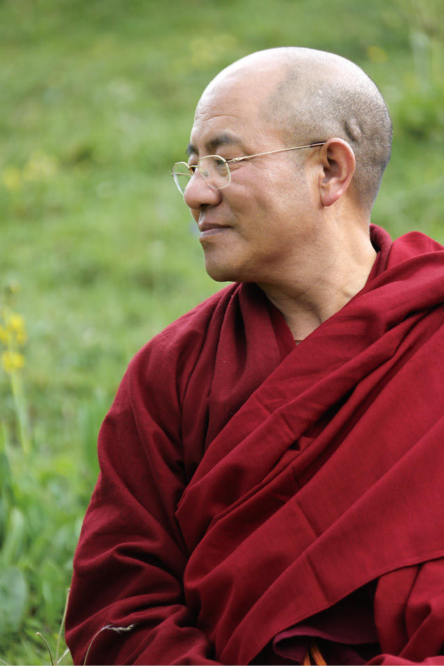
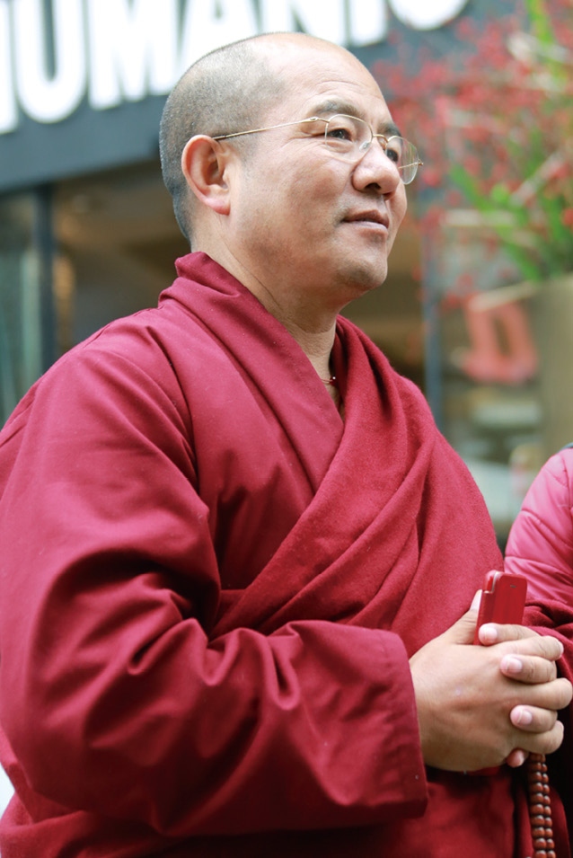

## 如何接受灌顶

——2015年金刚萨埵法会开示（1）

2015年5月24日

各位在座的和网络上的佛友，今天我在这里会讲几方面的内容：如何接受灌顶、《佛子行》的传承，以及给大家做皈依。

## 一、德巴堪布的圆寂给我们示现无常

刚才大家欢喜的掌声，让我想到一件很伤心的事情。我的一位上师——与根本上师法王如意宝无二无别的德巴堪布，刚刚圆寂了。是他老人家最初介绍我到喇荣，引荐我拜见法王如意宝。他的法体明天早上6点钟荼毗，以后他的色身在显现上将永远离开我们这个娑婆世界，也许他在不同的刹土中还会有各种各样的幻化示现。对我来讲，德巴堪布的恩德可以说超过了父母和任何人。因为当初如果没有他老人家，我可能没有缘分出家；即使能够出家，我也可能没有机会见到法王如意宝。

这几天我从色达到炉霍的路上经过时，感触很多。如今这条沥青公路修得越来越好了，然而在我们的物质条件逐渐变好的时候，包括法王如意宝和德巴堪布在内的多位上师，却一个个离开了。他们在世之时，都是乘一辆破车，沿着当初那条土路去弘法利生，显现上饱受劳累。如今，物质条件越来越好，我们精神的灵魂支柱却都纷纷离开了这个世界。所以，在座各位应该明白，这说明了人生无常。

的确，那么多金刚上师和大成就者都在示现无常，更何况我们这些不清净的骨肉所组成的身躯？所以，对于这些老上师们的圆寂，我们在座诸位应该有所触动。其实在座的每个人也不是长久不变的，我们的身心迟早都会逝去。当我们离开这个世界的时候，所有这一切都是带不走的，只有自己的善与恶伴随着心灵前往后世。

所以我今天一方面特别高兴，看到这么多佛友辛辛苦苦来到喇荣圣地，网络上也有很多人关注这次法会，大家还共同发愿念诵四十万遍金刚萨埵心咒，这是非常非常好的事情。但另一方面，也希望大家每一个人都应该要有一种无常观。每当一位上师圆寂，我都有特别大的触动，这种时候，会想起上师为我们付出了太多太多，而现在却永远离开了这个世界。虽然我也感觉得到，他的智慧没有离开，他的佛法没有离开，他的声音没有离开，我在夜晚的梦中，在白天的忆念中，也经常能见到这些上师。可上师真正的色身，昔日那张亲切、熟悉的面孔，随着火焰而消失，我从此之后却是再也见不到了。所以，我想趁今天也给大家上一堂无常的课，希望大家珍惜我们现在的时光，精进修行。

## 二、接受灌顶的条件及要求

刚才突然想起这个沉重的话题，接下来我给在座各位讲一下明天灌顶的情况。明天上午10点，在喇荣宾馆后面、坛城之前，门措上师将给大家做金刚萨埵灌顶。灌顶之前有一些注意事项要讲一下：首先，希望大家参加灌顶时不要拥挤，尽量往后面坐，因为这么多人如果都往前挤，前面的人会承受很大的压力，不一定扛得住。我很理解大家想见上师的心情，很激动、很感动、很冲动，但我们作为佛教徒，不应该太激动，也不要太冷淡，要走一条比较温和的中间道路，这是很重要的。我刚才进来的时候，很多人看上去十分感动，其实一旦跟我接触久了，也就无感了，这我已经司空见惯。一般而言，此刻表现得特别激动，哭啊笑啊的人，明天、明年就不会再这样了。我们佛教徒，要淡定一些。所以我希望明天的灌顶，大家提前准备，男女分开，有序入场。

这次接受灌顶的人，必须遵守这些基本条件：第一，至少要守一分居士戒，就是遵守杀、盗、淫、妄、酒五戒当中的至少一条。若是以前没有受过居士戒，明天灌顶的时候可以同时受。如果不能做到这一点，那就不允许接受灌顶。第二，必须遵守密乘的基本戒律，也就是不能与金刚上师及金刚道友发生严重矛盾，违者不能参与灌顶，这是需要着重强调的。

这两个条件大家要牢记，如果能够遵守，那么明天就可以参与这次灌顶。在灌顶的过程当中，希望大家不要拍照，也不要随意走动，要遵守现场的纪律。另外，门措上师要求大家在明天灌顶时，不要供养任何财物，也不要抛哈达，希望大家听上师的话。

灌顶入场和结束退场的时候，大家要慢慢排队，不要一拥而上，这种人数众多的场合，我很担心有些身体不好的人被挤到，包括一会儿下课时，大家也要慢些离场。我刚才看到经堂门口的鞋子已经堆成山了，相信今天会有不少人找不到自己的鞋，只能光脚回住处。今年暂时只有这样的条件，大家要理解。以后我们物质上的条件应该会越来越好，但精神理念会不会越来越弱呢？这可能也是一种客观规律。

明天接受四级灌顶时，会有好几组堪布堪姆分别给男女众传递加持品，你们只需要接受其中一组就可以了。我看今年来参加法会的，百分之八九十都是熟悉念诵仪轨的人，只有少数新人可能还不太熟悉，所以希望明天大家都能尽量遵守规矩，出入有序，圆满接受这次灌顶。

## 三、语言的加持胜过摸顶

这次法会我没有安排接待大众。虽然我个人觉得，给大家摸顶加持一下还是有必要的，但接待的时候总有很多人要做供养，我不希望这样。一方面，过于看重供养对佛教的发展并不是很有利；另一方面，你们应该留着自己的钱，保证回去有路费。再加上这次人特别多，一一接待的话，我也很累。你们如果有一些加持物需要开光，我现在统一给你们进行开光。

（堪布念开光仪轨）

依靠三宝无碍的加持力，依靠法界真实义的加持力，依靠我等清净的意乐力，愿这一切三宝所依之物都得到真实的开光。如此，不论你们此时是在经堂中还是在别处，凡是听到的人，皆能依靠三宝不可思议的加持，得到真实的开光。

如我刚才所讲，这次并不准备一一接待。我这边事情很多，忙不过来。我知道你们每个人都有话想对我说，但这些不是最重要的。我不是见解脱，你们依靠我的身体解决不了什么问题。刚才不少人用手机拍我，也许在灯光下照片效果还可以，但你们如果见到我本人会很失望的，所以我还是不露面，保持神秘感更好一点。《君规教言论》里也说，人如果被全部看穿了，可能不是很好。

我真正重视的是，通过语言也许能给你们带来一点真正的利益。我研究佛法这么多年，现在不论是写书还是讲课，都是想要依靠语言的力量来帮助大家。我这个身体的力量很小，就连路上有人摔倒，我要扶他起来，可能都有一定困难。靠这个身体我可能帮不上别人，但是通过语言我可以做到。运用语言也有很多种方式，包括视频、书籍。最近我刚出了本书叫《你在忙什么》，这次也结缘给你们。通过三宝的加持力，希望你们看完一遍后，能在相续中直接或者间接种下一个善根，得到一点力量，这是我给你们的礼物。

除了语言以外，见个面，摸个顶，我好像也没什么把握能给你们加持，除非用佛经来给你们摸顶，但其实你们自己用佛经给自己摸顶也同样可以得加持。我现在真正有把握利益众生的途径，只有语言。因此，虽然这次可能有很多道友希望当面见见我，包括一些我外出交流时接待过我的老师和学生，还有一些对我们学院和我个人给予过很大支持的人，但我这次确实很难排出时间，希望你们谅解。

有些人说给我带了东西，你们可以自己处理，我确实不想接受供养。供养的财物，如果要用来做弘法利生的事倒也可以，但我该做的，包括建学校等等，都已经完成了。作为一个出家人，也没什么其他的需求。你们在家人也有生活压力，如今经济不景气，给我供养财物也没必要。如果你们非要做一些供养，那就供养给僧众，或者结缘给目前正在施工的一些对僧众有意义的建筑。希望大家尊重我的意愿，接受我的做法。

我真正该给大家做的加持，就是接下来的讲法，以及念《佛子行》传承。这对你们而言，比让我摸顶和对我的任何见闻念触都更为重要。这是我用自己全部力量带给你们的加持。

## 四、长期学习佛法并融入自相续

在这里要跟大家强调一下，希望你们以后学习佛法，要长期地坚持下去。佛法的学习并不是一天两天、一月两月的事。就拿我自己来说，从1985年来到佛学院，至今我已学佛整整三十年了。这三十年当中，我确实是比较努力的，虽然我不是很聪明，但也不算特别笨。我讲课时用到的一些教证，即使以现在的年龄，读个两三遍也能背得下来。但我现在越发觉得佛法浩如烟海，深不可测。

然而不少佛教徒，有些刚开始学，有些学了五六年、七八年，以种种原因中途退失了，这是非常可惜的。我希望你们长期地、不懈地努力学下去，这是我在任何一个场合中都时时强调的，也许你们对这番老生常谈都非常熟悉了。总之，希望大家一来要好好学习，二来要把所学的佛法融入自己的相续。否则当你真正面对灾难、面对死亡的时候，有些教言很难用得上。但如果你能长期坚持佛法的修行，真到那个关头，一定会用得上的。

前段时间，我最后一次去拜见德巴堪布，当时他老人家已经好几天没有进食了，但他没有讲任何世间语言，讲的全是佛法的境界、佛法的咒语和佛法的本尊，等等。其实我非常希望，在我们临终之时，也能安住在与众不同、超越世间的佛法境界中，那可谓是死也快乐，活也快乐。

## 五、遵守学院纪律 体谅接待困难

大家这次来学院参加法会，一定要遵守学院的纪律。因为这里是一个男众女众戒律清净，而且规矩众多的地方。刚才主持人说这里是“当今的那烂陀寺”，这个说法也许有些夸张，但对于当今这个时代来说或许也有合理性。像喇荣五明佛学院这样培养出这么多僧才、这么多佛教年轻知识分子的团体，放眼当今世界，我不敢说没有，但确实比较罕见。所以希望你们能尊重这里的规矩。今天学院的大管家也在强调，任何女众不能进入男众师父的院子。这方面学院有相关的规定和要求，你们都要了解一下。否则，你们来到这里本来是为了好好忏悔，却又造下更多须要忏悔的罪过，这也不太好。

大家这几天也注意到了，我们学院的接待条件确实比较有限。之前我也在微博上说过，希望今年法会不要来太多人，否则山上的交通、用水、吃住、厕所等方面都会超出承受范围。现在这里挤满了人，常住出家人连上课的地方都全让出来了，只能在各自家里开法会。幸好前段时间有一些义工来帮忙，否则很难接待这么多人。这几天一直下雨，天降甘露，大家都做了很多“沐浴”和“灌顶”。不单你们受到了雨水的加持，学院很多常住道友也被雨淋感冒了，大家都要面对一定的困难。

但从另一方面来讲，在如今这样一个时代，还能有这么多人结上善缘、得到灌顶、修行佛法，我也感到很高兴。虽然有时我们觉得来的人太多有点麻烦，但也觉得你们能来是很好的。末法时代中能聚合这么多人共同行持佛法，我们学院的人即使日日夜夜再忙再累也心甘情愿。如果我们连这么一点勇气也没有，那自己所发的菩提心，可能只是一种妄语而已。因此，一方面我很高兴你们这么多人来参加法会，大家一同努力共修；另一方面，如果对这里的条件不满意，也要知道这是你们自己心甘情愿来吃苦的，希望大家能理解。

今天来了一些熟悉的老居士，你们老年人一定要注意身体，在明天灌顶的路上，如果身边没有人，可能不太方便，所以，希望年轻人尽量帮助一下老年人，尤其是那些身体不适的人。这次法会我们的医务工作者也非常辛苦，很多人夜里都没有时间睡觉，所以希望大家对身体不好的人多多关心和帮助。

## 六、如何接受灌顶

下面就如何接受灌顶给大家做一个简单的开示。明天门措上师给大家灌顶，在学院的道友基本都会去现场接受。网上的道友，也可以观察自己的相续，如果对密法有一定信心，以后有机会最好在具有法相的上师面前接受密法的灌顶，然后次第地修行《大圆满前行引导文》所讲到的五十万加行。尤其是年轻人，应该尽量在一两年的时间内把五十万加行修完，修完以后就可以次第地听受一些密法的引导和窍诀，之后再认认真真地修行生起次第和圆满次第，一直到大圆满。如此一来，就能得到密法不可思议的加持力。有些人之前只学过显宗，刚开始可能不一定理解，但随着逐渐深入学习，就像弘一大师一样，最终会完全接受密法。

### 1．灌顶的内容

进入密法，首先要经过一个仪式，叫做灌顶。灌顶在藏文中叫“旺”，梵语里叫“阿波肯匝”。这个词有两层意义，第一层就是灌输或者洗涤、洗掉的意思，也就是说，能给我们灌输将来的解脱种子。我们的如来藏本来是可以在将来开发的，但如果没有得到这样的灌输，没有得到这种力量的帮助，仅仅依靠自己的能力，很难呈现出如来藏真正应有的本来特质。我们的佛性处在沉睡之中，通过灌顶，它在很短的时间当中就可以得到苏醒和开发。就像一粒种子，在没有遇到水的时候，很长时间都无法发芽，可一旦到了春天，又得到了水的灌溉，它就会有发芽的机会。这就是灌顶的第一层内容——灌输。

灌顶的第二层意义就是摧毁。也就是说，通过灌顶，我们相续中的烦恼障、所知障、习气障等障碍会慢慢被摧毁。这就是灌顶的含义，我们通过得到灌顶，能够摧毁相续中的障碍，使智慧得以开发并增上。

很多人特别喜欢灌顶。我看到现在有不少居士，连什么叫灌顶都不知道，可只要听说哪里有灌顶，也不观察上师，也不观察灌顶的内容，就匆忙跑去接受。其实有些法可能在他们即生当中不一定能学得了，但他们也愿意花两三个月去受灌顶。虽然接受灌顶可以种一个善根，但并不是所有灌顶都能真正被接到。如果在灌顶时没有好好观想，或者弟子和上师之间所需的种种因缘没有齐全，那这个灌顶不一定能得到。

### 2．灌顶的来源

灌顶的来源是什么呢？释迦牟尼佛的显密经典当中都有讲述。灌顶的原意是古印度的一种习俗，当一位太子要登上王位之时，首先要对他的身体进行沐浴洗涤，接着要给他灌顶，戴上国王的王冠，然后给予他继承王位的授权，授权之后，他本人须要做出受职的承诺，经过如此流程之后他才能当上国王。在佛教当中，灌顶虽然并不是传递王位的仪式，但却有一种类似的缘起意义：要学习甚深密法的道理，需要先通过沐浴，通过缘起物，给你进行授权，在得到授权之后，你才真正有资格接受这种密法。也就是说，如果你没有太子的地位，那就无法得到这个授权，同样的道理，如果你没有密法的因缘，那以后就无法修行密法。

有些人也许会问：“为什么要保密？是因为密法有什么过失吗？”其实密法需要保密，并非是有不可告人的过失，而是因为密法中一些甚深的道理，没有足够基础的人是无法接受的。大家都知道，世间最高等级的机密文件，只有高层的人方有资格阅览。五百斤重的东西，只有大象能驮得走，而普通的动物都驮不动，所以密法需要的承载力，不是一般法器能达到的。

所以，在座各位也要知道，明天上师灌顶的仪式背后，有一种深厚的思想、文化、智慧在其中，只有懂得这些，才能理解灌顶真正的意义。

### 3．灌顶的分类

灌顶有许多种分类，按照《大幻化网》，外密灌顶有十种，内饶益灌顶有五种，秘密甚深灌顶有三种，总共有十八种灌顶。而大圆满无上密法的灌顶有宝瓶灌顶、秘密灌顶、智慧灌顶和句义灌顶四种。

我们明天接受的灌顶就有宝瓶、秘密、智慧、句义四种灌顶，因此接受灌顶之前，大家应该再三地考虑：进入密法之后，能不能守持密乘的戒律？如果能够守持，你就可以接受这次灌顶；如果不能守持，最好先不要去受。

### 4．受灌顶后应守持的誓言

（本节内容，未灌顶及未决定灌顶者不可阅读）

关于守持密宗戒律，大家也不必害怕。要受灌顶，首先要受皈依戒，从现在开始真正皈依三宝；然后要为了利益一切众生，发无上菩提心；在这个基础上，要有一定认真修行密法的决心；最后还要守持密宗的五种誓言。

下面介绍得到灌顶后要守的密宗五种誓言：

第一，对密法不能舍弃。密法的究竟见解是等净无二，即大平等和大清净无二。这个意义比较深，有人听到这里也许就开始“坐飞机”了，还有些人正在高原反应，听我讲等净无二的道理，恐怕会晕得更厉害。不过没事，我在美国时差没倒过来时也可以演讲，你们光是坐着听，应该没有问题。等净无二的道理是说，密法最究竟的实相，实际上是本来清净和本来平等。对于这样的道理，不能生起邪见，不能舍弃。

第二个誓言，对给你灌顶的、传续部的、传密法窍诀的三恩德上师，不能故意诽谤、舍弃，与上师之间不能有严重矛盾。

第三个誓言，对于密法的本尊、咒语，要经常修持。得到灌顶之后，至少在一个月中应当尽量修持本尊的咒语，尽量观想这位本尊。

第四个誓言，凡是得到灌顶的金刚道友，也许偶尔会有一些争吵，偶尔关系不太好，但是长期来讲，在同一个坛城和同一位上师那里得过密法灌顶的金刚道友，互相之间绝对不能有严重矛盾。

第五个誓言，不能泄露秘密。对于所得的灌顶、相关的法本，以及密法中一些甚深的见解、甚深的修行、甚深的行为，不能向对密法有邪见的人讲。应该以保密的方式来修持，这样自己的修行会更加圆满。因为我们身边有不少人对密法不理解，甚至妄加诽谤，在这样的人面前，我们没有必要透露密法的细节。

这五条誓言，希望得到灌顶的人都认真理解并且守持。

### 5．灌顶的殊胜功德

接受灌顶的时候，要有什么样的心态呢？一定要想到：无始以来，我们已在轮回中漂泊了那么久，而通过密法的灌顶，就能让我们非常迅速地脱离轮回。

接受了相关灌顶，我们就可以直接修持生起次第、圆满次第，以及无上大圆满。具体来说，得到宝瓶灌顶之后，可以观修本尊的身相；得到秘密灌顶和智慧灌顶以后，可以观修圆满次第风脉明点，可以念诵相关的咒语，阅读相关的法本，观修相关的本尊；得到句义灌顶之后，可以接受和观修无上密法极为甚深的道理。

从表面上看，参加灌顶可能只是短短一两个小时的一种仪式，但实际上，从此之后你就有了修持密法的资格。

### 6．灌顶与洗礼、摸顶不能混为一谈

不理解的人可能认为灌顶没什么意义，就像有人觉得世间一些仪式也是多余的，但实际上并非如此。我们生活当中有很多传统仪式是不可或缺的，比如过年的仪式、结婚的仪式、丧葬的仪式、庆生的仪式等等。这些仪式背后都有各自的理念。

个别大德对灌顶的意义有不同的解释，但我并不是很赞同。汉地有一位很出名的老人家，他说藏传佛教密法里的灌顶相当于基督教、天主教的洗礼。但其实二者是有很大差别的。西方的洗礼我也了解过，它的意义与内容和我们的灌顶完全不同。类似的传统在汉地一些地区也存在，比如为新生儿和过世者沐浴，但这些仪式与灌顶是截然不同的。

有些人认为灌顶可以令人发财、长寿、平安，也可以使心理更为健康，其实这些是灌顶最表层的作用。像长寿三本尊灌顶、黄财神灌顶等等，可能对追求世间名闻利养的人很有吸引力。但灌顶最究竟的意义，实际上跟我们今生的世俗追求没有任何关系。所以，如果把西方宗教的洗礼跟藏传佛教的灌顶混为一谈，我认为这种观点是欠缺深度和广度的。为什么呢？我们大圆满的四部灌顶都有着出世间的意义，宝瓶灌顶并不是为了满足即生中的追求，秘密灌顶和智慧灌顶的意义更为深奥，句义灌顶更是完全超越了我们的意识，达到了一种突破分别念、当下证悟的境界。

现在有些人根本分不清灌顶和摸顶的区别。刚才我在路上遇到一位居士，他拉住我的披单，非要让我给他灌个顶。我问他：“什么是灌顶？”他说：“就是用你的手给我摸一下头。”如果摸一下头就是灌顶，那我们岂不是可以彼此摸头，互相灌顶？根本没那么简单。同样，如果西方的沐浴、洗礼等同灌顶，那我们每天早晚冲澡，也等于给自己灌顶了。所以对于这些概念，很多人理解上是有误的。

密法班的很多道友学过《大幻化网·光明藏论》，其中有一品的内容就专门讲解了灌顶。有一点非常关键，就是灌顶之时如果没有如法地接受，可能就得不到灌顶。听说现在很多上师喜欢灌顶，很多弟子也喜欢求灌顶，但是这些灌顶是否符合严格的要求，我确实也比较担心。

现在汉地很多人来喇荣很有目的性，就像去巴厘岛旅游打卡一样。听说城市里有人一见到藏传佛教的喇嘛就问：“你们五明佛学院是不是在开金刚萨埵法会？”那位喇嘛只能解释：“我不是喇荣的，我是青海的……”有不少人都觉得来到喇荣就可以参加法会，参加灌顶，甚至觉得这是一件比较时髦的事。其实他们可能根本不懂什么是灌顶，只是跟风来到这里，以为灌顶就是给个加持，但这其中存在很大的认识误区。

希望大家在没有搞明白灌顶的道理之前，暂时先别盲目跟风。等到真正皈依并且学佛一定时间之后，再接受灌顶，这样会更加有次第性。要明白皈依和灌顶是不同的，皈依只需要你信仰佛教，但灌顶则需要在信仰的基础上，对密法有一定的见解，这样才能保持心态正确。否则，接受灌顶时会有一定困难，甚至根本无法得到。

### 7．得到灌顶的二因四缘

要得到灌顶需要具有“二因四缘”。其中的“二因”，就是相应因和俱生因。

相应因是指，在灌顶过程中，作为弟子应该身心健康，具有健康的身体和风脉明点，才能真正得受灌顶。如果身心不健全、不正常，比如患有精神疾病，那就无法得到真正的灌顶。所谓的健康，就是真正拥有接受灌顶的能力，这就是相应因。

俱生因是指，在灌顶过程中，每一项灌顶都有其特殊的加持物。进行宝瓶灌顶的时候，需要有宝瓶；进行秘密灌顶和智慧灌顶的时候，需要有甘露和明妃像；进行句义灌顶的时候，需要有经过开光和具德上师所加持的水晶——光有水晶也不行，还需要有等持力加持的因缘。

这就是灌顶所需的最主要的两个因缘，一方面是弟子作为合格法器的要求，另一方面就是上师对相关器物的准备。

“四缘”是什么呢？第一是因缘，就是指作为弟子，要有智慧，要对上师、对法有信心。如果一个人对密法没有信心，或者缺乏智慧，那么他即便在灌顶现场坐上好几个小时，也可能连灌顶的词句都理解不了，这样的话，不一定能得到灌顶。明天灌顶时大家可以带上收音机，我在现场会进行同步翻译，告诉大家应该观想什么内容。灌顶需要弟子具有相应的智慧，同时需要上师和弟子间的沟通。如果没有沟通，要得受灌顶可能不太容易。莲花生大士的传记中曾说过，有些具德的上师，能让雪域的动物甚至蚂蚁都得到密法的灌顶。也许依靠某些上师特殊的加持力是能得到，但一般来讲，如果听不懂上师的词句，要得受灌顶是很困难的。这是弟子方面所需的因缘。

第二是增上缘，就是指作为上师，必须具有灌顶的资格、灌顶的传承、灌顶的验相，还要持诵足量的灌顶咒语。一般的上师虽然有传法的资格，但未必有灌顶的资格。而我们的门措上师，在法王如意宝在世之时，就长期给学院里的很多大德进行灌顶。在灌顶的资格上，门措上师毫无疑问是得到大家公认的。

门措上师的身体也不太好，明天灌顶的过程中大家要保持安静，要表现得有素质、有水平。作为佛教徒不能太过激动，如果一看到上师就马上跪地磕头，让非佛教徒一看，会觉得我们很盲目。昨天我回来的时候，车子在路上被人群挡住了，还有人用花不停拍打车身，最后我看没有通行的希望，就在车上睡着了。这些激动的行为，刚开始还让我觉得他们很虔诚，可是后来只觉得他们太狂热。挡在路上磕头有什么意义呢？只会制造交通堵塞，而且这是很危险的！我个人不太认可这种行为，如果他们多学习一些论典就不会这样。

当然，人没有敬畏心也不好。有时不论我怎么讲解甚深佛法，有些听众好像都丝毫没有感觉，只露出一种不耐烦的眼神。看到他们表现得非常没有恭敬心、没有敬畏心，我也会感到很失望，觉得要让他们接受佛法的道理可能希望渺茫。

但不论你多么虔诚，也不能没有分寸。有的人激动起来就一直拉着上师的衣服，不让上师走。法王如意宝在世时，有一次在经堂里接见信众，当时有好几个女众一直抓着他老人家，上师无奈，只好让另一位堪布来劝阻，结果那位堪布说：“这些都是女众，我是比丘，我可管不了（众笑）。”后来，法王如意宝在课堂上拿此事调侃：“我都已经被人挤得不行了，可那个堪布却还装得很清净：我是比丘呀，不能碰这些女众！”

有信心确实是好事，我理解你们见到上师的心情，流泪也好，欢喜也好，这样的信心很重要。但是，我们在任何场合中，都要学会控制自己。而且真正的信心，应该要细水长流，要是一下子爆发完就没有了，这就有点可惜。你们要是有信心的话，就一直这样保持下去，等到十年以后，初心还能延续，那是非常好的。我在二十年前认识的有些老居士，最初见到我还很激动，但经过二十年的“磨炼”，现在见面就像见到尸体一样，啥反应也没了。

第三是所缘缘。在灌顶的时候，上师要用咒语来加持和观想，弟子也要观想相应的内容，念诵该念的咒语，这是上师和弟子共同需要具足的。比如，上师说现在要进行沐浴、现在要得受宝瓶灌顶、现在要进行句义灌顶、句义灌顶的意义是什么，这些都需要一一去观想。每一个环节都要缘取所缘的对境，这就是所缘缘。

第四是等无间缘，就是前一步次第完成以后，方可进入下一步。我稍后会给大家念个简单的皈依仪轨，明天灌顶的时候，也会先完成前面皈依、发心的步骤，然后再开始佛冠灌顶或水灌顶，或是宝瓶灌顶，一步一步依次而行，前前是因，后后是果，这样逐步进行下来，就能圆满等无间缘。

只有以上“二因四缘”全部具足，才能真正得到灌顶。并不是光拿宝瓶给你碰一碰，或者让你喝一点甘露，就能得到灌顶的。所以，我希望大家以理性的态度、合理的方式来接受灌顶。当然，对于个别极具信心的人，也有特例存在。丹巴德协的传记中记载：距今八百多年前，有一次在他灌顶的时候，现场人山人海，有三位乞丐无处可坐，就爬到树上接受灌顶。很多人都讥笑他们没有威仪，不懂规矩，居然坐得比上师还高，真是不懂事。但在灌顶结束的时候，丹巴德协上师说：“今天参加灌顶的人中，他们三位得到了真正的灌顶，他们在灌顶之时就已经开悟了。”所以当时三位乞丐虽然不合规矩爬上了树，但因为特殊的信心和因缘，也得到了灌顶。

智悲光尊者给晋美陈列沃色灌顶的时候，也不按常规，用了一些特殊的方式来进行加持。他给了晋美陈列沃色用过期糌粑做的丸子，还有一些不清净的食物。可在灌完之后，弟子确实得到了真实义的灌顶。在帝洛巴和那洛巴的传记当中，也有上师把鞋脱下来给弟子做灌顶的事迹。这些行为，在如今不一定能被人接受，然而在密法的记载中，确实有这样一些特殊的灌顶方式，不过前提是上师是大成就者，弟子也是利根者。

而法王如意宝，一直以来都奉行着传承上师们的非常清净的灌顶方式。所以，我们在接受灌顶时，一定要如理如法，一定要有恭敬心、欢喜心，但也不要太过激动。同时，也必须对密法不可思议的教义生起坚定的信心。

### 8．灌顶的意义

三十多年来，我在闻思修行中一直把密法放在最重要的位置。在这个过程当中，我觉得每一次依靠灌顶的力量所得的加持，似乎比听课还要多得多。有时一灌完顶，相续中很多烦恼就能自然而然得到遣除，由此就可以清净一些罪障，然后再如理如法地修行。能够这样，我觉得获得人身的确是非常有意义的。

我们需要依靠各种方法来净化身心，而并非只有一种方法，如果只靠一种方法，可能难以相应众生各式各样的根基。现在，大家已经有了这么殊胜的金刚上师给予灌顶，有了这么好的金刚道友们聚集一堂，在这个时候，大家能接受灌顶当然是非常好的。

今天在网上听课的一些道友，可能心想：早知道应该去喇荣接受灌顶。但是今年已经来不及了，灌顶也不能着急，以后有机会可以慢慢来。得过一次灌顶之后，将来就可以长期修持密法。只要我们有信心，因缘随时都是可以创造的。

希望大家在接受灌顶的时候，要如理如法，要懂得灌顶的意义。我刚才已经给大家清楚讲解过，对于现世轮回的种种追求，与灌顶的真正意义毫无关系。有些人可能认为，得到灌顶可以增长财富、健康、运势，会生意兴隆，无病无灾。诸佛菩萨的加持不可思议，这些效果也许会有，但最主要的是要了知四灌顶的意义，也就是认识自心的本来面目，这是灌顶归根结底的目的。因为众生在轮回之中陷于迷惑，非常可怜，但通过上师的灌顶，就有机会认识自己这颗心的本来面目，到那时候，世间所有的疾病、灾难、损害，全部都会烟消云散，对于我们来讲，这一切统统不再是痛苦。所以要明白，这才是我们接受灌顶的终极意义。

## 七、念诵传承和授予皈依

今天人很多，希望待会儿下课时，大家不要着急退场，否则全挤在门口，谁也出不去。以前我讲过一个公案：当每个人都想着自己得到的时候，大家谁也得不到；而如果每个人都去帮助别人，想着先让别人得到吧，这样大家就都得到了利益。所以一会儿散场时你们先念《大自在祈祷文》，按顺序慢慢离场。今年情况特殊，以后各方面都会变得更好的，希望各位道友都理解一下。现在我们学院有一些新建筑正在施工，所以许多地方道路不太好走，大家回去时应该慢慢地走，观清净心。

下面我给大家念诵《佛子行》传承，然后授皈依戒。我很希望一些老道友最好能在我面前听一百遍《佛子行》的传承。对于皈依三宝，大多数人以前可能都皈依过，但有人当初可能只是以一种想获得健康、平安的自利心态皈依的。所以，我希望今天现场和网络上的道友们，要以一种有生之年乃至生生世世，为了利益一切众生而皈依三宝的心态来摄持，在我念诵四皈依——皈依师、皈依佛、皈依法、皈依僧三遍以后，真正得到大乘的皈依戒。

（堪布念诵《佛子行》传承，并传授皈依戒）
