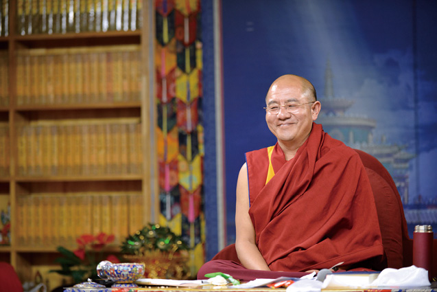

## 开启新学年显密宝藏

——2014年开学第一讲

2014年3月24日

今天是我们喇荣五明佛学院2014年开学的第一天。从今天起，各个班级，包括五部大论的戒律、俱舍、因明、现观、中观以及密法的续部班，还有修心班和净土班等等，都开始了新一年的学习。这个假期，我在外面闭关、看病、翻译了一些书、讲了一些课，现在回到学院了。昨天法师们开会总结了大家假期闻思修行和弘法利生的情况，同时也对新一年的学习计划做了初步安排。

## 一、新学年开讲《当日教言》

学会各地的学员们最近也正在进行着各科学习。今天的直播平台上聚集了很多佛教徒和非佛教徒，有些人是以虔诚的信心在接受佛法，有些人可能是以好奇心来了解佛法，这些都是允许的。今天是开学第一天，我没有太多话要讲，主要想给大家念一下《当日教言》的传承。《当日教言》是我今年准备给大家讲的一门课，这是我前年和去年翻译的，有接近一百个颂词。我计划每周讲一到两堂课，看看今年内能不能讲完。目前，我的课还有《现观庄严论》没有讲完，《六祖坛经》的课去年因为讲密法而暂停，所以今年我准备把《现观庄严论》《六祖坛经》《当日教言》这三门课一起讲完。

我们学院内部的道友，愿意听课的都可以来听，不想听课的，我也没有什么要求和约束。现在经堂里每天坐得满满的，但不知道有多少人在认真听，我也不要求你们。但对于外面学会的学员，不管是以前加入学会的还是这次新加入的，我都希望你们能好好学习《当日教言》。有些道友可能由于各种原因无法参加学会的系统学习，虽然你们学不了五部大论，但如果你们愿意从一些修行教言方面了解佛法，也可以由此入手。我在翻译《当日教言》的过程中，就觉得这些内容在如今这个末法时代，对修行人有很大裨益。所以，尽管有些人非常忙碌，也可以在茶余饭后抽空对这个课程做一些了解。

稍后我会用藏语来给大家念《当日教言》的传承，这样的话，万一以后听课时中断了，你们也能得到圆满的传承。大家都知道，藏传佛教是非常重视传承的，得到圆满传承非常有必要。有了传承，就能连接起这部法的作者和闻法者之间的法脉传授，使之一脉相传，从过去一直延续到今天。所以，这种教授方法，对整个佛教都很重要。

## 二、杜绝散乱 持之以恒

目前大多数道友都已经返回学院了，但还有个别人据说因为身体不太好，要过段时间才能回来。学习佛法并不是一种形式，也不是一种表演，如果心思不在闻思修行上，那另当别论，但要是真正想在学院好好闻思修行的话，我希望你们最好能从每部法开讲的时候学起，除非特殊情况，不要中途断了传承。

我建议今年学习显密佛法的道友们，要有一种自我约束的正知正念。现在城市里的人多数都很散乱，对于佛法的学习恐怕并没有真正重视起来，这也是末法时代一种魔的加持力，使人们在修行过程中违缘重重，难以收心，这些障碍都是我们凡夫人很容易遇到的。因此，我想提醒大家，在学习的初期不要特别热情、特别激动，学到了后面也不要转为冷淡麻木。有的人对于上师、佛法和道友，起初特别真诚，特别有信心，然而就像吃甘蔗一样，慢慢到了后头，就觉得没有味道、十分枯燥，越学越痛苦，这样就没什么意义了。因此，大家对待学习应该持之以恒，应该有一种恒常性，这样的态度很重要。

## 三、服从安排 合理分班

各班人员的分配，希望大家按照教务处和法师们的安排去做。我看到最近藏族喇嘛那边由于选班的倾向性，导致有的班级人数过多，估计汉族这边也会有这种情况。大家不要只选名气大的法师，全都挤到一个班里也没必要。其实每一位法师都具足三学功德，都有传授佛法的资格。作为学习者，只要你们的精进和智慧跟得上，选哪位法师都没有差别。所以，希望大家能配合我们的分班安排。如果年初分班合理，到了年底，各班的成绩以及管理效果都会比较均衡。

今年我们新增了密续班，有一些准入要求，如果没有达到就不能进入。女众这边在原有的两个戒律班之外新增了戒律三班，愿意学习戒律的道友们可以加入这个班。

大家在选班时不必特别执著、特别纠结。我们对大家的最低要求，是要把五部大论学圆满，同时要有自己学修的显密修行法门。所以除了个别发心特别忙的道友以外，每个人都应该在法师面前听受一门课。对于实在忙不过来的发心人员，所在部门和相关法师都应该去了解他们的发心时长，做出合理安排。除特殊情况之外，大家都应该好好配合管理，好好闻思修行。

## 四、念诵《当日教言》传承

其他我就不在这里多说了，网上很多听众对学院管理的事情可能不太爱听。当然，有的人也可能很感兴趣，很关注什么是五部大论、什么是因明班、什么是戒律班，甚至连我的一些批评，他们都特别愿意听。下面我给大家念《当日教言》的藏文传承，之后我们用《普贤行愿品》来一起回向。其实每天有这样一堂课是很好的，至少大家能一起念一遍《普贤行愿品》，这份功德也是无量无边的，这点法王如意宝以前经常提起。

关于这一周的安排，今天是念《当日教言》的传承，明天讲《现观庄严论》，周三没有课，周四讲《六祖坛经》，周五讲《当日教言》的第一课。你们平时要是没有时间听其他课的话，就只听《当日教言》吧。我每次讲三四个到五六个颂词，看看今年能不能讲完，也许突然显现一个神通，一天就讲完也说不定。

（堪布念《当日教言》传承）
