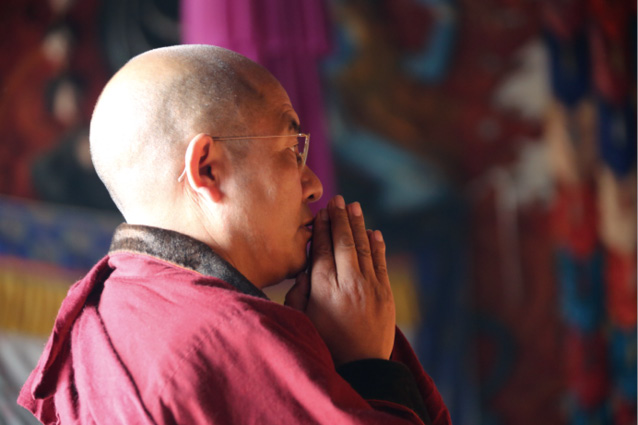
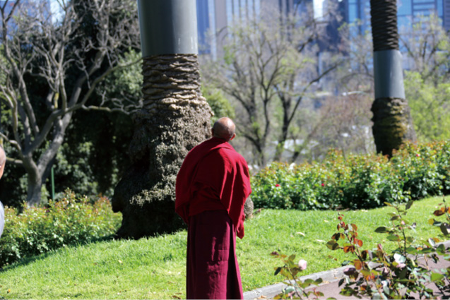
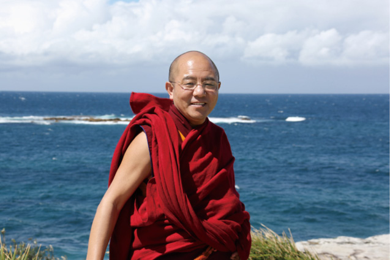

# 忏悔的修法与功德

——2015年金刚萨埵法会开示（2）

2015年5月25日

今天利用这个时间，与在学院现场和网络上参加法会的四众佛友们一起进行交流。

这也是一个特殊的日子，按照《时轮金刚》的藏历算法，今天是释迦牟尼佛来到这个世界的降生日；按照农历，今天也正好是汉传佛教四月初八佛诞日。我们的金刚萨埵法会正是从今天开始。

今天上午，在学院的人们都接受了门措空行母的灌顶，这是非常难得的。大家都见证了整个隆重的场面，相信都感到很震撼。在末法时代的今天，能有这么多人聚集在一起，接受密宗的灌顶和教授，共同发愿，共同修行，这是极其罕见、极其难得的一件大事、盛事。

## 一、克服困难 遵守纪律

这段时间，限于学院的条件，很多人可能正在经历着苦行。这次来参加法会的人实在太多，虽然大家都是来结上善缘、行持正法的，这点我很高兴，但人数确实超过了我们的接待能力。你们也看到了，昨晚下课后大家光是在门口找鞋就找了很久，最后有人光脚回去，有人穿着“鸳鸯鞋”回去，有人的鞋彻底消于法界中了。因为人数太多，目前用水也有些困难。我从昨晚到今天一直在为大家上厕所的问题到处奔走。刚刚我还在批评发心人员，至少应该用些盆子端水来供大家用，但可能管理人员都忙得晕头转向了。有些该解决的问题，希望学院的道友们，不论出家人还是在家人，都出来帮帮忙。这么多居士上山来，要是常住们都不去照应的话，他们会面临很多困难。

不管怎样，我们修行要受得了苦行。前辈的高僧大德们为了得到密法的灌顶和教授，都经历了常人难以想象的苦行。你们很多人都知道常啼菩萨的故事，看过米拉日巴、帝洛巴和那洛巴的传记，也了解过宗喀巴大师前往西藏的苦行，以及全知无垢光尊者依止格玛燃匝的经历。从他们的故事来看，我想我们现在承受的苦行并不算什么。这里的生活条件跟大城市比起来确实有一定的差距，但如果翻开这些前辈大德们的传记，看到他们跨越千山万水、远赴异国他乡、忍受种种磨难而励力求法的精神，我想大家应该会有勇气面对现在的小小困难。

世间人也说“既来之则安之”。我希望，大家这次既然来到学院，除非身体状况实在不允许，或是工作实在太忙，最好能够圆满参加八天的法会。在我们学院当中，不管条件多艰苦，也不会饿死冻死的。现在的天气跟极乐法会、持明法会那时候相比，已经非常暖和了。

大家既然来了，应该尽量专心参加法会，虽然转坛城也很重要，但法会期间大家最好在经堂里，如理如法地参加每天的四座念诵。要掌握好时间，不能迟到，早上7点准时开始第一座念诵。大家不要睡懒觉，经堂里会提供早餐。有些人特别挑食，觉得糌粑不好吃。你要是为了吃好吃的，大可不必到这里来。饭是不得不吃的，但可以简单点。明早7点经堂准时关门，如果迟到就进不来了。对修解脱法要是还不如世间赶个飞机、火车那样重视，那怎么可能获得解脱呢？

我希望大家每一座都要按照仪轨，从皈依、发心开始，到最后以《普贤行愿品》回向。法王如意宝在世时就有法会每天四座的传统，非常殊胜。这对在家人来说，确实是千百万劫中难得难遇的，这样的机会你们一生中有没有第二次，非常难说。参加法会的道友们不论是在现场还是网络上、是集体修还是单独修，我都希望你们在这七天当中尽量都能圆满四座。实在不行的话，哪怕每天能参加一座也是非常殊胜的。另外，大家在座上要尽量止语，这次给大家准备了禁语牌，你们用起来也算是给自己一个提醒。

大家念诵的时候最好使用转经轮。学院现在课前课后念诵都要用转经轮，希望你们也尽量用起来，会有非常殊胜的功德。你们与其供养我，不如去买一个转经轮、买一串念珠、买几本书，这样结缘也是很好的。有些人现在可能还用不熟练，慢慢会好的。

这是我对大家参加法会的要求，希望你们严格遵守各项纪律。世间法都要按规矩，我们修解脱法更应该有头有尾，更要有规矩，每个人都应该约束自己，不能太随意了。

## 二、做高水平佛教徒

从总体上看，今天在灌顶的过程中，我发现大家确实有进步。我昨天要求大家不要太激动，今天你们也做到了，能用正知正念来摄持，有的人刚想激动欢呼就立马忍住了。所以学习是很有必要的，否则有些佛教徒的行为在旁人看来疯疯癫癫，不像样子。不可否认，信仰的力量是非常强大的。不论世间法还是出世间法，具有信仰的人在许多方面都有常人难以想象的能量。但我们也要随顺世间，表面上看起来应该和大众一样，同时内在要有佛教的正见、信心和智慧，这样我们的水平才会越来越高。

这次看到这么多人能如此整齐地念诵，我觉得非常好。有些藏族朋友也跟我说：“现在不少汉族佛教徒都能熟练背诵许多仪轨，这是很多藏族年轻人都做不到的，特别随喜！”所以，我希望大家以后继续如理如法地闻思修行。我们佛教徒一定要学习，而不能盲目地信仰。否则，你的信心难以稳固和坚定，甚至所作所为都会不如法。如果不学习，哪怕你把所有家产全部供养出去，或是把所有时间全都投入修行，最后也不一定有所收获。但如果你能系统性、次第性地认真闻思，到一定的时候，虽然未必能保证你有多么高的修行成就和境界，但能确保你的所作所为不会让自己后悔，不会让别人误解。这样的人，不管对整个人类社会，或对自身的家庭和生活，都会具有特殊的价值。

如今，佛教对人们的生活状态有怎样的作用和意义，世间但凡稍有远见之人，都会非常明白。东西方有许许多多知识分子、顶尖科学家和企业家，对佛教都十分认可。所以，我很希望这个时代的佛教徒要给自己更大的成长空间，不断在智慧、行为、见解等方面提升自己。虽然感性的信心在信仰中是不可缺少的，但如果只有信心而缺失智慧，信仰很有可能会变成迷信。所以，信心一定要结合智慧的力量。如果你的信心中有智慧、智慧中有信心，那修行一定会成功的。

总体上看，我们佛教徒的见解、行为和修行水平是逐年提高的。希望很多新皈依的道友，要做到名副其实，而不要只做一个名相上的佛教徒。我们不敢说要把所有佛经和论典通达无余，但是对于修行和解脱所需要的基本知识，在学习中一定要扎实掌握。

你们现在是有进步的，但在这个过程中，我还是要强调，应该继续努力、不断学习。佛教徒里哪些是经过正规学习的，哪些是只受过皈依、表面信仰的，我基本上都看得出来。在这次法会上，你们应该也能发现，身边的人虽然同样信佛，但每个人的智慧和常识如何、行为如不如法，都是有差别的。这就是学与不学的区别。

这次可能好多人都想单独见见我，但因为我实在太忙，所以无法满你们的愿。其实，从佛教的意义上，见不见我并不重要，我最大的力量和加持，就是我的语言。而语言的力量，不论是在我面前还是在网上，都同样可以接收得到。

因为，语言的力量有两种。一种是听闻语言后在自相续中自然而然获得的加持。比如我们在接受灌顶和传承时，会有一种豁然开悟的感觉，自然会对佛法产生信心，这就是语言的一种加持。我想，如果我有这种语言的加持力，不论对网上和现场的任何人，我都会努力祈祷上师三宝加持你们的。语言的第二种力量，就是我所说的法能被大家接受于心。这也是任何一位上师转法轮的目的。我们这里有很多专业人员，能为大家提供网络传播的内容和服务，让我说的每一句话，都能被大家听到，让我自己懂得的知识，都能被大家接受。我想你们来到这里求受佛法传承，目的也不外如此。这就是我给大家真正的加持、真正的礼物、真正的交流、真正的力量。所以，大家不论是上网听课，还是参加当地的团体共修，我都希望你们能真正深入地去学习佛法，这就是我们的根本目的。

现在的佛教团体有着年轻化、高知化、专业化的趋势。我们在进步的同时，也要注意在其他方面不能退步。尤其是各地的佛教徒，不能自我中心，不要自吹自擂，不要搞门户之见：我的堪布如何如何，我的上师如何如何。佛教的目的是面向全人类，乃至所有众生，把正能量真正传播出去，而不是只顾各家自己的圈子。

我虽然常把“我们佛学院”挂在嘴边，但实际上这个佛学院所想的、所做的，都是为了天下一切众生的利益，并不局限于我们自己的民族、寺院。如果心有局限，别说是大乘佛教，就连小乘佛教都算不上。小乘佛教也要靠无偏的发心从三界轮回中获得解脱。所以，大家今后应该以一种包容的心态、深远的智慧、开阔的格局，立足于佛教的整体，在利益众生的事业上努力。

我希望大家都能发自内心地发一个愿——我有生之年绝不退于菩提道。这是很重要的。你们已经皈依了三宝，但如果只是名相上的皈依，什么实事都不做，整天只想着自己，那这样作为一个佛教徒其实应该感到惭愧。真正的大乘佛教徒，是连自己的身体和生命都不在乎的，一心只想为众生的今生来世付出自己的全部力量、资具，甚至身体。为了无边众生获得解脱，能够付出自己的一切。有了这样的发心，我们才能算是一个真正的大乘佛教徒。

你们这次来到喇荣，也许并不知道这里为什么叫喇荣。这两个字有很多种解释方法。我的解释是：身心获得自在——依靠三宝和上师们的加持，我们的心得以堪能。“喇”是上师的意思，“荣”是堪能的意思。你们来到喇荣，重要的不是买个纪念品、拍个照片，而是要在心里发一个愿。在你的人生中，2015年5月25日这一天，你在喇荣圣地发下了大愿。要记住“555”这个日子，虽然有时候这代表哭，但也可以代表开悟——悟悟悟。悟的是什么呢？在人生旅程中的这一天，你来到了喇荣，发下这样的愿，这给你的人生带来了怎样的改变。你最好写在笔记本上，等十年、二十年之后，再翻开这份记忆，那时会很有回味的价值，会有非比寻常的意义。

所以我希望你们在弘法利生、闻思修行、尽心尽力为众生这些方面上，都更加堪能。现在有个别佛教徒堪忍力很差，就连与人稍微起一点摩擦，都控制不了自己的脾气，各种坏毛病和习气一下就爆发出来，这说明修行很差，不够堪能。当然这只是极少数的现象，我在这里稍作提醒。

## 三、如何修忏悔

### 1．忏悔之必要

下面我讲一下如何修忏悔。在忏悔的过程当中，需要具有四种对治力。第一是所依对治力，也就是观想金刚萨埵；第二是厌患对治力，即认识到以前所做的罪业并深感后悔；第三是返还对治力，就是下决心以后尽量不造恶业，对所犯的错误尽量改正；第四是现行对治力，就是通过观想金刚萨埵降下甘露，或者是通过禅定、念咒语等不同方法，来清净自相续的罪障。依靠这四种力量，任何罪业都可以清净。

罪业本身没有什么功德，但是能通过忏悔得以清净就是它的功德。罪业这种东西很奇怪，如果我们没有及时忏悔，很小的罪业，也会慢慢增长变大。就像有的人本来借债不多，但利滚利一段时间之后，利息就超过了原来的本金，导致负债累累。相反，如果我们好好忏悔，即使犯过很大的罪，依靠忏悔的力量，也能使弥天大罪慢慢缩小，甚至彻底消除。这就是忏悔的力量，就像一点火星短短时间就能把如山王般的一堆干草焚烧无余。同样的道理，我们的忏悔也具有非常大的力量。

一般来讲，越是愚笨的人越不肯认错、不愿忏悔。而有智慧的人，虽然在生活当中难免犯错，但他会真诚忏悔，会想方设法清净罪障。所以对于智者，哪怕犯下大错误，只要及时忏悔，最后也不会受到罪业的染污；而对于愚者，虽然起初犯的只是小错误，但越积越大，后果也是不堪设想的。因此，我们要懂得忏悔，这非常重要。

忏悔实际上是一种惭愧心。所有人来到这个世界上，都不会存心想当一个坏人。有的人原本理想很美好，但由于生活、家庭、感情、生存等原因，最后在实际行为中，不得不做违背初心的事。比如，你们中有人可能本来不想说妄语，但为了来喇荣开金刚萨埵法会，只好跟父母或者单位说，自己是去泰国旅游。当然，为了参加法会，稍微说一点方便妄语，这也不算很坏。不过，我们有时候确实会因为无明造下一些罪业。

不仅是我们佛教徒，任何人在世间都有忏悔的必要。我以前看过一个故事：有一个美国人，因为与家人吵架，心情郁闷而买醉，酒后驾车撞死了一个6岁的孩子，被判入狱五年。刑满释放之后，他心里始终忘不了自己铸下的大错，在之后的十年当中，一直走不出杀人的阴影。于是他以这个孩子的名字建立了一个基金会，每周拿出10美元投入基金。他还坚持每个月利用一天的时间，在当时撞人的地点举着一个警示牌，上面写着：我是一个酒后驾车撞死过人的罪人，希望所有人一定要注意行车安全。虽然他坚持这样做了很久，但始终觉得自己的罪过无法清净，一生都活在愧疚之中。

其实我们很多人都有罪，只是不说而已。回首人生历程，因为无知、因为世间陋习的影响、因为谋生需要，我们造过多少罪业？有些人堕过胎，这其实就是杀人；有些人宰杀过动物；有些人以妄语欺骗过别人，特别是在生意场上，经常假话连篇。我觉得现代人的确很可怜，所有的红白喜事、逢年过节、聚会宴席，都变成了残害其他生命的日子。你们想想自己当初办婚宴时杀了多少众生？每年除夕的饭桌上又吃了多少众生？

其实人类有时候是非常可怕的，我们自己追求欢喜、快乐，却非要以无数众生的宝贵生命为代价，甚至把它们的痛苦当成乐事。听说有些人，不仅爱吃海鲜，还喜欢活生生地吃。甚至有人生吃活蛇，蛇的尾巴还在嘴里动来动去，就这样活吞下去。据说有道广东菜叫“三叫”，就是刚出生的幼鼠，筷子夹起它的时候叫一声，粘调料的时候叫一声，最后咬到嘴里时再叫一声。喜欢这种吃法的人还认为如果没有听到这三声叫声，就说明食材不新鲜。现在很多人，非要亲眼看到众生受苦，才觉得有营养、值得吃，其实这都是非常愚痴的行为。

我们在座的很多人，在皈依学佛之前，也许因为不懂取舍，造过许许多多的业。无论南方、北方，到处都有人在吃各种动物，还有着许多非常残忍的手段。我在十多年前写过一本书叫《悲惨世界》，很多人看了以后就不想吃肉了。当然，也有部分人批评我，说我不该描写肉食的残忍，这样对他们的生意、对产业发展、对社会经济是不利的。确实会有一些不同的观点存在，但你们要记住，这个社会有时候就是这样的——做好事的时候，常常会出现各种反对意见；而做坏事的时候，人们反而会赞叹有加。

前段时间新闻报道，有些人从悬崖上把猪活活扔到河里，特别残忍，引发了来自全球的不同评论。其实我们现在一些所谓的娱乐和享受，就是建立在其他众生丧失生命的痛苦之上的。这样的话，我们的生命还有什么意义？我们到底需不需要因此而忏悔？这次你们也可以好好想一想。且不说我们在无始以来漫长的轮回中肯定造过各种各样的业，即使在从小到大短短的这些年里，我们也造业无数。不谈佛教的别解脱戒、菩萨戒和密乘戒，就连做人最基本的伦理道德——应取十种善业、应舍十种不善业，哪怕用最低的标准衡量，我们恐怕也远远没有达到。

在藏地生活的人，也许造的业会少一些。虽然他们也可能说妄语、行邪淫、杀害生命等等，但他们自小就听父母教导：这样不能做，不然会下地狱；那样不能做，那是不合理的。所以大多数人从小就有一种因果取舍的观念。然而其他地方的大部分人，从来到这个世界开始，就在盲从着世间浊流。我遇到很多佛教徒，他们回想当初，总是很感恩善知识们的引导以及善道友们的开导。如果没有这种引导和支持，他们的一生很有可能还要不断地造业。人活一百岁，则造业一百年，最终离开的时候，就如《中观四百论》所讲：凡夫人大多都将堕入恶趣[^1]。所以我们很可能会成为地狱、饿鬼、旁生的真实无伪的“材料”。

因此，你们不用问别人：“我有没有什么罪可忏的？”只要扪心自问，就知道自己应该忏悔。我为什么特别喜欢参加金刚萨埵法会？虽然我从小没有杀过生，但按照经典严格来讲，“阎浮众生，举心动念，无非是罪”[^2]。实际上我们造的罪业是非常多的。有些人可能觉得自己是个很善良的人，其实未必真的善良。且不往严格里说，我们绝大部分人即使用最基本的标准来衡量，也算不得善良。

### 2．当断之烦恼

《圆觉经》云：“当勤忏悔，常起希望，先断憎爱嫉妒谄曲求胜上心。”

这里讲了应该断除的几种烦恼，第一就是憎恨。我们平时不一定讲解得出显密经论，可跟人吵架的时候却口若悬河、气势汹汹，这就是嗔恨心、憎恨心。甚至不少人在这种憎恨心的驱使下，什么疯狂的行为都会做，就像《入行论》里面讲的一样，完全变成了精神癫狂者。而有些修行人，面对别人的谩骂和攻击，却从来不以为意，因为知道对方的言行是出于烦恼的驱使。就像我用棍棒来打别人的时候，棍棒实际上是无力自主的，它只是处在手的控制之下。所以，当别人骂我们的时候，要知道其实他是非常可怜的，因为他完全是被嗔恨心驱使而造作恶业的。

第二个应该断除的，是我们的贪爱。其实贪爱也是一种非理作意。当我们看到好的事物，包括亲友、钱财、车子、房屋，都觉得要是为自己所有该多好，自然而然产生很多贪心。我们无始以来，由于欲望和贪心作祟，导致自己感受了无数痛苦。现在有些人自杀就是因为贪欲太过强烈，内心无法满足。在这种贪欲的驱使下，很多人一辈子都活得不知足。如果欲望能止息，其实现在大部分人的生活都会过得很平稳。

第三个，就是嫉妒心。有人看到别人学习成绩好、长得漂亮、赚的钱多、开的车好，甚至走得比自己快，都会觉得：我凭什么比不上他？然后产生强烈的嫉妒心。在生活里的大大小小各种方面，人的嫉妒心都很容易滋长。

另一个是谄曲之心。我们做生意也好，平时说话也好，心里本来想的是一套，口里说出的却是另外一套，在许多场合下，都使用各种各样的手段和语言欺骗别人，这是谄曲心。

此外，我们还有竞争心。合理的竞争，在学佛时也是可以有的，但不合理的竞争，一定要断除。有的人自己本来没有那样的福报，可一旦跟别人攀比起来，就会觉得自己也要有，看到别人赚的钱比自己多一些，就好像自己口袋里的钱被抢走一样，心里非常不平衡、不快乐。

诸如此类，还有种种。光是从心上面讲，就有许许多多值得我们忏悔的地方了。很多人有时候自我感觉不错，觉得：“我不需要学佛，不需要忏悔，我本来就是个善良的人。”可正是这样的人，一边以善良自居，一边在餐厅里面杀这个吃那个。你们想想看，如果真有善心，怎么会把这些鲜活的生命吞进自己口里？哪里有这种善人？所以，我们其实是在愚痴的驱使下，根本意识不到自己有多凶恶。如果你真正审视自己，就会发现：自己最初以善良之心来到这个世界，但后来却长成了很坏的人。一旦你发现了自己的罪恶，没有了傲慢心，这个时候你就会想忏悔。所谓的忏悔，正是一种自我发现、自我检讨的态度，这是很重要的。

### 3．忏悔之方法

忏悔的时候，可以依靠外在的诸佛菩萨、高僧大德、佛像唐卡、经书佛塔为对境进行忏悔。藏地的很多人在转绕佛塔的时候，有些会念阿弥陀佛来祝所有众生往生极乐，有些会祈愿自他一切众生罪业清净。今早我在坛城看到有的老年人一边拄着拐杖转绕，一边念着：“嗡班匝儿萨埵吽，嗡班匝儿萨埵吽，愿天下一切众生身语意的所有罪业都得以清净……”我觉得这是很不错的。她虽然身体一瘸一拐，需要依靠拐杖，但是她的心却能发出如此广大的愿力。她念金刚萨埵心咒的目的，并不只是让自己得以清净，更是为了清净自他所有众生的罪业。有时候我们确实能看到，有的人虽然垂垂老矣，没什么文化，但他们的发心非常清净。也许在座有些从麻省理工、哈佛、哥伦比亚大学毕业的佛教徒，心里还存着一大堆分别念，发愿的时候，也是只想着自己的罪业得以清净，最好能长得更漂亮、生意做得更大、钱赚得更多。虽然你们的知识水平很高，但心里的境界也许还不如这个拄着拐的老太太——开玩笑的，我相信你们应该不会这样发愿。

实际上，罪业并不是心的本性，而是像天空中出现的乌云一样，当风吹来，乌云就会散去。或者说，我们的罪业，就像冰川、积雪，依靠阳光的照射，是可以融化的。的的确确，依靠金刚萨埵不可思议的加持力、发愿力、智慧力，我们的罪业完全可以消除。如果罪业是一个实实在在的东西，我们应该能抓得到它，甚至有钱人可以花钱消业，没钱的人则不一定。然而，这些罪业全是心的一种迷乱。法王如意宝的《忠言心之明点》当中说过：我们的心就像是一面明镜，外面的障碍，就像明镜上面的微尘。依靠四种对治力的白布来进行擦拭，这面明镜就可以恢复它原本的洁净。也就是说，我们的心可以恢复清净，这个时候，生起次第和圆满次第的影像可以呈现其中。[^3]

如果有较高的境界，也可以依靠大圆满、中观、般若空性的安住方法来忏悔。但如果没有那么高的境界，还是应该尽量完成四十万遍金刚萨埵心咒的念诵。在我们学院四大法会里面，我最喜欢的就是金刚萨埵法会，因为金刚萨埵的念诵很容易。持明法会念诵很长，地藏法会也不好念，极乐法会念阿弥陀佛稍微容易一点，但我最喜欢念的还是金刚萨埵，可能是罪业深重的原因吧。

缘金刚萨埵的观修有很多种。一般来讲，是把金刚萨埵观想在自己前面，把自己观为平凡的身体，然后通过念诵咒语，观想金刚萨埵的光芒融入自己的身体，自己无始以来的罪障都变成污水和不清净物排出体外，最后，身体内外都变成澄澈透明的。这是一种外修的观修方法。

内修法的观修，在麦彭仁波切的《金刚萨埵修法仪轨》里有。这个仪轨我们以前也念过很多次。如果在座各位没有更高的生圆次第基础，就观想金刚萨埵是一切百部的主尊。麦彭仁波切在《金刚萨埵修法仪轨》的后面也写了：时轮金刚、密集金刚、喜金刚等所有这些密乘主尊，跟金刚萨埵都是无二无别的。[^4]所以，通过念诵这个咒语，破密乘誓言的罪业也能清净，更不用说犯别解脱戒和菩萨戒，还有我们刚才所讲到的世间罪业了。以前你们可能杀过生，甚至杀盗淫妄什么都做过，那这次开法会时就好好地忏悔。就好比我们的身体很脏，但遇到了一个很好的浴室，全身就能清洗干净了。要是以后多加注意卫生的话，我们长时间以来的各种罪障，都是可以清净的。

乔美仁波切在《山法》里一个忏悔文中写到：千年的黑暗，只要明灯一照，当下就可以驱除。同样，我们相续当中无始以来各种各样的无明障碍，依靠金刚萨埵心咒的光芒，当下全部都能消除。所以我认为这确实是传承上师们为众生开启的无比重要的法门。

不少人可能会认为：我的钱很重要，我的家庭很重要，我的事业很重要。我不否认这些确实是重要的。但考虑到生生世世，忏悔更加重要！如果你相信前生后世的存在，相信业因果的存在，那我们的相续当中有这么大的罪业一直覆盖着，什么时候才能变成一个好人、一个清净的人呢？很难！而依靠金刚萨埵法门这样一种殊胜的方法，自相续就能得以清净，这是非常非常有意义的。这次大家有缘共修，现场参加的就不用说了，网上的道友们如果能圆满完成四十万遍念诵，我相信以传承上师们的金刚语来比量衡量，都能获得同样的功德。所以，大家不管在哪里，都应该以一种欢喜心、坚定心，共同地好好念诵。

如果在法会期间实在念不完，就尽量在短时间内完成，我们这次不规定期限，但大家应该发愿一定要圆满四十万遍。今天灌顶的时候，我就在想，能与这么多菩萨，这么多出家人，一起共同发愿，实在是非常有福报，哪怕只念一遍《普贤行愿品》，功德也不可思议。藏地修行人都非常重视跟出家人共同发愿。比如朝山的时候，最好有出家人在场，或者多位同行道友一起，大家一定要共同念一遍《普贤行愿品》，这是需要特别在意的，我们确实需要这样一种共同的发愿力。因此，我希望法会上每次念到《普贤行愿品》的时候，大家都要用一种欢喜心来发愿：“愿生生世世遇到大乘佛法。”希望大家重视起来。

### 四、忏悔的功德

我的胡言乱语就要接近结尾了。下面，我会念一下《开显解脱道》和明天法会仪轨的传承。

（堪布念传承）

麦彭仁波切所造的仪轨后面有一些小字，是关于修金刚萨埵忏悔的功德，大家最好看一下。第一层意思，《集密意续》里面讲，谁听到或者接触到金刚萨埵心咒，这是由于他以前在很多佛陀面前积累过资粮。所以，各位参加金刚萨埵法会，看起来是一种偶然，但实际上你们都是曾经有过佛缘的人。

第二层意思，金刚萨埵是其他所有本尊的总集，我们不论修什么本尊都可以修金刚萨埵，比如你修文殊菩萨，或者其他本尊，念金刚萨埵心咒也可以成就。这一点非常重要。

第三层意思，金刚萨埵以前曾发愿，在业力深重、破誓言的人面前，愿清净彼等一切障碍。此愿已成就，从而加持了他的咒语和名号。所以当罪业深重的人念“嗡班匝儿萨埵吽”的时候，他会给予特别的加持。就像我们洗澡的时候，可以用沐浴露、香皂等洗去污垢。同样的道理，在三宝的加持中，有些是专门开智慧的，有些是增长财富的，有些是往生净土的，有些是清净罪障的……我们这次法会是息、增、怀、诛四大事业里的息业——清净罪业。

我们在忏悔的过程当中，虽然不能二十四小时一直抱着负罪感，但尽量一天中至少一两次，要在心里一一回想自己以前所造过的罪业。也许你跟别人说会不好意思，但可以跟金刚萨埵默默地说。

最后，麦彭仁波切说，金刚萨埵心咒的功德不可思议。你们念咒的时候，先应该懂得它的功德，这样才会有兴趣，有力量。不然光是口头上念诵，心里什么也不想，这样念再多也不是很有用。有时候我们可能心会散乱，但坐在金刚萨埵和这么多僧众面前，会真正发自内心地忏悔。等你回去的时候，就会感到，这次到藏地来，不但灌顶时降下雨水做了外部的沐浴，在法会中，通过念诵金刚萨埵心咒，内心也得到了沐浴。

我们在内心中忏悔之后，直至临死也不要再造大的罪业。有时候我们可能难免会犯一些罪过，但不能像从前一样无恶不作，尤其是杀生。很多人以前肯定杀过很多生，那么这次更应该好好地忏悔，这是个很好的机会。这些就是今天要讲的，忏悔的功德不可思议。

[^1]: 《中观四百论》：“由于诸人类，多持不善品，以是诸异生，多堕于恶趣。”
[^2]: 《地藏菩萨本愿经》：“尔时，地藏菩萨摩诃萨白佛言：‘世尊！我观是阎浮众生，举心动念，无非是罪。脱获善利，多退初心；若遇恶缘，念念增益。是等辈人，如履泥涂，负于重石，渐困渐重，足步深邃。若得遇知识，替与减负，或全与负，是知识有大力故，复相扶助，劝令牢脚，若达平地，须省恶路，无再经历。’”
[^3]: 《忠言心之明点》：“自续佛性白晶镜，忽然障尘极遮蔽，难现深明等持故，应用精进四力布。”
[^4]: 《金刚萨埵修法仪轨》：“胜乐金刚、喜金刚、密集金刚、时轮金刚、黑日嘎、普巴金刚童子此一切本尊实际均是金刚萨埵……十方三世诸佛归集为金刚萨埵，所有密咒明咒归摄为六字真言，因而此本尊心咒的功德利益不可思议。”
