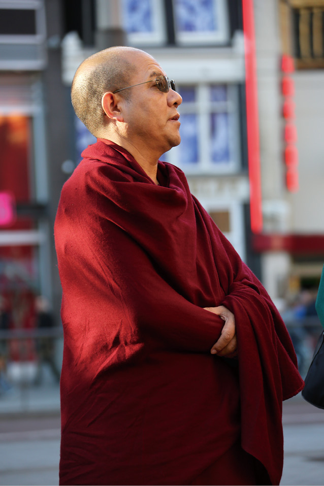
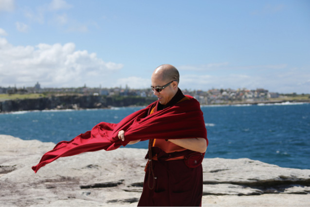

# 怎样才快乐

2015年3月20日

今天，在这里做一个简单的交流。前两天没有网络，所以只给大家讲了一些零散的修行方法。除了佛学院的学员以外，城市里的学佛者有一种通病，就是不太愿意闻思系统性的课程，而更愿意接受一些临时的、零散的内容。比如，昨天我讲“念珠的功德”就有很多人听，但接下来系统地讲《大圆满心性休息》《大乘经庄严论》时，可能有些人就会不太想听。其实如果我们严格要求大家必须从头到尾听完一门课，否则不能听其他课，由大家自行选择听还是不听，这样也许更可行。但我们还是给了大家特殊的开许，希望你们自己有时间的时候，最好能尽量听完这些课程。

## 一、系统闻思修，才能根除痛苦

这次我也考虑了很久，大城市里很多人确实缺乏闻法的机会，对佛法的一些真正甚深的道理，很多人都不是很明白。有些人没有听课的兴趣，有些人没有听课的习惯，好像学佛就是吃止痛药一样，要能立刻让他得到收获才肯听，如果没有立竿见影的效果，就不太愿意听受。有些人可能不只是对佛法如此，甚至对世间的知识也不感兴趣。一讲到学习就头痛头晕、心烦气躁、浑身不适；一讲到打麻将或者看电影，心里就特别舒服、特别亲切。虽然我自己从不看电影，但有时候会故意提起这类话题，因为我知道有的人对这些特别感兴趣。所以，大多数人在世间法上有时间、有兴趣、有因缘，而听到佛教的基本道理，或者一些专用词汇时，却麻木无感。对当今很多世间人来讲，这可能也是一种普遍现象，是可以理解的。但是作为佛教徒，既然已经皈依了三宝，如果对佛教的教义不感兴趣，甚至一窍不通，那可能不太合适。

现在有些佛教徒，说实话，有时候看他的所作所为，会觉得非常可悲。这样的人在出家人、在家人、汉族人、藏族人当中都有。有些人也许觉得：喇荣五明佛学院是世界著名的佛学院，里面全都是人才、精英，只要是喇荣山沟里的人，肯定是值得依止的。这恐怕也不一定。有的人虽然在我们学院里待了很多年，但佛法要是没有融入相续，可能也跟一般人一样，甚至有些行为还不如一般人。

有些人跟我讲：你们佛学院出来的某某人，他的品行如何如何。确实，我们学院不是工厂，不敢保证里面出来的产品百分之百质量合格。我们这里的人也是形形色色的，有的是来了几个月的，有的是来了几年的，他们都还没有毕业，有的甚至还没有正式入班。有些人虽然毕业了，但每个人的习气和行为千差万别，要真正做到法融入心，也并不是那么容易。再加上现在这个末法时代里，很多人都不爱学习，没有听法的意乐。即使听了，但法就是法，人就是人，法和人之间还有一段距离，书本上的道理并没有融入自己的心。在这种情况下，不少人就像熔化的铁水，一旦离开了佛法的环境，温度一降，就又变回了固体。同样的道理，虽然有的人在某些阶段和场合中受过一定的教育，可一旦离开了这种环境，离开了原来的道友，也会有各种各样不如法的行为暴露出来。

所以我今天要在这里指出一些问题。现在的佛教徒有一个通病，就是不爱看书、不爱学习，而喜欢谈一些神通神变，向往不需勤做、轻而易举就能得到某种境界。通常来讲，有一定佛学水平的人是不会随便讲境界的，即使他内在已有这种境界，也不会公开说出来。因为他知道，我们佛教的四大根本戒之一就是戒妄语，如果自己本来没有得到某种境界，偏说得到了，这就是犯大戒。如果他是居士，就犯了居士的根本戒；如果是出家人，则犯了出家的根本戒。但现在有些佛教徒，明明根本没有这方面的境界，却说自己有，听的人也很容易轻信。这是为什么呢？就是因为佛教徒的佛法水平普遍不够高，很容易受到别人的欺骗和引诱。因此，在这种情况下，我们更应该通过各种方式来加强学习。

最近一些报道也指出了中国人不爱读书的问题，呼吁大众要多读书。说实在的，对这一点我感受非常强烈。我去欧洲的时候，不管是在火车上、飞机上，任何场合当中，都能看到人人手里拿着厚厚的书在读。可是当我回到了这个世界，就只能看到每个人抱着手机刷屏，看书的人少之又少。

很多藏传佛教前辈大德的传记都有博览群书的记载，有的大德在一生中看了三千多本书，有的看了两千多本，有的看了七百多本。许许多多前人用他们的整个人生，研读和翻译了数不清的经论教典。可是到了今天，很多佛教徒恐怕只学得进两三部经典，只看得懂几本世间的书，除此之外，心基本不放在学习上。一个人要是离开了学习的环境和机缘，他的品行作为很有可能就会逐渐变得庸俗，变得低劣。

所以，从世间角度讲，我认为一个人如果想提高自身水平，一定要有阅读的习惯。作为大乘佛教徒，那就更不用说了。你要成为大乘佛子，需要度化无量无边的众生；要广度众生，就要知道众生有着怎样千差万别的根基；要把握众生根基，就要了解东西方不同人群都有些什么爱好、想法、意乐，要洞察他们形形色色的智慧和心性。这个时候，我们自己如果没有一定的学问水平，恐怕是有一定困难的。

因此我今天在这里，说是呼吁也好，祈祷也好，劝请也好，希望十方的佛教徒不要沉溺于一些无义的闲聊，不要整天讲神通神变，嚼口舌是非。现在有些人确实特别关心是非，其实真正有一定水平和境界的佛教徒，对这些闲谈是不感兴趣的，他们会讨论更深、更广、更重要的一些觉悟和智慧。所以，我首先希望大家今后都把注意力放在有意义的内容上，比如对一个问题，从显宗的角度、密宗的角度、世间学术界的角度，分别是怎么讲的，东方文化对此有什么看法，西方文化又有何评价……诸如此类的很多问题值得大家去探索。尤其你们大多人都还年轻，应该下点功夫多去精通一些经论、教典。

我希望从现在开始，佛教徒不要盲目地信仰佛教，否则就成了一种迷信；学过佛法的一些佛教徒，也不要盲目地傲慢，即使你听法已经两三年、十几年，其实也没什么了不起，因为最根本的是要问问自己相续中的烦恼减少了多少。如果没有减少，就仍然需要不断地去闻思和修行，仍然需要以学习、互动、交流作为助缘。通过这样的方法，才能让我们真正压制烦恼，根除痛苦。这样一来，人生才活得有意义。

## 二、怎样才快乐

今天的主题是“怎样才快乐”。我的快乐就是把所有的手机信息都关掉，喝喝茶，看看书，观观心，这就是快乐。我自己的快乐分享出来，就是这样的。怎样才能获得快乐呢？我可能谈不上有什么快乐的窍诀，但我看过许多前辈大德的经论、窍诀和教言，与那些沉溺在茫茫无边苦海里的众生，以及那些不断涌现种种分别妄念的人们比较起来，我觉得自己还算享有一定的快乐。把这种快乐与大家分享一下，也未尝不可。因此，今天就利用短短的时间，我们来一起交流怎样才快乐。

### 1．相比可怜众生，人们是快乐的

今天我们上课还有几个原因，主要的原因是大家可以共同念诵《普贤行愿品》，还有一个原因，今天是神变月的最后一天，功德非常大。另外一方面，今天还是“世界无肉日”。

说起“世界无肉日”，我记得是从1985年开始的。当时包括美国在内的很多农场蓄养大量动物以供屠宰，为了拯救动物，呼吁人们减少杀戮，很多善心人士就创立了这么一个节日，号召全世界在3月20日这一天不要吃肉。这一点在我们学院内是可以做到的，但外面很多人可能刚刚才吃了不少肉，然后过来听课。

人们大多有喜欢吃肉的习气。但从另一个角度看，我们对人的尸体又很害怕。人死了以后，我们不敢把他的肉切成一块一块放在冰箱里。但是对于其他动物的尸体，却非常习惯这样。如果把人的头、脚或者手肢解下来放在你家冰箱里，你心里可能会感到不舒服。但是把鸡鸭牛羊这些动物放在冰箱里，你却觉得很不错，很好吃。餐桌上的猪肉、羊肉也是动物的尸体，我们享用它们的时候，如果仔细思考，其实很多方面与人的尸体并无不同之处。

我前段时间去了新西兰和澳大利亚，那边有些大型养殖工厂，里面的牛羊特别可怜，因为它们一辈子都被关在小小的隔间里，身体始终都没办法移动，一直这样直到最后被杀掉。有时想想，我们人类自由地活在外面，而它们从小就只能在这样一个异常狭窄的空间里生存。比较而言，藏地的一些牛羊，在没有被宰杀之前，它们生活在草原和山间，至少是自由、安心的。但现在很多养殖场里的动物，完全是被困在一种工业化流水线的框架当中，睡也不能睡，动也不能动，一直到死为止。所以，这种情况下，我们确实需要提倡素食。有时候我们人类的确很可怕，随意剥夺众生的快乐，夺走众生最执著的身体，供自己肆意地享用。所以有些学者说，吃肉实际上就是吃众生的生命。

大乘佛教徒，尤其是在汉传佛教当中，历来都非常提倡素食。除了个别必须依赖肉食维持生命的人以外，我们特别希望佛教徒一方面经常戒杀放生，另一方面多提倡素食观。这对于如今整个地球的环境和气候问题，也有非常大的积极作用。如今这些规模化的农场，是以什么手段养殖鸡鸭这些众生的，你们可以通过视频了解一下。我每次看到、听到它们的处境，就觉得我们人类确实是一种非常可怕的动物。

其实我们人类只要没有严重的疾病痛苦，大部分情况我想应该已经算是很快乐了。比起这些动物，我们可以自在地行走，晚上有睡觉的空间，白天可以自由地出门，这本身就是一种快乐。

### 2．换一种眼光，任何因缘皆可快乐

所谓快乐，每个人认定的方式都不同。如果你认识到这就是快乐，那即使处在恶劣的环境下，也能感受到真正的快乐。有些人可能觉得有了财富才会快乐，那可不一定。很多修行人一贫如洗，比如米拉日巴尊者，我们却能从他的传记中看到，他所享受的快乐，是世间任何富贵之人都无法相比的。

我们首先要懂得，怎样才是真正的快乐。世界上所有的众生都在追求快乐，但真正重要的是得到内在的快乐。因此，米拉日巴尊者也说过：内在快乐尚未得，外在快乐皆苦因。我们如果没有体验到内在的快乐，那么外求的快乐就变成了痛苦之因。这一点可能你们也感觉得到，当我们忙于追逐名声、地位、情感等世间种种事物之时，如果没有内心的快乐，而一味向外在追求，最后即使追求到手，往往也伴随着许许多多的痛苦。

所以我们应该认识到，在这个世间有各种不同的快乐因缘。无著菩萨讲过一个《快乐之歌》[^1]，我在几年前曾给大家传授过。大概的内容是：我们生病的话，应该感到很快乐，因为通过疾病能净除我们的业障，如果没有生病，也应该很快乐，因为通过健康的身体可以做许多善法；如果没钱，那是很好的，因为世间诸多痛苦都是由钱财引起的，如果有钱，也应该很快乐，通过钱财可以积累更多的福报；如果长寿，那是很好的，人活在世间，特别是具有修行境界和清净戒律的人，可以积累很多资粮，能为众生带来很大利益，就如《中观四百论》里所讲的“具戒久存活，能作大福德”，如果寿命不长，即将死亡，也是快乐的，因为我们如果早一点离开世间就会少造一些恶业。

所以，不管富也好，穷也好，长寿也好，短命也好，生病也好，健康也好，我们如果以另一种方式来看待，那么无论如何皆是快乐。这是无著菩萨对快乐的一种定义方式，我们如果真能懂得其中深意，无论世间一切如何显现，都能认清它的性相和状况，那在什么情况下都可以快乐。

其实对于修行人就是如此，只要有了一定的修行境界，生活中的任何境遇，对他来讲都是可以接受的。健康或者疾病，贫穷或者富裕，遇到善友或是恶友，赚钱或者亏损，一切都能从容接受。这种心境要通过修行来获得，我想我们很多人更应该追求这种快乐。

当然，口头上的道理谁都会讲，但在生活中真正遇到问题时就不一定了。有时候痛苦产生的当下，是很难转为道用的。我们藏族有一种说法：看火星落到自己的身上没有？如果火星落到自己身上，就很难受。意思就是说，火星溅到一个人身上的时候，旁人看不出来多痛苦，只有他自己感受得到。比如我的家人要是死了，尽管我平时把道理讲得天花乱坠，真遇到这样的痛苦时，我还是很难受的。这个时候，也需要其他人的一些帮助。

我们很多佛教徒都学了大乘佛法，嘴上也都会说“胜义当中一切都远离四边八戏，世俗当中一切都如梦、如幻、如阳焰、如水月、如乾闼婆城”。当你开心的时候，就好像真是个不错的修行人，眼睛一闭，入定也行，安住也行；可当你遇到困难和违缘的时候，入定也没办法入，念咒好像也起不到作用，安忍也修不下去，一切都开始倒塌、崩溃，这样的现象有很多。有时候，也可能当局者迷，旁观者清。有些事在旁观者的眼里不过如此，可一旦发生在自己身上，就觉得我是世界上最痛苦或者最快乐的。

麦彭仁波切等很多藏传佛教的大德，都传授过把快乐和痛苦转为道用的方法。快乐的时候，你也不能过分执著、傲慢、开心，因为这种快乐毕竟是无常的，过一段时间，你也可能会流下眼泪；痛苦的时候，你也不必特别地失望和绝望，因为一切都是无常的，过一段时间，你也可能会变得开心。

我以前给大家讲过自己读书时的一个小故事，当时我觉得这件事情非常重要，但现在看来十分幼稚。不管是幼稚也好，重要也好，在我生命中有过这样的一段经历。大概三十多年前我读初中一年级的时候，有一次跟其他同学拉帮结派打架，当时，我们的部落跟另一个部落打了两天的架，打得十分激烈。后来我们班主任在班会上点名批评，说索达吉同学是班级的“败类”（众笑）。他说还有初中三年级的陈某、初中二年级的康某，对这三位，学校要警告处分。当时我们班主任批评得很厉害，说如果不是因为他去说情，我可能要被彻底开除，要求我第二天要在全校师生大会上做书面检讨。

当时我们这个班人并不多，不到20个，但我感觉好像所有的同学都不理我了，就连他们看我的表情都变得不一样了，我觉得特别伤心、特别痛苦。当时我必须写一份检讨书，可实在写不通顺，时间又比较急，我就去求以前小学时对我不错的一位老师，他曾经给我上过一堂数学课——我不能说这位老师的名字，以前我的有些讲记里面提了名字，有些老师后来找我算账。我说：“某某老师，您可不可以帮我写一份检讨书，明天我要在全校面前念。”但是这位老师当时表情特别不好，他说：“谁叫你打架的？我没有让你去打架，凭什么帮你写检讨书，我才不写呢！”然后完全不理我。其实我也找得不对路，因为这位老师就是来自跟我们打架的那个部落。我平时认为他人很好，但这次不该找他帮忙。当时我可能太伤心了吧，这件事在我的记忆当中是很深刻的。

前阵子，我去一个地方开法会，三十年前的那位老师也在迎接的队伍里，拿着一条长长的吉祥哈达。我一看到他，心想：“当时我请你帮写一个检讨书，你不帮我写，今天却又这么恭敬地拿着哈达。”后来又想：“哦，我学了这么多的大乘佛法，不能有这样的执著。”我就马上把刚才的想法像电脑上的病毒一样删除了。

当时，很多同学、老师都不帮我写检讨，我就自己勉强写了一份，找另一个同学帮我修改了一下。第二天，老师说这次不单是我们学校的校长要来参加这个所谓的批评会，还有当时我们区里的区长和区委书记都要参加，这情况非常严重！于是，就在这么一个全校大会上，以我为主的打架者，被大家公开批判了一番。当时我感到自己是这个世界上最可怜的人，非常非常伤心。我觉得自己可能没有希望了，不管是我们班、我们老师，还是我自己，以后都没办法再抬起头来了。我甚至想过要不要离开学校。这件事发生在我初中一年级，当时确实是很痛苦的。

后来，到了初中三年级，应该是1981年的冬天，那时我又感受到了一次很大的快乐。当时，同样是我们班主任，表扬我说，我是班里的光荣。为什么呢？因为当时我得到了整个炉霍县第一名的奖学金，记得有32元钱。那时我也是在全校大会上被公开颁奖。现在回想起当时领奖的感觉，就好像是得到了诺贝尔和平奖或者奥斯卡金像奖一样。这种县级的奖励对于当时的我来说就像是世界级的一样，我觉得自己是世界上最快乐的人！但是，如今回头来看，当时的那份快乐和那种痛苦，其实都微不足道——虽然对个人而言，可能是件挺大的事。确实，那时候痛苦的感受，还有那些老师同学态度不好的情形，过了三十多年，至今我还记忆犹新。

所以，当一个人处在极大的痛苦中时，你在旁边哪怕稍微说一句安慰的话，或者稍微扶一把，他可能永远都不会忘记。因为在他最绝望、最痛苦的时刻，你给了他一剂复活的甘露妙药，他会特别地感激你。而当一个人处在快乐中时，又会有很多人对你赞叹、欢呼……不管怎么样，当我们快乐或痛苦的当下，就当时的自己而言，可能是很强烈的一种感受，然而时过境迁以后再回头看，实际上没什么大不了。今天我们在座的有些人可能正遇到一些事，心里特别特别地痛苦，但在旁人看来，你这个痛苦也许完全不值一提。

### 3．观察心的本性，苦乐皆可道用

按照一些佛教的教言，我们现在所感受的痛苦，真正从本体上观察，其实也没有什么值得去烦恼的。为什么呢？莲花生大士有一个快乐和痛苦怎样转为道用的教言，这是伏藏大师桑吉朗巴取出的伏藏法。“道用”指的是为修道所用。这里面说，世间一切快乐也好，痛苦也好，归根结底，苦乐实际上都是我们的心。当我们观察自己的心的时候，其实它没有形状，没有颜色，没有未来，没有过去，没有来源，没有住处，没有去处。这一点，我们每个人稍微向内观察，就会清楚。尤其是学过一些密法的人，应该会完全明白；学过中观的人，也能领会得到；甚至有些念过《金刚经》的人，也知道“过去心不可得，现在心不可得，未来心不可得”。我们的快乐和痛苦实际上都是一种心，这种心从过去、未来、现在观察都是不可得的，从颜色、形状、形象上观察也不可得。

所以莲花生大士教我们观察当下这一颗痛苦的心：它的本体其实是空性的；本体空性的同时，它的自性是光明的；由于自性光明和本体空性，在形象上它可以有各种各样的显现。这就是我们心的真相，它并不是痛苦的东西。当我们去观察内在这颗心的时候，如果觉得痛苦，只不过是没有认识到心的本性而已。当你感到心里特别不舒服的时候，会涌起一种说不清楚的感觉，这种感觉的来源也许是别人对你的评价，也许是你身边发生的事情，也许是你身上感受的病痛，在这个时候，我们可以对这种痛苦加以观察，如果真正认识到它的本质，就会发现，原来这就是心。以心观心的时候，心就是空性的，空自然解脱，是解脱的本体，也就是光明大乐无二无别。

这种修行方法，是我们藏传佛教中的一种特别殊胜的窍诀。虽然世间也有很多心灵方面的教育，诸如“怎样寻找幸福？”“幸福的秘诀是什么？”“快乐是从何而来？”但这是世间一般教言无法相比的。只有当我们真正深入了解自心的时候，才会知道原来世上所有的痛苦其实来自这一颗心。因此，我们不用别人来开导，也不用吃药治疗。有些人因为特别痛苦，实在没办法，就试图通过酗酒、抽烟、去一些不如法的场所寻求刺激，来让自己忘掉痛苦。但这不是办法，只是将痛苦暂时压制而已，当一时的麻醉过去以后，心里的痛苦还是照样存在。

如果我们能够真正从根本上认识到，这些情绪实质上只是一种迷乱的、习惯性的执著，那我们的痛苦就可以自然而然解除，从而得到一种无漏的快乐、一种恒常的快乐、一种不会轻易改变的快乐。很多修持佛法的人，在生活中不管有什么遭遇，都能保持淡定从容，就是这个原因。在痛苦面前，依靠内心自我调整的力量，相比外在的药物治疗，或者娱乐麻醉，效果上有天壤之别。现在越来越多的人都在尝试通过修行来解除烦恼和痛苦，这非常重要。很多人在学习和修持大乘佛法之前，生活是非常苦恼的。很多进入我们学会的人，曾经也特别痛苦，在感情、事业、家庭方面，都有许许多多的烦恼。我写过几本书，其中《苦才是人生》特别畅销，我想，畅销的原因也许与这个书名有一定的关系。书里面虽然也有针对不同问题的窍诀，但确实，这个时代上上下下所有人都对痛苦深有感受。

痛苦的根源是什么呢？就是源于我们没有认识烦恼，没有认识自己的心。当你稍微认识到自己的心的时候，其实就能在生活中感受到许许多多的快乐。这种快乐可以来自一杯茶、一杯咖啡，一种随时随处简简单单的生活；或者静下来看书学习，这也许是人生当中最好的一种快乐；或者经常与别人交流、分享、互助，做一些利他的事情，这也是一种非常快乐的状态；或者在某个寂静之处，通过禅定来让自己安住，体验佛陀所讲的一些快乐、无苦的三摩地，这种修行也是很好的一种快乐。

在繁忙的生活当中，有些人可能没有这样的机会，因为他们需要不断工作，需要发心，需要做很多事情，但如果在这个过程中对内心稍加调整，或许就能变得跟任何人都能自在相处，对任何事都能从容接受。曾经有些修行人，可能因为前世的业力被关入监狱，他也能让自己过得很快乐。我们藏传佛教很多大德，在“文革”期间被关押入狱，一直囚禁了十几年、二十几年，但他们在监狱里的生活状态与旁人完全不同，因为他们心中有一种境界。他们把坐牢当作是一种闭关、一种享受、一种修行，这也是一种快乐。

### 4．疾病转为道用的三种方法

所以，世间很多遭遇，都可以通过修行来应对。即使我们遇到疾病，也可以转为道用。麦彭仁波切有一个教言，叫做《治病甘露流》，比较简短，主要是讲如何将疾病转为道用的修行方法。我以前曾想翻译，但一直没有来得及。它分了三个方面来讲：第一，我们所产生的病痛，实际上是一种净除障碍的因；第二，我们的疾病，其实是一种善知识；第三，这个疾病可以转为道用。

第一点是说，我们受到各种外境以及内在的业和烦恼的影响，因而产生了种种疾病。当我们生病的时候，可以如此观想：这种病痛对我而言是一种机会。世间经常讲“小苦除大苦”“以毒攻毒”，《中观宝鬘论》中也有类似的教言，意思就是说，我今天感受疾病，虽然很难受，但是借此可以遣除更大的包括堕入地狱、饿鬼、旁生界的痛苦[^2]。佛经当中也说，修行人通过感受头痛之苦，可以消除转生地狱之恶业。

所以，我们遇到疾病的时候，应该以一种欢喜心来接受。还可以这样想：愿一切众生获得快乐，愿我现在感受这些身体和心理的病痛，可以消除无量众生的痛苦。这样观想，无始以来所造的诸多罪业，都能依此而清净。

这一层内容，就是要告诉我们：人在生病的时候，要会抓住机遇。遇到病痛的时候，很多人也许会觉得自己很不幸，一定要想方设法治疗。前阵子冬天的时候，我就感冒了很长时间，吃药打针都不管用。有时候我也会这样观想，有时候也观想不起来。但如果是一个很好的修行人，一定会想到：不管怎么样，如果我生病对众生有利，就让我生病；如果我健康对众生有利，就让我康复。有这样的心态是很重要的。因此我们要知道，生活中一切都非常顺利的话，不一定是好事，有时候生活当中遭遇不顺、违缘，对我们反而是一个很好的修行机会，能让我们消除无始以来的许多罪业，从而遣除更大的痛苦。这是第一层内容。

第二层内容，就是把疾病看作善知识。我们可以这样想：如果产生疾病，就能帮助我们生起出离心。一个人如果一直快快乐乐的，感受不到轮回当中的痛苦，他的相续就会产生一种傲慢心。当我们遇到疾病和不顺时，依靠它就能让自己的修行有所进步。什么是善知识呢？所谓的善知识，就是通过他的出现，能让我认识到以前不知道的道理。同样，在这场病痛没有发生的时候，我也许对这个世间麻木无感，但正因为遇到了这种痛苦，我才能重新开始调整自己，重新对人生有所认识。有些人在自己身体好的时候，从来都不去寺院拜佛，而在身体不好后，就开始学佛了。所以，无垢光尊者也在《窍诀宝藏论》里讲，一些病魔、外缘其实对我们的恩德是很大的[^3]。如果我们在人生中因为遇到疾病，从而开始认识轮回、认识自我，这其实就等同于真正的善知识出现，因此，生病也不一定不好。

凡夫人平时总是习惯问候：“你好吗？身体怎样？”如果回答身体很好，对方会说：“哦，那就好，那就好！”可如果身体不好，互相都比较焦虑。但按照大乘佛教的一些教言，身体好的话，也许会令人傲慢、懒惰、荒废修行；如果身体不好，可能反而会令人生起紧迫感。就像前段时间有一个人说：“因为我生病了，现在必须开始修加行，否则可能时日不多了。”他在身体健康的时候，从来不想念佛、修行，一直散乱，但由于身体不好的原因，他才意识到生命无常，死亡会随时出现。这是第二个观修方法。

第三层内容讲的是，通过疾病可以修持六波罗蜜多。当你生病的时候，知道自己的身体可以布施给一切众生，修持自他交换，这就是布施度；当你生病的时候，知道自己依靠有漏的身体，痛苦始终是接连不断的，因此发愿一定要修出无漏的智慧和金刚身，这就是持戒度；当你生病的时候，以大悲心和自己修行的境界相结合，然后安住，这就是安忍度，有些大德，不管生什么病都不怕，无畏死亡，这也是一种安忍；当你生病的时候，在病得不太严重时，将以前所修过的境界不断地串习、运用，这就是精进度；当你生病的时候，时时安住在空性与自己的心无二无别的境界当中，或者思维轮回众生的痛苦，在自他交换的方式中修禅定和安住，这就是禅定度；当你生病痛苦的时候，按照上师的教言，观想病苦在胜义当中远离一切戏论，在世俗当中如梦如幻，这样来摄持，就是智慧度。因此作为一个真正有修行境界的人，在一场疾病当中，可以圆满六波罗蜜多。

总而言之，应该把疾病看作一种净除障碍的扫帚，看作一位非常难逢难遇的善知识，同时要了知，依靠这种疾病，还可以修持波罗蜜多。如果我们可以把疾病转为道用，那同理，在生活中出现的其他任何痛苦，也照样可以转为道用。

## 结语

今天大多数听众应该都是佛教徒，当然也有个别不是，在我们学院当中，每天晚上也会有一些游客来听课。我特别欢迎非佛教徒，因为他们一样有痛苦，有烦恼。这个时候，佛教的教义也许能引起他们的一些思索，通过一些前辈大德的教言和金刚语，也许能对他们的人生稍微有一点启迪。我想这就是我们共同学习的最主要的目标。

当然有些佛教徒可能已经听腻了，成了“法油子”“老油条”。我一般不喜欢“老油条”，喜欢“新油条”（众笑）。新油条是刚炸的，吃起来口味比较好，如果油条时间放长了，也会有一些问题。不管怎么样，希望你们在生活当中，不论遇到怎样的痛苦，都去观它的本体，然后将其转为道用。这个时候，真正的快乐，就不再遥远。

这个世上确实痛苦多，快乐少。人们普遍追求的那种快乐，其实只是一种暂时的满足。这种满足感，我们随时都可以找到。有些人可能认为，所谓幸福只有从名声中才能得到，他就一辈子拼命地追求名声；有些人觉得，幸福应该是一个崇高的地位；有些人觉得，幸福应该寄托在感情上；有些人觉得，幸福能在金钱上找到；有些人可能觉得，幸福就是拍照给别人看——我刚才看到一位艺术家，他的胡子全白了，几十年来一直在青藏高原各处搞环保摄影，我想“哇，他的胡子就是在藏地慢慢变白的”，所以他的幸福，是在这个过程里找到的；还有些人的幸福在心里，尤其是一些修行人，他们的幸福，更容易从心里找到。当然，外在的基本生活条件是必要的，但更重要的是，当他们去观察自己内在的心灵时，会发现，原来在内心更深的一个层次当中，有着幸福的宝藏。只不过真正去寻找它、得到它的人，为数不多。

在宇宙无限的空间中，在无边无际的世界中，每一个人，从早上睁开眼，一直到夜里合上眼，其间一直在寻找幸福，甚至闭眼入睡，梦中也在追求幸福。我们每个人，从来到这个世界的那一天开始，就一直寻找幸福，直到最后离开这个世间。但是，真正的幸福究竟在哪里？能否找到它，就看你们自己！

[^1]: 《快乐之歌》：“自他虚幻此蕴身：如若患病当快乐，灭尽昔积诸恶业，修行正法众所作，皆为净除二障碍。如若无病亦快乐，身心舒适善行增，欲令人身具实义，三门奉行诸善法。如若无财当快乐，无有守护忙碌事，所有争端及恼怒，悉由贪执财物起。如若有财当快乐，广兴福德之善资，暂时究竟诸利乐，定是福泽之果报。如若速死当快乐，恶缘无机作阻挠，衔接来世之善缘，定入无误之妙道。如若久活当快乐，修行体悟之庄稼，长依教授温湿度，茁壮成长得成熟。无论如何皆快乐！”
[^2]: 《中观宝鬘论》：“如医术中说，以毒能攻毒，小苦除大苦，如是何相违？”
[^3]: 《窍诀宝藏论》：“五是从不舍弃能鼓励我们行持善法的种种病魔，因为在病魔等违缘的催促下，能警醒我们提持正念而精进用功修行。”
