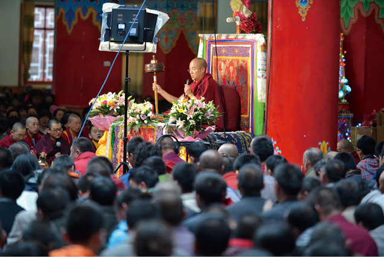
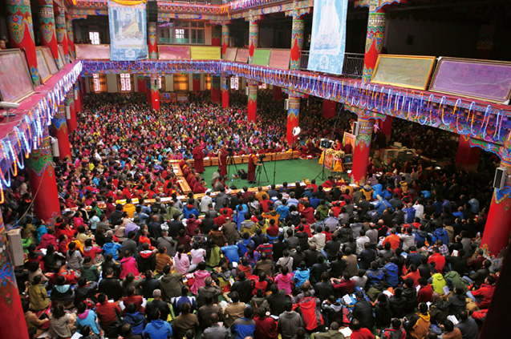
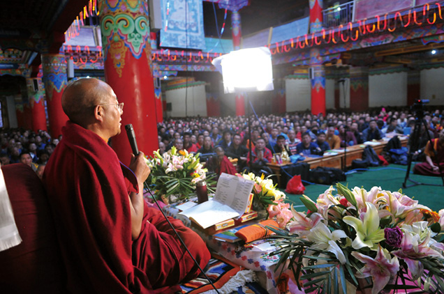
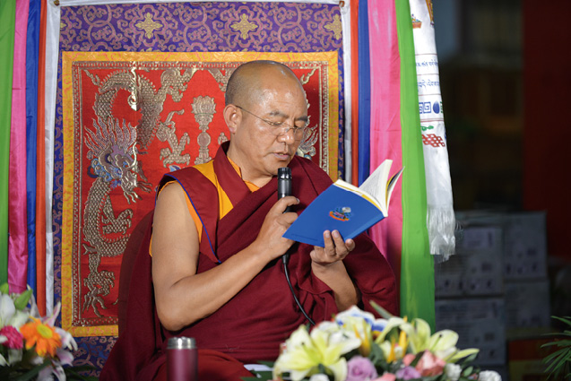
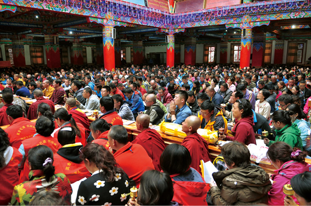
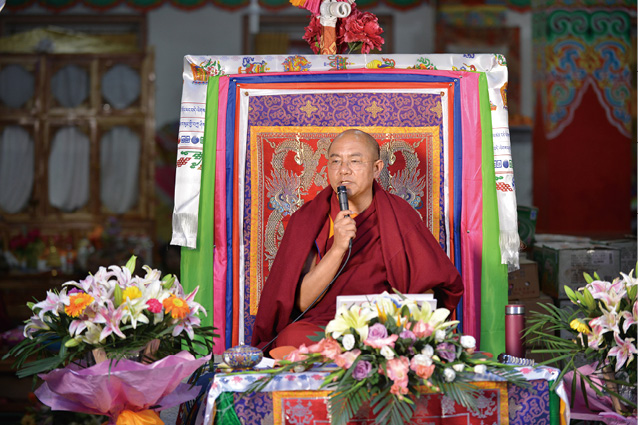
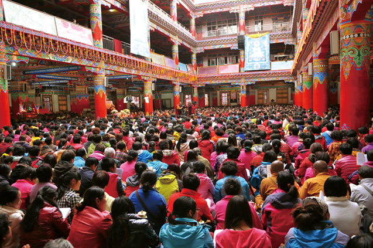

## 擦拭心灵的明镜

——2014年金刚萨埵法会开示（2）

2014年6月5日

今天，在正式传法之前，我有些话要说。这次来参加金刚萨埵法会的人非常多。虽然我们没有邀请任何人，也没有通知要开法会，但还是有这么多人从各个地方自发来到了喇荣，这也是因缘和合吧。

## 一、护持戒律 守持誓言

今天上午门措空行母给大家灌了顶，这是极为圆满的。在短暂的人生中，能有善知识为大家引导，这是非常稀有难得的。大家都知道，法王在世之时，门措上师就已经在为大家灌顶，并传授大圆满。学院四众弟子乃至藏地许多大德都承蒙门措上师灌顶传法。这并不是我们在自我赞叹，事实就是如此。实事求是做事，实事求是说话，实事求是思维，从世间角度来讲这就是真理；从出世间角度看，虽然这是一种世俗谛，但按照月称论师的观点，世俗谛也有世俗谛层面的真理。

今天整个灌顶的场面非常庄严隆重，在如今这个末法时代，能有这么多出家人和在家人一起接受密法灌顶，发愿修行密法，依靠金刚萨埵法门来忏悔，是非常殊胜的！

今天大家都接受了金刚萨埵四级灌顶。受过这个灌顶之后，心中应该有守护密宗誓言的理念。关于誓言，在慈诚罗珠堪布的《慧灯之光》中讲解过密宗的十四条根本戒，我在《藏传净土法》中也讲过十四条根本戒，还讲过《大幻化网》的五条根本戒。如果你们想要成为一名真正的密宗弟子，既然已经接受了灌顶，就一定要认真学习密宗的相关戒律。当然，作为一个真正的佛教徒，你们也不必害怕守护誓言，有些人可能觉得一旦受了密宗灌顶，以后就什么都不能做了，实际上也不是这样的。

密宗当中有千千万万的戒条，其中有一条最为关键的戒律：为自己传过密宗灌顶、窍诀、续部的上师叫做三恩德上师，与三恩德上师千万不能有严重的矛盾。平时如果有一些小口角、小摩擦，那还可以忏悔；但如果与这样的密宗上师完全断绝关系、互相背弃，那后果是非常严重的。这是最为重要的第一条。

第二条，我们在座的所有道友，都是依靠同一位金刚上师、同一个坛城得受了灌顶，因此大家都是金刚道友。既然已经成了金刚道友，以后彼此之间就不能有严重的矛盾。当然，这次来参加法会的人有些可能是一家子，一家人之间难免会发生口角，会有一些内部的“小战争”，这也是一种正常现象。这一条要禁止的是大的矛盾，也就是彼此彻底成了怨恨的敌人。那样的话，不管对方是自己的家人，或是同一个坛城中接受灌顶的其他道友，后果都非常严重，所以绝不能有这种情况。这也是相当重要的一个戒条。

这些都是密宗当中非常深的内容，今天虽然有些网络上的听众没有受过灌顶，但是我也开许你们听，因为希望大家提前了解一些密宗的戒条。宗喀巴大师在《事师五十颂》的注释中也对此有所开许[^1]，密宗的戒律提前宣说也是合理的。而对于别解脱戒，比如比丘戒，要先得戒以后才可以学戒，这是一个不同的地方。

下一条要遵守是什么呢？我们密宗中那些甚深的见解、修行，包括一些佛像，不能随意给别人看、随意告诉别人，否则要是别人看了以后对密法的甚深修行没有生起正见，反而在相续中产生了邪见，泄密的人就会犯密宗根本戒。关于这一条，我想大家并不容易犯，因为我们没有必要故意到处泄露秘密。有些人可能过于谨慎，一不小心被别人看到了法本、佛像，就觉得自己破密乘戒了，其实也没有那么严重。因为别人就算看到了法本，也不一定生起邪见。当然，有些人对密法没有信心，甚至排斥、诽谤，对于那些人，尽量不要给他们看。密法只要能做到保密，就会有很殊胜的加持。不仅密法如此，包括世间一些医药秘方，也要通过严格保密，才能发挥其成效。大家都知道，中医界的很多祖传秘方，都不会轻易传给外人，这样才能保证它的特殊功效。这也是我们密宗要守的一条戒律——不能泄露秘密。

另外，在密法的见解中，一切万法不但是空性的，而且其本性就如《大幻化网》中所讲，本来都是清净的。这样清净的见修在禅宗里也有，就像我刚刚讲完的《六祖坛经》中，也承认有一种清净的法，只是我们现在还不知道自心的本来面目。密宗当中也讲，一切万法的本体是本来清净的。为什么这么讲呢？比如说，我们平时认为不清净的贪心、嗔心、痴心等五毒烦恼，其实真正对它们进行观察的时候，会发现它们在空性的层面一无所成——贪也不成、嗔也不成、痴也不成；然后再对这样一无所成的本体进行观察，会发现它和五种智慧其实无二无别，这就是“烦恼即菩提”。对于这样等净无二的道理，我们不能舍弃。当然，有智慧的人肯定不会舍弃这么甚深的意义，但一些没有智慧的人却很容易舍弃。所以，这条戒律也非常重要，不能舍弃等净无二的密乘见解。

密宗之中还有诸如不舍弃菩提心、不舍弃众生等很多戒律，因为时间关系，我就不一一给大家讲解了。希望大家不要像世间个别佛教徒那样，尽管接受了无数次灌顶，却连密宗的戒条也不知道；学了十年、二十年密法，却连五加行都没有修。那样的话，不管学什么无上密法、大圆满、大手印，实际上对自己都不会有太大利益的。

## 二、趋入密法 精进修行

学修密法并不是光靠一个仪式就能解决一切问题，大多数人都要靠自己踏踏实实修行。所以，你们趁这次来到喇荣圣地的机会，也应该认真思考一下，自己学佛、学密已经多少年了？现在自己的境界怎样？闻思修行的水平又如何？

去年我去了新加坡和台湾等地讲学，发现有个别修行人，在我二十年前去的时候，他们对佛教的道理一窍不通，二十年后的现在，还是原来那样。当时我十分不满，就直截了当地指出来了：你们学了二十年佛，按理来讲，不管是在理论的理解上、修行的体会上、利益众生的发心上，都应该有很大的进步。但看你们的表现，去年是一年级水平，今年还是一年级水平，没有丝毫长进，这说明你们自身存在一定的问题。后来我听说其他法师去到当地后，也有同样的感受，我们的批评不谋而合。那究竟为什么会这样呢？就是因为他们对闻思修行没有重视！

今天你们得了灌顶，很多人都觉得功德圆满了，觉得特别殊胜。其实灌完顶并不代表结束，恰恰代表真正修行的开始。金刚萨埵灌顶完成之后，大家明天紧接着就要开始念修密咒，念咒也并非完成四十万遍就可以作罢。这要看你究竟是想成为一个表面上的、形象上的修行人，还是想成为名副其实的修行人。很多人可能认为，只有喇荣山沟里穿着红袈裟的人才有时间修行，我们要养家糊口，要处理各种事务，没这个时间。实际上，这些大多数都是借口。你们只要把自己每天的时间挤出短短一点来，不论闻思还是修加行，都是可以完成的。如果现在不抓紧修行，再过十年，可能你还在原地踏步，理论水平没有提高，修行境界上也没有进步。那样的话，我觉得特别不合理、不值得。

所以，获得密法灌顶，只是一个入门、一个开始。入门之后，真正的修行要依靠自己。这是我今天想特别强调的。

## 三、专注念诵 有始有终

这次参加法会的人非常多，以现有条件要做好接待有一定的困难，所以，请大家一方面要谅解，一方面要坚持苦行。其实跟我刚来那时相比，现在的条件已经算很好了。我第一次来喇荣，正好是1985年持明法会的时候，那时没有经堂，大家都是坐在泥地上开法会。当时法王如意宝说，明年要修座经堂，后来我们就一起从很远的地方背来石头建造经堂。现在的甘多拉经堂，就是那个时候开始修建的，那时的经堂还很小很小。所以，我刚来喇荣山沟的时候，条件远比不上现在；但现在这里的条件，又远比不上你们大城市。就像《大圆满前行》里的一个公案：难陀的妻子再美貌，跟天女相比也丑得像猿猴一样。

这次法会有网络直播，念诵内容主要是《金刚萨埵仪轨》和《普贤行愿品》。这种共修非常殊胜，大家一定要尽量参加。不管是通过网络参加，还是在学院现场，我希望你们都能坚持每天完成四座，坐在一处，好好念修。如果经堂里实在坐不下，可以在自己家里跟着收音机念。其实在哪里念都是可以的——我们在同一个山谷里、同一片蓝天下、同一个地球上、同一个世界中，在哪里参加法会其实都是一样的。现在网络如此发达，来不来学院参加，功德应该都一样——很多人听到这儿可能觉得伤心了。（众笑）

我希望大家开法会就要有开法会的样子。从明天开始，早上七点要准时到，中途不要来来去去。除了极个别发心人员需要收集资料或者了解情况，其他人从第一座开始就要止语，一直到这一座结束。每座中间会有一个小时的茶歇，这个时候你想说什么都可以。但每一座进行期间，大家就不要走来走去，也不要说话、吃东西，两个小时应该能忍得住。

有些人要是实在太忙，那就在早上一座和晚上一座好好地念。学院中有些发心人员特别忙，我希望各部门的负责人，至少要给每位发心人员两天的时间来参加金刚萨埵法会。再忙的岗位，这两天也要由其他人来代替。否则，八天法会之中连一座也没能完整念修，以后还有没有好好参加的机会也很难说。所以，相关的法师和工作人员应该好好安排一下工作时间。

我们开法会一定要有头有尾。这里的管家和相关的法师也会不时查看，要是谁在念经时一直说话，按照学院的纪律，就要让他到所有僧众中来磕三个头，或者给他公开点个名，这两种惩罚可以自行选择。因为大家都在止语念经时，你一个人随意说话，会给别人带来干扰。而在所有的僧众面前磕三个头，也是很有功德的，磕长头、磕短头都可以。或者，我们点一下你的名字：某某人，什么时候出生的，来自什么地方，法名叫什么，真名叫什么，今天正在开法会的时候他说了一些话，请他站起来给大家看一看。这个方式虽然简单，但对个人来说可能会有一些颜面上的损失。

明天是法会第一天，也是萨迦月的初八。大家都应该清楚，佛陀的三大纪念日——出生日、成道日、涅槃日，都集中在这个月。我们学院的这几个法会，都是法王如意宝用智慧眼来抉择举办的。所以，网上的道友，如果实在不能八天全部参加，我希望各地学会至少明天能安排学员集中起来开一天法会，这是非常重要的。法会进行期间，大家应该有头有尾，不要边吃边喝、边说边走、边抽烟边喝酒……若掺杂了各种不如法的行为，那就没有什么功德了。这是关于此次法会我想说的。今天可能会多说一些，但讲得细致点也好。

## 四、清净供养 殊胜加持

本来我不想在今晚传法结束后安排加持和接待。因为昨天接待的时候，大家拿来了很多的供养。我这些年来一直是反对拿供养的，因为感觉那样就像把传法和加持变成了一种交易。我们学会的很多人一直想过来与我见见面，可我没有想到，见面时有些人受当地学员之托，带来了很多供养，这让我心里不是很舒服。十年来，我每次出去传法，都是一结束就从后台悄悄退下来，不想把传法和供养关联在一起。但昨天女众那边送来了很多供养，我也没有办法挨个退回。所以今天需要跟大家明确说一下：我这里现在虽然有一些建筑还在施工，但依靠大家之前的发心，这些工程的经费基本上都没有什么问题了。除此之外，作为一个出家人，跟金钱连在一起时，我感到非常不舒服。昨天收的供养，我没有数，只是交给身边的人。除了一位出家人为建学校捐献的十万块钱之外，其他的供养全部都会转交到我们藏族觉姆这边。因为这次法会我们本来也借用了她们的经堂，按照国外的一些惯例，不应该白白使用别人的场地，所以就供养给了觉姆的经堂，她们用来装鞋架、地毯都可以，到时由她们自行处理。

今天男众这边也是一样，大家供养的钱，将全部用于男众经堂和我们降魔胜利洲一些在建的工程。所以，你们的所有供养，我只是中间过了一下手而已，大家不要认为我一个人吞了很多钱。

大家都明白，我们佛教团体现在最大的问题就是所谓的“市场化”——与经济利益挂钩。这种现象不管对个人还是对整个佛教都很不利。我本来并不想安排加持环节，因为我很惭愧，自己并没有什么加持力。但后来又想，有些道友已经和我们一起学习了很多年，这次好不容易来到学院，如果不近距离见一面，也许这辈子我们都不会再见到了。而且菩提学会的学员也会一年一年陆续毕业，我这个人虽然给你们当过一阵子老师，但是在你们毕业以后的人生里，我迟早都会消失的。在座的道友中有一部分刚刚毕业，有一部分即将毕业，有一部分可能刚开始报名，不论怎样，我们在人生的旅程当中接触的机会不会很多，因此我也想尽量满足大家想要当面加持的愿望。

但我不愿意你们把钱用在不必要的方面。以我的观点，一个人不管是做官、经商还是作为佛教徒，要是拥有很多金钱的话，用在有意义的事上那还好，但如果用在没意义的事上，可能是非常危险的。佛教团体中，过去和现在都存在这种问题，将来也会面临这种危险。所以，你们如果一定要供养，我自己不忍心接受你们来之不易的钱，但若是用来修建一些学院的工程和供养僧众的话，我心里会觉得用途很清净。那样的话，不管你们供养多少，我也没有什么顾虑，因为我自己没有吃你们一分钱，我们之间没有经济上的挂钩，只有佛法上的交流。

这次有机会跟大家讲明也是很好的。虽然今晚在这么多人面前讲法，但我自己反观内心，也经常感到惭愧。这次金刚萨埵法会，我虽然没有太多时间，但每天至少也要参加一座来忏悔。我认为自己不论功德、学问、智慧、悲心，都没有资格给这么多人讲法。我有自知之明，并不是故作谦虚，忝居此位确实让我感到很惭愧。有些人可能会说：“你不要说这样的话，不然别人会对你提不起信心。”但不管别人起信心也好、起邪见也好，我还是要实事求是地讲。

我们学院的确有很多高僧大德，上师如意宝的弟子之中，门措上师自不必说，像慈诚罗珠堪布、龙多活佛、丹增嘉措活佛，还有希阿荣博堪布、益西彭措堪布，以及现在新一代的比如乔多堪布、秋多堪布、卓地丹增，还有秋央尼玛堪布，都是非常了不起的大德。我自己也经常想，比较而言，在众位堪布之中，我是最差劲的、业力最深重的。特别是我得到了很多汉地的供养之后，有了一些财障，智慧越来越被蒙蔽，业障也越来越大。而你们一直对我吹吹吹，本来这个气球质量就不是很好，你们再这么吹下去，到了一定的时候，就会“啪”一声炸没了。

我希望自己迟早有一天能去一个寂静的地方修行。这些年我在这个喇荣山沟里，为学院也好，为大家也好，该做的事情也做了一些了。人生非常短暂，我不愿意名利缠身，虚度晚年。当初我来到这里，是怀着很真诚的心来出家的，但后来不得不卷入各种各样的人际交往，感觉自己的心态都被染污了，所以每年都要拼命念修金刚萨埵来忏悔。我并不是故意要在大家面前自我批评，因为事实就是这样，今天趁着人多，我把内心所想跟大家说明一下，这也是有必要的。

我本身其实是不太愿意去给人摸顶加持的。我在大学和社会上演讲时，也不会去做什么加持和灌顶。但有时我也在想，加持毕竟是佛教中的一种重要仪式，我自己也曾在很多大德面前得受过加持，当时的那种感觉让我至今难忘。如果我们以后只剩学术化的内容，那么真正能从佛教中得到的加持和体会就不一定能完全启发出来。因此，我就借这些经书来给大家作加持，包括了《法界宝藏论》、《系解脱》、《般若摄颂》和《佛子行》。我给大家这样加持，并没有任何个人的目的和想法，一心一意就是想通过这种方式，让大家的信心得以稳固。另外，人生之中能与在座各位见面的机会，也许只有这一次两次，所以，尽管昨天我很累，但还是觉得应该坚持给所有人加持完。大家也都遵守纪律，好好排队，这很不错。我的心也比较清净，不管别人会怎么想、怎么说，我觉得既然有这个机会，就该利用起来，让大家有所收获。因为我们佛教也需要这些特殊的仪式、行为和语言，来树立它自身的特性以及正见。

前面强调了灌顶之后守护誓言的要点，以及法会的纪律。大家这次来到这里参加法会，与这么多的僧众一起发愿，一起尽力念修金刚萨埵心咒，希望你们一定要珍惜这个难得的机会。我虽然已经在学院待了30年，但仍然觉得每年的法会都非常重要。今天网络上的听众非常多，我也特别希望你们依靠网络来参加法会，希望每个人都能自己发愿。虽然大家在城市里工作繁忙，但多念金刚萨埵心咒确实非常有必要。这几天我们哪怕晚上不睡觉，或者只睡两三个小时，也应该尽量去念。想想我们为了世间的工作，也经常通宵熬夜，那为了解脱，为了忏悔无始以来的罪业，为什么不能精进地修行呢？

至于念诵的期限，我们也分了上等、中等、下等。上等者，应该在法会八天内把四十万遍金刚萨埵心咒念完。我们这里好多喇嘛和觉姆都能一天念八九万遍。金刚萨埵心咒跟其他一些咒语不同，只有六个字，非常好念，因此大家一定要认认真真地念完。中等者，一个月念完。下等者最迟也必须在三个月或一百天内念完。这是我再三强调过的。另外，我们念诵的时候，应该尽量用转经轮。

大家在开法会的时候，一定要认真听从管理人员的安排。比如，在出家僧众当中走动的时候，不要从袈裟和法本上跨越，否则会有一定的过失。因为我们既已皈依了佛、法、僧，那就要有恭敬心。如释迦牟尼佛所讲，即使一片红黄袈裟的碎片，也有无量的加持和功德，这在《地藏十轮经》中也提到过，你们方便的时候应该看一看。有些刚来的居士可能不太懂规矩，随意在经书、转经轮和出家人的僧衣上面跨来跨去。虽然我们这里空间狭窄，行走的时候可能有点困难，但是，大家一定要对三宝有恭敬心。

我们这里是一个非常有规矩的学校，希望你们来到这里之后，要用正知正念来观察自己的言行举止。法会期间，大家尽量不要去转坛城，不要四处闲逛，也不要总是约人吃饭。我也说过，任何人请客，我都不会去的。因为大家来这里的目的是参加法会，不是朋友聚餐，现在谁都不缺一顿饭吃，所以你们也不用邀请熟人，这反而会耽误大家的时间。

今天现场和网上都有一些新来的道友，所以再给大家传授一次皈依。这是无垢光尊者在《大圆满心性休息·三处三善引导文》中的皈依法。你们要自己观想：从现在起乃至菩提果之间我一定要好好皈依三宝。我昨天也说过，皈依有上等皈依——为一切众生而皈依；中等皈依——为自己得到解脱；下等皈依——为得到健康、财富、平安等等。下面，想皈依的人跟着我念一遍。接下来还要给大家念一下法王如意宝在1997年所造的《金刚萨埵修法如意宝珠》仪轨传承，以及我们法会主修的麦彭仁波切所造的《金刚萨埵修法仪轨》。

（堪布授皈依戒及金刚萨埵相关修法传承）

## 五、弘扬佛法 与时俱进

今晚在这里，既是讲课，也算是跟大家谈谈心吧。首先要说的是，我们现在身处于21世纪这个特殊的时代，跟古代相比，这个时代有很多的方便方法，但同时也遍布陷阱和深渊，非常容易让人堕落。因此，当代人特别需要具有警觉心，具有正知正念。

这个社会表面上看是在进步，但实际上，人心却在倒退。这个时候，我特别希望每一个佛教徒都能负起责任来。什么样的责任呢？在这样一个信息发达的时代，佛教徒应该利用多种多样的平台来弘扬佛法。这方面相信你们每个人多多少少都是有一定能力的。比如，大多数人每天都会上网发微博、发朋友圈、传递种种信息。如果我们完全屏蔽网络，像噶当派的闭关实修者那样，当然也可以，但实际上，90%的人不一定能做到，大多数人天天都在关注一些无聊的信息。因此我想，从现在开始，每一个佛教徒都应该行动起来。这不是为了抢占文化思想市场，我们的目的全然是利他、是付出、是奉献。以这样的发心，我们每一个人都可以利用信息时代的方便方法来传播正能量——世间人说正能量，我们佛教徒说菩提心。

你们可能觉得，弘扬佛法、利益众生是个别大法师或是少数有思想、有智慧、有能力的人才能做到的事，其实不是的。现在这个时代，每个人有自己的资讯阵地——朋友圈、QQ群、微博，还有你周围熟悉的人。不管你的受众是佛教徒还是非佛教徒，当他们之中有人感到内心疲惫、消沉的时候，给他打一支“强心针”，也许就能让他的心振奋起来、坚强起来。我们并非一定要去推广佛法，但我想，在这个世界上，不管哪一种精神财富，只要真正对众生有利，我们就应该推荐给别人。这就如同遇到了健康美味的饮食，你除了自己享用之外，也会很想分享给别人。

当然，佛教徒中有很多人是真正远离了红尘、舍弃了世间一切，这也非常有必要。但如今科技日新月异，大家如果全都保持一种避世隐修的状态，把弘法利生的发心事业全部放下，不理任何世事，那等到大众的精神需求全部被其他文化和思想占据，甚至被一些毫无意义、乱七八糟的东西充满的时候，我们佛教自己恐怕就连立足的空间都没有了。因此我们所有的佛教徒，应该积聚成一种力量，凡是真正对众生有利的思想——不一定非要局限于某个派别、某位上师——我们都应该尽己之力去弘扬！

当今时代，人们的思想和行为在不断地变化，使用的技术和设备也在不停地更新换代。看看我们的手机和电脑，二十年前是什么样？十年前又是什么样？现在全世界依靠网络信息技术来工作、生活的人有多少？在我看来，这是我们佛教徒的好时代，因为通过网络，只需运用一些简单的方法就可以帮助到许许多多的人。

我们弘扬佛法，并不是要让佛教思想席卷全世界，影响所有人。我只是想，凡是能对全人类乃至所有生命起到帮助的，无论佛教还是非佛教，任何思想文化，都值得我们推荐出去。

但就我个人而言，以我三十多年的修行体会，的确感到在世界上所有思想体系当中，释迦牟尼佛的思想极其伟大！有些人也许不认同，那也没有关系，我内心的真实感受就是如此。无论从科学的角度分析，还是从因明、中观的逻辑学角度推理，佛陀的思想都是颠扑不破的，因此希望你们也能好好去观察。如果有人对此心存怀疑，那或许是自己的思想有些局限，也可能是极个别佛教徒的行为染污了佛教的整体形象。但即使存在个别不如法现象，佛教本身的思想体系和精神内涵，在全世界的思想领域中，始终在闪耀着独特的光芒。

所以，我们佛教徒应该好好想一想，如何跟上时代，跟上众生的分别念，跟上日新月异的技术、平台和传播方式。整个人类社会在时刻变化，但佛教的真理永恒不变，不管过去千年万年，佛陀宣讲的四法印绝不会改变，佛法对人心的利益绝不会过时。但与此同时，我们作为佛教徒，应该头脑清醒，不要自我封闭，整天只顾埋头念咒修行，不关心世界变成怎样，不去利用大把的机会弘法利生。其他一些宗教，在弘扬教义时是非常积极的，而许多佛教徒在这方面却不太作为。我们口口声声说要以菩提心来饶益无量无边的众生，可当那些近在身边的众生陷于痛苦和无助的时候，我们有没有办法去救他们？每个人都应该扪心自问，我们每天都说着发菩提心，但菩提心在我们相续当中到底有几分？这一点实在值得我们每个人自我审视和反思。

我总觉得很多佛教徒的思想没有统一起来，甚至有些人经常混迹于江湖术士之中，整天搞一些神通、打卦、算命……这种人不在少数。虽然佛教当中也有这些法门，但这并非我们学修的重点，如果尽用这些手段来解释问题、应付他人，那恐怕佛教的理念不会长久延续。真正的佛法不需要这些，我们应该把佛法当作一种非常崇高的教育、一种至高无上的理念来学习、研究、修行，这对大家才会有真实的利益。

## 六、罪业深重 励力忏悔

下面，重点讲一讲忏悔。明天法会就要开始了，不管你们是在学院还是在网络上参加，都希望大家一定要重视这次法会，因为我们每一个人其实都有很多罪业。刚才我也反观了一下自己的内心，确实非常舍不得错过每一年的金刚萨埵法会，因为能跟这么多的僧众一起忏悔，实在是一个非常好的机会！

就好比我们的衣服，穿久了上面难免会有很多污垢，只要洗干净一次，就可以再穿一阵子，可如果年复一年不去洗它，最后这件衣服就不能穿了。我们的相续也是如此。古人也说，屋子要常打扫，内心要常反省。以佛教的观点看来，我们作为凡夫，身体上会犯杀盗淫的罪业；语言上会有妄语、恶语、离间语、绮语的罪业。你们可以自我审查一下，身体上有没有做过不如法的行为？语言上有没有争吵、骗人、说是道非、挑拨离间？这些问题其实非常严重。更何况我们每个人的内心还盘踞着种种贪心、嗔心、害心、邪见。所以，忏悔对我们来说是非常有必要的。

《前行备忘录》中引用华智仁波切的教言：“恶分别毒隐腹内，命终之前必现前。”意思就是说，我们心里可怕的恶念和罪业即使藏得再深，临死之前也一定会现前的。有些人行为非常不如法，自己还以为别人发现不了，但实际上，上师、本尊、智慧天尊和护法神通过法眼和天眼完全能了知。既然我们的自相续都有不清净之处，那就一定要认真忏悔，所以，通过这次金刚萨埵法会来忏悔，对我们每一个人都至关重要。

就连上师如意宝那样的大成就者，每次开法会的时候，显现上都会提前完成金刚萨埵心咒的念修。我记得有一年，学院僧众一起念了一亿遍心咒，我们称其为“金刚萨埵一亿大修”，当时用的就是今晚我要给大家传的仪轨。那时候学院的人还不多，但大家修得非常认真。

这次法会也是个很好的机会。大家首先应该明白，我们每个人都曾造过种种罪业。比如杀生，很多人在学佛之前，点杀过不少海鲜、鱼虾、青蛙；有些人在孩提时代玩耍时，杀死过无数虫类。要知道，你对每一个生命的伤害，都要用自己的生命来偿还。既然知道因果不虚，我们若不趁现在赶快忏悔，万一死亡突然降临，带着这么多的罪业，还能有解脱的机会吗？

佛经中也指示过，如果造过五无间罪、谤法罪等严重罪业，是不能直接往生极乐世界的[^2]。那这些罪业通过忏悔能不能清净呢？绝对是可以的。古代大德也说了，罪业本来没有什么功德，但是通过忏悔能使之清净，这就是它的功德。历史上，指鬘王杀了999个人，未生怨王造了无间罪，最后通过忏悔都得以清净；《百业经》中也有杀人如麻最后忏悔证果的公案；龙猛菩萨在《亲友书》中也举了很多关于贪嗔痴深重但通过忏悔得以清净的典型案例。

因此，我非常希望这次法会作为一个缘起，能使每一个修行人的相续得以清净。上师如意宝在《忠言心之明点》中也说过：我们的心识就相当于一面明镜，如果被罪业染污，那么修行密法生起次第和圆满次第的验相就绝对不会现前，唯一的解决办法就是用四对治力的白布来把它擦干净。[^3]就像照相机的镜头上如果有灰尘，你再怎么拍，画面都是模模糊糊的。同样的道理，我们相续中有各种各样的业障、烦恼障、所知障、习气障，这些罪障不仅障碍我们的今生，也会障碍来世，致使我们解脱希望渺茫。今天的四灌顶就能分别对治这些障碍，这也是给大家一个悉地的缘起。因此，借着这次法会与如此多僧众一同共修的良机，我们大家应该发愿好好忏悔。

## 七、四对治力 清净相续

关于忏悔的方法，按照《金刚萨埵修法如意宝珠》的意趣，必须具足四种对治力。如果运用这四种对治力来进行忏悔，罪业一定会清净；但如果四种对治力没有具足，则很难忏悔清净。我想，关于四种对治力，在座大多数修行人应该是比较清楚的，但有些初学者不一定知道，所以我在这里还是简单地讲一下。

第一种，是所依对治力。当我们想要忏悔的时候，应该在金刚上师或者诸佛菩萨面前进行忏悔，比如《三十五佛忏悔文》对应的三十五尊佛像，也可以在自己心里观想十方三世诸佛作为对境。按照《前行备忘录》所讲，所依对治力包括外所依对治力和内所依对治力两种。外所依对治力就是刚才讲到的诸佛菩萨、上师，而内所依对治力就是皈依、发心，以及自己的信心、智慧等等，这是尤为重要的。关于这一点，我们要观察自己是否具足。你们专程来到这里忏悔，如果光是“嗡班匝儿萨埵吽，嗡班匝儿萨埵吽”不停地念，那恐怕是不行的。口头上念咒语有没有功德呢？绝对有很大的功德。但如果你的心也跟上，功德会更大。有口无心念再多“嗡班匝儿萨埵吽”，都不算圆满。所以，大家要记住，首先要有所依对治力。

要具足所依对治力，应该这样想：我从无始以来造了无数恶业，真是个罪人、坏人！要反思：我经常产生贪嗔痴等烦恼，经常跟别人争吵，相续中很不清净，该生的信心生不起来，不该生的邪见、傲慢却经常生起。应该经常这样反观自己。我自己也常想：“表面上我虽然给很多人讲课、加持，可实际上我是这样坏的一个人，真是自欺欺人的典型！”像我这样差劲的人可能还是有一些的吧，所以大家还是应该反思反思。

无始以来，贪嗔痴引发了我们数不清的罪业。自性罪，如十不善业，我们肯定犯过；佛制罪里的别解脱戒、菩萨戒、密乘戒，我们每天也会犯很多。而与此同时，我们的功德却微乎其微，少得可怜。既然这样，我们为什么还不在诸佛菩萨面前好好忏悔？要明白，我们如今遇到佛法，有一个忏悔的机会，是不幸当中的万幸。就像一个罪人，在即将面临审判之时，如果先把自己所犯的罪业在众人面前坦白发露、交代清楚，或许就能被从宽处理。这么好的机会我们为什么不去争取争取？

大家明天念修和观想的时候，最好在佛堂里陈设金刚萨埵佛像。如果没有的话，可以使用《大圆满前行》的法本，其中有金刚萨埵的法相。如果有观想的能力，不看法本也可以；要是实在观想不起来，就打开法本，稍微看一下图片。麦彭仁波切的《金刚萨埵修法仪轨》后面，有一行小字引述了《集密意续》中的教证，说的是：若没有前生在诸佛如来面前承侍的善根，一般人是听不到金刚萨埵心咒的。所以在座的各位，应该都是非常有善根的。以前有人跟我说：“我见到了这么殊胜的坛城和佛塔，我的善根一定很不一般！”确实，我们能念修金刚萨埵，善根都是很不一般的，功德更是非常之大。所以，大家明天念诵仪轨的时候一定要认真阅读汉文内容。一顿饭吃不到无所谓，我今天中午就只吃了一碗酸奶，重要的是对于这些关键的修行，不能轻视，不可放弃，放弃的话就全完了。

《集密意续》中说：“三时诸佛之本体具德金刚萨埵六字咒语，何者耳闻此咒语名，证明曾于众多佛尊前行事。”任何一个人，如果听到了三世诸佛的本体金刚萨埵的六字真言“嗡班匝儿萨埵吽”或其名号“金刚萨埵”，那就证明这个人曾在诸佛面前承侍过。有些人总说自己从来没有见过佛。其实，我们以前是见过佛陀的，只是不知那时的我们是一只小虫，还是其他众生。

“将来必定生于金刚萨埵佛刹”，这点我是深信不疑的。可能有的人以前做过牛马，邪见很重，对佛陀的授记并不相信，这也无所谓。邪见重的人即使亲见佛陀也不肯相信。

“蒙诸佛加持”，凡是念修金刚萨埵的人，十方诸佛菩萨都会加持。因此，要对这个咒语非常有信心。

“于大乘获得定解，具备神通，拥有胜观慧眼，必定成为佛子”，这样的人对大乘法门一定会获得定解。有些人对佛法没有定解，见解很不稳固，容易动摇和退失，因此要多念金刚萨埵。另外，对于出世间的功德，包括一些神通、寂止和胜观，通过念修金刚萨埵也能增上。很多人修行总是难以进步，也许就是因为业力深重，如果每年都能认真修持金刚萨埵法门，业力稍微得以清净，那很多修行自然而然就会增上。法王如意宝也说过，如果自相续被业力遮障，那什么验相都现不出来，修行也修不起来，世间的事业也做不下去，违缘还会重重出现。

《手金刚三威猛调伏续》中这样说：“如若持诵此心咒十万遍，则破根本誓言亦得清净。”法王如意宝曾说过，以前念十万遍就能清净破根本誓言的罪业，但现在是末法时代，数量要增到四倍。所以，我们现在念四十万遍金刚萨埵心咒，破根本誓言的罪业就能得以清净。法王的《金刚萨埵修法如意宝珠》仪轨后面也有这段内容。

麦彭仁波切还写道：“胜乐金刚、喜金刚、密集金刚、时轮金刚、黑日噶、普巴金刚童子此一切本尊实际均是金刚萨埵。”在藏传佛教中有很多密宗本尊修法，不管修哪一种，都可以这么观想。比如念四十万遍金刚萨埵心咒时，如果你能观想金刚萨埵跟普巴金刚一味一体，跟文殊菩萨一味一体，跟释迦牟尼佛一味一体，那实际上你也会同时获得念这些本尊心咒四十万遍的功德，因为诸佛的本体也即是这些咒语。金刚萨埵心咒有诸如此类的许许多多功德，我在这里不多叙述。

总而言之，很多人业力非常重，杀盗淫妄都犯过，尤其是杀生，而且心中向来缺乏正见。所以，我们都应该趁此机会好好忏悔。念金刚萨埵心咒四十万遍并不算多。有的人觉得四十万太多，只能念十万遍，找我开许，跟我讨价还价，我也不是金刚萨埵的卖主。其实跟我们的业力相比较，四十万遍金刚萨埵心咒并不多。

上面讲的是第一个——所依对治力。

第二个叫厌患对治力，也就是要认识到我们以前犯下的罪业。就像一个人犯了错误后，应该后悔自己做错了。在座许多人在学佛以前都不懂因果取舍。有些人因为年少轻狂，有些人因为烦恼深重，有些人因为愚昧无知，有些人因为放逸自私……总之，过去我们由于各种各样的原因，身体、语言、意识依靠各种各样的对境，通过各种各样的方式，的的确确造下了许多罪业，现在才幡然醒悟。反省自己的种种罪业，会感到悔不当初，就像是一个人喝下毒药以后才开始后悔，但为时已晚，毒药既已喝下，就一定得承受毒发的恶果，因此这个人随时感到恐惧无比。如果我们的相续中产生这样的悔悟，就叫作厌患对治力。

这次我也接触了一些来到喇荣的居士，他们都觉得自己以前造的罪业太多，学佛以后才明白了因果取舍，所以能遇到一个忏悔的机会就特别珍惜。“所有的法门当中，我最喜欢修金刚萨埵。”有些人这样对我讲，我也深有同感。

总之，厌患对治力，就是要认识到我们的罪业，这是非常重要的。

第三个是返回对治力。意思就是说，明白以前做错了，现在开始回头改错，决心以后不再犯错，这也是相当关键的。

过去，我们由于无知、无能、听信邪知识等各种原因造下了诸多罪业，那从今往后就该尽量不再去造。比如，我们如果过去杀生比较多，那从今天开始就要特意避免杀生。很多人经常在饭桌上点杀，吃鸡、吃鱼、吃青蛙、吃兔子，甚至吃小狗，这是非常可怕的。有些人对待小动物，一边觉得它们很可爱，想要摸摸抱抱，一边又觉得它们的肉很好吃，想要一饱口腹之欲。说可爱的是你，杀死它们的也是你，多么可怕啊！你要是真觉得可爱，那就不应该想要吃掉它们。然而，我们总是说着“好可爱，好可爱”，一边爱抚它们，一边又垂涎它们的肉，“好想吃，好想吃”，这样的我们跟魔王又有什么差别呢？魔王尚且没有那么野蛮，魔王只会用一些间接的手段来伤害众生。仅仅在杀生这一项上，每个人都该好好自我反省，从小到大杀害过多少生命？我们的生命如是可贵，其他任何众生的生命也是如此。所以，我们从现在开始不要再去杀生！

想要任何罪业都不造，可能有一定的困难。昨天有位老乡在我面前说：“从现在开始，所有罪业我都不会造的。”我想这话可能说得太大了，即使是阿底峡尊者，显现上也说自己入了密乘之后难免有造罪的现象。我们很难做到一丝罪业也不造，但学习了佛法、参加了法会、念修金刚萨埵心咒忏悔以后，每个人至少都可以把自己以前比较典型的坏毛病和习气改掉一两个，这也是一种进步。比如有人以前有偷拿别人东西的习惯，那么今后就不要再犯。否则，若行为上毫无改进，纵使念再多忏悔，都不算具足第三个对治力。

第四个是现行对治力。从广义上讲，凡是修行善法都可以叫做现行对治力，不论发菩提心、念诵心咒、念《普贤行愿品》，遵循“诸恶莫作，诸善奉行”的所有善行都是现行对治力。但根据多位上师的窍诀，此处的现行对治力主要是指通过念修金刚萨埵来进行忏悔。与刚才讲的所依对治力同理，这里特指缘金刚萨埵来忏悔。

为什么要通过念修金刚萨埵来忏悔呢？因为金刚萨埵在因地的时候曾发过愿：“将来我成佛之时，凡是念我名号和咒语的人，相续中的罪业都会得以清净，如果不能清净，我宁可不成佛。”后来他不仅成佛了，而且现前了庄严的现喜刹土。所以，以麦彭仁波切为主的许多高僧大德用金刚语再三提醒我们：即生当中能遇到金刚萨埵法门，是极其殊胜的。

因此，大家要认真观想金刚萨埵，如果做不到特别详细的观想，也可以看着金刚萨埵的画像，在其面前进行忏悔。不同的仪轨当中有不同的观想方式。有时要观想金刚萨埵在自己的头顶上方，身体降下甘露，使无始以来所造的罪业都得以清净；有时要观想自己的身体变成金刚萨埵。按照上师如意宝《金刚萨埵修法如意宝珠》的要求，可以观想金刚萨埵单身法像；按照麦彭仁波切的修法，也可观想金刚萨埵佛父佛母双运法像。不管是哪种修法，根据众多教证和前辈大德的教言，我们应该知道，金刚萨埵是众生忏悔罪业时最为殊胜的一位佛陀，因此我们不论念诵他的佛号还是咒语，功德都不可思议。

其实金刚萨埵的相关仪轨和修法，在日称伏藏大师尼玛札巴、明朗大师德达朗巴等的伏藏法中也非常多，这些暂不广说。1994年，法王如意宝在青海的一个湖里亲自取出了《金刚萨埵修法仪轨》，在后记文中莲花生大士说：此伏藏法与汉地的众生更有殊胜因缘。当时法王说：因为莲师的特殊授记，每年的金刚萨埵法会就交由汉人的降魔胜利洲来举办。那时汉地还没几个人知道金刚萨埵修法，但现在却能吸引这么多人来参加，这就是法王如意宝无碍智慧的体现。大家没有接到任何法会通知，却自发来到喇荣，一路克服着种种艰辛，这也是莲师加持的吸引力。我看大家来到这里，即使一直吃方便面，都很开心。

我确实觉得，在这个末法时代，我们大家都需要忏悔。通过忏悔，我们就能获得更大的能力。就像电影里，孔繁森在地震废墟中发现一个脏兮兮的孤儿，带回去洗干净，就成了一个特别可爱的孩子。我们其实也是这样，刚开始身语意都充满污垢，但是通过金刚萨埵的沐浴清洗，渐渐智慧和悲心都会呈现，自己的修行也会走向成功。同时，当我们的内心拥有了悲心、智慧和信心的力量，那它就一定会闪闪发光，一定能帮助周围被邪知邪见误导的可怜的众生，令他们归入正道。

佛法重视缘起，大家应该珍惜这殊胜的缘起和难得的机会，认真地、真诚地去对待这场法会。千万不要认为这就是一场普通的活动，想参加就参加，念不念完都无所谓。我们的生命是有限的，应该投身于最为重要的事上，而这次忏悔对你的今生来世就是极其重要的事。所以，虽然参加法会的人特别多，我也很累，但看到这么多人愿意学习佛法，这么多人有机会忏悔，我也很高兴。大家哪怕没有能力念完四十万遍，能念完十万遍，也很不错的。希望我们每个人都把金刚萨埵法会重视起来，以后每年这时候也应该如此，来不来学院并不重要，重要的是自己一定要好好忏悔。

这次我们学会中一些发心人员也来了，这几天晚上都为你们组织了交流会。虽然你们比较累，白天一直在念诵，晚上还要开一两个小时的会，我们也担心各位身体是否受得了。但是大家来一次也很不容易，学会目前管理等各方面的思路需要借此机会与你们交流，以便将来能更好地为众生做一些有意义的事。我们会尽量把会议时间缩短，希望大家能认真参与。我们每个人生命的最大意义就是弘法利生，为了这个目标，不管是在哪里死了，也不会有任何的后悔心。因此，大家只要有了这种勇气，心的力量是不可思议的。

[^1]: 《事师五十颂释》：“假设有人说：‘在尚未灌顶之前传讲《事师五十颂》是不合理的，因为有泄露秘密的过失。’并没有泄密的过失。因为此部论典中密宗的不共名词术语非常非常少，个别说法也只是略而带过、极不明显。又如，弟子在最初祈求灌顶时，如果资具没有准备齐全，上师为了守护弟子而让他们念修某些本尊，这是在灌顶之前进行的，如此不成泄露秘密。同样的道理，并非随随便便地传给所有的人，而只是为那些修过共同道并想入密宗的佛教徒讲授《事师五十颂》，并不算是泄密。”
[^2]: 《佛说无量寿经》：“设我得佛，十方众生，至心信乐，欲生我国，乃至十念，若不生者，不取正觉。唯除五逆，诽谤正法。”
[^3]: 《忠言心之明点》：“自续佛性白晶镜，忽然障尘极遮蔽，难现深明等持故，应用精进四力布。”
