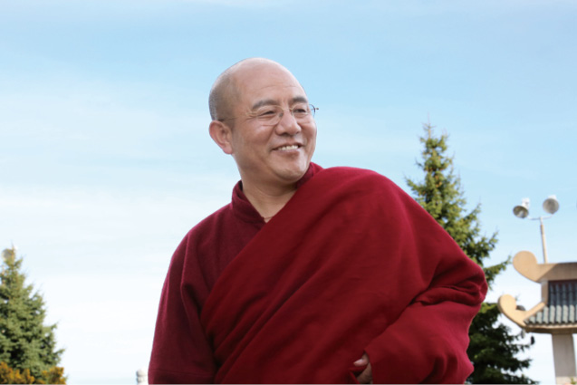
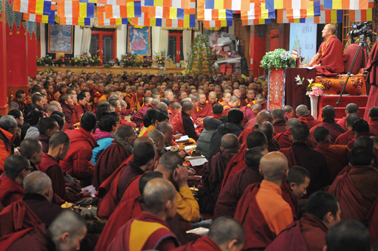
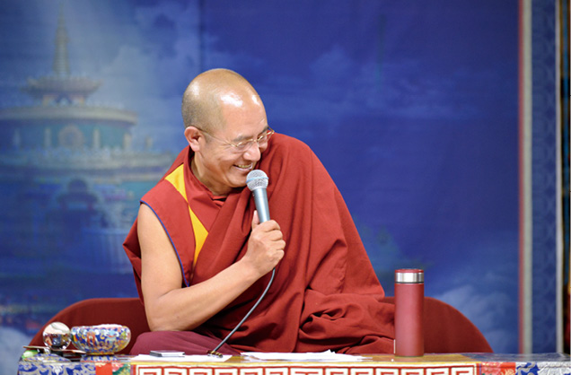
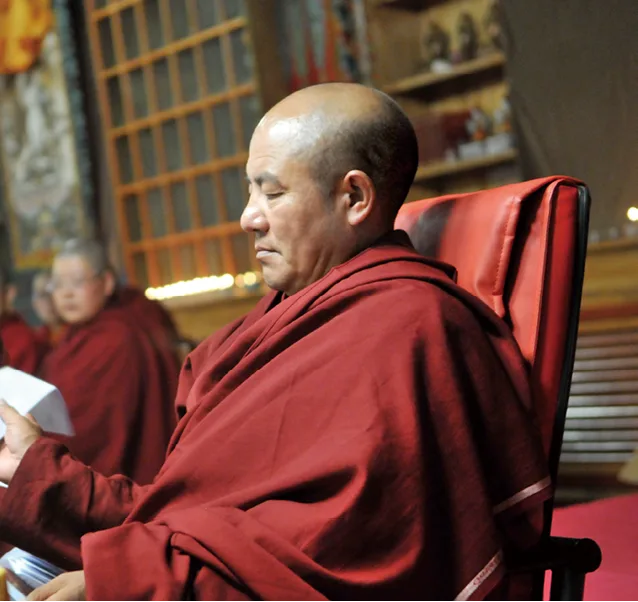

## 旅程的开端

——预科系2014届新班开学典礼开示

2014年8月16日

各位现场以及网络上的兄弟姐妹们、道友们，大家好。今晚是个非常吉祥、非常有意义的夜晚。这是自2006年以来，我第69次通过网络给大家做开示，也是我们菩提学会2014年新班的开学典礼。今晚来参加的，有很多佛教徒和非佛教徒，按照一些佛经和论典的说法，也许还有很多人与非人、饿鬼、阿修罗、天人。不过我并没有神通，也不知道他们来了没有。总之，今天大家既然聚集于此，我就说几点。

## 一、缘起

第一点，今晚我们汇聚一堂，是怎样的一个缘起呢？这样的活动我们已经连续举办了四年，这四年来，我们每年进行两次开学典礼，而从今年开始，由于人数规模导致的管理压力较大等原因，合并为一次。我们的初衷，是为城市里的学佛群体提供一个完善的闻思修行平台。今年6月我们开始接收新生，通过两个月的体验学习，让大家自己判断是否愿意继续学下去，因此今晚是正式的开学典礼。这就是我们相聚的因缘。

今天是8月16日，日子很好。民间都说8是发，6是顺，我们虽然不执著这些，但按《时轮金刚》的说法，做事之前观察缘起也是很重要的。今天看来缘起非常好，我看到有不同肤色、发色的道友来到现场，这也是一种特别的缘起。所以今晚举行这样一个活动，意味着我们会有个很好的开端！

## 二、学习佛法的重要性

第二点，我想说一说学习佛法的重要性。为什么我们现在要以这种形式共同学习？如果你不是佛教徒，那不学也罢，但如果你是一个佛教徒，不懂佛法就非常可惜。

大家都清楚，现在科技非常发达，物质条件也相当丰富，可是我们的内心却越来越苍白，越来越虚无。很多人都承受着各种各样的压力，非常焦虑、痛苦。如果只依靠自己的挣扎，想要化解这些痛苦和压力，是非常困难的。所以，在当前这个特殊的时代，东西方的人们都在共同寻找一种疗愈心灵的妙药。这样的妙药，西方哲学中存在一部分，世界各大宗教当中，也有一些教理、仪轨以及修法，可以在不同程度上解决很多问题，特别是佛教的闻思修行，我认为对当今繁华城市里的迷茫之人，的的确确是非常有效的。因此，这几年来，汉地乃至其他国家，越来越多的人纷纷加入了学佛的团体。这并不是我一个人夸大其词地吹嘘，而是大家有目共睹的事实。

英国哲学家汤恩比博士曾提出观点：人类想要解决21世纪的问题，必须从孔孟思想和大乘佛法中汲取智慧。如今看来，这番论断在很多社会群体当中的确得到了验证。现在许多人将学佛作为一种明智的选择，通过学习佛法，将自己的心态调整得更为积极，在各项工作中，效率也有了明显的提高。我看到一些多年学习和修行佛法的人，他们生活上发生的种种真实的改变，完全可以体现出这一点。

我们做任何事，首先应该提前进行深入的思考；然后要用自己的智慧来进行慎重的选择；选择之后就要义无反顾地走下去；这样，到了最后，我想是不可能后悔的。不仅仅是学习佛法，面对生活中任何一件重要的事、任何一个关键的抉择，都应该如是而行。因为我们作为人，跟其他动物相比，应该有更为高级的智商和情商。所以我觉得，在座的和观看直播的每一个人，都是有一定智慧的，不会仅凭对佛教的爱好而盲目地选择加入这个群体。

我经常想，如今这个社会，拥有财富、地位、美貌、权势等等，真的对人那么重要吗？在一定程度上，也许是重要的，因为这些外部条件，能令人在现实生活中享受到一些不一样的快乐。但比这些更重要的，是获得心灵的解脱——真正的智悲双运的境界。这种境界，超越了世间一切荣华富贵，是任何人都无法抢夺、无法偷走的。因此，我特别希望大家能认识到，在当前这个纷乱复杂的时代中，最首要的目标就是找到真正的心灵指导——智慧和悲心双运的佛法真义。这是我今天跟大家说的第二点。

## 三、珍惜学佛的因缘

第三点，我们能够学习这样的佛法，实际上是一种难得的机会，这种因缘不是每个人都能拥有的。从我自身来讲，将来会不会出现无常也说不定；而你们每一个人，虽然今天都在这里听课，但能不能坚持学完四年预科，这也很难说。

从无常的角度来讲，我们依靠的种种外在条件，以及我们内心的力量，这些都需要因缘聚合，而这种因缘并不是恒常的。所以，刚才我也默默地祈祷三宝：祈愿我们能够将这种活动顺利地开展下去，让大家不必付出千辛万苦，跋涉到高寒缺氧、气候恶劣的藏地雪域来求学，只需要通过一台小小的电脑或手机，就能轻轻松松、方便直接地学习到佛教的甚深道理。

虽然作为讲者，我是非常低劣的一个人，但我对自己所说的法很有信心，因为这些法都具有来自传承上师们的圆满加持力。如果没有这份信心，我也不愿欺世盗名。而且，我的内心从未掺杂任何个人的目的，没有受到名声、地位、财富这些世间八法的染污。我心里最渴望的，就是通过这种方式，在这个无常的时代，为这么多无常的人们，打破对无常幻相的执著，令他们真正懂得佛教智悲双运的教义，最后能够从困惑迷茫、焦虑痛苦当中获得真实的解脱。因此，从我自身来讲，发心是清净的；而对你们而言，只要不出现大的无常，现在的因缘正是最圆满的时候。

前段时间一位企业家说：“过去是一个制造的时代，主要靠身体力行去达成目标，而现在是一个‘智造’的时代，更需要通过智慧和方便来寻找真理。”大家都知道，现在只要一打开网络，任何你想要的知识都能瞬间涌来。但有的人也在这些信息中迷失了方向，不一定能找到自己的真正所需。这个时候，我们尤其应该保持头脑清醒，选择真正对自己今生来世都有用的真理。因此，我觉得今天的因缘，从世间角度讲也是非常殊胜的，大家应该珍惜。

要知道，前辈的高僧大德们，为了求一个法，或者一个法本，需要付出常人难以想象的心力和苦行。而现在，因为有一些人不惜血汗为大家发心，让许许多多的人不需花费任何金钱和代价，就能轻而易举地得到正法。所以，虽然个别道友可能要花一些通勤时间去听课，但这些为了完成自身学业必要的付出都是非常值得的。

因此，希望每一个人都要懂得珍惜。当因缘在你手里时，很多人不知自己身在福中，而一旦失去因缘的时候，才知道它有多么可贵、多么重要、多么难得稀有。这样的活动未来我们还能举办多少次，也很难说。因此在学习和修行上，当诸多殊胜因缘聚合的时候，自己应该发自内心地生起欢喜。这是我想说的第三点。

## 四、修学佛法要持之以恒

第四点，大家通过前期的认真观察后，已经做出了继续学习的决定。学习佛法确实很重要，但对都市里的人来讲，其实也并非易事。有的人要放弃自己所有的工作和家庭事务来全力学佛，这我并不赞叹，我也不愿意。刚开始学佛的时候，最好不要积极过头，把单位和家里的所有事都扔下不管。虽然认真学习很重要，但在初期也不宜过度热情，不然时间一久，难保热度不会下降。因此，虽然大家都知道，学习佛法需要有一种投入，但是这种投入不能操之过急，应该有一份在明年、后年以及将来都能长久保持的动力。

在最近这两个月中，大家应该对我们的学习计划、授课内容、管理方式等等，都观察过了。大家应该自己判断，这些模式对你是否适合。作为一个有智慧的人，一旦做出决定，就不要轻易改变。就像萨迦班智达所说：智者的发愿，就像石头上刻的字，永不改变；而愚者说的话，就像水上的波纹，一下子就没有了。因此，大家要好好想一想，如果觉得实在是不适应，那就到此为止，不继续学也可以；如果决定真正开始学习，那么我也特别希望，你在预科系的这四年当中，能够善始善终。四年，说长确实比较长，但说短，好像也就是一眨眼的时间。我们菩提学会建立至今已经八年，有很多人已经顺利毕业了。在这整个期间，他们自己的修行非常认真，同时对管理也都非常配合。

我可以喝口茶吗？开学典礼应该是很严肃的场合，但我今天特别高兴，因为看到有这么多人来参与，大家都这么喜欢学习。

所以你们今晚应该认真考虑，自己会不会刚开始一时兴起：“我一定要好好学！”但过不了两三年，就以一些小小的缘故而退失了。就像我们喇荣五明佛学院，三十多年以来并不是没有遇到违缘障碍，但不管是法王如意宝，还是后来的堪布活佛们，都从未放弃过对学院的管理，因为我们曾经发过誓愿，既然发了愿，那途中的任何坎坷都不会阻挡我们前进。

就像一个人想到达他的目的地，如果没有智慧或者决心不大，可能路上稍微碰到一点障碍就返回去了。前段时间，我的一个同学和他的同伴准备来佛学院，半路上发现挡了一块大石头，他们认为去路不通，于是就调头返回了。结果仅仅两个小时以后，那块石头就被清走了，而他们却再也没能来成。我们修行的过程也是如此，有人看到路上有一块小石头，就觉得是块庞然巨石，很多事情本身并不是真正的阻碍，我们却把它当作了阻碍。

所以，我们应该再三观察、慎重选择。选择好了以后，就要发愿三大阿僧祇劫中都要修学佛法、普度众生。如果觉得这太长，至少也要发愿在四五年、十几年中做到。这样的决心一旦发出，就绝不改变。这是我说的第四点。

## 五、以闻思修为核心价值观

第五点，我想讲一下我们学会的核心价值观。我们真正的价值观是什么呢？就是闻、思、修三个字。如果对这三个字不重视，那就不必来参加学会了，因为我们需要的不是人数。现在学会里的学员已经很多了。记得刚开始的时候，我发愿哪怕只有20个人来学习都可以。所以我觉得人数并不重要，重要的是每个人都应该有自己的求学目标。

现在佛教界有许多道场、学会、团体，各有自己的宗旨。我们菩提学会建立的目的，在此要跟大家讲清楚。首先，我们的目的不是政治，任何形式的政治我们都不会参与。其次，我们的目标不是经济，学会以及所有成员绝不允许有任何传销、化缘、敛财的行为，也不允许利用学会来赚钱、经商、打广告、搞个人宣传。我们的目的是什么呢？我们唯一的目的就是闻思修佛法！

佛教当中有很多诸如放生、会供、皈依、灌顶之类的活动，这些活动是佛教中的一些特有形式，但我们学会有我们自己的形式，具体是什么呢？每一个学员首先应该真诚地了解佛教教义，对于该学的课程，要一堂一堂地认真听，这叫做“闻”，可以生起闻所生慧；对所听到的佛法，要再三地去深入思考、互相探讨，这叫做“思”，这样可以生起思所生慧；最后要实修，也就是按照每一天的修行要求，把所学到的知识转化成修所生慧，而不是变成书呆子。现在有的人每天读很多书，但光有知识没有修行，这是我们不太愿意看到的。因此，参加我们菩提学会的佛教徒，人人都必须认真地闻思修行。极个别人可能会认为，每天只要拜一拜或者烧烧香就可以了。如果你坚持这种看法，那不一定适合加入我们学会。我们的核心价值观就是闻思修行，这一点大家一定要明确。天天做会供，或者天天放生，这不是我们学会的根本目标。虽然我们也很赞叹这些功德，但你既然参加了菩提学会，最重要的还是闻思修行。

我们规定一个星期要学习一到两节课，并共修一次，虽然这还不足以体现学会闻思修行的真正宗旨，但考虑到城市里的人都非常忙碌，如果按照佛学院的课程标准来要求大家，恐怕是很难做到的。因此，为了减轻大家的压力，也为了大家能在学习佛法的同时，不影响工作和家庭，我们安排了这样的学习进度。这样一来，大家可以做到在闻思修行中生活，在生活中闻思修行。

这几天我们佛学院正在考试，我每天都要参加，不过没有上考场，因为我已经毕业了。今天参加了《现观庄严论》的讲考，昨天参加了中观系的考试，前几天则是因明、俱舍，以及戒律等五部大论的考试。我发现，参加考试的学员当中有一些发心人员，因为平时要参与学院的各种事务，每天发心工作都特别忙，但他们不仅考得很好，还能背诵、讲考，这让我非常随喜。

同样的道理，有些在家的佛教徒，总认为自己没有时间学佛，其实这是一种分别念，你只是不会安排时间而已。我们一个星期当中只给大家安排了非常轻松的几堂课，虽然有些人可能要花一两个小时从家里或单位乘车去上课，有时还会堵车，确实有一些困难。但我认为，越是面临困难和压力的时候，你得到的加持就越大。我们为了讲一堂课，经常也要开车到几百公里之外，来回三十个小时，但我觉得很有意义，因为这是为了佛法。我们没有像其他人那样，整天都在无所事事的消遣当中，浑浑噩噩度日。

因此，各位在闻思修行的过程中，一定要有一种乐于付出的觉悟，而且这种付出要有长期的决心。不要刚开始时特别认真地去听课，过了一段时间，就不听了。不过我认为，我们这里的学员都是很不错的。我走访过许多城市，也经常跟一些道友交流。在过去，佛教徒普遍年龄偏大，他们虽然都很有慈悲心，但由于体力、心力不足等原因，真正能去弘扬佛法、利益众生的人不多。但近年来情况完全不同了，很多有水平、有能力、有智识的中青年人士，成为佛教徒。我希望你们能够合理安排自己的时间，平衡好学习和生活、工作。如果时间安排得好，再忙也可以保证学习。

我们学会不搞什么展览、绘画活动，也不是专门放生、做火供的，我们最首要的任务是闻思修行。大家应该知道，现在有些佛教徒虽已皈依十几二十多年，但还说不出三宝的功德，甚至连三皈五戒的细则都说不清楚。没有系统学习，很多佛教徒，无论在家人还是出家人，都是非常迷茫的。这样的信佛是一种迷信，而不是智信。因此，为了提升佛教徒的佛学综合水平，学会以闻思修行为核心宗旨。

同时，大家也应该认识到，生活中我们总会面临各种挑战。世间纷繁的知识和信息，引发人们的众多分别念。如果没有学到佛法中强大的智慧，有些刚刚皈依的佛教徒，恐怕过不了几天，所有的信心和追求就会消失殆尽，确实存在这种危险和可能性。因此，我认为，学会要有自己的理念，就像一个企业要有自己的品牌文化和愿景。只有围绕我们的根本理念去行持，才能不浪费这么多人生命一样宝贵的时间。那么我们最根本的理念是什么呢？就是闻思修行。

当年法王如意宝创立五明佛学院，也正是这个目的。佛学院里除了学习佛法、闻思修行以外，整个喇荣山谷里，没有做任何其他事。虽然为了暂时的一些方便，我们修建了一些经堂，但实际上这不是我们的核心价值观。我们的核心价值观就是，让所有来到这里的人，都能闻思修行、利益众生。

所以，大家不要迷失了根本。有的人不是为了学习佛法，加入学会后就开始搞一些自我宣传或者宗派宣传。其实我们是一个很有包容性的佛教组织，没有任何宗派之见，不分藏传、汉传或者南传，只要是真诚求法的佛教徒，都可以加入。甚至有些来自其他宗教的人士，也能以旁听的方式来了解佛法、学习佛法。

前段时间，在香港的一个跨宗教活动上，我说：“作为一个佛教徒，我自己也经常学习不同宗教的教义，同时，我也希望其他宗教的朋友能了解一些佛法。我们可以有一种求同存异的理念，彼此学习、彼此包容。这样，在这个小小的地球村中，我们这些微不足道的众生，也可以共同为世界做很多有意义的事。”

以上就是学会的核心价值观，这是我要讲的第五点。

## 六、遵守学会的规章制度

第六点，就是遵守规章制度。大家都知道，世间任何一个组织团体，哪怕是一个小小的宾馆、餐厅，都有它的架构和管理模式。所以，今天在场的各位，将来你们要在学会中跟大家共同学习，一定要遵守相关的规章制度。不能认为自己的出发点很好，就什么都可以做，这样是不行的。虽然你的心很善良、你的意愿很不错，但每个地方都有自己的规矩，佛教也要按规矩做事。每个团体、每个寺院、每个中心、每个小组都有它的生存方式和管理之道，希望大家能理解、配合、遵守！

### 1．以学习为目的

今天参加我们开学典礼的，有来自四面八方、不同民族、不同文化、不同爱好的人，这是学会包容性的体现。我们非常希望大家向着共同的目标去追求。但如果有人来这里不是为了学习，而是为了其他目的，那到了一定的时候，会露出本来面目的。世界上任何一件事，如果是出于自利的目的，为权势、为金钱而做，虽然暂时可以包装得很好，但到了最后一定会暴露的，这是一种规律。所以，希望大家都是以真诚之心来此学习。同样，如果我的目的不那么纯粹，那我宁愿早点收场。所以，我们每一个人都有责任遵守学会的规章制度和管理条例。

### 2．积极参加共修

当你正式加入了学会，就要尽可能地去参加我们规定的共修。这一切要求，并不是为了让你们给我什么交代，而是希望你们能真正得到利益。学会这么多发心人员，每天都在为了你们每一个人而辛苦付出。从学习资料到一切服务，我们都在尽量地全部免费提供给大家，在这些服务背后，是许许多多人用身体和心血，从人力、物力、财力等方面所做的无偿付出。然而免费的服务有时候是不值钱的。前段时间有人向我建议，说不能免费，一旦免费的话，人们反倒会觉得没有太大价值。但是，我们还是希望能把这个学习平台免费提供给大家。

虽然现在有很多人在给大家发心，但我也很担心时间久了他们的身体和心力承受不了。大家要明白，我们每一个人都已经竭尽全力了，包括我自己，也许某天这些因缘就不复存在了。

所以在这个过程中，大家一定要理解，特别容易得到的，往往不会珍惜。当你什么都不用付出就能获得这些服务的时候，你也许会觉得这是理所当然的事情，这就是人的一种分别习气。不论如何，我们还是尽力坚持着最初的发心，为大家提供免费的服务。我们付出的一切，包括精神和物质上的，大家不一定看得到，但愿这些付出能在无形之中让你从轮回的迷途中获得真正的解脱，这就是我们真正想要的收益，而不是要你们回报金钱，回报赞叹，不是的。

也许你在过去的生活中，曾是一个特别迷茫、痛苦、绝望的人，甚至想过自杀，但现在通过佛法不可思议的加持和威力，你能真正找到今生幸福和来世永久解脱之道，这就是我们的根本目标。因此，我们为大家安排了这样的管理方式，请一定要理解。

### 3．祈祷莲师、度母

为了大家的修学、管理等各个方面能够圆满，我希望你们每一个人，都要在自己心灵深处立下一种坚定的誓言，要祈祷、发愿、念修一些咒语，比如一万遍以上的莲师心咒或者度母心咒。同时要依靠一些其他的方法来遣除违缘。因为末法时代，道高一尺魔高一丈，你虽然现在对学习佛法很有意乐，但是能不能顺利地完成学业？对于很多人来说，如果没有足够的福报，是不容易的。因为你今天的心态不一定能始终保持，而你周围的顺缘也不一定永远存在。所以，我们特别希望你们每一个人尽量多念莲师心咒，或者度母心咒。

我现在给大家传一下这两个心咒的传承：

嗡啊吽班匝儿格热巴玛色德吽

嗡达瑞德达瑞德瑞索哈

### 4．随时带着念珠

另外，我对大家有个要求，凡是学会的成员，每个人都要长期带着念珠，这是我们的一种标志。除非你在工作场合有一些不方便之处，那可以特殊开许。原来上师如意宝给我们讲过，即使不能经常念诵咒语，带上一条念珠，这就是象征佛教的一种标志。所以，从现在开始，要是我发现谁的手上没有念珠的话，我可要罚款（众笑）。我看到很多佛教徒，包括一些参加学会多年的学员，好像都没有带念珠的习惯，但在我们佛学院，从上师如意宝在世时一直到现在，每一位堪布、堪姆、法师，都是长期左手拿着念珠的。

带着念珠的目的是什么呢？就是方便我们随时持念各种咒语，这也是代表着真正的佛教徒的一种形象。我在国外看到一些佛教团体的成员，始终都带着念珠，随时随地一有机会就开始念咒。我们每个人都应该发愿念诵一定数量，比如我们佛学院的女众，去年有两三千人发愿念莲花生大士心咒一千万遍，今年她们又发愿念上师如意宝的祈祷文；藏族这边的修心班，也有两三千人在一年当中念了一百万遍上师如意宝的祈祷文，就是“内钦热沃贼诶样堪色，蒋华特杰辛拉耶拉门，晋美彭措雅拉索瓦得，贡觉多巴破瓦辛吉洛”这四句，念一百万遍的话，字数还是相当多的。

大家可能都见到过，藏地很多佛教徒，手里始终拿着念珠。这并不是为了打扮而戴的装饰品，而是佛教的一种象征。因此，我今天在这里正式要求，凡是我们学会的佛教徒，都必须随时带着念珠。

### 5．学习佛法为主，慎重选择上师

今天参加开学典礼的道友，可能大多数以前都没有系统学习过佛法，所以有一点必须提醒大家。现在很多人对藏传佛教非常有信心，但不论藏传还是汉传，观察上师、依止上师，都是非常重要的。希望你们先以学习佛法为主，而不要急于找一个上师。佛陀在佛经当中也说了，要依法不依人。什么意思呢？就是说不论依止哪一位上师，最重要的是他所讲的佛法。如果不依靠他所讲的佛法来判断，而是看他形象很庄严、笑容很可爱、长相很悦意，这样仅靠眼根衡量就去依止的话，是非常危险的。

所以，大家一定要注意，在依止上师的过程中，至少要对这位上师充分了解。就像你要交一个朋友或者找一个老师，如果你根本不认识对方，会去信任他，依止他，把他当作自己的老师吗？这是不可能的。同样的道理，我们依止上师之前，一定要先观察了解。如果你想学显宗，那就要找具有显宗传法资格的师父；如果想学密宗，藏传佛教当中有格鲁、萨迦等很多不同的宗派，你可以详细了解，依止具有法相的密宗上师。不经观察而随便依止上师，这是非常危险的，所以我在这里要跟大家再三地强调。

以前有一些新学员，心态很不稳定，容易被人影响，对某些不具法相的所谓上师而言，正是招揽的目标。如果遇到真正的善知识，我也特别愿意你们结上法缘，但你们是否有能力分辨？所以在这里要跟大家声明，我们学会并不排斥任何一位具有法相的上师，不会轻易赞叹，也绝不轻易诽谤。但是这里毕竟是一个公共的学佛平台，为了维护教学秩序，没有经过教务处开许的话，各位最好专注于自己的修行。我们可以开许大家自由依止自己的上师，但是希望不要利用这个平台来给任何人做宣传。

学会并不排外，但是要防止被人利用，要保护学员不被带入歧途。这样的事曾经多次发生过，一些人进入我们学会是为了拉人，拉去后只是利用他们，并没有任何闻思修行的机会，导致他们没能好好学下去，这让我觉得很可惜。所以今天趁着开学典礼的机会，在这里有必要跟大家明确地提醒一下。

### 6．提供道场功德不可思议

还有一点在这里要说一下。现在很多道友开始系统学习，就需要许多适合的家庭式道场。大家要发挥自己的智慧和方便方法去寻找。我也特别希望，如果你们家里有一些闲置的房屋和多余的空间，最好能够提供给大家，这有不可思议的功德。现在有很多人发愿把自己的房子提供给别人，用于十到二十个人的共同学习，这是非常大的功德。这样一来，你辛苦赚钱买来的房子，就成了真正的经堂。

大家都知道，我们佛学院的经堂并不是只用来供奉佛像的，全部都是学习佛法的教室。所以，任何人如果把自己的房屋用在学习佛法上，从因果上讲，提供这么一个道场的功德，与为弘扬佛法修建一座真正的经堂没有任何差别。关于这一点，我已经学了这么多年的佛法，对因果法门，虽然自己取舍得比较差，但道理上应该是比较明白的。在我们短暂的人生当中，世间的财富就像是绿草上的露珠一样，很快就会消失；如果将财产用在弘法利生上面，那才是真正有意义的。

我在这里也特别感谢所有提供道场的道友们。有很多人将自己最好的房间分享给大家使用，这确实是菩萨的精神，我看到以后非常感动。城市里面有不少人在做着种种付出，这是一种真正的舍心，甚至超过了一些出家人。如果让我们喇荣佛学院的个别道友，把他的大房子提供给别人去辅导，他可能不一定愿意：“哦，不行的，我的房子可能不合适，来这么多人的话，我的心也会很烦……”然而，现在汉地很多居士不但提供了道场，而且每次都准备了水果、零食、矿泉水，中午还给大家做好吃的。其实在这方面给大家提供一些方便是很重要的，因为有些初学者刚开始最重视的不是佛法，而是体验。我们佛学院的有些法师，讲经说法特别好，但只讲法理，不管其他，下面的人听着听着就跑了；而有些法师，很有善巧方便，不但给大家讲法，还要买一些糖果零食，结果眷属就越来越多了。

所以，我真正觉得佛陀特别了不起。佛陀所宣说的四摄法中，摄受弟子不仅要有爱语，还要布施。爱语非常重要，擅于讲经说法是很重要的，但更关键的是要懂得布施。所以，在新的道场中学习时，如果谁有条件，可以给道友们提供一些吃的，比如给每人准备个大大的苹果，那么大家都会特别欢喜。这也是一种善巧方便，善巧方便可以用在任何时候。这是我讲的第六个问题。

## 七、积极发心 多做贡献

第七个问题，我要提倡一下发心。学会现在人数非常多，正如刚才所讲，我们是在无偿给大家提供服务，所以各个地方小组的日常管理都需要靠自己。这次新加入的学员中，有很多人是非常有智慧、有能力的，大家都很有发心的意愿，我也很希望各位能积极发心。比如有人愿意发心为大家辅导的话，就好好去参加研讨班，深入学习。不用担心你不熟悉法义，只要你的心很清净，认认真真地依靠教证和理证来给大家辅导的话，应该不会有什么大问题。所以也不用太畏缩、太顾虑。当然，也不能太张扬、太炫耀，应该不堕两边，在掌握合适分寸的基础上，好好地为大家发心。

现在学会成员众多，如果大家都不主动发心，仅依靠我们极少数人的力量和智慧来维持，确实有一定的困难。各位如果有人力，有财力，有智力，可以为你们当地的小组贡献一些力量。我不需要你们的任何资源，只是希望你们能够利用自己的智慧、能力、善巧方便，服务好你们自己。如果因缘聚合，我这边也会尽量给大家关心和支持。我们只要齐心协力，也许在自己人生短短的几十年当中，就能改变很多人的命运。现今的都市生活中越来越多的人感到非常抑郁苦恼，如果他们有了佛法的精神食粮，会活得更加开心，所以我们弘扬佛法是非常有意义的。因此，我特别希望大家为众生、为佛法多做一些贡献，不要整天只为了“我”，只为了自己，否则与大乘佛教最究竟的教义不一定很相合。如果我们凝聚了许许多多有信心、有能力、有智慧、有力量的人，我相信，将来我们的整个时代、整个社会都会变得更加美好。

## 结语：发好愿 走好路

今天依靠上师三宝的加持和大家共同的因缘，我们有了这样一个美好的聚会，大家都要好好地发愿：从今天开始，我们一定要把四年中的所有闻思修计划全部完成。

我自己做事，习惯首先用智慧再三观察；观察之后，我会尽力做下去；要是实在是没办法做下去，我就选择另一条路；如果没有遇到障碍，我不会轻易地半途而废，我绝不会这样的，一定会善始善终。所以，我希望今天一起发愿、共同前进的所有佛友们，你们每一个人也应该有这样的一种心态、这样的一种决心。

其实发愿的力量是非常强大的。世间当中经常也讲，愿大力大。如果我们的愿力跟不上，身体力行就无从说起。因此，我特别希望大家怀着一颗感恩的心、一颗坚定的心，来走这样一条路。因为这对你们的人生而言是一个非凡的起点。你现在不一定能懂得，但再过十年，甚至等我离开这个世界的时候，你们也许就会明白，原来自己曾经走过的这段路，对整个人生来讲是增添了怎样的辉煌！到那个时候，你绝不会后悔的。

我们今天选择的这条路，它有着诸佛菩萨智慧的光芒，有着善知识们的善巧方便，通过这样的一种因缘，我想我们每一个人所追求的目标，终将无限美好。谢谢大家！

（堪布传授皈依戒，并念护法神仪轨传承）
