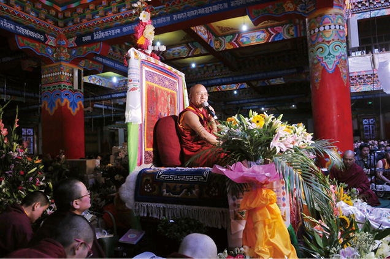
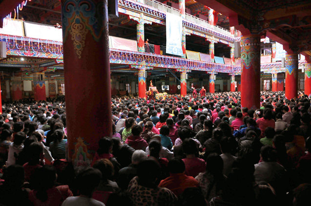
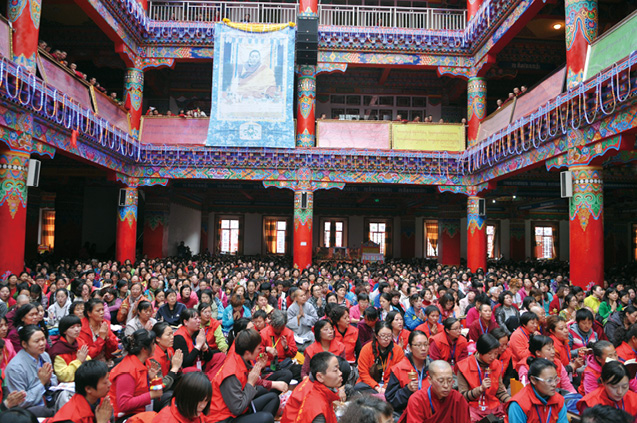
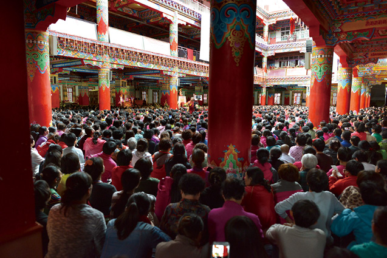

# 终生不变的决心

——2014年金刚萨埵法会开示（1）

2014年6月4日

今晚我们利用一个多小时的时间，给大家做个简单的开示。在座的各位，大多数都是纯粹的佛教徒，还有一部分人不是佛教徒，是为了旅游或者朝山拜佛来到喇荣圣地的，但也许不久以后也会成为真实的佛教徒。

我们很欢喜，有这么多来自五湖四海的善男信女和有缘众生，以真诚之心千里迢迢来到喇荣圣地；同时，我们也有些担忧，因为这里的气候、交通、生活条件，以及种种内外因素，可能会令大家遇到不少困难。虽然我们所有的法师和常住学员都在努力为大家服务，但这次来的人实在太多了。以前我都会提前声明：我们学院的接待条件有限，希望大家在当地参加法会。然而每次我这么强调后，来的人反而更多了。所以今年我什么也没说，不说来，也不说不来，可没想到来的人还是特别多。学院里很多法师也怪我没有提醒大家，因为担心学院目前的条件无法接待那么多人。

## 一、为求法而苦行，值得！

这里的生活很苦，不是你们在城市里能想象的。虽然今天学院的条件跟我二三十年前初来喇荣山沟时已经截然不同，但相比大城市的生活还是有很大的差距。这几天大家为了参加法会，经历了堵车、淋雨，每个人都很辛苦。我们这边的接待人员也非常劳累，虽然临时招募了200多名义工，但人手还是不够，令很多人没有得到及时的关心。一下子来了这么多人，我们也实在没有办法。

但大家能来也很好，因为喇荣圣地的确有一种无形的加持力。你们来到这里，即使没有听到法，没有得到什么收获，但至少也能看到，在世界上原来存在着这样一个角落——有这样一群人依靠精神食粮生活着，他们选择的人生道路、他们体验的生活方式、他们内心感受的快乐，与大城市里的人是如此不同。所以，我想也许各位在城市里学佛多年，都不如亲自来到这里，住一晚上、吸一袋氧、输一瓶液、苦行一两天。在你的生命历程中，这会是很难忘的一幕。在大城市里，见惯了高楼大厦、高级宾馆、豪华轿车，很多人都已经麻木无感了。也许这次来到山中，在寂静之处清净地修行，会成为你一生中与众不同的印记。

因此，希望这次来到这里的每位学员、每位佛教徒，在遇到困难和痛苦的时候，要想一想前辈高僧大德是怎样悉心求法的。当年唐玄奘远赴印度求学，穿越沙漠、翻越雪山、遭遇猛兽和匪徒的时候，他是如何面对的？同样，藏地许多大德到印度求学时，也遇到过无数艰险，他们为求法而苦行的故事，在许多历史和传记中都有记载。与之相比，我们只是从自己家中来到这里，在不那么舒适的生活条件下修学佛法，这也不算什么，大家应该能够接受。

再者，大家经历这番苦行，也是一种忏悔的方式。为了修行，我们必须洗涤自己的染污；为了忏悔，我们也应该承受一些身体上的痛苦，这是非常有必要的。因此，如果感受到困难和辛苦，大家应该把它当作消除自己无始以来所造罪业的一种方便方法。我相信，通过这次法会上的诚心忏悔，你前生和今世积累在阿赖耶上的种种恶业习气都可以一扫而光。这就是清净罪业最好的方法，并非我信口之言，而是有前辈大德的开示作为依据。

因此，大家要这样想，求学佛法的过程中所遇到的一切困苦艰难，都是非常有意义的。我们活在世间，仅仅为了自己的生存，也在漫长的轮回中受过无数的痛苦，然而受那些苦并没有太大的价值。而我们现在为了真正的自利利他、获得解脱，在生活中克服一些困难，这是非常有意义的。因此，对于条件的不足，请大家多多包容。虽然这次法会期间，我们学院已经把喇嘛经堂、觉姆经堂、降魔胜利洲的经堂等都借出来供大家住宿，但人实在是太密集了，所以希望大家互相包容、互相理解，同时自己也尽量地安忍苦行。当然，如果你们有任何生活上或修行上的具体困难，法会期间都有管家、义工和负责人值班，会尽量给大家解决。

今晚，我先简单做一个开示，然后念一些传承。另外，可能有些人以前没有正式在现场皈依过，所以今天会给大家做皈依。

## 二、灌顶前观察自他、 灌顶后守持戒律，重要！

首先讲讲这次法会灌顶的须知事项。明天上午十点门措上师会给大家灌顶。在座不少人以前都得过一些灌顶，大家要懂得，灌顶并非表面形式，而是佛教中非常重要的一种仪式，尤其在密法的学习中是不可或缺的。接受灌顶之前，首先应该对灌顶的传法者有充分的了解，然后要反复观察自己的相续，是否真心想学密法。如果不是真的想学，那就不必非去接受灌顶。如若下定决心此生要学习显密佛法，绝对不会改变心志，那么就应按照修学次第，从前行开始，一步一步循序渐进地学。在这个过程当中，能得到灌顶是最好的。在藏传佛教的传统中，有些前辈大德要求弟子必须接受过灌顶才能修学金刚萨埵仪轨、上师瑜伽等前行内容；也有一些大德，并不要求在修行前行之前就要得受灌顶。不论怎样，我们如果真诚地希求密法，接受灌顶是十分重要的。

其实灌顶没必要追求数量。现在有些居士，根本不理解什么是灌顶，既不懂灌顶的内容，也不懂灌顶的功德和作用，更不懂灌顶以后若不守护誓言、违犯密乘戒律，会有怎样的过患。在这种盲目的状态下，一听说某位上师、某位活佛要灌顶，就东奔西跑地去接，这种现象是普遍存在的。在这方面我希望大家最好谨慎一些。为什么呢？现在汉地正值藏传佛教比较兴盛的时期，然而很多佛教徒非常盲目，没有次第性、系统性地闻思修行过，对于信仰的认知还很缺乏，这时突然遇到一些所谓的上师、所谓的修法，往往来不及观察和分析，就跟风去求法、去受灌顶。但事后可能会发现，自己得到的不一定是真正的灌顶，所依止的也不一定是真正的善知识。诸如此类的情况比比皆是。

因此，我们建议大家，在接受灌顶之前，先冷静思考。当然，门措上师是我们公认的金刚上师，大家无需再去观察。但如果你们对上师和密法没有信心，不想修学的话，那这个灌顶也不一定非要去参加。

作为佛教徒，一定要对佛教的基础知识有所了解。现在的佛教徒，大多数在这方面做得不错，尤其是近几年来，各地都涌现出一些学习佛法的中心、学会，不仅是佛学院和寺院的出家人，还有许许多多在家居士，都在认真地闻思。但是，也有一部分人不去好好闻思佛法，仅仅抱着一种盲目、冲动的信仰，在这种心态下，很多问题他们都无法正确判断。所以我们希望你们这次来到喇荣圣地，不仅仅是用相机拍下外面的房屋僧舍、蓝天白云，更重要的应该是去发现，我们佛学院二三十年来的精神究竟是什么？

汉地有的居士学了十年八年，懂得几部论典，就自以为是。其实在我们喇荣五明佛学院中，学过几部论典根本算不上什么。真正的闻思，应该长期坚持，很多人将自己二三十年来的所有时间精力全都投入到了佛法上。当然，在座各位毕竟有工作，要承担家庭和社会的责任，在因缘不成熟的情况下，我也不要求你们抛弃一切来一心一意地学习佛法。但是你们要明白，来到喇荣山谷以后，不能盲目冲动，或是自欺欺人，去做一些不如法的事，这样不但对你个人没有利益，甚至会给整个藏传佛教带来不好的影响。对于某些所谓修行人的不合理、不如法的行为，以及有些居士冲动过激的行为，我在这里都不得不加以呵斥。

这次大家都是以一种信心和因缘来到我们佛学院的，我始终坚信，依靠上师如意宝的殊胜加持和威德力，来到这里的人都会增上信心，至少在正见方面会有所进步。除了极个别前世与佛教结上不良因缘的人以外，大多数人身上应该都会产生这样的效应和作用。

明天各位参加灌顶之后，要知道如何守持密乘的戒律。现在有些人参加完灌顶以后，并不清楚要守哪些密乘誓言，这是很危险的。我和学院的其他堪布以前都讲过，接受灌顶之后，遵照《大幻化网》，应该至少守持密乘最基本的五种誓言。在灌顶的时候，要具足“二因四缘”，依靠自身的诸根具足，按金刚上师的引导进行观想，或者简单地观想：现在接受的是宝瓶灌顶，现在是秘密灌顶，等等。每一种灌顶完成之时，自己应该想：通过这样的仪式，我已经获得了宝瓶灌顶、秘密灌顶、智慧灌顶、句义灌顶。明天灌顶时我会同步进行翻译，大家可以用收音机收听，但最好插上耳机，不要影响到旁边的人。

## 三、终生要一直修行，不改变！

你们来这一趟也很不容易，所以从明天开始，大家白天晚上都不要浪费时间，因为能与这么多的僧众一起共修忏悔是非常难得的。网络上的道友们虽然没有来到喇荣山沟，但你们的心应该在这里。在某些情况下，心到比身体到还重要。而个别来这里参加法会的人，由于不适应气候等原因，虽然身在喇荣，心却早已回了家。与此同时，有些人虽然没有亲身来到这里，但实际上心已经在参加法会了。到底是身体重要，还是心重要呢？按照佛教的观点，重要的其实是心。所以，不一定非要到这里来才算参加法会。

不论是现场在座的各位，还是今晚在世界各地收听直播的线上道友，大家都应该珍视这次机会。明天的灌顶没有网上直播，但接下来法会的全部念诵仪轨都有直播，希望大家在自己家里也能认认真真地念诵。上等者，在法会八天中念完四十万遍金刚萨埵心咒；中等者，应该在一个月内念完；下等者，三个月念完。三个月还念不完的人，可能是太过忙碌了，所以不关心忏悔和解脱，更关心其他事务。这样的人很难得到救拔，恰恰是因为他们在世间太厉害、太成功了。

我认为每年法会念四十万遍金刚萨埵心咒来忏悔，这是非常非常重要的，大家无论如何一定要念。在念之前，我希望所有人能一起发愿。我们作为密宗弟子，自相续应当堪能。如何使自相续堪能？靠这一堂课不可能解决你们所有的问题，所以我还是要提醒大家，我们的修行并不是一天两天、一年两年的事，而是要在有生之年乃至生生世世不断地修。大家应该做出这样一个长远的、坚持不懈的、不轻易改变的发愿，这十分重要。希望大家不要像参加世间活动一样对待这次法会，千万不要觉得做完了就结束了。应该通过这次法会认识到，终生都要一直修行，不要改变。

在英国有一些佛弟子，跟随自己的上师已经四十几年了。他们在十几、二十岁时遇到上师，然后就毕生学习这个法门，即使上师圆寂后，他们还在不断地修学。对此我是很赞叹的。我自己依止了法王如意宝后，也是终生学习上师传授的法门，没有变过。现在有个别佛教徒，今天学这个，明天学那个，一直不停换口味，最终往往一无所得。当然，你不一定要学习喇荣的课程，也不一定要追随某一位上师，但自己应该善加观察，一旦认准了要学的法门，就不要轻易改变。这个时代有些修行人，心思转得很快，总是变来变去，最后自己根本没有任何实际收获，到头来只会一场空，得不到真正修行的利益。

因此，趁这个机会，大家应该发愿：我一定要真诚地终生学习、终生闻思、终生修行。这对你们十分重要。当然，我自己这辈子肯定不会换什么传承，要换也来不及。人生是很短暂的，我们想一想，在座大多数人早年都没有遇到佛法，大多是二三十岁、四五十岁后才开始学佛的。要是以后想要在自己的信仰和修行上换来换去，恐怕也没有时间了。人的一生就像白驹过隙，世间的琐事那么繁多，工作那么繁忙，在这种情况和心态下，哪里还有那么多任由你变换的机会。

因此，今晚我要强调几个重点。首要的就是发愿恒常不变地学习一个对自己有利的法门。今天你们在这里跟成千上万的出家人和大德圣者一起发愿，发出这样的愿，就一定会实现，这很重要。

你们既然想学习密法，想接受灌顶，受持金刚萨埵忏悔法门，那就要有终生不变的决心。如果没有这样的决心，我建议最好不要去参加灌顶。因为要接受灌顶，你们对自己应该要有这样一种把握：我此生之中一定要好好学习密法；不会舍弃金刚上师；不会舍弃殊胜的密法；只要各方面因缘具足，一定要把五十万加行修完。

我以前也象征性地给大家灌过一些顶，要求是没有修完加行不允许参加。虽然现在很多上师都比较慈悲，没有硬性限制，但实际上我们还是希望大家至少应保证将来一定要修完五十万加行，再接受灌顶。

有些人可能会有疑问：为什么要磕十万个大头？为什么要念十万遍皈依偈？这是我们修行中的一个界限。比如说，你要驾驶飞机，要当机长，那就必须完成规定小时数的专门训练；同样，你想学习密法的话，也必须付出一定的精力，之后才能真正成为一个可以学习密法的合格弟子。然而有个别佛教徒，才刚修了一点，就给自己找借口，半途而废了，这是很可惜的。我们有了这样难得的人身，为什么一生当中连区区五十万加行都修不完？等到离开这个世界的时候，会不会懊悔：虽然遇到了佛法，遇到了善知识，遇到了各方面都这么好的因缘，可是自己却没有珍惜。

我今天跟大家讲这些，不是为了我自己，在这方面我没有任何的私心，但我想认真地对待你们，所以在这里直言不讳：现在有些人告诉你们，学佛只要快乐就行，让你们放松，不修加行也可以，只要如何如何就行……这些话听起来似乎很美好，很符合我们凡夫人的心态。其实，就如某些父母对孩子非常放任，而有些父母对孩子严格管教，哪种更可能让他未来有个好前途？大家应该很清楚。因此我们作为佛教徒，一定要重视加行，要认真地去修加行，要善待自己，善待众生。这些都是我认为很重要的。

## 四、弘扬佛法，自利利他，发愿！

接下来我想说的是，作为佛教徒千万不能盲目，言行举止应当如理如法。佛教是一个很好的宗教，既是智慧，也是教育。但是现在有些人利用佛教来搞自己的事，这非常可怕。这种现象，在藏传佛教某些“上师”中有，在汉传佛教某些“大德”中有，在汉藏两地的居士和修行人群体中也有。虽然这种人在佛教徒中比例不是很高，但这少数人经常利用佛教的名义追求私利：有些为财，有些为名，有些为了其他目的。在这些时候，我们佛教徒绝对不能盲目跟从，不论是对自他、对佛法、对众生，都应该负起责任。如果连这样的责任心都没有，那我们连世间一位老师、一位知识分子都比不上，还怎么能口口声声说自己是佛教徒？

作为佛教徒，我们应该承担起自己的责任。看看周围其他的宗教团体是怎样团结一心的——他们在弘扬自己宗派精神的时候，如果团体中间出现假冒现象，会一致打击，一起根除。但有些佛教徒，则是以慈悲为怀做借口，对一些非法行为置若罔闻，不理不睬，任由其在团体中蔓延，致使我们佛教越来越衰败。长此以往，众生还能得到什么利益呢？恐怕只会得到越来越深的痛苦。

因此，作为佛教徒，我们不能盲目，不能愚痴，不能迷信。自己必须花一定的时间来闻思修行，不要把全部希望都寄托在所谓的上师身上，上师毕竟也是人。虽然有些上师，比如法王如意宝，确实是超群绝伦的大成就者，见闻忆触者都能获得利益，但其他大多数所谓的上师，也只能通过讲经说法来度化众生。

佛陀在世时曾说过：我虽然给你们指示了解脱之道，但解脱最终依赖于你们自己。佛陀已经给我们讲了因果不虚、断恶行善、上有天堂下有地狱的种种道理，但关键要看我们自己能不能如法行持，取舍因果善恶。这个责任只能全部由我们自己来承担。

作为佛教徒，有信心当然是很好的——这么多人从各个地方来到学院，有些人怀着多年的心愿，这次终于因缘具足而实现了。虽然我特别理解大家，但我们作为佛教徒更重要的是要有智慧！这种智慧在任何境况面前，在任何国家和民族当中，都不可缺少。如果我们是以一种有智慧的方式信仰佛教，那佛教就能永远存续；如果我们的信仰是盲目的、缺乏智慧的，那佛教在这个时代就很难发展前进。因此，我们佛教徒始终需要具有智慧。而这种智慧并不是天上掉下来、地里长出来的，一定要靠自己勤奋学习、痛下功夫、精进苦行才能得到。

我们佛教徒经常讲自利利他，而自利利他最基本的原则，就是首先要自己学懂，不能盲目。我一直在观察，在我们佛教徒中有相当一部分人，他们的智慧和悲心非常超胜、常人难以想象，但也有一部分人特别迷信，修行、行为、说话等很多方面都非常不如法，甚至越学越糟糕。今天我特意在此指出来，希望你们能够反观自己，也看看我们周围，思考一下佛教的未来应该是什么样。

今天这番话主要是说给佛教徒的，至于非佛教徒以及对佛教感兴趣的听众们，我也希望各位能用智慧进行观察，对于目前佛教之中不合理、不如法的现象，你们可以直接指出来。当然，我完全有把握，佛教本身经得起任何推敲和以理观察。然而，由于一些佛教徒不如法的行为，致使其他人对佛教生不起信心——这并不是佛教造成的，而恰恰是我们佛教徒造成的。

不过，现在相比上个世纪七八十年代，佛教徒的总体水平有了不少提升。所以我特别希望，我们大家一方面要有一种对内团结合作的精神，另一方面，也要学会观察甄别。就如世间的商品，无论国产还是进口，我们都会先看看质量，不会随便花钱买；同样的道理，在对待各种各样的佛法“商品”时，我们也要用一种理性的智慧去观察，而不能用盲目的心态去轻易接受，否则后果只能自己承担。因此，大家应该团结起来，共同学习，要学会用细微的智慧和眼光去观察。

现在佛教的确是很有前景的，尤其近几年来，我去了汉地和欧美的很多高校，他们常常在问，为什么现在汉地许多高水平的学者和老师，都热衷于藏传佛教？我是这么想的：虽然藏地经历了风风雨雨的历史变迁，但在整个过程中，真正的教理没有受到任何损害，包括藏传佛教的法本、寺院等重要的文化资源，一直完好地保留着；同时，藏传佛教的教育体系、佛法的传播方式、佛学人才的培养方式，也都没有受到影响。因此，很多有识人士来到藏地之后，不但可以用相机拍到藏地的美好风光，更重要的是，他们在这里感受到了滋养心灵的慈悲与智慧，满足与包容……而这些，都是当今全人类最为稀缺的财富。

虽然如前所讲，佛教群体中确实存在一些盲目的人，但我相信，来到这里的绝大多数人不会是那样的。我们的目标是要共同去树立一种度化他人的信念，因为大乘佛教的核心归根结底就是帮助众生。而帮助众生怎样才能做到最大化呢？我认为应该是从精神上给予帮助。物质的帮助只是一时的，精神的帮助才会永恒。为什么我们会特别感恩自己的老师？就如我特别感恩自己的根本上师。因为他们给我们的精神财富的价值，远远超过了任何世间丰厚的物质财富。因此，我很希望大家这次来参加法会不要仅仅走一个形式。念完四十万遍金刚萨埵心咒其实很简单，没什么了不起的。毕竟谁都可以拿着念珠，边走边念：嗡班匝儿萨埵吽，嗡班匝儿萨埵吽……

大乘佛教的精神核心，就是要利益众生。所以，大家应该发愿：在今年之中，至少要度一个人。怎么度呢？可以引导他认识佛法、学习真理、步入佛门，让他在心灵上解脱痛苦。虽然我们现在不提倡加入学会了，因为随着学员越来越多，学会的压力也越来越大。但尽管我们这边的工作人员很累，仍然希望能给大家提供一个系统学习的机会。因为人生实在短暂，希望大家能在这有限的人生中，真正学懂《入菩萨行论》和《大圆满前行》这些经典。

再过一段时间我计划讲《大圆满心性休息》和《大乘经庄严论》。以前在网上有直播，谁想听都可以，但这次不会这样了，一定得有个基本要求。若真正想学，三年当中不管有多少堂课，都要认真听完，这样才可以，而且在开课之前要写一个保证书，除非特殊情况，尽量不断传承。因为你们作为在家人，可能会有一些身不由己的应酬。但是，即使有特殊情况，如果缺课达到一定数量，也会取消听课资格。我想到时候应该会有这样的要求。

用世间的说法，《大圆满心性休息》对我而言应该是最拿手的。对这部法我非常熟悉，而且我认为它在修行上是最有加持的。我本人在学习大乘佛法之初，便遇到这个法门，当时就有了极大的信心。当然，讲这部法是很大的一个工程，很多人可能想都不敢想。我也是几经考虑，如果开讲的话，到底能不能圆满？就像刚开始讲《大圆满前行》的时候，也这么想过。《大圆满前行》我讲了大约200堂课，对于现在忙碌的城市人来说，听一次讲座也许都觉得很累，要坚持学习200堂课，是不容易完成的。我目前还在讲《现观庄严论》《六祖坛经》等等，有些道友是自发在网上听，有些是跟随我们学会的课程在同步学习。

对于这些认真地、系统地、不断坚持学习的道友们，我非常感恩，因为他们确实为了学习放下了生活中很多事情。尤其是在学会中，有些人不仅在认真学习，还在义务地参与管理和发心，或是提供道场和各方面的资源，这些功德都非常大。所以，这次法会期间我们会组织一些交流会，如果没有特殊情况，希望相关人员都可以参加，这非常重要。这次来到喇荣的人，有些是有着双重身份的，一方面是要参加金刚萨埵法会，另一方面，是要来参与交流，以便更好地弘扬佛法和利益众生。除此之外，我们没有其他的目标。

我们通过各地线下的班级以及线上的网络平台，共同进行学习。同时还在利用微信、微博、博客等新媒体为主的多种渠道，希望将真正对人们有利的精神食粮和佛法智慧，传递出去。我相信在座的很多佛教徒是完全有这个能力的。你们每一个人，哪怕只是发一条微信，将一些有意义的教义传递给身边的人，这就是利益众生的一种方法。

当今时代，弘扬佛法的方式跟以前有很大差别。过去一位上师在山沟里讲课，只有这个山沟里的人才听得到，除此之外就没别的办法了。而现在完全不一样，在这个时代，不论好的东西还是不好的，都传播得特别快。所以，如果能把一些正能量、一些善法，传递给我们身边的人，他们的人生就有可能变得更好。这种时候，我们佛教徒都应该秉持一颗利他心，不为自我宣传，不为谋取利益，甚至连自己的解脱都可以置于其次。先度众生，后度自己，这才是菩萨。

在座各位大多都发了菩提心，既然发了菩提心，就一定要有一种自信，不要认为自己没有能力，很难度化众生，不能这么想。甚至有的人，不但不用这么好的佛法来帮助众生，反而用这个平台来为自己做不如法的事情，这样就太可惜了，就如同用金银财宝来做粪扫用具一样，是非常愚痴的行为！因此，我们每个人，一定要有一种度化众生的勇气。

所以，虽然大家很累，但我还是希望你们这次来到学院，不仅仅是参加个金刚萨埵法会就可以了，每个人都应该想一想，自己今后要如何修行？有的人可能已经来过很多次，成了老油条，没有感觉了；还有些人现在可能还是懵懵懂懂。大家的层次各有不同，但不管怎样，你们既然来到了喇荣圣地，就应该对自己的修行，发一个永恒的愿；同时还要发愿在这个信息发达的时代，尽可能地用一些现代的方便方法，让更多人从佛法中受益，让他们得到度化。如果能做到，那就真的是功德无量。

对于很多佛教徒来说，现在是一个特别好的时机，以前很多时代的人不一定有这样的机会和方便。当然，网络时代也让人特别容易散乱。我看到人人都拿着手机，疲于奔命，做着一些毫无意义的事，这也是这个时代的一个弊病。但不管怎么样，我们佛教徒应该发菩提心，真诚地、系统地学习佛法，同时在我们力所能及的范围内度化众生。

今天我可能有点啰嗦，但这些确实是我发自肺腑的一种心声。下面，我给大家念《佛子行三十七颂》的传承，虽然以前也在网上和其他地方念过，但今天算是借此给大家一种加持。因为无著菩萨的《佛子行三十七颂》，任何人听到之后，都会在相续中自然而然生起菩提心。今天任务比较重，还要念《开显解脱道》，以及给大家做皈依。很多人正在修加行，听了《开显解脱道》就有了五加行的传承。今天还有很多人在网上听课，希望大家能共同发愿。网上有些道友可能没有得过灌顶，但按照藏地一般的传统，念修金刚萨埵不需灌顶也可以。

这次网络上和现场的人都非常多，人多了有好处，但也有麻烦。不管怎样，我们都要以一种坚强的心态面对各种事情。学院很多道友做接待时都累坏了，其实我也很累，但没关系，只要大家能通过这次法会得到一些启发，让人生有新的转变，我们累一些也值得。这里很多大法师当初也只是来参加法会，或者只是想来拍拍照，结果自己慢慢地就学进去了，后来成为弘扬佛法的高僧大德。一开始谁都难免有一些盲目之处，渐渐就会有所转变。其实受点累我们都可以忍受，相比难以忍受的地狱、饿鬼、旁生之苦，我想人间的痛苦除了特别严重的疾病之外，我们应该都可以接受。因此，在修行过程中，大家一定要坚强，坚强是很重要的品质。

同时，要时时刻刻想到人生短暂无常，即生中能遇到佛法就像中彩票一样，是非常难得的——在茫茫无边的人山人海中，你们仅仅是千分之一、万分之一。如夜空的闪电一般，你心中生起了这份信仰和修习佛法的念头，是非常不容易的。所以，不管再苦再累，都应该无悔付出。我希望大家都能成为真正的修行人，只要对你们即生或来世的解脱有利，我们都非常愿意为大家付出。

这次法会聚集了这么多人，希望大家一起来好好忏悔。下面我给大家念《开显解脱道》的传承。在我念诵的时候，希望大家能默默发愿，今生之中一定要修完五加行。已经修完加行的人请举个手。要是没有修完，我希望你们这次来五明佛学院应该发个愿。发愿修完加行的人举个手，网络上的听众如果有发愿的也请举手，我用“神通”来看。哇，这么多！很好！其实我用的神通，是因明中的比量，可以推测到此时各地有非常多的人举手。

接下来我念五加行的传承。我自己也是从修五十万加行开始的，身边很多人也是通过修加行真正成为一名修行人。任何一件事都需要经过漫长的锻炼，才能有所成就，这是很重要的，所以希望你们不要只有短暂的热情。今天的发愿是你们自愿的，你们一定要记住这一刻，我相信你们都是具有智慧的，不会欺骗别人，更不会欺骗诸佛菩萨。

（堪布念《佛子行》《开显解脱道》传承，并传授皈依戒）
