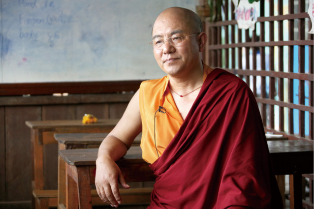

# 调整心情 闻思修行

2015年3月10日

首先请大家为了利益一切众生发无上殊胜的菩提心。今天我们所讲的内容，分为两个方面：一是跟大家简单地交流一下；二是给大家念《七句祈祷文上师瑜伽》的传承。

## 一、新学期课程安排

本来今天是我们《大圆满心性休息》课程开课的时间，但是这几天学院没有网络。如果通过电话来接受传承，对于外面的很多道友，比较不方便。所以我想等过两天，这边的网络修好以后，再给大家讲课。讲什么课呢？一是《大圆满心性休息》。前三品在上个学期，也就是第一学年的时候已经讲完了，下节课就要开始讲第四品。今年还准备讲《大乘经庄严论》，也是从下周开始。星期一和星期四讲《大圆满心性休息》，星期二和星期五讲《大乘经庄严论》。再过几天会给大家具体通知。

## 二、调整心情，认真闻思修行

大家已经休息了两个月了吧？记得我是1月10日离开学院的，今天是3月10日，刚好两个月。有些道友觉得放假特别好，到今天还没有回来，可能他们比较贪执世间，还没享受够外面大城市的色声香味。包括我们学院当中的一些出家人，有些是刚刚才回来的，听说明后天还有几批人陆续回来。也许他们是对世间妙欲比较贪著的人吧，还有的人更加贪著，一直不想回来，也有这样的情况。

同样，在我们学会的居士当中，也有些人觉得这次放假特别开心，因为不用天天上课，没有约束了。现在一开始继续上课，可能他们就感受到了压力。当然也有一些人，确实觉得闻思是人生当中非常重要的事，而且知道这样闻思的因缘能保持多久很难说，因此他们都觉得机会难得，欢喜踊跃地听受。

我的课程安排基本上就是讲这两部论典，一般情况除了星期日以外每天都会讲课。今年大多数的时间我想待在学院里，也可能会去外面城市里的一些大学、企业、监狱交流讲课，我外出讲学基本都是固定这几个方向，要么去大学，同知识分子群体交流佛法和传统文化，包括史学、艺术以及其他的一些知识。虽然我穿着僧衣，但我在高校里并不是仅讲佛法，凡是我懂得的，都愿意用各种方式与他们交流。另一个方向是去企业，主要是通过佛法来跟他们交流。还有监狱，如果有机会，我也很愿意跟这些比较特殊的群体进行交流。这是我自己的一些计划，在新一年开头之时跟大家说明一下。

目前全学院都在筹备开学，教务科的堪布堪姆们，这几天正在给男众、女众分班，接着就要开始讲课。我们降魔胜利洲，明后天将正式开始讲授五部大论以及密宗、前行等课程，各个专业的教研工作也正在开展。所以希望在座的，尤其是降魔胜利洲的道友，现在应该把心收回来。毕竟放假期间很多人都出去了，心容易散乱。也许你们的定力都很好，比较淡定，不会散乱，但要是我的话，出去一次之后心确实会有点不在状态。虽然我几乎没有离开过经典和论典，一天大多数的时间都用在佛法上，没有放逸，也没有到处乱跑，可是直到返回学院以后，我才感觉进入了一个比较正常的状态。我觉得每天都有闻思修行，人生才是真正有意义的。所以，不论学院里的道友，还是外面学会、中心、寺院里的道友，这几天就不要再散乱了。人生中能有多少个一年，现在新的一个学年已经开始，马上就要正式上课了，大家都应该好好调整一下心情，然后认真地投入闻思修行。

## 三、整顿纪律，建设清净的学佛团体

我是前天回到学院的，从昨天到今天上午，一直在给堪布堪姆以及相关的法师们开会，就我们的管理、学习以及其他很多方面的工作做了一些交流和沟通。希望在座的道友们，如果你是佛学院常住的出家人或在家人，那就应该按照学院的相关规定和制度，如理如法地闻思修行，否则在学院里待着也没有意义。这里不是旅游观光的地方，也不是搞商业的地方，而是闻思修行、弘法利生的道场。不管你是堪布也好，堪姆也好，不论什么身份，作为佛教徒，如果违背了因果，或者不具足学院规定的常住的条件，那就应该离开这里。还有一部分人，心没有放在修学佛法上，不好好闻思修行，甚至还有一些不太如法的行为，我觉得也没有必要在学院住下去。这是第一点。

第二，我们所管理的外面的一些佛教小组、中心、学会里，有的人没有好好地闻思修行，而是经常搞一些是非，这种人在人群中相当于一颗炸弹，随时都有可能爆炸，我不希望这样的人留在学佛团体当中。其实我们这个平台即使没有人来参加也是无所谓的，这样更清静；既然有人来，希望你们都能保持清净、纯洁，这很重要。

去年我们也做过一些整顿工作，今年不论是上是下，老虎也好、苍蝇也好，包括堪布堪姆，只要违背了真理，违背了因果，我觉得就没必要待在学院了。我不愿意看到学院里人越来越多，我最愿意看到的，是哪怕极少数愿意闻思修行、利益众生的人，组成的一个特别清净的团体。无论是在城市里面也好，学院当中也好，我都很希望看到这样的人。2006年我刚开始通过网络弘法的时候，就这样想过，哪怕只有二十个人来听课，这些人也应该是很清净的。

这次放假期间，我听到了一些好的消息，比如有些人在弘法利生方面做得不错，还有些人很具足正知正见。但是不好的方面听到的更多，比如有些人以藏传佛教的名义来欺骗大众，这类骗子在汉族当中也有，藏族当中也有，其他民族和国家当中也有。还有一部分发心人员比较不在状态，当初我给每个人都清清楚楚交代过具体要求，像不能关机、应该随时保持联系等等。可是时间一久，有的人就听不进话了。说实话，对一些失职的发心人员，我感到有些失望。

本来在开学第一天，说这些是比较忌讳的。但是我最近看到，随着我们的人数越来越多、事务越来越复杂，管理人员就相对越来越少，而一个团体如果没有管理到位，就会变得很糟糕。现在有些佛教徒在闻思方面是不错的，但在其他方面，一个小小的事情也会小题大做，最后甚至比没有学过佛的人还要差。说实在的，有时候看到有些佛教徒行为这么不如法，我确实会生起很大的厌离心。

因此，今天我就在这里跟大家讲明，真正想好好学习佛法的人，可以进入各个班级，不好好学的就没有必要留在佛学院了。特别要注意的是，现在我们学院越来越大，网络越来越方便，通过各种方式行骗的人也越来越多。有些骗子之前在汉地没有机会，到了佛学院穿上出家人的衣服，就很有可能骗得到人。所以，我们管理人员应该提高警惕，谨慎识人。尤其是堪布、堪姆、法师们，要注意对班级学员的管理，长期住在学院的人，就要遵守常住要求；如果不是学院的常住，那这里也没有什么好玩的，不如转一百遍坛城，然后背上包回去吧，我们也特别随喜功德。

## 四、具足条件可申请闭关

另外，从今年开始，学院要在原有的闻思班、实修班、净修班之外，增加一个闭关的选项，也就是一年之内一直闭关不出。这种闭关要求是比较严格的，要从三月份开始，闭关到冬天放假为止，一个月中只能出来一次，手机也只能一个月用一次。要申请闭关，需要在学院闻思五年以上的人才有资格。今年还在发心岗位上的人，因为工作不能间断，所以暂时不能去闭关。如果特别想去，可以等到明年再申请。当然，你们也要考虑好再申请。每次我们提出一个计划，刚开始时大家都非常踊跃，然而一段时间之后就冷淡下来了。到时不要说闭关一年，就是闭关一天有些人也是坐不住的，这样就没有必要了。

实修对于我们非常重要，包括前行和正行。但我不建议太年轻的人去闭关，四十岁以上的可能适合一些。不然有些人还没有打好闻思基础就去闭关修行，那是很有危险性的。以前有个人，没经过太多闻思就去闭关，一个月后出来，两眼通红，死死盯着我，我非常害怕，都不敢从他面前过路，只好往后面躲。后来我想，没有闻思基础的人贸然闭关确实有点危险。所以我希望你们大多数人先好好地闻思，个别条件适合的人可以去闭关。

## 五、应重视学院管理

今年我们理事会的分管法师们也在积极地发心。总的来讲，法师参加管理工作是很有必要的。如果堪布堪姆和法师们不管理学院事务，不论讲法讲得多么好，我都不是很赞叹和随喜。所以，希望法师们也应该重视管理工作。光顾着自己的课，不管学院的事，也许对你们来讲比较轻松，但是对整个佛学院、对法王的道场，却是一种不负责任的态度。无论是谁，我都是这样认为的。因此，希望各位堪布堪姆和法师们把管理重视起来。

我们经常口口声声说，这是法王如意宝的道场，这样的道场难道是自然形成的吗？如今法王示现上已经圆寂了，但他的道场还需要人继续运营、继续投入很多的管理。如果没有管理，道场如何维持？我假期离开了两个月，一回来就发现管理上有很多地方有待加强。我刚才还跟一位堪布说，如果我一年不在这里，可能我们降魔胜利洲就要解散了。

所以，我认为管理确实非常重要。可能你们现在还没有意识到，等某些重要的管理人员离开了，你们也许才会发现管理是不可或缺的，但是那个时候就已经来不及了。对于管理工作，不论小管家还是辅导员，上上下下都要认真对待，这是非常重要的。

## 六、莲师七句祈祷文开示

今天总体上看缘起还是比较好的，接下来我给大家念一个《七句祈祷文上师瑜伽》的传承。在此之前，先做一个简单的开示，并进行英语同步翻译。

这几天我们喇荣五明佛学院正在开法会，主要内容就是莲花生大士的七句祈祷文。用这个祈祷文来祈祷“咕噜仁波切”非常重要。“咕噜仁波切”是藏语里对莲花生大士的称呼，通常在英文翻译中就是采用“咕噜仁波切”的音译。“咕噜”是古印度的梵语，意为上师；“仁波切”是藏语中珍宝的意思。所以，莲花生大士在藏地经常被称为“咕噜仁波切”，意思就是上师如意宝，或者上师宝，一般这是莲花生大士的专用称谓。

我们祈祷莲花生大士主要的作用是什么呢？我认为，真诚祈祷莲花生大士的人，能够证悟自己如虚空般的心性。

在我很小的时候，从来到这个世界，能叫妈妈起，就已经开始念观音菩萨的心咒“嗡玛呢巴美吽”和莲花生大士的心咒“嗡啊吽班匝儿格热巴玛色德吽”了。我从小就依靠着这两个咒语，一直到现在，已经五十多年了。我不记得究竟是几岁时开始念的，但对我而言，在世间的众多语言中，这两个咒语是非常重要的。

在我的印象里，小时候，父亲特别喜欢念莲花生大士心咒，而母亲特别喜欢念观音心咒。虽然我们当时生活在一个比较贫困、封闭的环境当中，但在家庭教育上，与莲花生大士结下了很深的缘。我始终认为，第一个给我传莲花生大士法门的老师，就是我那连自己名字都不会写的父亲。这种信心一直没有退减。后来我又陆续遇到了很多金刚上师，尤其是法王如意宝。有授记说过，法王晋美彭措就是莲花生大士的化身。所以，在我的人生中有幸得到了真正了义的莲花生大士的教言。

我以前也讲过七句祈祷文的功德。今晚的听众不一定全都对莲花生大士具有信心，但我相信大多数人是有的。当然，不论是对其他教派，还是不同宗教，我们每个人的爱好和兴趣都不一定相同，这完全是个人的自由。但是我们若想通达自己的心性，祈祷莲花生大士跟自己的传承上师其实无二无别，在这样的尊者面前祈祷，效果是非常好的。这也是我长期以来自己祈祷的一种体验，今天也给大家提醒一下。

本来我们今天要讲《大圆满心性休息》，但因为网络问题，就改为念“七句祈祷文上师瑜伽”的传承。我看到今天有不同肤色、不同信仰、不同性格……种种不同的人来接受这个传承、接受佛法，这也是很好的一个缘起和开端。所以在此我也特别感谢大家，感谢你们让缘起吉祥。

因为没有网络，学院之外的道友只能通过电话连线来听课，可能比较费劲，但是为了修行一定要对此感到欢喜，不管遇到什么障碍都要保持开心。我们最后念《普贤行愿品》时，大家要好好地回向，把全部善根统统回向给天下所有的老母有情。

（堪布念《莲师七句祈祷文上师瑜伽》传承）

刚才我念的是《七句祈祷文上师瑜伽》，这个上师瑜伽修法非常殊胜，大家有空的时候应该多多念诵。念诵之后，如文中所讲，要观想上师的心和自己的心融为一体，然后念“阿、阿……”，安住在无上大圆满的境界当中。

今天我们学院集体念诵七句祈祷文，祈祷莲花生大士，很多人误会是不是出现了什么违缘。不是的，我们是为了认识心的本性而祈祷莲花生大士。刚才说过，我从小就对莲花生大士有极大的信心。昨天我在回学院的路上，看见了小时候放牦牛的地方，我那时虽然很小很小，但经常在山顶上拿着念珠祈祷莲花生大士。昨天一路上我有很多这样的回忆和感想。我会发愿生生世世不离开上师莲花生大士，还有他的大圆满法。我自己是这样发愿的，生生世世，乃至轮回未空之际，永远都不要离开。我希望你们也如此发愿，生生世世不离莲花生大士。

念这个传承是今天的临时安排，这个上师瑜伽的内容我以前曾经翻译过；刚才打开法本一看，发现麦彭仁波切在修法的后文中也是这么说的：“发愿生生世世做莲花生大士奴仆的麦彭蒋阳南嘉造。”意思是说，麦彭仁波切发愿，生生世世都要成为莲花生大士的弟子，这是麦彭蒋阳南嘉的意海，也即智慧海之中出现的。所以，我们每个人，只要有兴趣，都应该发愿生生世世成为莲花生大士的弟子。下面我们一边这样想，一边念三遍《七句祈祷文》。

你们当中如果有人对莲花生大士没有信心，也可以不念，或者装着念。以前我参加过一个其他宗教的会议，会上他们念诵自己的祈祷文，我看到旁边的人合掌，就也合掌，旁边的人闭着眼睛念，我也闭着眼睛念，我有过这样的经历。

下面我们开始念七句祈祷文……
