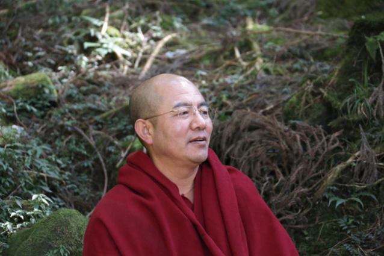
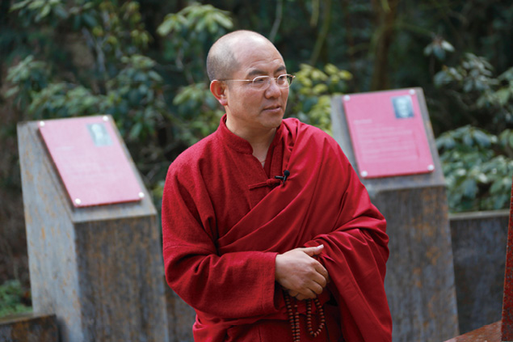
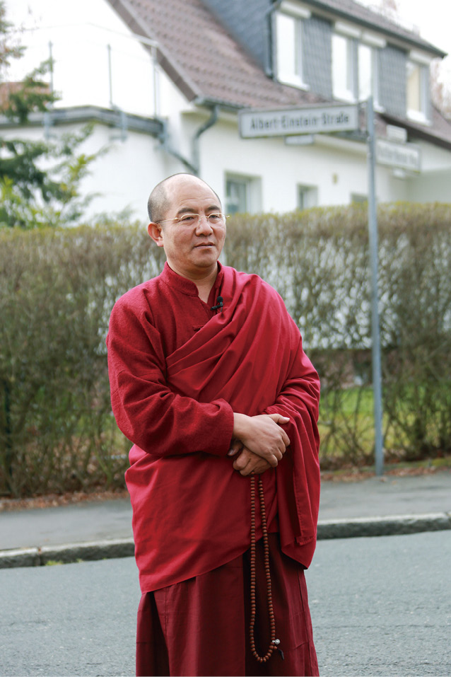
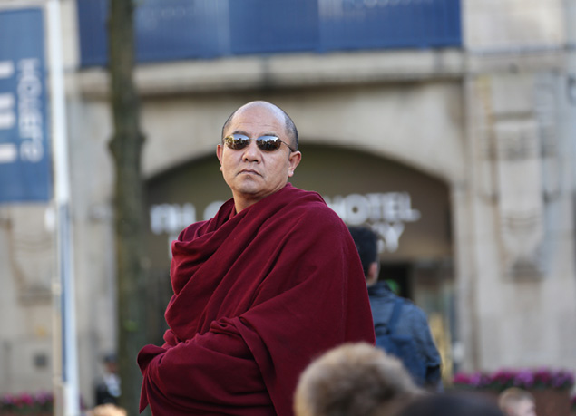

## 路漫漫 其修远兮

——2013年第二届新班开学典礼开示

2013年12月14日

今晚，是我们菩提学会2013年第二届新班的开学典礼。我从2006年开始，时不时在网上跟大家进行佛法交流，今天是第62次。

在座的无论年轻人还是老年人，生命都是无常的，我们会在这个世界停留几十年，然后每个人都会离开世间。当我们离开时，所有的财富、亲朋好友都无济于事，对我们今生乃至生生世世真正有利的是什么呢？就是现在行善、断恶！

很多人因为自己的家庭、教育、环境以及其他种种因缘，对前世、后世和业因果等佛教的道理并不是很明白。我从小生长在佛法兴盛的藏地，同时也花了一定的时间研究佛理，我深深地感觉到：现在人们再如何有福报，权力再如何显赫，财富再如何富裕，地位再如何崇高，如果没有心灵的调节和净化，不一定能体现出生命真正的价值与意义。

在21世纪这个科技高度发达的特殊时代，交通工具、手机、家具等都很现代化，可与此同时，人类的内心越来越空虚，越来越没有安全感，而佛法恰好给每个人带来了一味精神妙药。我最近遇到很多人，他们都发自内心地说：“如果没有遇到佛法，我的人生确实非常悲哀！”

因此，我特别希望利用这样的平台，跟大家一起分享极为珍贵的佛法精神。

## 良好缘起 共发永恒誓愿

今天在座的各位，选择进入菩提学会系统学习佛法，这是十分难得的因缘。为什么难得呢？现在无论是在中国还是在其他国家，学佛的人虽多，但很认真、系统、次第闻思修行的人并不太多。虽然难得已得，但这样的因缘也可能会改变，因此，特别希望各位珍惜良机，我们共同携手前行。

我昨前天刚刚发了一条微博，说：一本好书，一天可以看完，却需要一辈子回味。我原来翻译的《大圆满前行》大概4个小时就能看完，但可能需要用一生去实践与修行。我在1985年春天刚刚进入佛学院时，曾用一个月的时间，在一位老堪布那里学习《大圆满前行》，到今天已经接近三十年了，这么多年我几乎每年都看一遍，也讲了几遍，也由藏语译成了汉语，但现在看《大圆满前行》时，我还是觉得非常深奥，仍然在消化中。

同样，今天你加入学会，参加一个典礼，举行一个仪式，这很简单，但以后能不能将这条路坚持走下去？每个人要有自己的誓愿力，这很重要！有些人发的誓愿不容易改变，他想：既然我已经报名了，那不管遇到再大的困难和痛苦，四年的学习都要坚持下去；有些人走马观花，发愿的时候很容易，可是两天、十天或者一年就无影无踪了，这种人别说在佛法方面，可能连世间法方面的坚定誓言都没有。

今天在座的人，有些是学习佛法十多年、二十年的德高望重的出家人和居士，有些刚刚皈依，有些甚至还没皈依，无论如何，我们每一个人，首先都要有一个极其坚定的誓言！因为我们既非盲从，也非被迫，应该是自愿学习佛法的，那要有一种坚定的、永恒的使命感。因此，今天这个日子，大家应该记下来。

我看到很多人闻思修的生命比较短，有些老道友现在“电力”已经不足了，从表情也看得出来。和这些人比较起来，我觉得虽然自己也在末法时代，但学习佛法的生命并不算很短，还是坚持了几十年，还是有一种激情和积极性。我有时会用自己的这种“傲慢心”跟别人比较，因为我经常看到很多道友学了十年、二十年以后，基本上都已经“奄奄一息”了，不像刚开始那样有眼泪、有微笑、非常欢喜，到最后慢慢就没有感觉了。这是老道友们的一个毛病。

而新的道友们，我很担心你们变得特别快。从大的方面讲，你们每个人都具足如来藏，这是不可否认的；从小的方面来讲，在社会竞争这么激烈的环境中，你选择学佛，而且选择进入我们这个门槛比较高的学会，这是很值得赞叹的。但现在的整体环境并不乐观，各位身处繁华的都市，很容易被卷入各种欲妙的瀑流中，不过无论如何，希望你们都能坚持学完这几年的课程。

在场的道友，每个人都要把今天当作一个比较特殊的日子，都要共同发愿：好好学习！好好修行！善始善终！

## 不要做形式上的佛教徒

前段时间，我去了泰国、新加坡、台湾、美国等地区，有些我十四年前去过，有些二十年前去过，有些大概十年前去过，但个别佛教徒一点进步都没有，二十年前闻思的智慧和修行境界，到今天不但没有进步反而退步，很让人遗憾。

佛教徒如果不好好闻思，虽然名义上已经学了十年、二十年，皈依了佛法，但是对佛理完全不知晓。有些人我在二十年前遇到的时候，他就说五年前、十年前已经在某某大德面前皈依过了，自己也认为自己很不错，但到现在还是经常说神通、鬼通，经常讲是是非非，除此之外，佛教的基本道理一点都不会说，一开口就知道他们对佛教完全是外行。二十年前是这样，到今天也是这样，难道不可悲吗？

当我看到这种现象后，心里就想，我们佛教徒不要仅仅停留在名相上。哪怕是学五年、十年，在闻思的智慧上、修行的境界上，也一定要有一点进步。今天上午，有个人给我打电话，说他十年前开始学习佛法，但2013年是他最有意义的一年，因为懂得了很多以前不懂的取舍之理。这很重要！

释迦牟尼佛在《毗奈耶经》中也说，有些人修行百年，但却不如一岁。这里的“一岁”是指修行的岁数，不是人寿。如果没有很好地修行，就算修一百年也不如好好修行一年。这是一个非常鲜明的对比。因此，你们也要好好思考。如果没有很好地系统闻思和修行，就只是一个形象上的佛教徒而已。

现在各地很多人，把佛教的一些仪式，包括唱歌、跳舞、火供、放生等作为重点，这些是不是佛教的修行和行为呢？应该是。需不需要做呢？应该要做。但更重要的是什么呢？佛教分为教法和证法，证法就是我们相续中真正能生起出离心、菩提心、无二智慧，以及光明大圆满和密法中讲到的觉性。这些如果没有生起，形式上的很多行为，只不过是它的影像、支分而已。

可能有些人今天来这里学习的目的，就是希求身体健康、家庭平安……这只是暂时的目标、追求。最重要的是，对人生永恒的快乐和解脱方面，要有一个高瞻远瞩的思想和追求，这样才能找到佛法真正的意义。

## 珍惜机缘 系统闻思修行

在各种不良行为充斥着整个世界的时候，我们要好好珍惜学会提供的系统闻思修佛法的机缘。

大家应该清楚，世间任何知识的获取，要付出什么代价。很多人给我提建议，说加入学会一定要收费，而且要收高价人们才会珍惜。在国外也有这样的现象：如果是免费的讲座和培训班，大家都觉得是不是背后有其他财团做支撑，是不是有其他目的……就不珍惜。如果收取高价，人们在付出一定的时间和钱财以后，就会有一定的希求。

我们完全是跟金钱不挂钩的、非常清净的学习，但这样往往很多人都不珍惜，想听就听，不想听就不听，连法本也是免费的，太容易得到他们反而就不珍惜了。如果是上世间的课，请一位老师一天需要100块钱；加入一个六个月的培训班，要交7000块钱；有些学校MBA的课程，两年之内需要交76万、87万。而他们所得到的，和我们学习佛法所得到的，在价值上的差别，你们可以用自己的智慧来分析。

我并不是要你们缴费，以前一直是免费，现在也是，在力所能及的范围之内能维持多长时间，还是会免费给大家提供所有资源。但是，希望你们不要因为免费就完全不在乎，对自己没有任何约束，那这从取舍因果、恭敬三宝等各方面来讲恐怕不合理。因此，希望每一个人应该把佛法的学习和修行，当作生命中最重要的一环。

今天在座的道友们，我们这里的发心团队、发心人员，七年来默默地在背后为你们服务，付出了很多很多。我并不是用这种语言来抱怨，只是希望你们要珍惜。如果没有珍惜，那任何一种机缘到最后都会消失。我也经常在想，我们现在这样共同学习的机缘，也许只有两年、三年的时间，也许是十年、八年，很难说。

如今末法时代，很多在家人烦恼非常深重，前世福报也不太够，遇到佛法后，各种违缘和困难都在不断涌现：有些是自身的各种业和烦恼涌现，有些是亲朋好友的阻碍等，这样的一个人群，今天有这样系统闻思修佛法的机会，确实比较难得。

在座的很多人，拥有独立的思维与人格，应该正好是智慧比较成熟、吸收知识的大好时机，就像孩子五六岁、六七岁时刚好是读书的年纪一样。所以，希望你们抓住时间和机遇，认真学习。我们开设的课程是预科班四年、正科班五年，基本类似现在人们所提倡的“九年义务教育”。如果这九年学完后毕业，我也就放心了，那时你至少在佛教中可以“生活自理”。

但如果“九年义务教育”没有完成的话，虽然你自我感觉良好，实际上我还是很担心。佛法确确实实非常深奥，不能只是蜻蜓点水般地偶尔学一学。现在很多佛教徒基本上不懂教理，只是看过一两本佛书，在一位上师面前稍微发点心，再皈个依，就认为自己是佛教徒。这只是名相上的佛教徒，并不是真正的佛教徒——真正的佛教徒会闻思修行的。

## 学习内容和时间安排

今年我们在教学上略有调整。前几年的预科班是学习佛教基础知识，后来很多道友反馈，有些说内容太深了，有些觉得一个礼拜听两堂课实在无法接受。其实这很可怜，一个礼拜听两个小时的课都觉得太难了、太累了。后来经过商量，今年我们改用了新教材《离幸福很近》。

这本书是大家通过很多次的考察和调研，我自己也是反反复复思维、思考之后才决定采用的，书中收录了我以前在一些大学的演讲、对刚入门的道友比较适合的各地开示，以及有些我自己觉得应该对大家有加持的内容。所以，今年我们就从这本书开始学起。

很多人拥有这样九年或四年、五年的学习佛法的机会，这很好，但同时违缘也非常大，你们今天应该先做好思想准备——你学着学着可能没有什么感觉，刚开始听一两节课可以，但佛法很深奥，没有一定的心力坚持不下去，这是一个违缘；还有一个违缘，可能你的朋友、家人，都反对你学佛，在这样一个环境中，能坚持下去非常不容易。

我看见一些老道友的时候，经常会想：这些人还是不错！十年前就在学习，现在还没有倒下去，在这么差的环境当中还能坚持下去，这难道不是一个奇迹吗？有些新道友也不要太冲动了，不要把所有的时间全部都用来学习佛法，家里什么都不管，这样过段时间你的压力会更大。作为在家佛教徒，有家庭的责任、工作的责任、修行的责任，这三个责任不要忘。大家应该处理好家庭关系，这样你的违缘也少一点，会学得比较踏实、比较圆满。

四年的学习不容易坚持下来。有些人跟我讲：“四年太长了，可不可以学两年、三年或者一年？像短期出家一样。”但这样就成了一种形式。我不想做形式上的事，应该让你们实实在在得到一点利益。学会里面的个别人，六年学下来以后确实感觉很不错，刚开始学习的前一两年，完全是一种表面上的学习，越学越深入的时候，才知道其实学佛五六年根本不算什么。

法王如意宝在一首金刚道歌里讲过：现在很多年轻的学者，很早就想获得一个学位，你难道不知道其实藏传佛教格西的学位，白发苍苍的时候才能得到吗？藏传佛教真正的一些学位，只有五六十岁、七八十岁以上才能得到，并不是很容易。因此我想，学会的人数可以很少，但毕业出来的人，要能算得上是一个人才。

## 共修是最好的学修方法

学习的方法，要共修！希望你们有条件的一定要共修。前段时间我在新加坡和其他地方也讲了，很多人都在网络上闻思，这样虽然很方便，但也很危险，因为网络上有很多其他的东西，佛法比较难懂，你听着课的同时跳出来很多广告，你的注意力可能会被吸引，不一定真正去听课，这是第一个危险；第二个危险，学着学着最后自己可能“不翼而飞”了，因为谁都不知道你是否在坚持学习。而如果在地方组，就会互相激励：“你怎么不来呀？你是不是想从学会里退下去呀？”你自己也会不好意思：“我这次缺课、那次也缺课，旁边的道友都在不断地学习，我这样太不好了。”

我们凡夫人需要有自己的能量，同时也需要借助同行道友、志同道合的其他人的力量，只有自力和他力相合，才能完成善法，这是我人生几十年的一个经验。因此，在学习方式上，特别希望大家尽可能地共修。

虽然共修的时候，性格不是很好的、比较孤僻的、带有抑郁症或是焦虑症的人，跟大家共同在一起的时候很痛苦，但通过学习佛法，你的各种疾病会慢慢消除，而且我们佛教徒一定要有一种跟大家共处的能力和修行，否则怎么能度众生呢？

## 遵守学会的纪律和管理

下面是关于学会的一些纪律。有些道友，尤其是新生，可能听起来不一定很舒服，但还是要跟大家说：学会有自己的纪律，希望大家好好遵守；如果实在无法遵守，我们不希望你待在学会里给别人带来很多染污，造成管理上的不便。

如果原来有其他上师，你继续对他信仰、恭敬、供养都可以，你也不用把给其他上师的供养带给我，不用把对其他上师的信心转给我，我没有这个要求。我唯一的要求是什么呢？你在学会一定要如理如法地闻思修行，除此以外没有其他任何要求。如果具足这个条件，不论任何宗派、任何上师、任何教派的弟子都可以参加学会；如果不具足如理如法闻思修行的条件，那不管对谁，我们都一视同仁地处理。

关于这个问题，有些人经常问我：“你们学会为什么不能发其他上师的宣传品？为什么不能迎请其他上师？”这样的观念有些肤浅。世间任何一个团体和平台，都有行使其管理规约的权力。比如，美国的耶鲁大学，有它自己的平台、自己的管理和自己的教学内容，如果哈佛大学的人要到耶鲁大学去举办各种活动，也要看是否符合耶鲁大学的管理规定，如果哈佛大学的一些行为在耶鲁大学不被允许，你就去抱怨耶鲁大学，这是不合理的！

建立与管理学会，我在背后付出了很多很多，我不干涉任何其他宗教、其他教派或上师，只是在这里规规矩矩管理自己的学会，对学会的管理有自己的做法，我觉得这不过分。

就我们佛教来说，以前印度最大的寺院是那烂陀寺和吉祥戒香寺，戒香寺有戒香寺的管理方式，那烂陀寺有那烂陀寺的管理方式，如果其他寺院要求那烂陀寺的管理必须跟自己配合，这是不合理的。

所以，你有其他上师也好、其他团队也好，你要加入学会我们并不排斥，但来到这里以后，必须遵守这里的纪律。在遵守纪律的前提下，你同样可以供养、礼拜其他上师、其他教派。

但你不能特意来拉人，有些人参加学会的目的不是真正学习，就是想来拉人，你把人拉去以后并没有为他提供系统的学习，我觉得这种做法不合理。我们佛教徒不是为了壮大自己的队伍，但有些道理应该对大家说清楚，否则，就像别人已经辛辛苦苦造了一个乐园，但你通过各种方式来这里染污，染污的时候还不断攻击我们，这是非常不合理的事情。如果你们想利用我们学会，只有一个方法，就是规规矩矩地加入这边闻思修行，然后把你所学到的知识，到别的地方去传授，这是可以的。

我们这里也不允许做关于任何个人的宣传，包括对我的宣传，都不允许。如果你们方便的话，最好是挂释迦牟尼佛、莲花生大士或者诸佛菩萨的像。

还有一点，不准在学会化缘！现在有些佛教徒把佛法当作一种商业，有些上师们，显现上也是对化缘很重视，弟子和上师之间成了一种金钱的交易，并没有佛法的教育，那这样以后，不知道后果会如何？所以我的原则是，不准在学会化缘！我也在学院和其他地方建经堂、建学校，但从来没有在学会发传单化缘。

学会不搞经济上、政治上的各种非法活动，这从开始到现在都没有发生过。现在世间各种集团、各种团体比较复杂，如果利用平台做一些违背法律、法规的事，当地政府就会不满意，这样我们修行也会有一定的违缘。

所以，有些事情今天应该跟大家讲明白，希望道友们不要对我们的管理带来一些危害。

学会能存在多久？它的生命力多长？我现在也无法预计，但只要我在，我还是想付出。希望大家积极配合，尽量地用你的智慧、悲心和能力给予支持。

现在的管理和学习需要大家共同努力，尤其是发心人员。有些发心人员好像遇到一点点困难和问题的时候，就马上想要退下来；有些一直坚持发心，很不容易。

现在发心人员中有两种极端，一种极端是太保守了，基本上不去挖掘新的人才。本来我们现在有很多有能力、有智慧、有爱心的人，但一直不给他们机会；另一种极端是，有经验的人都退下来，把工作交给新人，而新人没有经验，很多事情也把握不好。管理团队应该是科学管理，不要把所有的事情全部交给新人；也不要把所有的事情牢牢抓在手里，一直舍不得放开，像七八十年代的那种保守思想也不太好。管理上应适当权衡。

## 发心团队的共同愿力

学院很多道友说压力很大，这不是家庭或金钱的压力，而是管理学会的压力，他们比你们在家人的压力还大。我周围的这些人，也受到了很多攻击，有些佛教徒对我也有攻击。我的心应该是如理如法的，以三宝作证，我对所有的上师都有清净心，对所有的传承都有包容心，学会的成员中有各个教派的人。我去到哪里，不同宗派和不同高僧大德的弟子，大家相处非常和睦，95%非常好；极少数5%左右的人，经常给我泼冷水、扔“炸弹”、扔鞋子，这种情况是有的，但我愿意接受。

在座的道友，应该乐于接受不同的意见和批评，这是最好的修行。我们如法的方面不要舍弃，不如法的方面可以舍弃。我也希望其他监管者、旁观者，给我们指出一些珍贵的意见，比如：你这里不如法。怎么不如法？你们在某某时候所说的话、所做的事，与大乘佛教的教义相违背，与传承上师的传统相违背，与小乘佛教的戒律相违背……如果真是这样，我们愿意改正，重新给大家一个交代；如果没有这样，我们应该坚持自己的原则。

我们做这些事情并非为自己得到一个福报，而是觉得在短暂的人生中，尤其是在人们思想这么浮躁、内心被各种痛苦充斥的时代，只有佛法才能给大家带来真正不变的快乐和勇气。

大家有一个学习佛法的机缘与良好的学习环境，这在百千万劫中也是非常难得的，所以，只要对大家有利，我们还是有一种力量，还是特别愿意为大家付出。在此过程中，我们受到别人的刺激也好、诽谤也好，自己累也好、苦也好，怎样都无所谓。在现在这个时代，如果很多人来到这个世界不明取舍就离开，那就太可惜了。我们很希望大家一定要把自己的见解、行为、修行稳固一下，如果能坚持五年、六年、八年、十年，那就像我刚才所说，很多人在修行上都应该能够自理，这就是我们究竟的目标和想法，我们发心人员是通过这种共同的发心、共同的愿力在做事。

因此，希望你们不要退下去。在学会学习期间，学会可以给大家提供很多资源：第一是共修的力量，我们会给大家提供各种共同学习的条件；第二，除了我以外，我们有很多法师给大家提供辅导，这些机会对你们来讲非常难得。你们真心想一想，自己的恶知识和恶朋友特别多——喝酒的、抽烟的、上网玩各种游戏的，这些人城市里到处都是；但真正的善知识，能令你的出离心、菩提心增上的因缘和法本，还有很多志同道合的道友，这些才是最美好的外境，这种外境和这种群体，在你们的有生之年，我觉得确实很难得。

我们生存在这个世界上，即使有钱、有地位也不一定快乐，很多人系统学习佛法后，才从佛法中找到真正的快乐。虽然世间各种生老死病的痛苦每个修行人也无法避免，但我们面对的方式会跟以往完全不同，这就是学习的力量和必要。

## 学会的特色是闻思修

学会偶尔也念佛、会供、放生，但这些不是我们的特色，我们团队的特色是什么呢？就是“闻、思、修”！这三个字大家应该去思维、支持、维护。

希望各个地方的老道友们，应该给新来的道友们好好培训。他们有些是慕名而来，什么都不知道，连“菩提”两个字都不懂，来这里问：是不是讲养生呀？是不是讲神通呀？

希望不要在学会讲神通。如果有神通，要先让我认证。有人说：我是瑜伽母、我是空行母、我是瑜伽士……这些在我们这里都不提倡。所以，这里不要化缘，不要搞传销，也不要做各种宣传，不要讲一些神通、是是非非，“我今天看见地狱众生了，昨天看见饿鬼众生了，那个鬼跟我说话……”真正的佛教徒，一般不会讲这些。如果想求神通，你可以当场离开。

如果发现有人在学会讲神通，你们可以直接举报，我可以亲自给这个人考试，看看他是不是真有神通。对这些，我还是有我的一套观察“仪器”，我专门测试一下，看他的神通怎么样。我并不是不承认神通，但讨论神通、追求神通会影响闻思修行。

## 先修己后利他

如今汉地各大城市里的佛教徒，大多数人水平很不错，这一点很随喜。现在很多年轻人确实对佛教有兴趣，但光有兴趣不行，一定要从理论上学习，学习以后才知道佛教真的非常伟大。

我也去过很多学校，在如今这样的科技时代和知识时代，我一个连本科都没有读过的人，也很有把握去高等学校演讲，为什么呢？因为佛教太好了，佛教的理论谁也破不了。我所学的这些佛教知识，无论是对宏观世界还是微观世界的研究都特别殊胜，这种知识在任何一所高等院校都是能被接受的，而且对这些人有帮助。

我经常遇到一些高校的大教授，他们在科技知识领域具有卓越贡献，但内心很迷茫，特别痛苦、特别苦恼；世间很多明星、领导、成功人士，受到成千上万人崇拜，但其实精神非常焦虑。如果能在恰当的时机用相应的佛理对他稍加指点，他马上就豁然开悟，一切问题迎刃而解。

所以，佛教的知识不能只是自己独享，应该在通达佛理后，尽量跟身边的人分享，我们每一个人都有这样的责任。特别希望大家要先学习，自己没有学习就无法跟人分享。你一点都没有修学，让别人去接受，这是不合理的。我也是已经苦行修学很多年，然后稍微有点把握的时候出去跟人们分享，不管去哪里，只要能对他人有利，再累也愿意去。

现在是各方面都非常好的时期，特别希望我们大家共同弘扬佛法、利益众生、自身解脱！
