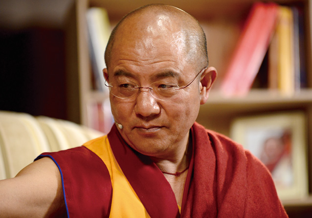
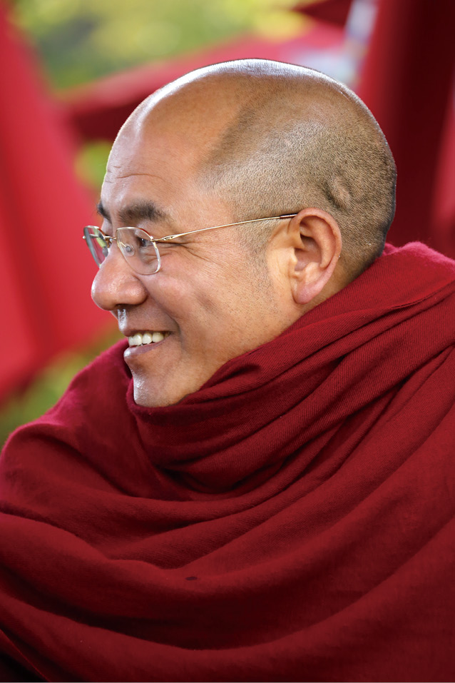
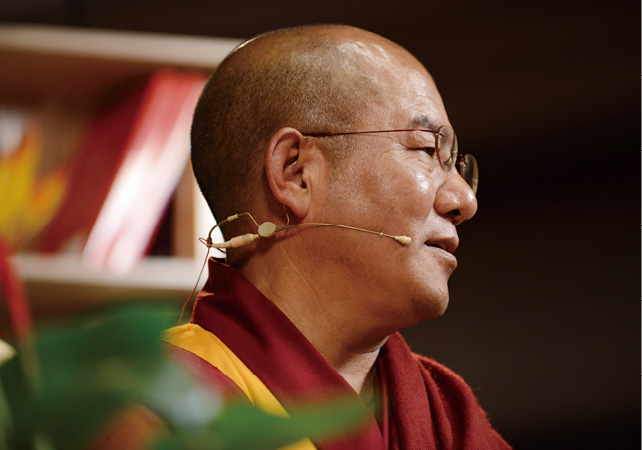

# 不要过于察言观色

2016年5月18日

学院的金刚萨埵法会已经开了五天，我一直没有给参加法会的道友讲课，部分道友请求我给大家做一点开示。以这个缘起，今天我利用一个小时的时间，跟大家做一些交流，主要内容是“不要过于察言观色”。不过，题目只是一个引子，我将依靠它，给大家提几点希望。

## 殊胜月，殊胜的共修

首先特别感谢这次法会的所有参与者。大家在法会现场如理如法，非常认真地修行，也非常认真地遵守学院的纪律和各项规章制度。

我们今年开这个法会，特别不容易，因为来的人特别多。有些人从来没有吃过这样的苦，觉得这里有纪律约束、住宿紧张、经堂拥挤等，对各方面都不满意，心里有一些苦恼。也有相当一部分道友认为，经历求法的苦行是应该的。尤其是想到前辈的高僧大德，为了求得一个偈颂而历尽千辛万苦，一切都能承受了。

我也特别感谢这里许许多多的义工道友。你们组织起来，成立义工团队，无论是行堂、搞卫生，还是接待、服务等，都付出了很多，做出了相当大的贡献。谢谢你们！

参加法会的菩萨们，非常团结，非常认真，每个人都念了40万遍金刚萨埵心咒。这一点，我也要特别夸奖一下。

当然，有好的就有不好的，这是一种阴阳平衡的规律。极个别外来的所谓居士——可能根本就不是居士，而是持有种种目的者，法会上不认真念诵，也不服从发心人员的管理，不懂佛法，对世间的基本规则也不太了解。这极少数的蛮横无理者是应该批评的。以后，学院没必要接收这种人参加法会。

这几天，我们的发心人员一直在即时播放法会实况。山下有相当多的道友，通过法音频道等网络直播平台参加法会。非常感谢发心人员给大家提供这样的条件。我特意看了一下，大家都很准时，效果相当不错。各个地方的道场，就像在学院正式开法会一样，从早到晚，在金刚萨埵佛像面前，不断地念诵咒语。有一些居士还发心给大家做饭。这次法会，山下的人也开得很成功，我非常认可。

以后的大多数法会，可能这样开才是最好的。现在科技发达，所有的信息都能在第一时间传到大家的电脑和手机上。到学院共修，与在自己的道场或者家里参加共修，功德完全等同。汉地各大城市，甚至全球各个地方的佛教徒，都能通过我们的直播，得到现场参加金刚萨埵法会的利益。这非常值得随喜，也非常值得赞叹。

金刚萨埵法会一共有八天，最后一天实际上是药师佛法会，到时也会有直播。前一段时间，我们刚刚讲了《药师七佛经》。我希望听过此经的人，到时能跟僧众一起念诵、发愿。当天一共有四座，每座先念一遍《药师七佛经》，然后念《普贤行愿品》回向。如果实在没有时间完整参加法会，能在最后一天参加《药师七佛经》的念诵，也是很好的。

这个月，藏历叫萨迦月，是释迦牟尼佛降生、觉悟、涅槃三个殊胜日聚合的月份，所以特别重要。全世界很多人都知道释迦牟尼佛的这三个殊胜日，南传佛教、汉传佛教和藏传佛教也一致认可。就连美国总统奥巴马，也专门为佛教的卫塞节发过言[^1]。前一段时间，我在网络开示时特别提到过。

因此，如果你以前修行不太精进，希望你在这个月，在金刚萨埵法会的八天当中，能守持清净的戒律，细致地取舍因果，做一些放生、念诵、受持八关斋戒等善行。

在学院，我们会安排堪布、堪姆们讲一些修法。明后天，准备给大家传授居士五戒。作为居士，哪怕受一分戒也可以。关于授戒的观点，一切有部、上座部和大众部稍有不同，我们将按照一切有部和汉地《四分律》来传授。到时也可以给大家传授八关斋戒。

这次金刚萨埵法会，与以往不同的地方，是要求大家吃素。对有些人来讲，长期吃素不太现实——有些初学者，或由于工作等原因不方便吃素的道友，彻底断绝肉食有一定的困难，但哪怕只在萨迦月吃素，也特别有功德。

## 把自己变成阳光

作为佛教徒，我们要改变自己的相续，但更重要的，还要尽量改变身边人的相续。我们一直提倡的生活佛教，可以体现在生活的方方面面，不要过于死板。对刚开始学佛、对佛教比较陌生的人，要尽量传递正面、向善、简单的知识，不能宣讲一些相对反面、禁忌的事情。他的见解还没有稳固，就把显密的所有戒律讲给他听，并不是明智之举。他一旦认为，学佛以后这个不能做，那个不能说，什么都不准，会特别排斥佛教。

当他心存怀疑，又满怀希望的时候，不要给他讲很多戒条，要尽可能讲一些正面的功德，并告诉他：“你要是不能守戒一辈子，那就暂时守一两个月，就像南传佛教的短期出家一样。”这样一来，他就会比较放松：“原来，并不是一入佛教，就被各种各样的镣铐束缚死了。”总之，我们向别人传播佛法，一定要有善巧方便。

而且，自己学佛之后，不能变得跟周围格格不入、自私自利，贪嗔越来越严重。不然，会给别人留下这样的印象：“他原来是个正常人，可学佛之后，每天都在闭门思过，好像特别伤心、特别绝望。看来，我不能学佛，否则就会变成他那样！”这就给别人带来了负面的影响。

我们常说，学佛要以身作则，给别人起到好的示范作用。什么样的示范作用呢？自己很开心，对朋友更随顺、更和气。作为一个佛教徒，天天跟世间人一起吃喝玩乐、同流合污，确实不太合理，但也不能把自己变成不合群的怪物。我们自己的见解、行为和衣着打扮，都应该是正常的、正面的、欢喜的、安乐的。只有这样，才能够向别人传递积极和阳光的信息，吸引他们靠近佛法。

我们学习佛法，尤其是学习大乘佛法之后，一定要尽量地利益他人。为此，我们要不断培养利他的心念，不断改正自己的坏毛病和坏习气。很多人学佛多年，却没有一点改变，与不学佛的人相差无几，甚至越学越坏，确实应该感到惭愧。

有人可能会想：“堪布今天从头到尾，好像一直在批评我？”其实，我并没有针对任何人。藏地有这样一个故事：有一个人听说某位上师特别出名，于是生起了很大的信心。当他知道上师在某个地方传法时，很想前往。他对别人说：“我对这个上师的印象非常好，我一定要去听他的课！”说完，他就满心欢喜地去了。但是到了下午，他却伤心至极、愁眉苦脸地回来了。别人问他：“你为什么不高兴？”他说：“我对那个上师很失望。”“为什么？”“那个上师上午讲课，下午讲课，从早到晚一直在骂我，而且只骂我一个人！整整一天，除了骂我，他没有讲任何佛法！”

实际上，他心里虽然很难过，但这位上师是在对症下药。自己的烦恼和缺点，如果被善知识指出来，就是遇到最好的上师了。阿底峡尊者也说过：“殊胜上师为揭露罪恶，殊胜窍诀为击中要害。”

按理来讲，与非佛教徒或其他宗教的信徒相比，大乘佛教的追随者不管是从自心上，还是从行为上，都应该越来越好。可是我们有一部分人，不但没有进步，反而越来越倒退。这说明大家还需要不断地闻思修行。只要坚持闻思修行，倒退就只是短暂的历程，自己最终会趋入真正的大乘佛教。

如果一时改变不了自己，也不要失望。不要认为：“我没有希望了，没救了！算了吧，我以后天天看电影，再也不学佛了，堕落就堕落吧！”这样更不好。我们即生遇到了这么好的佛法，并且好不容易产生了信心，这是人生最珍贵、最难得的机遇。如果因为一点小小的违缘或者暂时的情绪，就抛弃它、埋没它，是极其不合理的。

## 以清净心察言观色

今天的主题“察言观色”，其实是个世间的词汇。我为什么要讲这个话题呢？我发现，通过电子媒介传递出来的影音、图像，可以在人的内心种下根深蒂固的种子或习气。这种情况，不但出现在我们的日常生活中，更可怕的是，它还出现在我们方方面面的行为和修行中。这一点，需要引起我们的警觉。

在座的部分道友，可能接受了儒释道等中国传统文化的影响，或者接受了世界其他宗教或古文化的影响。也有相当多的人，受到了当代新媒体所宣扬的人生观、价值观和世界观的影响。这当中，我们通过察言观色，对家人、同事、金刚道友以及其他人进行判断和抉择时，有时会得出正确的结论，比如通过逻辑和推理，就像因明运用三相推理那样。但是，也有错误的时候，比如透过细枝末节判断整体。一旦我们的方法不对，就可能给自他带来不便和痛苦。

我认为，现在很多人的生活都被戏剧化了。电视剧里某个角色的语言和表情，不管是高兴还是生气，都是编剧和导演提前设定好的，目的是引出后面的情节。可是，我们很多人却在生活中模仿影视的剧情和表演，变得越来越多疑，越来越敏感，越来越痛苦。对此，我们可能要深思：自己的生活真的需要演这样一出戏吗？

我们藏地的有些传统，本来很好，但现在已经被很多藏族青年丢弃了。他们舍弃自己的传统以后，既没有西方的科科学技术，又没有汉地的儒教思想，变得有点不伦不类。只有老一辈的牧民和农民，还依然善良、淳朴，生活简单，心地忠厚，不会想很多。

我们的有些痛苦是客观存在的，比如今天生病了，身体确确实实很痛，再怎么想“不痛不痛”，也没有用。肉体上的疼痛，并不是靠简单的观想就能解除的。但是有些烦恼，却属于不必要的执著，比如人与人之间的关系复杂化。一件小事被无限地放大，带来的就是无限的痛苦。最后，事情变得特别糟糕，谁都束手无策。

这种情况，在人们的日常生活中，尤其在我们佛教团队当中，经常发生。有些居士，开法会特别认真，一边拿着转经轮，一边“嗡班匝儿萨埵吽、嗡班匝儿萨埵吽……”，不断地念金刚萨埵心咒。看到这些，我都禁不住产生信心。但是下座之后，他们却与道友勾心斗角，制造很多的麻烦，又特别让人生厌离心。

尤其是有一些人，整天拉帮结派，根本没有想过佛教的未来，也没有想过众生的苦乐。对自己好的人，即使没什么功德，也会不断地提携。对自己不太好的，或是觉得在某个时候，因为一个表情、一句话得罪过自己的，就永远视为敌人，即使他脸上有一块金子，也不认可，也认为是铁或是镀金，想方设法污蔑或者埋没别人的优点。这种情况，现在比较严重。

佛教徒之间，以后要单纯一点、清净一点，不要有许许多多的是非。

昨天我比较忙，开示的时候没有讲太多，但也跟大家强调，学会除了闻思修行，没有其他的事。大家应该好好地学习，好好地修行，不要把很多复杂的问题带进学会，也不要说别人的很多过失和是非。我们应该向内看，专注于自身的问题。

有时候，我们自己说的也不一定正确。现在，很多人的价值观，长期受到一些不良文化的影响，比如宫斗文化——宫廷内部的各种斗争；比如厚黑学——谁的脸皮越来越厚、心越来越黑，谁就是成功人士，就特别了不起；再比如阴谋论，搞各种阴谋诡计，等等。以前对坏人的评价，大家众口一词，说这个人很坏；现在的坏人，越坏，越有许多人赞叹：“这个人好酷，好有力量，好了不起……”整个世界的氛围都是这样，不太好。

佛教徒如果把自己的圈子变成宫斗剧，今天跟天斗、跟地斗、跟大自然斗，掠夺所有的资源；明天跟父母斗，跟妻子、丈夫、儿女斗，跟金刚道友斗，那可真的是“其乐无穷”。真正的大乘佛教徒，应该以慈悲菩提心作为主导思想和主流文化。

大家在生活中，应该单纯一点，开心一点，不要想太多，不要把影视的情节套路拿到生活中来。“今天听法的时候，那个人坐的位置不对，肯定对我有意见，以后再也不理她了。”“他今天说的那句话，肯定是针对我。”其实很多时候，都是说者无心、听者有意。别人只是随便说了一句，你就觉得是针对自己——“侮辱了我的人格！”实际上，他可能偶尔情绪不佳，并不是有意要侮辱谁。光是看枝末，不能推出整体。

我跟你们讲一个公案。在《大涅槃经》第三十二卷里[^2]，讲了一位镜面王。他自己是一位虔诚的佛教徒，而且还是著名的法王。但是，他的大多数国民却不信佛，他很想让民众信仰佛法。不过他也深知，如果没有善巧方便，即使自己是国王，民众也不一定接受。

一天，他让大臣召集了一群天盲。所谓的天盲，是指天生的盲人，他们自从来到人间，就没有看过任何东西。这群人被召集起来后，国王又让大臣牵来一头大象，然后命令这些盲人去摸大象的身体，并要他们说出大象长什么样。

于是盲人们便开始去摸大象。有的摸到了大象的牙，有的摸到了大象的尾巴，有的摸到了大象的腿，有的摸到了大象的耳朵，有的摸到了大象的肚子，有的摸到了大象的鼻子。那大象到底长什么样呢？摸到象牙的盲人说，大象像萝卜，摸着尾巴的则说大象像绳子，摸到象脚的说大象像木臼，摸到大象耳朵的则说大象像簸箕，摸到大象肚子的说大象长得像瓮，等等。由于没有真正的标准，盲人们各执己见，争论不休。

这时候，国王说话了：“我们国家有各种不同的教派，都说着各自的‘真理’。但实际上，他们所谓的那些真理，都只是支分的知识，并没有完全通达世界的真相。就像这些盲人，自己并不了解大象的身体，却坚持自己的观点是正确的。在这个世界上，真正了知‘大象’全貌的，唯有佛教。”

作为修行人，我们要通过修行，找到真理的全貌。自己对真理有一种体悟，非常重要。很多大德都说，现在这个时代，说真话，很多人都不信，说欺骗别人的谎话，人们却会相信。谎话根本靠不住，为什么人们还会相信？因为他们不了解真理的全貌。

## 学佛了怎么还有烦恼？

你们不要认为，自己从2006年到2016年，学了整整十年，就非常了不起了。说起来学了十年，但你们真正用于学习的时间，不一定有那么长。

很多“上师”并不喜欢闻思修，作为弟子，肯定也有样学样。就像一个模具里印出来的擦擦像，“上师”的法相你都具足：不爱闻思、不爱修行，只喜欢搞轮回的事。有些人虽然爱闻思，但实际上学得也很少。学会一个礼拜才上一两节课，也就一两个小时。可你在这一个礼拜当中，可能已经把世间的电视剧看了二十几集。所以说，你的世间习气非常强大，而每周一两个小时的善法力量却非常微弱。

你们不要笼统地认为，自己已经学了多少多少年。这么多年来，你到底学了多少时间？不要说无始以来，光是这一辈子，你就熏染了多少世间习气？又打下了多少佛法基础？两相比较，你相续中的佛法能不能超越世间法？对压制世间的烦恼，你有没有把握？最后是善法赢，还是恶法赢？

就像两个孩子，一个天天吃得好，甚至营养过剩，一个每天只喂一点点。最后让这两个孩子比赛打架，谁赢？或者拔河比赛，一边膘肥体壮、吃得很好，一边骨瘦嶙峋、吃不饱，哪边会赢？

所以，你们不要觉得奇怪，学佛了怎么还有烦恼？出家了怎么还有烦恼？只要我们原来在世间的观念和习气没有改过来，烦恼就一定会存在。我们学院有些出家人，已经剃了光头，穿上了极具加持的释迦牟尼佛的袈裟，可里面的心还跟以前一样，习气和烦恼都没有减少。更何况有些居士，所处的环境那么复杂，接触的人又都是烦恼深重的凡夫人、贪嗔痴旺盛的普通人，自己的相续想要明显地改变，不是那么容易的。

大家也不要认为：我现在学得很不错，已经背了多少论典，很了不起。比较而言，学院道友的讲考、背考、笔考等，各方面都要稍好一些。但说实话，与我们年轻时候的闻思相比，还是有一些差距。所以，大家不要过于自信和傲慢，都还需要努力。

不学佛的在家人，或学了一点佛的居士，因为各种因缘，给佛教带来的负面影响比较多，大家应该引起注意。这次法会，不管是个别“上师”，还是个别普通的喇嘛，都在食宿方面帮助你们。对此，我们很随喜。但是，天下不一定有免费的午餐。如果他今天帮了你，过一段时间就去你那里化缘，那你要慎重地考虑。

现在藏地的假活佛、假上师怎么出现的？就是因为汉地一些居士，自己没有依止过善知识，得到一点片面的介绍，就到处宣传，最后弄到不可收拾的地步。对此，这些居士负有不可推卸的责任。

有些人认为我很苛刻，不让你们依止自己的上师。我从来没有说过，你们不能依止自己的上师。不管什么身份，无论是汉传、藏传还是南传佛教的，只要戒律清净，有闻思修行，有真正的利他心，就是真正的善知识。对这样的善知识，哪怕你们依止五百个，供养多少钱，我都没有任何意见。

我唯一的要求是：在没有很好地辨别之前，不要把本来不是上师的人当成上师。现在，一些被藏传佛教寺院开除的人，却被你们“认定”为上师。对此，某些人心里应该是有数的。这些话，可能会得罪一些人。但我个人是从佛教的利益出发，以负责任的态度来劝告你们的。希望大家在这方面谨慎一点。

现在是一个开放的时代，各种文化、各种思想，交流融合，有利有弊。就像市场上的产品，虽然琳琅满目，但也不乏假冒伪劣。如果没有智慧，买到了假冒的产品，就会给自他带来伤害。佛法本身没有过失，但别有用心的人，却会以它的名义来欺骗别人。有这样的危险性。

## 心中若有明灯，何惧世界黑暗

这次金刚萨埵法会，有这么多佛教徒聚集一堂，很是殊胜。但因为人多，也出现了很多弊端。在加拿大和日本，即使发生了火灾、地震，人们也会有秩序地排队，就连车队也是有序地行驶。看到这样的视频，我觉得很感动。

可我们这里呢，为了吃午饭，为了占位子，为了得加持品，很多人都在争先恐后地抢，拼命地叫喊：“给我！给我！”似乎脚下踩死了人都无所畏惧。这次法会幸好没出什么事情，但这个问题不解决，以后迟早会出事。这是很麻烦的。

以后，我们应该低调一些，不一定再开大规模的法会。行持善法不一定非得聚在一起，以分散的形式可能更好。就像现在，大家通过网络来学习和共修，也能达到相同的效果。

这次法会，我本来在外疗养身体，很多方面不便参与，但还是想借此机会，跟大家说一下我的心里话。依靠金刚萨埵法会，聚集这么多人共修，本是一件好事，但现在毕竟是末法时代，有很多人把这样的机会当作工具、当作手段，大行非法之事，令人非常遗憾！

当然，这并不只是学院的问题，也不只是这个时代的问题。就连释迦牟尼佛在世时，也有六群比丘那样非常调皮的出家人，一些非常不如法的居士，以及诽谤释迦牟尼佛的外道。这样的事，古代有，未来也会有。信仰佛教和修行佛法是非常不容易的，我希望每个人都能遇到好的善知识，如理如法地学习佛法。

总的来说，汉地多数佛教徒对闻思修行还是有意乐的，这是好事；但也有很多人，因为愚痴、贪婪等坏习气，整天陷入痛苦和烦恼当中。就像我刚才讲的那样，本来是一件小事，却通过你的察言观色，被无限扩大，最后弄得无法收拾。

我发现，居士与居士之间的许多争论，真正说起来，全都是一些鸡毛蒜皮的小事，特别可笑。比如，在某个时候，觉得他说话得罪了自己；在某个时候，又觉得他看自己的表情不对劲；在某个时候，又听说他在别人面前诋毁自己……从此之后，就对他印象不好，甚至耿耿于怀。国家与国家之间，会为了一片领土、一座海岛，发生争斗；居士与居士之间，会为了一句话、一个表情，发生矛盾。二者都没有太大的意义。

跟大家讲这些的目的，是希望大家不要把世间的媒体文化和影视文化带到佛教团体中来，把佛教团体弄得乌烟瘴气。大家要有好的心态，说话要真实，对人要坦诚，内心要知足少欲，这样才是真正的修行人。

这可能跟中国文化有一定的关系。英国哲学家罗素特别喜欢中国人，但他仍然觉得中国人有三种不好：冷漠、贪婪和说谎。我原来想，一个英国人，居然说中国人冷漠，我不太认可。为什么呢？因为我去英国的时候，看到的英国人一个比一个冷漠。尤其英国本地人，不管你怎么跟他讲话，他都爱理不理的，特别刚强难化。确实有这种感觉。但罗素在他的书里，却得出中国人冷漠的结论。

不管事实是不是如罗素所说，我们的佛教团体都应该有和谐的气氛，要开心、欢乐，不要分帮派。现在很多世间人，对自己喜欢的，就不断地赞叹、夸奖；对自己不喜欢的，则以各种方式否定、打压。如果我们佛教徒也这样，以后佛教的发展就没有什么希望了。实际上，就事论事而言，在任何一个团体内部，人与人之间都应该和谐包容。

在家庭内部，在朋友之间，都不要太敏感，不要太善于察言观色。我觉得，藏族人在这方面还是比较坦诚的。藏地的有些地方很落后，即使到了现在，各方面条件都还很差，但人却很淳朴，相互之间非常信任。无论是父母兄弟，还是亲戚朋友，彼此都没有怀疑和防备。

尤其值得一提的是，现在藏地的年轻人，依然要跟父母住在一起。而在汉地，除了特别孝顺的人以外，大多数人都觉得跟父母住在一起是拖累，都在努力推脱。这也许是文化上的差异。

有时候，我们将西方文化或者说欧美文化，代入自己的生活，会不会有冲突？如果发生冲突，到底哪个合理、哪个不合理？我们要用自己的智慧去观察，用佛教的思想去解读。也许，这时我们才发现：人与人之间，应该保持清净的心态，彼此信任。

虽然世界很黑暗，我们心中小小的明灯，不一定能遣除全部黑暗，不一定能立刻改变世界，但如果怀着一颗坚定的心，一直做下去，我们的团队、我们的理念，也会有逐渐扩大的机会。

希望大家不要用黑暗的阴谋论，来影响佛教清净的道场。每个人都要心地善良，彼此之间要互相信任。对佛教徒不信任，对父母兄弟也不信任，慢慢变成孤家寡人，最后心也逐渐冷漠，这样不太好。以上是我今天讲的主要内容。

## 结语

最后，我还想跟大家说几件事情。

第一件事情，你们方便的时候，看看麦彭仁波切的金刚萨埵仪轨后面的小字，里面讲了金刚萨埵的功德。大家生起广大的信心后，希望都发愿念40万遍金刚萨埵心咒，并尽量在规定的时间内完成。如果因为工作等原因拖延了，也要尽快完成。和这么多僧众、修行人一起念金刚萨埵心咒，机会非常难得，大家一定要努力。

第二件事情，从今年开始，大家不要把闻思修行当作累赘，或是没有必要的生活方式。你们在电影院看一场电影，需要花多少钱？至少也得三五十。那么，我们每次都为你们直播或者转播讲法视频，即使用世间的价值观来衡量，也不是没有价值的吧？我们是因为关心你们，所以才通过各种努力，给大家传播佛法。这样的一种机缘，等我离开人间以后，就不一定有了。到那个时候，希望大家不要后悔。并不是我自己想死，但我们每个人都要经常观无常，懂得珍惜现在的机缘。

第三件事，今年是一个比较特殊的年份，不一定很吉祥。你们不要误解，我并不是在说神通，也不是在预言世界末日。只是从天文等各方面观察，今年可能会有各种违缘。对每个人来讲，今年都不一定景气。

过一段时间，如果没有其他违缘，我会讲《妙法莲华经》。每次传讲前，我都要念传承。这个传承非常有加持，非常重要。汉地很多人只喜欢灌顶，不懂得传承。其实，灌顶有时候只是听闻某部法的开许而已，得到传承远比灌顶重要。一旦你得到了某部法的传承，这部法的加持就真正融入你的心了。所以，藏地历代的大德对传承都非常重视，会不顾一切地去求传承。

这次我要讲的，是鸠摩罗什的《妙法莲华经》译本。由于它跟其他译本有些差别，我目前正在对照。虽然比较费心，但不管怎么样，我是一定要讲的。你们也要规划一下自己的时间。如果时间充裕，最好在“第一现场”这个平台听完传承。如果因为工作原因，不能听现场直播，那就只能听重播。

第四件事，这次法会，法师们给大家授了居士戒和八关斋戒，我也给大家做了开示，大家要好好珍惜，希望能够终生受用。更重要的是，你们多多少少都要禅修。不然，虽然听了法，但却没有禅修，到临终的时候，所得的法不一定能派上用场。所以，每个人都应该对自己所得的法进行思维和修行。

最后，特别感谢大家在金刚萨埵法会期间来听我的开示。如果我在学院，可能会多做一些开示。但实际上，我在与不在，差别不是很大。下面，给大家念几个咒语的传承。

（堪布念金刚萨埵心咒、莲师心咒、药师佛心咒、度母心咒、观音心咒的传承）

如果你们实在没有能力闻思，那就多念一些咒语。你们看看藏地的一些老修行人，他们每个人都能念四五个亿的咒语。如果我们每天都不拿念珠，只知道说闲话，不是太好。我希望你们精进一些。尤其是一些年老的人，多念阿弥陀佛和观世音菩萨的心咒，今生来世都会获得快乐。

今天我就讲这么多。特别感谢在座的各位，也特别感谢网络上所有的发心人员，以及学院所有的管家、义工和负责人。他们从早到晚，特别特别忙碌，如果有做得不周的地方，希望各位多多谅解。他们很不容易，为大家付出了很多，大家应该有一颗感恩的心。

最后，我们将今晚开示的全部功德，回向给天边无际的一切众生。

[^1]: 奥巴马发言如下：“白宫华盛顿2016年4月29日向庆祝卫塞节的所有人致以问候。对于亿万佛教徒来说，卫塞节是纪念佛陀出生、觉悟和涅槃的特殊日子。在全球的寺院里，佛教徒利用这个时间从事礼拜并彰显智慧、勇敢、慈悲等美德。通过参加这些谦逊的活动，那些坚守佛教光荣传统的男人、女人和孩子们，对世界文化和宗教的多样性做出了贡献。正是这种文化与宗教的多样性，塑造了我们共通的人性。在你们欢聚一堂，共同为这一时刻留下印记之际，我向各位表达最美好的祝福。”
[^2]: 《大涅槃经》中云：“善男子！譬如有王告一大臣，汝牵一象以示盲者。尔时大臣受王勅已，多集众盲，以象示之。时彼众盲各以手触，大臣即还而白王言：‘臣已示竟。’尔时大王即唤众盲各各问言：‘汝见象耶？’众盲各言：‘我已得见。’王言：‘象为何类？’其触牙者，即言象形如萝菔根；其触耳者，言象如箕；其触头者，言象如石；其触鼻者，言象如杵；其触脚者，言象如木臼；其触脊者，言象如床；其触腹者，言象如瓮；其触尾者，言象如绳。善男子！如彼众盲，不说象体，亦非不说。若是众相，悉非象者，离是之外，更无别象。善男子！王喻如来正遍知也，臣喻方等大涅盘经，象喻佛性，盲喻一切无明众生。”
