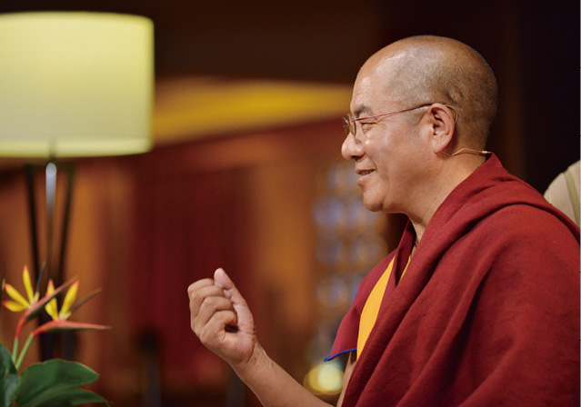
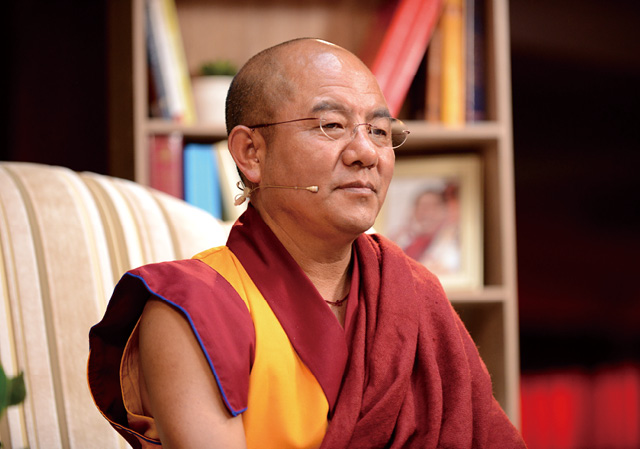
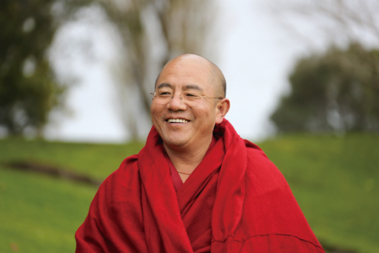

## 佛教徒如何跟上时代

2017年6月5日

今天是6月5日。去年6月6日，《法华经》开讲。而6月5日那天，我的母亲离世。所以，今天算是比较特殊的日子。

对我个人而言，讲了一辈子的无常法，理论上非常明白生死无常。但是，真正面对母亲的离世，心里仍然有不同的感受。比如，我们习惯性地一起过年；春天第一次听到布谷鸟的叫声，我们会互相报喜；夏天的鲜花刚刚盛开，我们会彼此问候；每年第一次喝到新鲜的酸奶，也会有一些交流和沟通。

这一年来，我一直勇敢地面对，毕竟父母等亲人的离世实在太正常了。我母亲是那天早上八点钟离开的。当时，我好几个妹妹都几乎昏厥过去。我刚刚赶到，学院做整顿工作的领导就给我打电话，说中午12点要到县上开会，讨论学院的一些事情。我说：“好，没问题。”我没有请假。

到了县城，在会议中途，领导们听说了这件事，非常惊讶：“实在不好意思，我们不知道。你要不要先回去？”我说：“没事，学院的事情比较重要，我们继续讨论吧。”

所以，虽然在某些方面我比较脆弱，但在某些方面，也还算淡定、坚强。

我的母亲是一个非常普通的人。她没有什么文化，一个字也不认识，连自己的名字都不会写。但是，《极乐愿文》等很多祈祷文的念诵，却是她教会我的。我父亲是1995年离世的。临终前，他问我，我以后朝拜佛塔、佛寺的时候，能不能念他的名字，为他超度、回向？这些，我在1999年写的《泰国游记》里，也提到过。

今天，我想以我母亲的离世纪念日为缘起，不仅为我的父母，也为在座道友的父母、兄弟、亲人，以及因车祸、恐怖袭击等死去的素不相识的人，念108遍观音心咒。

（堪布带大家一起念观音心咒）

讲课之前，我先念一些传承。这次的法会与忏悔有关，所以我先念《三十五佛忏悔文》的传承。里面的佛号，只要听闻，就可以消除业障、获得加持，你们以后要多念。另外，还要念一下《随念三宝经》的传承。

（堪布念诵传承）

## 这辈子，再也回不去了

昨天，我讲了一些禅悟方面的道理。但我只给大家抛出了一些问题，以说明修行的重要。至于怎么以毗卢七法的方式坐禅，怎么修寂止和胜观等，却只字未提。

吾等大慈大悲的本师释迦牟尼佛，曾经在相关经典中讲过，一切众生的根基意乐不尽相同，对他们宣说的法门也多种多样，包括寂止、胜观、大悲心、空性观，等等。如果对某个法门一点兴趣都没有，却非要让他修，不但不会有什么进展，反而增加烦恼和痛苦。如果特别喜欢某个法门，只需要稍加点拨，他就能深入其中。所以说，对什么样的人，传什么样的法，最好是因机施教，不能一概而论。很多传讲佛法和引导修行的善知识，对这一点都非常重视。

今天，我以“佛教徒如何跟上时代”为题，和大家简单地做个交流。谈一谈佛教徒如何面对现代的生活，如何跟上这个时代，如何不舍弃自己的修行，如何利益有缘的众生，等等。这些问题，都值得我们关注。

我经常引用英国著名小说家狄更斯在《双城记》中所说的话：“这是一个最好的时代，这是一个最坏的时代；这是一个智慧的年代，这是一个愚蠢的年代；这是一个信仰的时期，这是一个怀疑的时期；这是一个光明的季节，这是一个黑暗的季节……”他说这些话时，是在19世纪。其实，那个时代可能并没有那么特殊。

如今的21世纪，才可以说，既是一个最好的时代，又是一个最坏的时代。为什么说它是一个最好的时代呢？因为在人类历史上，没有哪一个时代能真正超越它。比如，我们今天在空中教室集聚、交流，传播珍贵的文化，不要说上一辈的时代，即便是我年轻的时候，距现在只有二三十年，也根本无法想象这样的场景。如果那时有这样的机会和平台，有很多资源可以共享，很多教理可以轻而易举地学到，我肯定会欢喜若狂。

学会的开创，距离现在已有十多年。在这十几年里，我们通过网络给大家传递佛理，让很多人和佛法结上了善缘。如果没有时代的便利，今天的很多佛教徒都无法进入佛门。我想，这应该是这个时代最好的礼物。

那为什么又说这是一个最坏的时代呢？因为现在的人心特别浮躁、混乱，贪嗔痴慢疑不断地扰乱我们宁静的心。而且，导致这种心态的外境和因缘，也越来越复杂、越来越强大。

现在，很多人都开始憧憬以前的生活。以前信息不发达，每个人都有空闲，生活朴素而简单，内心悠闲而健康，没有手机综合症，不会隔一会儿就看一下手机。但是，退回过去的想法，已经无法实现了。

上个世纪八九十年代，我特别反对出家人用手机。我在讲《入菩萨行论广释》的时候，还严厉地批驳过。当时去一些南方的寺院，看到一些出家人拿着所谓的大哥大，我心里特别不舒服。

但是，时代的潮流却一直把我们向前推，已经没办法扭转。我今天来上课，自然而然的，就把手机和充电器都带了过来。刚才手机没电了，下课后还有很多事情要处理，不想带也不行。身不由己。虽然很想回到从前，过宁静、纯洁的生活，但这一辈子恐怕再也回不去了。

从物质文明的角度，可以说现在是一个最好的时代。走在路上，几乎看不到有人穿打补丁的破旧衣服。饭桌上，大家都觉得饭菜不香，因为好吃的东西太多。

但是，在精神文明的层面，现在却是一个最不好的时代。我们看到了各种令人散乱的音频、视频，接触到了各种各样的抑郁症患者、精神分裂症患者。整个外部环境，带给我们的是内心的不安、狂躁和迷茫。与上一辈人相比，我们的心态已经没那么健康。

将来人们回顾历史的时候，对这个时代可能会有不同的评价。

## 时代的车轮越来越快

从人类历史的发展来看，早期是农耕时代。那时的生活比较简单，没有学校，多是家庭式的传承，父母就是老师，子女都随父母学知识。偶尔有私塾老师，学生通常也不过十几、二十个人。

然后就到了工业时代。第一次工业革命开始于18世纪60年代，此后被称为蒸汽时代[^1]。那时的火车，都是用蒸汽来推动的。进入这个时代以后，人们的生活范围扩大了，各个地方开始建立学校，正式的学校教育在社会上推广开来。

大概19世纪下半叶，第二次工业革命开始了，人类进入了电气时代[^2]。当时发明的电灯、电话、发电机等，使人们的生活发生了很大的变化。与以往的时代相比，电气时代有迅速的发展。

20世纪30年代，即法王如意宝降生的时期，整个世界发生了经济危机，经济陷入大退化的阶段。当时的人们特别可怜。有人认为，那时是原子时代[^3]，也有人认为是商业时代。

上个世纪60年代，欧美国家率先进入了网络时代，或者说信息时代[^4]。而中国和其他亚洲国家，是在上个世纪80年代才开始进入信息时代的。

信息时代的特征是什么呢？日新月异的变化。以前我们认为，日新月异只是一个说法，不可能一天出现一个新东西。但是现在，人们的生活确实在短短的时间内发生了翻天覆地的改变，而且都是我们无法想象的。比如我们的手机，从苹果4到苹果7，不断地推陈出新，更新的周期越来越短。前段时间，我在一些藏族学校里讲：我们藏地很落后，有些电子产品从出现于世，到被社会淘汰，很多藏族人都不知道。现在的生活，变化真的太快了。

为什么我今天要讲这些？很多佛教徒并没有觉察到时代的飞速发展，还自认为跟得上时代。如今稍不注意，我们可能就被时代抛弃了。我们的父辈受到的教育、掌握的知识，能传递给我们的，已经寥寥无几。我们能传给孩子的，更是少得可怜。他们已经处于另一个新世界。

现在，全世界真正利用到的传统的文化知识，连10%都不到。信息时代的新产品、新文化、新的价值观，占据了人类社会90%左右的空间。作为佛教徒，第一个要看清自己：我是什么时代的人？我的文化理念是什么？我的价值观是什么？我学的知识是什么？我所掌握的知识，有多少人在用？有多少人关注？有多少人感兴趣？

我们有时觉得，自己以前的老师或同学特别好，于是邀请他们来学校任教。结果，他们跟我们一样，看不到世界的变化，反而觉得现在的学生特别奇怪。学生们呢，也觉得老师奇怪——为什么他关心的，不是我们的世界？

很多父母认为现在的孩子很难理解，是因为孩子看到的世界、接触的教育以及关心的事物，已经完全超出了父母的视野和经验。这当然不能怪父母，只能怪这个时代变化太快。

从农业时代到工业时代，人类走了几千年。从工业时代到信息时代，至少也用了一百年。而信息革命进入我们的生活，不过短短的二三十年，我们的价值观已经发生了翻天覆地的变化，并且还在不断地提速。

在这样的时代，我们佛教徒不能原地不动，不能一直待在深山老林，与青灯古佛相伴，不能再以古老的方式来维护自己的理念。我们要放眼看世界，要跟上时代的步伐，要及时了解世界的动态。否则，很可能全人类的观念都已经变了，我们还陷在原地，根本拔不出来。

## 进化论需要反复观察

但是，不管时代怎么变，我也不认为佛教的教义需要改革，否则跟不上时代。这一点，我从来没有想过。

现在，有很多人认可进化论，认为远古时代的某个物种，经过漫长的进化，演变成了今天的人类。实际上，进化论只是达尔文个人的说法，不一定正确。如果真像进化论说的那样，越进化，越高级，那古人应该非常愚笨，我们应该非常聪明才对。但实际上并不是这样。

举个非常简单的例子。我们这些所谓的现代人，对二千五百多年前的佛陀，以及后来出世的龙猛菩萨、月称论师、法称论师、功德光、释迦光等大论师们的思想，不但找不出任何错误，而且深感他们的逻辑如此严密、辩证思维如此超越。现代社会的人，即使再聪明、再有智慧、再有辩才，再绞尽脑汁地研究、分析、探讨和辩论，也找不出他们的半点错谬。就如同真金不怕火炼，我们越是和他们的思想碰撞，越惊叹他们无与伦比的智慧。

所以说，我们对有些事情，人云亦云是不对的。全世界大多数人相信的，也不一定正确。三恶趣的众生不计其数，可它们的价值观却是错误的。在人类的世界，引导者如果是一位智者，大家都变得有智慧；如果以盲导盲，结果也可想而知。

因此，我们也就能理解，为什么这个世界有那么多甚深的智慧是现代科学无法解释的。各大宗教的教理，长达几千年的人类文明，还有人们喜闻乐见的很多文化和古迹，现代人真正通达的有多少？去年发现的印尼金字塔[^5]，距今已经有9000到2万年。按照进化论的观点，那么久远的年代，不要说建造出水平如此高超的建筑物，甚至连如此细致的设计理念都绝不可能有。那时的人到底怎么样，我们从历史知识中得到的概貌，与真实情况之间会不会存在差距？

对有些观点，大家不要简单地认为“就是如此”。如果用自己的智慧去分析，也许会有新的觉悟。

## 出世，还是入世？

现在这个时代，确实是日新月异。许许多多的产品、文化，都在不断地快速更新。而大多数的变革，都是由科技带来的。所以，有些科学家说，未来人类的信仰，就是科学的信仰。这句话还是很有道理的。

在这样一个复杂的时代，我也没办法给大家指定方向，只能抛出一些话题，引起大家的思考：比如，世界变化如此迅猛，甚至可以说瞬息万变，我们自认为是虔诚的、优秀的佛教徒，应该怎样面对？

最近，英国出现了好几起恐怖爆炸案，死伤都很多。恐怖分子越来越猖狂，引起了世人的广泛关注。我们佛教徒心怀慈悲，对这些问题漠不关心、不闻不问，合适吗？

关于环保问题，世界也众说纷纭。人类目前最大的环境问题，就是温室气体的排放。为了解决这个问题，2015年，全世界195个国家签署了《巴黎协定》[^6]。为了改善越来越恶劣的全球气候，各个国家都在全力以赴。但最近特朗普一上台，就要退出《巴黎协定》。对此，美国六十多位市长纷纷抗议，局面非常混乱。

作为一个大乘佛教徒，我们曾在诸佛菩萨面前发愿，“要利益天下的一切众生”。现在，世界变得如此恐怖，人人都在关心自己的安全。我们佛教徒应该如何做？

另外，在这个信息时代，有很多人沉迷于网络。有些90后、00后的年轻人，甚至没日没夜地在网络上消耗生命。2014年，光是中国的网民人数，就有6.45亿左右，全世界又有多少？他们在网络上耽迷的，并不是对自他身心有利的内容，而是引起欲望或痛苦的各种因缘。我们佛教徒应该如何解决这样的问题？

还有，全世界的抑郁症患者现在越来越多。在英国、法国、荷兰等国家，情况尤为严重，据说已经达到了五分之一的人口比例。2013年，我去了一些欧美国家。有些人告诉我，抑郁症之所以如此普遍，是因为气候不好，像一些北欧国家，早上十点左右太阳才出来，下午三四点就落山了。将抑郁症的原因归结为日照时间过短，我觉得不一定全面。古代山洞里的修行人，一直闭黑关，精神也没有出问题。

不管怎样，全球抑郁症患者越来越多，已经成了不争的事实。中国也紧随其后，就连我们佛教徒中，也有患抑郁症的，而且为数不少。有些佛教徒，表面上在修加行，在行持善法，但眼神、脾气、性格都有问题。与别人交往，一言不合就断绝往来、自我封闭。前一段时间，听说有一个人，因为得抑郁症，把手机、衣服等放在河边，自己去跳河。有些人说，是因为道友没有劝他。有些人说，劝了，但没有用。总之，这个人失踪了。

诸如此类的许多事情，如果出现在自己身边，我们应该如何对待？如果自己遇到了这些问题，我们又该怎么办？

有一部分佛教徒认为，任何事情都不要管，只管自己闭门修行，连网络、手机都不要接触。前两天，在我们学院内部的高层会议上，很多堪布、堪姆都说：“所有手机全部都收起来，以后谁都不准看，这样比较寂静。”一些传统的保守派认为，对时代的变化最好置之不理、直接屏蔽。但实际上，全世界都变成这样了，要凭个人的力量置之不理是很难的。

另一种观点认为，佛教徒要积极地了解、积极地参与时代的变革。有一本书叫《一个美国佛教徒的生活》，是创巴仁波切跟作者的对话。里面讲到，对佛教徒而言，修行当然非常好，但如果只专注于修行，对整个世界不管不问、不闻不见，恐怕也有很大的困难。

我们佛教徒究竟应该出世还是入世？有些人认为，佛教徒既要修空性、修无常、修白骨观等出世间法，也要每天了解世间资讯，应该顺应时代，不断地调整自己的认知。也有人觉得，佛教古老的传统、理念、思维和威仪，应该原汁原味地予以保留，丝毫不能改变。

其实，时代已经变成这样，世界已经今非昔比。我们的吃穿用度、生活方式等，都发生了很大的变化。在这个时候，我觉得该变的地方还是要变。大家在任何场合，都要跟随时代的步伐。否则，佛教徒会被世人歧视或蔑视，最后变成跟不上时代、看起来笨笨的一群人。

## 像水那样，学会随顺

### 1．提升人际关系

我看到，很多佛教徒独自专修时，特别优秀，但做起人做起事来，却显得不合群，跟家人和朋友都处不好，甚至不与任何人来往，没有一个朋友。有时候，就连对上级也不屑一顾。这样可能不太好。作为佛教徒，我们要多思考一下自己的人际关系。

当然，佛教也需要有一部分人精进地专修。如果生活没什么压力，可以到山里去闭关十年、二十年，像米拉日巴尊者那样。这是非常好的。但大多数在家人没有这样的因缘，所以还是应该多一些善巧方便，跟家人和朋友友好地相处。你看，文殊菩萨为了度化外道，在他们当中住了那么长时间；富楼那尊者为了利益众生，也是如此。

佛教徒要学会随顺。比如，你是一位老师，人们对你的评价本来很好，但是你学佛以后，天天闭门谢客，搞得家人对你意见很大，周围的人也觉得你怪怪的。到一定的时候，社会就不认可你了。这会带来什么麻烦呢？在利益众生方面，会失去许许多多的机会。

所以，我们在社交方面要学会变通，把佛法融入生活。否则，一学佛就变样，别人都不敢学了。当然，有相当一部分佛教徒还是非常优秀的，修行方面基本上一课不落，处理人际关系也很有善巧方便。

经常陪别人吃饭、喝茶，没完没了地聊天，我也承认这是一种散乱；对一些不得不参加的应酬，我也特别心疼时间。但是也没办法，不能完全放弃。否则到一定的时候，会给个人带来很多的麻烦和痛苦。

### 2．关注自身形象

在佛教徒的形象方面，我也想提一下。有些人学了佛以后，生活变得非常简朴：吃得简单，穿得更简单——长年不变，只穿一套衣服。自己认为自己是一个很好的修行人，在佛教团体里也可能受到赞叹：“哇，他一个星期都没有换过衣服！天气那么热，脚上也只穿那双球鞋，身上只穿那件太空服……这个修行人很不错！”实际上，你永远都是一身灰扑扑的衣服，别人不一定看得惯。

学了佛以后，马上不修边幅，穿得特别难看，我觉得没有必要。虽然佛教徒不能像有些世间人那样，一天花几个小时化妆，每天都在美容、打扮，但基本的形象还是要过关。

现在的人，对别人的穿着、言语、行为等整体形象，特别注意，国内外、东西方都是这样。我看到西方有些佛教徒，在任何社交场合，穿着都很得体，形象也很庄严，非常好。否则，大家一看就知道来了个居士——头不梳，脸不洗，衣服破破烂烂，说话吞吞吐吐，行为颠颠倒倒。这样的佛教徒，对整个佛教的形象都是有损害的。

释迦牟尼佛在戒律中说，所有的人都可以学佛，也可以皈依，但想要出家，却不是那么简单，黄门和残疾人是不允许出现在僧团里的。佛陀对僧人的身体、心理乃至整体形象，要求都比较高。即使出了家，也还要专门学习很多威仪，就像现在一些特别成功的企业的管理模式。

时代已经变了，作为佛教徒的我们，有没有顺应时代的变化？是不是已经被甩得很远了？很有可能。你自认为是很好的修行人，是济公和尚的传人，但实际上，所有的世间人都不把你放在眼里，甚至特别排斥你，像丢唾液一样丢弃你。对于这个时代，我们还是有责任的，所以要特别注意，不能落伍。

### 3．提升知识层面

下面我从学习方面讲。时代在不断地变化，知识也在不断更新。作为佛教徒，除了念《喇荣课诵集》，其他什么都不会，连转经轮都摇不来，也不行。

藏地很多出家人，虽然从来没上过学，但仍在不断地学习英语、汉语以及其他的知识。我在国外看到，很多藏族人也好，汉族人也好，其他民族的人也好，都在努力地学习新的语言和新的知识。

当然，在佛教徒当中，爱学习的也大有人在。我们需要学习两个方面的内容。一是大乘佛教和小乘佛教的所有知识。不仅要学，还要自觉地学，不需要别人打考勤。管理的约束，是用来对待不听话的孩子的。被父母天天用鞭子抽打的孩子，肯定没有自觉性。自觉学习的孩子，父母很放心，根本不用管。所以，我们要自觉学习显密佛教的所有知识。

另一方面是世间相关的新知识。现在，整个世界的科技、文化都在变化。我在课堂上提过好几次，因为我看了很多书，知道世界的一些变化，比如人工智能对社会的冲击。对此，很多人非常担心，也有人故意吊大家的胃口：“人工智能来了，所有人都要失业了，怎么办呢？”的确难以想象。

基于人工智能的“阿尔法狗”[^7]，去年打败了世界围棋冠军李世石，前一段时间又打败了柯洁。很多人都说，“阿尔法狗”具有深度学习的能力，可以不断地探索，所以它的智慧会不断地快速更新，这是我们人类的大脑无论如何都无法企及的。我们本以为，人工智能是人类造出来的，人类完全可以掌控。结果，人类根本跟不上它的智慧。相反，它还可以教给人类很多知识。

所以，当这样一个颠倒的时代，出现在我们面前的时候，我们要么什么都不管，捂着耳朵、闭着眼睛，走另外一条路；要么，从现在开始，就好好地思考，好好地做准备。

我有一次开玩笑说：“如果佛教翻译领域也出现了人工智能机器人，我会不会失业？”其实，我并不是真的担心。人工智能再怎么样，也没办法认识如来藏的本面。它只不过是对第六意识的信息和知识，通过大数据的不断积累和分析，最后以一种独特的模式，在某种意义上超越人类的智慧，超越人类的认知。

所以，我们佛教徒要不断地学习。如果连操作电脑都不会，只知道念诵书本上的内容，不要说获得佛菩萨的果位，就连跟世间有一定知识的学者探讨，可能也有一定的困难。在与时俱进的过程当中，佛教面临着什么样的挑战，是我们不得不关心的问题。

## 平台需要多样化、立体化

佛教团体以后要多建立一些不同的平台。像国外个别的佛教团体，就设立了电视台、广播电台，并发行报纸、季刊、月刊，以及成立出版社等。这一类的传统媒体，我们肯定应该重视，但还远远不够。现在的微博、微信、推特等新媒体、新型社交平台，也是不可缺少的。

特朗普为什么能上台？恐怕与他对新媒体的重视有关。所以，对新兴的媒体，佛教徒不能完全排斥。各位堪布、堪姆、法师、辅导员，以后应该学会利用全球性的平台。这些新鲜的事物能保持多长时间，很不好说。我们不要错失机会。

最早的时候，博客风靡了一段时间。微博出现之后，很多信息就从博客上转移了，微博占领了大部分市场。而微信出现以后，微博又开始衰微。现在，很多公司还在不断开发新的平台。

这种形势下，我们佛教徒也应该有自己的平台。内容以佛教的教义为主，以各类的文化知识为辅。只要没有违犯戒律等轨则，在相应的权责范围内，我们完全可以有自己的公益平台、文化交流和运作模式。包括对商业模式，也不能完全排斥。对有些资料，管理人员不要完全屏蔽，否则就跟朝鲜的做法一样了。

总而言之，我们佛教徒应该多关注一下新媒体。在这个自由、共享的时代，要学会使用一些方便方法。当然，利用这些平台，以欺骗、狡诈、谄曲的手段谋取利益，肯定不合理。

另外，我们还要多传播佛教慈悲与智慧的崇高理念。这对全人类，乃至对一切众生，都有无比的利益。包括举办“世青会”等很多活动，我都希望通过不同的语言传播正能量，比如英语、汉语、藏语、法语、德语、日语等。非洲虽然以英语为主，但不同的国家也有各自不同的语言。

虽然不同的语言有不同的文化，不同的文化有不同的宗教，但在不同的背景下，人类却有一颗相同的希求离苦得乐的心。所以，我们应该推广不分年龄、不分民族、不分国家的大家庭理念。

现在，世界上的很多宗教，都积极地从正面推广自己的教义，而且非常成功。相比之下，我们许多佛教徒都以独自修行为主，没有集体感，天天拿个转经轮，“嗡玛呢巴美吽，嗡玛呢巴美吽”“嗡班匝儿萨埵吽，嗡班匝儿萨埵吽”……

昨天，我去参加金刚萨埵法会，看到很多人在拍照，就躲起来了。结果，他们就搞偷拍，我没有发现。我当时念得比较快，“班匝儿萨埵、班匝儿萨埵”自己听着都觉得不舒服，他们还故意传到网上。

我们天天摇转经轮，天天念咒，当然也很好。但是，如果一辈子都这样，两耳不闻窗外事，除了“嗡班匝儿萨埵吽”念得好，人格也不好，性格也不好，对谁都看不惯，恐怕也不行。

那天，有一个人问我：“每次修前行，都需要把父母观在两边，把敌人观在前面。父母观在两边没有问题，但我在这个世界上没有敌人，前面天天空着，修起来非常痛苦。怎么办？”我说：“没有敌人很好呀。但你不是天天说某个国家的坏话吗？你就把那个国家的人观在前面吧！”

## 看清时代，看清自己

近年来，我去过很多国家，发现每个国家都有自己的文化。所以，我们要尽量多学一点世间不同的文化。我们这里有很多青年才俊，智慧敏锐，会多种语言。如果他们能将佛教的文化，通过自己的智慧传递出去，会有很多众生得到真实的利益。

希望我们佛教徒都具足智慧，做事做人都很超胜，世间法也很成功。所谓的世间法成功，并不是说每个人都要赚大钱，而是对世间的各种关系，要懂得妥善处理。

作为佛教徒，自己首先要变成一个好人，把原来不好的习气和脾气，尽量地改过来。其实，人是可以改变的。不要说改变心态，现在就连脸型都可以改变——原来胖胖的，两三个月以后，就变成锥子脸了。所以，性格不好的人，用一两个月的时间，给心理整一整形，坏脾气是可以改好的。到时你在家里，对家人非常好；在单位里，跟同事相处很融洽。然后，家人一刹那也舍不得跟你分开，同事也喜欢和你相处。

我希望我们佛教徒，形象得体，人际关系融洽，学习和修行都非常厉害。对很多人来讲，这样的要求并不高。我们要马上获得大威德的果位、玛哈嘎拉的果位，有一定的困难，但要变成一个随顺时代、热爱学习的人，并不是太难。通过今天的因缘，我希望大家的行为和内心都有所改变。

最后，我想跟大家说的是，佛教徒要看清时代、看清世界、看清自己。世界和时代变成什么样了，我们心里一定要清楚。同时，还要多花点时间，看清自己。很多人从来没有进行过自我观察，比如，自己是什么样的人？哪些方面的烦恼比较重？等等。大家可能经常照镜子，观察自己的形象，但对自己的内心状态、沟通能力、利他心、优缺点等，却并不自知。

以后，我们要多向内观，看清自己。自己的缺点，可以不对别人说，但要经常反省；自己的优点，也要做到心中有数。这样的话，我们的修行一定会慢慢变好。

[^1]: 第一次工业革命革命是以工作机的诞生开始，以蒸汽机作为动力机被广泛使用为标志。它使工厂制代替了手工工场，用机器代替了手工劳动，使依附于落后生产方式的自耕农阶级消失了，工业资产阶级和工业无产阶级形成和壮大起来。
[^2]: 第二次工业革命极大地推动了社会生产力的发展，对人类社会的经济、政治、文化、军事、科技和生产力产生了深远的影响。资本主义生产的社会化大大加强，垄断组织应运而生。人类进入了电气时代。
[^3]: 第三次科技革命以原子能、电子计算机、空间技术和生物工程的发明和应用为主要标志，涉及信息技术、新能源技术、新材料技术、生物技术、空间技术和海洋技术等诸多领域的一场信息控制技术革命。
[^4]: 信息化时代就是信息产生价值的时代。信息化是当今时代发展的大趋势，代表着先进生产力，其代表性象征为“计算机”，主要以信息技术为主体，重点是创造和开发知识。
[^5]: 印尼金字塔：在印尼西爪哇省，研究人员似乎发现了比埃及金字塔更古老的金字塔。这座金字塔可能建于9000年到2万年前，它位于海拔885米的山坡上，被视为当地土著人的圣地。
[^6]: 《巴黎协定》：2015年11月30日，第21届联合国气候变化大会召开，经过近半个月的艰苦谈判，一个新的气候系统保护协议——《巴黎协定》终于由195个国家谈判代表签署通过。《巴黎协定》以尽快使全球温室气体排放总量达到峰值为目标，并在本世纪的下半叶实现温室气体中性，即人类活动所导致的温室气体排放与吸收在总量上要达到平衡。并把全球气候目标设立为——全球平均气温较工业革命之前，温升控制在2摄氏度以内，并努力将其控制在1.5摄氏度以内。
[^7]: 阿尔法围棋（AlphaGo）是第一个击败人类职业围棋选手、第一个战胜围棋世界冠军的人工智能机器人，由谷歌（Google）旗下DeepMind公司戴密斯·哈萨比斯领衔的团队开发。其主要工作原理是“深度学习”。2016年3月，阿尔法围棋与围棋世界冠军、职业九段棋手李世石进行围棋人机大战，以4比1的总比分获胜；2016年末2017年初，该程序在中国棋类网站上以“大师”（Master）为注册账号与中日韩数十位围棋高手进行快棋对决，连续60局无一败绩；2017年5月，在中国乌镇围棋峰会上，它与排名世界第一的世界围棋冠军柯洁对战，以3比0的总比分获胜。围棋界公认阿尔法围棋的棋力已经超过人类职业围棋顶尖水平。
