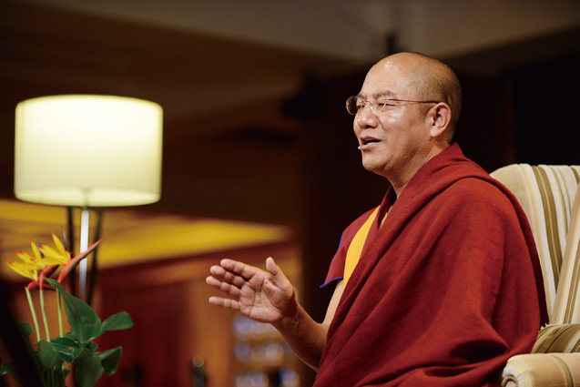
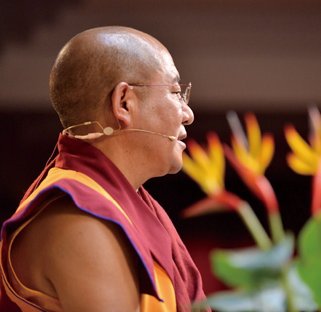

# 保持清净的心

2016年8月7日

今晚，给大家做一个简单的开示，然后念一下《普贤行愿品》的传承。

## 保持一颗清净的心

作为佛教徒，不管自己的修行好不好，都要尽量保持一颗清净的心。我们有些佛教徒，越学越烦恼，越学越复杂，越学越痛苦，这样不太好。学习佛法的目的，一是即生获得一些暂时的利益，二是获得究竟的解脱。

我们既然有这样的目标，就应该把学到的佛教真理融入自己的心。心清净了，语言和身体也会清净。很多人因为心不清净，所以说话不太如法，经常讲一些是是非非，经常看别人的过失，却从来不观察自己的心。

我们想说别人过失的时候，应该观察自己的心，反反复复问自己：“我这样说对不对？到底是我的错误，还是别人的错误？”然后再开口。每个人都经常自我反省，我们的佛教团体就会比较清净、比较简单。

在佛教群体当中，包括各个城市佛教团体的管理方面，都有一些人只会说，不会做。如果让他自己做，他会做得非常差劲。所以，管理人员也好，非管理人员也好，都不要把事情复杂化。

我自己认为，我们这个佛教团体，没有经济、政治、军事、外交等复杂的社会事务，唯一是在力所能及的范围内，好好地闻思修行。如果你愿意闻思修行，那可以加入；如果你不愿意，随时可以离开。你当初进来的时候，我们并没有跟你签几十万的约。你现在要离开，也不存在退多少违约金的事。一切都非常简单。

我们在各个地方，只是象征性地做一些管理。一旦有的地方不争气，居士之间勾心斗角，心思复杂，法师们很难管理，那就只有算了。我本人也是这样。哪里有因缘，就去哪里传法；哪里没有因缘，那就随缘。这样大家都不会烦恼。

有些地方，从开始到现在，一直学得很不错。而有些地方，不但学得不好，而且还不断地更换管理人员。每次换了以后，都有一些人满意、一些人不满意，好像真的成了世间的团体。

不管在哪个国家，世间团体内部都有一些针锋相对的复杂关系。但在我们这里，如果你真的有能力、有意乐，那就好好修行。如果实在待不下去，那就离开。学习方面，如果能按要求闻思修行，那就尽量地闻思修行，不要给别人添烦恼。有些人很想学，但却有心无力。这种情况下，我们也不会强制大家学习。

有些社会群体和社会阶层，相互之间的沟通和配合非常顺利，而在我们佛教徒内部，虽然大多数人很好，但个别人却经常引发争斗。就像缅甸，这么多年一直处于战争状态。几十年前，据说他们比新加坡还富裕。后来因为内部的观点不同，爆发了战争。直到今天，他们的经济都不算特别好。云南那边，很多人都了解他们的情况。

哪里有争论，哪里就不会有和平。如果没有和平，又怎么会有成就和解脱呢？所以，我希望佛教徒之间不要有内战，不要有外战，应该简简单单，平平淡淡，开开心心。佛教团体之间，也不要因为传承派系而彼此对立，这样很不好。佛教徒跟其他宗教徒、非宗教徒之间，也不要有争斗。

佛教徒一定要学会调整自己的心。能够调整自心的，就是真正的修行人。我前一节课也跟大家说过，我们至少先要做一个好人，在这个基础上，才可以学习佛法。如果行为奇奇怪怪，心态惴惴不安，说话颠三倒四，那就连做好人的基础也没有了。

所以，各个地方的佛教团体，首先心要清净。心清净以后，周围才会保持平和的氛围。为此，每个人都要学会观察自己的过失和错误。即使你看到了别人的过失，也要在必要的时候才说；如果没有必要，那就尽量不说。我们凡夫人看到的，不一定都真实，有些是自己的心造成的，有些是自己的眼睛造成的。所以，有些事情即使你说了，也不一定正确。

在保持清净心方面，出家人应该好一点，各地学佛团体中的在家人，情况却各有不同。在有些地方，负责人、辅导员、组长等，修行境界比较高，下面的团结也做得很好。有些地方就像缅甸。缅甸很多年前很富裕，但由于战争，现在还有那么多的难民，分布在中国、泰国和附近的很多国家。虽然佛教徒不会发生那么严重的枪战，但人与人之间的基本关系如果搞不好，闻思修行就更不用说了。

我们学院有一个好处，两个人如果发生矛盾，相互不说话，必须当天忏悔，不能过夜。否则，一旦被管家发现，任何佛教活动都不允许参加。一直有这样的规定。所以从整体上看，学院的道友之间，相处还是很和睦的。

其实，人与人之间的关系应该简单一点。这样，大家的心都安宁。心安宁了，修行应该会成功。这是我想说的第一点。

## 系统地闻思修行

关于系统闻思，我经常在讲。重要的事情，需要重复很多次才行。否则，只说一两次，大家不一定重视。《君规教言论》中也说，重要的事情要重复两遍。上师如意宝的《忠言心之明点》中，为了强调修行的重要性，有两个偈颂是重复的，但却没有重复的过失。世间人也是这样。有些父母叮嘱孩子，反反复复地交代：你出去以后，不要忘了，千万不要忘了！记住，一定要记住！

按照佛教的传统，佛教徒应该进行系统的闻思修行。在座的很多人，并不是从小就有信仰。大家的信仰，有从十几岁开始的，有从二十几岁开始的，有从三四十岁开始的，有从五六十岁开始的，有从七八十岁开始的，也有从九十岁才开始的——真的有！我曾经听说，有个人已经到了癌症晚期，依然不信佛。到最后，接近临终时，信了，但第二天就死了。他的家人是佛教徒，说他活了八十多年，只信了一晚上的佛，虽然第二天就死了，但还是为他高兴。

所以，每个人的信仰状况都是不同的。在我们心里，有根深蒂固的邪见、无知，以及傲慢、嫉妒、嗔恨等染污意识。所谓的闻思修行，就是通过学习大量的佛教经论，把前后世、业因果、三宝的功德等世出世间的真理，输入自心的“系统”，根除烦恼的病毒，建立佛法的正见。否则，要遣除无始以来的烦恼、邪见，以及即生来自家庭、学校和社会等后天环境带来的负面影响，是不太现实的。

不要认为，办个皈依证就是佛教徒了，就有信仰了。表面上可以这样说，但如果没有系统闻思的智慧，过一段时间，遇到一些状况或特殊的外境，你的信仰就无法支撑了。《定解宝灯论》中讲：对佛教和本师佛陀生起信心的“唯一门”是什么？因明[^1]。通过学习因明，遣除相续中的怀疑和邪知邪念以后，才能树立起佛教的正见。

任何一个佛教徒，无论你是大学生、博士生，还是什么大学教授，身份越尊贵，学问和文凭越高，心相续中的根本烦恼和随眠烦恼可能就越多。所以，学习佛法第一个就要建立正见。尤其在正见还没有成熟和稳固的时候，要不断去串习、熏习，不断地潜移默化。到了一定的时候，你的见解才会变得稳固坚定、牢不可摧，一般的外境根本没办法动摇。

今天在场的很多佛教徒都非常年轻。我最开始跟汉地佛教徒结缘，应该是上个世纪八十年代。那时，每次灌顶或传法，来的人百分之七八十在60岁以上。有时候，整个群体全是白发苍苍的老人。有一次，我去四川一个城市的道场，一共有两三百人，只有两三个年轻人。这仅有的两三个年轻人，还被很多人讥笑：“老婆婆、老爷爷学佛的地方，几个年轻人怎么也跑去了？可能他们的精神有问题！”当时是这样的。

现在的状况不同了。近几年来，许多年轻人，尤其是文化水平较高的年轻人，都开始学习佛法。他们中的有些人，非常理性，真正是用自己的智慧，对佛教的真理进行了观察，逐渐逐渐产生了信心。

也有个别人是人云亦云型的，这种人叫作“钝根随信行者”。他们信佛，不是由自己的智慧引发，而是跟着别人走，别人信，自己也信。这样也很好。我们看一些阿罗汉、菩萨和藏汉大乘修行人的传记，发现他们最开始入佛门，并不都是理性的，但到最后，都得到了佛法的正见和智慧。所以，我希望有更多的年轻人，趁着年轻，多探讨佛教的正见，多用自己的智慧去挖掘佛教的真理。

今年，我们主要提倡“普贤十大愿”。用现在的话来讲，“普贤十大愿”就是人的十大潜力，我们要努力挖掘这些潜力。具体的内容，以后会通过不同的途径给大家讲。

其实，我们的如来藏是一个真正的宝藏。在自己的如来藏或阿赖耶上，可以开发出很多的宝贵资源。遗憾的是，很多人都没有发现这个宝藏。有些人即使发现了，由于挖掘的工具错了，最后也没能成功。

那些成功的修行人，都是发现自己的如来藏有很多潜在的功德，然后用漫长的时间，努力地挖掘、开发，最终实现了自己的理想。从此以后，世人无法面对的问题，他能轻而易举地面对；世人无法超越的境界，他能毫不费力地超越；世间人无法接受的事情，他接受起来易如反掌。

挖掘如来藏的功德，既要靠自己，也要靠三宝的加持。就像华智仁波切在《大圆满前行》中讲的那样，我们的心很容易被诱惑，被欺骗，很容易随外境而转，所以光靠自己，修行是很难成功的，必须时时刻刻祈祷三宝。

我个人的体会是，无论修什么法，祈祷三宝都很重要。仅仅依靠自己的智慧，当然也可以去挖掘、去探索，但大多数时候会流于学术研究。而一个虔诚的佛教徒，通过祈祷上师三宝的因缘和缘起力，自己的闻思修行或守护戒律，一定可以善始善终，心中本有的强大力量也一定可以开发出来。

一旦得到上师三宝的加持，我们在任何时候，遭遇任何事情——不论遇到好事、坏事还是中等的事，都可以正确地面对，都能转为修行的助缘、助伴和资粮。而这样的人，才是真正的修行人。

但我们有些修行人，好像永远都在祈祷三宝护佑自己：“祈祷上师三宝加持我，平平安安、不要生病，家里不要有任何违缘！”来佛学院朝拜的人也经常讲：“祈祷三宝多多加持我，让我顺利地回到家里！”这样发愿，好像是被抓到什么地方去了。既然这样，那你不来就可以了。（众笑）

这是我说的第二件事，要系统地闻思修行。这非常重要，希望大家经常反思自己，看有没有做到。

## 调好心的频道

佛教徒和家人应该团结和合、齐心协力、和睦相处。如果能够这样，就可以把自己的智慧、悲心和力量发挥出来，给周围的世界增添一份美好。

实际上，家庭是非常复杂的，相当于一个小国家。而且，这个小国发生内战的时候比较多。有时候，是婆媳之间的关系比较紧张，两三天不说话，偶尔说两句，也比较勉强；有时候，是父母之间吵架——有些老人，一辈子都在喋喋不休地互相抱怨，我以前看过老人吵架，非常可怜；有时候，是夫妻之间发生战争。家里如果发生大的战争，“外国人”都能看到；而小的战争，“外国人”一般看不到，只有你的孩子和父母知道。

一般来说，孩子会从父母的情绪、语言等方面，看出战争即将爆发，然后开始恐惧、害怕。所以，父母吵架会在孩子的心里留下阴影。等他长大之后，心理可能不健康，容易发脾气。

我们当中也有这样的人，即使出了家，好像也改变不了。别人都这么评价他：“哎哟，你们不要惹他、不要接触他！他小的时候，父母经常吵架，所以现在脾气不太好！”其实，也没那么严重。总的来说，修行人应该还是不错的。但有时候我也发现，个别人会有这方面的倾向，比如莫名其妙地摔东西等。当然，这也是一种因缘。

从现在开始，最关键的事，是关注我们的内心。要通过学习《入菩萨行论》、《大乘经庄严论》以及其他一些大乘经论，慢慢地梳理自己的心。嗔恨等心态，刚开始可以压制，慢慢地可以息灭，最后在任何时候、任何环境，都能做到处变不惊。这样的人，因为坚强，每个家庭都需要。

面对家人的抱怨，我们可以通过修行，通过人格魅力，不断地感化他们，让彼此变得和睦、快乐。家庭幸福的人，心态是积极的、正向的，工作、修行都能打理好，去弘法利生，也非常容易。

所以，我们要从改变自心开始，先在家里做一个好人。做什么样的好人呢？你们来开法会，不要只关注甘露丸、会供品等吃喝的东西。这些虽然也是加持品，但并不是最重要的。最重要的加持品是什么呢？回去之后，自己的脾气要有所改变。对家人和朋友来说，这才是最好的妙药。否则，你今天给他一个加持品，让他好好吃，明天却无缘无故地打他一顿——加持品虽然很好吃，但打他的那一顿也很痛，对吧？所以，我希望你们参加完法会或其他佛教活动以后，心态要有所变化。

其实人这一辈子，就离不开痛苦。无论什么样的人，都有各种各样的痛苦，而且要到呼吸停止才算结束。那天，我因为对一个领导不高兴，说了一些不好听的话。他就教训我：“你就是《苦才是人生》的作者？”我说：“你知道《苦才是人生》讲的什么吗？是面对痛苦的方式。”我当时是想说，不管什么人，如果不能对治烦恼，人生就很苦；如果能对治烦恼，就可以从痛苦中脱离。

至于对治烦恼的方法，按照大乘佛法的教义，有寂静的方式，也有忿怒的方式，或是以智慧转为道用的方式。从某种意义上讲，这些方法很管用，但有时候也不一定。

我以前年轻的时候，在传授佛法和管理学院的过程中，对自己看不惯的事，批评得比较多。那现在会不会批评呢？也会。有时候不用尖锐的语言，大家根本意识不到问题的严重性。用温和的语言说五六次都不起作用，一旦表现出生气的样子，狠狠地说一顿，即使没有自相的嗔心，也马上起作用。所以，有时候我还是会选择后者。

不过，有一些发心人员和工作人员，自己因为烦恼现前，看不惯别人，就用嗔心去制止，这样很不好。佛教徒应该用温和的心态和行为，对待每一个人、每一件事，尽量感化周围的人。

我今天想说的第三点，是我们要以佛教的慈悲观、利他心，来对待周围的众生，要发自内心地帮助他们。

最近，我听到了很多苦难众生的声音，也看到了很多苦难众生的眼泪。昨天是我的生日，我见了一些贫困学子，既看到了他们的欢笑，也看到了他们的泪水。人在这种时候，内在的悲心很容易激发出来，很有意义。

说到我的生日，一方面我要感谢大家。听说，昨天各个地方放了很多很多的生命。等一会儿，我们念《普贤行愿品》的时候，要一起做回向。另一方面，我也想自己发愿，希望在有生之年，自己的身体、精力和情绪，都能对众生有一点点利益。哪怕生病，哪怕发脾气，哪怕被嘲笑、被诽谤、被赞叹、被戏弄、被轻视，等等，就像无著菩萨在《入菩萨行论释·善说海》后面发的愿那样，不管自己有什么样的行为，都希望能直接或间接对众生有利，这的确是我发自内心的一种愿望！

比如，有一个人对我指指点点、吹毛求疵或者揭露过错，他自己觉得特别开心，那我就这么想：“希望他通过这样的方式，获得暂时的快乐！”每一个佛教徒，都应该以这样的心态，通过各种不同的方式，来利益众生。

我们要尽量成为一盏明灯，虽然很小很小，但却能遣除周围的黑暗。

我们有些人住在繁华的城市，经济条件很不错，有些人住在偏僻的山村，经济条件一般。虽然各自的身份参差不齐，但同样都能发出慈悲的声音，以利他的光照耀所在的地方。这种正向的力量逐渐汇聚，最后可以形成世界性的正能量，实现我们经常说的“世界和平”“天下太平”“众生离苦得乐”等诸多愿望。

## 多念《普贤行愿品》

现在佛学院在开普贤云供法会，每天都在念《普贤行愿品》——这是《华严经》里面的一品，非常重要。我以前讲过很多次，在座的很多道友都会用藏音和汉语念诵。各个地方凡是跟佛学院法脉有关的人，放生和参加法会时都念得非常好。也有不太会的，但不多，他们看到周围的人都会念，觉得有点不好意思。也有一些人，自己不会念，却在人群中假装念……《普贤行愿品》确实很重要。

还有一个是《大自在祈祷文》。前两年，每年法会我都要求大家念。今年从今天开始，要求上等者每天念21遍，中等者念7遍，下等者念3遍。其实念3遍很容易，希望你们暂时先发愿一年，每天都念。如果上课的话，很多人在课前念诵就能完成。

我早上起来，先念一遍《圣八吉祥颂》，然后念百字明，再念3遍或者21遍《大自在祈祷文》。如果时间充裕，我会念21遍。如果实在没有时间，比如出国的时候，念诵经常会落下很多，这个时候就只念3遍。但不管怎么样，我都把《大自在祈祷文》作为自己的功课，因为它能令我们即生获得身心健康和自在，并且生生世世利益众生，非常重要。

我们现在为什么不能利益众生？因为身心没有得到自在。为什么我们的生活很苦恼？也是因为身心没有得到自在。有些人烦恼很重，人际关系很糟糕，工作找不到，心态也不太好，修行不但没进步，还越来越后退，甚至可能产生邪见，很危险的。在这种情况下，我们需要依靠一种无形的外在力量，才能获得救拔。这种无形的力量，就是三宝的加持。如果经常念诵《大自在祈祷文》《普贤行愿品》等，就能得到三宝的加持，

作为一个佛教徒，行为应该跟没有信仰的人有所不同。他们没有信仰，是“自由主义者”，所以什么都可以做。但这样的自由，到了一定的时候，很可能就不自由了……

下面，我给大家念一遍《普贤行愿品》和《大自在祈祷文》，算是奉献给大家的传承。

（堪布念诵传承）

麦彭仁波切说，不管什么样的人，只要念诵《大自在祈祷文》，经常祈祷，所有的怀业一定会成就——并不是说，修行不太好的人祈祷就不怎么起作用，不是这样的。

刚才给大家念了《普贤行愿品》《大自在祈祷文》，还有法王如意宝的《愿海精髓》的传承。《愿海精髓》我有比较特殊的传承，是在上师如意宝面前最先得到的。

一般来讲，一部法，我们修行人得过一次传承，终身都会修持。在藏地，经常听一些修行人说，曾经去什么地方，在某个上师那里得过什么传承，然后有生之年都把它当作必修课。当然，你们可以根据自己的情况来决定。

上师如意宝以前再三地讲，哪怕某天不讲课，大家聚在一起念一遍《普贤行愿品》，功德也不可思议。这样说过很多次。所以，法王的传承弟子对《普贤行愿品》《大自在祈祷文》，一般都非常重视。像我的话，不管到哪里都会念。

有一次，我在泰国参加世界青年佛教研讨会。有一天，要参加一个供灯仪式。之前并没有安排念《普贤行愿品》，但到了那里，我发现各方面的缘起都很好，天气也好，环境也不错，大家的心态也相当快乐，所以我们就临时念了一遍《普贤行愿品》。因为研讨会的学术性比较强，完全是用学术的眼光研究佛教和三大教派的和平观，所以最初没有安排念《普贤行愿品》。但后来念了一遍，对世界和平应该会起到非常大的作用。

所以，大家在法会上，和这么多僧众一起，一天四座都会念《普贤行愿品》，非常有意义。有些道友在网上参加法会，也很好，因为我们的心是连在一起的，共同的功德大家都可以回向。

不管怎么样，大家念《普贤行愿品》发愿的时候，尽量做到每一字、每一句都能观想，比如我要度化无量的众生，我要面见无量如来的刹土，等等。如果没办法一一观想，那就总的观想一下普贤十大愿王；或者发愿让世界的所有众生都得到安乐、愿佛法兴盛，这样也可以归纳所有的普贤大愿。

有些人参加法会，可能只是为了吃会供品，真正的加持和目的并没有搞明白。这次法会，不管是网上参加的也好，现场参加的也好，通过念诵《普贤行愿品》，发愿将来也要像普贤菩萨、文殊菩萨那样利益众生，从而让自己的心态有明显的改变，这才是参加法会的重要目的。否则，只是为了抢一个会供品，意义不大。

分东西的时候，有些道友特别重视：“喂，给我给我！给我拿一点！”可能刚开始学佛的人，对形象上的东西都比较执著，不太关注对自己内心的开发。对此，我们也能理解。那么，真正重要的是什么呢？比如，通过善知识的一堂课，改变了自己的人生；听到一个故事，改变了自己的前程；参加一次法会或活动，明确了自己的人生定位等。内心有真正的改变，才是最重要、最值得我们关注的。

在这个信息化的时代，大家可以通过各种因缘参与共修。即使你不能来学院，远在其他的地方，比如地球的另一端，也可以在同一个时间，跟僧众一起念《普贤行愿品》。这样的话，我们的心和发愿都连在一起了，这样的功德不可思议。因此，希望大家用真诚心、欢喜心、清净心来发愿。

本来，大家今天比较累，做个简单的回向也可以。不过，我们还是坚持一起发愿吧。这个月是转法轮月，非常重要。你们今天虽然已经念了4遍《普贤行愿品》，但现在网上有这么多人，大家一起集聚的因缘非常难得，所以各位还是调整好心态，一起再念一遍。

我们这么多人在一起，要发什么愿呢？就像《普贤行愿品》里所讲的那样：文殊菩萨怎么发愿，我也如是发愿；普贤菩萨怎么发愿，我也如是发愿。如果我们不太会发愿，可以这样观想。

本来我在开会，但中途跑出来了。我给他们说，只用40分钟，其实早就超出了，等会儿我用其他的方式说服他们吧。发愿是最重要的！

（大众念《普贤行愿品》回向）

[^1]: 《定解宝灯论》：尤其于教与本师，获得诚信唯一门，即是因明之论典。
