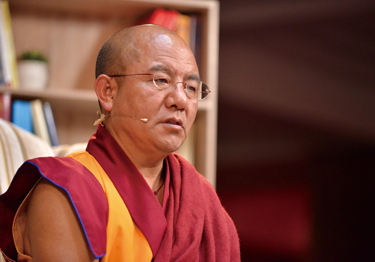
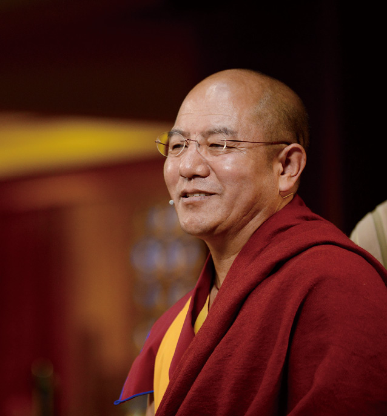

# 受持此经 天龙护佑

2016年8月4日

今天，给大家传授《药师本愿功德经》的传承。这部经在汉传佛教中弘扬得比较广。在此之前，我先给大家做个皈依。因为来学院开法会[^1]的部分人想要皈依，网上也有人需要皈依。

## 皈依

按照无垢光尊者《大圆满心性休息》的观点，皈依三宝的发心有三种：一种是为了获得人天福报而皈依，这是下等的皈依；一种是为了自己从三界轮回中获得解脱而皈依，这是中等的皈依；还有一种是为了利益天下无边的一切众生而皈依，这是最上等的皈依。选择什么样的皈依，你们自己决定。

以前皈依过的不用重新皈依，如果想再次皈依也可以；以前没皈依，今天想皈依的人，要珍惜这个机会。等会儿你们的法名，前面是一个“圆”字，再从自己的名字里选一个最可爱的字，加上去就可以。

下面，我给愿意皈依的道友传皈依戒。你们跟着我重复念三遍皈依偈。

（堪布授皈依戒）

## 三件事

念《药师本愿功德经》的传承之前，我要强调几件事情。

### 1．殊胜日广做善法

学院现在正在开法会。这个月非常殊胜，尤其是8月6日，也就是藏历的六月初四，是释迦牟尼佛在印度鹿野苑第一次转法轮的殊胜吉祥日。这一天，大家应该好好地发菩提心，认真地念《普贤行愿品》发愿。

本来，每年的这一天我都会给大家传菩萨戒，但今年因为要参加学生的活动等，所以当天没有网上开示。虽然平时做善事也很殊胜，但我希望各地的道友，当天更要好好地念《普贤行愿品》，并多做一些善事。这是我讲的第一件事，珍惜佛陀的转法轮日，也珍惜自己难得的暇满人身，好好地闻思，好好地修行。

### 2．显密圆融

在座的很多人对密法有很大的信心，也愿意学习和研究显宗的法门，可以说是显密圆融地学修佛法。也有一些人，对密宗不是特别了解，显现上有些排斥。

其实，显宗和密宗在暂时修行和究竟解脱上，都没有差别。我本人无论去显宗寺院，还是密宗寺院，都有恭敬心和欢喜心。大概在上个世纪八九十年代，一些人对密宗的看法有所偏颇，现在基本上没有了。即使偶尔有一点点，力量也不是很大。

我们佛教徒对显密的任何教法，都不要排斥；和其他宗教徒之间，也不要有任何抵触和矛盾。佛教当中有藏传、汉传、南传，汉传佛教中有八大宗派，藏传佛教也有八大宗派，南传佛教也有新派、旧派等不同的派别。各个教派之间应该和睦相处，互相学习，彼此尊重，建立感情，这一点非常重要。

其实，对任何一个教派，只要我们认真去了解，所有的误会都可以消除。比如说，我以前对南传和汉传佛教不太懂，后来亲自到南传佛教的僧团里生活了一段时间，体会到了最古老的佛教生活的韵味；去汉地的禅宗寺院，也领略到他们高深的思想。同样，如果你来到藏地寺院，品尝了藏传佛教特有的教理美味后，对藏传佛教不共的魅力也会有全新的认识。

我还要强调的是，学密宗的道友，一定要认认真真修好五十万加行。如果没有修完五十万加行，就去听很多密法，得很多灌顶，接很多传承和实修引导文，意义不是很大。光是听一下当然可以，只要上师开许，最高的法也可以听。但是，说一句负责任的话，我们绝大多数人都是普通根基，如果没有打好前行的基础，今生要想开悟，可能性很小，很小。

希望大家不要自以为了不起，将自己看作非同寻常的利根者。对加行的法不愿意修，对前行的书不愿意读，天天攀最高的法，结果是什么？纸上谈兵，冰上建筑。像这样忙一辈子，有什么意义呢？虽然汉地很多人的加行修得不错，但也有一部分人，10年前就已经磕了三四万大头，念了一两万的皈依和百字明，可到了10年后的今天，加行依旧没有修完。这是很值得惭愧的一件事。

总之，我希望大家不断地修共同加行和不共加行，打好密法的基础。这是我讲的第二个问题。

### 3．最好的灵丹妙药

人生有时会遇到特别痛苦的事。前一段时间，有一个人对我说：“我非常非常痛苦！我真的非常非常痛苦！”我能感受到众生的痛苦，每个人肯定都有一些痛苦的经历。

不过，这些痛苦都有解决的方法。佛陀的四谛法门，对于遣除痛苦非常契机，非常有效。因此，当我们遇到痛苦时，心里要放松，并不是没有希望了。不要自己把自己推到绝望的边缘，像很多年轻人那样，最后把生命都弄没了。

关键是要调整好自己的心态。如果心态调整得好，即使遇到了天大的事情，也不会绝望，因为总有解决的办法。如果心态没有调整好，即使世界没有发生任何事情，家庭也没有天翻地覆的变化，自己却觉得天已经塌了、地已经裂了，整个世界都没希望了，最后选择了不明智的路。

在人生的道路上，即使你非常了不起，有名声、有地位、有财富，甚至当上了皇帝，也多多少少会遇到一些痛苦。这个时候，我们要懂得用佛法来调整。按照我的经验，人生有了佛法的智慧，不要说来世确实能获得解脱，即便是今生，也能从容面对各种复杂的环境、复杂的人际关系和复杂的情绪。

即生当中，我们的情绪总是起起伏伏，一会儿好，一会儿坏。今天虽然很正常，但却没办法保证明天依然正常。有时候，自己都不知道自己哪儿出了问题。所以，凡夫人的心态随时都需要利用妙药，进行自我诊断、自我治疗。

最好的灵丹妙药是什么呢？佛法的智慧。这一点，没有信仰的人不一定承认，就像一位医生说“我的药很好”，对他没信心的人根本不承认一样。如果在信仰的基础上，品尝过佛法的智慧，你会深深地认识到，没有它的支撑，自己的生活会非常可怜、非常悲惨。

今天，我要在这里告诉大家：人生并不是没有希望。任何人，在任何时候，都有希望！

## 传承

今天传的是《药师经》。在汉地，很多人经常念这部经。下面，我用藏文来念传承。

我念传承的时候，大家不要说话，也不要玩手机。时间在一个小时左右。大家开法会本来就很累，所以我不会耽搁太久。如果念的时间太长，就分两次来念；如果不是特别长，今天会一次性念完。

很多道友从来没听过传承，不懂传承的意义，心里可能会问：“你不讲课，我单单在这里听你读藏语，又听不懂，到底有没有用呀？”也许听着听着，就打瞌睡了。

其实，传承是很重要的。我们受戒，比如受三皈、五戒、沙弥戒、比丘戒、菩萨戒等，都需要有传承。我们的眼睛虽然看不见戒的本体，但实际上，当善知识传戒的声音和自己的信心相结合时，就像无形的能量变成实体一样，会有一种类似实体的东西在我们心里生起。从佛法意义上讲，这种实体就相当于戒体。

所谓的传承，都是有特殊加持的。我们经常修的法、念的经，最好都有传承。有了传承以后，得到的加持是不同的，产生的力量也是不同的。我自己就有这样的体会：在某个上师前得过传承的法，修起来比较容易，也更亲切，更相合自己的根基；如果一个法没得过传承，没结上善缘，只是个人独自翻阅，法的加持离自己的心，就好像总有距离。

很多道友好像都不懂传承的重要性。之前我讲《药师七佛经》，每天都会花十分钟念传承。有些人对我说：“你最好不要念，直接讲课。不然，我一直傻乎乎地坐着等。”藏族人对听传承很重视，不会说自己“傻乎乎”。以前学院传《大藏经》的传承，从早上六七点钟开始，一直念到晚上十点钟左右。所有的人都一直坐着听，两三个月，天天如此。

我讲《妙法莲华经》时说过，以前法王如意宝听《大藏经》的传承：第一个月，特别有信心；第二个月，好像有点累；第三个月，“什么时候传完呀？”法王如意宝显现上也会这样——法王肯定只是示现。我们作为凡夫人，为了听传承，三个月一直这样待着，的确有点困难。但我想，听三个小时应该没有问题。

（堪布念诵传承）

任何一个众生，只要听到了药师佛的名号，暂时都不会堕入三恶趣。你们很多人都是远道而来，这几天是如何念经、如何发愿的，我虽然不是特别清楚，但我觉得，只要听到了《药师经》的传承，也算不虚此行了。

众生来到这个世界，能够听到佛的名号，能够信仰圣教，其实是非常难得的。甚至对佛教生起一刹那的信心，就像黑暗中出现闪电般，也非常难得。依靠这种信心的力量，不管是网上，还是现场的道友，都能得到听闻此经的利益。哪怕你没有信仰，今天莫名其妙地来了，耳边听到了此经的传承，阿赖耶上也会种下非常好的种子，很有意义。

这里还说，即使是声闻，有时也很难坚信因果、深信三宝，更何况我们凡夫人。但一般来讲，作为最后有者的菩萨，是完全深信因果的。所以，我们偶尔产生一点邪见、造一点恶业，并不是没有希望了。经常犯错误是凡夫人的通病。但犯错以后，要有惭愧心、忏悔心，经常念金刚萨埵心咒，不断地净化自己、升华自己。

《药师经》中说：人身难得，于三宝生信心也难得，听闻如来的名号亦是如此。这里讲了三种难得，一是人身难得，二是对三宝起信心难得，三是听到药师佛的名号难得。

今天在座的很多人，可能都觉得自己不够好。“我觉得自己很差！我们可以随便聊，但千万不要提课程！不要提学修！否则，我会很紧张！”我跟大家接触的时候，发现很多人都不愿意提学修的事，一提学修就要走，觉得自己很惭愧。实际上，虽然按照高一点的标准，我们修得不是很理想，不能达到要求，但按照《药师经》的观点，我们获得了难得的人身，对三宝产生了信心，耳边也听到了药师佛的名号，也是非常有意义的。

《药师经》已经给大家传完了。前面讲《药师七佛经》的时候，我也讲过，《药师经》和《药师七佛经》，虽然内容比较相近，但无论在藏文《大藏经》，还是汉文《大藏经》中，都属于不同的经典。

平时，我们可以把这些佛经供在佛堂里。如果没有佛堂，带在身上也非常有加持力。甚至它们所在的地方，也会增长吉祥，一切天龙八部，包括十二药叉大将，都会经常护佑。修学这样的法门非常殊胜，所以今天给大家念传承。

## 结语

这次开法会，很多道友是从不同的地方赶来，甚至从比较远的地方赶来。来了以后，要求我腾出时间，跟他们见面。其实，我们在这样的场合，见一下就可以了。本来，见和不见都只是一种概念。只要眼睛看到了，就可以叫作见。

所以，等会儿我出去的时候，大家不要着急。该传的法，我已经传了，这是最大的加持，比摸顶、接待更有价值。你们听到这部经的传承，这是我们最好的见面，也是我给你们的最好的见面礼。你们给我的最好的礼物，就是好好地修行，不要东奔西跑。不要肤浅地做个简单的皈依，就到处乱跑，天天说是道非，干一些坏事。作为佛教徒，这样真的不太好。

我们佛教徒首先应该做一个好人，有了做人的基础，再谈如理如法地修行。有些佛教徒，刚开始特别特别激动——我刚来学院的时候，心情跟现在好像也有差别，现在更稳重一些。这些人一看到上师，就大声地尖叫，没有必要这样。也许你的信心实在控制不住，但真正的信心需要慢慢培养。如果再过20年，你还能发出尖叫，那是最好的，但是很难。我记得，10年前有些尖叫的人，现在不要说看到就尖叫，可能踩在他身上都没什么感觉。所以说，我们的信心经常会变，应该时常观察自己的心。

今天给大家念的传承，就是最大的灌顶、最大的加持，也是最好的见面。我最近事情比较多，如果一个一个地见面，每个人都见10分钟、20分钟，我不睡觉也没办法完成。所以，希望大家谅解。

我每次出去，很多人都对我很好。尤其出国的时候，很多人在接待等方面，对我非常照顾。这次他们来了，我却不理，不安排时间见面。对此，有些人很生气：“这个人去我们那里的时候，带着笑容。我现在到了他这里，他却是另一种态度。人格不好！人格不好！”（众笑）没办法，我也很想知恩图报，很想自己的人格好一点，不想当忘恩负义的人；但有时候即使人格好，身体也不好。所以，你们要多理解。

这次法会，没想到来的人比较多。当然，大家在法会期间来也很好。大多数人都在好好念《普贤行愿品》，好好修行善法。不过，我看有些人不是来开法会的，一直在外面跑来跑去。另外，大家也要注意，现在我们佛教徒当中，有很多的善知识，也有很多不太如法的人。所以，大家首先应该观察善知识、观察老师。这是佛教徒应该具备的基本理念。

今天，除了在座的人以外，网上的人也比较多。希望大家都变成很好的修行人，这个很重要。而且在修行之前，先要闻思。像《大圆满前行》和《入菩萨行论》，我觉得是非学不可、不可或缺的，大家一定要学。

有了基本的佛教理论基础，再修加行和禅定。现在，不仅是我们佛教徒，全世界很多人，包括没有信仰的人，也在讲禅修。佛教徒应该通过禅修，让心安定下来。这样以后，什么事情都容易成办。

希望大家不要浮躁。现在这个时代，科技越来越发达，表面上看是好事，但是人心却越来越浮躁。我们每一个人，天天都通过网络、通过手机，把自己的精力分散得越来越多，基本上筋疲力尽了。所以说，这是特别浮躁的一个时代。

前两天，我引用英国作家狄更斯的话：“这个时代是最好的时代，这个时代也是最坏的时代。”如果佛教徒依靠网络平台来修行，这就是一个最好的时代。很多高僧大德的演讲也好，书籍也好，都可以通过手机来学习。一个小小的iPad里面，可以装几千本、几万本书。以前我们出去，需要带很多书；现在只要带上手机，就可以看书，就可以听课，非常方便。

不好的是什么呢？很多孩子从小就被灌输了糟糕的思想，天天被各种各样的视听包围。长大以后，他们的价值观会是什么样子？也许，他们将来都变成机器人、虚幻人，没有一个真实的价值观。这样的时代真的很可怕。但更为可怕的是，人们没有信仰。

希望大家用自己的智慧来观察世界，观察内心，做一个清醒的、远离浮躁的修行人。

[^1]: 当时学院正在开地藏法会。
