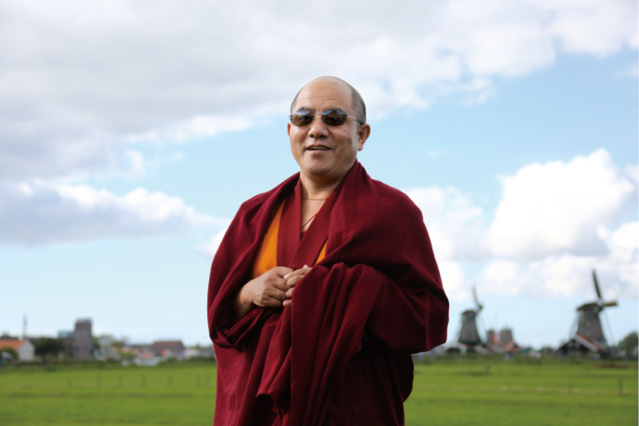
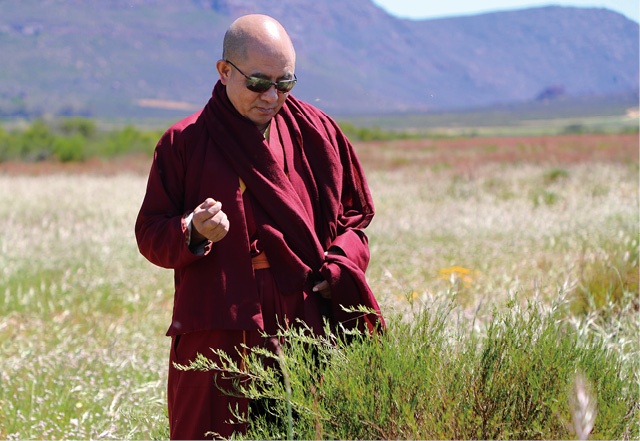

# 在这特殊时代 你是一个特殊的人

2016年2月14日

首先，通过网络给各位兄弟姐妹、佛友、善男信女拜年，祝大家在新的一年吉祥、快乐、顺利、圆满！

今天是情人节，日子比较特殊。我们大多数是学大乘佛教的，按照大乘的理念，一切有情都是自己的亲人，是我们最爱、最敬、最亲的人。在这个西方的传统节日，我们要用无私的慈悲心，关爱整个人类，乃至一切众生。当然，爱每一个有情，不能光是口头上讲。一个名副其实的大乘佛教徒，还要从内心深处去思维、观修，发自内心去实践。

今天是2016年的开端。我给网上东南西北的道友，讲四个方面的内容：一是学会的开学和管理；二是佛教的生活化，即生活佛教；三是甚深佛教，也就是说，我们不能停留在简单的生活佛教上，还要深入佛教的精髓；四是作一个简单的皈依，然后念《心经》的传承。前一段时间，在新年来临之际，我们都念诵了《心经回遮》。在汉地，《心经》是非常受重视的一部经典。藏传佛教正好有这个传承。不管什么法，有了传承，就要传递下去。今天一个多小时的时间，一共要讲这么四层内容。

## 不要在红尘中散乱

今年冬天，佛学院的僧众有近两个月的寒假。有些人因为身体不好，山上又比较冷，所以下山看病。山上除了少数人，大部分都没有课。三月初，我们要正式上课。下山的四众道友，包括堪布、堪姆、辅导员和所有的学员，希望能准时回到学院，正常闻思修行，不要耽误。没有特殊情况，最好不要明天上课、今天才到，而应该至少提前几天回来。正式上课时，一切都应该准备完毕，这样比较合理。

大家在山下，不要过度散乱，一定要抓紧时间。否则，对自他都不利。出家人如果在城市里、世间人群中待的时间太长，除非有较高的修行境界，不然很容易受外境影响。大家还处于闻思阶段，最好不要随着习气，漂泊不定，像流浪汉一样。这是我对佛学院道友的一点要求。

对全球各地正式参加佛学小组的修行人，我也提几个要求。从2006年开始，我除了在佛学院的正常上课，比如讲了《入行论》200多堂课、《大圆满前行》100多堂课、《现观庄严论》、《六祖坛经》等，偶尔也会额外地给大家做一些网络开示——到今天，已经是第83次了。时间过得还是比较快。

希望新的一年，不论是管理层的发心人员，还是闻思修行的学员，大家都尽量不要散乱。过年期间，大家难免有所懈怠。我听说，有些人睡懒觉睡到中午12点半，也太懒惰了吧？一个大乘佛教徒，不去度众生，天天这样睡懒觉，可能不太好。

按照学会的要求，从明天开始，就正式开学了，希望大家不要再懈怠。各地的理事会、监事会和相关的负责人，应该按照要求，互相鼓励、互相督促，帮助大家把心尽快定下来。同时，对于预科系和正科系的考试、招生和管理，年初应该有个好的计划，然后再用365天去一一执行。

## 生生世世，到底有多久

在执行的过程中，我希望大家能有稳定的发心。现在很多人，心不稳定。刚开始，谁都有一种热情和好奇心，但慢慢地就退失了。佛教徒中，有开始的人比较多，有结尾的人却比较少。到今年5月，我们以小组的方式修学，已经有十年了，但真正圆满学修的人有多少？从身边的人也看得出来。

前一阵子，我在香港的度母法会上讲：“作为佛教徒，偶尔听一两堂简单的课，不一定能对治烦恼。我们相续中的烦恼根深蒂固，力量非常强大，要想胜伏它、超越它，需要长时间的智慧积累。”因此，希望大家未来的十年，也能在闻思修行中度过。这样的话，你前十年在闻思修行，后十年也在闻思修行，下了二十年的功夫，应该会取得显著的成就。

前不久，我看过一本书。书里说，我们要想影响别人，自己对法必须要有深刻的印象和浓厚的习气。否则，只懂一点肤浅的知识，最多能影响别人一点点。所以，要成为一个真正的佛教徒，要想利益众生，需要长期的酝酿和熏习。

现在的汉地，学习佛法的人越来越多，这本来是好事。但我担心很多人没有恒心，坚持不下去，由此留下遗憾。我本人不管是前世的业力也好，宿世的愿力也好，都跟汉地佛教徒有很深的因缘。我在汉地弘扬佛法，已经有30个年头了，这在专门研究汉传佛教的汉族人中，也不算特别多。与有些人相比，我可能更了解汉族人的心态。

有相当一部分汉族人，人格非常稳重。我今天放生的时候也说，二十多年前，从1987年起，成都、绵阳等很多地方，就有一些居士开始学习藏传佛法，一直到今天，也没有任何退转。但也有一部分心不稳，总是随习气、随环境而转。所以，我想提醒大家：要想学好佛法，一定要有长久的心、恒常的心。

为了实现这样的目标，各地的管理人员和发心人员要不断地努力，不能发心三五年或十年就退。昨天有人说：“我发心五六年了，现在想退。”我说：“发心五六年并不长，我发心这么多年也没想退。”还有人说自己五六十岁了，年纪大，做不动了。现在美国总统的候选人，年龄基本上都是六七十岁。他们在这个年龄，都还有管理三亿多人的勇气，并且宣誓，要对这个国家如何如何。我们作为大乘佛教徒，为什么就不能做一点利益众生的事？我们当初也在诸佛菩萨面前“宣誓”，要生生世世度化无量的众生，现在才发心几年，就不愿意做了，也不愿学佛了，是不是在欺骗诸佛菩萨、欺骗三界有情呢？所以，有时候不要给自己找很多借口。

作为发心人员，表面上是为别人服务，实际上是提升自己的修行。以前，也有一些人退出发心，说是要闻思修行。但结果怎么样呢？由于接触的不再是闻思修行的群体，而是烦恼深重的凡夫俗子，最后不要说发心，自己连闻思修行的机会都没有了。如果一直发心，身边都是大乘佛教徒，和他们接触就是修行，自己一定会有所升华、有所进步。有些时候，对别人的付出，就是自己的收获。遗憾的是，很多人没有发现这个秘密。

学会并不是没有发心人员，如果你退了，天就塌了，地就裂了，世界就垮了，一切都毁于一旦，不是这样的。但是，有这份发心，对你个人也好，对整个佛教的发展也好，都非常有利，所以我们要关心这件事。大家的发心一定要长久。

## 做什么事都要有分寸

在弘法利生的过程中，会不断吸纳新的佛教徒加入，2016年也有这方面的计划。希望各个地方不要只看数量，而要以质量为主。我们的发心人员、辅导人员和管理团队，也要提升自身的素质。这些如果没有跟上，招来的人大部分会流失。

各地的发心团队应该多思考一下，如何管理新来的学员。有些地方做得很不错。过年也没有休息，开了很多会，辅导员是谁，道场在哪里，都做了充分的考虑。对新一年的管理，安排得有头有尾。

当然，招收新学员的时候，不可能没有烦恼。但只要发心清净，烦恼就是菩提。跟别人接触的时候，自己能学到很多东西。另外，大家在招生和管理的时候，要掌握分寸。目前学会的管理模式，不是要高调地大量宣传，而应该保持低调，抓住重点。

什么是重点呢？闻思修行。这可以说是学会的核心价值观。虽然在闻思修行的基础上，我们也需要做一些善事，如放生、助念、慈善等，但不管怎么样，最根本的重点和原则不能改变。

如果你个人觉得，在这里学不到东西，想退也可以。减少几百个、几千个人，对我们来讲也无利无害，不增不减，“不生不灭，不常不断，不一不异，不来不去”。但对你个人来说，也许有损失，也许有收获，具体情况我也说不清楚。如果你觉得有收获，那也是你的自由。

大家在选择信仰之前，最好多观察一下，不要进进退退。有些人可能烦恼深重，学的时候——“哎呀，我好痛苦啊！好想退啊！”退了以后，又到处搞关系，想回来。回来以后，烦恼又炽盛起来，不好好学习，每天打假报告，各种应付，敷衍了事，这样不太好。任何一个人，做任何一件事，都应该先好好观察。既然选择了，就应该认真一点、细致一点，善始善终，这是做人的本分。

总之，掌握分寸和尺度很重要。有些地方的管理，听说有点过激。2016年的招生计划，我们都还没有制定，他那边就开始招人了。所谓“上有政策，下有对策”，现在有很多不合理的现象。当然，这么多人一起学习佛法，不可能十全十美，鱼龙混杂的现象在哪儿都有。

但不管怎么样，我们应该尽量地上下一致，上面怎么安排，下面就怎么执行。希望各地不要违反我们的规定，不要利用学会的平台，搞个人宣传、募捐化缘，做有损佛教的事情。

我在南京开示时也说过：学会不是接待站，不是收留所，也不是宣传频道。包括对我自己，我也不喜欢别人宣传。无论是谁，如果写我的传记、供我的照片，我都非常反对。一看到自己的传记和照片，我就不高兴，因为没有必要。真正有必要的是什么？就是大家能学到佛法。不管什么人，只要学好了佛法，就会得到今生来世的利益；只要得到了佛法的精神食粮，生活就有力量。

今天的开示，我要求教务处的法师也来听。新一年的工作和考试，应该有序地推进。只要没有大的违缘，大家要不断地向前，不断地努力。我们的管理模式和弘扬模式，目前还是很有意义的。十年来，大家通过这样的方式共同学习，懂得了佛教是什么，能给自己的生活带来什么。时间过得真快！

以上这些，我们可以作为人生经验，分享给他人。希望这样的智慧碰撞，能给世界带来一点利益。

## 学佛只为自己快乐吗？

在上个世纪，不少人认为佛教是迷信，学佛不科学。到了21世纪，各方面因缘具足，认可佛教的人越来越多。很多人都认识到，佛法是一种智慧，是人生真正的奢侈品。尤其是藏传佛教，在欧美、东南亚等地都深受欢迎。

在座的大多数人，都是受过佛法教育的，你们应该想一想：自己学佛的目的是什么？是为了自己获得快乐、得到解脱，还是为了利益身边的人？大家可以观察一下自己的内心。

过年的时候，各大城市里通往寺院的路都堵车，而且堵得很厉害。包括四川，几百公里以外的地方有一些庙宇，很多人都开车过去，然后烧香、拜佛。为什么？大多数人都希望得到保佑，自己一定要如何如何。这样一种信仰形式，当然也可以有。但更重要的是，佛教如果真的很好，按照大乘佛教的理念，就一定要给身边的人分享。

听说前一段时间，学院有些居士包车下来，在车上聊天，旁边很多人在听。说什么呢？“弘扬佛法是上师们的事情，跟我没有关系。我只要健健康康就可以啦！”其实弘扬佛法并不只是上师们的事，每一个佛教徒都有这个责任。否则的话，你学的是大乘佛教，皈依时是怎么皈依的？发菩提心时是怎么发的？大乘的教义又是怎样的？“让上师们度化众生，我来占便宜，天天享受安乐”，你没有这样发愿吧？

但是，现在很多人都没有弘法利生的责任感。不光汉地，藏地也是如此。大家都觉得学佛很好，放一放生，摇一摇转经轮，也很好，却从来没有想过众生可怜，应该让佛教常住世间，并为此付诸行动。

尤其是，如今出家人不多，佛教的未来一定程度上寄托于在家人身上。作为有智慧、有能力、有财富、有福报的居士，不能只想着自己死后不堕地狱、房子和财产怎么处理，而不想佛教的未来怎么办。

## 佛教应该接点地气

世人对佛教普遍有一种误解，觉得佛教徒四大皆空，什么都没有。我在外面坐出租车，经常一上车，司机就对我大发悲心：“你光着个头，是学佛的吧？你们不能结婚，好可怜啊！”所以我每次坐出租车，都会有心理准备。

在这些人眼中，佛教是断绝了世间一切欲妙的宗教，但实际并非如此。虽然对一部分学佛的人而言，出家人有出家人的戒律，在家人有在家人的戒律，但是，还有相当一部分人，既没有出家，也没有受居士戒，只在世间安稳地享受生活，同时也可以进入佛教。

这一点，很多宗教都在推进。西方和中东的宗教，如大海波浪一般，已经蔓延至地球上的许多角落。所以，这段时间我心里有一种想法：弘扬佛法，需要改变一种方式，要努力让佛教的智慧，融入更多人的生活。

如果我们不这样做，很多人就只会在死亡时，才想起佛教，因为要为亡人念“嗡玛呢巴美吽”。久而久之，我们一念“嗡玛呢巴美吽”，人们就会忌讳，“他们家死人了！”我去日本就有这种感觉。那里的很多寺院，只负责给死人做超度，此外几乎没有其他的事。正因为如此，日本佛教被称为“死亡宗教”。

事实上，佛教并不只跟死亡有关。在藏地，人们日常生活的方方面面，都有佛教的影子。一个人从最初的出生，中间的成长，到最后的死亡，佛教可以贯穿始终。

所以，从今年开始，我们将逐渐在各个城市，推广“生活佛教”，关心身边人的苦乐。但教义不能太深，只需要一些简单的理念。这方面，我提几个建议：

### 1．为新生儿赐吉祥

无论是不是佛教徒，只要生了孩子，我们都要关心一下。在西方，孩子生下来，会专门到教堂做洗礼，或请牧师到家里做仪式。我们佛教徒可以为刚生下来的孩子放一些生，并用佛像、甘露丸等给孩子加持，尤其要劝父母尽量不杀生。

一个孩子来到人间，如果接触的第一件事就是杀鸡杀鸭，非常不好。《护诸童子陀罗尼经》中讲，很多非人喜欢啖食初生婴儿的精血，如果“杀生害命而为欢宴”，则“诸小童子，能短其命”。所以，为孩子杀生很不吉祥，容易让孩子多病短命。

在印度，孩子生下来后，会举行一些盛大的仪式，类似汉族人喝满月酒——其实是在造业。喝满月酒的习俗可能不好改，但最好有一些善的力量加入，为孩子增加一点今生来世的福分。比如为新生儿念观音心咒、莲师心咒、《吉祥经》等，为孩子赐福。待孩子慢慢长大，还可以教他一些简单的佛教格言、佛号、心咒，以及《弟子规》的教义等。这对孩子的成长非常重要。

### 2．给新婚之人送祝福

孩子慢慢长大以后，会结婚。现在很多人结婚时，杀生的情况非常严重。对不信佛教的人来讲，这非常正常，没有杀生反而不行。但有信仰或有一半信仰的人，能不能在婚礼上尽量采用素宴？如果不能完全做到素食，也可以一半荤一半素，其中荤食不要点杀。

听说有一个居士结婚，早上先参加大放生，然后请大家参加他的婚礼，十几桌全是素食。他们说，素宴虽然不好吃，但酒店还是做得不错。其实这样的婚礼很吉祥。如果有条件，大家还可以念《八吉祥颂》《招财仪轨》等，为新人祈福。《招财仪轨》是麦彭仁波切造的，其中的“财”不单单是指钱财，还有幸福、智慧、慈悲、成就等精神财富。

现在，各个城市都有很多佛教徒，但大多不太关心这些事。所以，大家以后要多多关心。如果有人愿意办全素婚宴，可以在教务处登记，到时我会给一些加持品，比如佛像、唐卡等，祈愿三宝加持他们幸福美满、情谊绵长。不要当天结婚，当天离婚——听说2015年8月，有一对新人就是这样的。这是以前造恶业的结果，也可能是其他的特殊因缘。

我认识的很多佛教徒都说，自己以前不懂因果，一场婚礼杀了无数众生，现在的身体、感情和家庭都不好，特别后悔。我们不懂因果的时候，这样做情有可原。懂了因果以后，就要约束自己，并把这些道理告诉身边的人。这其实不难。我听说，有些人并不是真正的佛教徒，但因为别人的影响，结婚主动要求办素宴。

### 3．传授夫妻相处之道

佛教有一部《善生经》，专门讲了夫妻和睦相处的各种窍诀，很值得在家人学习。我们如果光给别人讲空性、讲悲心，大多数人不一定能接受。但如果让他们学一下《善生经》，他们还是愿意的，而且很有意义。

这部经说，丈夫应该这样对待妻子：

第一，“怜念妻子”。丈夫要疼爱妻子，发自内心地关怀她、体贴她。正如帕单巴桑吉所说，夫妻是一种特殊的因缘，双方应该以诚相待、互相尊重、彼此珍惜。

第二，“不轻慢”。听说现在有些人，不但对妻子恶言相向，甚至拳打脚踢，把妻子当成仆人，制造了很多家庭暴力。这其实是不对的。世间提倡男女平等，佛教也认为，众生都有如来藏。所以，男人不应该看不起女人，夫妻之间要互相尊重。

有些人认为，自己的妻子很坏，什么都不好。有些佛经也说，女人的毛病比较多。但我觉得，女人其实并不是特别坏，要说做大的坏事，男人可能更厉害。我去过一所监狱，那里的监狱长是个女的。她向我介绍说，全省犯人一共有2500多名，其中女性只有400多，女性干坏事的比较少。所以，男人不要有什么优越感。作为丈夫，应该尊重自己的妻子。

第三，“为作璎珞严具”。作为丈夫，要给妻子提供一些装饰打扮的方便。很多人都抱怨，结婚前妻子犹如仙女，结婚后却成了黄脸婆，而且情况越来越不乐观。出现这种情况，丈夫也有一定的责任，可能你化妆品买得不够（众笑）。当然，并不是让你买高档奢侈品，一个包花几十万，用不着这样。

实际上，对于基本的仪容修饰，在家男女都应该注意。除非受八关斋戒，不能化妆，否则，平时在公共场合，还是要有得体的衣着打扮。

第四，“于家中得自在”。丈夫不要以为自己是妻子的主人，妻子必须伺候自己，必须炒菜、做饭、做家务等。应该给她一定的自由空间，不要过多干涉她的生活。

有些人说，女人值得同情，男人更值得同情，男人整天忙着赚钱养家，承受着各种各样的压力，所以一般都死得早，不如女人长寿。这种说法是否正确，我没有研究过。但不管怎样，丈夫还是要给妻子一些空间，充分信任她。

第五，“念妻亲亲”。丈夫应该顾念妻子的亲朋好友，经常关心他们，照顾他们。如果一点也不管妻子的亲人和眷属，长期下去，家庭必然不和睦。

以上是对丈夫的要求。那妻子又该如何对待丈夫呢？一共有十三条，我不一一介绍，只简单说几条。比如“摄持作业”，妻子要好好护持丈夫的事业。据说有些佛化家庭，妻子为了支持丈夫的事业，不惜牺牲自己的工作，一心一意搞“后勤”，两人互相支持、互相鼓励，一辈子从未吵过架。

“善摄眷属”，妻子对丈夫的亲友要特别关心。有些丈夫带客人回来，妻子不高兴，不给做饭，脸色也不好看。客人一走，丈夫就和妻子吵架：“你刚才为什么态度恶劣？不给做饭，还摔碗筷。我好不容易带了客人回来，你却这样！”然后就爆发“世界大战”。

“言以诚实”，妻子对丈夫要语言温和，态度诚实，等等。这方面的内容，《善生经》讲了很多，这里就不一一介绍了。

这些内容，说的都是佛教的观点。在家人按照佛教的理念，完全可以组建幸福和睦的家庭，而不是一学佛，就把家人统统抛弃，跑到深山老林出家。学佛没有那么恐怖。只不过，有些佛教徒不好好学习和研究佛法，不懂这些道理，所以才让世人误解甚至排斥佛教。

### 4．大乘的种种善巧

此外，还可以借助喝茶、唱歌、跳舞、绘画、书法等形式，来传播佛法。我们不能要求，凡是对佛教感兴趣的人，都必须跟学会的人一样，有很高的修学层次。这样的要求，会把别人吓坏的——“天呐，还要磕十万个头？我连一百个都磕不了。那我不敢学了！”

对于初学者，我们有时候要包容一点。不能一开始就不许这个、不许那个。有些不学佛的人问我，吃肉可以吗？我说可以。喝酒可以吗？可以。结婚可以吗？可以可以，什么都可以。实际上，其他有些宗教，刚开始也是跟大家一起吃，一起喝，一起唱歌跳舞。

总之，不要一上来就板着个脸，把人吓跑了。等他们对佛教真正感兴趣了，再慢慢推荐他们看看书、念念咒。有了长期的熏染，他们自然会知道怎么做。到一定的时候，让他们磕十万大头也好，学般若空性也好，他们都会欣然接受。

我个人在这方面深有体会。比如，本来穿鞋进经堂是有过失的，但是，当一些领导或非佛教徒进入经堂，问我可不可以穿鞋，我也只能说“可以”。然后，自己一边脱鞋，一边念金刚萨埵，默默地代他们忏悔。虽然也担心有罪业，但为了随顺世人，自己还是会提供一些方便。

作为大乘佛教徒，随顺世间非常重要，否则很难利益众生。当年迦叶尊者去度化外道，方法过于死板，结果不太成功。后来，换了文殊菩萨去。文殊菩萨很有善巧方便，根本不给外道讲什么佛理，刚开始整天和他们一起玩儿，结果顺利地度化了他们。

## 明天还有没有希望

对于佛教的未来，我们一定要经常思考。

三四年前，我提出为亡人助念超度。几年下来，大家做得不错，有些助念团甚至有八百多人。但是，佛教不能只是给亡人超度。从今年开始，希望大家重视“生活佛教”，多举办一些佛教婚礼或有佛教内涵的其他活动。

基督教在亚洲、欧洲、非洲等地的推广，刚开始就是请大家免费吃喝，再慢慢传递自己的理念。实际上，人们比较容易接受这样的方式。而我们佛教徒呢，不管做什么事，都非常死板。长期下去，佛教团体的人，学深的本来就不多，学浅的又越来越少，最后必定后继无人。这样的发展形势，非常令人担忧。

西方的宗教非常人性化，他们的圣诞节、情人节、复活节等习俗，都跟宗教有关。其实，佛教也可以有情人节。现在很多年轻人，你爱我我爱你，如果有一种善巧的理念，引导他们进入佛教，是很好的。但我们好像不屑于做这些，只知道给亡人念经，根本不会和活人打交道，这是一件很遗憾的事。

十年前，我曾在一封公开信中讲过，佛教需要生活化。但后来，很多人只抓了亡人的助念，却没有重视活人的“生活”。这样下去，我们也会变得跟日本佛教一样，被人称为“死亡宗教”。现在很多人，出生的时候，活着的时候，都和其他宗教接触；只有死后，才到佛教的寺庙请和尚念经。

佛教现在有点“高不成、低不就”。高深的境界，很难触及；简单的内容，人们在生活中也没什么印象。佛教成了深奥的哲学，只是少数人的境界。如果不能贴近普罗大众，到一定的时候，必定会出现断层。再过十年、二十年、一百年，佛教会变成什么样？希望大家用智慧深思。

今天开示的主题叫“明天的佛教”。那明天的佛教，到底有没有希望呢？你们自己可以看看。

## 佛教不但要广，还要深

前面讲的“生活佛教”，只涉及佛教的广大方面。而要真正地弘扬佛法，还需要有甚深方面的内容。否则，佛教徒再多，哪怕初一、十五寺院人山人海，但学佛如果只停留在表面上，缺乏应有的深度，也难窥佛法的奥义。

佛学院在佛教的甚深领域有一定的专长。无论是研究显宗还是密宗，都比较有优势。三十多年来，这里每天都有很多出家人和居士，在认真地研习五部大论等显密教义。如何将这些研究成果与更多的人分享，是我一直在思考的问题。现在，已经有了一定的计划。

今年新年的第一天，网上就传来净空老法师对我的肯定和赞叹。这让我再次想到了这个问题。我个人的性格，并不太在乎别人的赞叹和诽谤，不会因为老法师的两句赞叹，就得意洋洋。只是不久前有缘与老法师会面，从他身上学到了很多东西，发自内心地敬佩老法师的品格。多年来，他全力弘扬净土宗。取得的成绩，全世界有目共睹。他还复兴传统文化，坚持不懈，从未放弃。

他今年90岁，讲经说法却已有58年，非常了不起。他耳聪目明、智慧敏锐，不仅生活能够自理，而且每天坚持上网，给全球的佛教徒传法。这让人无法想象，可以说是一种奇迹。

过去，因为文化隔阂和传统差异，藏传佛教和汉传佛教之间，曾有一些误会和摩擦，甚至诽谤和诋毁。老法师希望我今后能在二者的融合方面，发挥一些作用。他的这些话，对我意味着特殊的缘起。

本来，五部大论[^1]是我弘扬多年的甚深教法。早在上个世纪90年代，法王还没有圆寂，佛学院的汉族四众就在不断地学习。而五部大论的教义，对复兴大乘八宗[^2]很有帮助。虽然我人微力薄，而汉地已经有很多高僧大德在护持八宗法脉，但振兴八宗对佛教的未来意义重大，所以我打算从今年起，在这方面尽一点微薄之力。

## 我们可以做些什么

### 1．教义

首先在教义方面，藏地的五部大论，是研究和继承大乘八宗的殊胜方便。

①俱舍系和戒律系可以研究律宗。这两部论直接解释了声闻乘的见解和行为，所以对《毗奈耶经》《四分律》等，大家都可以研究。

②因明系可以研究唯识宗。因明的最终目标是抉择名言量，而按照《中观庄严论释》的观点，抉择名言量最究竟的就是唯识宗。此外，《释量论》抉择果量和建立世尊为量士夫，最终也建立在唯识的观点上。

③中观系可以研究三论宗。所谓的“三论”，是指《中论》《百论》《十二门论》。这些都是中观系的研习内容。除此之外，我们还闻思过《七十空性论》《中观庄严论》《入中论》等其他中观论典。

④般若系可以研究天台宗。般若系主要学习现空双运的般若空性，尤其是《现观庄严论》所讲的智慧与慈悲相结合的般若教理。这有助于理解天台宗的《妙法莲华经》《大般若经》《大智度论》等经论，以及智者大师的寂止和胜观法门。

⑤修心系可以研究禅宗和华严宗。其中，禅宗的《金刚经》、《心经》和《六祖坛经》，我都传讲过，修心系可以直接修学。除此之外，修心系平时的参禅、调心、修加行等，和禅宗都有内在的联系。华严宗重点研究《华严经》，其中的很多内容，比如依止善知识、发菩提心、《净行品》等，在我们所学的《事师五十颂》《入菩萨行论》《普贤行愿品》等经论中，也有相关教义。

⑥净土系可以研究净土宗。《无量寿经》《观经》《阿弥陀经》等净土经典，净土系一直在学修。

⑦密续系可以研究真言宗。真言宗（唐密）主要是外续部，而藏传佛教的密续系除了学习外续，还要学无上瑜伽续，等等。

### 2．弘法人才

三十多年来，佛学院的汉族四众对八宗涉及的法义，一直在听闻、研讨、复讲、背诵、笔试和实修，可以说具备了复兴八宗的一些因缘。

### 3．传承

八宗所涉及的佛经教典，百分之八九十的传承，学院的堪布、堪姆和法师都有。暂时没有传承的，今后也可以想办法求取。在藏传佛教中，《甘珠尔》和《丹珠尔》的传承从未间断，一直完好无损地延续着。只要没有嫉妒心和自私心，我们可以全力以赴地复兴八宗。

作为汉地的佛教徒，既要考虑佛教的生活化，也要考虑八宗的复兴、护持与弘扬。希望出家人和居士联合起来，为佛教的未来创造新的辉煌。每一个佛子都有这样的责任。

## 在特殊的时代，你是一个特殊的人

今天在场的部分初学者，对佛教的基础知识并不是特别了解。既然进了佛教团体，那就试着了解一下。如果觉得佛法对生活、对今生来世有帮助，那就继续学习、继续修行。如果觉得佛法没有一点用，想退出，那你随时可以离开。我们不会用佛教的名义，来统治你、控制你。

其实，只要对众生有利，我们就愿意传播佛教的理念。近期有一部挺火的电影——一提到电影，你们的眼睛就睁大了。这部电影里面有一段对白：“你要去西天取经，可是佛经到底讲了什么？”“真相。”

现在，整个时代都在飞速地变化，佛教徒一定要抓住机遇，不能和机遇擦肩而过。否则整天懒懒的，汉地的只会念佛，藏地的只会念“嗡玛呢巴美吽”“嗡玛呢巴美吽”，然后就这样待着，很多机遇就没有了，再也找不到了。

每个人都要想：“在这个特殊的时代，我是一个特殊的人。”

我个人经常认为，自己出生的时代没有战争和饥荒，确实非常幸运。如果我1959年来到这个世界，肯定会饿死。我1962年出生，什么时候死不知道。在我活着的这段时间，会失去很多，也会得到很多。当我得到的时候，哪怕只是对身边的一个人，产生一点点积极的影响，我也会鼓励自己：“在这个特殊的时代，我是一个特殊的人！”

你们也要这样鼓励自己，不能整天吃喝玩乐。现在有些人很无聊，天天在手机上刷来刷去，你吃什么、我吃什么，你喝什么、我喝什么——这个真的不重要。我们来到这个世界，不能只是为了享受，还要有一点思想，尽量为众生创造一点福祉。

若能这样，我们的烦恼会越来越减少。所有的烦恼，都来源于自私自利。如果经常关注佛教的未来，关心众生的苦乐，自己的心量会越来越大，对很多东西都不再执著。即使得了严重的疾病，也没有什么感觉。自己只是浩瀚世界的一粒微尘，这个身体好也罢、坏也罢，都无所谓，没有什么可焦虑的。心大了，痛苦自然会消失。

希望每个人都能记住这句话：“在这个特殊的时代，我是一个特殊的人！”我经常想，自己来这个世界，讲经说法只在活着这段时间，什么时候结束不知道。当自己长长地呼出一口气，再也吸不回来时，生命也就消失了，特别简单，也特别快。在这之前，作为大乘佛教徒，应该用珍贵的智慧和悲心，去感化他人，利益他人。

我特别感谢我们的发心人员，他们每天都把时间、精力、财力花在服务众生上面。我听说，有些人把自己所有的钱都充到手机里，和外面联络；有些人把自己舍不得住的房子，提供出来给大家作道场。没有他们的付出，没有他们提供的各种便利，今天很难有这么多人享用佛法甘露。

希望依靠我们的共同努力、持续努力，佛教能有更好的明天。现在已经立春，天气越来越温暖。而到了夏天，日子会更美好，更快乐！

## 皈依和传承

下面，给大家作个简单的皈依，并念《心经》的传承。希望大家都发菩提心，受大乘的皈依。以前皈依过的，不用皈依，想再次皈依也可以。

（堪布传授皈依戒，并念传承）

最后，我用释迦牟尼佛像，给现场和网络上的道友作意幻加持。《华严经》讲，谁作意佛陀，佛陀一定会降临加持。

我们很多人都是真正的佛教徒。依靠佛陀庄严的身相，我们的今生和来世都能得到无尽的利益。我个人不管在哪里，住旅店也好，在家里也好，都带着一尊释迦牟尼佛像。希望今天的每个人，都得到本师释迦牟尼佛身口意真正的加持，在菩提路上不退转，在有生之年，乃至生生世世，度化无量无边的众生。

今天的开示圆满结束。感谢所有的观众，也感谢现场和各个地方的工作人员。如果没有工作人员的发心，我们不可能有这么好的网络聚会。在当前的时代，我们应该利用网络，增加福报，增加正能量，而不是毁坏自己。我尤其希望很多年轻人，能利用网络充实自己，增加自己的福德资粮和智慧资粮。

[^1]: 五部大论：戒律、俱舍、因明、中观、般若。
[^2]: 大乘八宗：律宗、三论宗、天台宗、唯识宗、华严宗、净土宗、禅宗、真言宗。
