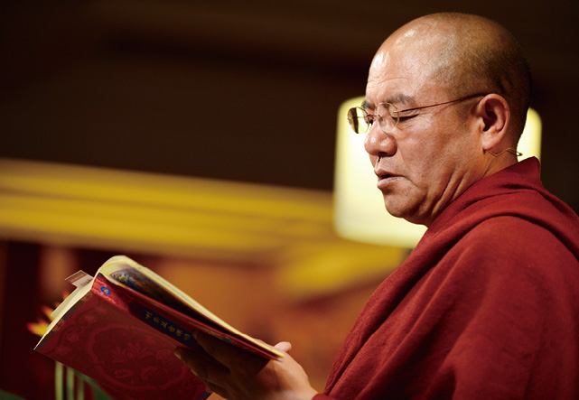
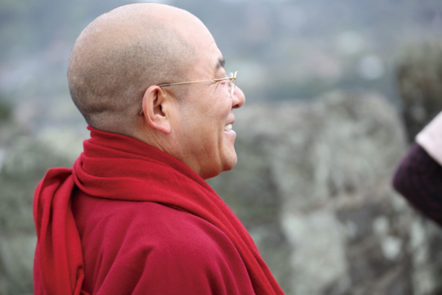
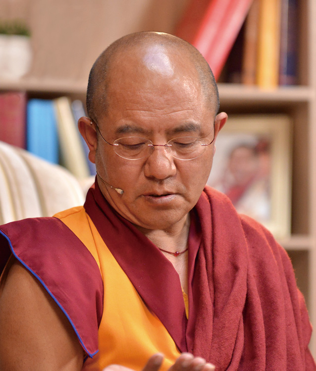

## 大乘佛教与 自闭症、抑郁症

2016年4月30日

今天，跟大家聊一下自闭症、抑郁症与大乘佛教的关系，以及大乘佛教如何治疗常见的心理疾病。对这方面的问题，我一直都很关注。以前，心理疾病在全世界不是很严重，现在却越来越常见。

很早以前，我学习《入菩萨行论》，看到里面有一句偈颂：“自迷痴狂徒，呜呼满天下。”意思是说：可悲呀、可悲！自我迷醉的愚痴狂徒遍满天下，就像疯子一样迷失了方向，非常可怜。这是寂天菩萨在一千多年前说的一句话。当年，我在讲解这个颂词时，觉得有点不符合实情，因为那时除了极少数的精神病患者，绝大多数人都很正常。

但是现在，无论是看媒体报道，还是接触国内外、东西方的各类人群，好像都会想起这句颂词。很多人表面上很开心、很正常，实际上呢，多多少少都有一些心理疾病。有些比较明显，已经直接影响生活；有些比较轻微，只是自己有所察觉，别人不一定发现；有些还没有表现出来，以潜在、隐藏的方式存在着。所以，我觉得寂天菩萨的那句话，很符合当今这个时代的情况。

## 星星的孩子，活在自己的世界

前两天，我说要讲大乘佛法与自闭症，有些人跟我讲：“自闭症并不普遍，大多数人都不关心。你在网上谈这个，除了极个别自闭症孩子的父母以外，可能没有人听。”我回答说：“我不担心没人听。”为什么？如今自闭症在全世界蔓延得非常厉害，西方国家尤为严重。

众所周知，自闭症一般在孩提时期发作。在发达国家，情况尤为明显。据美国官方资料显示，1970年，全美每14000个孩子中，有一个自闭症患者。可是到了2015年，每68个孩子中就有一个自闭症患者，而且大多数在男孩当中发现——每42个男孩中就有一个。在韩国，每38个孩子中，就有一个自闭症患者。有些轻微，有些比较隐蔽。

对此，英、美等国的相关领导特别担心。将来，如果自闭症患者越来越多，会直接影响国民的生活。美国每年启用约2亿美元，用于关爱自闭症患者，包括对患者提供照顾。据说，英国每年要花500万至650万英镑，用于帮助自闭症孩子的生活。他们对于残疾人或有心理疾病的人，还是比较照顾的。

一些经济学家认为，社会应该帮助患自闭症的孩子。如果他们能够好转，并胜任一些特定的工作，社会的经济压力会减轻很多。

研究发现，自闭症分为低能自闭症和高能自闭症。患低能自闭症的孩子，基本上没办法与世人交流。他们虽然掌握语言，但不愿意沟通；虽然具有视力，但不愿意跟别人对视；虽然具备听力，但无法接收正面的信息，始终处于封闭的状态。这些低能患者，甚至连照顾自身的饮食起居都很困难。

这类孩子的父母特别担心：一旦自己离开了，孩子在这个世界将无依无靠。我以前遇到过这样的父母，他们说：“我们虽然活着，但已经感受到地狱般的痛苦。我们非常担心孩子将来被社会遗弃。他会因为没人照顾，而饿死、冻死。”

高能的自闭症孩子，又是怎样的呢？他们的记忆力和模仿能力都很强，无论是玩具的摆放方式，还是日常行为，他们都很有规律。一旦有人破坏了这种规律，他们就会特别恼怒，甚至会做出过激或危险的行为。国际上认为，如果通过教育和培养，正面引导他们的认知，充分开发他们的大脑，这些孩子可以胜任信息库管理、图书馆管理等模式单一的工作。

关于自闭症孩子的病因、教育方式等，国际社会非常关注。为什么1970年美国患自闭症的孩子很少，而现在却变多了？有些专家认为，可能是以前测试的仪器没有那么先进、敏锐，或者根本没有那么多仪器来测试；有些则认为，是现在的空气和饮食等因素造成的，比如当代人的饮食充斥着转基因、农药残留和再加工食品等。从佛教的角度来讲，可能有前世的业力和即生的执著等多种原因。

各个国家自闭症孩子的现状如何，我没有特意去查，所以不太清楚，但有些症状应该是相同的，比如都很孤独——自闭症又叫孤独症。有些人把他们叫做“星星的孩子”。在天上，每一个星星都是一个世界，不会跟其他的星星相会。同样，自闭症孩子的特点就是偏执、自闭，不愿意跟父母和其他人交流，只喜欢待在自己的世界里，独自玩电脑、手机或其他东西。除此之外，他们对这个世界的一切事物都兴趣索然，显得特别孤独。

如果发现孩子出现这种状况，可以对他们进行干预治疗吗？早期应该有一些办法，但晚了可能不行。尤其是一些患低能自闭症的孩子，到了一定的年龄，治疗起来确实比较困难。

所以我想，如果他们的父母真的离开了，我们这些大乘佛教徒，应该想尽各种办法，去帮助他们。我们要把力量积聚起来，组织起来，去帮助孩童、残疾人等弱势群体，为社会做一些有意义的事。在这些方面，我们大乘佛教徒应该多一些关心。这是我想说的第一个问题。

## 抑郁症就像感冒

从全球来讲，抑郁症也是一种比较严重的精神类疾病，但是真正痊愈以后，对生活没有任何影响。这些，我以前都了解过。有些人却认为，抑郁症特别可怕。自己要是得了，根本不敢对人说。听说别人得过抑郁症，接触时就变得小心翼翼，担心被传染，甚至担心他发疯。

其实，根本用不着如此紧张。第一，抑郁症不具有传染性。从它的病因、病症等多方面来看，都不会传染。第二，抑郁症是一种心理疾病。不管什么样的人，都可能得，包括我们修行人或者世间的名人。西方的很多宗教人士，很多著名的画家、政界人士，都得过这种病。

以前，我觉得某些女性得抑郁症的概率似乎大一点，因为她们的情绪起伏比较大。在学院处理事情时，如果要面对多个女众，我就会特别注意。比如现场有四个女众，我说话就不能只对着一个人，不然其他人都不高兴。我会先看第一个人，然后看第二个、第三个、第四个，最后再模糊、笼统地看大家一眼。这样的话，可能大家都高兴。

但是，现在面对男性有时好像也需要这样。一段时间里，我在男众这边处理问题时也非常小心，因为一些男众的心有时也很脆弱。有人就这么对我说过：“堪布啊，两三年前，你跟我说过一句话，但当时却只看别人，不看我。”似乎比个别女性还脆弱。

我觉得，抑郁症就像感冒。发作的时候来势汹汹，非常痛苦，需要吃药缓解，但是病愈以后就不值一提了。心脏病也是这样。我从来学院的第二年开始，心脏就特别不好，平时只跟比较熟悉的个别出家人说话。除此之外，包括一些关系很好的堪布，我都不愿意理睬。那一段时间，我晚上睡不着，白天会莫名其妙地发火，好像整个生活都没有意义。

以后，我们周围的群体中，如果有人得了抑郁症，不要觉得可怕，也不要有任何担心。我就遇到过很多得过抑郁症的人，有西方人，也有东方人。他们都说，自己以前得病时痛不欲生，但好了以后，就完全正常了。

但是，这种病如果没有治愈，也很危险。尤其在欧美国家，抑郁症非常厉害。我去英国时，特意问了剑桥、牛津的几位教授。他们都告诉我说：“现在英国得抑郁症的人很多。”据说，每六个英国人中，就有一个得抑郁症的。在荷兰、德国和美国，也同样很多。中国的情况，估计也不乐观。

虽然抑郁症很普遍，也没什么可怕的，但我们还是要了解它的症状。人得抑郁症的时候，非常痛苦、煎熬，总觉得活在世间没有意义，无路可走，特别想自杀。这种症状一旦出现，应该怎样放松？还需要进一步探索。

我以前看过梵高的传记。梵高是一个非常有才华的人，他的一幅画现在可以卖到八千多万美元。这么出名的一位画家，内心却感受着难以忍受的痛苦。因为失望和自责，他甚至把自己耳朵的一小块割了下来。年仅37岁，他就开枪自杀，结束了痛苦的一生。

抑郁症患者还有一个特点，就是过度反应。他们喜欢把自己的过失夸大，一件小小的事情，他们的反应却特别夸张。有一个人说他难看，他就觉得全世界的人都认为他难看。有两三个人骂他，他就认为，世界上所有的人都看不惯他，再也没有人爱他、喜欢他，活在这个世界上已经没有任何意义，非常绝望。

现在很多人都是这样。本来是一件很小的事情，对人生根本不会有什么影响，但他却觉得是天大的事情，觉得自己的人生已经被毁了。我那天听说，有个人先被领导说了两句，后来又被同事说了两句——前后只有两个人说他，他却觉得整个世界没有一个人爱他，活着已经没什么意义了，想自杀，想到一个任何人都见不到的天地去。

其实，一个人只要内心宽广，即使长辈、孩子不管，领导、同事不理，自己也可以到山洞或其他地方去，过自己的自由生活。而心胸狭小的人，遇到这种情况就无计可施了，只有把自己的心束缚得越来越紧，结果特别可怕。

我以前也看过英国前首相丘吉尔的自传。他把抑郁症比喻为黑狗，并且说道：“要是‘黑狗’开始咬你，千万不要置之不理，要是严重的症状已经持续了数周，而且还有自杀的念头，那就赶快去看医生。”从他的传记看，他一辈子都在与抑郁症作战，非常苦恼。

现在的人，包括一些修行人，内心也有不舒服的时候。但只要内心坚强，外在的疾病也好，生活的困扰也好，社会或家庭的压力也好，自己都能扛得住。而如果内心脆弱，即使遇到的是一件小事，可能也无法支撑。可见内心的力量非常重要。

## 变玻璃心为金刚心

所谓的抑郁症，其实跟心力的大小有关。怎样才能增强自己的心力呢？可以采用大乘佛教的一些方法。

### 方法一：修慈悲菩提心

大乘佛教认为，一个人之所以得心理疾病，主要是过于执著自己，自私自利的心比较重。比如，认为别人不认可“我”、不喜欢“我”，伤害了“我”的自尊，侮辱了“我”的人格，等等。前一段时间，有个人给我打电话，一直哭诉，说他的上师对他不好。我问怎么不好，他说上师批评他，不信任他，侮辱了他的人格……

很多人都认为，如果某件事情自己明明做得很好，但别人却批评自己、践踏自己，就是在侮辱自己的人格。从某种意义上讲，侮辱他人的人格，肯定不合理。但在大乘佛教徒眼中，众生对我不好，是最好的修行机缘，正好可以观修慈悲心。

如果你最爱的家人、男朋友、女朋友，或是领导、同事，真的侮辱了你的人格，那你应该好好观察一下自己。实际上，很多时候，并不是别人在污辱我们的人格，而是我们自私自利的心太重。

如果你认为“我是天下第一”“我很了不起”“我很不错”“我的人格很完美”，别人稍微说你两句，你可能就受不了，感到伤心、痛苦。如果你给自己的定位不高，认为自己就是一个凡夫人，业力、烦恼、障碍无不俱全，别人指出自己的缺点和过失非常合理，那不管别人怎样侮辱你的人格，你也不会在意。

现在，很多人的心都比较脆弱。究其原因，一是凡夫人的承受能力有限——这是一个普遍特质，一是受电视、电影等传媒的影响。我们从小的生活深受影视媒体的影响。在影视剧里，一个人如果说了侮辱性的话语，对方一定会有所反应，尤其是他的脸色，一定会在第一时间发生改变……在这样的人生观和价值观下成长起来的孩子，长大后会在自己的人生里饰演电影中的角色——当别人说我的时候，我一定要给予反击。

现在整个社会，好像都变成了极易对立的剧场。哪怕只说一句话，双方都特别敏感。就像眼睛进一点点灰尘，就禁不住泪流满面，我们的人生只要受到一点点刺激，就没办法抵抗。个中缘由，就是自私自利的心太强了。

按照大乘佛教的慈悲观，我们不应该过分地关心自我。无论遇到什么事，自己只要能活下来就行。别人的话并不重要，应该把主要精力放在帮助他人方面。利益众生的时候，如果遭到网络诽谤，我们应该这样想：“有人监督自己，指出自己的过失，是一件好事。如果自己真有这个过失，就应该勇敢承认，并予以弥补；如果没有这个过失，不管别人怎样中伤，也没必要难过，而应该心胸坦荡。”

一心帮助众生的人，自己受到他人的侮辱，不会放在心上；而当众生受到侮辱的时候，他却非常关心。相反，一个人如果缺乏慈悲菩提心，整天自私自利，只考虑自己，哪怕是一句特别轻柔、微不足道的话，他也会受不了，甚至伤心至极，以牙还牙。

很多抑郁症或者自闭症患者，对自我都特别执著，将自己绑缚得紧紧的。如果他们有一颗慈悲菩提心，对自我不太在乎，即使别人对他们不好，说他们、骂他们、打他们，他们也会认为：“这个业力和烦恼充斥的蕴聚假合身，有什么好执著的？我这么坏，别人对我不好，理所当然。我自己怎样都无所谓，只要对众生有利益就行。”当他们这样想时，痛苦自然减轻，心情自然放松。

所以，我对抑郁症患者的第一个建议，就是修慈悲菩提心。这对心灵的承受能力，有很大的提升作用。

### 方法二：证悟空性的智慧

对治抑郁症的第二种方法，是证悟无我的智慧。在心智所有的状态中，无我的智慧是最具有力量的。我们知道，一切痛苦都来源于实有的执著，一旦通达了无我的空性，心就不再脆弱。

现在有一个流行词，叫做“玻璃心”。这里的玻璃，不是钢化玻璃，而是一碰就碎的那种玻璃。很多年轻人的心，就像这种玻璃，稍微说一下，马上就破碎了。以致很多人说话都特别谨慎，或者干脆不接触人：“我这个人很笨，什么话都敢说。只要一说话，就会得罪人，所以我干脆不说话、不接触人。”在我们学院，有些人在脖子上挂着大大的“禁语牌”。其中一部分是真想禁语，以便好好修行，另一部分则是管不住自己的嘴，怕得罪人才挂的——这种禁语，是禁止自己得罪别人。

闭关、禁语当然也可以，但最关键的，我们的心不要那么易碎，应该努力变成证悟空性的“金刚心”。看看历代大德的传记，他们在任何时候，面对任何侮辱、诽谤、灾难和痛苦，都能把它们转变成顺缘。对他们而言，生活中所有的事情都是好事。生病了？很好，我可以代受众生的痛苦。被别人抛弃了？很好，我现在没有束缚，自由了……不管怎么样，他都不会绝望，不会倒下，更不会选择自杀。所以，对治抑郁症，证悟空性应该是最彻底的方法。

我以前看过一个资料，美国前总统林肯一生都被抑郁症折磨。他把报纸上别人对自己的赞美之词剪下来，放在随身的口袋里。心情抑郁的时候，就拿出来读一读，以此鼓励自己：原来有这么多人赞美我，看来我并不是最差的。读完之后，他会稍微轻松一点、振奋一点。不过，这么大的总统，还要用这么虚幻的东西自我安慰，我觉得还是很可怜。

在这个世界上，表面上非常成功的人，内心也多多少少有一些苦恼和不顺心的事。所以，如果有机会，我很希望大家学一学佛法，尤其是学一学《中观根本慧论》，这对大家的人生非常有帮助。我最近在看《中观根本慧论》的注释《显句论》，心里的感受很深：世界上竟然有这么好的论典，以后有时间，我真的应该讲一讲。

当然，有些人年轻时就会死，有些人年老才死去。身体的四大分离，最后谁也没办法阻止。但在此之前，如果懂得了中观，有了真正的空性智慧，我们的心会越来越坚强，不会因为世间简单的烦恼和别人的攻击，变成一堆玻璃碎片。

学院有一部分这样的人，不管在感情上，还是在生活上，他们都曾遇到一点点事情就觉得特别倒霉，好像除了离开世界，看不到任何希望，已经走投无路；后来遇到了佛法，学会用正向、正确的方法观察自己的心，最终改变了自己。

佛法带给我们的改变，并不是幻觉，人人都可以得到。希望你们能用中观的道理，修复自己的心，把它炼成无坚不摧的金刚。

### 方法三：观修无常

抑郁症、自闭症的病因，源于对自我的错误认知和对万法常有的执著。而多观无常，能够消除我们对常有的执著，所以也是对治抑郁症的一种方法。

很多人都觉得，世界是一成不变的。所以，当好好的家庭或工作突然发生变故，自己就特别想不通。经常听人说：他的父亲死后，他就患上了抑郁症；他离婚以后，心态就变了；他以前事业很成功，后来工厂倒闭，不敢面对别人的眼光，最后得了抑郁症……之所以会这样，就是因为没有修无常，相续中没有无常观。

经常观修无常的人，能接受人生的各种变故。因为他知道，无论是地位、名声、财富、容貌，还是家庭、工作，一切的一切，都在不停地变化。日复一日、年复一年，甚至一刹那、一须臾，都在发生改变。

佛陀早就说过“诸行无常”，一切万法都处于不稳定的状态。人在变，事在变，物也在变。如果你提前知道无常的真相，当生活发生改变，心里就会释然——既然万法是无常的，那我小小的家庭、感情、生活圈子发生一点变化，又有什么不合情理的呢？

在藏地，曾经有个非常著名的歌手，特别受欢迎。后来他的嗓子哑了，唱不了歌。突然之间，谁都不把他放在眼里。人是很现实的，用得上你的时候，大家都喜欢；一旦用不上了，马上就舍弃。

后来，有人问他：“原来你那么出名，现在怎么变成这样了？”他说：“没事没事。天上的飞机都会掉下来，我这点儿事根本不算什么。”确实如此，无常到来的时候，万米高空的飞机都会掉下来，更何况人生的财色虚名呢？明白了这些道理，我们的心里自然不会有疙瘩。

在这个世界上，很多事情都在不断地变化，包括我们的身心。对此，我自己深有体会：今天身体好一点，心情也还可以；明天身体不太好，心情就有点糟糕。但不管身心的状况如何变化，我都能完全接受。昨天健康也好，今天患病也好，都是正常现象。别人对我好也好，对我不好也好，也是正常现象。西方国家投票选举总统，支持率能达到百分之七八十，就已经很不错了。像我们这样的普通人，怎么可能得到所有人的认可呢？

在学佛小组里，也有一些人抱怨：“这个人反对我，那个人也反对我，好多人都看不惯我！”其实没什么。只要多数人看得惯你，你就有得票的机会。这是人类社会的真实状况，跟无常有一定的关联。如果对此有一些了解，心就会放宽一点，不会那么痛苦。

总之，只要有了无常观，紧绷的心就会放松下来。以后再有什么事情发生，我们也会表现得很坚强。

### 方法四：忏悔业障

国内对抑郁症、自闭症关注的时间不是特别早，而西方国家二十多年前就开始关注了。1993年我们去美国时，他们已经比较重视了。那个时候，亚洲的很多国家，好像都没有这方面的意识。

西方的很多大德都认为，所谓的抑郁症，是前世的业力所致，应该修诵金刚萨埵心咒和百字明。前世的业力一旦忏净，今生的心理疾病就会很快消除。这个方法确实很好。我听说，有人以前抑郁症很严重，后来修加行，念百字明，消了很多罪业，生活也逐渐恢复了正常。

按照佛教的说法，一切都有它的因和缘，不一定是我们想象的那样——我今天心情不好，可能是因为某个人说了我。我这一段时间身心都不自在，则可能跟我此生或前生的某些因缘有关。所以，像这种看不见摸不着甚至医院都查不出来的心理疾病，我相信通过宗教的力量，尤其是通过佛教的忏悔法门遣除业障，澄清自心的垢染，可以让我们的生活恢复正常。

### 方法五：念诵不动佛心咒

我在欧美国家，特别倡导大家念不动佛心咒。为什么呢？有两个原因。第一个，我自己的心态从摇摆不定到逐渐稳定，就是因为得到了不动佛的加持。最开始，我的理想是当一个牧民。当时，我家隔壁住着一个牧民，放牛放得特别好。我很羡慕，所以想变成他那样的人。读书以后，村里有个著名的医生，我看他治病救人，非常了不起，又想当医生。上了师范学校，我遇到了一位很好的老师，又想变成他那样的好老师。

在我的成长历程中，一会儿想当牧民，一会儿想当医生，一会儿又想当老师。也许，这与我所受的教育和成长环境有关，与遇到的人有关，也可能跟自己心态不稳有关——我的朋友和了解我的人，都曾经说我不稳重。

出家以后，我念诵了不动佛心咒，心态就变得比较稳定了。从1987年到现在，我给汉族人讲经说法，已经长达30年。那天，我跟一些堪布开玩笑：“我的心态还是比较稳定的。不然，这30年很难坚持下来。”我个人的感觉是，自从遇到不动佛法门，不管是翻译经论、讲经说法，还是依止上师，自己的心态都变得更加坚定了。因此，我对不动佛心咒生起了很大的信心。

更重要的原因是，现在的很多心理疾病，都跟天龙八部有关。很多人都说，电影《美人鱼》拍得不错，我很好奇，所以特意去看了一下。表面上，这部电影主要讲环保，但不知道你们看出来没有，它其实着重宣说了龙跟人的关系。一些天龙八部等不高兴的时候，不仅会给人类带来瘟疫等疾病，还会引发战争、海啸、地震等灾难。他们有这个能力。

这不单单是佛教的说法，其他宗教也如是承许。一些古老的文化和文明中，也有这样的记载和阐述。所以，我们不能把所谓的天龙八部当作一种迷信传说。现在有些电影，通过梦等形式，将天龙、夜叉跟人类的生存状况联系起来，可能会引发人类的进一步思考。虽然他们的出发点不是弘扬宗教，但却不谋而合，在无意间起到了这样的作用。

有些时候，我们内心的伤感、绝望、浮躁、抑郁，也可能是龙病导致的。麦彭仁波切在他的不动佛修法仪轨中说，天龙导致的人心不安，可以通过念诵咒语来解决。

有一次，我去英国的一所学校讲课。本来是安排讲其他的内容，但上课前，我听到很多老师一直在探讨抑郁症的问题，就特意没有讲计划中的课程，而是给大家念了不动佛心咒的传承。本来，这是一所非常著名的学校，讲一些学术性比较强的内容，会更加吸引人。但是，我对学校的名气没什么执著，只觉得众生可怜，所以就没顾虑那么多，直接传了对他们更为有利的咒语。

如果我自己得了这种心理疾病，肯定会念这个咒语。我相信这个咒语可以让自己痊愈。

过一段时间，学院会开金刚萨埵法会。我特别希望，你们每个人都念诵40万遍金刚萨埵心咒。40万遍其实很容易，我自己每年都会努力地念。念咒完全可以清净自心，是一种无形的心灵按摩，所以又叫作“动中禅”。只要念咒语，心情就可以安定下来。本来想吵架、打架的，因为咒语的加持，转念就不想吵，也不想打了。念咒十分钟，什么都解决了。

总之，通过念咒语，可以放松心情，可以遣除疾病。等一会儿，我会在这里给大家传不动佛心咒的传承。这非常重要。

## 内在的养生更重要

在座的道友，我特别希望你们能好好地学习佛法。现在，系统学习佛法的人比较少。每到初一、十五，到寺庙烧香拜佛的，人山人海，但多数并不了解佛教真正的意义。中国是这样，其他国家也是如此。所以，我特别希望大家能通过网络和法本，系统地学习佛法。

我并不是因为自己是佛教徒才这样说。实际上，只要佛教的教理跟世界的真理相合，我们就可以学；否则，即便我是佛教徒，也不会承认它的教理。

学习佛法需要时间的积累，并不是今天看个《金刚经》，明天看个《心经》，就是在学佛了，心里就满足了。不是这样的。真正的学佛，需要针对一定的范围，下一定的功夫，需要全面、系统地学习和了解佛法的内涵。否则，现在有很多形象上的佛教徒、形象上的“法师”“上师”。他们不仅不能代表真正的佛教，反而因为个人的某些行为，让大众对佛教产生误解。有时确实让人比较担心。面对这种现象，大家应该用智慧分辨取舍，而智慧来自系统、长期的学习佛法。

再过一段时间，大概是5月2日到5月10日之间，我准备用六堂课讲一下《药师七佛经》。现在，有很多人得各种各样的疾病，我希望通过药师佛的加持，让大家得到身心的健康。现代人特别重视养生，跑步、健身，吃人参、吃冬虫夏草，都是一种养生的方法。但是，这只是外在的养生，内在的养生才更重要。我生病的时候，会有很多人给各种各样的补品。但我吃得不多，多数时候会以念咒语等方法来调整。外养生和内养生之间，我以内养生为主。我也希望大家多念药师佛的咒语。

到时候，每节课会讲一两个小时。有些人不太会念前后的课诵，光是来听一听课，也就一个多小时。这对你们的今生和来世都有非常大的利益。到时候你们会知道，药师七佛每尊佛的名号，只要在耳边听到，就会有很大的功德。

念诵药师七佛的名号很重要。很多人让我念经加持临终的人，我都先念药师七佛的名号。给别人超度时，我除了念阿弥陀佛的颇瓦法仪轨，也会把药师七佛的名号在死者耳边念上一遍。我以前编著的放生仪轨中，也有药师七佛的名号。

当然，你们来或不来，听或不听，对我个人都没有丝毫影响。我不求任何名声，也不求任何财富，只希望你们每个人都心理健康、身体健康。光是身体健康，心理却不健康，会过得很痛苦。假使身体不健康，但心理健康，生活还可以忍受。我看到很多心理健康的修行人，身体经常要吃药、打针，但他们在任何场合都很开心，跟周围的人也相处融洽。

下面，我给大家念一下不动佛仪轨的传承。这本仪轨是我刚刚出家时，一个叫达热的堪布给我的。他已经圆寂很多年了。法本在我手里保存了三十几年，都有点变黑了。我每天都会念一点。

（堪布念仪轨传承）

如果你们不太懂仪轨，可以直接念不动佛的心咒“嗡 赞扎嘛哈若卡那吽啪的”。经常念诵这个咒语，世间的天龙夜叉等危害会消失，能从各种瘟疫、疾病当中得到解脱，五无间等罪业和一切魔障都得以遣除，修持怀业容易获得成就。

末法时代，我们既要有外在的养生，更要有内在的养生，多念咒语，多观空性，多观无常……内外都要保护好。不然，光是外面戴一个口罩，不一定能阻止各种无形的、看不见的危害进入我们的身体。真到那个时候，就很难治疗了。

今天，因为一种特殊的缘起，用全知麦彭仁波切的不动佛仪轨，给大家提供这样一个方便。
