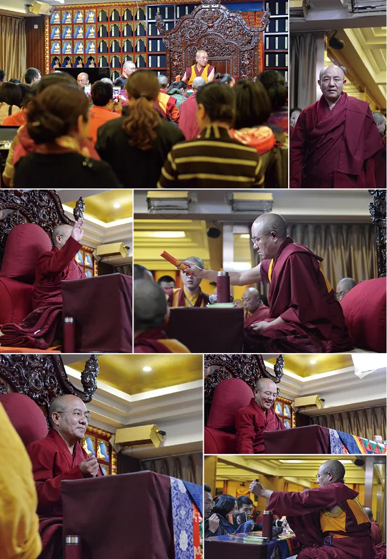
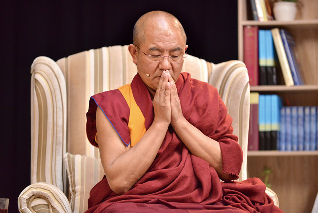
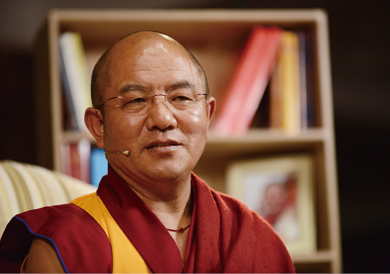
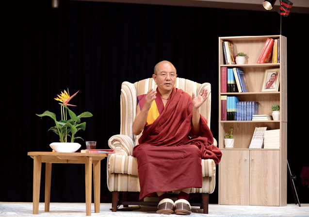
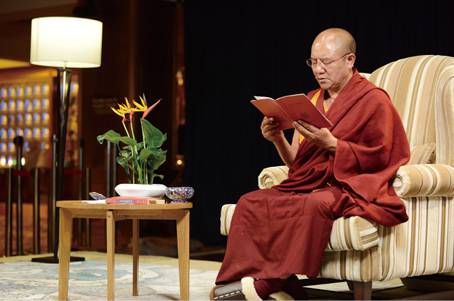
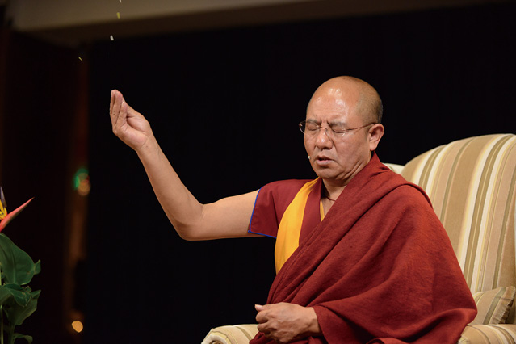

## 当今时代如何学佛

2017年7月16日

今天，是我们智悲弘法大学第17届新班的开学典礼，也是第119次网络开示。119，要很久、很久，这个数字的缘起不错。这次开示的主题是“当今时代如何学佛”。今天是星期日，大家都比较放松。我内心显现什么，就跟大家聊什么吧。

首先，我要特别感谢各个地方的发心人员。不仅仅是今天，每次我的课程，幕后都有很多发心人员在默默地奉献和付出。直播现场，有很多人在忙碌；各个网络平台，也有很多人在转播。背后这一切，你们也许永远不会知道。

虽然他们不需要感谢，但大乘佛教特别强调感恩心，能够发自内心地感恩，对自己来讲，是一种智慧，也是一种加持。所以，我在这里要特别感谢他们一直以来的默默奉献。

今天听法的人，将自己大大小小的事情全部放下，在百忙之中抽出时间学习，我也非常感谢。虽然我讲不出什么精彩的言辞，更说不出什么甚深的内容，但我会发自内心、非常真诚地跟大家进行心灵交流。我知道，大家空出这个时间不容易，所以我用一颗慈悲心，认真地给大家讲解。

## 最好的时代，最坏的时代

刚进来的新学员，有些还没有正式皈依；有些以前已经皈依，现在经过再三地观察和分析，选择了我们的团队，希望在这里不断地闻思修行。还有一部分人，多年以来一直在学习佛法，可以说是深入经藏、智慧圆满。

今天在座的学员，有一些是因为亲朋好友而学习佛法，获得了利益，被亲朋好友劝进来的；有些没有明确的目标，人云亦云、懵懵懂懂，跟着别人就进来了；有些在生活中遇到了不愉快的事，为了寻求心灵的归宿，加入这个团体；有些对轮回生起了厌离心，想要获得解脱，想寻求大乘佛教，从而加入我们的群体。不管怎么样，刚开始每个人的目的都不同，但到了最后，都会明白大乘佛教的究竟思想是什么。

现在这个时代比较特殊。就像一个英国文学家说的那样，这是一个最好的时代，这是一个最坏的时代。为什么说是最好的时代呢？因为互联网、智能手机的普及，小至村落、大至全世界的各种资讯纷至沓来，在每个人面前上演“信息大爆炸”。只要想学、想看，各种知识都能轻而易举地得到。

以前我们求一点知识，有时需要越过千山万水。但现在完全不同了，世界就在我们手中，信息就在我们眼前，寻求知识的过程变得异常容易。十几二十年前，在虚空中聚集这么多人共同学习，我们连做梦都无法想象。如今，因为科技的发达，各种因缘的聚合，全世界所有的演讲、教言或知识，都可以在我们的眼前呈现。这个时代，比前面任何一个时代都更先进、更便利。无论想要什么，都唾手可得、易如反掌。

为什么又说这个时代最坏呢？社会竞争越来越激烈，生活节奏越来越快，生存压力越来越大，人与人之间的关系越来越复杂，身心的不安全感越来越强烈，人们的内心越来越痛苦、越来越浮躁。

现在，很多人对家庭、财产、感情等，都缺乏足够的安全感。各种无法治疗的突发疾病，四大不调、自然灾害、饥荒、战争等无法想象的痛苦和灾祸，比其他任何时代都多，给我们带来的痛苦，也比其他任何时代都大。

以前的人有没有痛苦呢？有痛苦。有没有压力呢？有压力。但前后一对比就会发现，现在这个时代，物质产品特别丰富，给人们提供了各种便利，但同时也扰乱了人们的心，造成了很多心理的问题。而人们内心的问题，又没法通过物质产品得到解决，只有越积越深。

## 人工智能来了，我们怎么办？

昨天，我看了俄罗斯总统的一段发言。他说：“由于人工智能的出现，很多人的岗位会被机器人占领，大家要做好思想准备。”以前的工业革命，曾经让很多人失去工作，最后一些国家发生游行、暴乱等。现在会不会发生这样的事情呢？很有可能。而且，面临这种困境的，不仅仅是俄罗斯人，未来全球大量的在岗人员，都会被机器人取代，从而失业。对此，很多人由于没有其他的生存技能，都非常害怕。

有人问《未来简史》的作者[^1]：人工智能出现之后，人们的不安全感需要通过什么样的途径得到解决？他说，唯一的办法，就是不断深入地学习，尤其是心灵上、精神上的学习，毕竟AI不具备人类的意识。

英国著名的历史学家汤恩比博士，在他的《展望21世纪》一书中明确地说道：“未来浮躁的社会，要解决人类心灵的根本问题，唯有依靠中国传统文化的孔孟思想和大乘佛教的利他思想。”拥有大乘佛教的利他思想，可以解决很多人的心灵问题。这样的结论，应该是汤恩比博士深思熟虑的结果吧。我们并不否认，其他的宗教也会提升人类心灵的智慧，但佛教的有些道理，在21世纪的今天尤其重要。

如果我们心理不健康、内心不稳定、智慧不具足，在这个花花绿绿的世界，很容易迷失方向。而学习佛法，可以让我们获得内心的安宁与富足。因此，今天新加入的学员，虽然有年龄和阶层的差别，但你们的选择都是对的。当然，并不是因为你们加入了我们的团体，所以我就认为你们很有智慧，不是这个意思。

发自内心地讲，如果佛教不能解除人生的痛苦，不能减轻心灵的压力，不能消除轮回中今生来世各种各样的煎熬，即便我是佛教徒，是出家人，我也绝不会推荐给大家，因为这样的推荐是不负责任的。就好比一个医生，明明知道自己的药是假的，还推荐给别人，他在良心上是过不去的，会非常惭愧。

我作为一个佛教徒，有多年学佛的切身感受。凭我个人的经验，佛教的确能消除很多人的内心痛苦。那是不是学佛之后，内心所有的痛苦都荡然无存了呢？也不是，佛教徒也会有痛苦。只不过，我们面对痛苦的方式，与世人完全不同。对此，你们可以一边学习，一边修行，看看我说的正不正确。很多人经过多年学佛，逐渐体会到了佛法不可思议的力量。

## 不一样的团体

### 1．理性的学员

现在，我们每一届的新学员，知识分子都在增多，尤其是80后、90后的年轻人。为什么会这样？因为在这个自由开放的时代，你们有自由选择的空间，也有对比的能力和智慧。不像以前一些人，因为比较愚痴，只能盲从，只能随波逐流。

大乘佛教讲，佛教徒有两种：一种叫随信行者，随自己的信心加入佛教团体；另一种叫随法行者，跟随自己的智慧而行，并不是别人讲什么就跟着去，这是非常利根的人。我相信，新学员中的大多数人，不是盲目加入进来的。这一点，从前面好几届道友身上也看得出来。大家进入这个团体之前，都经过了一番了解和对比，有观察、有准备，是自己用智慧做出的抉择。

### 2．自由的平台

我们这个团体是什么样的性质呢？给大家创造闻思修行的自由平台。除此以外，我们不参与经济、政治和其他的世间事。进来的人，大多是真正的佛教徒，分属于各个不同的教派，包括藏传佛教、汉传佛教和南传佛教。藏传佛教中也有很多派别，比如格鲁派、宁玛派、萨迦派、噶举派、觉囊派；汉传佛教中有禅宗、净土宗、律宗、天台宗，等等；南传佛教也分旧派和新派等不同的学派。

除了佛教徒以外，还有一些信仰其他宗教的学员，以及一部分还没真正学佛，但对佛教有好感的人。有些佛教徒的家人和朋友，也经常看我们的直播和书籍。除了生起次第、圆满次第、大圆满等密法外，我们的其他课程均是公开的。

大家在这里，有很大的自由空间。我们不会因为你是其他派别、其他上师的弟子，就把你拒之门外。不管你的上师是谁，不管他是印度人、阿拉伯人还是非洲人，你在这里都会受到欢迎。

上师如意宝1980年建立学院，1987年就跟汉地四众弟子结上了善妙的因缘。从那时起，各个教派之间都很团结，没有任何矛盾。上个世纪90年代，法王先后去了印度、不丹、尼泊尔、日本等亚洲国家，以及美国、加拿大、法国等西方国家。以此因缘，我们佛学院一直秉持自由、开放的理念，各个教派的人都可以前来学习。

这里就相当于一个市场，只不过是精神的市场，而不是物质的市场。如果你想得到智慧、慈悲、信心和禅修等，可以进入我们的虚空网络大学，或是加入各个地方的学佛小组，进行系统的学习。

我们的发心人员，心态多数是开放的，不会因为自己学的是藏传佛教，就不接受汉传佛教或其他教派的弟子，不会这样。只不过，个别发心人员的水平、素质或见解没有跟上，他个人的一些狭隘行为，让别人心里产生了烦恼。世界上任何一个团体，都有这样的现象。

我开始比较系统地为信众讲课，是在1991年。网络授课大概始于十年前。这十年当中，我这边算是总部，下面设了弘法教务处，里面有很多的法师。虽然他们发心的状况不同——有时由于个人身心变化而会有一些不同，但不管是网络组还是地方组，目的都不是占用别人的资源，或者利用某位上师的弟子，来达到某种目标，获得某种利益。我们的宗旨，唯一是建立一个开放、自由、轻松的学佛平台。这一点，大家有目共睹。

这样的学佛平台有没有必要呢？很有必要。如果没有这样的平台，很多人学佛可能就没有师父的指导。一个中医，没有跟师学医，别人不一定信任；一个老师，没有上过正规的学校，教师资格也不一定被认可。同样，在座的各位要想学习真正的佛法，一定要选择次第性、系统性的全面的学习方式。如果害怕压力，只想自学，最后很难成才。

### 3．正规的管理

现在，不管是开法会，还是学习，我们的门槛都在不断地提高。尽管这样，人数还是减不下来。虽然减不下来，我们也不会痛苦——从结善缘的角度，人越多越好，但是管理的压力确实很大。在生活等各方面，我们都没什么压力，但管理上确实有一定的压力。所以，我们现在想尽量地减少人数。

管理需要约束别人的行为，带有强制性，但却很有必要。凡夫众生就像轮回中贪玩的孩子，如果没有真正的老师带他回家，他就会一直流浪，一直漂泊。所以，在轮回的大旷野中，每一个孩子都需要找到和自己有缘的、具有智慧的慈母般的善知识。遇到这样的善知识后，要找到自己真正的心灵归宿，我们必须要闻思修行。

### 4．长期的学习

大家加入我们这个群体，完全是自由的，想进来可以，想退出也可以。但不管怎么样，你们进来一趟也不容易，所以尽量不要忘却初心，尽量善始善终。表面上看，大家都很珍惜这样的机会，实际上，有些人的学习有始有终，而有些人则半途而废。

在非洲草原上，如果方圆几公里的草都被吃光了，斑马、羚羊等食草动物会群体性地迁徙到几千公里以外的地方去。在漫长的路途中，有的会遭遇狮子、猎豹、鳄鱼等猛兽的袭击，有的在过河的时候，被水淹没，没办法上来。

佛教徒长年累月的学习过程，就像食草动物漫长的迁徙之旅一样。在这期间，会有很多猎豹般的恶友引诱你，狐狸般的恶知识指导你，也可能深陷在河水、沼泽般的恶劣环境中难以自拔，还可能遇到里里外外的各种障碍。最后真正能到达目的地的，少之又少。

去年，我们统计了一下学满10年的学员人数，并给大家发了一个挂件，里面有法王如意宝的一根头发和一片衣服。对我来讲，这样的挂件比任何东西都珍贵，但不知道他们会不会珍惜。发这个加持品的时候，我发现学修真的是一个漫长的过程，真正从头至尾圆满学习的人并不多。所以，我在这里提醒一下，学习的过程非常艰难，大家要有思想准备。

## 宣说四法印

所谓的学习佛法，到底是要学什么呢？学习显宗和密宗的法。所谓的佛教，又到底是什么呢？对这个问题，大慈大悲的释迦牟尼佛，给我们留下的甚深教言是：“诸恶莫作，众善奉行，自净其意，是诸佛教。”结合我们自身来讲，所谓的佛教，就是不做恶事、行持善法、让心得到调伏。一个不做坏事、只做好事、内心清净、性情柔和的人，在任何一个国家、任何一个民族中，都应该算是一个好人吧。而佛教，为我们提供了这样的教育。佛教的一些行为规范，能帮我们实现这样的目标，它既是佛教的一部分，又是护持佛教的一种方法。

在座的有些人可能在想：“学佛是不是崇拜一个神？是不是学传统文化推崇的某些知识理论？”都不是。学佛是要规范你的内心，让你远离恶的行为和习气，变成一个好人。我们佛教唯一是讲这个。除此之外，再也没有其他的内容。这不是我说的，也不是其他的某个人说的，而是佛陀在《别解脱经》中明确讲到的。这种精神，所有的诸佛菩萨和传承上师，不断地给我们宣讲，所以自古以来，一直代代相传。遗憾的是，现在很多年轻人，并不清楚什么是真正的佛教。

佛教的内容是什么呢？四法印，也即“诸行无常，诸法无我，有漏皆苦，涅槃寂静”。这四句话，是释迦牟尼佛对共同乘的行者讲的，把佛教的内容说得非常清楚。

### 1．诸行无常

众所周知，在这个世界上，万事万物，一切的一切，包括我们自身在内，都是无常的，这就是所谓的诸行无常。如果对这一点有甚深的体会，将来的生活即使发生变化，也不会痛苦。不管你修行有多好、境界有多高，无常都是非常重要的修法。甚至，一个没有任何信仰的人，只要懂得了无常，对生活就有很大的帮助。以前我讲过的《开启修心门扉》和《扎嘎山法》，都特别强调了无常的重要性。

新生入学，最好从无常的内容开始学习。这样以后，当我们的人生发生一些变化，就能比较轻松地面对。这就是佛教的加持、佛教的力量。

我对自己以前的开学典礼，印象很深，不知道你们有没有印象。我去甘孜师范学校就读的时候，第一天就是开学典礼。已经过去33年了，当天老师的讲话内容，我依然记忆犹新。以后，你们不一定记得我讲了什么，但今天的开学典礼也许能记得。

大家今天来听我的开示，有些抱着审视的态度，“我倒要看看，这个老师会讲些什么”；有些带着恭敬心、无记心等，有各种各样的心态。其实，佛教讲究依法不依人，我个人怎么样都不要紧，重要的是，我说出来的法，是本师释迦牟尼佛传下来的，希望能深入你们的相续，融入你们的生活，发挥积极的作用。佛教的甚深道理，是当今时代所有知识中最宝贵的，并不像我们在手机上查找一个名词、一个知识点那样来得特别容易。

无常又可以分为粗无常和细无常。在佛教中，再没有比无常更简单的法了，所有的初学者都能理解。但这么简单的无常道理，却可以在生活中帮我们解决很多实际的问题，让我们变得更加积极、阳光、快乐，从此不再消极——所有的一切都是无常的，没有什么过不去的坎。

### 2．诸法无我

诸法无我的道理比较深，我今天不作广说。简单地讲，所有的法显现上是存在的，但实际上却是如梦、如幻、如阳焰、如乾达婆城、如水月、如水泡等，没有真正的实义。如果从胜义的角度进行观察，既没有我，也没有我所。这样的道理，并不是一个传说，而是宇宙万法的真相。

一个真正的佛教徒，一定要懂得“我和我所不存在”的中观空性思想。今天在座的，不管你是学者、科学家，还是文化水平一般的人，都无法跨越这个真理。

我在外面经常接触一些科学家，虽然他们很有学问，但我心里并不怕。当然，我并不是打架比他厉害，所以不怕，而是觉得，自己用佛教的空性理论或者最究竟的推理跟他辩论，应该能够以理服人，而且，这样的理论对他个人应该是有利的，不会有害。实际上，只要是真理，东西方的任何一个科学家，世间任何一个有智慧的人，都会尊重，都会接受。

说实在的，不管什么层次的人，我都愿意接触。因为我百分之百地相信，佛教的有些真理，无论是谁，只要能够得到，对他的生活，对他的人生，对他的健康，对他一切的一切，都绝对有百利而无一害。

诸法无我的道理，通过中观思想来抉择，完全可以明白。

### 3．有漏皆苦

什么是有漏皆苦？我们的生活过得再美好，它的底色也是痛苦的。这样的道理，有些西方人不一定承认。实际上，只要你用智慧详尽地观察，生活中许许多多的感受，都离不开痛苦的因、痛苦的果、痛苦的自性，痛苦会连绵不断成为其他一切的因缘。

对很多人来说，如果懂得了有漏皆苦的道理，对轮回会有更深层次的认识。当生活遇到坎坷、挫折或烦恼的时候，意味着你有了很好的机会，可以反省自己、审视人生。由此，你对从轮回中获得解脱，会产生更大的向往，而积极性却不会有所减少。可见，有漏皆苦的道理，我们非常有必要去学习。

### 4．涅槃寂静

当我们所有的痛苦，通过无我智慧抉择之后，会达到不住两边的清净涅槃。从此，我们通达了万法的实相，证悟了心灵的实相，可以任运自成地利益无量无边的众生，而轮回所有的痛苦，也都消失得无影无踪。这就是所谓的涅槃寂静。

以上简单地讲了四法印的教义。懂得四法印的意义，对我们的修行会有很大的帮助。

## 唯一值得炫耀的地方

今天在座的各位，有些长期坚持闻思修行，特别精进，不管是我的网络开示，还是日常的教学课程，都非常乐于参与。这样的道友，相续中的习气会逐渐断掉，智慧会逐渐增上。可见，对学习佛法而言，长期的积累非常重要。

大家要知道，加入我们的团体就是为了闻思修行。在学习方面，我们给大家提供了法本和光盘，以及可供下载的网络资源。有些内容是我前几年讲的，大家要再三地学习。学会最大的特点，就是有很多珍贵的学习资料。虽然前期资料的清晰度和音质不如现在的，但我还是希望你们好好地利用，坚持学习。从传承、内容和加持的角度来看，都跟现场听闻相差无几。

前辈大德们在几百年甚至几千年前留下来的文字，到今天同样具有活力和功德，同样有着不可思议的加持力。上师如意宝在世的时候，经常引用前辈大德们的教言。我们也要认真学习这些善知识的教言。不论是听音频还是看视频，都要当作是在善知识面前，现场听取教言。如果能够这样观想，自己获得的利益就和现场听课没有什么差别。我有一次在课堂上，结合现代科技的理论，专门分析过音频保存对于未来弘法的意义和作用。

在座的新生，从六月份开学到现在，已经有一个多月时间了。大家刚开始在一起学习，会有一个磨合期，可能觉得有一些困难。但为了学到真正的法，人际关系遇到一点小小的违缘，并不算什么，希望大家尽量克服。不要像我前面讲的那样，自己本来很有善根，完全可以系统地学习，但却因为自己认知上的问题，或因为和道友之间相处不融洽，或者因为其他的个人因素，最后不得不退失。虽然我并不需要很多人，但你既然加入进来了，中间最好不要退。否则，以后当你回忆起这件事，也许会有遗憾。

我遇到过很多退失的道友，每次我都会问：“你现在还学佛吗？”每个人的回答都是：“我曾经学过一段时间，但后来因为什么什么原因，没有坚持下去，现在很惭愧。”也许只是口头上说说，也许是发自内心，但不管怎么样，他们最后都会说到“惭愧”两个字。

总之，希望大家稳重地学习佛法，尽量地跟自己的烦恼作斗争，不要半途而废。

在大家学习的过程中，有很多人在背后提供各种各样的方便，包括提供道场。所以，我在这里要特别感谢这些道友。其实你们辛辛苦苦赚钱买房子，如果一直空在那里，让它变成“鬼屋”，也不太好。提供出来给大家做共修的道场，功德非常大，我非常随喜。

有些人经济比较宽裕，就把自己的空房提供出来；有些人经济上并不宽裕，就把自己住的房子拿出来做道场——自己依然还住在里面。不但如此，有时候还管吃管喝。其实，即使没有吃的、喝的，也不要紧。只要有个地方就行，我们需要苦行。

我刚来佛学院的时候，只有法王如意宝的大型讲课是在经堂里进行——当时唯一一个破旧的经堂。除此之外，所有的班级、所有的辅导课，都在露天完成。夏天下雨，冬天下雪，都照样进行。冬天下雪后，稍微扫一下，大家就在雪地上席地而坐。就算没下雪，地面也全是冰冻的。坐在上面久了，站起来那块地方都融化了。

那时，我每次讲课的时候是这样，每次听课的时候也是这样。所以，在我的人生经历中，没有什么值得炫耀的地方，但唯一值得骄傲的是，我曾经在上师们面前乖乖地听法。在闻法方面，我确实很有意乐。

## 不搞商业，不搞接待

还要强调的是，我们这个平台不搞传销、直销、电商和微商。虽然现在有很多这样的平台，但我们这里不是。我知道，有些道友需要依靠这些生活，但你们最好在自己的平台做。如果只是为了推销商品，那就不要进来。

当然，管理人员也不要因为有些人互相加了微信，就马上开除他们。现在是21世纪，如果不是有一些特殊或恶劣的目的，同学之间或上师与弟子之间，有一些微信沟通，也没什么大不了。

去过西方国家的人都非常清楚，这样的自由平台是可以共享的。只是，我们不要该学习的不学习，光知道卖各种各样的东西。这样的话，我们的道场会变得特别混乱。

另外，我并不反对你们迎接自己的上师，我对私下的个人行为从来不反对。但是，在我们的道场中，最好不要迎请这样那样的很多上师。哪一个是真正了不起的大阿阇梨，哪一个不是真正的善知识，我们很难分辨，并不是所有具上师头衔的人，都是真正的上师。

有些人抱怨说：“你们佛教徒好糟糕、好麻烦，我现在都不想参加你们的学习了。”这可能只是你个人的问题。我们的宗旨很简单，就是闻思修行。我们的平台也很简单，除了学习的事情，不推荐其他任何的信息，也不作其他任何个人的宣传。除了本师释迦牟尼佛、法王如意宝等传承上师的照片，其他的一律不要挂。包括挂我个人的照片，我也不赞同。我们不要皈依人，而应该皈依佛。

我们要组建一个开放、清净、轻松的佛教团体，所以道场要简单化、合理化，唯一目的就是闻思修行。如果闻思修行搞不上去，人际关系也搞不好，那还是不来为好。

佛教徒里真的有坏人。来了一个坏人，所有的人都起烦恼。他在里面待一百天，大家就烦恼一百天。把他开除了，其他所有的人都轻松。虽然大乘密法里讲，烦恼即是菩提，但我们还没有到那个境界。坏人走了，真的特别轻松。我们佛学院，有些班级也有个别恶劣的人，给大家增添了很多不必要的麻烦。

所以，佛教徒一定要善于观察。不然，有些人表面上是佛教徒，但他来这里不是为了学佛，而是带着各种各样的目的，要么宣传五花八门的东西，要么搞乱七八糟的事情。对这样的人，各个地方小组最好不要接收。

我刚才再三地讲，这里不是接待站，也不是商业平台，这里只有闻、思、修。谁有闻思修的意乐，谁就可以到这里来。跟其他团体相比，我们的课程和管理要求都比较严格。可能正是因为严格，参加的人反而越来越多。

无论是我本人，还是下面的发心团队，都没有任何其他的目的。我们共同的愿望是：在这个混乱的时代，希望你们能依靠佛教的知识，今生和来世都得到快乐和安全感。

佛教的智慧浩如烟海，世间知识难以匹敌。但能不能深挖，能不能获得，要看个人的缘分、精进和信心。如果有虔诚的信心，有清净的戒律，有闻思的意乐，也有深挖的精神，我相信很多人都能获得这种与众不同的智慧。

虽然我们身处五浊恶世，烦恼浊、见解浊、众生浊等，样样俱全，大环境非常恶劣，但如果拥有佛法的智慧和悲心，“犹如莲华不著水”，在任何群体都可以出类拔萃，展现出特殊的才能。这一点，说是佛教的威力也好，加持也好，智慧也好，都可以。

## 奉献生命，才能获得生命

佛教的学修很重要。如果没有实修，就没办法把所学的知识落到实处，没办法提升自己的生活质量。但我们只有学习和修行还不够，还要利他。

在利他方面，不要说我们大乘佛教，世间人也会倡导。爱因斯坦就说过：“我们是为别人而活。最重要的是为了这些人活，他们的笑容和幸福构成了我们快乐的源泉。”不为自己活，而为他人活，我们的生命才有价值。泰戈尔也说：“我们必须奉献生命，才能获得生命。”拥有奉献自己、忘却自我的精神，我们的生命才能实现真正的意义。

这些世间的伟人，也认为做人要有利他心，我们大乘佛教徒就更不用说了。但真正的利他，单在口头上说一说，是远远不够的，一定要经过十年八年以上的学习沉淀。

在接受佛法的时候，不管你是大学生、研究生、博士生，还是公务员、领导阶层，都希望你将这些“金色的冠帽”取下来，非常谦虚、非常恭敬，以普通人的身份认认真真地学习。到一定的时候，你会拥有足够的智慧和悲心，能将自己的精神和智慧传递给别人，从而实现生命的意义和价值。

在这个特殊的时代，佛教徒一定要有心理准备。实际上，所有的准备落到生活中，就是利益众生，这是大乘佛教最深的精髓。

听说过一段时间，各个地方要搞一些放生活动，说是给我的生日礼物。我过生日，对吃蛋糕没什么兴趣。如果你们能救护一些众生，比如，放一些我特别喜欢的麻雀、喜鹊等，我是最欢喜的。但不一定在我生日的当天，之前之后都可以。如果全部集中在当天，很多地方可能都比较麻烦。

我原来也讲过，不要随意地放生，一定要做到科学、安全、环保，不要违犯相关的法律法规，在佛法和世法两方面，都要尽量做到合理合法。同时还要小型化，因为大型放生容易出现违缘。

放生时，还要念佛教的放生仪轨。虽然我是凡夫人，造的仪轨不多，只有一两个，但我造的放生仪轨，应该是诸佛菩萨的加持吧，在藏汉很多地方都念了无数遍，依靠它得救的生命非常多。虽然后来再看，有些字想稍微改动一下，但最后也不敢改了，因为全球很多人都念过这个仪轨，缘起上已经有了不可思议的加持。当然，大家在念诵这个仪轨救护众生的过程中，不要忘记发大悲心。

## 结语

最后，我在这里要感恩所有的人。一个是多年坚持放生的人。你们有些参加了我们的学习小组，有些虽然没有参加，但心跟我们是连在一起的。我祈祷三宝，加持你们一切吉祥！

一个是在学习团体中一直担任发心工作的人。希望你们以后多多地发心。如果没有新人的加入，老的发心人员会比较累，这样不太好。我们需要很多有积极性的发心人员。还有一些人，常年不变地闻思修行，从来都不间断，你们的精神我也特别随喜。对以上的道友，我在这里一并感谢！

最后，我希望世界各地的人，能依靠不同的语言文字来弘扬佛法。今天的讲座，有日语和英语的同步翻译。英语听课的人比较多，日语的虽然不多，但我们还是要创造各种缘起。刚开始会有一些困难，但在将来，我们一定要让我们的弘法精神全球化、国际化。

我们没有什么其他的目的，只有为大家奉献的精神。我们这里，只是一个服务性的平台，而不是其他的什么平台。大家一定要牢牢记住这个宗旨：发自内心地为众生服务，让他们暂时离苦得乐，究竟而言，让他们的烦恼消于法界，真正获得圆满的菩提果位。

这是我们自他共同的发愿。要实现这个愿望，需要我们经常念诵、回向、祈祷三宝。如果能够这样，缘起力不可思议，到一定的时候，我们一定会如愿以偿。

时间到了。下面，我给大家念诵一些传承，包括地藏法会念诵的地藏菩萨赞颂文。跟着法会的直播念诵此文，你想得到什么，都能够心想事成。

（堪布念诵《圣八吉祥》、《怀业自在祈祷文》、《地藏赞·大地庄严》、地赞圣号等传承，为部分加持品开光，并为大众传授皈依戒）

[^1]: 科技理论类著作《未来简史》是由以色列作家尤瓦尔·赫拉利创作。尤瓦尔·赫拉利出生于1976年，为历史学家、牛津大学历史学博士和耶路撒冷希伯来大学历史系教授，著有《人类简史》《未来简史》《今日简史》。
