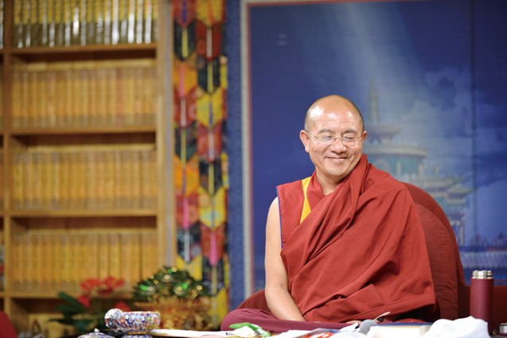
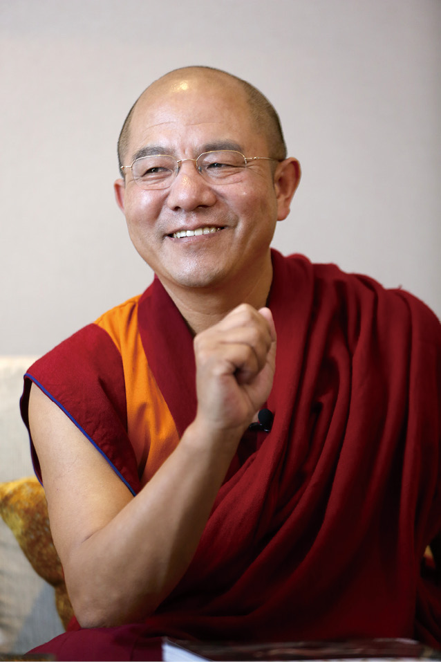
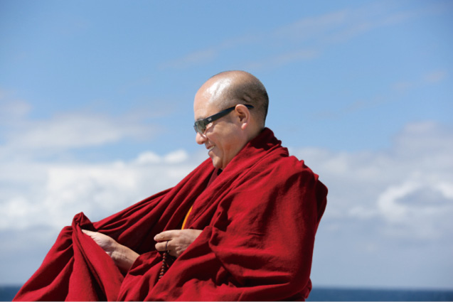
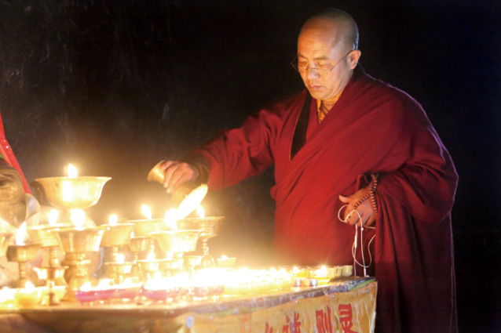

# 最初的因缘

——预科系15届新班开学典礼

2015年8月22日

现场的四众佛友，以及网络上的各位道友，在今天这个殊胜的日子，我们一同举行佛学会2015年新班的开学典礼。

## 一、学佛之路 解脱之道

本来很多道友在六月份就已经加入了我们这个闻思修行的佛学团体，但是因为当时我正在外面奔波，后来七月份我们这里又没有网络，所以开学典礼一直延迟到今天举行。

经过两个月的学习，很多人现在已经正式开始了闻思修行。有些人可能认为佛法太过深奥，怎么都学不进去，没办法正常地闻思修下去，所以就自动退出了；而有些人，越学越起劲，越学越有兴趣，已经上瘾了，准备继续不断地学下去。我们多数人已经度过了很多春夏秋冬，感受过一路上的风风雨雨，品尝过人生的酸甜苦辣、悲欢离合，现在终于走进了佛法。佛法给你带来的，不仅仅是外在暂时的快乐，更重要的是内在究竟的安乐和幸福。因此，今天我想跟大家分享一些自己的想法。

在座的各位，应该都是愿意继续学下去的。到底能不能学圆满？能不能学究竟？前方还有很多曲折坎坷的路要走。在这条攀登的路上，也许有些人累了，走不动了，就气喘吁吁地下山了；有些人被下山的人阻拦住，也被带了下去；有些人在寻找解脱之路的过程中迷失了方向；还有些人，找到了真正的路，通过自己的不懈努力，最终圆满登上了山顶。

我通过多年来的管理，以及跟大家共同学习、探讨的经历，确实能证明，学佛这条路虽不平坦，但也并不是有些人想象的万丈悬崖。只要在这条路上保持坚强、不断努力，一路唱着美妙动听的歌，每个人都会有解脱的机会，会找到适合自己的真正的解脱之道。这是我跟大家分享的第一点。

## 二、佛法妙药 现代必需

第二点，要讲一下佛教对我们现代社会的意义，或者说，为什么佛法是当今社会必需的。我们生活在21世纪的今天，虽然身处于同一片天地，但生活方式已经跟过去截然不同。这个时代充斥着越来越多的竞争、越来越多的困惑，尤其是随着网络技术的发展，人们的思想也越来越复杂。科技给我们带来了五花八门的生活方式，也带来了各种各样的分别念。我们每个人都有手机、电脑，还有各种先进的设备，如果正确运用它们，我们可以做许许多多对众生对自己有意义的事；但如果被它们控制，我们就变成了科技的奴隶，会给内心制造各种迷茫和困惑，甚至有可能演化成抑郁症、自闭症、焦虑症等问题。在这个时代，世间的妙药未必能治疗我们内心的疾病；而佛法的妙药，只要享受到一点一滴，也许就会对你的身心健康发挥极大的作用和利益。

最主要的妙法就是大乘佛教。上世纪70年代，英国著名学者汤恩比博士就说过：“21世纪要解决人类的重大问题，必须要靠孔孟思想和大乘佛教。”在解决社会问题的时候，儒家思想为主的传统文化能发挥很大的作用。但我认为更重要的是，要解决这个时代人心极度复杂烦乱的问题，依靠大乘佛教中利益他众、生起菩提心的这种无比珍贵、微妙的思想，的的确确能给自己和他人带来不可思议的利益。因此，我们应该知道，即生当中能遇到佛法这种幸福法宝、心灵妙药的人，福报的确非常广大。

不知道今天参加开学典礼的道友，将来会半途而废，还是善始善终？也许，你学了一年之后，家庭、生活、感情、工作等方面，会出现一些障碍和违缘，让你不得不放弃；也许，无论你在生活中遇到怎样的艰难困苦，你都能不断坚持下去。不管怎样，我们今天欢聚在这个空中殿堂，一起思索这个问题，这也是非常难得的机会。我有一个想法，我们相聚在这里，或许是宿世的因缘，或许是暂时的因缘，不论如何，既然我们遇到了佛法，遇到了这么殊胜的因缘，请大家一定要发下坚定、甚深的誓言——不要放弃！

## 三、因缘殊胜 务必珍惜

我想说的第三点是，大家应该知道，我们现在的因缘非常殊胜，务必要珍惜。为什么殊胜呢？首先，大家现在所学的这些佛法，是传承自大恩上师法王如意宝晋美彭措，他堪称现代佛教的再弘者。他传下来的这些法门，不但有非常确凿的教证理证依据，更重要的是有很多殊胜的窍诀，以及传承上师不可思议的加持。这一点在当今时代中可以说是非常罕有的。另外，我们所传授的佛法，无论显宗、密宗，还是其他学问，甚至包括世间的管理理念等等，这些内容你们都能在短短的几年当中圆满、系统地学到。

要在世间学一门知识，比如学个MBA的课程，一般都要花费不少金钱；而我们提供给大家的，不仅是免费课程，而且是一种非常方便、高效的学习方法。预科班四年完成，正科班五年完成，其实只是短短的一段时间。学习世间知识，至少需要九年义务教育，才能达到基本的水平；而在我们这里，佛教的基础理论以及修行方法，都能够在这短短的九年当中完全掌握。

有些人可能觉得九年太长，自己没有那么多时间。你如果只想浅浅地学一学，不需要次第掌握，那可能九年确实太长。而我们学会从刚开始设计教学体系的时候，就对课程的内容、管理，以及时间安排等等，做了非常严谨的观察、思考和审核。在我们的体系里，不仅次第性地教授了显宗、密宗的理论和实修，还有考试等相关的审核环节。我们不是仅仅给大家制定或安排一个学习任务，后面还会根据每个人的学修情况，不断跟踪、督促和提醒。这样的教学体系、教学团队，以及这种互动的修学方式，在这个时代的佛教团体中，也并不是常有的。

大家可以对比现今东西方的任何一种教育模式，在佛教的理论教育和实修训练方面，有没有像我们这样以严密的制度、负责的态度来互相管理、互相学习、互相督促的？希望大家都去观察一下周围的世界。这是我想说的第三点。

## 四、稳重包容 认真修学

第四点，修学过程中，我们应该稳重、包容、认真。我们最近发现，报名的道友当中，有一部分认为所学的佛法内容太浅，不管书本上、光盘上，还是辅导员讲授的知识都太简单了，因此并没有予以重视；还有一部分认为太过深奥，要学那么多科判、颂词、内容，要做思考题，还要进行讲考、笔考等等，这样的学习自己不一定适应得了，担心听不懂、看不懂。不少人有这样的想法。

实际上这两种情况都是走极端。对于佛法，不要遇到浅显内容，就觉得已经懂了而产生轻视，因为在词句的背后还有甚深的意义，意义背后还要通过实修与我们的心相续结合。就像佛法中最简单的“人身难得”和“寿命无常”的修法，对于很多学修多年的佛教徒，要完全消化也是很难的。但你也不要认为，佛法高不可攀，其实这也是一种自我轻蔑的懒惰。佛法是有次第、有层次的，只要你有坚定的信心、精进的行为，佛教中所有的道理可以通过一些简单的方法逐步与我们的心相续完全交融。

因此，我们既不能把佛法想得过于简单而放弃，那样可能会失去非常难得的次第闻思修行的机会；也不能认为佛法太深奥而退却。其实佛教里很多甚深的道理，你们预科班的道友还没有正式开始学，等真正学到了五部大论和密法的甚深理论，确实有许多深不可测之处。但即使这些法义非常深，我们凡夫人也可以用一种相似的理解方式产生定解，最后也能证悟到相同的法喜。

因此，大家也不要堕入一种极端，应该深入地去思维。在座很多人都有一定的学习世间知识的经验。大家都知道，当你想要学懂任何一门学问、任何一个专业的时候，绝不能轻视它，否则最后可能连简单的内容都掌握不了；也不能认为所有内容对你来讲都高不可及，其实只要努力勤奋的话，世上无难事。这是我讲的第四点。

## 五、参加共修 圆满求学

第五点，对于参加开学典礼的道友，今年可以说是你们新生活的开始。加入学会的学习，需要改变你生活的方式。有些人原来在周末和其他空闲时间，可能经常放逸、散乱，去一些娱乐场所，交往些狐朋狗友。从现在开始，你们的身体、语言、心态上都需要一些改变，需要一些改造，需要一些改革。你们要对原来那些放逸无度、过分自由的行为进行自我监督，使自己变得自律。要自律就需要以正知正念来约束自己。同时，不仅仅是依靠自我约束，更重要的是要加入我们这个佛学群体进行共修，从而互相观察、互相督促。如果没有参加任何共修，只依靠自己的力量，也许现在你的信心还比较强烈、迫切，但过一段时间，可能就会慢慢淡化，最后变得无踪无影。所以，为了防止这样的情况出现，大家一定要发愿参与共修。

在参与共修的过程中，也许你会因为时间安排、交通不便等而面临一些难题。有些人可能还会因为自己的心态问题和社交能力，不太愿意与别人相处。一开始可能有许许多多的问题要面对，但从长远的角度和更大的意义来看，共修的力量比什么都强大。因此，为了能够长久坚持，为了预科和正科的所有课程能圆满学完，你们每个人都需要群体的监督。我们毕竟是社会性的人，一旦置身于群体之中，当你想要偷懒的时候，就会在其他道友面前产生惭愧之心，由于这些特殊的心态，你就会时常自我提醒，调动起正知正念，最后你的修学就会在这个过程中日趋圆满。我们学会里那些坚持学习了近十年的道友，当分享他们走过的修行之路时，都一致认为共修的力量最为关键、最为重要！

因此，我今天特别强调，大家在修学过程中，尽量不要优先选择通过网络在家里自学。在家里学习修行虽然很方便、很舒适、很合你的心意，但一个人待久了，自己阿赖耶上存在的很多习气，随时都有可能爆发。一旦恶习气发作起来，你曾经想要不断闻思修行、完成一切课程的信念就会动摇，最后可能全部毁于一旦。我们要防备这种可能性和危害性。因此，我再次强调，大家求学圆满的唯一方法就是参加共修。

## 六、闻思佛法 调伏自心

第六点，我想告诉大家，一切修学，首先必须建立在理论的闻思之上。一直以来，汉地的一些寺院和佛教团体中，普遍缺失系统性、次第性的闻思修传统。比较而言，我们如今有了这样一种更具先进性、科学性，同时具有殊胜加持的闻思修方法，大家千万不要抛弃。

如果没有认真进行理论的闻思，最简单的修法都不一定修得圆满。最近我们在学《大乘经庄严论》，通过了解其中的道理，我们就可以观察自己的智慧、慈悲、信心、安忍，以及其他种种威力是否成熟。作为佛教徒，我们不仅要有信仰，更要重视理论的后盾。然而很多佛教徒一直是在迷信，这让我很担心。他们也许是非常非常虔诚的人，但并不清楚自己到底在信仰什么。为了解决这个问题，遣除自相续的迷信，我们每个人都要下功夫，努力增上自己的智慧。

要增上智慧，唯一的方法就是依止具有法相的善知识。在这一点上，我必须要做特别提醒。对于某些新来的佛友，我不得不说点不好听的：你们的心态比较幼稚。可能今天不管遇到什么样的上师，你们都会去依止。我不介意你们依止多少位上师，但我非常担心，你们要是依止不慎，有可能会把宝贵的时间、精力、青春、资源，全都浪费。

所以，我们应按照《大圆满前行引导文》里所讲的那样，首先要学会如何观察善知识。如果你没有这样的智慧，那就要更加谨慎。当今这个时代，尤其是在汉地，佛学圈子可以说是鱼龙混杂。在我们每一年新班开学的时候，都会发生各种各样的情况。有些人并不是真正想要解脱，也并不是为了学习佛法智慧——他们有的是为了治病而学佛，有的是为了发财而学佛，有的是为了出名而学佛……当然，也有不少人是真正为了获得解脱、为了利益天下无边众生而学佛。当我们面对这个群体中形形色色的人时，必须观察深思：自己身边的佛友到底有没有得到真正善知识的引导。

所以，学佛最首要、最关键的，就是要学会观察善知识，真正经过观察以后，才可以依止，在这之前不要随波逐流，不要人云亦云。这个时代下，具备相应的资格——精通显宗密宗、外内密戒律清净、具有殊胜的大悲菩提心、自相续已经圆满成熟、有利益无边无际众生的威力，这样的善知识大有人在；但为了名声、地位、钱财等各种目的，假装出家人的虚假善知识也层出不穷。在这个时候，我们一定要学会谨慎观察。大乘佛教的《华严经》中也再三强调，作为初学者，一定要反复观察善知识，不能轻易、随意地依止任何一位上师。经论之中这类教言比比皆是。

谨慎依止善知识之后，要在认真闻思理论的基础上，去调伏自己的心。很多佛教徒也许理论上讲得天花乱坠，然而真正跟自己内心相结合、跟身口意相对应的时候，理论是一套，自相续又是另一套，两者之间也许有千里之遥。如果这样，闻思再多都不能成为真正的解脱之道。归根结底，我们通过学习，一定要调伏自相续中以强烈的贪嗔痴为主的一切烦恼分别念。

调心是修学佛法的根本，也是我们学习的最重要的目的。在我们的学习体系中，要通过五十万加行等修持之法，把自己变成一个真正的修行人。我并不指望把你们所有人都培养成对标博士学历那样的弘法人才——当然有的话，我也很随喜。我更希望的是，你们每一个人都能自心调柔、寂静，具有善心、菩提心，至少不要太敏感、不要烦恼太重。

现在城市里有些人烦恼非常重。一些从大山里出来的修行人，经常有这种感觉：这些人怎么会这么敏感脆弱？别人对他稍有看法，或者某句话、某个行为稍微不合适，对他而言似乎都会带来须弥山那样大的烦恼和痛苦。如果有这种心态，人活在世上是极其痛苦和悲哀的。一个成功的修行人，无论生活怎样的环境中，都会保持自在和豁达、快乐和包容。真正的修行人，始终都会有一种开心、从容的心境，因为他的修行已经运用自如，身心已经获得自在，这种心态下利益众生对他而言是轻而易举之事。这是我讲的第六点，在闻思的基础上着重调伏自己的心。

另外，希望以后听课也好，开会也好，大家一定要有时间观念。今天刚开始在网上听课的人并不太多，但现在人数越来越多了，这些人迟到也许是网络不好，也许是堵车，也许是随便来听一听——出入自在，这就是没有时间观念的表现。希望我们佛教徒要有这方面的意识。

## 七、理解付出 发心护持

第七点，如今有这么好的因缘，也许有些人想得比较简单，觉得堪布和道友们给我提供这些条件是天经地义的，自己只要来学就可以了。其实这种想法不一定很对。要知道，在这些因缘的背后，有许许多多出家人和在家人的辛苦付出。他们放弃了自己的闻思修行，放弃了自己的工作和家庭，一心一意地为我们的学修付出无数心血，这一点大家应该清楚。

比如我们手头的一本教材，它是怎么得来的呢？首先，要感谢了不起的原作者，这自不必说。我将它翻译成汉文，也是一个很大的工程。翻译完之后，要有人校对、输入、二次校对，然后是排版、印刷，印出来之后，还要装订，最后再运送到各地的书库……了解背后的工作量，会感觉得到这本书的确很不容易。你拿到它的时候非常简单，但是翻开想想，封面设计要花多少时间？扉页选择放释迦牟尼佛还是莲花生大士的画像？第二页总目录下每一个子目录，有多少章节和文字？其中每页字体大小、行间距等都调整过多少次？你以为发到你手里的这本书是现成的，但实际上并没有那么容易。学会里有不少人，因为领教材的一点点麻烦就退学了。当然，众生是各种各样的，我们也并不计较。但是希望你们想想发心人员的付出。且不说成本上要花费多少钱，光是时间、精力和整个团队的人力付出，就是难以计量的。

做法本很不容易，做光盘更难。每一个视频前期的工作都要有长时间的拍摄。摄像是很辛苦的，我们摄像团队的很多人都已经累到极限了，有人一直撑着，也有人想换个岗位。如果一个摄像师走了，我们就要再花两三年的时间重新培养。拍摄之后还要进行后期制作，要剪辑、配字幕……连字幕节奏都要调得符合讲者口型。也许你们挑毛病的时候很容易，觉得发下来的光盘质量不好、效果不行，其实它们都来之不易。

我认为，讲经说法的光盘放在家里，就跟真正的善知识没有什么区别。虽然通常法本留存于世的时间会久一些，但还原讲法现场的效果，法本是比不上视频的。通过视频来接受法义，就跟直接面对面听受没有差别，有更直接的加持。我跟很多人都是靠光盘结缘的。有人对我说：“我从视频上认识你已经好多年，今天终于见到本人了。”从视频上和从书本上认识确实有些不同，有一种零距离的感觉，通过影像可以产生一些感情连接。就我自己而言，对一些前辈大德开示的影像资料，包括上师传法的光盘、磁带，我会比法本更为重视。

发到你们手里的可能只是一套光盘、一套书籍，或是一个简单的奖励礼品，但这些都是极具保存价值的。要知道，它们背后有很多道友的辛勤付出，而且这些付出都是无偿的。如果要按世间标准对每一项工作计算成本，恐怕再富裕的人也付不起报酬。正因为佛教中信心的力量非常强大，这种力量比一切更有价值。我一直认为，如果不是靠信心的力量，很多事情是做不下去的。要按世间的成本计价，在当今时代要做出我们这番事业，恐怕是不可能的。

所以，我要提醒大家，一定要想到背后这么多人的付出，希望你们把所有教材和资料，都当作真正的善知识来顶戴、供养。也许当你离开人间的时候，有这些法本和光盘等三宝所依放在身边，依靠它们的殊胜加持和解脱之力，你就不会下堕恶趣。

我想强调的是，希望你们来到学会之后，不要认为一切都来得非常简单，每个人都应该有一颗感恩之心。世间一门寻常的知识和学问，你想得到也并不容易。现在很多孩子去学一些国学、英语、古琴之类的课程，要找到好的老师、好的课程资源，都要付出很多代价。我在机场经常看到一些企业家、管理者的演讲视频，有些讲得很好，我就会请一套光盘。但有的光盘价格特别贵，我一方面有点舍不得，一方面又很想请。有一次看上了三张光盘，要700多块钱，我犹豫了半天。因为它有版权，所以就这么贵。还有一次，想在网上听一些学者的演讲，但必须付费，于是花了1000多块钱，可只让听一段时间，后来就不能听了，这也没办法。

所以，我们即使想获得一点世间的知识，也并不是那么容易的，需要一定的付出才能得到。而且，有些人对免费的、太便宜的东西都不重视。西方国家很多人就是这样。比如我应邀去演讲，一开始对主办方说，凡是我的演讲都免费，结果发现人们都不重视，所以后来我让主办方适当收取点费用，这样一来效果好了很多。但我们学会现在原则上除了极个别的法本之外，其他一切还是免费提供给大家。

我尤其要感谢的是在城市中为大家提供道场的发心人员。就如我刚才所讲，这体现了信心不可思议的力量。当很多素不相识的人聚到你家里，打乱了你原有的生活状态，带来了种种让你不适的习惯，对于你而言，这种发心一边要提供道场，一边要修安忍，一边还要时刻与自己的吝啬、烦恼之心交战，确实很不容易。但是，我看到有那么多大乘佛教徒，还是愿意把自己的空余房间提供出来给大家共修。如果你们各方面因缘具足，我希望你们尽量把这种发心多维持一段时间。有些人一开始感觉很好，发心也很大，非常欢迎大家到自己家中共修。然而等各种各样的人来过几次之后，发现家人不太支持，邻居也些点意见，自己的心力也没有那么持久，就改变了主意，找种种理由不再让大家来了。的确，坚持提供道场是很不容易的。所以，如果你们有这种能力，我希望你们首先要用智慧来再三观察，一旦答应了，就不要随便反悔。智者的承诺就像刻在石头上的文字一样，不可能轻而易举就抹掉，因此誓言一定要坚定。既然做出承诺，就应该坚持三年、五年乃至终生。

前阵子我也开玩笑说过，你们把房屋用来做道场，这份资产才真正有了意义。我经常想，汉地和藏地有一些寺院，外面虽然金碧辉煌、非常庄严，可是里面没有人。硬件设置很好，但没有软件。从佛家的根本目的来看，软件才更重要。当然，软件的教育也离不开外在的硬件条件。

因此，对于我们学会中在硬件方面为大家提供方便的许许多多道友，我一方面特别感谢，另一方面，也希望你们在面对各种问题和困难的时候，能勇于坚持。我们只要肯坚持，世界上很多的问题，都是可以面对、可以超越的，甚至会得到一种想象不到的力量，来帮助我们获得最终的胜利！

这是我讲的第七点，就是请大家要理解我们的付出。

## 八、发心清净 配合管理

第八点，我们学会从创始至今一直有自己的制度。在学会内部，无论是管理人员，还是参与的学员，每个人待遇都是平等的，并不会因为职务关系等因素，而对这个人宽松，对那个人严格。凡是具足条件的成员，都享有平等的权利和义务。

我们也有自己的管理原则，可能跟其他一些道场和团体有所不同。我之前就强调过，我们的学会并不是哪位上师的接待站，学会的人员也不是谁的接待员和服务员。你如果是真心诚意想要学习，可以加入我们，但如果你想利用这个平台来搞各种宣传、化缘、传销，搞个人宣传，甚至搞一些涉及政治、经济的事，那不管你有什么背景、财富、人脉、身份，都只能说明你没有来这里修学的因缘。虽然你具足如来藏，但我们没有办法接收和管理你这样的人。

所以，我希望凡是参与我们学会的人，都是一心一意来认真学习和修行的，不要带有任何私人目的，也不要来这里宣传其他道场、其他上师甚至生意业务等等。如果怀着这样的目的，我们希望你最好不要加入这个学会。即使你加入进来，时间久了以后，学会也不可能发现不了，到时候假面具掉落在大家面前，你自己会很尴尬的，我们也不太愿意看到这种局面。因此，在学会的管理过程中，如果发现这类问题，我们的管理人员会公正地采取一系列的必要措施，到那个时候，希望大家有心理准备，并进行配合。

我也希望你们在加入这个团体的时候，好好想一想，自己的目是否单纯，自己的心是否清净，如果有其他目的，我们希望你们不要加入。即使有人现在已经加入进来，学了两个月的时间，但我也会双手合掌祈请你退出这个群体。否则就像俗话所说，一粒老鼠屎染污一锅汤。一个目的不纯的人，会带来很多麻烦。在我们的群体当中，如果有人搞些不如法的活动，也许所有人闻思修行的因缘都会被破坏。这样的事以前也发生过。所以对于这种人，我今天双手合掌祈请你退出学会。

我们管理学会的目的，是为了大家能够健康地、合理地、持续地学习下去。你们应该这样思考：我作为一个世间人，真正要去一所寺院或者佛学院完成系统的修学，目前恐怕是不现实的，因为我有家庭、单位和各方面的责任。既然无法放弃一切到山里闭关修行，那现在加入学会就是最好的选择。一方面能保障自己的正常家庭、工作和生活，同时也不耽误学习大乘佛法。虽然我在修学的过程中可能要面对很多问题，但这确实是一种难得的机缘。

我知道，有些学员能坚持学习五年、六年，甚至十年，非常不容易。有人每个星期上课都要应付各种问题，要找理由跟家人、朋友交代。刚开始的时候，你可能会有点不习惯，因为各方面要应对的问题比较多，但时间长了以后，你周围的亲朋好友，也都会理解你的。因为他们会发现，你这个人在学佛之后并没有变得越来越不像话，而是在为人处世上越来越有长进，对待身边的人也越来越好，这样的话大家都会认可你的。

我在这里尤其要强调一点，你们很多人是刚开始学佛，在一开始的时候，希望你们不要过于冲动、过于狂热，否则，等你自我感动的汪汪热泪流干了，以后可能就再也流不出来了。最初的时候很多人都容易激动，在这种心态下，千万不要忽视你的家庭关系。你们毕竟是在家人，要对家庭负起责任。所以我们要求大家保持理智，尤其对家庭、对自己身边的人，一定要学会照顾、配合他们的感受。如果你因为自己学了佛，就把所有的生活方式都改变了，不跟他们吃饭，不跟他们说话，天天只会拿着课诵集，念“嗡玛呢巴美吽”，这样的话绝对不行。有些道友学佛学得不太灵活，不会随顺世间。当你能够与身边环境融合无碍的时候，才可以进行你的学修，否则，若是在单位里整天转着转经轮，很有可能会被领导开除的。

所以呢，我们刚开始的时候不要太着急，不要太激动。但学了两三年之后，也不要变得太冷漠。像我的话，到佛学院已经30年了，但是我对闻思修行还是有意乐的。只要有时间，我就会看书、会学习，我对佛法的信心好像从没有减退，对佛学的闻思一直非常有兴趣。你们如果学习我这一点，等过了30年以后，对佛教的闻思修行还有强烈信心的话，这也是非常好的。

我希望你们在学佛的初期，一定要会善巧地处理身边的人际关系，不要因为学了佛，自己的行为和眼神就变得奇奇怪怪，无法跟别人正常沟通合作，吃饭的时候一直念咒语，不跟大家说话……这样的话，别人会觉得你有毛病，很有可能把你捆起来送到精神病院。那时候你解释：“我是正常的，我只是精进于闻思修行，害怕浪费时间……”他们也听不懂你在说什么，这样的话就比较危险。所以我们希望，刚开始学佛的人一定要善巧地处理身边的各种人际关系，等你的信心、慈悲和智慧逐渐增长起来，那时候你做任何事情都会更为顺利。

所以，我希望大家，要理解管理的必要性，也要懂得配合管理人员。所有学员，从现在开始，不能再像以前那样自由散漫，必须遵守学会的管理制度。我们的管理是比较严格的，要检查修学的考勤，还有很多统计表格和监督措施。你们都知道，世间的自由职业者和正规企业职员，做事的约束上是有差别的。如果你是个自由人，想说什么、想做什么都可以，没有人管你；可你一旦进入正规单位，就要服从很多方面的约束和要求。所以，希望大家都能配合我们的管理。

现在我们学会的要求是比较严格的，准入门槛必须提得高一点，否则人太多了没办法管理。大家都知道，我们刚开始在2011年、2012年、2013年的时候，每年都招收两届新生，从2014年开始，改为只招一届了，今年应该是第8届。我们的招生人数也在调整中。从整体方面要看我们能管理多少人，要是人数超出我们的管理能力，以后改为两年甚至三年招收一届也是有可能的。当然，我们会根据具体情况来调控管理方法，这是我自己的想法。

还有一点，我必须跟大家说明，对于参加学会的人，我个人对你们没有任何目的，没有想过依靠你们来得到世间的名闻利养。我们这里的发心人员和管理人员也没有这种目的。我们的目的是什么呢？就是让你们每个人真正找到一条人生的光明之路，这就是菩提学会建立的唯一目的，我们为此再累、再难、再辛苦也在所不惜。只要你们哪怕一个人，在复杂的生活里，能从原来面对人生、感情、生死、解脱等问题的迷茫中，找到一种方法，找到一种力量，这就是我们真正想要的。我们日日夜夜所有的付出，其实就是为了这样一个目标。

我也希望这届学员，能以利他心尽量站出来发心。在发心的时候，千万不要以私人的、世间的、不清净的心态做出一些不合理的事，甚至搞一些破坏。那样的话，从世间和从出世间来讲，对你个人都没有任何实义。在我们这个集体中，如果有一个好人来发心，是非常有意义的；但如果我们当中出现一个坏人，虽然不见得能造成多大的破坏，但可能会给集体带来一些麻烦和困扰。

## 九、坚定勇敢 弘法利生

各位学会的道友，你们学佛的路是漫长的，希望你们心里要有一种很好的准备。不只是学佛这条路，世间任何一条人生之路，都需要慢慢走下去。但是，只要我们有一颗坚定的信心，坚持走下去，其实并不会很难。

今天这个开学典礼，是我们最初的因缘。这场开示我没时间好好准备，因为今天我为了学院和学会的各种事务，一直在开会。但我觉得，只要大家都有一颗利他之心，什么事情都阻挡不了我们的前进。接下来，我们就一起好好地闻思。你们今年刚开始学习佛法，其中或浅或深的道理，也许你现在并不是很明白，但只要长期坚持努力，任何智慧都可以潜移默化、自然而然地在你的相续中不断积累，最后你的一切都会有进步。不仅仅是佛学，世间上任何一种知识教育，只要你浸泡在相应的环境、氛围和人群当中足够久，都会逐渐受到教化。相信你们将来都会成为真正善良的人，成为真正的修行人。

同时，也希望大家不要把佛教的修学看作一件简单的事，这并不像学一门瑜伽课，或者是去体验一次沐浴、按摩。佛教的调心方法需要很长的时间，但你从中得到的收获也会越来越多。希望每一个人从现在开始，一定要树立一种坚定的信心。你们在修学过程中，也许会遇到一些退失的因缘：有时候是因身体不适而想放弃；有时候是你身边的恶友劝你放弃；有时候是你学习跟不上而想放弃，有时候你会心情散乱、产生各种烦恼分别念；有时候你的家人、朋友会阻止你；有时候你的工作或者家庭会出现一些麻烦状况……也许你在修学过程中会遇到种种违缘，然而这些就像乌云，一旦把它们驱散开来，你又会再次恢复原有的心境。不断跌倒，又不断地站起来，这就是人生最勇敢的一种直面方式，修行也是如此。

我今天早上刚看了一位大德的传记，他的修行确实非常不容易，但是他一直没有放弃，正因如此，最后他成就的境界也相当伟大。因此，我们大家都要学习这种顽强的意志，我自己就很想向这些坚强的人学习。坚强的人即使遇到再大的困难，都会勇往直前；而脆弱的人，不论世间之事还是佛法修学，遇到一点点问题，就束手无策，最后只能随波逐流，无法振作起来。这样的案例有很多。

今天是一个新的开端，我希望，大家最后终有一天能圆满学业。我们大家一定要种下这个无比殊胜的因缘——弘法利生！归根结底，大乘佛教最究竟的意义，就是弘法利生。我们一起发愿共同努力，实现这个宏伟目标。

这就是我今天的讲话。接下来我按照学会的安排，给大家做皈依，还有一些传承要念——他们把我当成机器人一样不停利用了。没关系，在我的小零件、小螺丝没有损坏之前，我会不断转动的。（众笑）

今天给大家做个简单的皈依，很多新生还没有皈依过，之前皈依过的也可以再次皈依。但要知道，皈依并不是皈依我，而是皈依三宝——皈依佛、皈依法、皈依僧。最好的皈依，是为了利益一切众生而皈依；中等的皈依，是为了自己从轮回中获得解脱而皈依；下等的皈依，是为了自己今生的健康、财富等而皈依。不管你们实际是哪一种心态，现在最好还是想着一切众生。下面按《大圆满心性休息大车疏》中的仪轨，念三遍皈依偈，你们跟我重复三遍。最后一遍念完时，你们心里要想，自己从此时起已经获得了皈依戒。授皈依戒，不论在现场还是网络上都可以同样得到。

（堪布传授皈依戒并念《八吉祥颂》《大自在祈祷文》《二十一度母赞》等传承）
