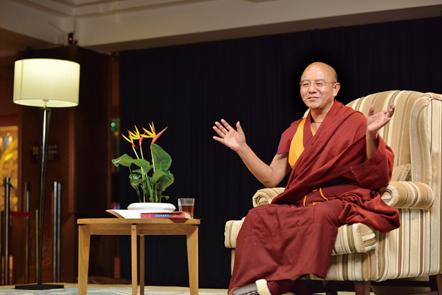
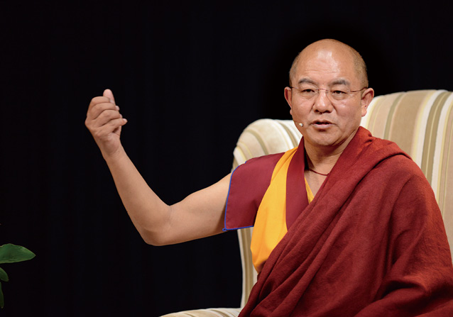

# 洗涤心灵的垢染

2017年5月31日

今天做一个忏悔方面的开示。

忏悔方面的道理，多数佛教徒应该比较明白，有一部分非佛教徒也比较清楚。下面，我利用一个小时左右的时间，简单讲一讲如何忏悔，包括什么是忏悔、忏悔方法是怎样的、忏悔对我们有什么利益等。今天的开示有同步的英语翻译，你们听汉语如果不是很清楚，可以戴着耳机听英语——可能很多人不行。（众笑）

## 殊胜的萨嘎月

我们佛学院在每年的萨迦月，也就是藏历的四月份，都有一个比较公开的法会。但今年没有，只有一个内部的法会。不过，念诵和修行基本上跟往年一样。

近几年来，我们每年都有个别的法会在网络上直播，听受、念诵的人非常多。大家亲自到佛学院参加法会的情况，以后可能会越来越困难，因为作为一个正规的佛学院，有它自己的规范和管理。如今，全球大多数人都在依靠网络生活、办公，成办许许多多的事情。所以我想，将来的一些法会和授课，大家在各自的地方通过网络来接受，可能更好。

萨嘎月集中了释迦牟尼佛降生、涅槃、成道的三个殊胜日。以前上师如意宝在世时，佛学院一年要开四个法会。第一个是持明法会，在神变月。佛陀曾在神变月降伏外道六师，为了纪念这件事，学院有这样一个法会。

藏历四月份，我们开金刚萨埵法会。农历的日期会靠前一点。按照《时轮金刚》的观点，由于天体运行不同，各个地方的历算也不太相同。比如现在，农历的四月初八已经过去，应该是五月了，但藏历还是四月。在藏历的四月初八到十五这几天殊胜日，法王选择开金刚萨埵法会。

藏历的六月份，有释迦牟尼佛初转法轮日，那时会开普贤云供法会。

藏历九月二十二日，是世尊到天界为母亲说法之后返回人间的天降日。天降日所在的这个月，学院会开极乐法会。

当然，还有很多佛陀的不同节日、莲花生大士的不同节日、诸大德的降生日和圆寂日……但按照我们学院的传统，每年最主要的这四个法会，都是与释迦牟尼佛的事业有关。

所以说，这个月是一个特别殊胜的月份。今天是萨迦月的初六，从后天初八开始，我们内部要开七天的金刚萨埵法会，第八天是药师佛法会。法会期间，全世界很多佛教徒，都在各自的地方参加共修。

共修的时候，如果各方面情况允许，希望大家准时参加，把开法会当作非常重要的事情。就像汉地经常举办的“打七”，如果是七天中念佛，就叫佛七，七天中参禅就叫禅七，还有华严七、药师七等，七天中专门以闭关的方式来修行。我们这次也一样。

## 清洗心灵的垢染

从后天6月2日开始，在早上念加倍咒之前，学院的四众道友就应该把早饭吃完、该做的事情做完，然后很正式地坐下来念经。上午两座，下午两座，一直到晚上七点钟结束。

法会的时间，学院近几年来作过调整。以前，一整天都没有很长的休息时间。现在，上午、下午各有一个小时的休息时间，中午还有一个多小时的时间。念诵方面，每一座前面都有发心，中间念金刚萨埵仪轨，后面念《普贤行愿品》摄持。

金刚萨埵仪轨和其他的药师佛仪轨、持明法会仪轨等不同，比较简单，大家都会念。我也特别喜欢开金刚萨埵法会，但因为自己太忙了，实在没办法。我现在越来越感觉到忏悔的重要性。如果没有好好地忏悔，自己也很害怕。虽然自己在很长一段时间内，都是以讲经说法为主，表面以行善的方式在度过，但实际上，自己无始以来所造的业，基本上也能推测出来，所以非常需要忏悔。但我能参加共修的时间，确实不是很多。不过哪怕一天也好、一座也好，我都非常重视，尽量积极地参与。

不管是我们学院的道友，还是各个地方的道友，我都希望你们好好参加法会。我们这边负责网络直播的发心人员，一天24小时，从早到晚一直盯着，确实很辛苦。好多法会都是他们在拍摄，方方面面的工作量特别大。但是，为了利益更多的众生，我也特别叮嘱他们坚持。希望为外面的，尤其是不能来学院的人，提供一些方便。有些道友，身体不能来学院，心里却一直牵挂着。有了直播以后，从手机或电脑上下载一些软件，就可以接收了。现在，全世界的人都处于虚拟的世界，佛教徒能利用这样的网络来接受佛法，也是一件好事。

在共同修行的过程中，大家一定要守时。学院里有个别的“老油条”，比较麻烦，好像没有时间概念，想来就来，想走就走，这样不太好。每个经堂里都要有一些要求，大家还是要注意一下。

另外，也希望大家在念诵期间，尽量不要用电子产品，比如上网、发微信、写微博、发短信、接电话等。这样的行为，别人看起来不太好。对你个人而言，一边念咒语，一边上网，也不太好。大家在学院里，一定要遵守纪律。

外面的道友，我没办法监督，但你们如果是集体修行，也希望大家一起好好地忏悔。如果有一些特殊的、重要的、不得不处理的事情，我们也没有那么死板，也有所开许。这是一个特殊的时代，如果不随顺世间，有时候也有一定的困难。

共修的功德非常大，尤其是这次共修金刚萨埵心咒。前一段时间，我发了一条微博，说是如果愿意念诵40万遍金刚萨埵心咒，就给我的微博点赞。我在想，有些人是很难完成40万遍的，尤其城市里的人，10万遍应该还可以，但我还是把条件定得比较高。一个一个地统计数量，有一定的困难，谁能完成40万，谁就给我的微博点赞，这样比较简单。我刚才看了一下，有23000多人。表面上看，人数并不多，但我大概算了一下，如果没有算错的话，念诵的总数接近100个亿。

大家都知道，共修的功德不可思议。这一次，单是依靠点赞的方式，就有非常多的人参与。我在微博上说，要在法会回向的前一两天报完。现在，法会还没有开始，就有这么多人发愿。而且，这还没算上我们学院的人——他们很多是不摸手机的，只能通过传统的、线下的方式报数。所以，我相信共修的实际数量还会更多。

总之，大家无论如何，也要参与共修。如果40万遍心咒实在没办法完成，那你能不能完成10万遍？即使念10万遍，功德也非常大。

我们每一个人，无始以来都造了特别多的罪业。尤其是你们当中的很多人，因为从小不信佛，就连吃个饭，也杀了无数的生命。至于其他的罪业，比如在网络上诽谤别人，说一些恶语、绮语，比如偷盗、邪淫、妄语，比如生邪见、生嗔恨心、生贪心，等等。光是十不善业，就造了很多。

然后我们入了佛门，受了居士戒、出家戒，因为修行遇到了种种困难，没有很好地守戒，也造下非常多的罪业。有些受了菩萨戒，菩萨戒守得不太好；有些得了灌顶，密乘戒守得不太好……这些，全部要在金刚萨埵如来面前，一一地忏悔。依靠四对治力，一定能忏悔清净。

在如此殊胜的日子里，聚集在如此殊胜的环境中，遇到如此殊胜的法门，以如此殊胜的发自内心的大乘菩提心摄持，大家共修的念诵功德的确不可思议。

大家不要觉得自己罪业深重，没办法清净。不要有太强的负罪感，一定要对自己有信心。要相信，依靠四种对治力，我们的罪业一定会得以清静。其实，我们的相续就像水晶，特别的纯洁，暂时的罪业染污，依靠诸佛菩萨不共的威力和加持力，确实能够遣除。

我们什么时候离开人间，不好说。但如果每年都念40万遍或10万遍金刚萨埵，好好地忏悔，阿赖耶上所有的病毒和垢染，是可以一一删除的。到时，我们的生活一定会获得清净和安宁。

## 皈依是一种承诺

另外，有很多人说要皈依。以前皈依过的人不用皈依。没有皈依过的人，我今天为你们传皈依，但你们皈依的不是我，而是三宝，这得说清楚。按照《俱舍论》的观点，我的身语意全是有漏的，没什么可皈依的地方。

皈依的时候，心里要想：我所皈依的佛尊，是释迦牟尼佛，他是觉悟者；还要皈依佛所说的法，也就是八万四千法门，或者说佛陀三转法轮所讲的显宗密宗一切法；还要皈依佛陀的追随者，比如文殊菩萨、观世音菩萨等具足功德的菩萨，以及具足戒律的四位沙门以上的僧团和居士。也就是说，皈依觉悟者佛陀，皈依他所说的正法，以及皈依佛陀真正的追随者。

现在，我们在十方诸佛菩萨面前发誓：从今天开始，我下决心成为佛教徒，从此以后，我的身语意都按照佛教的教义，如理如法地行持。

其实，皈依是对诸佛菩萨的一种承诺，也是对自己的一种期许。皈依以后，我们要懂得相关的学处。《大圆满前行》对皈依的学处讲得很清楚，有三种所断、三种所修、三种同分，这些都要懂。

皈依的时候，为了利益一切众生而皈依，是大乘的皈依；为了自己远离烦恼、获得涅槃，是声闻乘的皈依；为了自己即生当中健康、快乐、发财、升官等，是下等的皈依。希望今天皈依的人，心里都这样想：为了利益一切众生，我从现在开始皈依佛法僧三宝，以及三宝的总集——上师。

心里一边这样观想，一边跟我念诵。我按照无垢光尊者《大圆满心性休息》所讲的皈依偈，来给大家做皈依。偈颂的意思是：皈依师、皈依佛、皈依法、皈依僧。我用藏文来念，可能加持力大一点。我念三遍，你们跟着我重复三遍，并在我弹指的时候，观想自己得到了皈依的戒体。

（堪布传授皈依戒）

## 做一个誓言清净者

不管是在学院开法会，还是在各地的小组开法会，大家都要守护好誓言。金刚萨埵法会念诵的麦彭仁波切的《金刚萨埵修法仪轨》，是密宗生起次第和圆满次第相结合的一个修法，非常深。今年学院没有灌顶。如果有灌顶，参加灌顶和开法会的人，与自己的金刚上师和金刚道友，誓言一定要清净。

什么叫做誓言不清净呢？比如心里舍弃给自己灌过顶、传过密法窍诀和传承的上师。这种人是不能参加法会的。有些人说：“虽然我诽谤过上师，也和上师吵过架，但上师对我没有报复心，所以不算誓言不清净。”对此，法王如意宝曾经说过：上师是一个菩萨或是发了菩提心的人，所以不一定对你怀恨在心，但是你如果对上师有过争斗、诽谤，情况会非常严重。

按照宗喀巴大师的观点，以及智悲光尊者在《功德藏》中对誓言的解释，一个人如果在心里舍弃了上师，发誓再也不依止他，再也不向他求法，再也不接受他的灌顶，并超过了一定的时间，就会成为破誓言者。所以，并不单是口头或者行为上对上师有怎样的损害，严格来说，心里如果真正舍弃了上师，就已经是破誓言者了。

一般来讲，跟上师有严重矛盾、已经舍弃师徒关系的破誓言者，是不能参加金刚萨埵法会的。另外，在同一个坛城得过灌顶或密法的道友，如果由于种种原因，互相之间不说话，两个人都最好不要参加法会。金刚兄弟之间互相不愿意说话，肯定是不行的。在我们学院，道友之间如果有严重的矛盾，互相不说话超过一夜，一旦被管家或堪布、堪姆发现，两个人都不能继续住在学院。一直有这样的纪律。

所以，参加法会的，一定要是誓言清净者。

## 经旗挂在清净的地方

道友们挂经旗的时候，千万不要挂在学院的围栏上，而应该挂到清净、僻静的地方去。经旗上都是经文，挂在围栏上，万一掉到路中间，被很多众生跨越或者踩踏，会有非常大的过失。而且，从环保方面来看，也不庄严，容易让人有看法。

还有一些道友，在自己的房子周围挂满了经旗，这样也不是很好。经旗应该挂在比较干净的地方。如果有特殊的必要，在屋顶上稍微挂一点也可以。在藏地，一般人死的地方会挂一些经旗。但现在有些活着的人，却把自己的房子用经旗包围起来，我们都搞不清里面的人是死的还是活的。（众笑）

## 念诵仪轨传承

下面，我给大家念法王如意宝的《金刚萨埵修法·如意宝珠》和麦彭仁波切的《金刚萨埵修法仪轨》的传承。麦彭仁波切的这个仪轨，每次开金刚萨埵法会都要念。

（堪布念传承）

法王如意宝的仪轨有两个，其中一个是法王涅槃法会上念诵的《上师金刚萨埵修法仪轨·净除诸罪》。这是1994年法王如意宝在青海年宝湖取出的伏藏。在这个伏藏品中，莲师亲自授记，金刚萨埵法门将在以汉地为主的很多地方弘扬、兴盛。确实，从1994年以来，大家有目共睹，金刚萨埵法会已经与汉地各个城市，以及其他很多地方接上了善缘，接受这个法门的信众越来越多。以前，上师特意要求我们念诵金刚萨埵心咒。这个心咒有很多不同的唱诵音调。

因为法王如意宝取伏藏的殊胜缘起，我希望各个地方每年都对金刚萨埵法会予以重视，并带动身边的人多念诵金刚萨埵心咒。上等者每年40万遍，中等者10万遍，特别刚强难化的，一天杀100个众生都不成问题，念咒语却实在念不动的人，可以让他们念1万遍。

这一次，我也希望大家给身边的亲朋好友说一说。即使他们不学佛，也希望你们给他们讲一讲。让他们相续当中的罪业得以清净，是一件非常有益的事。

## 爱忏悔的人更快乐

今天的听众，可能东西方的人都比较多。东方的一些忏悔理念，跟西方思想有所不同。在东方人眼里，承认自己有错，是一件很好的事情。但西方的有些观念却是：“我为什么要认错？”他们受弗洛伊德哲学的影响，认为人应该保护自我，要勇敢，不要轻易在别人面前认错，不太接受所谓的忏悔。

许多西方人崇尚个人主义、自我中心主义，不认为人与人之间、人与事之间是互相依赖、互相依存、互相观待的，对东方的集体主义不感兴趣。他们会觉得：我为什么要忏悔？我为什么要承认错误？我明明没有错！想做什么、怎么做，是我的天性，是我的意愿，跟着自己的心走才对。我遇到的一些西方国家的人，很多都不理解为什么要忏悔。

以前有一本书叫作《地下室手记》[^1]，很出名，里面说：有些事情，朋友可以知道，其他人不能知道；有些事情，只能自己知道，连朋友也不能说；还有些事情，自己对自己都不能说，只能永远隐藏在内心深处。他们有些价值观是这样的。

当然，西方人也有两种：一种特别爱念仪轨、特别爱忏悔，心非常专注，特别好；还有一种，价值观一直转不过来，一直不愿意忏悔。不同的人有不同的性格，也很正常。

关于忏悔，如果光从佛教的仪式上讲，而不从世间层面进行解释，好像也不行。因为从世间的角度，也可能有人问：“我为什么要忏悔？为什么要发露？”

实际上，忏悔不仅是佛教的说法，从现代科学或者心理学的层面分析，暴露自己的罪恶对今生来世也很有帮助。美国有一个心理学家，叫霍金斯博士，非常有威望。他在长达30年的时间里，根据人不同的生理和心理状况，进行了一些临床测试。涉及美国、加拿大以及南美洲、北欧等很多地方的人。这些人覆盖各个年龄段，来自不同的国家和民族，职业、爱好等也各不相同。

通过对几千人次、几百万个数据的分析，最后他得出结论，人的心理状态大概可以分为两类：一类是创造性的，比如喜乐、和平、慈爱等；一类是破坏性的，比如愤怒、欲望、骄傲等。而在破坏性的心理中，内疚和羞愧是最可怕的。如果长期存在这两种情绪，会对身心健康产生极大的消极影响。按照这个说法，我们的罪业如果没有发露出来，一直藏在心里，对自己的健康、寿命及心理都有很大的影响，甚至带来致命的摧残。

曾经有一些科学家，对33个二战幸存者进行了采访、调研和观察。在这个过程中，一部分人把自己在二战中经历的悲哀和伤痕，全部说了出来；另一部分人对自己的经历只说了一部分，没有全部坦露。科学家发现，选择全部说出的人，比只说出一部分的人，无论健康状况，还是心态和情绪，都要好一些。

## 忏悔发自内心，而非强迫

按照佛教的观点，所谓的忏罪，就是发露忏悔，藏文中叫“夏巴”，或者“莫恰多”“莫瑞多”。《三戒还净额喝拉》中也说：“彼诸尊前，发露忏悔，不敢覆藏。”如果不好意思在别人面前发露自己的罪业，那就在诸位天尊、本尊面前，将自己想得起、想不起的所有罪业，一个一个地全部发露忏悔。

忏悔的时候，一定要把罪业说出来，至少要在心里说出来：“我在某个时候杀过众生，在某个时候对别人生过嗔恨心，在某个时候又如何如何……这些罪业，有的想得起来，有的想不起来。请诸佛菩萨用神通观察，我相续中有很多贪嗔痴的垢染！”我们要承认自己的罪业，并为此感到惭愧。自己修得不好，还经常造罪，而且非常严重——大家应该以这种心态来忏悔。

我相信在座的道友，在忏罪方面没有太多的辩论或分歧。但从世间的历史看，却不一定是这样。二次世界大战结束以后，德国分裂为东德和西德，中间筑起了一道柏林墙[^2]——我在2013年专门去看过。西德前总理勃兰特曾经在华沙起义纪念碑前下跪，对纳粹德国屠杀几十万犹太人的罪行公开地道歉、忏悔[^3]。世界对此褒贬不一，尤其是一些西方媒体，对他的行为是有所排斥的。但在1971年，他却获得了诺贝尔和平奖。

从世间层面来讲，政界的高层领导可能因为政治的敏感性与复杂性，有时明明知道自己这边错了，却不敢在别人面前承认。而实际上，对提倡和平与善良的人而言，这位总理的忏悔应该是正确的。

按照佛教《地藏十轮经》的观点，有两种人是清净者：一种是从来没有犯过错误的。这种人比较少，是树立胜幢者。还有一种人，以前犯过错误，但后来进行了忏悔。这种人是摧毁魔幢者。本师释迦牟尼佛在大乘经典中这样讲过。

所以，我们自己首先要有忏悔的心，要觉得惭愧，这个很重要。否则的话，让大家念40万遍金刚萨埵心咒，就成强迫性的了。

前一段时间，网上一个海外的视频，引起了大家的热议。视频的内容是讲，一个女孩子撞到了一个姐姐，父亲要求她道歉。她虽然不情愿，但还是勉强向那个姐姐道了歉。后来，这个女孩在街上被另一个女孩撞到了，也要求对方给自己道歉。她说：“我曾经因为撞到别人，给别人道过歉，所以你也必须给我道歉！”但对方却不愿意道歉。后来事情复杂化了，包括公司经理、警察都一一介入。最后，警察通过恐吓的方式，强迫对方道歉。那个女孩非常勉强，边哭边说：“我并不愿意向你道歉，但现在实在没办法，我太恐惧了，不得不向你道歉！”

## 金刚萨埵的因地大愿

忏悔不是别的什么，其实就是道歉。认识到自己无始以来所做的种种事情极不合理，因此在诸佛菩萨面前，发自内心地发露忏悔。

忏悔的方法有很多：可以念诵金刚萨埵心咒；可以修世俗菩提心——《入菩萨行论》第一品中说，菩提心就像末劫火，能烧尽所有的罪业；可以像《现观庄严论》中讲的那样，认识自己心的本体，然后在这个境界中安住，以了悟空性的方式来忏悔；还可以念百字明、念佛号，以及用转经轮、磕大头、转神山，等等。

但在所有的方法中，金刚萨埵的忏悔方法是正对治。其原因是，金刚萨埵往昔在因地发愿：“愿我未来世现证佛果时，若有众生造五无间罪、破坏誓言，这些众生若闻我名，作意于我，念诵百字咒王，则一切罪堕无余清净，此愿不成就，终不证无上菩提。愿我住在这些破戒者前，一切罪障悉能净治！”后来，经过漫长时间的积累资粮，金刚萨埵如愿以偿，最后示现圆满正等觉果位。

因此，无论是谁，哪怕只是听到金刚萨埵佛尊的名号，也是非常有福报的。麦彭仁波切的仪轨后面，讲了金刚萨埵心咒的很多功德，你们应该认真地看一看。

我们这一生，一方面很不幸，从小到现在，造了那么多罪业，说都说不完，非常可怜；另一方面，我们又是幸运的，芸芸众生这么多，唯有我们遇到了金刚萨埵，遇到了这么好的忏悔法门。金刚萨埵的咒语、名号和佛像，我们都可以亲耳听到，亲眼看见，亲自观想。我们不幸中的万幸，就是获得了这样一个人身。

我觉得，我们在未死之前，遇到了这样的清净法门，非常有意义。否则的话，我们来到人间，造了无数罪业，最后又带着这些罪业离开，什么时候才能再得一个人身？绝对很困难，就跟大海里的盲龟值遇木轭一样困难。所以，此生能遇到这个法门，能将罪业忏悔清净，真的非常幸运！

## 忏悔的四种对治力

以前，每年开金刚萨埵法会，我都会讲忏悔的四对治力。很多老道友可能都生厌烦心了——“厌患对治力”自然而然地出现了。没办法，现场有新来的居士，网上也有没听过的人，所以，我还是要简单地讲一下四种对治力。

### 1．所依对治力

所依对治力，就是将金刚萨埵佛观想在自己前面，或在自己面前放一尊金刚萨埵佛像，将金刚萨埵作为我们忏悔的依处。就像我们以前在某人面前认错一样，现在，我们要在金刚萨埵面前认错，忏悔自己的罪业。这一点很重要。

为什么我们要在金刚萨埵面前忏悔呢？麦彭仁波切讲，喜金刚、胜乐金刚、大威德金刚、时轮金刚以及普巴金刚等，所有这些本尊的总集，就是金刚萨埵佛尊，金刚萨埵是所有十方诸佛的总集。我们祈祷金刚萨埵，也就祈祷了显宗密宗的所有本尊和十方如来。

我们后天开始念诵的麦彭仁波切的仪轨中，是观想金刚萨埵双身像。那个仪轨很简单，是在金刚萨埵的双身佛像前进行忏悔。如果你对密宗的双身像以及空乐无二的道理，还没有系统地闻思过，也可以观想法王如意宝的《金刚萨埵修法·如意宝珠》中的单身像。以前，学院给大家提供过非常好的金刚萨埵单身像。大家可以在这尊像前好好忏悔。

### 2．厌患对治力

所谓的厌患对治力，就是对自己无始以来所造的罪业生起极大的后悔心。自己心里要想：我以前不知道是着魔了，还是别的什么原因，居然诽谤上师、杀生、邪淫……凡是此生所造的罪业，比如十不善业、违犯三乘戒律的罪业等，自己都特别后悔，就像喝了毒药一样。

对罪业没有后悔心，就不能忏悔清净。后果是什么呢？果报不一定马上显现，但迟早一定会感受报应。《俱舍论》第四品《分别业品》中讲，业有很多分类，一种是顺现法受业，今生造的业，今生受报；一种是顺次生受业，今生造的业，下一世一定会受报；还有一种是顺后生受业，下辈子的下辈子，甚至可能在几百劫以后，才会感受果报。

有些人觉得，这个人明明是坏人，为什么过得越来越幸福？佛经里讲：“欲知前世因，今生受者是；欲知后世果，今生作者是。”要想知道你前世造了什么业，只需要看你现在感受的是什么；要想知道来世的果报是什么，看看自己今天做的是什么。有些影视剧的情节也是这样，一个人犯了罪，却还在不断升官，可能在最后的大结局才被抓。很多观众不理解，为什么到最后他才被抓，甚至有些人到最后也没有被抓。但因果是不虚的，这辈子虽然不一定被业抓住，但是后世肯定被抓住。

在座的一些居士，可能没有很好的闻思基础。但不管怎么样，一定要相信因果的道理。藏传佛教对业因果的正见特别重视，如果业因果的正见没有树立好，很容易对佛教生邪见。

有些佛教徒想不通：“我以前不学佛，什么都顺利。学佛以后，身体也不好，事业也不顺，为什么？怎么办？是不是越做善事，越没有好报？”其实不是这样的。这可以分为两种情况。第一种，与我们前面所讲的一样，你今生的顺与不顺，来自前世的业力。

还有一种情况，《俱舍论》中也有此类公案，一个人马上要获得阿罗汉果，原本会在来世成熟的业报会提前在即生现前。就像你欠了债，想要离开这里，很多人都会找你讨债，因为你一旦到了别的地方，他们就讨不到了。《般若摄颂》和《金刚经》中也讲到，因为遇到了非常殊胜的法门，即生只需要感受少许业报，下一世所有的痛苦都不用再受。

在修行的过程当中，对业因果不是很了解的人，很容易产生邪见。我原来讲《俱舍论》时建议大家，如果其他部分无法背诵，那看第四品能不能背，因为这一品对业因果有详细的分类。当时好多道友都背了。其实，很多人之所以生邪见，就是因为不懂，很多人之所以造罪，也是因为不懂。我觉得特别可惜。

因此，大家一定要认识到自己的罪业。就像我刚才讲的那样，表面上看，我们是居士、出家人，实际上，我们的相续中有很多坏习惯和毛病。不管是贪嗔痴等烦恼也好，心理学家分析的那些破坏性心理元素也好，我们都应该忏悔。对自己的所作所为不太满意的心态，就叫作厌患对治力。

### 3．返回对治力

所谓的返回对治力，就是发誓以后再也不造罪业，彻底地改变自己。这一点对凡夫人来讲，确实有一定困难。有些人以前杀生，后来发誓再也不杀，这种人还是有。但是有些罪业，却是不断地忏悔，不断地再犯。

法王在世的时候，有两位堪布吵架。其中一位堪布公开说：“我忏悔是忏悔，但让我以后再也不吵，暂时不敢承诺。”听完他的话，很多人都笑了。他当时的心态可能不是很好，还想吵，所以才那么说。

我们如果真的想忏悔，就一定要发誓，以后再也不造那样的恶业。佛教历史上的一些伟大人物，像阿底峡尊者、仲敦巴、奔公甲等，都成功地做到了。奔公甲在家的时候，是那么坏的一个人，每天身上都带着几把长短不同的刀子，但出家以后，这些习气全部都改掉了。世间的鲁迅先生——我看过他的传记，13岁时，他的祖父被逮捕入狱，父亲又长期患病，他每天早上都要去医铺买药。有一次，他上课迟到了，老师批评说：“你如果再迟到，就不要来上课了。”他觉得非常惭愧，在自己的桌子上刻了一个“早”字。而且每天早上，都比以前起得更早。从此以后，他再也没有迟到过。

《君规教言论》中也讲，有些伟大的人，敢说，敢做，特别有魄力。而我们作为修行人，却不敢承诺。不应该这样。其实，如果真正有忏悔心，是可以承诺的。比如，我以前特别爱杀生，那就要想：“众生的生命那么可贵，我以前却杀了很多，真是太恶劣了！我已经皈依三宝，从现在开始，以后坚决不再杀生了！”

我以前遇到的一个居士，给我留下了比较深的印象。有一次吃饭，他说自己以前杀生特别多，尤其是吃饭点杀。后来他发誓：“从我今天放下筷子开始，我终生不再吃一口肉！”从他放下筷子到现在，已经十几年了，他的确再也没有吃过肉。所以说，有些修行人还是敢于承诺的，而且说到做到。

自己下定决心，不再造罪业，就叫作返回对治力，也非常重要。

### 4．现行对治力

所谓的现行对治力，就是通过实际的修法进行忏悔。每一个法门都有不同的忏悔方式。在这里，我们用《大圆满前行》里所讲的方法，观想金刚萨埵降下甘露，清净自己的罪业。

有些人可能会想：“金刚萨埵怎么会降下甘露？我的罪业怎么会全部清净？”其实这是一种缘起。依靠这样的缘起，我们相续中的罪业真的能得以清净。通过念诵金刚萨埵心咒、观修金刚萨埵降下甘露的方法来忏悔，非常有必要。

## 各大宗教都在忏悔

不仅佛教如此，世界上一些大的宗教，对忏悔都很重视。

### 1．基督教受洗

基督教叫受洗。整个仪式在教堂举行，通过一个浴盆完成，非常庄严。基督教认为，人生来就有原罪，经过受洗，身心会变得清净。很多西方人都说，自己受洗以后，身心特别清净、轻松。听说受洗时，他们会把自己收入的10%捐给教堂。如果有一千块钱工资，一百块钱要捐给教堂，所以教堂还是很富有的。不知道现在是不是这样，以前有这样的传统。基督教对忏悔，对沐浴，还是有一种仪式的。

### 2．印度教沐浴

印度教的忏悔方式，是在恒河中沐浴。以前我们去那边的时候，是一个黄昏，太阳马上就要落山了。我们站在恒河边，看到很多印度教徒在河里沐浴。他们认为恒河水是天水，用来沐浴，可以洗掉罪业，而且他们还喝恒河水。不过，现在印度的科学家说，如今恒河水里有很多化学物质，不是很干净。阿底峡尊者也说过，印度的水不干净，藏地的水干净。因为印度的很多人死后，都是做水葬，尸体直接扔到河里。还有一些人在恒河岸边做火葬，烧完以后，骨灰也全部倒在河里。

不仅印度教徒会喝恒河水，以前很多佛教的大智者，包括月称论师也赞叹说，喝恒河水可以增长智慧，产生悲心。

虽然印度教的忏悔方法与我们有所不同，但我们却不能说，只有佛教的方法才是正确的，他们的方法完全没有意义。我是不敢说的。我刚开始学佛时，觉得其他宗教的说法都不对。后来接触其他宗教多了，发现他们也有自己的依据和理论。可能不同的众生需要不同的净罪方法吧。

### 3．伊斯兰教表白

伊斯兰教的《古兰经》里，也有很多忏悔方法。他们很多人受斋戒之前，也会受持仪轨，进行沐浴。而且他们经常在真主面前表白，自己犯了什么错误、造了什么罪业，全部真诚地向真主讲述。像耶路撒冷等很多大城市里面，尤其每年9月份的时候，会开非常大的法会。那个场面，我们很多人都看过吧。

有时候看到这些，会觉得我们佛教徒非常渺小。我们自认为是藏传佛教，是某某宗派，好像是个很大的教派，但与基督教、伊斯兰教等世界性宗教相比，却显得势单力薄，非常渺小。否认他们，也没有必要。

### 4．各大宗教的异同

不管怎么样，每一个宗教都有自己的沐浴方法和忏悔仪式，每一个宗教都认为人类有很多罪业。而且不同宗教对罪业的定义在许多方面是相同的，对嗔恨心、欲望、嫉妒、傲慢等烦恼的认识也基本相通。他们和我们一样，也要皈依，也有很多仪轨，也要忏悔罪业。

当然，不同之处在于，佛教要断除人我执和法我执，最后获得声闻、缘觉、菩萨、佛陀的果位。就像《缘起赞》所讲的那样，大慈大悲的佛陀，最终要引导我们彻底通达一切万法的真相，这是佛教特有的、与众不同的法道。

## 忏悔是一张白布

这次法会期间，希望每个人都真诚地想：来到这个世界，我肯定造了很多罪业。今天，我要在诸佛菩萨面前，诚恳地发露。然后，就像《大圆满前行》所讲的那样，一心一意地忏悔，有时候观想金刚萨埵的身像，有时候观想四对治力，有时候观想自己罪业深重……

有些人认为：“忏悔什么呀？我的境界很高，我是学大圆满的，我是学禅宗的！”你可能高估了自己。你相续中的烦恼只是没有被发现而已，一旦发现，还是需要忏悔。《极乐愿文》中讲，往生极乐世界有两个最大的障碍，一个是舍法罪，一个是五无间罪。很多人都有相同的罪业或者支分过失。

以前，每年开金刚萨埵法会，法王如意宝都会圆满完成40万金刚萨埵心咒。阿底峡尊者也说：受持了别解脱戒以后，我的戒律非常清净，不需要忏悔；对于菩萨戒，也几乎没有毁犯；但是对于密乘戒，却犯得特别多，只是自己从未让罪业过夜。每次犯戒的时候，哪怕正在赶路，他也会立刻停下来，以随身携带的木制曼茶盘，在诸佛菩萨面前供一供曼茶，以此忏悔罪业、积累资粮。

像阿底峡尊者、宗喀巴大师、法王如意宝这样的大德，从他们的传记来看，也曾认真地忏悔罪业。汉地一些高僧大德和修行好的居士，显现上也重视忏悔。我们作为业力深重、烦恼深重的人，不需要忏悔是不可能的。尤其是城市里的人，有时候造的罪业非常严重。如果临死之前没有忏净，后果特别可怕。

有些仪轨中讲，当罪业在某种程度上清净时，会有内外两种验相。如果你念了40万遍金刚萨埵心咒，梦到了雪山，梦到了白色的衣服，梦到了金刚萨埵，或梦到自己喝牛奶等，凡是与白色有关的好梦，都说明罪业已经清净，这是外在的验相。内在的验相，对众生生起更大的悲心，对三宝生起更大的信心，或者开启了智慧等。比如，你以前比较笨，开完金刚萨埵法会以后，突然对一切万法通达无碍，说明罪业已经清净。这次法会，我希望大家都获得内外两种验相。

今天现场的人非常多，网络上的人也非常多。我对你们的要求是，除非你根本不信仰佛教，否则至少念一万遍以上的金刚萨埵心咒。大家共修的功德，你现在也许不知道，但将来一定会对你产生非常大的利益。

现在是最好的时代，也是最坏的时代。为什么是最好的时代呢？我们共修善法的时候，有那么多人参与进来。为什么是最坏的时代呢？网络上的一件坏事，可以让全世界的人生起贪、嗔、嫉妒等烦恼。

我们要善于发现时代蕴藏的机遇，并且一定要抓住。尤其是年轻人，要依靠网络、媒体等，多学一些与人工智能相关的知识，多做一些佛教徒该做的事情。这样一个特殊的时代，如果没有抓住机遇，非常可惜。

法王如意宝在《忠言心之明点》中说了，我们的心性如白色水晶，如果被烦恼障和所知障的垢染所遮盖，生起次第和圆满次第的影像就不会显现。因此，我们应该精勤地以四对治力的白布，将心性的水晶擦拭干净。这样以后，我们自然能够照见心性的本来面目。

## 不要得“干眼症”

还有一件事，6月4日早上5点钟，要给居士传授八关斋戒。我观察了一下，这里真正的明相是在5点50分。所以，前面先做一个简单的开示，然后再传八关斋戒。

但是，像东北或国外的有些地区，时间不一定合适。我们这里5点钟的时候，东北不要说明相，连太阳都已经出来了。至于国外的一些地方，时间就更不好把握了。所以这些地方，以后再看情况。

4号晚上讲禅修方面的内容，5号晚上讲佛教徒如何应对时代。另外，学院也安排了其他法师，给大家做一些简单的开示。本来，学习小组的负责人想开一个研讨会，但考虑到各方面的因素，暂时没有安排。希望大家在共修、管理等方面，都好好去做。为什么呢？你们是为自己修行，不是为我，也不是为学院的个别法师。如果以健康、集体的方式完成学业，作为佛教徒，你们以后不会太盲目。

我们佛教徒千万不能盲目。有些佛教徒一看到上师，就激动地哭啊，闹啊。像南传佛教的出家人，是不能随便触碰的，但内地一些在家居士，见到上师经常会有不如法的举动。大家的心情我可以理解，但还是希望大家把信心用在修行方面，不要太激动。初学者不能哭太多，眼泪很值钱，自己要保留一部分。不然刚开始哭得太多，到后面什么都没有，得“干眼症”就不好了。真的，有些佛教徒到后来一滴眼泪都没有，有点麻烦。所以，我希望大家理性地修行，不要太激动。

今天就讲这么多。下面，我们大家一起念诵《普贤行愿品》进行回向。

[^1]: 《地下室手记》是俄国作家陀思妥耶夫斯基创作的长篇小说、代表作。该作主要讲述了主人公“地下室人”的内心思想活动，充满悲观主义的色调，被称为作家所有作品中最恶毒的一部。
[^2]: 柏林墙始建于1961年8月13日，全长167.8公里。是冷战期间，民主德国政府环绕西柏林边境修筑的全封闭的边防系统，其目的是阻止民主德国的居民逃往西柏林。由于柏林墙把西柏林地区如孤岛一般包围封锁在民主德国境内，因而也被称为“自由世界的橱窗”。它是第二次世界大战后德国分裂和冷战的重要标志性建筑，也成为分割东西欧的铁幕象征。
[^3]: 1970年12月7日，德与波兰签订了《华沙条约》。勃兰特在华沙犹太隔离区起义纪念碑前献花圈后，突然自发下跪，并为在纳粹德国侵略期间被杀害的死难者默哀。此事件被称为“华沙之跪”。
