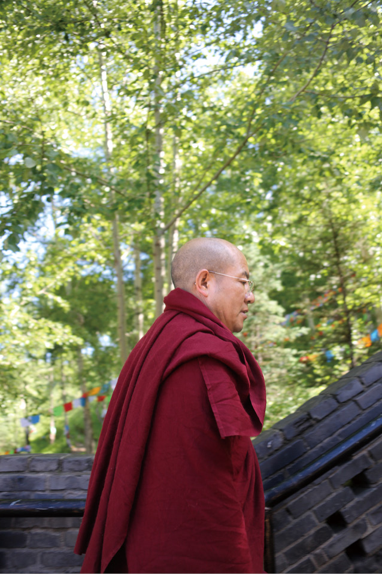
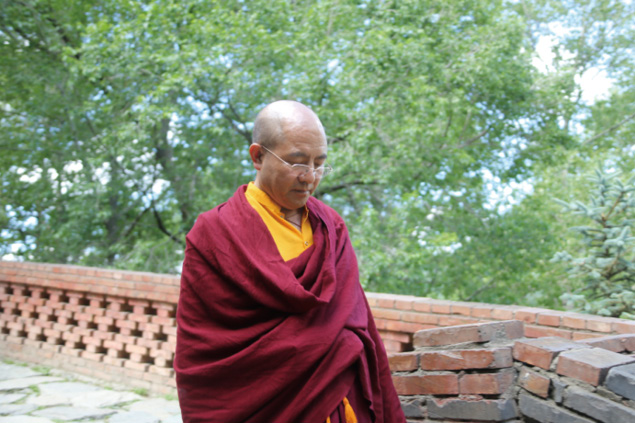
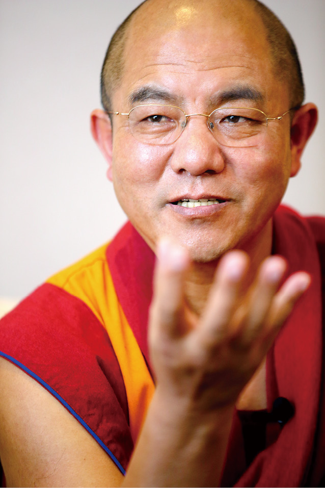

## 点燃智慧的明灯

2015年7月7日

今天要给大家传一下法王如意宝所著的《莲花生大士略传》，还有法王当年在五台山亲见文殊菩萨时唱的一首金刚道歌。在这之前，我先讲几件事。

## 一、30天讲学足迹

我这次出去了将近一个月，为了不耽误学院的课程，我的行程安排得比较紧，去了很多地方，但还不算太累。反倒是回学院以后，处理各种事务感觉更累。我们嘉绒藏族有这样的传统：什么时候外出、做了什么事情、什么时候回来，整个过程都会给大家交代一下。以前法王如意宝去国外弘法，是从我们这里先到香港，再到日本，又从日本去美国和加拿大，然后再去法国，最后经过台湾回到这里。我记得他老人家回来的时候，用了近两个小时详详细细地讲述了旅途的过程。虽然我今天没有那么多要讲的，但也可以稍微分享一些。

5月31日我从学院离开后，先去了炉霍。6月1日上午参加了上罗科马学校的六一儿童节活动；下午，又赶去参加了下罗科马学校的六一儿童节。在这两个地方我都做了讲话。第二天参加了我们的中学和其他工程相关的一些会议。6月3日早上从康定乘飞机到成都，当晚飞往北京。然后在中国中医科学院，做了《药师佛和中医》的主题演讲。第二天在北京大学，就密宗文化与艺术、管理、教育的关系做了访谈和演讲。之后又在中国传媒大学讲了现在新闻媒体道德取向方面的话题。

6月8日经珠海去到澳门，第二天在澳门大学讲了科技时代佛教思想运用的一些道理。澳门有一个贝诺法王的白玉佛法中心和地藏殿佛教中心，10号在那里做了关于放生功德和修行次第的开示。

之后经珠海到了广州。12号在华南理工大学演讲《佛教视野中的物质》，然后在广东省科技图书馆讲了一些管理和心理方面的内容。本来在广州还有两个学校的讲座，但临时有一些关于学院工程和管理方面的会议不得不参加，那两个讲座只好取消了。于是第二天我从广州飞到成都，从下午到晚上都在开会。当时慈诚罗珠堪布也在，学院这边也有两位堪布下来参加。

6月14日我又飞往山东青岛。第二天去了青岛监狱——去年6月20日就去过一次，时隔一年，刚好又是6月去那里讲课——我现在挺喜欢给监狱里的人讲课，好像喝咖啡一样上瘾了（众笑）。接下来去了青岛的恒星科技学院，参观了一些科技项目，也在那里也讲了课。现在很多本科生都找不到工作，而有些技术学校和职业学院的毕业生找工作反而比较方便，所以我也比较关心他们的教学方式。第二天，我又给几个基金会做了一个讲座。那段时间还安排了很多佛学团体的讲座，有时一天两场，有时一天三场。

之后我从山东青岛飞到上海。到上海的第二天给当地一些知名人士和佛教徒讲了课。然后又到上海外国语大学进行演讲。紧接着又飞到了海南海口，为中国政法大学海南校友会做了一场讲座。第二天又在海南大学演讲。然后去了海南省监狱。那里的服刑人员非常多，现场听课的就有2000多人，同时还有很多人在线上听课。另外，还给管理人员也讲了一堂课。

然后从海口前往厦门，去了两所监狱讲课。接着又从厦门飞到南京，在南京农业大学和南京大学各做了一场演讲。第二天就已经是6月30日了，中间完全没有空档，从南京飞到成都，7月5日回到学院，今天在这里给你们讲课。（众笑，掌声）

这就是我这次外出讲学的全部过程，一共去了11所大学、4所监狱、6个佛教中心。

## 二、认清定位 好好修行

这次行程跟去年到美国一样，日程安排得比较紧，我也遇到了各种各样的人。我总觉得，所有网上的和在座的道友们，你们都是非常幸运的，因为遇到了佛法，有了修行的机会。而现在很多人因为没有信仰、没有修行，在生活中遇到了很多困难和痛苦，却无法去面对。我遇到过一些富贵之人，有人非常有钱，但得不到幸福和快乐；有人地位高高在上，但心里却十分痛苦。尤其最近国内股市跌得厉害，不少人赔得倾家荡产，甚至有人绝望自杀。这种时候，有信仰的人，虽然也会遭遇痛苦，但即便流着泪，也能保持坚强。这种坚强并不是故意装的，而是在痛苦面前，他们能找到很多抚慰心灵的方法。比如，思维万法无常、有漏皆苦、财产都是痛苦之因……佛教徒总有很多理由能让自己活下去。我们确实会看到，这个时代没有信仰和修行的话，人会很可悲、很疯狂，找不到方向。所以，佛法的心灵教育的确很重要。现在最稀缺的就是心灵的财富，内心如果贫瘠，人就会很空虚、很苍白、很难生存，因为没有依靠之处。

我们现在身体还算健康，没有生病——如果生了大病就难以支撑修行；年纪也还未到白发苍苍、老态龙钟的时候——到那时也许连出门都非常困难，何况修行；而心灵如果被邪知邪见染污，也没办法修持正见。既然我们现在无论身体上、年龄上、心灵上，都没有这些违缘，还能自由自在，顺缘具足，就应该真诚地去求一些正法。即使你没有长年累月闻思修行的机会，也可以在短时内，哪怕几个月、几天甚至短短的一两节课中，用佛法的能量给自己充充电。其实，人是需要充电的。有些人电量一旦用完，就会被世间各种各样的染污所摄持，最后无力自拔，非常痛苦。

我们在山里修行，可能看不到世间人的生活压力。要是到了世间当中，会生起极为强烈的悲悯心，就像断臂的母亲看着自己的孩子被水冲走却无可奈何。这种时候，我们作为大乘修学者，最关键的是要先充实自己，先尽量让自己的心力得以坚强，除此之外没有其他方法。我们要在佛法的智慧里不断浸泡、不断串习。这样之后，我想你们即便遇到人生中最难以想象的违缘和痛苦，也会拥有支撑下去的能力。

在座的道友中，有些人长期修行佛法的精髓心要，这样的人，在即生和来世的任何违缘障碍面前都有应对的把握；但有些人是所谓的“跑跑修行人”，今天跑这里，明天跑那里，自身几乎没有真正的修行，也不肯勤奋用功，这种人最可怜。我们好不容易遇到佛法，千万不要变成表面上的修行人——仅仅办了个皈依证、穿着出家的衣服、自称某某上师的弟子。这样的人，在内心的调整和自身的修行上很难有真正的收获。

大家一定要认清这个时代，同时要对自己有一个定位，认清自我是什么样的人。我们这里的出家人，既然已经披上了僧衣，那就应该内外一致，向着佛法终生奋斗。而学会的在家居士，应该承担好三种责任——家庭的责任、工作的责任，还有修行的责任，要知道你是同时负有这三重责任的修行人。所以，希望我们所有在家和出家的道友们都明白自己的定位。

## 三、点亮智慧 规划人生

现在不论藏地、汉地，还是国外，佛教徒都很多。其中有一部分只是形象和形式上的佛教徒，真正从内心当中皈依三宝、发菩提心、修持甚深佛法的人其实并不多。虽然外在的佛教徒的名义也重要，但更重要的，是内在是否有慈悲心、出离心，以及修证境界。即使你没有多少修证，至少也应该对传承上师、对佛法有着不共的信心和欢喜心，愿意长期不间断地去修学，这些才是修行人应该具备的素质。

最重要的是，我们既然已经成为大乘佛教徒，就要用佛教来饶益其他众生，这点我在不同场合反复强调过。因此，我们应该重视如何通过讲经说法来利益众生。我这次去了汉地很多城市，有时也会感觉到，在汉地，好像提不起讲经说法的兴趣。我们学会里现在有很多居士都在认真学习；从学院出去的出家人当中，有一部分确实在弘扬佛法，但很多人只是在追求自我的修行。

我这次遇到了很多大和尚，他们的修行和戒律都非常不错。我有时候像警察一样的，看到一个人就会自然而然地挑毛病。我看到这些出家人的时候，觉得都很不错。不过，也有些方面比较可惜，他们有的人在某个寺院当住持，平日里一直念经，当然这也是有功德的，但我总觉得，既然在寺院里，为什么不讲经说法呢？

一个人来到学院五六年，至少也该会讲《入菩萨行论》和《大圆满前行》。有的人告诉我，他已经把《中观庄严论》学了好几遍了。我想，既然学过《中观庄严论》，讲《大圆满前行》应该没有什么问题。但我问他有没有讲过，他说：“没有，我天天供灯。”看来我们有些师父下山以后就变成了香灯师。供灯确实也有功德，我原来也专门讲过《供灯的功德》，但宣讲一些佛法，可能更为重要。

以后我们的法师们应该进行一些培训，否则会跟世人的想法有一些脱节，很难与他们沟通。要是实在没有机会，那就另当别论；可如果有机会，我们应该远离自私自利之心，尽量想办法饶益众生。

这次外出我遇到了好几位我们学院的师父，有些的确是在讲课，这样很好，但也有些只会供灯。我听人说起过，学院下去的某些师父好像一直在一座佛教名山里大量供灯。供灯是很好的，但比起供物质的灯，供心灵的智慧灯更为重要。你们要知道，虽然现在很多人关心供灯，但最好的供灯就是为人们点亮心灵的明灯。

还有一些其他情况。我们学院里的个别人，不管藏族也好、汉族也好，出去就是为了化缘。尤其是女众这边，听说有些人专门请一些藏地师父出去，我这次就碰到过几个这样的人。我已经登记了她们的信息，要好好查一查，她们是否打着修寺院的名义，特意把藏地的师父请到汉地去化缘。这些行为我一律不支持。现在藏地的寺院基本上都已经修好了，不需要什么帮助。我认为，只有讲经说法的道场能叫做寺院，如果没有讲经说法，不管是藏地汉地，不管建筑上贴了多少24K金，不管寺院再怎么金碧辉煌，也不一定有多大意义。

有人经常给一些藏地师父打电话，让他们到城市里化缘，这样影响非常不好。我前段时间专门强调过：我在汉地办的学会，是学习的道场，不是学院里一些师父的接待站，也不是供灯站、放生台，更不是化缘中心。不管谁要塑什么佛像、造什么坛城、刻多少经板、供多少斋……我觉得相较于学习，这些都不是很重要，而且公然化缘不太好，这样对修行很有影响。

现在有很多人连什么是佛法、什么是上师都搞不清楚，以为凡是穿红色僧衣的都是上师，凡是五明佛学院来的都是供养的对境。其实我觉得出家人在外弘法，还是清清白白的比较好，除了讲经说法之外，不要牵扯其他事。吃住能自己安排就自己安排，不能安排的情况下，只要别人提供基本食宿就行。

我这次出去讲课主要是面向大学和监狱，接触了形形色色的很多人。我很明白，我们这个佛学院该做什么，不该做什么；我们这些出家人该做什么，不该做什么。我希望从这里出去的人尽量专注于传法。当然，首先你要做好自己的闻思修行，如果没有资格，是不能传法的。有些人连加行都没有修，连《大圆满前行引导文》的传承都没听完，就急着下山弘扬佛法，这样恐怕为时过早。

因此，一方面，我们要好好修行，没有修行的话，可能连今生中遇到的小小挫折都无法面对，更不用说来世了。所以，趁着我们现在还有这样的身体、因缘、时间、空间……一定要好好地修行。另一方面，我们既然身为佛教徒，每个人都有责任对佛教做一些贡献，至少也不能做有害于佛教的事。我们一定要清楚自己的定位。现在很多人的所作所为都很迷茫，找不到方向和标准，尤其是当代社会过于追求个性，好像认为什么都可以想做就做，这就是现在年轻人普遍的特点。但实际上对于这种观念，也应该观察和分析。

我们学院重视闻思，这次女众这边有上百人出去受戒，在戒场学习戒律时，她们都感到闻思很重要。不论居士还是出家人，在年轻的时候，应当以闻思为主，当然修行也需要跟上；等到年龄稍微大一些，像我这样的时候，确实就必须把修行重视起来了，否则难说什么时候就会离开人世了。虽然年轻人也可能无常，但年龄大些的，更应该重视。

我们要对自己的人生有一个规划，这是很重要的。我以前看过日本的一位企业家这样规划自己的人生：以80年为限，前20年因为年少，没有什么规划；最后20年，是自己修行的时期；中间的40年，要用于对整个社会和世界做贡献。他的人生是这样规划的。

各位也应该想一想，你可能前20年都花在读书上了。你现在多少岁？还能在世上活多久？可能60岁，可能80岁，也可能像一些高僧大德那样活到100多岁。假使能活那么久，我们的人生应该怎样度过？所以，我们每个人都要有一个属于自己的修行计划，还要有一个弘法利生的计划——怎样对佛法做出贡献，怎样利益众生。在这些方面，无论你是什么身份、修行得好与不好，都需要去自我观察，深入思考。

## 四、《莲师略传》和《文殊祈祷道歌》传承

我今天准备念两个传承。第一个是法王如意宝造的《莲师略传》。这是当年法王如意宝去印度的时候，在莲花生大士曾经示现过各种神变的莲花湖的岸边造的。

（堪布念《莲师略传》传承）

在座不论在家人、出家人，有信仰、无信仰，什么身份的人都应尽心祈祷莲花生大士，这样能遣除你生活和修行中的很多违缘和障碍。在我16岁以前，那时还没有去上学，经常到山上放牛。我的父母总说，如果牛丢失了，祈祷莲花生大士就能很快找到。其实藏地很多人都有这种说法。所以我就常常祈祷莲花生大士加持。我那时候自己学了莲花生大士的另一个略传，我经常念诵那个略传，到后来都会背了。每次牛找不到，或者在山间云雾里迷路的时候，我就念这个莲师传祈祷。有时候我父亲出门许久不归，当时没有电话，家里特别着急，我也会祈祷莲花生大士。只要祈祷，很多吉祥就会出现。

在我的人生中，对莲花生大士的信心一直是非常坚固的，不仅常常读莲花生大士的传记，心咒我也常常念，哪怕有时只能念几句。比如乘车时，或者特别累时，但就算时间很短，我也会念三四遍“嗡啊吽班匝儿格热巴玛色德吽”来祈祷莲花生大士。这种祈祷的习惯并不是偶然的、一时的，我从小就对莲师有特别大的信心。后来上了学，当时学校不允许学生有信仰，可我一直把信仰藏在内心里。老师问：“你们有信仰吗？”我们口头上回答没有，但心里暗自想：“我是有信仰的，只是嘴皮那样动一下而已，我的心从没有变过。”后来我出家之后，遇到了莲花生大士的很多大圆满窍诀，那种信心就更不可能被别人所夺了。所以，你们且不说想要今生修行圆满，以及各方面因缘成熟，单从满足个人利益出发，也应该经常祈祷莲师。末法时代，祈祷莲师的力量和加持是极其迅猛的。

法王造这个略传的缘起，是我们在印度的莲花湖时，法王突然从自己的觉性海中涌现出了这些内容。当时我们同行的南卓堪布用录音机记录了下来。

（堪布念《文殊菩萨祈祷文》传承）

还有一个传承是文殊菩萨的祈祷文。法王1987年朝拜五台山的时候，在菩萨顶给大家讲授大圆满，当时我也刚开始翻译《佛子行》。后来法王在善财洞闭关了七天，有一天法王显现上亲见了文殊菩萨，就把当时所唱的金刚歌录了下来，慈诚罗珠堪布和我把录音抄成文字。抄完以后，法王让我们两人唱，虽然我们的声音都不太好，但还是拼命大声唱了出来，唱完了以后，法王说还可以。所以这也是个特殊的缘起。

后来我们去五台山的时候，每天都念这个祈祷文，因为在其中法王特别祈求文殊菩萨：现在末法时代的众生，烦恼特别粗重，修行也不精进，请用您的智慧、您的慈悲、您的能力来加持我们的相续……我们当时去五台山，一部分人是念《普贤行愿品》发愿，过了一段时间就回来了。还有一部分人在五台山住了一百天，我们住一百天的这些人每天都念这个祈祷文，最后感觉应该得到了文殊菩萨的加持。

你们也要得到文殊菩萨的加持。文殊菩萨的这种加持，其实跟大圆满中很多智慧是无二无别的。同时，如果想要在世间多有一些好的缘起，也应该多念修文殊菩萨。将来你们如果有机会去印度，最好去一下莲花湖。很多人将印度的其他圣地都朝拜了，但没有去过莲花湖。

如果你们去五台山，也应该去一下善财洞。我们以前有一次去到那里，突然有人来阻止我们念《普贤行愿品》。当时我有点生气，但后来想，那会不会是文殊菩萨的化现？你们有的人在某些情况下脾气不太好，比如在一个殿堂里，别人好不容易来到这里想要朝拜，你非把人家赶出去，这样是不好的。有时候一些做环卫的发心人员脾气也不好，当然，这也可能是诸佛菩萨的化现，但如果不是化现，可能就会让很多人的善根当下被摧毁。所以，不管你们面对什么人，脾气都应该好一些。听说我们这里有些发心的医生和护士性格很不错，这样很好。刚才说的善财洞，大家以后去的时候，如果不能在里面发愿，那就在外面念《普贤行愿品》，这样也是可以的。这是文殊菩萨的加持祈愿文，当文殊菩萨和诸佛菩萨、传承上师的加持融入我们内心的时候，修行就会很容易成功，这是非常重要的。

今天我没有太多要说的，聚集在这里主要目的是和僧众、和网络上的道友们一起念《普贤行愿品》，这非常重要。我这次出去了很长时间，没空念《普贤行愿品》，心里总觉得：还是在学院里讲课有意义，至少每天可以念一遍《普贤行愿品》。所以这次回来之后，能跟大家一起念《普贤行愿品》，我感到非常开心。

等会儿下课以后没有接待。刚才已经给你们念了传承，其他的加持不重要。我今天讲的三层意思你们要明白，第一层：我们自己要好好修行；第二层：我们要如理如法地通过讲经说法等方式，点燃智慧的明灯；第三层：要祈祷莲花生大士和文殊菩萨，让我们的相续真正变成智慧的相续。这就是我最大的加持。
