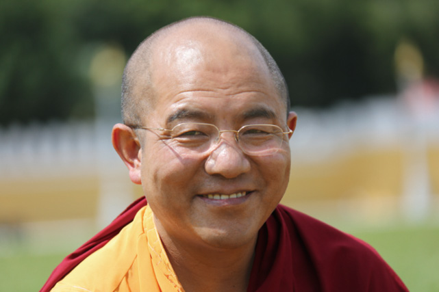
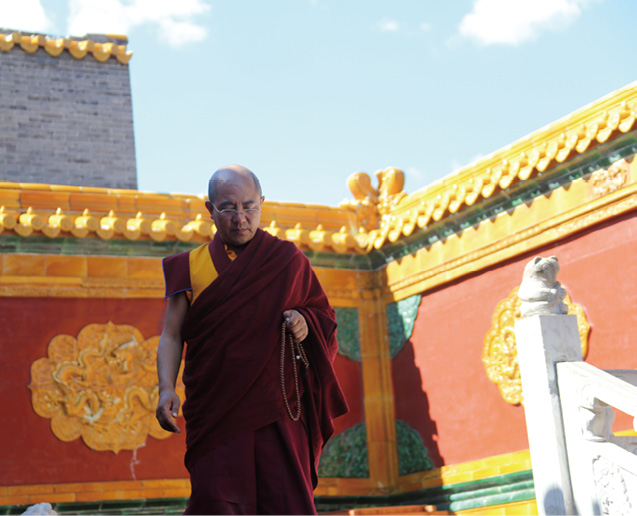
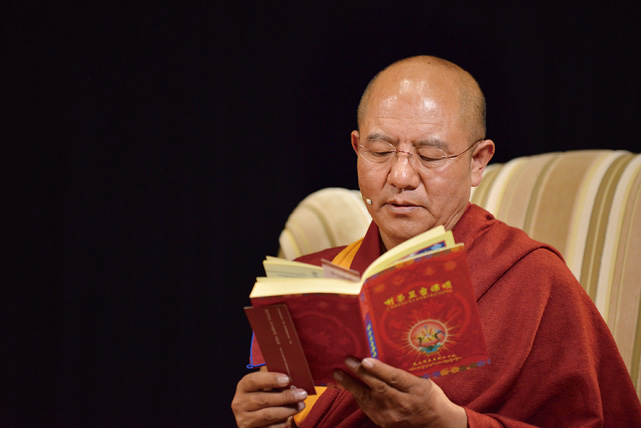

# 用智慧抉择人生

2016年7月30日

今天，通过网络给新学员做一个简单的开示，之后给大家念一些传承。

## 对新学员的教诲

刚刚加入学佛的群体，大家可能比较迷茫，同时又对什么都感兴趣。加入我们的学会，有些人缘于理性，有些人缘于感性，有些是人云亦云、盲目趣入，有些则试探性地观望、了解，有些人以好奇心探究：“学佛到底是怎么回事？”有些人带着某种希望：“学佛能不能治好我的病？能不能让我发财？能不能让我快速找到喜欢的人和事？能不能让我在短时间内断除烦恼？能不能让我无有勤作地过上幸福美满的生活？……”不管怎么样，我们都欢迎。

对每一届新学员，我都会做一些简单的开示，一直有这样的传统。从2006年以来，我们就通过现代特殊的网络科技传播佛法和智慧。在这个过程中，有不少人因此改变了命运，也有不少人获得了超越世间的智慧、能力或境界。

我们处在一个特殊的时代，每个人都是一个特殊的个体。如果没有特殊的方便方法，好的机会就会与我们擦肩而过。我记得英国著名的作家狄更斯在《双城记》里说过：“这是一个最好的时代，这是一个最坏的时代。”世间的智者们，对这句话有不同的解读。

如果用佛教的观点，应该怎么解释呢？如果网络利用得好，这个时代就是好的时代。因为我们通过网络平台，可以轻而易举地获得古人无法获得的许多知识和财富。如果网络利用得不好，这个时代就是坏的时代。因为通过网络，我们的身心在短短的时间内就可能毁于一旦。有这个危险性。

在座的诸位善男善女，有些才刚刚学佛，有些学佛很长时间了，却一直没有加入我们的团体。你们中间有一部分人，将来可能会半途而废，不一定善始善终、圆满究竟；而另一部分人，通过今天的因缘和缘起，也许到死的那一天，誓言都不会改变。

我喜欢后者，因为他有智慧，知道用智慧来抉择自己的人生和命运。在这个过程中，无论遇到什么灾难和挫折，他都会勇往直前，最后获得真正的胜利。

下面，我跟在座的各位简单地谈谈佛法。你们中有一部分人，可能知道什么叫三宝、什么叫修行、什么叫解脱等。也有个别的人，就连什么叫佛、什么叫法、什么叫僧都不清楚。但不管怎样，我们从现在开始，要正面地了解佛法。

相对于全世界的人口总数，佛教徒并不算多。不过，就我们眼前的人群来看，现在学佛的人的确是越来越多。有些人，包括一些名人，自己并不真正信佛，却喜欢在手上戴一串念珠，似乎要象征性地表示一下：“我是信仰佛教的。”其实这样也很好。虽然只是一串小小的念珠，却自有它特殊的加持、力量和价值，能起到保护身心的作用。也许，他们也知道念珠的功德。

同样，我们的信仰，也是出于对佛教的信任、信赖，或者说仰慕、渴望。有这样一种信念或意乐。在这里，我想告诉大家的是：皈依三宝、信仰佛教，在你们漫长的人生中，的确是非常难得的机缘。以我学佛、信佛这么长时间的眼光来看，每一位拥有真正信仰的人，都是非常有智慧的。对这一点，我并不是毫无理由地下结论。从你们的人生观、价值观和世界观来看，学佛对你们自己确实有很大的利益。

## 佛教的核心与精华

“诸行无常，诸法无我，有漏皆苦，涅槃寂静”，是佛教的四法印，也是佛陀八万四千法门中最精华、最重要的法。我经常遇到南传佛教的法师，他们大多数传的就是这个内容。藏传佛教的古大德们，也会讲这个内容。所以，我们要深深地理解四法印的意义。

什么是“诸行无常”？一切万法都是不断变化的，没有丝毫的稳定性。懂得了无常的道理，学佛会变得非常容易。我们的生命就像流水，转瞬即逝，不会在原地等着我们。如果没有依靠宝贵的人身，好好学习佛法，完成自己的解脱使命，将会非常可惜。

什么是“诸法无我”？在这个世界上，虽然有无数的众生，从小到大，一直在为“我”奔波、忙碌，非常重视“我”、爱护“我”，可真正用智慧观察时，不管是“法我”还是“人我”，在究竟意义上，都是微尘许也不存在的。

什么是“有漏皆苦”？佛陀在经中讲，整个三界轮回，犹如火宅，无有安宁之处。虽然我们生活在世间，有暂时的快乐和幸福，但究竟而言，都超不出苦苦、变苦和行苦这三大根本苦。细一点说，还有生苦、老苦、病苦、死苦、爱别离苦、怨憎会苦等八大支分苦。

什么是“涅槃寂静”？不管什么人，通过修行，最后都能真正获得永恒、究竟的涅槃安乐。这样的道理，很多人可能从来没有想过。他们从来到这个世界起，就一直为寻找幸福而劳碌奔波。可是最后，又得到了什么？在座各位应该心知肚明。真正的安乐，唯有通过修行才能得到。

## 稳稳地学，别后退

我还要跟大家特别强调，希望你不管是老学员还是新学员，都能稳重地学习佛法。学佛不是听一堂课、学一部论典就算完事了。有些人从2006年开始系统地学习，到现在已经有了进密法班的资格、进研讨班的资格，甚至成了辅导员。但是，如果自己的内心有很多傲慢，认为自己已经广闻博学、至高无上，也是不太好的。

不管怎么样，你们学佛的时间跟我们比较起来，还是相差悬殊。由于你们完成了一定的课程，为了管理的方便，我们会跟大家说，“这个人已经毕业了”“这个人已经是辅导员了”，等等。但实际上，这个人出世间的学问和知识，恐怕还没有达到可以对别人傲慢的程度。因此，老学员们千万不能因为完成了一两部论典的学习就自以为是。不管什么样的学员，都要一如既往，不断地闻思修行，不断地改变自己。

有些新学员刚刚来到这里，可能还有很多的顾虑、徘徊、挣扎，甚至还有一些犹豫。对此，我希望你冷静地思考，用自己理性的智慧好好地抉择：这一生要不要选择这样一条路？如果已经选择了，那就义无反顾地去学习。

学习当然需要付出。不管是学世间法，还是出世间法，都需要付出精力和时间，都要舍去很多东西，甚至自己的生命。那最后我们会得到什么呢？一般的世间财富无法改变我们的命运，所以不是我们希求的。我们最后得到的，是现实生活中无法想象、无法表示、无法描述的解脱利益。为了得到这样的殊胜利益，我们现在应该去学习新的东西。

在学习的过程中，有些人很不稳定。比如，今年有100个新学员报名学习，我就会想：这100人，最后也许能留下61个或71个。如果过了三五年，这100个人中，真的留下了61个，我会觉得：“还可以。‘生意’不错，我赚了！”会有这种想法。（众笑）

在末法时代，很多人的心态都不是很稳定。根据学员的状况和心态，我们的规则有时不得不改变。2006年刚开设网络课程的时候，我在公开信中提出了一些理念。后来在实际管理中，发现理论和实践有一定的差距，理想和现实也有一定的差距，于是及时作了调整。

我知道不一定所有人都能学得圆满，因为每个人的目标和想法不尽相同。但是，你们一定要知道，不管是佛学院，还是各地的佛学组织，其宗旨都是闻思修行、弘法利生。这样做的目的是什么呢？帮助千千万万的在家人，在迷茫的世界找到自己，找到人生真正的方向。

我们这里有很多法师和工作人员，给大家提供了很多的方便方法。从你们的角度看，通过视频、音频或者光盘、书本来学习，也许是一件简单的事情。有人可能会想：“一本书有什么了不起？一张光盘有什么了不起？组织一个小组有什么了不起？”之所以这样想，是因为没有看到背后的付出。就像一部电影，放出来只有两个小时，但演员、导演、投资人等，在背后付出了多少？大家可以想想。

各位加入我们的学佛团体，我非常欢迎，也非常高兴。高兴的原因，并不是来了这么多人，对我个人有什么利益，而是因为沉淀了二千五百多年的佛法智慧，可以融入大家的生活。这样的智慧，哪怕只有点滴的融入，对你的人生也是有利无弊的，除非你是有恶缘的人。这一点，我们的老学员深有体会。现在的人非常现实，对自己有利才愿意接受，否则是不会接受的。

新加入的部分学员，信心可能不稳定，因为进来的目标不是获得永恒的涅槃和解脱，而是想治病，或者想改善心情。为了治病和其他目的进来的，可能过一段时间就慢慢退失了，离开了。所以，为了帮助大家确立正确的学习目标，我们每一届新生进来，都有一个开学典礼。

我们并没有实体的组织，也不是实体的大学，只能算空中的或虚幻的大学。诸法本来都是如梦如幻的，我是如梦如幻的老师，你们是如梦如幻的学生、同行或者同事。我们通过网络的虚拟世界，组织了一个虚幻无实的群体。大家在这里学习如梦如幻的佛法，断除如梦如幻的烦恼和痛苦以后，最后都能获得如梦如幻的解脱和涅槃。这是不可否认的如梦如幻的事实。因此，希望凡是加入我们团体的人，都能发下坚定的誓言：我要坚持学6年、8年、10年，乃至更久。

在人的生命中，学习应该是最快乐的。人生的许多烦恼、纠结和痛苦遭遇，都可以通过学习来遣除、舍离。因此我想，这样的学习机缘，应该超越了世间某些培训机构甚至名牌大学的课程。大学四五年的学习，也许能给我们的世间前程指出一条明路，但从知识的深奥性和究竟利益来看，世间学校提供的教育，的确没办法和佛法的课程相提并论。

当然，这些价值必须以信仰为前提。如果你没有任何信仰，要让你学习宗教，尤其是学习大乘佛教，是不太现实的。对每个人来说，用什么样的眼睛看世界非常关键。戴着墨镜看世界，对境必定会有不同程度的变色。用真实的智慧之眼看世界，世界的真相则会一目了然。这是现实世界的一个规律。

## 简单一点，清净一点

我们的团体很简单，没有各种各样复杂的世间思想，也不跟金钱挂钩。大家在这里只做一件事：一心一意地闻思修行。但是，有些人好像真的有误解，有些人则由嫉妒心引发，还有些人可能有其他目的，目前大家对我们的学佛组织有各种各样的说法和看法。当然，这也是正常的，世界上的任何宗教、任何团体、任何组织，都不可能得到所有人的赞美。

实际上，我们并不想通过学佛、修行，搞什么道德绑架。整个团队的运作框架，都是为了保证每个学员能专心专意地闻思修行。如果你在这里不好好地闻思修行，只想利用平台做传销或直销，搞各种各样的自他宣传，我们肯定是不接受的。

有些人对我的意见很大，说这个平台太死板了，居然不让某个上师进来。我们并不是不让某个上师进来，但他进来以后，想要弘扬什么样的法，必须经过我们的同意。为什么呢？因为这个平台不是接待站，不是收留所，也不是任何法都可以弘扬的自由平台。不是这样的。

我们建立的这个平台，有它自己的特色。最重要的特色是什么呢？以闻思修行为主。为此，我们安排了一些辅导法师。但是，听说最近有些管理人员只强调某个法师的法，学习和考试一应俱全，对我的传承和课程却在慢慢地淡化。当然，只要他传的法是合理的，也未尝不可。淡化我和我的课程，没有任何问题。前提是，他是真正的善知识，弘扬的是正法。而且，这个正法要得到我们官方的认可。

这个平台建立以后，我也迎请过具有法相的善知识来传法，但也不是所有的人都能利用这个平台。我们有自己的规则，即使你不高兴、不舒服、不快乐，也没办法。有人提出疑问：“你不是佛教徒吗？既然大家都是佛教徒，我为什么不能利用你的平台？”虽然我们都是佛教徒，但也并不是所有的佛教徒都可以利用所有的佛教平台，因为每一个佛教平台都有自己相对独立的权益。

对一些不合理的误解和不合理的想法，我们只会觉得好笑。什么是佛教？什么是价值观？什么是文化平台？世间稍微有点层次的人都清楚。只不过我们有些佛教徒，对世间的某些道理可能并不了解。

所以，我在这里跟大家强调：加入我们这个团体以后，心里不要想得太复杂；该闻思却不好好闻思，该修行却不好好修行，每天说一些是是非非，做一些非法行为，这样的人对我们的清净道场是有损害的。

## 做佛教的三好学生

作为佛教徒，我们先要做一个普通的人、正常的人。可我们有些道友，连正常的人格都不具备，奇奇怪怪、神神道道，连基本的工作、家庭和修行都没办法面对，每天跑来跑去、胡思乱想，所作所为都不道德。这样的佛教徒，现在占了相当的比重。

我曾经说过，在家的佛教徒有三个责任：

第一个是家庭责任。佛教徒在家要做一个好人，承担起家庭的责任。但现在有些人根本不顾家，上对父母，下对子女，关系弄得一团糟，家人对他学佛的意见非常大。

第二个是工作责任。有些人不去挣钱，今天跟着这个上师，明天跟着那个上师，过一段时间钱花光了，就对佛法、对我们产生邪见，认为是我们把他带坏了。为什么呢？他认为，自己没有努力赚钱，是因为跟着我们，所以是我们的错。其实，这是他自己的心没有调整好。

第三个是修行责任。有些人不好好修行，今天这里学一点，明天那里学一点，今天跟着这个，明天跟着那个。没有稳重的人格，最后修行也不会成功。

我读书的时候，学校会评三好学生。在家人学佛，也应该评“三好学生”——对家庭负责、对工作负责、对修行负责。世间人只要照顾好家庭、干好工作，就可以算是一个好人了，根本没有修行这一层。因为我们选择了信仰，所以在家庭和工作之上，还有一层修行。

有些人刚开始学佛，特别特别感性，所有的财产全部拿去供养，所有的时间全部用来修行，所有的精力全部实践佛法——今天去放生，明天去朝圣。由于精力和财富投入过多，最后没办法正常生活，于是产生邪见，诽谤佛法，退失修行。

其实，这都是自己的心没有调整好的缘故。做什么事情之前，都应该先考虑周密，不要太冲动、太激动、太盲目，不然自己的选择不一定正确。此外，有些人自己的生活也没有调整好。佛教徒中的成功人士，白天非常忙，晚上抓紧时间修行、看书、闻思。这样过了十年、二十年，家庭没有受影响，工作没有受影响，修行越来越有进步。可见，只要把心调整好、生活调整好，佛法是可以融入生活的。

今年，我主要提倡生活佛教。所谓的生活佛教，并不是把高深莫测的佛法用来炒股、投资等，而是把佛教的相关理念、利他思想和修行方法融入生活的点点滴滴。学佛，并不意味着要放弃所有的事情，到寂静的山谷出家。如果能调整好心态，调整好工作方式和生活方式，合理分配时间，在家照样可以做一个好修行人。

有些人学佛之后，把所有的人都得罪完了，这样没有必要。对身边的人，你不一定天天跟他们同流合污，但偶尔陪他们吃个饭还是可以的。我那天讲过，为了随顺大家，我们的穿着打扮也要讲究一点。不要因为自己学了佛，就变得不修边幅，不敢说像个乞丐，但确实形象也变了，心态也变了，行为也变了。你这样做，身边的人对佛教徒会有什么样的看法？大家可想而知。

佛法是一种高尚的思想，一种精神的奢侈品，又与我们的生活息息相关。所以，我们应该依靠佛法的道理，逐渐地改变自己的生活。比如，你学了《佛子行》，以前脾气不好，现在变好了，安忍修得越来越轻松；以前很懒惰，像猪八戒一样，天天大吃大睡，现在变得精进了，不管是家里的事，还是工作上的事，都能及时处理；以前特别吝啬，像饿鬼一样，现在变得大方了，该布施的时候知道布施了。总之，学佛以后，变得比以前更好、更进步了。

佛教的布施、持戒、安忍等行为，一旦融入自己的生活，我们就能以自身的行为影响周围的人。家人和外人看到我们的改变，我们的修行自然会被社会所认可。大家参加了学佛的团体，应该以这种方式来体现佛法的正能量。否则，学佛以后，什么都处理不好，生活、心态、工作，都越来越不正常。到一定的时候，自己很难弥补缺口。这一点，很值得大家深思。

## 学佛不能啃老

加入学佛的团体，认真地学习佛法，从佛教的智慧中获取生命的营养，这是非常有必要的。佛教的精神，对每一个人来讲，都是难得的精华。所以，当你们学到了一定的时候，得到了一定的利益，就应该出来发点心，做点事。这是我对各位的希望。佛法要弘扬，要利他，需要大家共同的努力，而不是只依靠法师、出家人和辅导员。每个人都用佛教的思想来利益众生，非常重要。

现在，佛教徒也有很多“啃老族”。世间的孩子，刚开始吸取母乳滋养身体，稍微长大一点，就像汉族人教育孩子那样，“你现在长大了，要帮妈妈洗洗碗、扫扫地”，慢慢学会帮父母做一些家务事。可是，我们有些佛教徒，在佛教团体待了多少年，却连一点心都不愿意发，永远都是：“我要！我要！我是接受者，不是付出者！”就算是无情物，比如二氧化碳和氧气，都有接收和付出的转化，作为一个人，你从佛教得到了利益，有了一定的积累，更应该懂得付出，懂得回报。

当然，发心也要掌握分寸。自己一点不成熟，却在别人面前夸耀“我已经学完三堂课了，现在要给你们讲经说法”，这不一定成功。自己至少要稍微成熟一点，才能去利他。但有些人一直认为，别人的付出是理所当然的，自己什么都不做，只想得到，非常自私。

去年和前一段时间，我在泰国接触了南传佛教的很多法师。他们的确有广大的利他心，和他们比起来，我们这些大乘佛教徒也许会感到惭愧。我们说自己是大乘佛教徒，但却非常自私，相互讨论的话题，要么是自己的事情，要么是别人的缺点。别人的缺点，先用放大镜观察，再展示给大家；别人的优点，先用“缩小镜”缩小，然后秘而不宣；自己的功德无限扩大，自己的缺点用黑色的布加以遮盖。这样很不好。

我们应该观察世间那些成功的宗教，看他们是怎样传教的。有些宗教是一个人去传教，有些是两三个人一起去。不管别的宗教怎样做，作为佛教徒，尤其是学习大乘佛法比较久的佛教徒，我们要以真正的利他心，多多地发心，多多地做事。如果连自己小小团体中一点简单的事都不愿发心，那说要利益天下无量无边的众生，恐怕更是遥不可及。

我们的生命是有限的，利他的机缘也不一定常有，所以从现在开始，我们要通过各种方法，尽量地弘扬佛法。

## 让不同的声音，传遍世界

今年冬天，我准备派一些法师到各地去讲课。主要讲八大宗派的法，比如《坛经》、《金刚经》、戒律、中观，等等。有些宗派如果需要，我们愿意提供法师，但前提是你们没有什么争论。如果引发争论，我们宁愿不做。

更重要的是，我今年想用不同的语言来弘扬佛法，比如阿拉伯语、英语、日语、法语、非洲语——非洲语暂时可能有点困难。但是，我还是想找几个黑人法师，不知道能不能找到。传授佛法应该有不同的声音，应该让很多人感受到国际化的学习氛围。

这么多年来，我基本上是用汉语给大家讲法。我希望你们能用不同的语言来弘扬佛法、辅导佛法。有能力用外语弘扬佛法的法师，可以直接到我这里报名。

为什么会有这样的想法呢？因为我出去的时候发现，很多人其实特别特别需要佛法。众生真的很可怜！如果我们只用藏语或汉语讲法，有些人是听不懂的，找个翻译也不是那么容易的事。

不管怎么样，从今年开始，我会尽可能地派一些法师出去弘法。不仅仅是学院的法师，我在全世界还有很多熟悉的法师，包括在我这里闻法多年的法师，有些已经去了不同的国家。他们无论是戒律、禅定，还是智慧，都比较不错。

虽然在这个过程中，可能会出现极少数不如法的现象，但我还是要努力地推行。做任何事情，都没办法十全十美，这在人类历史上屡见不鲜。释迦牟尼佛在世的时候，有些修行人去了城市之后，也会发生各种情况，更何况现在这个时代？

前一段时间，我去新加坡和泰国。有些寺院需要我们提供能讲一个月法的法师，比如在一个月当中讲《大圆满前行》《入菩萨行论》等。我说可以，虽然我在网上也讲过这些法，但还是可以派一些法师给你们。这也是弘扬佛法的一种方式。

佛法是什么样的？没有国家、民族、肤色的界限，甚至没有物种的界限，哪怕是对动物有利，我们也要奉献自己的慈悲。这就是佛教崇高的精神。总之，近几年我们要想办法在全世界弘扬佛法。

有些道友经常给我讲：“你现在已经看不起我们了，只看得起那些懂英语、懂日语的‘外国语人’。我即使是班智达，你也看不起！”其实不是这样的。我们现在要在全球弘扬佛法，愿大，力就大，每个人——不仅仅是懂外语的人，都应该尽量发大愿。

我刚来的时候，是给藏族寺院的僧人和部分居士讲法，这远远不够；后来，依靠法王如意宝去五台山的缘起，我与汉地众生结上了善缘，这依然不够；1993年，跟法王去了西方国家，又开启了在全世界弘扬佛法的缘起。一路走下来，如今我们每个人都有这样的因缘。

前一段时间，我们让法师报名，以后出去弘扬佛法。来的人比较多，有些还没有达到相应的境界，有些各方面能力都不错。不管怎么样，自己愿意发心，也很好。

不过，对讲经说法，汉地好像没有请法师的传统，不像藏地和其他地方那样，把讲经说法当作生命中的重要事情。有些地方虽然请了法师，但因为没有这方面的传统，个别法师似乎也掌握不好分寸，一出去就变得不可一世，最后发生了一些不愉快的事。这样不太好。

我们不接受供养，只希望一部分人能真正地接受佛法，真正地修行。这方面我们还处于起步阶段，跟很多地方相比，确实有一定的差距。所以从今年开始，我有了进一步推进的想法，希望大家也多多地思考、斟酌。

## 以低调的方式，细水长流

2009年，我呼吁大家要有“修学不怠，大爱无疆”的精神，不仅要闻思修行，还应该做一些慈善，包括助学工程、放生护生、助念往生、灾难救助、医疗救护、复兴传统文化，等等。当时大家做得轰轰烈烈，后来有一段时间做得不太够，其中有很多原因，比如管理的法师强调不够等。但是现在，他们又开始特别地强调，把重要的闻思全部放了下来……

这里面有一定的复杂性。我们闻思修行，没有什么危险，而做慈善、搞基金、建平台，情况就不同了。一部分人是真的想弘法利生，另一部分却怀着自己的目的，经常跟管理法师对着干，断章取义地借用我的一两句话，或用其他方式进行误导。所以，我们应该观察清楚，各个地方不要一概而论，毕竟人是很复杂的动物。

有些人真正是以菩提心和慈悲心在做事情，在这个过程中，可能还会受一些冤枉和委屈。有些人根本没有慈悲心，只是利用我们的平台，宣扬自己或某个人的价值观。慢慢地水落石出，大家才发现：当时这群人是那样的，现在却是这样的！

“路遥知马力，日久见人心。”我没有出家的时候，经常骑着马去放牛。有些马脚力不好，走一段路就走不动了。不管你用鞭子怎么驱赶，它都依旧走不动。而有些马特别好，能走很远。人其实也一样。和一个人走一段路，他的真正面目就会慢慢显露出来。

在我面前，有很多人说，要把他的徒弟全部供养给我。我说：“我不需要徒弟。我没有什么‘我的徒弟’‘我的学生’的概念。谁要是好好地闻思修行、利益众生，真正把人生的价值参透，最后修行圆满，就是我最尊敬、最崇拜的人。除此之外，弟子和上师之间互相攀附，最后的结果是什么，很难说。”

所以，我希望我们的学员，一是待在佛教团体当中，不要总想得到，而不愿意付出；一是不要利用我们的平台，在微博、微信上宣扬自己。包括管理人员，也不要过多地利用现代传播方式召集别人。我看你们好多QQ群都有好几百人，这是很危险的，应该低调一点。有时候，古朴的生活更加保险。

有些人刚学佛时特别冲动，其实是不妥的，应该低调一点。前一段时间，我说从九月份开始，要放生。放生也要低调、分组，不能搞大型的放生活动。我未来的人生，也想尽量地低调，周围的人少一点。走路的时候没有侍者、没有保镖，一个人悠悠闲闲，是很舒服的。有时候我出去，被一群人围着，一些人在前面叫嚷着：“注意！注意！让路！让路！”我不喜欢这样。其实，一个人蒙着头走路，不用说话，也不用谁让路，随便过。

所以我经常讲，以低调的方式，细水长流，我们的学习才会长久。不好好闻思修行，今天在这里搞个大型活动，明天在那里做个火供仪式，这样的平台是不可能长久的。不过，现在的火供好像越来越少了。以前有一段时间，就像是“火供年代”，什么东西都烧。

总之，我们不但要好好地闻思，而且不能放弃往生助念、国学演讲，以及对《弟子规》等传统文化的弘扬。就像其他宗教积极帮助社会那样，我们佛教徒在力所能及的范围内，也要尽量多做一些事情。在闻思修行的基础上，把该做的事情圆满完成，这是我们大乘佛教徒的责任。当然，这需要智慧。

## 谢谢你对我的伤害

虽然有人觉得我们的佛学团体不好，经常挑我们的毛病，但我们心里是坦然的、清净的。我们的想法很简单，就是帮助大家好好地闻思修行。除此之外，没有更多的事情。如果你觉得不好，随时可以选择离开。你有这个自由。

有些人在这里学了很长时间，稍微懂了一点佛法的道理。其实，不管你懂了多少，都是在我们这里学的。但现在，一些忘恩负义的人却开始出来诽谤。当然，这样的事，即使在世间，也比比皆是。这不仅是你们当中某个人的历史，也是古今中外很多人的历史。我们已经司空见惯了。这样的人，暂时会有少数人跟随，不过更多的人是对他的所作所为嗤之以鼻。只不过，他没有看到那样的场面而已。

确实有个别人，刚开始对我、对传承上师等，看起来很有信心，但到一定的时候，就露出本来的面目了。前一段时间我讲《妙法莲华经》，也看出学院一些人的“信心”了。虽然信心分三种，但这些人连一种都没有，只有非常特殊的一种“信心”。这种人的行为，迟早会暴露无遗。我说的这些，都是真实的。

对此，我们不会放在心上，不会觉得难以接受——“为什么会这样啊？”这样的人，以前有，现在有，将来也会有。我在学院待了30年，一方面给大家讲经说法，另一方面负责执行学院清净的戒律和严明的纪律，也算是一个管家。我处理僧团事务的时候，有些人高兴，有些人不高兴。本来是他自己犯了错，不具足在僧团常住的资格，他却对执行者有很大的意见。这种现象，在学院时有发生。

为了清净僧团，为了弘扬大乘佛法，不管别人对我有什么看法、说法和想法，我都根本不予理会。有些人跟我讲，“网络上有人说你什么”“有人在背后说你什么”，我都无所谓，因为这不是真正的我。

从我内心来讲，无论别人说我什么，我都无限感恩，因为对自己的修行有帮助。没有这些因缘，自己的修行好像一直没有长进。一旦出现一些特殊的人，说了一些特殊的话，尤其是一些忘恩负义的人出现时，“哇，特别感谢！因为有了他，我自己的修行有了很大进步。”

也许他们不高兴：“啊？堪布怎么又进步了？这是我不愿意看到的。我只想他倒霉！”可事实就是这样，不愿意看到也没办法。别人的诽谤，对真正的大乘修行人而言，就是促使自己进步的阶梯。所以，我今天在这里，要特别地感谢这些人。

从内心而言，我对所有的人，都只想帮助，不愿意损害。即使是对我不好的人，我也不会有损害他的念头。但是，为了维护清净的道场，为了弘扬大乘佛法，对那些看不惯、不如法的现象，我也会直接说出来。有这种情况。另外，因为烦恼和无明，自己有一些不恰当的言行，引起了别人的不舒服、不快乐、不欢喜。也有这样的因缘。再有就是，我即生虽然没有对任何人做过任何坏事，但因为前世我对他不好，所以他今生恨我。

前一段时间，有一个居士说：“我最不愿意看到的人就是堪布。可是居然在路上碰到了，当时我心里特别不舒服！”这些话，是他对别人说的，最后传到了我这里。我想，这个人我连认都不认识，怎么可能损害他呢？他之所以不舒服，大概是我前世损害过他吧。这样的事，我希望你们每个人，都要学会转为道用。

## 免费，是因为无价

我今天除了对新生开示，还会做一个简单的皈依。你们当中有些人还没皈依，希望皈依以后，好好地学习佛法。

有些道友学得非常好。明天有好几个班要参加考试，我先祝愿你们考得好。即使考不好，有参加考试的勇气，也很不错。千万不要作弊。不然，本身就考得不好，还要作弊，就更说不过去了。现在的网络监控很厉害。也许我应该在这里安一个特殊的监控器，把所有考场的情况看得清清楚楚——这好像有点困难，只是个假设。

我希望今天新加入的学员，再过五年还在参加考试。学习需要长期的付出，之后再通过考试做个检测，看自己是不是真的学会了，而不是今天跟这个跑来跑去，明天跟那个跑来跑去。

我希望听了这个开示之后，喜欢跑的人明年就别来了。我们的管理人员很辛苦的，而且我们也没有收取任何费用。有时候，越是免费的东西，很多人反而越不重视。现在上海和北京的很多高校，学生要交六七十万学费。你们如果不重视，我们以后要酌情收费，也许交了钱，你们才会重视。但也有可能，交了钱你仍然不重视。

希望各位能这样想：虽然这里的学习是免费的，但它的价值在如今的高等院校里，也不一定能得到。以这样的心态来接受佛法，会比较好，不要持否定的态度。

现在有些学佛的人，比世间人还差。学着学着，大乘佛教的道理根本融不进自己的心，只会天天看别人的毛病、说别人的是非。有时候，佛教团体比世间的单位更复杂，不管说话还是做事，心里都非常痛苦。

其实，学佛的人不应该这样。即使遇到世间人没法处理的天大的事情，也会快乐地用智慧去解决，这才是真正的大乘佛教徒。如果连世间人都能处理的事情，我们自称佛教徒，却纠结半天，痛苦不堪，可能就学偏了、学错了，因为运用佛教的智慧，是完全可以超越世间很多痛苦的。你看世间人，一件小事就打官司，互相争来争去。而有了大乘佛教的思想，别人根本无法接受的事情，我们却能轻而易举地面对。这就是佛法的魅力。

但是，有些佛教徒却不懂这个道理。他们学着学着，学了很多年，最后同事关系处理不好，家庭关系也处理不好。以前不学佛，接触的人不多，生活还简单一点。现在接触了很多佛教徒，生活却越来越混乱，越来越糟糕。这样学佛有什么意义？不如干脆不学，没有学佛的压力，做回以前的自己好一点。

在新加坡，有一种人叫“自由思想者”，意思是没有信仰的人。因为没有信仰的约束，自己的思想很自由，所以叫“自由思想者”。如果你学不好佛法，不如当一个有自由思想的人，不一定非要用信仰来约束自己。

出家人也一样。有些出家人，好像不是真的出了家，表面上没有头发，实际上比有头发的人更烦恼、更痛苦。我并不是在这里诽谤出家人，但的确有极个别、极少数的出家人是这样，只占1%、2%或3%。

下面，给大家念一下《佛子行》的传承。这个法非常重要，非常有加持力。《地藏菩萨赞颂文》的传承也念一下，过段时间开普贤云供法会要念这个仪轨。另外也通知一下，我这边《妙法莲华经》和《大乘经庄严论》的课程，8月15日开始讲。在此之前，也许有一些简单的网络开示，没有正式的课。学院当中，可能讲一些特殊的法，但保证没有密法。

（堪布念诵传承）

接下来，再做个简单的皈依。皈依有三种发心：一是为了获得人天的福报而皈依；二是为了自己从轮回中获得解脱的声闻乘的皈依；三是为了利益天下无边的众生而皈依，这是大乘的皈依。哪一种发心，你们自己选择，是为自己的身心健康，还是为自己的解脱，或是为利益一切众生而皈依。当然，大乘的皈依是最好的。下面，我按照无垢光尊者《大圆满心性休息大车疏》的观点，念三遍皈依偈。你们跟着我念。

（堪布传授皈依戒）

现在，你们已经获得了皈依的戒体。已经皈依过的，不用重新皈依。皈依的法名，第一个字是“圆”，后面是你名字中的任意一个字。比如你的名字有三个字，选出你最喜欢的那一个，跟在“圆”字的后面，就是与你有缘的法名。

今天的网络开示已经圆满了。特别感谢所有的发心人员，也特别感谢所有的参与者。下面，我们一起将这一堂课的功德，回向给天下所有的众生。
