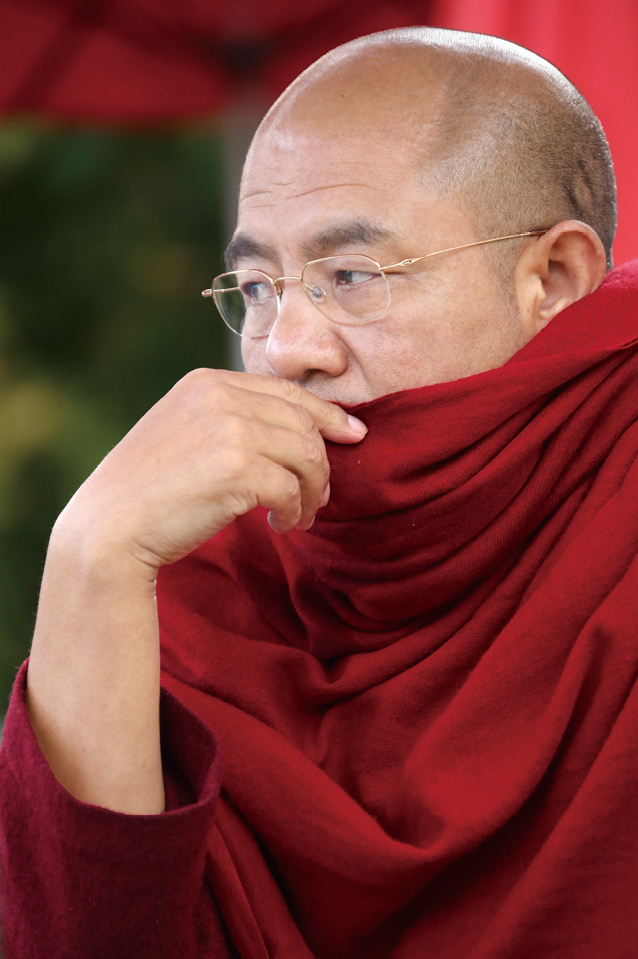
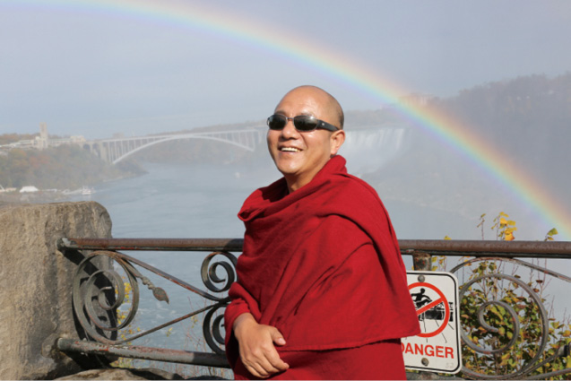

# 稳重做人 智慧行事

——2015年地藏法会开示

2015年7月8日

## 一、坚持发心 弘法利生

最近我们的发心人员都很辛苦，可能有些人很想回学院听课，但是因为工作需要，还得在外面发心。我想，我们作为具有大乘菩提心的修行人，除了极个别的情况，比如严重的疾病，很多困难都是可以克服的。如果心相续中没有发起大乘菩提心，哪怕身在学院，在上师身边，也不一定能感到快乐，不一定能有所作为。所以，对于这次留在外面的发心人员，包括长年累月在炉霍等地帮我发心的道友，他们基本上都是舍弃了自己闻思修行的机会，通过各种方式，为学校、为僧众努力发心，我要向他们表示特别的感谢！

我自己也曾在依止上师的过程中，为了上师的事业和佛法的弘扬，舍弃了很多自己的事情。所以，我希望大家要时刻想到，我们所做的一切是不是为了弘扬佛法、利益众生？如果是的话，无论是在学院中发心，还是在外面各地发心，大家都应该要争取、要努力。因为只有众多发心的力量凝聚起来，才能真正做成对社会、对人类有利的事业。所以，我自己在尚有因缘的时候，也在一直拼命，一直努力。

我努力的目的从来不是为了名声，也不是为了自己，而是感念我们遇到大乘佛法是多么的不易。现在那么多众生陷于痛苦，我们应该想尽一切办法，哪怕能帮一个众生暂时缓解身心的疲惫和苦恼，这也是非常有意义的事，因此我本人也有兴趣在这方面努力。我希望大家无论是在家还是出家，都应通过各种方便来行持善法、弘扬正法、利益众生。这是我想说的第一点。

## 二、关于地藏法会

（堪布念诵《地藏赞·大地庄严》传承）

在夏天举办的地藏法会，是我们喇荣五明佛学院的四大法会之一，主要是祈祷地藏菩萨。法会上经常念这个赞文。我以前翻译地藏菩萨传记的时候，深深感觉到，地藏菩萨在满足众生愿望方面，有非常特殊的加持力。通常来说，如果我们想开智慧，要祈祷文殊菩萨；想生起慈悲菩提心，要祈祷观世音菩萨；而论及满足所愿，在无数时日中不断祈祷普贤、弥勒、文殊诸位菩萨，都不如在短短的时间内忆念地藏菩萨。这个时代的人，有些在物质财富上比较贫穷，有些在精神财富上特别匮乏，他们总有很多愿望想要实现。通过祈祷地藏菩萨，不论世间的还是出世间的愿望，一般来讲，除非前世造了无法逆转的严重罪业，依靠地藏菩萨的愿力以及自己的信心和缘起力，愿望一定能够实现。所以，祈祷地藏菩萨非常重要。

除了满足愿望，我们祈祷地藏菩萨还有另一层意义，就是发起无上殊胜的菩提心。地藏菩萨曾发下“地狱不空，誓不成佛”“我不下地狱，谁下地狱”这样救度众生的宏大誓愿。我们即生当中想要利益众生，就应该学习地藏菩萨这样的精神，发地藏菩萨这样的愿。在大家常念的《地藏十轮经》和《地藏菩萨本愿经》中，这些发愿的内容都讲得很清楚。

本来这次法会我也跟上次金刚萨埵法会一样，建议大家不要来学院，因为最近这里一直在修路，交通很不方便，加之接待条件有限，大家来了有可能会失望。我刚才打听了一下，学院内部和周边的宾馆，全部都已经订满了，每次开法会的时候都是这样。因此，我们提倡以后学院开法会时，大家不一定非要到现场来。来学院的人如果太多，对自他都可能不利，不仅难以管理，到一定的时候，可能学院都不一定能继续存在。

大家各自在本地的道场当中，也可以好好地参与法会共修，念《普贤行愿品》和地藏菩萨名号，而不必全部聚集到一个地方。全都聚到这里，可能对这个道场不一定有利。对于重要的道场，我们大家都应该尽力维护才对，而不要去干扰它。开法会时我们这里很多发心人员都累坏了，要是他们都累得不想干了，道场不一定能维持下去。现在网络这么方便，不论企业还是其他团队，全球各地的人要一起做件事，都不必聚集在一个空间。在不同的国家和地域，都可以共同参与，这是最方便的一种方法。

很多人对开法会、接灌顶特别地重视，但我觉得这些其实对解脱而言并不是最重要的。参加法会是修行中的一种顺缘，但最根本、最重要的是自己好好去闻思修，这是我一再强调的。有些人总想着到某个上师那里开个法会、灌个顶，但如果自己没有好好修行，你灌一百个、一千个顶，最后头顶都灌破了也没有什么用。所以，不要整天总想着灌顶、灌顶，一味灌顶并没有多大用，最终还是要靠自己修行，这很重要。

开法会也是一样的，如果自己没有好好修行，整天赶去各种法会，最后可能连心都没办法收回来。其实，这些现象主要是因为现在佛教徒的总体水平比较低，普遍处于初学者比较粗浅的境界，对真正的佛法的领会，并不是很深、很广。所以，大家对表面的形式和仪轨比较重视。虽然这些是佛教必要的传统，但我们为什么要念这些仪轨呢？其实根本目的就是提醒你观想本尊，除此之外，没有什么玄机。同样，佛教中为什么要灌顶？就是为了让你进入坛城。这就好比得到了一张通行的门票，但进了这道门以后，最根本的还是要好好修行。

因此我想提醒大家，法会期间，如果过多的人都往一个地方聚集，这个地方就有可能会不复存在。大家知道，即使地球也有承载的上限。当我们乘船的时候，若是所有人都集中在船舷一边，这艘船很有可能就会翻。所以船长经常会提醒大家：“不要全挤在这里，往那边分散一些。”很多佛教徒都喜欢往一些名声大的、有加持的地方跑，就像被会供品吸引，喜欢追逐甜的、酸的各种味道。不论如何，大家以后应该要有理性、要有智慧、要在各自的领域当中保持稳重。

## 三、具足十二种功德的人身树

我希望大家学习一下《二规教言论》。我曾经讲过这部论典，后来我们学会也把它作为一门课程安排在了教学体系当中，但我发现很多人好像都没有好好学。我们该如何做一个人？《二规教言论》中将人比喻为一棵树，这棵树上既有出世间的解脱法，也有世间的为人和修行之法。

这棵树到底是什么样的呢？首先，它的树根，就是稳重和智慧。稳重是一个人的重要品质。我们这里有一个发心人员，刚来的时候我很欢喜，因为听说他在世间做事的能力还不错。结果没多久他就跟我提出，想到某个地方去闭关。我想，这个人虽然聪明，但可能不是很稳重。所以有时候，聪明的人可能会有智慧，但是做人不一定很稳重。而我们修行和弘法的根本，就是稳重和智慧，相当于一棵树的树根。

这棵树的树茎是什么呢？就是不放逸和具有惭愧心。现在世间很多人特别放逸，最后即使做了些功德，但都用不上。加之缺乏惭愧心，为人无所顾忌，行为就更加没有约束。这两个品质相当于树茎。光有树根是不够的，树茎也很重要。

光有树茎也不行，还要有树枝、树叶、树花、树果。树枝就是坚定的誓言和正直。一棵树光有茎杆，没有树枝的话，也不庄严；一个人光有稳重、智慧、不放逸、惭愧心也不够，还要有坚定的誓言。不管做什么事情，当一个出家人，就要守持最初出家时发下的誓愿；做一个发心人员，就要坚持最初发心时立下的誓言。一个合格的人，不仅要誓言坚定，还要正直，不要狡猾。现在的社会确实容易让很多人变得油滑狡诈。所以，做人要具备这两个功德，就像一棵树要有树枝一样。

有了树枝，还要有树叶，否则也不庄严，光秃秃的很难看。树叶就是利他和感恩。一个人若没有利他心、感恩心，功德是不完整的，就像一棵树上长不出树叶。

光有树叶也还是不行，一棵圆满的树还要有花，树花对应的是布施和信心。不管作为佛教徒还是普通人，做人做事都需要有信心和兴趣，还要懂得布施。

有了树花，最后就能结出树果。树果就是安乐和声誉。也就是说，当一个人具备了这些品质，最后自己和他人都会得到安乐；而当一个人自己能创造快乐的同时，还能给他人、给众生都带来安乐，那他的名声就会周遍整个世界。

我们留在世上的名声，有些是臭名，有些是美名。名声好的人，大家都会喜欢他，因为他具有稳重、智慧、不放逸、知惭有愧的品质，而且为人正直、誓言坚定，会利他、会感恩、会布施，满怀信心，活得快乐，对于这样的人，我想每个人都会非常赞叹。这样的人即使离世，美名仍然会在世间流传。

所以，我希望各位不论是出家人还是在家人，都要以一个很好的修行人的标准来要求自己，不要每天光会跑来跑去。我很不喜欢那种形象上的、名义上的修行人。我最赞叹的就是具足《二规教言论》里十二种功德的人。这样的人，不管是什么身份，都非常了不起。当然，我自己也不一定做得到，但我觉得这棵人身树非常重要，每个人都应该对照着观察一下自己。

有些人可能连稳重都做不到。每当学院选拔堪布、堪姆，或者重要发心人员的时候，我第一个问题总是问：这个人稳不稳重？然后大家都会根据自己的观察来评价：这个人还是挺稳重的。或者说：这个人刚开始不够稳重，但学了《二规教言论》以后稍微好些了（众笑）。一个人的品格如何，人人都看得出来，人有些时候可能不自知，但其实身边的人都是“警察”，能把你看得一清二楚。所以，我希望每个人都具足这些做人的功德。所以，大家最好都学一学《二规教言论》，总共有160颂，每天学5到10个颂词就可以了。

我在这里想强调，佛教徒不应该跑来跑去，无论在哪里，都要好好地修行。在我们佛学院当中，有些人很稳重，很有智慧，也有惭愧心，也有利他、知恩等功德。有些人具有部分的功德，比如说其他都具足，但是缺乏感恩之心；有些人不够正直，比较狡猾；有些人不爱布施；有些人没有信心。就如同我们在树林中观察时，也会看到树有各种样子，真正树叶、树枝、树花、树果全部圆满的，在树林当中也不多见。我以前放牛的时候，就经常在树林里面，当时一边背诵《水木格言》，一边想着作者贡塘丹毕准美写下的各种关于树的比喻。的确，我在很早的时候，可能你们当中很多人都还没有出生之时，就经常在树下背《二规教言论》和《水木格言》了。

《二规教言论》里的这棵树，不是用来讲给别人听的，我希望大家先用这棵树来观察自己，看看自己的这棵人身之树长得怎么样。给你们布置一个作业，过几天每个人都得交出来，就是看看自己这棵树，是否所有功德都圆满具足了，还是有哪些部分不够圆满？自己研究自己，本来应该是最清楚的，但现在很多人，包括世间的一些学者，每天都忙于研究外境，对自己反而不太了解。其实我们应该多多观察自己，对照《二规教言论》所讲的标准，看看自己哪些具足？哪些不具足？想想不具足的话，应该怎么办？

## 四、放生要如理如法、智慧善巧

藏历的六月快要到了，每年这个时候，尤其是我生日那天，有些佛友就会在不同的城市里组织放生。我昨天讲过，与放生相比，闻思修行更为重要。今天一早就有人给我打电话说：“你说不要放生，我忏悔，以后再也不放生了。”其实，这是没把我的话理解到位，我的意思是放生很重要，但更重要的是好好闻思修行。放生当然有很大的功德，我们哪怕能救一个众生，也是很重要的。

但是，大家放生时要注意一些问题。一是不一定都要在藏历六月初四那一天放。虽然那天是很殊胜的节日，但放生不宜太过集中，或者规模太大，应该要有一种善巧方便。我们佛教徒有时候动作太大，树大招风，也可能带来一些违缘。所以，可以采用一些零散的方式，分成几个小组，分别到不同的地方去放，这样可能好一些。不一定所有人都要聚集在河边，不管鱼的死活，全部放到一处，结果让环保部门和新闻媒体批评我们放生影响了环境，甚至还伤害了动物。

保护生命确实非常重要。我们自己遭遇生命威胁的时候，如果有人救我们一命，这份恩德是无法想象的。但是在放生的过程中，一定要细心研究，前后观察，科学放生。佛教徒中，有一部分人是很有理性、很有智慧的，而有一部分人，则有些人云亦云，只要是上师的生日，是殊胜的日子，就一拥而上。我曾经提倡过，在我的生日那天最好去放生，但当时好像没多少响应。到了现在，不管是藏地还是汉地，佛教徒每逢上师生日都会放生，这确实很好。我以前讲过一个愿望：我在世的时候，希望大家把我的生日当作一个专门放生的日子；一旦我离开了人间，希望那一天也是一个放生日，从此以往，这个习惯能延续多久就多久。我希望自己离开的那个日子，凡是怀念我的、记得我的人，都能在那一天去放生。我原来确实这样说过，以后也这样希望。但我们放生的时候，一定要有一种智慧，希望大家对待放生不要太盲目，否则可能好心办坏事。

放生确实是非常好的事，这点毫无疑问。我觉得哪怕一年当中能救一个生命，活在世上也有了意义，这是我发自内心的想法。当年我在写《悲惨世界》的时候，就是这样想的，当时也发过很多愿。早在二十年前，我刚开始用汉文来写作时，写的就是与放生有关的内容。

在这里我有几点要求要强调。我以前写过一本《放生功德文》，里面有一篇《放生仪轨甘露妙药》，希望大家放生的时候统一念这个仪轨。慈诚罗珠堪布他们放生的时候，念的就是这个仪轨。以前我们也专门做了一个音频，包括了仪轨的内容和念诵的音调，希望各地佛友放生时，能照此仪轨统一念诵。这是我对大家的一个请求。尤其是为我的生日而进行的放生，多少也要听我的要求。其他上师的仪轨，你们想怎么念都是你们的自由，但我们学会的成员和与我有些因缘的人，在放生的时候，应该都念诵这个放生仪轨。

我觉得当今世上，应该没有比这个加持力更大的仪轨了。慈诚罗珠堪布他们也是照这个仪轨念诵了好几年；我自己每次去放生，也是念这个仪轨；现在全国各地很多放生团体，每次放生时也一直在念这个仪轨。所以我觉得，这是一个特殊的仪轨，凝聚了无数人的发愿力和救护无数生命的缘起力。这个仪轨不仅可以用于放生，也可以为一些比较危重的病人念诵，它的功德和加持是不可思议的。

因此，我今天提出这个要求：希望大家在放生的过程中，要念诵放生仪轨。放生仪轨的念诵有略有广，如果时间充足，最好把《普贤行愿品》全部圆满地念完；如果没有时间，那对于部分佛号和后面的回向文，可以稍微简略一些，但也不要太略。这个仪轨是谁造的，就该按照他的想法去观修，这很重要。

另外，我希望大家在放生的过程中，包括去放生的路上，尽量播放我以前写的《放生之歌》。很多道友对这首歌是比较重视的，里面提到了放牦牛、放鱼、放鸟等方面的一些缘起。这首《放生之歌》也许会有一些加持力，可以令有些人通过这样的歌声，被接引入佛门。这也是比较重要的一种缘起。

我今天关于放生方面提出了几点要求：第一，放生的时候，要做到如理如法；第二，要念放生仪轨；第三，在放生过程中，要经常播放《放生之歌》。这首歌网上可以找到，你们在去放生的路上，可以在车里播放，这样也许就会有一些特殊的缘起。再过一段时间，可能大家要去放生，因此我今天就先讲讲这些因缘和主要的原则。

放生确实非常重要，我昨天并没有说不要放生，在这里也澄清一下。但是，闻思修行和放生，哪个功德更大呢？我始终承认，肯定是闻思修行的功德更大。闻思修行和修建金碧辉煌的寺院，哪个功德更大呢？还是闻思修行的功德大！我们修建经堂的目的，就是为闻思修提供方便。现在有些和尚和居士，长年一直忙于修建寺庙，但是房子建成之后，很多情况下里面却没多少闻思修行的人。如果经堂里没有闻思修行，光是供着大大的佛菩萨像，虽然这也是很大的功德，但与闻思修行比较起来，还是有一些差距的。

还有一点需要补充。刚才提到放生仪轨的念诵音频，希望以学会成员为主的道友们，都按照学院念诵仪轨的发音来念诵，最好不要擅自改变。今年开金刚萨埵法会的时候，我感觉很好，因为前后的念诵文，不管是《大自在祈祷文》，还是《发心仪轨》，大家都念得非常好。早在学会刚成立的时候，我就给大家讲过，我们课前和课后的念诵，都是按照学院传统的念诵方式来念的。现在不论是新加坡、美国，还是澳大利亚的学员，都在这样念诵。

我前阵子去澳门，虽说那里博彩业比较盛行，但我接触的当地佛教徒，与其他很多城市的人比起来，却更加实在、淳朴。在那里我听到很多佛教徒按照我们学院的发音共同念诵，我当时就感觉像是置身喇荣一样。

所以，我们有时候要去创造一种缘起，这种无形的缘起也许会给你的相续带来无与伦比的加持。有一种加持是有形的，比如，当你看到一位菩萨或者一位上师，通过他带给你的一种觉悟，就会对你产生加持；还有一种加持是无形的，比如通过念诵的发音，或者去到一些殊胜的场合，一种无形的力量就会改变你的心，这也是有可能的。所以，希望大家今后坚持按照学院统一的方式进行念诵，这样无论再过多久，无论去到哪里，也许我们都能听到同样的仪轨念诵声。这种缘起是非常重要的，我在这方面有一定的把握。

## 五、关于供护法

（堪布念诵供护法神仪轨传承）

供护法神是很重要的。有些护法神是人类的形象，有些则是非天、罗刹、夜叉等形象。因为在历史上，莲花生大士和诸位持明者、金刚上师所降伏的护法神，身份是多种多样的。

我们在供护法的过程当中，如果是在密法的环境中，身边都是对密法等净无二的见解深信不疑的群体，那么供护法时可以供肉、供酒。但如果我们周围都是显宗修行者，或者供护法的人自己也没有密法等净无二的见解，尚有一定的分别取舍和执著，就不一定非要供酒。在座可能就有不少人不太理解为什么要供酒。所以一般来讲，如果你对护法神很有信心，但是对密法中个别供品的意义没有了解过，那最好只供一些水果、饮料、糖果之类。只要是人们喜爱的饮食，都可以供上；会让他人看起来心生邪见的供品，则尽量不供。

我们念供护法仪轨的时候，最好陈设一些供品。但如果在城市里实在不方便，就供一点茶，做一些意幻供养，这样也是可以的。总之，我们作为修行人，想要修行圆满的话，祈祷上师、祈祷本尊、祈祷护法神都很重要。我今天给大家念的，有格萨尔王、一髻佛母，以及单坚、绕呵拉、紫玛和丹哲耶吾布美等护法神的仪轨。供护法时能全部念就全部念，如果不能的话，念其中一位护法神也可以，比如说，你对格萨尔王特别有信心，就念格萨尔王的仪轨。

其实，这些护法神归根结底全都是莲花生大士和多位传承持明者的意化现，包括汉地一些护法神也是诸位佛菩萨的化现。因此，我们应该把他们当作一种智慧身，而不是以世间的认知去理解。虽然他们的身份看起来各有不同，手里拿的法器也各式各样，但实际上他们都对我们息增怀诛的事业有着非常大的护持作用。所以，在我们闻思修行的过程中，护法的助缘是相当重要的。

在供护法的时候，希望大家注意周围的环境卫生。我们学院中，有个别比较笨的佛教徒，不愿往自己的屋顶上撒供品，就把供品撒到别人的屋顶上。这一方面是你的自私之心在作祟，另一方面还有对别人的损害之心。弄得别人屋顶上满是糖呀、果呀，这是不合理的。供护法也需要注意环保，如果不懂环保，护法神也许会不高兴。我们现在都很重视环境卫生，这一点我们人类都知道，护法神更会知道。要是为了供养他们，把整个环境都污染了，不仅别人和环保部门不高兴，护法神也会觉得：虽然他给我供了一点供品，但却对集体造成了不良的影响。我相信，护法神们都懂得世间的道理和规则。人们会在意的方面，护法神就更不用说了。所以，希望大家在供护法的时候，不要有损于我们世间的公德。如果违背了人间的规矩和道德，我相信护法神也不会高兴的。

我们只是象征性地供一些供品。供品处理虽然有一些传统的做法，但过去房屋和人不像现在这么密集，以前一切都可以分散在大自然的怀抱中。现在是特殊的时代，有着特殊的生活方式，在这个时候，我们祈祷护法神的方式也要与时俱进，护法神会理解我们的。因此，大家在供护法的过程中，也应该要有些智慧。

刚才讲过，做人的这棵树，要具有树根、树茎等方面的品质，尤其是树根，对应智慧和稳重。光有稳重，没有智慧，那也不行，做什么事情都不会圆满。有的人护法也不会供，放生也不会放，仪轨也不会念，连坐个车、住个宾馆都会跟旁边的道友吵架。所以，一个人要是不会做人，修行也没办法成功。树根都没有了，上面的树叶、树花、树果都是白日做梦。

所以，我希望大家作为修行人，要懂得随顺世间，不要招致世人诋毁。《入菩萨行论》中也要求断除成为世间不信之行。什么意思呢？世间人在做一个项目之前，通常都要摸底、考察、调研，判断能不能实行。我们作为佛教徒，在弘扬、行持佛法的时候，也要调研、观察，如果世间人对此会产生不好的印象，即使是一件好事，我们也要先放一放，进行调整。所以，做任何事情，都需要智慧和取舍。

## 六、授予皈依戒

最后，今天有一些新来学院的人想要皈依。你们既然来到这里，能真正皈依的话，是很好的。但要清楚，你们皈依的是三宝，并不是皈依我。皈依三宝和皈依某个人不一样，如果皈依某人，那以后就是他说了算。实际上并不是这样，我们皈依的是三宝，你成为的是三宝弟子。

下面我按照无垢光尊者《大圆满心性休息大车疏》的教义，给大家念一遍皈依仪轨。自愿皈依的人，可以自己观想：从现在开始，为了救度一切众生，或者为了自己获得解脱，或者为了自己得到快乐而发心皈依三宝。这是皈依的三种不同的层次，最高的是为了众生而皈依，中等的是为自我解脱而皈依，最下等的是为自己在世间的安乐，比如赚钱、股票大涨等目标而皈依。

（堪布传授皈依戒）
