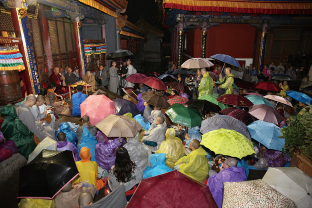
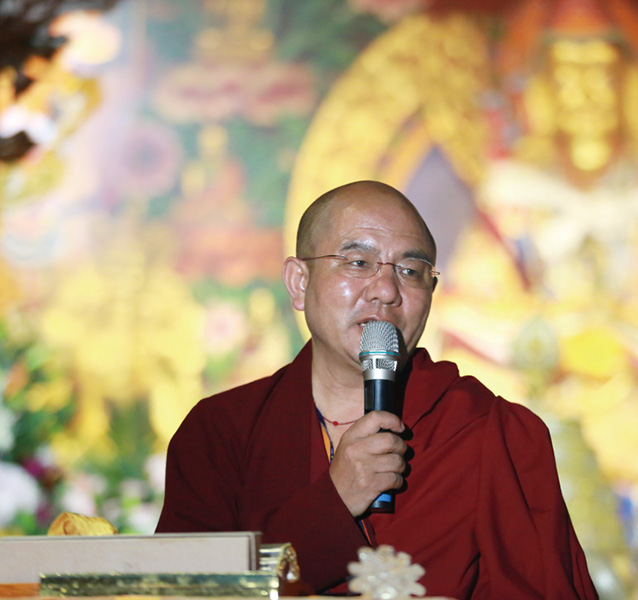
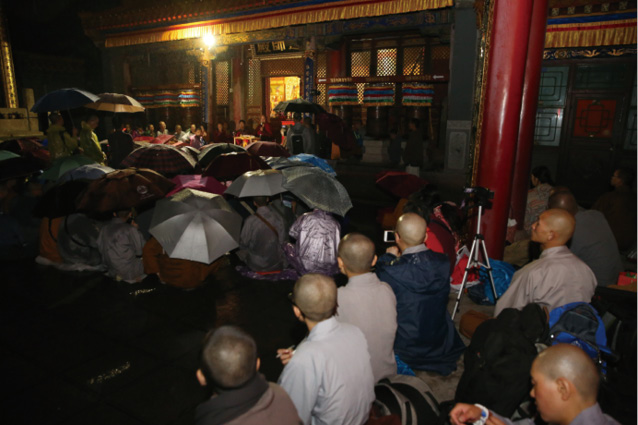
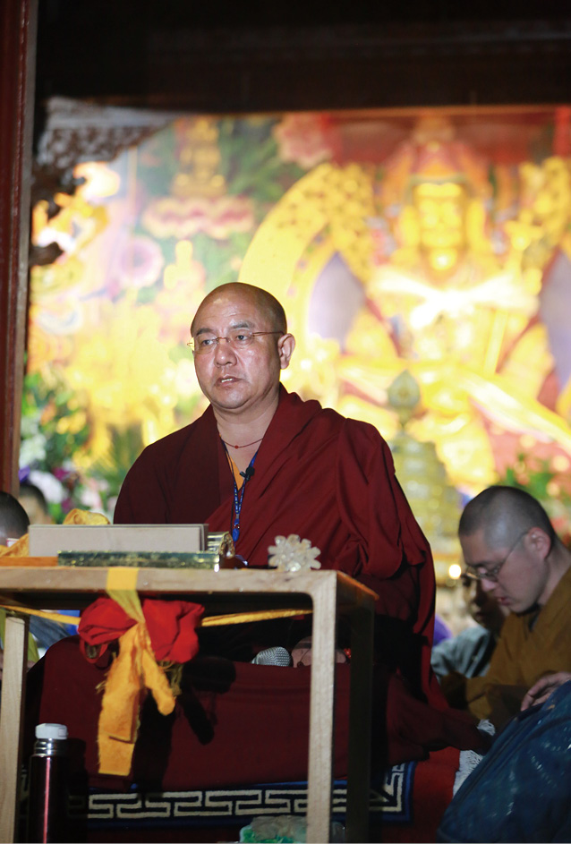
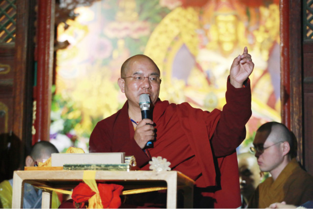

## 五台山菩萨顶 莲师殿开示

2017年7月26日

大家可以随意而坐，被雨淋到也没事，就算为遣除业障而苦行。有垫子的坐在垫子上，没垫子的躲在两边的屋檐下，也可以坐在自己的鞋上，有雨伞的还是打开雨伞。稍微冷一点，但还是要为了求法而苦行。

在正式念诵之前，先念三遍《圣八吉祥颂》。我来当维那师，起个头。

（堪布带领众人念诵）

按照组委会的要求，今天早上有几个环节：首先，我给大家讲一下来历和原因。

下雨了吧？你们最好打上雨伞。反正你们也看过我，我也看过你们。除非你是新来的，有好奇心。两个人打一把伞也可以。

今天早上，我这边先做开示，然后大家按照《喇荣课诵集》的念诵顺序，在见解脱莲花生大士像前发愿。念到中间的《文殊开智偈》，我开始传法，给大家灌“莲师除障法”的顶，之后念《佛子行》的传承。最后，大家一起念《大圆满愿词》《普贤行愿品》《前译教法兴盛文》来回向。

## 人生特殊的缘起

首先是第一个环节。这一次，我们能在这里聚集，大家要心怀感恩。平时，五台山的管理比较特殊，组织这样的大规模念经有一定的困难。大家想了很多办法，特别感谢相关的人员，包括蒙古喇嘛。

30年前，法王如意宝到这里时，蒙古族人和汉族人也是先在菩萨顶落脚。应该说，这是我人生非常特殊的一个缘起。也许是依靠30年前的这个因缘，今天在座的堪布堪姆和各位道友，你们生命的长河中，才有学佛、出家乃至证悟大圆满的特殊因缘。

有时候，因缘的确不可思议。因此，我要首先感谢组委会的道友，他们为这次朝圣付出了很多。在这里筹办这样大的盛会，离不开很多人的努力，否则会有一定的困难。

在座的都是堪布堪姆和发心人员。这次旅行，是弘法部组织的，我只是受他们的邀请来参加。不是我组织的，所以很多人不要有意见。弘法部一些发心三五年以上的道友跟我说，他们想要继续发心，恳请我一起出行，到五台山朝圣。大概半年前，他们就提前到此，做各种各样的准备。今天，终于如愿以偿来到了这里。

等会儿，我们会去东台顶。法王如意宝在这里第一次传《佛子行》的时候，也是下大雨，大家都没有雨伞，法王也说，要为了听课而苦行。在我们刚刚下车的地方，再上去一点，有一个长长的凉台，是法王当年传法的地方。可能是缘起吧，今天同样也下雨。

这两天大家要修安忍。几个身体不太好的堪布堪姆，不要在雨里淋着，最好到房檐下或到莲师像这里来，站在我后面。如果一直淋雨，也许明天就病了。其他的年轻人，可能问题不是很大。

我这里没有雨，比较舒服。本来，我也想苦行一下，但现在可能没办法。看来，我的苦行时代已经结束了。

## 第一次和汉人结缘

我先讲缘起。昨天晚上，我一直在回忆。想起来有点伤心，但还是克制情绪，给大家讲一下。

当年，法王如意宝带我们朝拜五台山的时候，跟我现在的年龄差不多，但看上去有些老。法王是1933年生的。昨天我和诺巴堪布算了一下，1987年法王应该是54岁。那时，是与汉地众生结上善缘的最初缘起。

当时，在我们藏族人的眼中，汉地真正的修行人是寥寥无几的。1986年的一天，上师在桑耶塔对面的甘多拉经堂，灌“大幻化网”的顶。法王一边念诵，一边迎请本尊。突然，他的身体从法座上慢慢地腾空而起，虽然不是很高，但与平时完全不同。降下来以后，法王安住了一会儿，对我们说：“在我清净的显现中，布玛莫扎和文殊菩萨亲自从五台山来这里迎接我。我们大概需要筹备一年的时间，明年一起朝五台山！”

当时，法王安排两个人负责此事，一个叫罗括，一个叫日协。他们领队先去，一队从青海那边走，一队从四川这边过去。历经一个月，把整个五台山都了解清楚了。在此之前，我们从来没有人去过五台山，根本不知道还有五台山这么一个地方。

法王说，如果我们要朝五台山，每个人可能需要1000块钱的路费。那时的1000块钱，大概相当于现在的10万，感觉特别多，而我们基本上没什么钱。幸好法王后来去道孚一带，信众们你一点我一点地供养，我们就攒够了。记得我好像有1200多块钱。第二年，我们到了五台山，刚好是雨季。后来每次到这里都下大雨。

法王的传记当中说，第一天是在后面的停车场，给汉族、藏族和蒙古族人传授《佛子行》。按理说，我给大家念《佛子行》的传承，也应该在那里。但位置基本上差不多，就在这里传吧。

当时，是我第一次跟汉族人结上善缘。在此之前，我虽然读过甘孜师范学校，但在汉语方面一窍不通，连“三宝”这个词怎么用汉语说都不知道。到五台山时，我带了一本《藏汉词典》——不是现在的《藏汉佛学词典》，内容非常匮乏、简单，根本没有什么佛教术语。

法王要求我和慈诚罗珠堪布翻译，当时我们特别为难。晚上，我和他商量：“咱俩根本不懂汉语，在那么多人面前怎么办？”后来想，这次上师如意宝朝五台山，特别不容易，为了不破坏缘起，再怎么样，还是要跟着翻译。后来我翻译了《佛子行》，堪布翻译了《菩提道次第摄颂》。

自从翻译了《佛子行》，我和汉族人的缘分就开启了。现在想起来，因缘确实不可思议。我虽然没有什么能力，但30年来，引导汉族人皈依佛教的数量，不谦虚地说，至少也是成千上万吧，算是比较多的。

在这30年里，有的人不知不觉已经离开人间，我个人也遇到了各种各样的违缘，但却一直坚持着。从上师如意宝第一次说，由我负责汉族这边开始，我就一直坚持着。

当时，法王如意宝在菩萨顶讲过法，在清凉寺讲过法，在那罗延窟等今天我们要去的这些地方，都讲过法。我没有其他什么能力，但对上师的教言一直铭记于心，直到今天。今天也是一个非常殊胜的因缘，在这里跟大家做一个简短的介绍。

雨下得比较大，毕竟是夏天，这是文殊菩萨的智慧甘露。到了五台山，文殊菩萨会用彩虹、云彩、雨水等各种方式，加持所有朝拜的人。所以，我们应该以坚定心和欢喜心，好好朝拜。

我本来非常忙，可以说在百忙之中，抽出了今天和明天两天时间。其他的时间，实在没法空出来。在座的各位，因缘比较殊胜。其实，还有很多人想来，但由于各方面的原因，实在没有办法。人数太多了，我们一直减，最后减成这样。

个别居士可能知道了消息。既然来了，那就随缘吧。大家不要宣传，组委会这边也有要求。此次五台山之行相关的照片，大家在年底之前，不要发到微信等网络平台上，因为很多方面都不太方便。

## 莲师像的因缘

下面，我再讲一讲莲师塑像的因缘。我后面的莲花生大士像，是上师如意宝当年特意塑造的，一直保存至今。在这期间，有人发心做了一些修整。

这尊像的加持不可思议。法王如意宝在它的心间放了一尊莲花生大士小像，是列绕朗巴大师的伏藏品，叫做大乐莲师。当时说，如果这尊像放得好，在藏、汉、蒙、疆等很多地方，佛法都一定会兴盛。当时听起来特别简单，但现在看来，大家都觉得特别不可思议。

这尊莲花生大士像，最初并不是那么出名。我特意在课堂上提过很多次。后来，大家都比较清楚了。这是一个特殊的因缘。当然，还有很多其他的因缘，我就不广说了。

在座的各位，这次能来这里，特别不容易。虽然你们或许曾经来过，我也曾经来过，但这次我们是一起发愿——发我们曾经发过的愿。按照《普贤行愿品》的大愿，无论如何，生生世世都要弘扬佛法、利益众生！

法王如意宝来这里的时候，最开始在塔院寺舍利塔那边，主要念《普贤行愿品》来发愿。这次我们如果有时间，也要去塔院寺发愿。但是人太多了，可能不方便。离开之前，希望你们各自去塔院寺，至少念一遍《普贤行愿品》。

今天是一个很殊胜的因缘。我这边有一尊伏藏大师大乐洲（德钦朗巴）生前随身带着的莲花生大士像，等会儿我用这个来灌顶。下面，我们按照学院平时的念诵顺序，从《圣八吉祥颂》开始念诵。

（课前念诵）

雨下得太大了，你们还是进来吧。

## 记住这一天

下面，我们做莲花生大士身口意的灌顶，名叫“莲师除障法”。

当年我们来五台山的时候，法王如意宝让我和慈诚罗珠堪布翻译莲师除障法。我们说，莲师除障法的内容不好翻译，怎么办？法王说：“这次有不可思议的缘起，我们要重新建立汉地闻思修行的法幢。即使翻译不出意义，你们也要从语音上做音译。”

当时没有电脑。我们琢磨半天，我的字写得好一点，最终决定用写字的方式。我们两个在塔院寺，每天晚上都在加班，因为白天法王经常要开法会。

最开始，法王如意宝住在菩萨顶前的那栋房子里，之后住到善财洞。善财洞上面，就是讲《忠言心之明点》的地方。然后再去东台顶、清凉寺等，总共待了100天。最初有一万多名僧人和在家居士，后来惊动了国家最高领导层，部分人不得不回去。据相关的历史记载，最后只留下了500人左右。

我们当时在五台山，就是用莲师除障法作为开拓藏传佛教的开端。30年后的今天，我们也要用此法作为缘起。希望在座的堪布、堪姆和法师们，一定要记住这一天——以莲师除障法为缘起，将来在各个地方弘扬佛法！

每个人的生命都是有限的，但我的内心却非常坚定。虽然自己的身体不好，肝、肾、肺、脊椎，里里外外，哪儿都不行，但这30年来，我一直坚持讲经说法。以后，还会继续坚持，只是不知道能坚持多长时间。反正，我一直在努力地发愿。

希望每位法师，今天能在圣境五台山的莲花生大士像前发大愿。以莲师法作为切入点和缘起，将来要在全世界，令无边的众生得到真实的利益。我们每一个人，都要披上精进的铠甲。在弘法利生的时候，无论遇到什么样的违缘和障碍，都不要退失，不要向违缘低头。一定要努力、坚强，以上师如意宝和前辈高僧大德为榜样，在菩提道上坚定地勇往直前。

这座莲师殿中的莲花生大士像，是法王亲自塑造的。后面的殿堂里，有格萨尔王像，另外还有护法殿。下面，我们开始灌顶。受灌顶的人应该坐下来。后面站着的，应该不是游客吧？

## 莲师除障法灌顶

按照传统的仪式，灌顶的前行部分已经完毕。接下来，将金刚上师和莲花生大士观为无二无别，在他面前祈求传授莲花生大士的除障法。大家以非常恭敬的意乐，跟着我念诵。意思是：今天，我以恭敬心祈求莲花生大士的除障法，依靠莲花生大士特别的加持力，令我本有的自然智慧得以开发。

的确，每个人都拥有自然本智的宝藏。但是，有的人即生能将这个宝藏开发出来，就像大德们开悟一样，有的人却不能。原因是什么呢？与我们的信心、精进有关，也与缘起有关。佛经说：“诸法因缘生，诸法因缘灭。”一切万法都依靠因缘而产生。大家一定要通过今天的因缘，开发自己本具的自然本智。

接下来，你们跟着我念三遍。观想在与莲师无二无别的上师面前，祈求赐予莲师的除障法，做大乐莲师的灌顶。

（众人跟堪布念诵）

现在，上师已经开许灌顶。接下来，是皈依、发心、受密乘的誓言。大家基本上都修完了加行，怎么皈依、发心、受密乘戒，应该都知道。为了节约时间，我在这里不说。下面是皈依三宝，皈依自性如来，发无上的菩提心，受持密乘戒。大家一边观想这三个道理，一边跟着我念。

（众人跟堪布念诵）

接下来，大家先将自己的身体观为莲花生大士，再观想从心间放光，从自性清净的刹土当中，迎请无数的莲花生大士，融入自己的身体。

（堪布念诵仪轨）

观想莲花生大士，再再地融入自己的身体，获得了与莲师身口意无二无别的加持。

我们以前在学院灌这个顶时，是按照蒋扬钦哲旺波尊者的灌顶方式，莲花生大士的身、语、意是别别分开来灌的。但上师如意宝比较简略，将莲师身、口、意无二智慧统一起来做灌顶。

接下来，观想莲花生大士的身、口、意发出不同的光，融于自己的身口意，获得与莲花生大士无二无别的灌顶和加持。与此同时，大幻化网、集密意续、八大法行等其他所有寂猛本尊的灌顶，也已经全部获得。

（堪布念诵仪轨）

接下来，我用这尊大乐莲师给每个人加持一下。殿堂里的人先接受加持，然后到外面等一等。外面的人，再一个一个地排队进来。其他的人念《大自在祈祷文》。

（堪布作加持，大众念《大自在祈祷文》）

外面的人，要进来见一见法王造的这尊莲花生大士像。刚才被雨淋到，提前进来的那些人，好像还没有见到。他们刚才被雨逼迫，不是以信心进来的（众笑）。现在你们排队过来，在莲师像前磕一两个头。大家快速地轮流进来。

自己找好坐的地方。还有一些环节，我们尽量在七点钟之前完成。下面，我们有一个重要任务——30年后的今天，在菩萨顶，再次念诵《佛子行》的传承。

（堪布念诵传承）

现在，我们的传法和灌顶都已经圆满了。等会儿，大家一起念《文殊大圆满基道果无别发愿文》《普贤行愿品》，回向以前译宁玛巴为主的所有的藏传佛教、汉传佛教、南传佛教，包括藏地的噶举、格鲁、萨迦等所有的教派，全部长久兴盛！

## 菩萨顶，发大愿

五台山就像布达拉宫，菩萨顶尤其特殊。这一点，我以前写《五台山圣地记》时，清楚地提到过。当时是用藏文写的，没用汉语。今天，大家要发大愿。我相信通过今天的莲师除障灌顶，你们每个人修行的违缘都能遣除。

今天在座的人，有些已经是讲经说法的堪布堪姆。有些还没有堪布堪姆的头衔，但10年、20年以后，会成为堪布堪姆。在这里，有很多人是五论学士、法师等。我相信，大家通过发心，将来会成为了不起的人。还有些人，下辈子会变成特别了不起的高僧大德。

我们每一个人，不要只想自己的事情。自己健康也罢，快乐也罢，都不是很重要。重要的是，我们今生乃至生生世世，都能弘扬大乘佛法，利益无边无际的有情。

今天，我们能在文殊菩萨的道场、莲花生大士的像前发愿，是一种非常不可思议的因缘。接下来，大家在与莲花生大士、文殊菩萨的大幻化网无二无别的殊胜清净道场，以非常真诚的心，念诵《文殊大圆满基道果无别发愿文》和《普贤行愿品》来发愿。在这样的缘分中，大家心里应该有很多不共的感想。

听说有个别人病了，等会儿组委会安排一下。其他人一会儿吃饭，吃得比较简单，反正今天和明天都要苦行。你们不像前辈的高僧大德，可能这辈子都没有苦行过。我们以前来五台山，身上带有两千块钱的人几乎没有，住的也不是宾馆。我当时在菩萨顶的院子里搭了一个小帐篷，在下面的台怀镇找了几个纸盒子，晚上睡觉的时候当作垫子。当时是这样过的。

今天淋点雨其实不算什么，很好。等一会儿我们上山，可能会比较冷。山上山下的温差比较大。我昨天晚上12点给这边发信息，让大家今天带上足够的衣服。大多数人今天穿得还不错。山上确实有点冷。如果你们带的衣服不够，要做好思想上的准备。其他应该没什么事了，接下来我们大家一起发愿回向……
