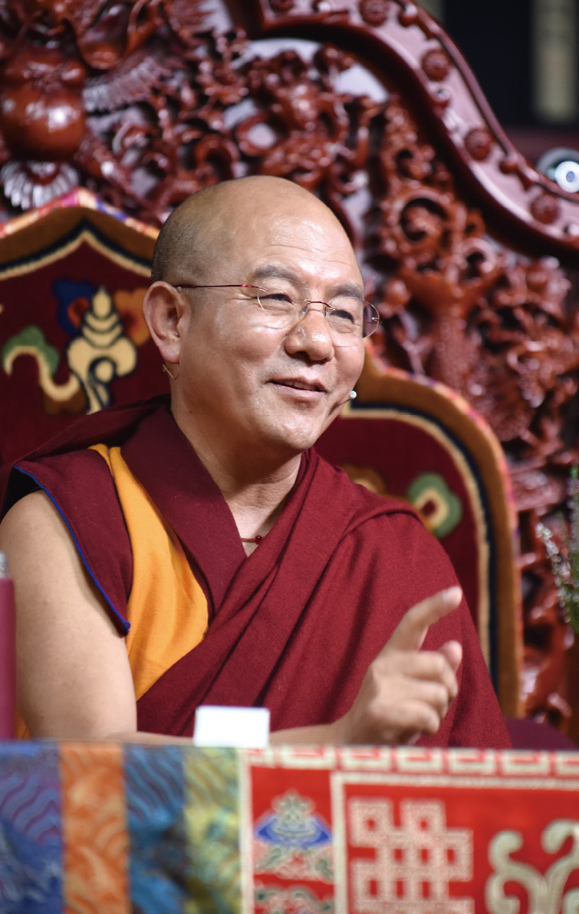

## 净土法门的开示

2018年11月10日

今天在念《阿弥陀经》的传承之前，先说一些事情。

## 珍惜闻法机缘

相对全球人口和佛教徒的数量，甚至学会随学者的人数，现在真正长期闻思修行的人少之又少。当然，如果跟二十多年前在喇荣闻法、修行的人数相比，现在闻思修行的人数算是多之又多。

但是，平时在网络上听课的学会学员，事实上并不多。今天晚上，因为我只是做简单开示，加上是周末，所以人才稍微多一点。一些人认为，平时有很多人在网络上听我们的课，其实不然。如果跟信息不发达的时代比较，现在确实算是很多。但在信息如此发达的今天，世间上一些意义不大、关于吃喝玩乐的网络节目，在线有多少人数、流量？大家应该清楚。

所以说，有闻思意乐的佛教徒不是特别多，学会的情况算是比较好，但我还是不太满意。我不是为了个人原因才希望闻思的人多一些；相反，从我自身和其他方面来说，学会的人数越少，对很多方面越好。如果我们比较低调、默默无闻，那就比较安全，也会减少很多议论和是非。藏族有句话“人多是非多”，人越来越多的话，不是一件好事。

不过，根据大乘佛教的教义，从人身难得或者佛法难闻的角度看，在全球线上直播平台这么兴盛的时代，佛教徒应该珍惜闻法的机会。我们平时的课，像《维摩诘经》或者其他经论的讲解，在线的听课人数非常稳定；但遇到一些临时的开示，在线人数会比平时上课多一两倍，为什么呢？因为没有约束，来一次就可以了，不用持之以恒。所以，很多人不是没有时间，而是没有闻法意乐。

显宗的一些课程跟密宗不一样。密宗的话，如果你没有听第一节课，那不管遇到任何情况，通常也不会开许你听其余的课，这方面有特定、严格的要求；而显宗的一些课程，虽然你错过了前面的课，但也可以随时加入进来听后面的课。这一点可能跟藏地古代一些大德们的传统不太一样，但法王如意宝在1986年讲解《贤愚经》和1998年讲解《百业经》的时候，都提到哪怕只是听到这些经中的一个公案，也会对众生有很大利益。当时所有老百姓可以随时来听课，哪怕是一堂课也可以。

从此以后，我们这里的一些公开课程对听法者没有严格的要求，如果大家有兴趣，就可以随时来听。你们很多人平时没有来听课，除了是没有时间，也可能觉得偶尔才听一两堂课不太圆满。即便如此，其实哪怕你只听一堂课，也能在相续中打下某种程度的基础，让你对佛法有更深的认识。虽然传承上你没有圆满，但是听一堂佛法课，总会对你的相续有帮助。

现在，学会的很多佛教徒对一些佛教基础知识还不是很了解。这除了跟以前藏地的传统有关，也跟现在佛教徒自身并不是特别积极和努力有关。如果你们很精进，就算不能听完一部法的10堂课，也应该可以听其中的5堂课，里面一定会有你们需要了解的教言和智慧。

为什么有时候我要给大家安排网络开示呢？虽然不排除这样可以吸引一些非佛教徒，但最重要的是，学会的学员没有长期闻思修行的力量。其实，很多世间人就算再忙，他们的忙碌程度跟喇荣的发心人员也应该差不多。像我自己，今天从早上9点一直忙到刚才19点04分；但对于上课，我跟山上的道友还是很重视。

所以，今天我觉得很遗憾。网络开示的在线人数比我们平时的课多了很多，现在信息如此发达，线上听课如此方便，而平时来听课的人却不多。按照目前的情况来看，不知道你们以后还有没有这样的闻法机会，也许到时候你们会想：“哇，原来以前听课很方便，但我当时没有很好地闻法……”可能有这种情况。

上师法王如意宝曾说：“弟子有信心的时候，上师已经不在了；上师在世的时候，弟子却没有信心。”如今上师在世、佛法住世、信息方便等各方面因缘具足的时候，你没有闻法的信心和意乐；而一旦各方面的因缘消失，你着急也于事无补：“哦，现在该到哪里去听课、学法啊？我真想学一学啊……”

所以，对于现在我们给大家提供的很多免费课程，希望大家好好珍惜！不管你有没有时间长期听法，只要你有空闲，就要想：“我要听课！”大家要培养这种习惯。

你们有些人平时一直在听课，传承圆满；有些人虽然不能圆满传承，但是会尽量来听；有些人不听课，同时也给自己找个好借口：“哎呀，我不能全部圆满传承，所以最好不听了。”这是“最好”还是“最坏”，你们要弄清楚。这就是我说的“很遗憾”。在跟外界接触的过程中，我发现城市里大多数佛教徒不爱系统闻思修行。

当然，我也很认可你们当中极少数人喜欢闻思修行，非常了不起。现在很多地方都有一部分这样的佛教徒，跟以前相比确实多了一些，但若跟佛教徒的整体数目相比，他们的人数就像白天的星星一样，这是我的看法。

今晚在线上听课的道友，我想大部分已经加入了系统学习的行列，但你们平时可能以不同的理由不来听课，比如：“我不能圆满传承，所以最好不听”“我特别忙，听不了课”“我最近身体不太好，这部法我就不听了”……凡夫人总是给自己很多“优惠”条件，就像一些孩子一样，总有很多不学习的理由：“我要看电脑”“我要玩IPAD”“我要出去玩”……大家不要给自己找很多不闻法的理由。这是第一件事情。

## 在家的年轻藏人也要系统闻思修

其次，我希望藏族的年轻人好好地学习佛法。上了年纪的那一代藏人对佛法真的非常有信心。藏地大多数寺院里的僧人，都有系统闻思修行的传统，但由于藏族的历史原因，藏地普通的在家老百姓很少有系统学习五部大论、加行的传统。虽然一些地方有这个传统，但不管是青海、拉萨还是四川、云南等很多藏区，在家人系统学习经论的现象不太普遍。

希望在家的藏族同胞群体可以系统地学习前行、五部大论等经论，这是我们正在提倡的；而僧人不仅要给寺院的出家人传法，也要给在家群体传讲。

现在藏地的学佛情况是怎样的呢？不管是藏地任何教派的寺院，出家人大多数对佛教的经论都很精通，而且有些人一辈子专攻一门专业，像《俱舍论》、现观、中观等等；另一些出家人可能没有这么深入研究，但也有一定的佛学水平。在家群体方面，以前可能有相当部分的人不识字，但现在大多数的藏人都识字，所以应该可以闻思。不过到目前为止，在家群体的闻思风气还没有建立起来。

今天来听课的道友中应该有一些年轻人。对于五部大论、密宗的相关佛理，希望我们这里的年轻人可以先从善知识那里听受——无论汉语、藏语，然后自己去思维，最后好好地修持，修持后要不断地利益众生。这很重要！

现在，一些藏族的知识分子可能因为身份的原因，所以不太方便有信仰。其实，全世界不同的人有各自不同的身份，但不同身份的人都可以有自己的空间去做自己的事情，包括研究、学习、信仰或者发展自己的爱好。自古以来，人们都各自有不同的兴趣爱好，这是再正常不过的。

当然，我们绝对不能触碰人类社会的法律底线、公众都遵守的大原则，比如杀人、偷盗、受贿。在此前提下，每个人还是有自己的空间去选择信仰什么和做一些取舍。这方面我尊重你们自己的决定，但有时候大家不要给自己加很多不必要的理由。

另外，现在藏族的年轻人如一些大学老师、学生，他们当中抨击佛法的人，比无神论者或其他宗教的信徒还要多。可是，他们本身并没有好好地学习过佛教知识，根本不懂佛教的道理。如果他们真的懂得佛理，然后用智慧理性地破斥，我们也愿意接受，而且从因明的角度，我们也很赞叹这种精神。但是那些人没有学过佛法，只是粗略地看了一部论典，甚至只看了一两句，或者只听了一两个人的只言片语，或者只从某篇文章里断章取义，就在世人面前作秀，以所谓权威的名义来驳斥浩如烟海的佛法。

当今时代，我们藏族保留了很好的传统文化和佛教智慧，其他民族、国家的很多人都能真正从中受益，可是我们本民族的一些年轻人、知识分子，不但没有从中汲取养分，反而在全世界的人面前作秀，这是不会成功的。当然，在此世间你可以扮演任何角色，但若你要作秀，不管是真是假，至少也要演得成功，否则可能有穿帮的一天。

## 佛教徒要修净土法门，也要对生活负责

现在开始讲净土法门，我会念《阿弥陀经》的传承。在2010年11月，当时我在讲“净土五经”的时候，用四堂课讲解了这部经，也念了传承。汉地很多人都能背《阿弥陀经》，也念得快。藏文版本由于翻译的原因，篇幅相对比较长，念传承也要较长时间。

（堪布念《阿弥陀经》传承）

下周六讲课的内容是“边学佛边生活”，是生活佛教的一部分，这对现在许多人很重要。我们出家人一味地学习佛法，但其实有时也要边学习边做一些事情。像喇荣这里，我们要求每位出家人一个月至少要为社会、学院或者寺院做一件事情，否则出家人可能变成书呆子——满脑子只有经论、续部的内容，生活上除了吃饭外，其他事情都不会做。这样不太好，弘法利生的时候会困难重重。

具体的题目还没有定下来，但内容就是“边学佛边生活”，对象主要是针对在家人，也针对那些平时不想做任何事情、只想往生极乐世界的人——毕竟你在往生极乐世界之前，还要在世间生存，所以你仍要随顺你的生活、环境。现在有些人只靠别人来做事情、提供所有的方便，他自己什么都不做，甚至碗也不洗。如今你尚在人世，极乐世界还没有现前。

在极乐世界，一切都随你的意愿：你想吃东西食物就出现；“欲闻时出妙法音，不欲之时即不闻”——你想听闻佛法的话，自然就传来法音，你不想听的时候，法音就自然消失。极乐世界那边很自动化，“人工智能”比较先进，但我们这个世界，还没有那么先进。

最近我们对未来做展望，提倡了一些理念。我们希望在未来培养什么人材呢？希望培养修行上很好，同时对社会、家庭、生活真正有担当的人。哪怕他在山洞里好好地修行一辈子，至少也会对自己负责。当然，我为此讲一两堂课不一定有作用，但以前上师如意宝也是这样，一些教言大家只是听了两三遍，听的时候也不是很重视，不过几年后或者当时讲法的场景流逝后，大家回忆起来都有很深的印象。

总之，下周六我们讲的佛教理念是——“边学佛边利他”或者说“边学佛边生活”。到时候也会念一个短法的传承。你们喜欢听传承，只想着“噢，我得到传承就可以了”，因为觉得闻思比较费劲、修行也累。

（堪布继续念《阿弥陀经》传承）

龙猛菩萨说：“若人山顶坠落，不欲亦会下堕，恩师赐予传承，不欲亦得解脱。”如果一个人从很高的地方坠落，就算他不想往下堕，实际上也会堕下去；如果在恩师面前得到传承，就算弟子不想解脱，实际上也会解脱（众人鼓掌）。之后我会把这个教言发到藏微博上。

（堪布继续念《阿弥陀经》传承）

## 跟法王结缘往生的两个条件

“若一日，若二日，若三日，若四日，若五日，若六日，若七日……”，今天念了传承，希望大家最近好好地念《阿弥陀经》。一些人从来没有听过这个传承，也没有看过《阿弥陀经》，这非常可惜。因缘真的很重要，这里说不管任何身份的人——善男子、善女人，如果一日到七日之间一心不乱地念阿弥陀佛，就会往生极乐世界[^1]。

往生极乐世界可以说很简单，也可以说不简单，最主要是看我们的因缘。那我们需要什么因缘呢？因为前段时间学院内部举行了第25届极乐法会，我就在此说一下。其实，凡是跟上师如意宝结缘的众生，都有往生极乐世界的因缘。这不是我们最近才说的，是两百多年前菩提金刚授记的[^2]。

我们每一个人都应该对极乐世界有信心。如果你没有信心，别说极乐世界，可能你连世间的一些愿望，比如去英国留学、去拉萨朝拜、去喇荣看看等事情也实现不了；如果你对一件事情有意乐和信心，就会身体力行往这方面努力。

当然，如果没有来世，就另当别论；但如果你的生命还会不断地延续、还要流转轮回，而轮回是那么痛苦，你现在遇到如此特别殊胜的因缘，是不是应该珍惜并在这方面努力？这值得上师如意宝传承下的善信们思考。大家可能看过菩提金刚对法王如意宝的那个授记，他对喇荣的器世界和有情世界全授记得清清楚楚，也提到与法王结缘的众生都能往生极乐世界。

那跟法王结缘的条件是什么呢？喇荣在1993年举行了第一次，也是规模最大的一次极乐法会。当时法王在讲解麦彭仁波切的《净土教言》，同时也开示了每位弟子最好每年念三十万遍阿弥陀佛心咒，这是一个条件。法王以前还说了另外一个条件，就是每位弟子一生中至少念一百万遍藏文的阿弥陀佛圣号（炯丹第 得印夏巴 扎炯巴 样达巴 作波桑吉 衮波哦华德美巴拉 香擦洛 秋多 嘉森切哦）；如果念汉文，就念六百万遍“南无阿弥陀佛”。以上就是跟法王结缘的两个条件，你们来不来参加法会倒不重要。

其实，虽然你们有些人从来没有亲见法王如意宝，但因为他的发愿力，各位都已经跟他结了缘。结缘并不是必须靠一条哈达——一些人把钱塞到哈达里，弄得哈达黑乎乎的。藏人经常说：“我拿哈达跟你结缘，供养！供养！”现在也有很多人说：“我要和某个上师结缘，供养！供养！”事实上，真正的结缘不一定是用哈达和金钱，供养不是最重要的结缘；最重要的是你与上师的法缘——通过闻思修行来结缘，才是真正的结缘。

## 往生极乐世界的顺缘和违缘

今天，我想让大家了解往生极乐世界的顺缘和违缘。顺缘方面，往生极乐世界需要什么呢？《净土教言》和《极乐愿文大疏》都讲了往生四因，相信很多道友也学习过。按照麦彭仁波切的说法，这四个因可以归纳为两个因。一是意乐，如果没有意乐就去不了净土；二是资粮，念佛号、心咒等等就是积资净障。

意乐方面，就是你真心想要往生，否则谁也不可能强迫你去极乐世界。如果你有其他意乐“我不想往生，我想下地狱，不要强迫我到极乐世界”，那就没办法往生净土。所以，首先大家要对娑婆世界有厌离心，然后相应阿弥陀佛的发愿而往生极乐世界，在那里圆满所有地道功德，最后证悟法身如虚空，以无边的愿力、事业来利益众生，这是最重要的发愿。

资粮方面的比喻，如一个想去拉萨的人，只有意乐却没有钱，最终他很难到达目的地。所以大家要积资净障，经常念《阿弥陀经》、阿弥陀佛圣号，以及每年尽量念阿弥陀佛心咒。

这方面我很惭愧，因为还没念完前阵子定下的三十万遍阿弥陀佛心咒。发愿的时候我的信心很坚定：“这次一定要念！”可是每天都有各种事情，本来应该在一个月之内完成，现在应该要三个月。有些事情是说易行难，不过我以前倒没有那么忙。其实，我每年都很欢喜地念三十万遍阿弥陀佛心咒，如此自己就感到胸有成竹，一定会跟着法王往生极乐世界，这是一直都有的意乐。

总之，大家要积资净障并发愿往生极乐世界，这两者非常重要。就像一个有钱但不想去拉萨的人，如果你没有意乐，即使念了三十万遍心咒，或者一百万、六百万遍圣号也不一定能往生。临终的时候，你自己的意乐尤其重要，那时候要想：“我一定要去上师那里！”

的确，上师的发愿力不可思议。在第一届极乐法会期间，法王如意宝说了一些金刚语。当然，没有信仰的人不一定承认大德的话语，但我们知道上师的金刚语是100%会兑现的。上师以前说过的许多话，现在已经一一兑现，我们后来才知道它的价值。

当时法王如意宝说了什么呢？法王说，往生极乐世界的佛教大德有千千万万，其中具有代表性的，是本师教法初期印度的龙猛菩萨，与他结缘的众生都已经往生极乐世界；本师教法中期的代表是藏传佛教的乔美仁波切，凡是与他结缘的众生，哪怕是旁生等都已经往生极乐世界。最后法王发愿，凡是与他结缘的众生都要往生极乐世界，这就是法王的金刚语。从此之后，喇荣每一年都举行极乐法会，与法王结缘的人多不胜数。在我们看来，法王的金刚语肯定会兑现。

还流转在这个世间的我们，以前错过了参与龙猛菩萨往生极乐世界的团队；然后到了乔美仁波切的团队，我们也没有机缘；现在到了法王的往生团，要不要报名呢？你们自己考虑。

以前藏地有很多朝圣队伍，其中维萨空行母的团队有几百人。当时交通不发达，他们去拉萨的时候不像现在这样可以坐飞机或者火车。他们的团队有三十多个小组，每组有七八人。小组的组员平时互相照应，到了晚上就一起烧茶、生火，朝圣队伍就这样慢慢地前往拉萨。

现在法王往生极乐世界的队伍，全世界有很多人报名，但有些人报名后，就因为“缺钱”而退下来；有些人本来就不想去，觉得去那里没有意义。总之，你们好好地考虑。圣者的发愿是不可思议的，就像一个朝圣的队伍，如果由一位很有能力的人带队，大家只要跟着他，便能遣除很多违缘。

在遣除往生极乐世界的违缘方面，大家要做什么呢？一方面需要断除舍法罪和五无间罪；另一方面，为了清净无始以来的罪业，每年要念满四十万遍金刚萨埵心咒。希望法王如意宝往生团的所有成员，都能够一个不留地往生西方极乐世界，就像某个路边的乞丐所说：“一个都不留，全部都成佛。”

当然，如果一些人不愿意报名，我也没办法，对吧？无论如何，我们都不知道自己何时离开这个世界，现在有一位如此殊胜的圣者带队往生极乐，我认为这个机缘在娑婆世界非常难得，大家应该发自内心地向往。否则我们只能在轮回中一直流转，感受更多痛苦。凡夫人的抉择都是基于自己的分别念，因此不能实际地解决很多问题；我们应该按圣者的金刚语和窍诀去做，人生才会越来越有意义。

总之，希望大家发愿！至于发愿的窍诀，可以归纳为三个方面：第一，发愿往生极乐世界；第二，尽量积资净障——按照法王的要求，每年好好地念诵跟往生极乐世界相关的心咒、佛号；第三，尽量忏悔——好好地念诵金刚萨埵心咒来忏悔自己无始以来所造的舍法罪和五无间罪等，因为在我们朝圣的途中可能会有很多违缘，如果能够把它们一一遣除，那要往生极乐世界是没有问题的。

## 共同发愿

这是一张阿弥陀佛唐卡，用来跟大家结上往生极乐世界的因缘。你们看，这是汉地清朝时存放在皇宫里的阿弥陀佛唐卡，由当时最好的画家绘制，确实是汉传佛教中非常好的唐卡。喇荣的道友已经请了，如果外面的道友有信心，我们之后也可以让大家登记，然后免费给各位结缘。

你们不要把它作为赚钱工具，结缘这张唐卡本来有一些念诵的要求，但现在是你们自己发愿。一些加持品的结缘要求不是金钱，是一些念诵的功课，但有些人请了却不念，所以这次没有特别的要求。喇荣的一些堪布也给大家结缘了这张唐卡，我觉得它非常好，经当时皇帝的要求而绘制，肯定是棒棒的，对吧？这也是大家往生极乐世界的因缘之一。

（堪布继续念《阿弥陀经》传承）

今天的课主要是让大家与传承上师法王如意宝结上善缘；如果你不认识法王，也可以跟阿弥陀佛的净土法门结上善缘。其实，当前一些老法师在弘扬净土法门方面贡献非常大，而且，不管是通过面谈还是不同途径，他们让我得到了很多安慰。同时，从我自身的发愿来说，也对往生极乐世界有一定的把握和信心。

明天是“双11”，再过几个小时，有些人很想买东西。作为佛教徒，我们对此不是很重视。我们重视的是，在特殊的节日、时间、缘起中发愿，如此会种下非常好的因缘。

今晚的因缘、缘起很特殊，而且来听课的人也比较多。藏人有种说法：“我有生之年一定要朝一次拉萨。”一些世间人会发愿：“我现在没有钱，但是我将来一定要成为富人。”今天，我希望大家以这种心态来发愿：“无论是这一世还是下一世，不管怎样我一定要往生极乐世界！”

确实，古往今来很多汉传佛教的大德，包括净土宗所有历代传承祖师和禅宗历代的很多大德，以及显宗、密宗的很多修行人，他们最后都往生极乐世界，这是上师们给我们选择的最好的一条路。多年以来，上师如意宝和净空老法师一直弘扬净土法门。另外，本焕老和尚等很多汉传佛教大德以及藏地的敦珠法王、顶果钦哲仁波切、贝诺法王、阿秋喇嘛等非常了不起的前辈，都发愿把很多有缘众生度脱到极乐世界。

今天比较特殊，几个小时后就是“双11”，你们应该能记住——2018年1111（11月11日），我们发愿：“1111（要要要要）往生极乐世界！”（众鼓掌）不管是现场还是网络上的道友，如果你特别没有信心，我们也不强求，但是希望你最好如此发愿。这对你的一切会非常有帮助，所以要记住今天。现在签字的话，我会写“1111”，因为只差几个小时而已。

如今很多人为了各种目的，让这个节日变得很火。有些人问：“你们佛教徒为什么庆祝这个节日？”我们答：“因为双11发愿。”他们以开玩笑的方式问，我们也以同样的方式回答。明天是正式发愿，今天是预备发愿。大家还要等几个小时，世间人为了在淘宝买一些东西也一直在等待。虽然“双11”不是佛教节日，但可以说是世间力量比较强的节日，在全球都很火，大家可以在这个日子发愿往生极乐世界。

有些道友以前可能没有在这方面发愿，如此你可能永远也不能往生极乐世界。如果你发愿往生，那依靠阿弥陀佛和上师们的愿力，在各种因缘聚合的时候，你自然而然就跟往生极乐的团队对接上了，就像刚才龙猛菩萨的教证一样。

作为佛教徒，我相信大家应该知道发愿有什么力量，因此，今天我们一起发愿往生极乐世界，好吧？（众人：好！）如果一个人不发愿，那他在世间所做的各种事情，也不知道有没有意义。确实，人们活着的时候，还是有必要发一些愿，对吧？希望我们大家真实地发愿。

（堪布念诵《摄略极乐愿文》，然后跟大家一起念藏文和汉文的阿弥陀佛圣号）

大家都发了愿，有信心也有感应，对吧？相信你们都能往生西方极乐世界！

[^1]: 《阿弥陀经》：“若有善男子善女人，闻说阿弥陀佛，执持名号，若一日，若二日，若三日，若四日，若五日，若六日，若七日，一心不乱，其人临命终时，阿弥陀佛，与诸圣众，现在其前。是人终时，心不颠倒，即得往生阿弥陀佛极乐国土。”
[^2]: 菩提金刚的授记：“单坚阿拉木天喇荣沟，邬金莲师化身名晋美，彼于菩萨四众眷属中，广弘显密教法如明日，利生事业顶天立地也，清净所化眷属遍十方，凡结缘者皆生极乐刹。”
