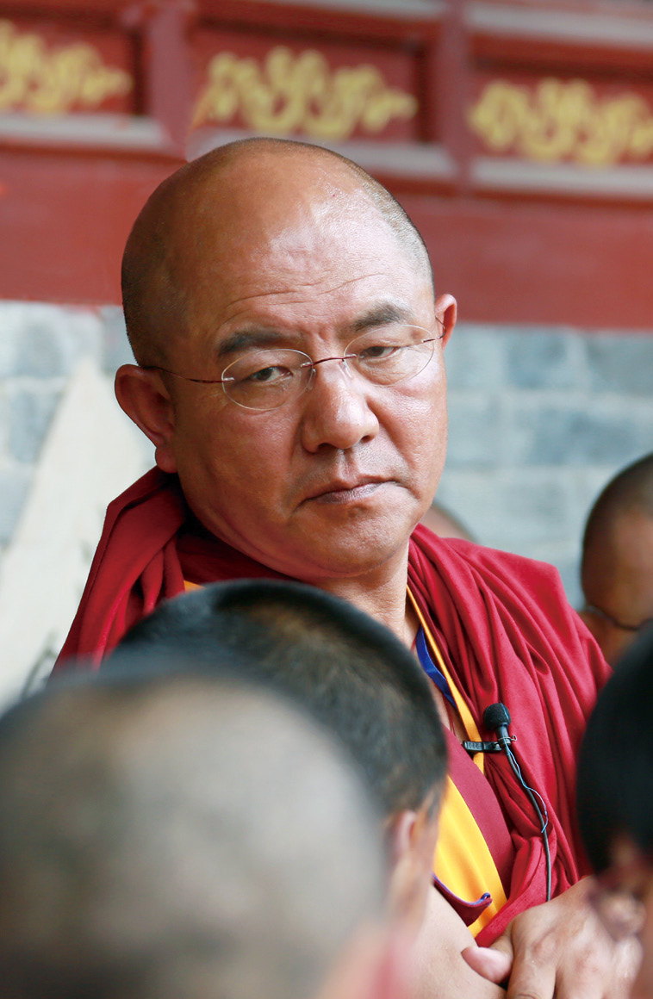
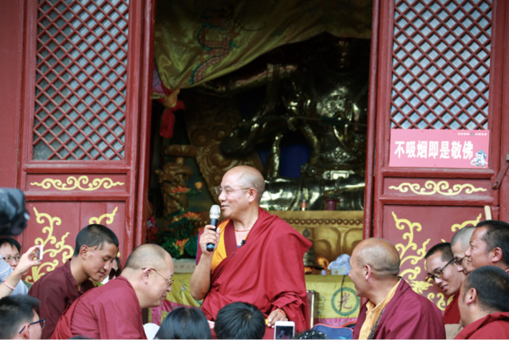
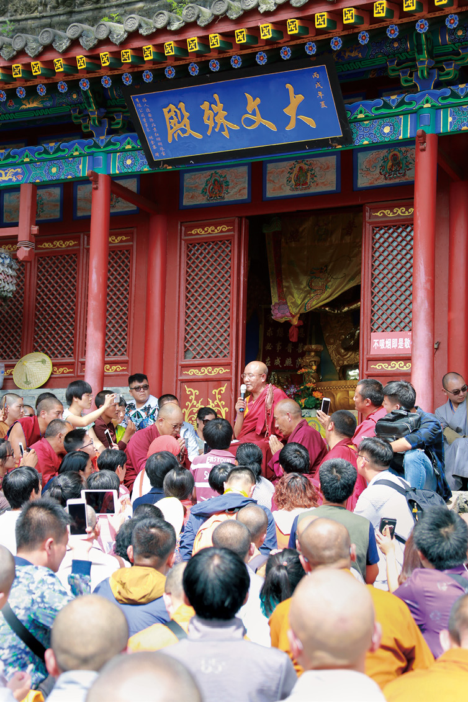
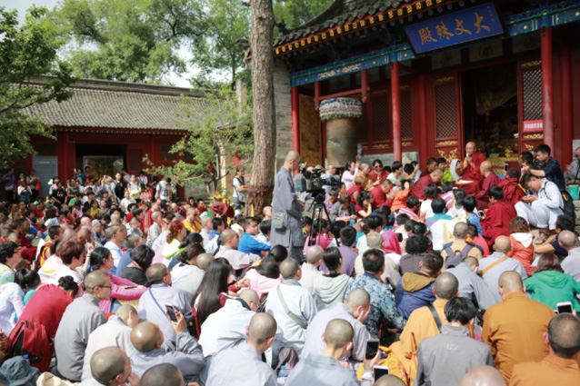
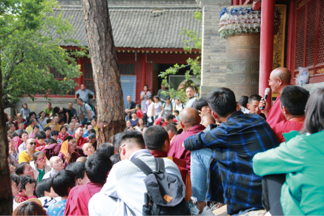
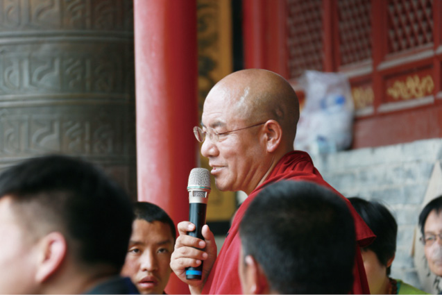
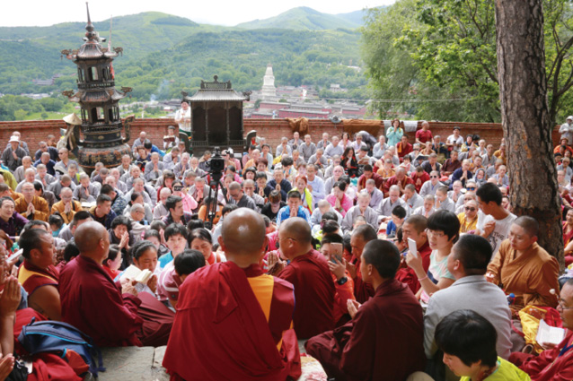
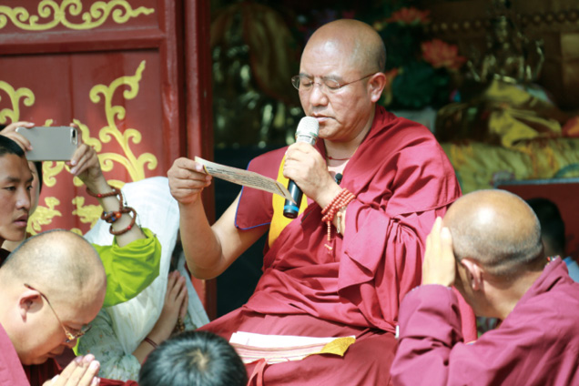
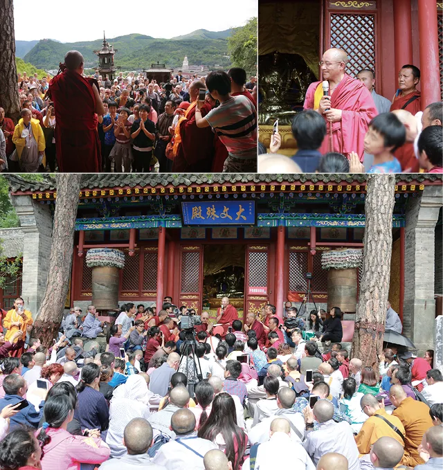

## 善财洞开示

2017年7月26日

（堪布藏文开示）

刚才，我用藏语简单介绍了一下我们今天在这里发愿的缘起。今天是比较特殊的日子。按照佛历，这个月是转法轮月，明天是本师释迦牟尼佛在印度鹿野苑第一次转法轮的殊胜纪念日。每年这个时候，我们色达五明佛学院都要开法会，从前天开始，直到六月初八，一共八天，一直开法会。

## 法王在这里亲见文殊菩萨

现在我们所在的善财洞，1987年法王如意宝在这里亲见了文殊师利菩萨。当年，法王如意宝先在菩萨顶住了一段时间，在那里给大家讲了《杰珍大圆满》《法界宝藏论》《佛子行》等。4月29日，法王到了善财洞，在这里闭关七天，并作了一首道歌。今天没有带藏文版的道歌，否则可以给大家念一遍。

当时，法王在清净的境界中见到了文殊师利菩萨，并唱了道歌：“我们辛辛苦苦来到这里，到处寻找您，却一直见不到您的尊颜。今天之前，您到哪里去了？现在见到了您，我要发愿：生生世世利益众生……”法王是这样唱的金刚歌。

法王写金刚歌的位置，曾经是一块空地，后来在那里修了一座三身殿。法王刚刚写下来，就让慈诚罗珠堪布和我唱。我俩唱歌并不好，但为了不破坏缘起，就大声地唱。

法王4月29日在善财洞见到了文殊菩萨，这在法王的传记和所有的历史资料中都有记载。还有，我们旁边的尸陀林，跟印度的清凉尸林也没有差别，这在《五台山志》当中有记载。

## 当年造了很多佛像

关于善财洞，相关的历史说，西日桑哈、加纳思扎等好多大圆满的传承祖师都加持过。1987年，宗教政策刚恢复不久，我们当年来五台山，相当于见证了五台山的历史，当时很多寺院正在恢复。我们在菩萨顶、罗睺寺、黛螺顶、塔院寺，都修了很多佛像。

朵芒寺的堪布德巴和今天在场的朵芒寺的几位堪布，一直在这里修菩萨像。中间的是四臂文殊。佛学院每月初十会供，念的都是麦彭仁波切的《四臂文殊仪轨》。当时，德巴堪布问法王修什么像，法王说修一尊四臂文殊。这个很重要，学院也一直念这个仪轨。

旁边是印度形象的莲花生大士。当时，如果修藏传的莲花生大士像，有些地方不是很接受。所以，这尊像看起来有点像阿底峡尊者，但实际上是印度的莲花生大士像。

这边是宗喀巴大师。这里比较容易接受宗喀巴大师。当时德巴堪布老人家一共修了这三尊像。堪布根沃等几个人，一直在场。

本来，我们今天应该在善财洞发愿。但善财洞的洞口比较小，今天来的人又多，就改在文殊殿发愿了。

我是“被迫”来到这里，因为他们邀请我参加他们一两天的活动。其他的人，包括藏族、蒙古族、汉族，有些是文殊菩萨加持来的，有些是业力现前来的，有些是漫无目的、随波逐流来的。不管怎样，大家有缘千里来相会，应该以欢喜心来参加。等会儿，我给大家念一个《文殊静修仪轨》的传承。

法王如意宝当时唱的金刚道歌，找到了藏文。为了缘起，我们在座的几个人一起念，大家听一下。另外，今天这里的事情，最好不要发到微博、微信等网络平台上，因为我是以隐蔽的方式来这里的。

（堪布等唱法王造的金刚歌，之后众人念课诵）

## 传法是最大的加持

在这里，我首先给大家做一个简单的开示，然后念一些传承，接着我们一起念《普贤行愿品》和《大圆满愿词》回向，最后大家拍一张集体照。人比较多，不一定全部照得下来。等会儿堪布堪姆和法师们坐在前面，然后是出家人，在家人站在后面。这样照一张简单的纪念照，我们今天在这里的发愿就算圆满了。

我给大家传了法，就是给你们做了加持。之后个别居士不要一直“跟踪”我，或不放我走。我没有什么侍者，要是被几个强壮的居士“抓走”了，比较麻烦。你们需要得到的是法。除此之外，我身上只有一个旅行包，里面没什么重要的东西，所以也没什么东西可以给你们。有时候，你们跟着我跑，我很不自在。你们需要的解脱法，上师如意宝传下来的清净法要，我都给你们念了传承。

有些人可能想照相。但我觉得，除了集体照可以作个留念，其他的相照多少张都用不上。现在的照片太多了，你们每个人的苹果手机里，都有好几百张，需要不断地删，因为手机容量有限。我有时候出去，也会照好多相。我五年前出去照的一些相，五年间一次也没有看过，以后也肯定不会看。所以，我觉得照相没什么用。

加持方面，我刚才也讲了，我不提倡特殊的加持，一般情况也不摸顶。至于供养，我也不收。有些人想供养哈达，但我没办法处理。供养钱，我也没办法处理。有些人可能觉得，钱怎么不好处理？钱是最好处理的。但我确实用不了很多。我希望你们好好地发愿。有些人来这里是为了朝山，有些人是为了发愿。

对面那座白色的佛塔，是阿育王造的。历史上，阿育王造了八万四千座塔。也有历史记载说，阿育王造了百万座佛塔。在中国有19座阿育王塔，其中就有五台山的这座舍利塔。前前后后，这座塔经历了很多次维修，现在我们看到的，是尼泊尔的工巧师维修的，历史非常悠久。所以，我们非常有必要在这里念一念《普贤行愿品》。

当年，法王如意宝从藏地来到这里，最开始在白塔前发愿，要念一万遍《普贤行愿品》。后来由于种种原因，多数人都没办法继续待下去，只有500人留了下来，待了100天。

今天上午，我跟个别道友讲，上师如意宝的弟子到一个殊胜的圣地，对住得好不好、吃得好不好、好不好玩、风景如何等，都不是特别重视。大家最重视的，是当地寺院有没有特别有价值的、特别有加持的佛像、佛塔和佛经。如果经过询问，找到了三宝所依，大家会日日夜夜地好好发愿、好好祈祷，把所有的时间用来行持善法。

这次来五台山，半年之前就计划好了。本来，十年前我就计划要来，但没有来成；二十年前也有计划，结果也没有来成。其实，其他时间我来过好多次，但最主要还是想在转法轮日到这里发愿。这次赶上藏历的转法轮日，终于实现了。

## 好好祈祷文殊菩萨

如果实在不会发愿，你可以念咒语。之前，我在微博和智悲佛网上分别发布了两条消息。半年前，我在智悲佛网上劝大家念文殊心咒十万遍，大概有九万二千多人参加，每人都发愿念十万遍文殊心咒，一共有92亿2000多万。一两个月之前，我在微博上要求大家发愿，报名的有三万六千多名，每个人发愿十万遍，共有36亿6000多万。两次的共修数量加起来，有一百多个亿。

按照很多高僧大德的说法，大家一起共修，每个人都能获得共修总量的全部功德。如果你已经念完十万遍，应该生起欢喜心。一百世都不一定能完成的功德，现在已经得到了，确确实实不可思议。

刚才山上有好多矿泉水，我让大家拿一瓶，结果你们好多人都没有拿。我现在可以喝了，这叫做有远见，我自己赞扬自己一下（众笑）。在文殊菩萨的道场，应该自信，要用西方人的思维方式，不能谦虚。中国人喜欢说：“我好惭愧啊！我好可怜啊！我业力好深重啊！”西方人一般不这么说。他们喜欢说：“我很有能力！我很有智慧！我很有远见！我很不错！”所以，今天我用一瓶矿泉水来赞叹自己。哈哈，很多人也喝起来了。

大家共修文殊心咒的功德，等会儿也要一起回向。这个月是转法轮月，很有必要回向善根。我自己觉得，是文殊菩萨不可思议的加持力，僧众不可思议的共同发愿力，以及各方面因缘具足的不可思议的法性力等，所有力量聚集起来，才有了这样不可思议的功德。

对佛教的信仰不太坚固，或对佛教咒语的功德不是很坚信的人，不一定相信我说的话。但我个人三十多年以来，一直没有间断过念诵文殊心咒。从1986年开始，我就对文殊法门非常重视。其实我很小的时候，就特别喜欢文殊菩萨，看到文殊菩萨的像，会特别特别地欢喜。

今天在座的堪布堪姆和法师们，如果还没有特定的本尊，希望你们把文殊菩萨作为自己的本尊。当然，有的话也可以。把很多佛菩萨作为自己的本尊，也是合理的，就像根本上师一样。一个根本上师可以，两个根本上师可以，甚至有十个根本上师也没问题。不过有十个根本上师，会有点累，如果不知道每个上师的密意，有时候这个上师高兴，那个上师不高兴。但本尊不像根本上师那样，不会那么麻烦。

以前上师如意宝给弟子加持，大多数是念文殊心咒。但我刚来学院的时候不是这样。朝了五台山之后，法王如意宝给别人加持，就开始念“嗡阿Ra巴匝那德”。平时，老人家也经常这样念诵。

虽然我不敢说大话，但在某种意义上，法王的传承弟子在讲经说法、弘法利生方面，的确有那么一点特色。所以，我希望在座的各位，来一次不能仅仅是照个相、吃个山西面，然后就回去了。不应该只有这一个目的。

今天中午，大家都吃得比较饱，所以比较开心。很多人看起来都很有精神，饭量也不错。有个别发心人员，平时显现上饭量比较大，这次应该吃饱了，满意了。哈哈，讲起吃喝来，大家都听得懂。所以我在这里，故意加了一点花絮。

## 到圣地，先发愿

今天我说的第一层意思，既然大家已经来到这里，就不要像以前的旅行，在生命中一点印记都没留下。而应该像我们30年前来五台山那样，留下不可磨灭的记忆。

我们当时来五台山，因为上师如意宝是了不起的大德，我们后来的生命都发生了很大的变化。不管是开智慧、弘法利生的精神，还是讲经说法、造论等，那次朝圣都成为缘起的开端。之后，我们每一次来五台山，都会去法王朝圣的地方。如果当初只是跟着旅游团，大家后来不一定有那么重视。

在座各位的生命历程，相同之中，也有不同之处。比如这一次，表面上看，大家都到了五台山，但此次朝圣对各自生命发挥的作用却是不同的，在弘法利生的缘起方面，也会有所差别。

以后你们自己旅行时，尤其是朝拜圣地的时候，不要走马观花地到处看，这样没有太大的意义。而应该深入地学习，深入地修行。只有这样，你的生命才会有特殊的转变，你的人生才会有价值、有意义。

希望将来有弘法利生因缘的部分道友，包括堪布堪姆，这两天能调整发心，好好地发愿。五台山与印度金刚座是没有差别的。印度金刚座是释迦牟尼佛开悟的殊胜道场，五台山是文殊菩萨显现化身的地方，都有很多不可思议的缘起。这一次，因为一些特殊的因缘，大家集聚在此，希望各位不要浪费时间。不管你在这里待多久，都一定要好好地发愿。

我以前跟法王一起去鹿野苑的时候，被法王严厉地批评过一次，至今记忆犹新。当时，我带着一个170块钱的照相机，每到一处圣地，就啪啪啪地拍照。包括去尼泊尔的很多地方，都是如此。法王此前一直没说，可能忍了很长时间。到印度鹿野苑的时候，我又先跑去照了几张相。法王就说：“到了一个圣地，要先以发愿为主。你们年轻人，天天拿着这个东西到处拍，是在干什么？”所以，我们以后到了圣地要好好发愿，这特别重要。

沿着这个山谷上到山顶，有个地方叫文殊法座，是文殊菩萨给一万个眷属转法轮的圣地，藏文叫加擦查旺，也是法王如意宝造《忠言心之明点》的地方。法王在这里大概住了半个月，然后到上面搭了帐篷。听说现在那里有一些经旗，在黛螺顶的对面。

今天我想强调的，一是希望大家好好地依止文殊菩萨，多多地祈祷；二是菩萨顶的莲花生大士像很重要，今早我们已经在莲花生大士像前发了愿。这里的文殊菩萨和莲花生大士像，都至关重要。

## 五台山的宗派圆融无违

藏传佛教、汉传佛教等各个教派，在五台山都有。这里的蒙古喇嘛、藏族喇嘛，都非常团结，这一点特别值得赞叹。五台山的寺院，汉传佛教的在念《地藏经》《阿弥陀经》，藏传佛教的在念《普贤行愿品》。大家供养、供斋的时候，也都非常包容。这是五台山的特点。

虽然去年的政策对五台山的游僧管得稍微严了一些，但总体上讲，五台山跟汉地的很多地方都不同，藏传佛教、汉传佛教都有，南传佛教比较少。

不管什么教派，都是释迦牟尼佛传下来的，大家不应该互相排斥。如果格鲁派跟宁玛巴之间相互排斥，萨迦派跟格鲁派之间相互排斥，汉地禅宗和净土宗之间也互相排斥，非常不好。从现在开始，我们要树立这样的理念：只要是佛教，都是一家。

我自己也拜访过汉传佛教和藏传佛教的许多大德。我之所以没去他们跟前参学，是因为我在窍诀和教言方面，该得的已经得到了。就在昨天，我还去拜见了五台山汉传佛教一些年龄较高的长老。

五台山藏传佛教的教派，多数是格鲁派的，他们的势力比较大。希望格鲁派的格西和蒙古喇嘛们，对我们宁玛派多一些慈悲的关照。在四川的喇荣佛学院，宁玛巴的教派相对兴盛一点，但我们对格鲁派、萨迦派、汉传佛教等，都非常包容。不管是蒙古族人、藏族人，还是汉族人，什么教派的人到了五明佛学院，我们都非常欢迎。

我们不仅对佛教内部的宗派，持融合和开放的态度，对基督教、天主教、伊斯兰教、耆那教、印度教等各种不同的世界性宗教，也非常包容。最近，我也在搞一些跨宗教的活动。希望大家不要以狭隘的思想，互相排斥。

我特别赞叹五台山的很多寺院——藏传佛教、汉传佛教以及其他的宗派，相互之间非常融洽。大家一起念经，一起朝拜，一起超度，一起发愿回向，非常好。我们今天去了菩萨顶，蒙古喇嘛们特别慈悲，很感谢。我们也去了那罗延窟，那里应该是汉族喇嘛，我没有问清楚，他们也比较包容。在善财洞也是一样。五台山有五十多座寺院，大家都知道哪些有包容心，哪些没有。

现在，全世界都进入了开放的时代，跟50年前完全不同。今天这个时代，佛教各教派之间更要互相圆融，互相学习。我们宁玛派可以学习汉传佛教、学习格鲁派，格鲁派、汉传佛教和南传佛教，也可以学习其他的教派，这对弘法利生非常有利。大家没必要彼此隔阂、排斥或看不惯，没必要让宗派的狭隘主义，障碍全世界开放思想的发展。

## 寺院是讲经说法的道场

我今天在这里，第一个跟大家简单讲了，要好好祈祷文殊菩萨；第二个讲的是五台山的宗派非常圆融，相信五台山的高僧大德们还会不断地努力。接下来讲的是，以后每个寺院供养的所依，都要有佛菩萨的像、佛经和佛塔。按照传统，三宝所依不可或缺。不仅寺院如此，个人家里的佛堂也最好有三宝所依。

但最根本的，寺院是讲经说法的道场，一定要尽量给信众结上法缘。寺院哪怕只有五个人、十个人，也要有法师给大家讲经说法。有了讲经说法，才有闻思修行；有了闻思修行，才知道佛教真正的教义是什么。如果没有闻思修行，没有讲经说法，虽然菩萨像非常有加持，佛像非常有加持，但人们的心却没办法转变。

我们每一个人，都需要得到解脱，而解脱只能通过佛陀的法得到，不是通过佛像的加持马上开悟。我们只有通过学习，才能了解佛陀真正的智慧和慈悲，才能把这些宝贵的精神财富弘扬出去，这是一个非常殊胜的因缘。

佛教徒不能只是念个咒语、念个佛号、朝拜一下就满足了，一定要懂得佛教的基本教义。在此基础上，还要不断地修行，不断地利益众生。这是我课前的简单开示。

## 正式传法

下面，我给大家念传承。先念《文殊静修仪轨》。刚才在山顶上念过一遍，但新来的个别居士也想得到，所以再念一遍。这之前，我先念麦彭仁波切的《文殊礼赞》。

（堪布念诵传承）

麦彭仁波切有个四臂观音的修法，也给大家念一下。

这两个孩子是谁的？他们玩得比较开心。没事，让他们玩。不能强迫他们，要给他们留一点自由。

（堪布念诵传承）

《四臂观音修法》的传承，我是在根登诺吾堪布前得到的，麦彭仁波切造的《文殊礼赞》则是在上师如意宝前得到的。我们在东台顶念的《文殊静修法》，是上师如意宝造的，我是在老人家面前得的传承。

太阳越来越强了。今天很多道友起得比较早，可能有点困、有点累，很多人都没有苦行过。我倒是没问题。过一段时间，我还要参加很多活动，比今天累得多。虽然今天的早上、上午和下午，我都做了简单的开示，但和过一段时间的活动相比，还算是最轻松的。

这是文殊菩萨的道场。我们先念一下《文殊礼赞》，再多念一些文殊心咒，最后我们念《普贤行愿品》做回向。

（大众念《文殊礼赞》和文殊心咒）

待会儿，我们念《普贤行愿品》回向。你们每个人都念了十万遍以上的文殊心咒，一定要好好地回向。我现在的位置可以看到白塔。你们等会儿站起来，也可以看到。因此，我们可以说是在白塔前发愿，在善财童子的善财洞发愿。善财童子当年是如何在文殊菩萨面前发愿的，《华严经》里讲得很清楚。大家应该将自他所做的善根，回向给天下无边的一切众生，让他们离苦得乐。

今天天气很好，本来可以多念一点，但大家可能有点累了，我们就早一点结束。等会儿，我们一起拍个照片。我先大概地说一下，能排多少就排多少。前面一排是穿灰色僧装的堪布、堪姆，女众法师和男众法师分开。他们的后面是穿红色僧服的藏传佛教的出家人，再后面是穿黄色僧服的汉传佛教的出家人，再往后的几排是穿灰色僧服的出家人。总之，出家人以灰色、红色、黄色、灰色的顺序排列。在家的不分男女，不分衣服，穿什么的都可以，只是稍微站在后面。你们有头发，容易挡住后面的人，而出家人没有头发，挡得不是很厉害，所以出家人站在前面。念完《普贤行愿品》以后，我们再照相。

我给你们传的法已经圆满，也算满你们的愿了。大家一起照完相，活动就算结束。没有必要再跟踪我。如果你们要跟踪我，我今天晚上又得搬家，比较麻烦。昨天晚上，我们12点半才睡，今天早上3点钟就起来了，睡得比较少。再说，我也不喜欢搬来搬去的。我们大家已经共同发了愿，其他的事情都不重要了。

我就说这么多，接下来我们回向。因为一些特殊的因缘，我们要先念《大圆满愿词》，再念《普贤行愿品》。维那师不要念得太快，稍微慢一点。

（大众念诵，合影）
