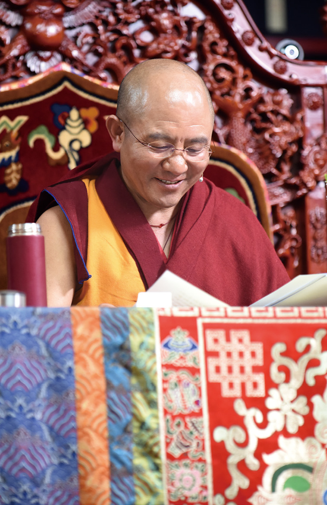

## 如何在忙碌中修行

2018年11月17日

今天讲“如何在忙碌中修行”，也会念《菩提道次第摄颂》的传承。我在1995年传讲过《摄颂》，距今已经23年了。至于今天的题目，挺有意思，可能大家在这方面也有很多心得。

佛教徒有三种责任，分别是修习佛法、工作和护持家庭的责任。如果你没有信仰，就只有家庭和工作的责任。有个别的佛教徒不需要工作，甚至也没有家庭，因此可以专一地修学佛法。出家人方面，藏地跟汉地的情况有点不同。藏人很支持他们的家庭成员出家，也经常给出家的亲属送一些粮食、物品，让他们可以好好地修行；汉地的一些家庭很支持他们的家庭成员出家，一些家庭则不太支持，甚至反对。

一些汉地的出家人不敢去探望正在生病的父母，因为他们不想让父母知道自己已经出家，也怕父母知道后会加重他们的病情；但是，如果父母的病情真的很严重，他们不去探望似乎很不孝，这是挺矛盾的。

在此非常复杂的世界，佛教徒有很多不同的身份。每个人前世的福报、今生的发愿力等因缘都不相同，因此人们的处境各不相同，有些人的修行之路荆棘满途，有些则非常顺利。

一些佛教徒的心本来就很复杂、浮躁，就算加入了佛教群体，他们的心也很难安静下来。他们要么受到外缘的阻碍，要么受到内心烦恼情绪的困扰，一直无法走上正常的修行之路。

另外一些佛教徒，可能由于前世的福报，在修行路上会遇到特别好的善知识和志同道合的法友，同时他会处于有良好佛教氛围的环境。更重要的是，他们自己的心态自然就很平和，不会时好时坏、起伏不定。具足了这些因缘后，他们的修行之路就很顺畅。

所以，一个人的修行好不好，不仅依靠法和上师，更重要的是看自己的福报。就像福力王子的故事[^1]一样，有大福报的人，不管做什么事情，世间法还是出世间法都非常成功。一些世间福报不大的人做世间法不成功，但是出世间法方面就非常成功；也有一些人在出世间法方面一点都不成功，但在世间法方面特别能干。

## 生活没有你想的那么忙

在此非常忙碌的时代，我们应该怎样修行佛法呢？这个问题很重要。现在跟以前任何一个时代都不一样，相信很多佛教徒也深有体会。我在三十多年前来到喇荣，那时候的生活方式确实跟现在不一样；同样，你们的生活在这些年应该也有了非常大的变化。

在人们短暂的一生中，过去几十年让全世界人类的生活有了非常大的改变，从某些方面说，这算是一种发展、进步。现在人们得到的财富资具、接收到的信息、所享受的物质种类都越来越丰富。可是，人们的快乐、幸福感有没有随着物质的丰富而增加呢？或许不多。

虽然我们的物质条件越来越好，但是我们的生活也许不太有质量，而且自相续可能越来越痛苦，因为我们要面对林林总总的各种问题。这时候大部分人会觉得：“哎哟，我没有时间看书，没有时间修行……”现在，东西方的人都感觉自己的生活忙碌不堪。其实客观来看，当今人们的生活跟以往相比，两者的忙碌程度没有明显差别。

牛津大学的一所研究机构收集了五十多年前的一些生活日记，这些日记的作者来自三十多个国家。研究人员把这些生活日记与现在人们的生活进行对比和研究，发现在工作时长方面，其实过去跟现在没有很大差别。比如平均来说，以前人们每天工作8个小时，现在人们也是每天工作8个小时，两者没有很大差异。那为什么现在人们都认为自己很忙呢？关键点在哪里呢？

第一个原因是，现在人们的价值观把忙碌看成是社会地位的标志。如果一个人说“我很忙”，那其他人会觉得这个人肯定很不错；然后这个人就会经常说“我很忙”，久而久之他也真的觉得自己很忙，其实他只是在做一些乱七八糟的琐事。很多人都是为了面子、身份而忙一些事情；即使有些空闲，他们也把时间花在玩手机上，对吧？大家也有这种情况。总之，现在的主流价值观把忙碌看成是身份的象征。

另外一个原因是，现在的信息过于发达。根据统计，人们平均每8分钟会收到至少一条信息，频繁收发信息会对你正在做的事情造成干扰。此外，不管这些信息有没有意义，人们经常对它进行反馈、回复，如此一天上班的8个小时中，可能花在与正事无关的事情上就用了四五个小时，很多时间就此浪费。

研究机构的结论是：在某种意义上，现在跟以前的生活本身没有很大差别，但是因为现在信息太发达，而且人们的生活方式、观念有了很大变化，所以现在人们都觉得自己很忙碌。

事实上，现在人们每天最忙的事情就是使用电脑和手机。之前我在网上看到一位艺术家创作的图片，他通过文字和图片来表达现在人们的生活都是全身心地专注在手机上；以佛教用语来说，就是眼、耳、鼻、舌、身、意全都专注其中。不管任何身份的人，都把自己的所有精力放在手机上。无论在各种交通工具还是公共场合中，每一个人都在专注地看手机，让手机占去了生活的大部分时间。这时候，如果我们想真正去修心，或者专注研究一些知识，那确实非常困难。

所以，我在西班牙马德里讲课的时候曾经建议：除了晚上睡觉以外的时间，大家每天至少关机一小时，好给自己留下一些空间。现在，一些地方要求人们长时间不用手机，学院的某些班级也有同样要求，但落实起来工作量比较大，而且长期实行也的确有些困难。即便如此，每个人至少要意识到手机给你带来的危害，不要从早到晚都在看。以前很多修行人会在晚上念咒、磕头，但现在的一些修行人晚上一直就在玩手机。

当然，人们可能不得不使用手机，因为跟生活有关的个人银行资料、交通信息等都在手机里。有时候出家人在城市拿着手机也不是很方便，别人会想：“身为出家人还天天玩手机……”但可能这也没办法——打车的话，要用手机里的“滴滴”，在店铺付钱也要用手机。

现在，基本上80%的人都用手机来处理很多生活和工作上的事情，比如发信息、聊天等等，要人们完全放弃使用手机可能不太现实。我们这里有一些非常好的修行人和一些比较保守的人，都认为完全不用手机是最好的，这种想法很好，但不一定每个人都能做得到。

## 忙碌中修行的两点建议

今天，我给大家的第一个建议是：哪怕是短短的一个小时，也要在忙碌的生活中挤出部分时间不用手机。这个要求不高，我自己也在身体力行。很多西方人觉得，演讲者不能对自己所说的事情或者理论光说不做，他们更好奇的是演讲者如何把所说的事情落实到自己的生活。

这方面我倒能做到，我在讲课、备课、翻译、看书的时候都不用手机，另外为了尊重别人，我也不会在开会、参加活动等场合使用手机，只会在某些场合才用。别人可能对我的习惯有不同意见，但我也无法满足所有人的要求。

有些人说：“我能关机，没问题的，我晚上睡觉的时候都关机的。”晚上睡觉的时候当然不算……总之，我建议各位佛教徒每天在适当的时候关上手机。其实，作为一位修行人，或者追求知识的人，大家需要养成这种习惯，否则你每天会在手机上浪费很多时间。

在学习、修行的过程中，大家虽然很忙碌，但如果你真有兴趣，其实并不会没有时间学修。因此，今天给大家的第二点建议是：你不用完全放弃自己的生活，但每年至少要安排一个月、半个月或者七天来专注地修行。

佛教徒要对自己所学的知识有深度思考。有一本书叫《深度工作》，在2016年翻译成中文，作者是个世间人。它的内容主要是：当今时代不管是科学界还是宗教领域，深度思考者都比较少；如果要进行深度工作，先要把其他散乱的事情放下来；至于深度工作的其中一种模式，就像我刚才说的，每年设定一两段时间，只专注于一件事情。

关于这一点，多年以来我自己也在身体力行。如果我在翻译某部论典，便会在这方面做深度的思考和工作；如果我要讲解某部经论，那在讲授期间，我会放下各种事情，比如不去其他地方演讲等等。现在顺便说一说下周的课程安排：周一、周二是《维摩诘经》，周三是《胜道宝鬘论》，周四、周五是密法课，周六待定。

你们看，这期间讲法是我最重要的事情，而我一定会把所有工作日程全都安排好。在这段深度工作期间放下的其他事情，我会留在假期或者法会的时候处理；再细分的话，我每周也有这种安排——在每周日处理一周中因为深度工作而放下的很多事情，所以周日常常是我一周中最累的一天。

其实，不管是思考、研究还是修学方面，每个人都应该有一些深度工作的时间。比如你在修加行，那应该在这一年中用一两个月来好好地专修加行；如果你在学大圆满或者中观，那应该在这一年中用一两个月深度地思考相关的道理。在现在碎片文化流行的背景下，很多佛教徒每天都用一些碎片信息来填充自己，学修方面不太有深度，跟诸佛菩萨的意趣相距甚远。

所以，关于如何在忙碌中修行，我今天给大家的建议很简单：第一，每天拿出大概一个小时来关掉手机，好好地学习、思考；第二，一年中拿出最少七天，多则两三个月的时间，在一件非常有意义的事情上深度工作，其间把琐事尽量减少或者放下，甚至到比较寂静的地方去。

## 《菩提道次第摄颂》中的窍诀

下面念《菩提道次第摄颂》的传承。刚才道友说，我传讲《摄颂》的时候是1995年，地点是一个大概能坐100人的小经堂——现在已经没有了。（堪布看看台下）这些老道友还在，不错。二十多年前的事情，你们还是记忆犹新。你们听了二十多年的课，真不容易；而我讲了二十多年的课，也不容易。不知道我们以后能活多久呢？

这个《摄颂》很重要，之后我会在微博给大家提供电子版，译者是一位姓侯的居士。《菩提道次第摄颂》和汉族弟子有很好的因缘：当时在五台山菩萨顶，法王讲法后就让我和慈诚罗珠堪布用汉语把他的课给汉族弟子传讲一遍；我译讲了法王《佛子行》的课，而堪布就译讲了法王《菩提道次第摄颂》的课。其实那时候我们不太懂汉语，但是为了不破坏缘起，我还是糊里糊涂地跟大家讲了，相信当时堪布的水平也差不多（众笑）。堪布去年在微博提到这件事情，说：“当时我们正在起步的时候……”其实那时候我们还没有正式“起步”。

我从法王口中得过很多次《摄颂》的传承，这部法非常好。希望你们今天得了《菩提道次第摄颂》的传承后，在一周内看完我二十多年前对它的略讲。以前没有电脑，全部讲记都是手写的，不知道整理出来的效果怎么样。无论如何，今天让大家跟这部法结上一个好的缘起。

（堪布念《菩提道次第摄颂》传承）

这个颂词的每一句都是窍诀：

> 通达圣教无相违

第一个窍诀：要通达一切教法都不相违。

这是宗喀巴大师很重要的教言。不管任何教派，像禅宗、净土宗、密宗、南传佛教的宗派等等，所有佛法都不相违。《菩提道次第略论》中也有相似的内容，今年我在藏微博中也提到“如来教法不相违”。这个窍诀对大家很重要。

不管你有没有信仰，希望大家不要以自己的分别念来妄下判断，说“格鲁派不合理、宁玛派不合理、禅宗不合理、净土宗不合理”，千万不要这样说。即使你是专门研究宗教的学者，也不一定精通佛法的甚深教义，所以不要因此而造业。

> 能将佛语成教诫

所有经典都是我们学佛修行的教言。

大家千万不要想：“这部经典不合理，那部论典也不合理……”不管是五部大论的因明、《俱舍》，还是不同的佛教体系，像藏传、汉传、南传等等，所有教法全都是断除自相续烦恼的教言，这很重要。如果你闻思有一定的量，你会明白所有上师和诸佛菩萨的教言都不相违，都能对治自相续的烦恼，这是第二个窍诀。

> 佛陀意旨顺利得

明白以上的道理后，我们会很轻易地得到如来的密意。

很多人因为得不到如来的密意，于是盲猜瞎练。其实，不管是南传、北传还是藏传佛教，所有教法都能直接或者间接趣入如来密意，希望我们每个人都能通达如来的密意。这是第三个窍诀。

> 拯救罪行于悬崖

最后，宗喀巴大师善妙甚深的窍诀，让我们不会误入歧途，甚至让一些已经误入歧途的人再得生还之机。

当今时代，真正引导众生趋向解脱的人不多，而把人们引向恶趣的却非常多。因此，大家要用正知正念来护持自相续，这很重要。不然你会像一些没有头脑和见解的人一样，很容易随波逐流，别人说：“那个法是假的，那个上师是邪的……”他就马上生邪见，立刻诽谤，然后老年的时候才后悔：“我年轻的时候很幼稚、很愚痴，当时听了某人的话，诽谤过佛法，现在特别后悔，但可能来不及忏悔，马上要离开人间了。”这是很多人的真实写照。

大家要记住这个颂词，这是今天所学的主要内容，也是我给你们的窍诀。法王如意宝经常引用这个教证，这个颂词就是上师的教言，知道吗？上师的教言很重要！

之前，我让我们餐厅的一位厨师去某个地方学厨，因为那里的菜做得比较美味。他学成回来后做的菜还好，但过一段时间味道就不同了。我刚才特意问他：“为什么你最近没有用学厨时学到的方式来做菜？”他说：“忘了，所以最近没有用那种方式做。”我说：“你对不起教你厨艺的‘上师’，前段时间你专门去学习了，但是现在你一点都没有按照你‘上师’的做法去做。”他说：“没问题的，其实很简单，我明天试一试……”所以，做菜也需要“窍诀”，明天就看他是不是按照“上师”的教言来做菜。

这个颂词真的很重要，都是窍诀性的。

（堪布继续念《菩提道次第摄颂》传承）

大家现在得了传承，就要完成刚才布置的作业——在下周日之前看完《菩提道次第摄颂讲解》。

## 懂得无常，修行就有迫切感

回到今天的题目“如何在忙碌中修行”，刚才给大家提了两点建议：每天用一些时间来关机学修，以及每年尽量安排一段时间来深度地做一件有意义的事情。

我在介绍生活佛教的时候也提过，大家能不能在一年中闭关7天、14天、21天或者一个月？如果你各方面的因缘具足，那可否在一年中闭关100天？很多修行人都这样行持，365天中用100天闭关，265天做其他事情。如果你有福报和相关的条件，自己也有平和的心态，那应该把握闭关修行的因缘。

可能是年龄增长的原因，现在我对无常很有感觉，觉得人生确实就像闪电，正如刚才《菩提道次第摄颂》说的一样[^2]。我们今天在世间，但明天还在不在，真的很难说。最近的新闻说，全国很多地方包括藏地都有大雪导致的翻车意外。车子在冰雪路面上自然地就滑下去，这时候司机束手无策，车里的乘客也只能坐以待毙。所以，只是一个冰雪的因缘，就让我们不能顺利地驾车到达目的地。

本来我明天要去探访一所学校，看到这些新闻后就决定不去了，也不敢去。如果明天早上出发，晚上就不在世间，那多可怕啊！其实，如果生命的无常真的来到，即使不出去，第二天早上也可能起不来。

大家如果有无常观，便会对自己的修行有迫切感，每天都会修法、念咒语，不会一直拖延。无常观对现在的城市人尤其重要。以前是人们操控生活，但当今时代人们都非常忙碌，机械化地生活，仿佛是生活操控了人们。现在，有些人用自动驾驶汽车来比喻这种现象——你坐上了一辆自动驾驶汽车后，只需要定一个目标然后做一点简单的操作，车子就会自动行驶；以前是你开车去某个地方，但现在依靠自动驾驶系统的运作，是车子把你带走。

很多人的生活也是如此，虽然一些人不一定是自愿，但已经坐上了“生活”这辆自动驾驶的汽车，不由自主地过着机械式的一生。现在，大多数世间人的生活都是每天周而复始地上班、下班，接送孩子上学、放学等等。实际上，一些人也可能不满足于这种生活模式，觉得生活很无聊，没有多大意义。

大家需要思考：“为什么我的人生要这样继续下去？”“如果我这样生活一直到死，那我为来世做了什么准备？”现在人们为了生活、感情和生存，可能造了数不胜数的恶业，包括杀盗淫妄等自性罪以及佛制罪等等，最后只能背负着众多恶业离开人间。

当然，处于类似机械化、自动驾驶模式的时代，你可能不得不忙碌，要处理很多事情，但是你一定要有正念，把修行融入自己的生活中。这方面修行较久的人做得很好，他们在忙的时候也会拿着念珠。很多汉地的居士可能因为工作和身份的原因，不太方便拿念珠，但会拿着计数器一直默默地念咒语；他们去任何地方都带着法本，在上下班的途中，可以争取时间看一些教言。他们这种不屈不挠的学习态度，是当今佛教徒不可或缺的。如果你没有这种精神、态度，却想真正腾出很长一段时间来修行，那是不切实际的。

我自己也会把握时间来做不同的事情，比如有时候我会边开会边看一些当天要翻译的内容，走路的时候就念咒，有空闲就做一些该做的事情，这样的习惯每天从不间断。

## 接纳自己，对生活有热情

确实，你们一定要认可、接纳、接受自己的专业，并且持之以恒地为此努力，不要总是抱怨、伤心、充满负能量。比如你在学中观，那应该对中观生欢喜心，平时可能会想：“中观的法师一进来，我班的道友都很开心。”“哇！我们中观班的法师长得真庄严！”“每次法师离开的时候，我们道友心里就酸酸的。”大家要对自己的法师、专业，甚至学到的任何世间知识有珍惜感，这很重要。

现在很多人没有热情，为什么呢？因为不认可。如果你对家庭、生活或者任何东西都不认可，那确实很难有热情。有一位名叫玛莎的美国女性名人，她出生于上世纪40年代。在70至90年代，她经常在电视上出现，也运营自己的平台，主打家政节目，那时候非常火。她在美国很受欢迎，有些人说她的节目陪伴他们成长，已经看了二三十年。那时候她的生活很优雅，她的形象、家庭等各方面都很圆满，给大家清新的感觉；而她的节目不仅提高了人们的生活质量，也散发了很多很好的正能量。

之后大概在2001年，她因为涉及一宗商业案件而被判刑。判刑后，她的节目都被下架，她的企业也亏损严重。所谓人情冷暖，藏人有句谚语，意思是：你往上高升的时候，天上的飞禽也来亲近你；你下堕的时候，自己的亲子也会远远地躲开。但是，她在监狱的时候也保持着很好的心态。那时她在监狱里当清洁工，她把所有清洁工作，包括刷马桶都做得非常好；而且她自己充满正能量，举止也特别优雅，所以给监狱里的人带来很多温暖。

半年后她服刑完毕，就回到她原来的生活中，工作、企业管理等都一如既往。她现在已经七十多岁了，但最近还在写她的第87本书。即使在监狱，她也没有中断写作的习惯。作息方面，她每天只睡4个小时，其他20小时用来工作——这方面我们是同一类人，但很多人可能做不到。如果她可以只睡4个小时，那大家可不可以只睡5个小时或者6个小时？最好不要超过7个小时，不然睡眠时间太长了。

我想表达什么呢？确实每人的福报各不相同，有些人做事很顺利，有些则不太如意，但不管怎样，你要认可你自己，对自己所做的事有信心，不要过于悲观，同时也不要过于张扬和盲目乐观。如果你过于张扬和盲目，那事情最后不一定会很成功。总之，如果做事的时候杂有傲慢或者烦恼，结果不一定会很圆满。作为修行人，在修法和学习的过程中遇到挫折、障碍的时候，大家要发起勇猛心，勇敢地面对。

亚里士多德说，当你遇到痛苦的时候，停下来好好地反观自己，你会发现真正的哲理。佛教也说，当你遇到一些不顺心、无法面对的境况时反观自心，你会发现一些真相，然后就没有那么伤心。密法中也说，如果你能认识自心，那所有问题会迎刃而解。

无论如何，大家要有自信和接纳自己的心！在此信息爆炸的特殊时代，我们每天都在接收大量信息，一些人会觉得：“为什么那么多成功人士拥有那么多好东西，而我却没有？”然后就怨天尤人，把自己的心情弄得越来越糟糕，最后对自己的修行、生活、工作失去热情，什么都做不来。正因为如此，一些人不需要遭遇外在的违缘如天灾人祸等而离开世间，而是在自己的人生本不应该完结的时候，亲自用刀、安眠药等各种方式结束自己的生命，这真的可惜！

## 佛教徒要坚强、团结

确实，现在很多人没有自信，所以今天我想强调什么呢？大家不要对外在的东西贪得无厌，而是应该有一颗非常坚定的心。刚才有人拿了一盆欧石楠花进来，这是挪威的国花，可以在大概零下20到40度的环境生存。它非常耐寒，我在北欧的冰雪地带见过它。

你们看，这几天喇荣都在下雪，但这花还是开得非常好。我很喜欢这样的花，为什么呢？因为它很坚强。有些花虽然很漂亮，但是很快就枯谢、凋零。希望我们每个人的心都像欧石楠一样，不要因为一些风吹雨打就奄奄一息，大家都要坚强。

作为佛教团体，我们内部要团结，而且佛教徒之间要互相认可。因为学院的人比较多，我一般看到佛教徒就会回避；在学院以外的地方像机场，若我看到一些念咒的人或者出家人，我会特意去打招呼，毕竟大家都是修行人。佛教徒有时候不团结，是现在佛教的一种悲哀。大家要有坚强的心和凝聚力，不管你学什么教派，也不要忘记你是一名佛教徒。

很多其他宗教的信徒，在任何时候只要知道对方跟自己有相同的信仰，他们就会尽力互相帮助。但是，佛教徒却经常分别“这个上师的团体、那个上师的团体”“这个教派、那个教派”，把其他团体的佛教徒看成敌人一样，这非常不好。而我最看不惯的，就是同一位上师的弟子之间，有很多明争暗斗，就像古代的宫斗一样。国内外的佛教团体都有这种情况，不知道我们这边有没有。

现在，很多有名气的大活佛、大上师的弟子们私下拉帮结派，以上师的名义做一些涉及商业利益和政治的事情，弟子们之间的斗争甚至比世间人更厉害，出现了很多不团结、不和合的情况。纵使某位上师很有名气，或者是诸佛菩萨的化现，但若他身边的人不团结，也是这位上师的悲哀。

我在讲《大幻化网》的时候提到，在上师的自现境界中，一切都是清净、没有烦恼的。但是，假如上师身边有很多不和合的人在做乱七八糟的事，除了上师所在地方的人外，其他地方、国家的人都听说了，那上师在自现境界中应该也能感知得到。所以，上师身边的弟子们最好不要有任何明争暗斗，不然会对上师弘法利生的事业有一定损害，这一点值得我们佛教徒注意。

相对来说，世间人比如一位明星，他下面的团队还是比较团结。我接触过一些出名的明星、领导，为他们做事的那些人之间没有什么仇恨，整个团队都是一心一意、好好地为“老板”做事情。

团结真的很重要。任何上师身边的人之间如果不和合，那最好离上师远一点，不要待在上师身边。佛经也说，要远离有争论的地方一百由旬[^3]。所以，就算还没有到要被管家开除的程度，但若你在道场中拉帮结派、跟他人有很多争论、自己的心也很烦、看谁都看不惯，那你最好自觉远离这个道场一百由旬。这不会给佛教带来危害，只会带来顺缘。

说到这方面的事情，我的语气比较严肃，但我真的特别希望，我们佛教徒能够像某些其他宗教徒一样，里里外外都非常清净，犹如洁白的莲花一样，没有任何垢染。其实，根据真正的大乘佛教思想或者善知识的教导，佛教徒应该全心全意地做利他的事情。马丁·路德·金说，人生在世要有服务他众的意识，其实这方面大乘佛教的精神是最好的。

可是，有时候我们嘴上念诵“愿诸众生永具安乐及安乐因，愿诸众生永离众苦及众苦因”，口口声声说要利益天下无边的众生，实际上却对上师的眷属和自己身边的人恨之入骨，这非常不好。如果佛教徒与身边的人都不团结，那要利益所有众生就更不可能了。

行为方面，大家应该做一些有意义的事情；如果你实在做不来，也不要做一些对佛教有害的事情。这很重要！也许你现在做不了一些特别有意义的事情，但可以减少做一些不好的事，这方面大家要“断舍离”。比如，一些你用不上的东西，或者一些让你徒增烦恼的朋友，这些你都要断、舍、离。否则，除了你自己痛苦外，也会让道场的上师和其他道友痛苦。一个性格特别糟糕、心情经常不好的人会让整个群体受到影响。希望大家以后听到的，都是我们佛教徒真正利他和有意义的声音。

现在，世界上很多没有信仰的人在做有意义的事情，也做得非常好，包括环保、慈善、教育方面，或者在世界各地提供医疗救护、照顾弱势群体等等。其实，大家除了在座上实修大乘佛教的愿行菩提心外，世间上还有很多有意义的事情需要我们去关心、付出。如果你对世间任何事情都置之不理，却自认为很了不起，那你的修行应该没有太高境界。

## 终身学习，终身修行，终身利他

今天给大家念了《菩提道次第摄颂》的传承，其中有些非常深的教言，大家在这一周要好好地学习它的讲义。这堂课结束后，你们要对自己有些要求。

在介绍生活佛教的时候，我跟大家强调了三个要求：一、不要放弃学习，随时要有学习的心态；二、不要放弃修行，要是你实在没有时间，也可以坚持每天早上起来或者晚上睡前挤出一点时间观想佛陀、念咒语或者忏悔；三、在力所能及的范围内，随时随地做一些饶益有情的事情，如果身边实在没有众生，就经常念《普贤行愿品》来回向。

这就是我们强调的“终身学习、终身修行、终身利他”。希望这些原则能够成为大家生活的基石，如此你难得的人身会很有意义。

还有一句话就是：“我们要坚强！”就像这盆欧石楠一样。大家平时要开开心心地生活，不要每天为了不同的事情而痛苦、伤心、忧愁。其实，只要你的心能熬过去，那世界上不会有让你熬不过去的事情；如果你的心熬不过去，哪怕你没有遇到任何困难，你也是最痛苦的人。因此，大家应该活得开开心心。

[^1]: 详见《释迦牟尼佛广传》第三“布施品”之《福力王有大福德》。
[^2]: 《菩提道次第摄颂》：“暇身胜过如意珠，如是得来只一次，难得易失如空电，思后应觉世间事，如同去扬纯糠秕，故应昼夜求真实。瑜伽我亦如是修，你欲解脱如是行。”
[^3]: 《发起菩萨殊胜志乐经》：“戏论诤论处，多起诸烦恼，智者应远离，当去百由旬。”
