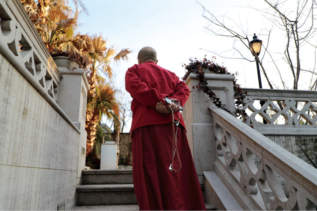

## 普贤云供法会开示

2018年7月15日

最近学院在举行普贤云供法会，我希望通过今天的开示，可以简单地跟大家结上法缘。我们对刚皈依不久的佛教徒，要经常讲一些佛教的基本道理；一些学佛多年的老道友和学院的常住，可能以前听过这些道理，但温故知新还是有必要的。

## 要常念《普贤行愿品》

今晚我会先念《普贤行愿品》的传承。大部分道友平时都把它作为日常功课；在最近的法会期间，我们每天都会念四遍。希望大家得了传承后，在修行的过程和日常生活中经常念诵《普贤行愿品》。一些道友已经发愿每天念一遍，有些人每天都念很多遍。你们想一想，自己为此发愿了没有？如果没有，那现在可以趁机发愿。

我以前给大家讲解过《普贤行愿品》的内容，今天就不重复了。它的功德很大，菩萨的十万大愿都包括在其中。如果我们每天依此发愿，那对自他会有非常大的利益。所以，佛教徒应该经常念诵《普贤行愿品》。

（堪布念《普贤行愿品》传承，接着念《开显解脱道》至皈依部分的传承）

刚才给大家念了《普贤行愿品》的传承，现在是念全知麦彭仁波切造的《开显解脱道》。

## 修加行很有必要

修五加行很重要！我们很多道友都在修。一些刚开始修的道友，只是在口头上皈依和发菩提心，或者只是自己喜欢忏悔、积资净障而已，并没有实际修过五加行。你们有些人已经修完加行，现在在听密法；有些人修了很长时间还没修完。确实，这要下很大功夫，因为皈依、发心、曼茶罗、百字明和上师瑜伽要各修十万遍。

刚开始修的时候，一些道友的发心很大，像顶礼方面，很多人都选择磕长头，那所花的时间就比较多。我建议比较忙的道友先磕小头，如此你每天可以多修一些，那按时完成应该不成问题。

以前我们修加行的时候，在早餐之前修一千多遍顶礼才去上课；午餐前后也修一千多遍，接着下午去辅导、念经；然后晚上再修一千多遍。这样二十多天就修完十万遍顶礼。有些道友的体质可能不太好，但确实这是非常好的锻炼。

如果你真的修完加行，你才是真正的佛教徒，这也是上师如意宝和前辈大德对加行非常重视的原因。有些人可能有不同的说法，我对他们的理由不排斥、不破斥，但按照我们很多传承上师的要求，弟子们要很认真地、真诚地修完加行。确实，现在修了三四遍五十万加行的大有人在。

我们今生获得人身非常难得，所以这辈子一定要做有意义的事情，像在皈依境、三宝面前做十万遍顶礼，这个功德非常大。另外，《大圆满前行》也说了很多念修皈依偈的功德。大家都知道，只是念四皈依的偈颂——“皈依师、皈依佛、皈依法、皈依僧”就有诸多功德，比如遣除各种邪魔外道带来的违缘、断除一切障碍、自相续无勤获得智慧和悲心等等。

希望大家不要只成为形象上的佛教徒，不要经常去跑不同的道场却连加行也没有修好。不然，当你离开这个世间的时候，也不知道佛教给你带来什么利益。所以得了法之后，一定要落于实修。

现在我们百分之七八十的佛教徒在学修方面都很认真，在闻思修上都非常有进步，比二三十年前好多了。毕竟我自己一直在讲课，也不断地在力所能及的范围内跟大家结缘，因此我对汉地佛教徒的状况尤其了解。现在越来越多人对显宗五部大论和密宗的一些不共修法都有信心，同时也在行持，这真的非常难能可贵。

为什么今天我想用一点时间来跟大家交流呢？因为有些道友，包括网络上的一些听众，可能在偶然的机缘下入了佛门，但是对佛教的真正教义不太明白。我想让大家知道，其实佛教的教义有很多，就像阶梯一样有不同的层次——低、中、高，以及至高无上的层次。如果大家能一步一步次第性地上去，那自相续一定会跟佛法相应。

当今时代，佛法给人们带来了心灵上的快乐和安慰。如果没有佛法这样的心灵引导，只靠物质或者其他种种方法，人们将难以面对一生中可能遇到的诸多困难。是不是佛法能让你的人生没有困难呢？不是，但是佛法对解决困难、减少痛苦、减轻压力有非常大的帮助。

关于这一点，可能在座许多人也有所体会：学佛之前，自己的生活、心态、情绪是如何糟糕，然后通过次第性、循序渐进地学习佛法，最后自己人生的各方面都有所改变。虽然大家还是要面对各种压力和事情，但是佛法对自心的坚强、情绪的塑造等很多方面确实有帮助。

麦彭仁波切的《开显解脱道》有不可思议的加持力，大家在修行的过程中应该也能感受得到。按理来说，每个修法应该分开来专修，念完十万遍皈依偈，再修十万遍顶礼。如果你们时间很紧，可以顶礼和皈依偈一起合修，那就可以同时完成十万遍的顶礼和皈依，这是一个很好的方法。

（堪布念《开显解脱道》余下部分的传承）

刚才念了五加行的传承。有些人没有信心，或者觉得自己身体不好的，你们不想修加行，我们也没办法；一些人年龄确实比较高，想顶礼但真的做不来，你们以后要多念金刚萨埵心咒、观音心咒等等。至于年轻、壮年、健康的其他人，应该在自己还是健壮的此刻，尽量行持善法。否则，当你老了、得了严重的疾病，或者某种因缘、无常出现的时候，你想做善法也来不及了。

你们修加行的目的，不应该是为了听密法，应该是为了修行功夫的积累，就像你学习驾驶机动车或者飞机，在累积了多少公里或者多少个小时的训练以后，才可以正常、安全地驾驶。同样，作为佛教徒，如果你在加行方面积累了一定的功夫，修到了一定的量，之后不管是弘法利生还是独自修行，都会有很大的方便。

因此，无论是凭众多修行人的经验，还是按照传承上师们、诸位前辈大德们所留下来的甚深窍诀、教言和传统，从各方面的因缘来说，大家都应该尽量修加行，这也是我今天想特别强调的。我在讲解《大圆满前行》的时候，大量引用了汉地《大藏经》中的不同公案，因为《大圆满前行》不仅是藏传佛教的修行方法，而且它的意义跟汉传、南传佛教完全相应。所以，凡是佛教徒都应该好好地依此修行。

今天，我们会给不是常住的道友提供一本《中观宝鬘论》。我们每年都有自学的课程，今年是学《金刚经》和《中观宝鬘论》。希望大家拿到法本后，回去认真地看，这是最主要的；纵使法本有加持、有功德，但如果你不看的话，它对你的相续也不一定有很大的改变。

虽然你不一定全看得懂，但最好还是尽量学习一下书中的道理。有时候大家学物理、化学、量子力学等等，所有这些知识不一定能全都应用到生活中与你相应，但你一定会用到其中部分内容，所以看书很重要。

很多西方人会在书里夹很多不同颜色的书签，会用红线、黄线、绿线去勾画里面的内容，也会记下重点或者在侧面做一些标记。以后只要翻看，就知道什么时候看过这本书，它的内容是什么。大家也需要抱有这种阅读态度。

在某种意义上，学习佛法的过程也像学习世间的专业知识一样，比如你本来不懂医术，那你把医术相关的书买回来学习，一段时间后，你就会对这方面的知识有所了解。学佛也是如此，因此大家修加行的同时，也要好好地学习。

我今天想强调的是：你们要修加行。只要你具足信心，不管怎样都要在有生之年至少修一遍加行。不管你是什么人，作为学佛三十多年的佛教徒，我给你的建议肯定100%非常有利，因为次第性地修行是非常安全和稳妥的，不会对你造成任何障碍。如果你刚开始就像老虎跳崖一样好高骛远，那最终你的修行不一定能达到特别高的境界，而且非常危险；相反，如果次第性地修行，就会非常安全。

本来没有准备在今天的开示中念《开显解脱道》的传承，但我刚才特意念了，就是想跟大家强调：你们要修加行。刚才我在想，你们有些人可能不知道什么是“加行”——是不是“加薪”，增加薪资？加工资？因为有时候我发音不太标准，所以当我说“加行”，有些人可能认为是说加工资、薪水的事情。（众笑）

## 好好学习，让师欢喜

《中观宝鬘论》和《金刚经》属于今年自学的范畴。如果你们有兴趣，可以自学这两部经论。大家都知道，《金刚经》是家喻户晓的一部经。

最近有些人说我的生日快到了，要吃蛋糕。但我觉得吃不吃蛋糕不重要，也吃不来，甜的东西不知道对身体有利还是有害。刚才几位法师给我拿了一个蛋糕，我狠狠地批评了他们，说：“你们弄这些形象上的仪式干什么？没有意义。”我们不一定要吃蛋糕，现在不是饥荒年代，吃的东西大家都不缺。

现在人们需要什么呢？精神食粮。如果你们真的要给我一些“蛋糕”，可以看一遍《中观宝鬘论》和《金刚经》。你可以在心里发愿，不一定要直接跟我说。在广阔无垠的法界中，我们大家都是心心相印的——如果你发愿，我会得到这个信息和利益，也会因而欢喜。其实你读书、学习的话，对你个人和整个世界都会有很大利益。

所以，如果一些人非要有所表示，不一定要给我什么东西，但你自己一定要发愿看书学习、修加行或者放一条以上的生命。放生不一定要在藏历六月初四当天，因为有些屠夫、渔夫可能在那天趁机涨价，所以大家也可以选其他日子来放生，这也是我最喜欢的事情之一。

## 发菩提心，利益众生

今天，我特别想跟大家说几件事情：第一是修加行，第二是学习，第三是弘扬佛法——以大乘菩提心的力量帮助身边的众生。

我们身边有很多可怜的众生，有精神上不自在的，也有身体上不自在的，其实两者都是病人。有些人的心一直被烦恼所束缚，痛苦、伤心、愤怒、恐惧等负面心理状态此起彼伏，这是精神上的病人；至于身体上的病人，就是身体有毛病，比如头痛等。最近不知什么原因，我的肩膀有点痛，我是身体上的病人，但精神上应该是健康的。总之，照顾以上两种病人就是在行善。根据大乘佛教，善行的力量是非常非常强大的。

最近有部很火的电影叫《我不是药神》，它的票房非常高，已经超过了20亿元，它在全世界也很受关注。我看完后，觉得它的内容其实包含了大乘理念。它有很多情节，主要是讲原来充满贪嗔痴的主人翁，在看到可怜的病人后，决定自己贴钱也不涨药价，一瓶零售价2000元的药他还是只卖500元，最后以种种因缘他还坐牢了。

不论东方西方，现在很多人都有同感——原来我们的社会真的有正能量，有很多做好事的人。其实从大乘菩提心的角度，做一些好事是很自然的，很多真正发了心的人，会无条件地去利益、帮助那些素不相识、毫无关系的人。

很多人都在想，为什么这位导演那么厉害。从采访者的问题和人们的讨论热点可以知道，很多人觉得导演想到那样的情节很稀有——“是不是因为他的母亲是位出家人？还是其他原因？”其实，如果你明白大乘佛教的道理，对《入菩萨行论》、《大乘经庄严论》或者《集学论》的内容有所了解，就知道电影中的发心、善行是相对渺小的。《释迦牟尼佛广传》中所讲的大乘佛教的利他故事，应该更感人。

现在，人们觉得也许人类社会还是有希望的。有些国家的领导人，开始在药价等很多方面关心弱势群体，这样很好，应该提倡一些正能量。实际上，现在全世界真的很需要大乘佛教，它能让任何国家、民族、肤色、信仰的人，都得到非常大的利益。

我越学习大乘佛法，越对社会的各种情况感兴趣，其主要的原因是：当今社会其实还有温暖、温度，人心并不是很坏；但是由于一些教育和传统，人们本有的善良和善心一直没有开花结果；如果每个人都有学习大乘佛法的因缘，那利他之花完全可以无有困难地盛开。

不过，很多佛教徒对佛教并没有很足够的学习和了解。希望大家不要只是为了自己才念佛、念咒、修法。很多藏传佛教徒特别喜欢念观音心咒、莲师心咒，但他们只对自己获得解脱、自己虹身成就这方面感兴趣。至于汉传佛教徒，也有一部分人是只为了自己而禅修，对社会上发生的任何事情都不闻不问，只想自己如如不动地安住在本性中，明心见性、开悟见佛；还有一部分人一生都在努力地念佛，却只是想着自己往生以后在极乐世界享受无量大乐。

当然，这些行持都非常好，毕竟2500多年以来，不管汉传、藏传还是南传，佛教对人们在心灵净化、心灵提升方面的作用是不言而喻、有目共睹的。但大家作为大乘佛教徒，最重要的是无条件地去利益众生，你自己哪怕在一年、一个月或者一天当中用心去做，这才是真正的大乘佛教精神。

今天说的第一件事情是修加行，第二件事情是学习，第三件事情呢？（众答：发菩提心利益众生。）第四件事情呢？还没说是吧？我今天想说的三件事情你们都记得，记性太好了。（众笑）

总之，我们在此世界并不只是为了活着、不饿死，也不只是为了自己发财、赚钱。当然，我们不排斥这些行为，这跟佛教徒的身份不相违，佛教徒可以、也应该拥有这些。要是你学佛后什么都不做，只是整天待着，那肯定不合理。但大家作为大乘佛教徒，更重要的是在生活中的每一个环节关心身边的人、关心所有众生，这是今天讲的第三件事情。

## 佛教徒的家庭要和合

至于第四点，佛教徒要更多地了解社会中大大小小的事情。即使纯粹是世间的事情，大家作为佛教徒也有必要去了解，然后要把佛教的教义与世间人的心态相结合，这样才能帮助他们。这几年我们一直在提倡生活佛教，有些地方也确实做得很好。不管在任何环境中，佛教徒应该都能对人们的生活起到很大作用。

从自身来说，希望大家跟家人和睦相处，每一个人都应该为此发愿。因为佛教提倡安忍波罗蜜多，所以大家尽量不要跟家人吵架，更不要说打架了。今天下午我听到了一个家庭的故事——有时候世间一个家庭也有很多故事，我听后真的感到很心酸。

我的同学讲述了他亲戚的故事：夫妻俩都很痛苦，他们怎样吵架，每次吵架是为了什么事情，男方、女方都想自杀，第一次自杀失败，又想来第二次……

我一直聚精会神地听着，像听上师讲密法一样。我有时候想，听这些好像比听密法更有感觉，因为密法有时候太高深了，像密严刹土、法界等等，有时候也听不明白。但我同学所说的故事，我完全能听懂，而且他认识当事人，记性也非常好，说了很多细节，比如夫妻俩吵架的时候说了什么，女的不想活了然后多少人去帮助她等等。在聆听的时候，我不断地产生悲心。

在家人有时候在家庭中有很多烦恼，感受到很多痛苦。有些人对家人的嗔恨心甚至比对敌人还强烈，个中原因我也不清楚，他们对敌人可以修安忍，但对家人就是修不了。如果怨恨的敌人来了，他们会想“哦，这是敌人，我要安住”，但如果面对自己的家人，他们却不能安忍，甚至想“咬一口”。人们身体上的伤口很快就痊愈，可是心里的伤痕有时候特别大，一直愈合不了。

之前，我在工地被梯子绊到，脚上弄出了一个伤口，过了大概一两个月它就愈合了，现在走路也没有问题。但是，有些人如果遭受了语言带来的创伤，他们心里会有很深很大的伤口，就算服各种药也始终不能愈合，过了好几年创伤仍在。

大家作为佛教徒，以后要先从自身做起。实际上，家庭源于前世的因缘，因此不管怎样，所有佛教徒的家庭要尽量和合，不要总是吵架。否则，你的生活会很艰难、痛苦。业力可以将很多人绑在一起，刚开始的时候你自己也不知道，最后活也活不了、死也死不了、分也分不了、合也合不了，如此下去是很痛苦的。

今天，在生活佛教方面，我着重提倡家庭和合，这是世界和平的根本。家庭也是一个世界，全世界的大部分事情我们都看不到——美国、伊拉克、叙利亚所发生的，除了电视小屏幕上的少许景象之外，我们什么都看不到。但是家里的不和合，你自己不仅能直接看到、听到，甚至打架的话你还能接触得到。其实，现在人们总强调世界和平，真正的和平，要从家庭做起。

除了特殊情况，各位佛教徒能不能发愿不跟家人吵架？时限可以是一周、一个月，最好是一年以上，如此你就在家里开了一年的“和平法会”，这很重要。如果你们的家庭不和平，那要尽量想办法，比如能不能在家里放个大的和平鸽挂画？这样一家人吵架的时候可以看看它（众笑）。如果把和平鸽放在很明显的地方，那有些人冷战不想说话的时候，可以轻轻地指它一下，意思是：“和平鸽不高兴了，我们还是和好吧！”

希望大家做到家庭和合，虽然它看似跟修法没有很大关系，但是按照释迦牟尼佛的教义，家人与你因缘深厚，如果你把这种因缘妥善处理，会对自己的修行、身边的人以及社会有很大利益。因此，生活佛教中的和平方面，是我今天想跟大家强调的重点之一。

## 把握闻思修机会，不做形象上的佛教徒

在此要强调的第五点——真正的佛法就是教法和证法。无论是弘扬者所宣扬的，还是修行者所依靠的，就是教法和证法。可是，现在很多人都不清楚，佛教的形象和本质有什么区别。每位佛教徒都应该扪心自问：“什么是佛教？我们该怎样弘扬真正的佛教？怎样修行？”大家对此一定要重视。

当今时代，城市里所谓的佛教徒可能比较多，但是真正去修行、行持、弘扬佛法的人确实不多。就算是佛教非常兴盛的一些南传佛教国家，包括我去过的柬埔寨、泰国等等，他们有部分人也只是停留在佛教的形式上。其实，佛教中的念经、闻思、内在的禅修是很重要的。佛教徒不要在形式上过于张扬，否则可能会遇到很多违缘。

大家一定要以法本的内容作为信仰的准则，比如根据《大圆满前行》，你要知道信心是什么，皈依、菩提心又是什么。现在，我们大多数的佛教徒是很好的，但我还是要强调：要用前辈大德们的论典内容来衡量自己、要求自己，如此佛法才能成为自己的信仰。我以前在其他场合说过这一点，现在也要再三强调。

希望各地的佛教徒好好地观察自己。为什么现在有些人遇到很多假上师？其实是因为盲目，没有智慧，没有很好地闻思，没有按照佛教的要求去观察善知识的法相。为什么有些人经常修错呢？因为没有如法、系统地闻思，有时候只是重视形象，不重视要义。现在，有些佛教徒根本不愿意学习，只有表面上的形象，比如挂串念珠，当然这些也重要，但最重要的是大家内在的闻思和修行！

希望你们把握闻思的机会！跟以往相比，现在网络的确非常发达，闻思佛法十分方便。以前我们从喇荣到色达，等车也要花一天时间，如果偶尔坐上货车，就高兴得不得了，我们会说：“今天运气很好！”但现在交通、信息等各方面的交流都非常通畅，如果我们现在没有把握闻思的机会，那确实非常可惜。

总体来说，学会闻思修行的氛围特别好。我们有如此多的人一起次第闻思、学习五部大论，这在历史上是很罕见的，当然这可能只是现代网络发达的缘故。各位要注意，一旦你放弃闻思修，或者不能持之以恒，那你的信心可能会很快消失。

大家对佛法的信心并不是与生俱来的，而是由于各方面的因缘，比如暂时的生活压力、感情挫折、朋友的引导、善知识的指导等等。在各种因缘具足的时候，你进入佛门。入了佛门后，如果你没有很认真、持之以恒地学修，也许你现有的境界都不能稳固，包括信心、智慧、悲心、出离心，或者更高的菩提心和无二慧。为了让自己已经生起的境界不断地稳固、增上、明显，大家要一如既往地学习。

有些佛教徒以前学得很虔诚、认真，后来由于各种原因而退失。这种现象很普遍，不管是喇荣的个别堪布，还是一些出家人、居士，他们学佛很多年，但后来因为工作、生活、散乱等原因，最后都退失了信心。有时候，我也害怕在大城市逗留太久。

我们获得暇满难得的人身特别不容易，而且这个人身随时可能出现无常。当你离开这个世间的时候，所有的财富、地位、名声都没有任何用处，唯一对你有益的是你以前做的善业，它保存在阿赖耶上，如同你随时随地带着的银行卡一样。你可以凭自己的银行卡在全世界任何地方拿到你的存款；同样，你从前所造的善业存在于阿赖耶，以后无论你怎样投生，也可以依靠阿赖耶上善业的力量而得到快乐。

大家要多闻思。确实佛法完全能经得起智慧的观察，你会越学越有劲、越有兴趣、越有感觉，到了一定时候你会获得不退转信；那时候即便有100个恶友和众多魔众来引诱你，你的信心也不会转变。这是大家努力的方向。

## 学修要有信心，利他要分散资源

今天我讲了大概一个小时，就不多说了，因为有些道友今天整天都在念经，应该挺累。也许再过一会儿，他们就在经堂睡着了。（众笑）

我特别感谢大家，最近你们都在很好地修行。各位来喇荣的主要目的是闻思修行和发愿，因此不要东奔西跑，这对你没有利益。现在是夏天，如果你们有空去一些寺院、自己上师所在的地方，那也是非常好的，我也很支持，但前提是不能断了我们这里的传承，同时还要不断地学习。

藏地、汉地以及南传佛教的一些高僧大德都非常有功德，大家都应该对他们观清净心。我在其他寺院、其他地方，经常看到我们的一些道友，这没有什么，你们有机会可以趁夏天去。希望我们的管理部门不要管得特别严格，不要看到道友做的不符合自己心意，就马上把他开除，这样不太好。

每个人的情况都不一样，我们不能一概而论。当然，如果我们的管理没有一点原则，那以后管理很多人会有困难。但如果管得太苛刻，你也要设身处地去考虑：你当领导的时候，所有事情都管得非常紧，开除了很多人，一旦你成了平民，别人也这样管你，可能最后你也会被开除——人世间的业力是可能很快现前的。

所以，在不违背原则的情况下，希望负责管理的法师、道友，可以让大家有一些自由的空间，不要管得太紧，如此大家在学习的过程中会更加有信心、欢喜心。

我也很感谢学会的很多道友：在藏地，你们长期为这里的寺庙、学校、医院、慈善机构、失学的孩子提供帮助，在社会上做了很多贡献；在汉地，你们也资助了一些佛教道场、失学儿童等。不论在国内还是国外，虽然你们不是“药神”，但每个人都有行善的能力。

大家不一定要把资源全部集中给某个寺院、某位上师，应该把资源分散，分到更多需要帮助的地方。世间上有很多不见光明的黑暗地方，你可以去非洲等世界的角落，哪怕付出一点点帮助，也会让那里的人得到很大利益。而同样的帮助，对于资源丰富的人来说，只是锦上添花，没有什么特别的。

所以，大家要把自己各方面的资源——信心、智慧、大悲心、物资，分散到不同的地方。自己有福报的时候，要对所有需要帮助的人以及全人类，乃至所有动物多多关心。

你离开人世的时候可以回想：“我有没有用这个人身做过善事？尤其是帮助众生的事情？”如果答案是正面的，那你死也无悔。否则，如果你的一生都在自私自利地跟别人争斗，像今天我同学提到的家庭一样，一辈子都在吵架，那你死的时候会有许多遗憾——我还在想着我同学所说的家庭故事，今晚可能会为此而做梦，因为我听的时候特别感兴趣。如果我们生活在那种环境，不知道会有什么感受？

别人不一定能感受得到我们的痛苦，但我们自己肯定能感受到。所以，大家要经常默默地发愿：要遣除世间所有众生的痛苦，要帮助他们。这是大乘佛教徒最基本、最基础、最低要求的发心。在此基础上，大家要尽心尽力地行持，但不要特别地苛求自己。

现在有些刚学佛的人，有时候多睡了一个小时，就要做点事情来惩罚自己，这没有必要。作为凡夫人，你偶尔多睡、散乱了少许，或者心里出现了一些不好的念头也是正常的。《大乘经庄严论》宣说了八地、九地、十地菩萨的一些功德和障碍。另外，个别阿罗汉也有失去正念和遗忘学处的时候。所以，大家在修道上要对自己有信心，知道吗？

今天我跟喇荣寺那边开会，有一位堪布说：“哎哟，太累了。”我说：“做几件事情怎么会累，这种工作量再正常不过了。”成功的人同时做好多事情也没有问题，大家不要做一件事情就觉得很累，常常叹息：“哎哟，好累哟。”

不同人的心力真的有很大差别。如果你的心比较放松、开心，即使很累，你也不觉得是一回事；如果你的心很狭隘，一丁点事情也装不下，那很容易就觉得非常痛苦。确实，大乘佛教的一些修炼、禅修能减轻心理负担。本来今天想跟大家讲一点禅修，可是没有时间……（众鼓掌）谢谢大家！
