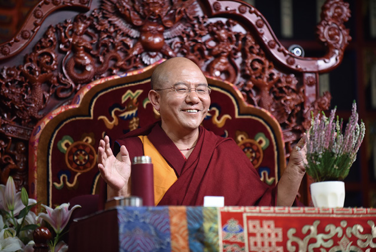
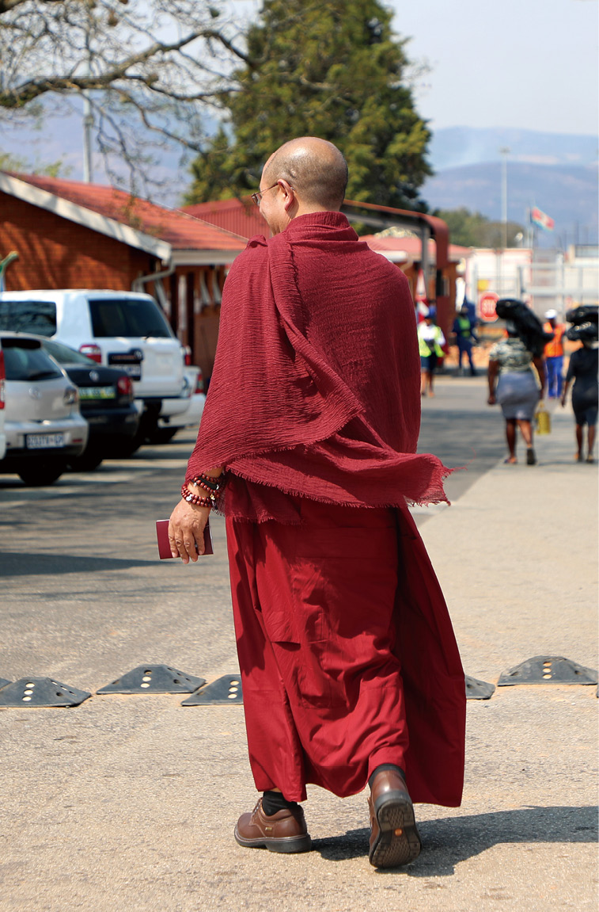

## 法显精神

——不畏艰难，坚定求法，弘法利生

2018年12月9日

今天讲“法显精神：不畏艰难，坚定求法，弘法利生”，在此之前先说两件事情。

第一件事情是下周的课程安排。周一、二讲《维摩诘经》，周三讲《胜道宝鬘论》的最后一堂课。今天在线上听课的道友比较多——一些人平时应该没有来听课。如果你们有兴趣，周三可以来听《胜道宝鬘论》的最后一堂课，虽然“无头”但“有尾”也可以——开玩笑啊！周四和周五是密法课，周六没有课。

下周日是网络开示，我刚决定讲中观的二谛，主要念《中观庄严论》的传承，也会依论中的个别颂词简单地跟大家讲解二谛。大家听了传承后要完成作业——在2019年上半年看完《中观庄严论释》。其中一些内容可能有点难，但佛教徒也不能每天只听故事。

今天的课是关于法显的故事，很简单；下周日的课，内容就难一点。大家要证悟空性，就要懂得中观和唯识宗的观点、胜义谛和世俗谛的道理。西方人也重视《中观庄严论》，我在美国的一些大学看到它的英文和其他语言的译本。总之，希望大家好好地学习二谛的道理。

再下个周一是《维摩诘经》的课，当天也就是17号是我今年的最后一堂课。所以，在17号之前只有周六没有课。

第二件事情，是念麦彭仁波切《上师供》的传承。不久之后，就是喇荣每年为期七天的《上师供》共修。不管是上师如意宝还是你们自己的一些上师，在他们圆寂后，你们可以经常念《上师供》来供养。

（堪布念《上师供》传承）

刚才念了麦彭仁波切造的《上师供》，希望你们看一下它后面的小字，其中提到此法的功德，包括它非常简单易行——在短短的一座上就能获得传承上师的加持[^1]。上师修法、上师瑜伽、上师供都是非常有殊胜加持力的法门。

我们修行人仅凭自己的分别念和勤奋努力，有时候不一定能证得无二慧。对我们最重要、最有必要的是一些特殊的善巧方便、独传的窍诀，如此自相续可以在短时间内真实地得到上师的加持。当上师的加持融入自心，那不管是学习三藏十二部等经论还是弘法利生，都是轻而易举的事情。

## 法显大师的求法背景和过程

接下来我会结合《法显传》来讲法显精神：不畏艰难，坚定求法；得法后要弘扬佛法。为什么今天讲《法显传》，而不讲其他高僧大德的传记呢？主要的原因是，我正在把《杂阿含经》翻译成藏文，已经译完前面12个很短的经典，而它的梵文本就是由法显从斯里兰卡带到汉地的。法显大师圆寂十多年后，当时一位著名的译师求那跋陀罗把《杂阿含经》翻译成了汉文。

我在1987年从五台山请了一本《佛国记》，回到学院后便精进地阅读，因为法显是早期一位非常著名的译师，而我当时也有这方面的发愿：希望以后能够翻译一些经论。另一方面，我也阅读了唐玄奘和鸠摩罗什大师的传记，因为当时我想对不同译师的翻译风格做一些研究、学习。

在五台山菩萨顶，上师让我翻译了《佛子行》，那时候我对这方面还不太懂。我们在五台山待了100天，快要离开的时候，大家在清凉寺做会供，其间上师如意宝跟我交代：“以后可能有一些汉族人来求学，你要负责翻译。”我去年（2017年，即法王五台山之行30周年）说过，因为当时上师如意宝的这一句话，我的发心已经坚持了30年。

其实，因为一些历史变革留下的印象，当时我和一些老上师都觉得不可能有汉人来藏地求法。但我一直认为上师所说的话总有些密意，所以不会持相反的意见，自己尽量领受。既然上师这么说，回来之后我就在这方面下功夫，于是就看了一些书，包括《佛国记》。

以前我们在学校没有接触过繁体字，那时候正在改革、提倡简体字，因此我们学的都是简体字。那本《佛国记》用的是繁体字，当时我就拼命地查字典，最后总算把它看了一两遍。看完之后我对法显的精神有很深的印象，包括他在六十多岁时求学、翻译的事迹。早前我突然有个想法，如果把法显精神与他的传记结合来跟大家讲解，那应该对大家有些帮助，这就是今天讲课的缘起。

你们有些人可能也看过法显的传记。其实，他可以说是一位很国际化的修行人，在那个年代就去了三十多个国家，包括当时新疆、印度地区的很多小国家。

今天我主要从四个方面来讲他的传记：第一，他求法的历史背景；第二，他的求法精神，在求法过程中，他遇到了什么艰难困苦；第三，在印度取经、学会梵语后回国的因缘；第四，回国后的情况，他并没有像一些现代人一样，有了一份很好的工作便安逸度日，而是继续翻译和弘法。我会从以上四个方面来讲解，最后提一些看法和希望。

首先讲一下为什么法显大师想去印度。他那个年代的佛教，在中国历史上算是兴盛——此前二三百年佛法开始在中国传播，出现了各宗各派，到法显的时代已经建立了各种不同的寺院，僧人的数量也多了起来。

可是他发现，当时汉地寺院的戒律比较欠缺，比如，虽然已经有一部分僧伽律，但是不完整，而且一些僧人的行为也不是很如法。他抱着以戒为师的理念，觉得应该从印度求取非常珍贵的律仪、戒律，以弥补汉地佛法的不足，这就是他当初求法的最主要动机。那时候他已经六十多岁，但仍有特别强烈的愿望要去印度求法，这种毅力是我们一般世间人难以想象的。

至于法显大师的背景，一直以来历史学家对他出生的时间和地点有不同的说法。有人说他出生于公元334年，此外也有公元337年、338年的说法；出生地方面，有人说是山西，也有另外几种不同的说法。他3岁时身体不太好——很多高僧大德幼年时候的身体都不太好，包括顶果钦哲仁波切和虚云老和尚。不知道是不是因为大德以后对弘法利生有非常大的贡献，所以有些魔王故意制造违缘，或者是圣者的显现？

总之，由于身体不好，父母把3岁的法显送到一座小寺院出家。他在那座寺院待了很多年，大概五十岁的时候去了长安。当时汉地各个寺院都有讲经说法的风气，那个时代人们对佛法确实非常重视，除了声闻乘的佛法，大乘佛法如《般若经》的弘扬也非常兴盛。但就像刚才所说，法显大师觉得一定要去印度求法。

他在公元399年从长安出发，这没有什么争议。不过因为他的出生年份不是很明确，他出发的时候可能是62岁，或者是65岁，甚至是更高的68岁——这方面有不同的说法，很多历史书说是65岁。不管怎样，他出发时已经是个六十多岁的老和尚了。我们这里六十岁的老和尚经常说：“我要去修心班啊。”甚至有些二三十岁的小和尚说：“我现在不行了，好像身心都老了，我可不可以申请到老年班学习？”我们绝对不会同意。

那个时代的交通不像现在，如今你买张机票或者火车票，然后去世界上任何一个国家都没有很大困难。即便是距离比较远的如南美洲、北美洲的国家，现在乘十多个小时的飞机就能到。可是在法显的时代，没有导航或者科技的帮助，要远行的确有很多不确定因素。作为一位六十多岁的僧人，他为了弘扬戒律而毅然启程，那种发心、发愿，确确实实令人难以想象！

关于法显的团队，历史上有不同说法，有些说是三四个人，有些说是十个人。他从长安出发，经现在的甘肃、新疆一带前往印度。从地图上看，是先去新疆（那时候新疆有许多不同的国家），然后经过帕米尔雪山（喜马拉雅山的一个支脉，海拔4000-7000米）到达克什米尔，就是印度的北方。法显大师从长安到克什米尔花了3年时间，我之后会讲述他在途中遇到了什么困难。

克什米尔本来有一尊据说由阿罗汉依照弥勒菩萨身相而造的像，大概二十多米高，但后来唐玄奘去的时候已经没有了。到了克什米尔后，法显大师去了印度北部的其他地方，包括现在巴基斯坦和阿富汗的一些地区，其间朝拜了佛陀的衣钵、遗骨等遗址。

那时团队中有一部分人已经回去，还有一部分人就留在了某些地方，不愿再走。当时法显身边只剩下两位弟子——慧景和道整。在阿富汗、巴基斯坦一带的时候，慧景生病了，之后越过阿富汗的小雪山前往中印度，途中慧景因为身体不适而在雪山冻死。所以，抵达中印度的时候，法显大师的身边只有一位弟子。

## 抵达印度和回国的经历

中印度的摩揭陀国就是现在的马嘎塔，在很长一段时间里是印度佛法最兴盛的地方；根登群培[^2]也去过，当时他对圣地的遗迹有很多感慨。抵达摩揭陀国的时候，已经是法显离开长安的第6年，他在那里学习梵文，也得到了《摩诃僧祇律》、《大般泥洹经》和一些法本。3年后，他准备去其他地方，但他的弟子道整觉得摩揭陀国修行人的威仪很好，想待在那里，所以法显就独自去其他地方求学。

按《高僧传》所讲，他去灵鹫山的时候，途经一个有很多黑色狮子的地方。那些狮子会吃人，非常危险，所以其他人都不敢去。法显大师经过那里的时候，遇到三头黑狮子。当时他给它们念经加持，并说：“如果你们想吃我，最好让我先把经念完再吃；如果你们不想吃我，而是想听法，就规规矩矩地趴着、跪下来。”狮子们很听话，真的趴了下来。他一边摸着它们的身体，一边念经。念完之后，狮子没有伤害他就离开了。

之后，法显在路上碰到一位非常高大的人，他正在好奇这位到底是谁的时候，来了一位小沙弥，告诉他那位非常高大的人是佛陀亲自交付教法的迦叶尊者。法显大师后悔刚才没有礼敬，就赶紧追上去，但有一块大大的岩石挡在路上，已经找不到迦叶尊者的踪迹。

从灵鹫山下来后，法显大师去了现在印度的孟加拉邦——印度东部的一个省。有些人说是去了孟加拉国，但应该不是。他在那里学习绘画佛像，也抄写了很多贝叶经，当时他已经精通梵语和很多佛经。他在孟加拉邦待了两年。总之，他从长安去印度中部用了6年，在印度中部待了3年，在印度东部待了2年，总计11年，是吧？

出国11年后，他想从水路回中国弘法。为了寻找港口，他到了狮子国，就是现在的斯里兰卡。狮子国的佛法也非常兴盛，有一次他听到一位长老在念经，应该是戒律方面的，他觉得特别珍贵，就说：“尊者啊，您可不可以把这个法本给我？”长老说他们都是记在脑子里的，没有法本。这是当时的一些状况，有些经典是靠背诵口耳相传，没有立成文字。总之，那时候斯里兰卡的佛教非常兴盛，法显在那里待了两年，抄写了很多经典，也得到了《长阿含经》《杂阿含经》《中阿含经》等很多经典。现在斯里兰卡对佛陀最原始的佛经——巴利文的《阿含经》仍然非常重视。

在斯里兰卡待了两年后，法显大师已经出国13年了。《佛国记》提到，有一次他看到家乡的一把扇子，就特别思乡。那时候他没有眷属，自己一个人把得到的佛经全部包装好，然后跟商人一起乘船回国。其间他们的船坏了，在海上漂泊了90天，之后到了一个叫耶婆提的海岛，这在《佛国记》中记载得很清楚。

现在有些人说，他当时可能漂到了南美洲，因为从亚洲到南美洲大概需要这么多天。但实际上可能不是这样，应该是在太平洋周围漂泊。有些人认为耶婆提是现在印度尼西亚的一个地方，因为《佛国记》提到那是一个信奉婆罗门教的国家，而当时南美洲应该没有婆罗门教。

在耶婆提待了五个月后，法显大师乘上了开往广州的船，但没有抵达广州，最后在现在青岛的崂山区登陆。上岸后，他没有停下来休息，而是立即将求到的佛经运往南京，然后开始与佛陀跋陀罗大译师一起翻译《摩诃僧祇律》等经论。

很多高僧大德都有“跋陀罗”的称谓，比如《阿含经》的译者是求那跋陀罗，唐玄奘在那烂陀寺的上师叫希拉跋陀罗。“跋陀罗”是“贤”的意思，在藏地也有类似的称呼，比如法王如意宝晋美彭措吉祥贤，“吉祥贤”的藏文发音是“华桑波”，是一种尊称。

当时佛陀跋陀罗在南京一带翻译经论，有说他跟鸠摩罗什的见解不同，刚好法显到了南京，他们便在道场寺一起翻译戒律方面的经典，此时法显已年近80岁。另外根据一些历史资料，法显大师翻译了《大般泥洹经》。这部经非常有加持力，有公案说曾经有人家里发生火灾，所有财物和其他的书全被烧光，但他的《大般泥洹经》却完好无损。

藏地也有《涅槃经》，从汉地翻译的，但是不完整。我还没有对照汉藏两个版本，也许藏地的《涅槃经》就是从法显的《大般泥洹经》转译的，因为完整的《大般涅槃经》是由后来的昙无谶翻译[^3]。翻译了《大般泥洹经》后，法显就给大众弘扬，最后大概在86岁的时候示现圆寂，也有历史学者说是88岁。

以上简单地介绍了法显大师的生平，我觉得大家有必要看看与他相关的一些纪录片和《佛国记》。我今天给大家介绍法显大师的目的是什么呢？主要有六个方面。

## 不畏求法的苦行

首先，他是怎样苦行的？这一点大家要知道。现在很多人在求法过程中，只是遇到一点寒冷，或者停电一两天，或者少吃一两顿饭就觉得很辛苦。以前从成都到喇荣大概需要三四天，有些人在路上感到一点寒冷就觉得特别难熬。但我们从《佛国记》可以知道，法显的求法之行绝对比我们现在所面对的艰难得多。

尤其在新疆那一带的沙漠，他要穿越一个叫沙河的地方。《佛国记》说：“上无飞鸟，下无走兽。”“唯以死人枯骨为标帜耳。”以往可能有些商人死在那里，所以有一堆堆死人骷髅；法显的团队没有导航仪器，只能以骷髅作为辨识方向的标志。他们花了17天穿越沙河，其间几乎没有什么吃的、喝的，真难想象他们是以多强大的毅力前进。

作为求法者，大家可以想一想，如果要横越一个无边无际的沙漠，你会有什么感觉？何况他是一位六十多岁的老人，这值得大家思考。下面跟大家分享一段两分钟的短视频，不管你有没有看过，我想大家可以从中大概了解他当时的苦行是怎样的。

（播放视频）

我们可以从很多方面来分析法显的事迹。当然，如果它是一个神话故事，我们也没有必要去研究。可能不同身份、不同价值观的人，对《法显传》的解读都有所不同。比如，历史学家和考古学家会分别从历史和考古的角度去分析、思考，探险家会有自己的分析方式，旅行家可能会探索法显的求法路线。

纽约城市大学的一位教授分析了三位高僧大德的求法路线，他认为法显的路线跟其他两位有所不同：法显由陆路沿着新疆那边去印度，回国的时候则经海路，从印度南方到印度尼西亚，然后直接到山东；唐玄奘来回都是经新疆那边的陆路；义净来回都是经海路。他把三位译师的求法路线标在地图上，做了一些对比。

相对于其他两位译师，法显的求法经历更为不易，他的时代距今一千六百多年，比玄奘要早二百多年。当时很多国人对印度完全陌生，那时也不像现在可以在手机上买机票、订宾馆等等。已届高龄的法显，要背着沉重的行李出行，路上也不知道会有什么困难。对他来说，这趟旅程确确实实充满着很多未知数。

如果大家没有仔细地思考，只是表面上看一下《法显传》，可能没有什么感觉。我是在2013或2014年看了相关的纪录片，初时没有仔细地思考，后来设身处地地想一想：只凭个人的意志力来完成这趟旅程，确确实实并不容易。

特别是他从海路回来的时候，在海上漂泊了90天。我们从北京乘飞机到加拿大或者纽约只需十多个小时——不过有时候也会感到害怕和恐惧。根据纪录片中的说法，法显漂泊了90天，《佛国记》也明显地提到：漂泊了90日，到达耶婆提国，在那里停留了五个月，然后随商人趣往广州[^4]。《佛国记》由法显大师亲手撰写、记录，对历史学家来说是非常珍贵的史料。印度人习惯把东西记在脑子里，文字方面的史料很少，而《佛国记》清楚地记载了法显的所见所闻。

大家想一想，如果自己在海上漂泊3个月，其间会遇到各种狂风暴雨，船只反复在波涛汹涌的海上颠簸，那是怎样的苦行。此外，当时婆罗门还准备把法显扔到海里，但他没有想“我的生命怎么办”，只是想：“我这些法不能送到故土了。”这就是他唯一的遗憾，他唯一挂念的就是佛法。

从很多高僧大德的传记，我们可以了解到，他们跟法显大师有相同的精神。大家虽然都在听课、在求法，但其实很多人都没有足够的信心，这方面没法跟前辈高僧大德的求法精神相比。试想我们若踏上法显的求法路线，也许只过两三天，我们很多人都会放弃，没有走下去的勇气。但古人不一样，玄奘说：“宁向西去一步死，绝不东归半步生。”他宁可往西方求法的路走一步，也不往东方退半步，如此死也无憾。他即使遇到了九死一生的艰难困苦，但仍然义无反顾地勇往直前。

所以，我希望大家思考的第一件事情是，法显大师的求法精神跟我们是否相同？我们有些人认为自己在苦行，但实际上只是稍微有点吃不好、睡不好或者高原反应，就觉得受不了了。确实，很多来学院的人面对的最大困难就是缺氧，但法显大师没有任何氧气袋，也没有现代交通工具，连拖拉机都没有。现在一些藏族人推着一辆架子车去拉萨，但法显的团队没有这些。他们仅靠自己的毅力来完成旅程，这种求法精神值得我们随学。

历史学家认为《佛国记》主要记录了当时一些地方的风貌，其他内容像感应方面的，则没有很多记载。总之，如果大家只是表面上看看《佛国记》，不一定能了解法显精神的核心。以上是第一件事情。

## 不论年龄，都要有积极的心态

我想让大家思考的第二件事情是年龄方面。法显大师出发的时候不管是62岁还是65岁，总之都是六十多岁的高龄。现在，很多人到了50岁就觉得自己已经老了，包括我自己，这确实不是一个好的想法。其实，只要我们自己有智慧和毅力，总会有一种不同的力量。

前段时间美国前总统老布什去世，享年94岁。现任总统和很多前总统出席了他的葬礼，其间小布什致悼词，说到他的父亲跟常人有点不同：85岁时，他去冲浪、开快艇；90岁时，他从飞机上高空跳伞，降落到他经常去的一座教堂附近，因为觉得万一出现意外，他可以直接在那里安息。这就是他的精神。

法显大师也好，世间的老布什也好，他们都是世界上伟大的人物，我们有时候可能没法跟他们相比，但从自身的年龄、毅力方面，我们自己也可以反思。法显在六十多岁的时候步行前往印度，到了那里才开始学梵语。我算了一下，不管是哪种说法，他学习梵语的时候大概是70岁，最后也学懂、学成了。按现代的描述方式，就是一位六十多岁的人出国、留学，还学会了一门外语。

很多人觉得学外语有一定的困难。其实，我们这里有些人的基础很不错，很多年轻人很有潜质，应该好好地培养，以后大概每两周我们会有一些英语的互动。虽然很多人觉得学外语很难，但法显在七十多岁才开始学习其他国家的语言，在东印度的时候还学了画画。他在七十多岁仍然做了很多事情，这方面值得大家思考。

现在，在日本、德国等地方，一些已达法定退休年龄的人很坚强，他们会重新找工作，有没有薪水都不介意。在那些地方，大家可以经常看到七八十岁的人开车、上班、做事，对他们来说这是很自然的。可是我们有些人未到60岁，心态上就觉得自己老了。

其实，你有没有信仰不重要，这里的年轻菩萨也好，老菩萨也好，我希望你们一定要有毅力，这很重要！如果你是在求学，就应该好好地学习；如果你是在工作，就应该好好地工作。总之，大家做任何事情都不要经常觉得“我现在不行了”，这没有必要。像我的上师德巴堪布，他在八十多岁才开始为一部著名的续部撰写注释，那时候他完成了很多作品。

作为真正的修行人，随着年龄增长，智慧、阅历尤其是世间经验，都积累得应该非常好。大家要从《法显传》思考法显大师的经历——他六十多岁的时候出国，然后学习梵语，带回了很多经典。他在这个年纪还做了这么多事情，大家应该用他的精神来对照自己。这是第二个方面。

## 坚毅前行

第三个方面，从法显的故事可以知道，他不管遇到什么困难，都一直坚持向目标进发，在没有实现愿望之前，他从不言退。在整个求法过程中，他要克服各种各样的艰难，比如穿越雪山、沙漠——特别在过沙河的时候非常艰难，也遇到了很多野兽、非人、强盗等等。他面对众多让生命、精神都直接受到危害的不确定因素，却恒时有着一种非常坚定、坚强的毅力。

前年有一本非常出名的英文书《Grit》，中文译名是《坚毅》。书中提到，有时候一个人的智商和情商不是很重要，重要的是他的Grit——毅力。如果一个人没有毅力，即使他的情商和智商很高，也不一定能够长期获得成功。不管做任何事情，修行也好，创业也好，毅力都是最关键、最重要的。

我们有些讲考的道友，刚开始学习的时候不是很理想，但是他们一直不放弃、一直坚持着，多少年后终于获得法师学位，在弘法利生方面也有非常突出的能力；有些人初时很不错，但学习的过程中要么身体不好，要么跟其他道友有问题，要么有一些其他的冲击，他们不能坚持下去就退了，之后还不断换道场，弘法利生方面也一无所成。

学会也有这样的道友。有些人遇到一些事情就觉得：“世间的关系很难处理啊！我上面有一些压力，领导可能对我……”其实每个人总会有一些违缘，但跟法显遇到的那些困难相比，我们遇到的违缘不足挂齿，这方面大家可以跟历史书对照。确实，许多人做事情不成功，是因为没有坚持——遇到一点点危害，就开始怯懦，没办法坚持下去。

佛教说，坚定的信心是一切成就之根本。因此，大家不管在佛教的修行，还是世间的创业、事业方面，都一定要学会坚持。世间和出世间的任何一位成功人士，从他们的传记来看，在完成大事的过程中不可能一帆风顺，他们每一位都遇到了非常多的艰难困苦，跟一般人不同的是，他们在困难中获得了成就。

虽然我们的境界跟法显有一定距离，但是我们要学习他的精神，如此在生活中遇到困难的时候，就不会轻易放弃。比如在过去30年，我确确实实遇到一些不容易管理的人，给我带来了很多麻烦，但不管怎样我就想：“别人越这样，我越要坚持，我要更加坚强。”当然，我的事情其实不算什么，我的坚强跟法显的精神相比，确确实实太微不足道。

不管在修行还是生活方面，希望大家不要遇到一点事情就马上产生怯懦之心——佛教称之为“自轻凌懒惰”，就是自己经常觉得：“我肯定不行的，我老了，我身体不好，我烦恼很深重……”这时候就特别“谦虚”，然后退下来，这可不行。法显可不会说：“我六十多岁了，哪能去印度啊？不可能的。”大家在影片中也看到，他胡子都白了，拿着拐杖，但是跌倒后又站起来，其中的象征意义是什么？这值得大家思考，这是第三个方面。

## 虔诚祈祷引发超胜心力

第四个方面是祈祷。没有信仰的人可能对法显的传记有其他解读方法；作为有信仰的人，我们看到他每次遇到困难的时候，都有强大的心力。这有两个层面，一是发愿：“我一定要去那里！”二是祈祷，《佛国记》多次提到他向观世音菩萨祈祷。当大家遇到任何困难时，一方面要虔诚地祈祷诸佛菩萨，这非常重要；另一方面，当然也要预备一些解决方法，不能光坐着祈祷而什么也不做。

在汉地，像我们之前讲《孝经》时提到的感应一样，人们祈祷后会有感应，历史上也有这方面的公案。在西方，人们也会祈祷他们的上帝或者其他圣尊。从人类历史来看，有些人确实通过祈祷而获得了超越常人想象的力量，这无可否认。一些人在逆境中根本找不到方向，之后通过祈祷而渡过难关。唐玄奘也是如此，他依靠《心经》的力量超越了许许多多险难。

所以，要是你有信仰，如果以后在人生中遇到一些特别难以对抗的困难，我建议你好好地祈祷。不管祈祷的对象是度母、莲花生大士、观世音菩萨还是佛陀，如果你一心祈祷，依靠自己的虔诚心可以接通超胜的力量，这就是诸佛菩萨的加持；当你得到了加持，便能越过一切艰难。

法显大师的同伴，有冻死的，有待在印度没有回来的，也有一些人由于其他原因而没有走完他们的取经之路，为什么法显能完成呢？其一是他的愿力，其二是他的祈祷。

藏传佛教的历史中，也有很多藏地的译师和班智达等智者们被派到印度，但是到了尼泊尔之后，一些求法者由于各种原因，比如疾病、饥饿、天气炎热等等，就在中途退了下来；只有囤弥桑布扎、噶秋让桑玛等个别译师成功抵达印度，在那里学了梵语后取经回来。那些依靠高僧大德的窍诀、诚恳地祈祷传承上师的求法者，最终能够取经回来；如果他们仅靠自身的力量，有些事情是不能圆满的。

我们每一个人都有自己的愿望，若要得偿所愿，一方面自己要精进和努力，这是必需的，也是东西方人们所共许的；另一方面我们需要祈祷，这很重要，也是我们要向法显大师学习的地方。这是第四点。

## 每位佛教徒都要弘扬佛法

第五点，通过学习法显的传记，大家要知道他求法的最终目的并不只是为了他自己。我以前说过，来喇荣求学的道友，不管是藏族还是汉族，都不要把喇荣当成家。有些人说“我的家在喇荣那里”，同时也修了一个非常好、很结实——钢筋密度很高、水泥标号很高的房子，几百年、上千年都不会毁坏的样子，但这不是很重要。

以前汉藏大德们在印度那烂陀寺的时候，并不是以修建屋子为主，而是以求法为主；得法之后，他们不是待在那里为自己的往生做准备，而是回到自己的故土把求到的法弘扬开来。

虽然，我们不一定像玄奘和法显那样有非常广大的宏愿，但若我们确确实实觉得自己得到的法很重要，就应该弘扬它。现在，很多地方信佛的人不太重视佛教的讲经说法和学习，一些地方只是停留在民间信仰的层面，全凭人们自己的想象，跟佛教典籍中的教法完全不同。因此你们应该为此思考，在喇荣得法后应该回去弘扬，而不是待在这里为自己的往生做准备，其他什么也不管。

法显的弟子道整，当时心想：“哇，这里修行人的威仪很清净，我要待在这里……”然后就没有回来。虽然对他个人来说，那里是很清净，待在那里也许会解脱；但从大乘佛教的思想来看，他应该把从那里求到的法弘扬开来。确实，当前藏地的传承、法本、讲修都很好——这不是自赞自夸，因此，大家以后应该把自己得到的法和法本弘扬出去。你们所在的城市人口那么多，哪怕只是对个别的人起作用，也是非常重要的。

大家要尽量把求到的法和法本弘扬到全世界。比如你是学习日文的，那能不能把一些法本翻译成日文？当然你们还可以用其他语言，像德文、英文、阿拉伯文、韩文等等。去年，我出访一些国家的时候，看到很多本地人可以用自己的语言来传授佛法，比如西班牙人用西班牙语，非洲人用他们非洲本土的语言。大家要从心底发愿：要把佛教众多殊胜经论的意义，通过不同的语言来利益其他众生；如果实在没有这个能力，那就用汉语来帮助众生。

以前《佛国记》有一些英文译本，现在有日文等好多不同语言的译本。一些译本的序言说，那个时代基督教徒的数目和佛教徒基本差不多。但时至今天，全球有相当一部分的人信仰基督教，而佛教徒的人数并没有显著增加。当然，我们并不是计较他们的教徒越来越多，只是觉得我们每位佛教徒也应该积极主动担负起自己的责任。

作为佛教徒，大家要肩负起弘扬佛法的责任，要想到：“我是一位佛教徒，尤其是一位大乘佛教徒，不管我的身份是像维摩诘居士一样的在家人，还是像阿难尊者一样的出家人，都应该在我的国家、地区、民族当中，尽心尽力地弘扬佛法。”如果我们有此信念，佛教将有望兴盛起来。

《佛国记》的结尾部分也非常精彩，它的最后记载了法显大师的一句话，意思是，他是带着哪怕只有万一的希望来弘法[^5]。所以，他的究竟目的是什么呢？不是为了自己享乐或者让自己成名，而是为了弘法。确实，他最后也把佛法弘扬到很多地方。

当法显在印度中部的时候，一些当地的僧人问他：“你是从哪里来的？”他说：“我是从中国来的。”僧人们都很惊讶：“啊？边鄙的地方都有佛教僧人啊？”的确，在那时候的印度人眼中，中国的佛教并不是很兴盛，是属于边地。

法显大师在86岁圆寂。他登陆青岛时年事已高，当时他应该很累，但是没有休息几天，便马上到南京翻译佛经。他只是想：“我得到这么多非常珍贵的经典，一定要弘扬！”这是我们要学习的。以上是第五点。

## 对法要有感恩心

最后一点，对于前辈高僧大德们所翻译、求得的法，大家一定要有感恩之情。藏地著名大德根登群培曾说：“现在我们在一个小小的四方形坐垫上安闲地坐着，就可以享用所有佛经、论典的内容，这是前辈译师和大德们的恩德。”这句话很有深意。

如今我们得到一本书，觉得是很简单的事，“这是《佛国记》，那是《涅槃经》”，全部信手拿来，但它们的来源是什么？法显从印度取回的经书有上万页，实际上并不是很多，但这几本经书如此珍贵，是他冒着生命危险求来的。

对于以前藏地班智达、罗扎瓦（译师）的恩德，藏人确实念念不忘，包括上师如意宝，也经常在课堂上说：“如今我们有这么丰富、珍贵、殊胜的经典和论典，是众多前辈大译师、大班智达、智者、法王的恩德。”所以，哪怕是前辈大德们的一字一句，藏人都会记录下来，非常重视。

基于同样的原因，以前有一位美国人一辈子都在收集藏传佛教的经论，目前为止有接近三万多函。他的收藏一部分存放在哈佛大学专门为此成立的一个资源中心，一部分存放在西南民族大学。前段时间，我们也在探讨怎样把一些经论存放到喇荣的图书馆。

总之，我今天要强调的是，大家可以从法显的故事了解到，我们现在看到的每一部典籍，里面的每一句话、每一个字，都是前辈大德们用他们的心血，甚至生命的代价请回来的。不管是哪一位前辈大德，求法之路都不是那么容易的。

义净说：“去人成百归无十，后者安知前者难[^6]。”假设有上百人去远方求法，但是真正安然回来的不到十个人，就像以前藏地有很多罗扎瓦去印度求经，但回来的人寥寥无几。我们后人通过历史资料才知道，前人求法确实非常艰难。“后贤如未谙斯旨，往往将经容易看。”后来的贤哲们，如果没有知晓前辈高僧大德求法的艰难，往往觉得所有经论都特别容易得到，就不去重视，这样非常可惜。

大家想一想，六十多岁的法显独自冒着生命危险求回来的法本，像《大般泥洹经》，它是何等珍贵？所以，以后不管是经典、论典，还是前辈大德们、住世善知识们的教言，对于求到的法，大家应该珍惜，不要觉得“这只是一本书”，把它扔到100公尺以外的地方置之不理。如果你对其他的所谓金银财宝很重视，一看到就：“哇，这是耳环，这是手镯。这是玉做的，这是宝石做的……”但若看到一些非常殊胜的法本，却没有想到它们的价值，这是一种很颠倒的习气。

所以，今天的第六点是，希望大家对现存的很多前辈大德的珍贵法本，哪怕是一字一句，都要非常重视。毋庸置疑，佛教的书籍对后人和我们自己的今生来世都有很大的利益和帮助。如何好好地保存这些珍贵的法本，是非常值得我们思考的事情。

最后我有两点建议。一是希望大家多看法显的传记，包括《佛国记》和那部纪录片。纪录片是免费的，网上就能找到。虽然片中可能没有我刚才的一些分析，但是作为一部以历史题材为主的纪录片，大家看后可以大概对法显的求法过程有所了解。二是希望一些有能力的人，就法显的故事写一篇文章。当然，这不是强迫的，如果你实在写不了，也不用痛苦；如果你有意乐和时间，可以把它作为假期作业，于明年交上来，评审后我们会发一些奖。

如果你有写作的意乐，可以比较一下你和法显的求法过程，二者所遇到的艰难有什么差别？当然，你写：“我的福报很大，是21世纪的求法者，求法并不艰难。”这也没有问题。然后，你想一想自己是怎样得法的？自己的求法过程是怎样的？把这些记录下来。你得法之后，最关键是在自己有生之年，甚至生生世世，哪怕是对一个人也好，以发愿的方式也好，总之要用这些对自己有利的法来利益其他众生——在文章的最后部分，你为此发愿，我觉得是最可贵的。

所以，你们的文章可以从以上四个方面来对照自己。其实，大家应该从法显的传记中找到自己的影子。虽然在年龄、学佛时间等各方面，我们都不一定比得上他，但是我们毕竟也是大乘佛教徒，因此要尽量利益众生，随学他精彩、奇妙的大乘事迹。

你们每一个人都要发愿弘法利生。也许你还年轻，认为到了60岁再发愿也来得及，或者总觉得自己不行：“我能吃饱饭、睡得着就可以。现在我每天都要吃安眠药，愿三宝加持我能睡得着！”如果你每天所求的只是自己的安闲、快乐、健康，表面上你是在学习大乘密宗，实际上发心连小乘都不如。

最近在看《阿含经》的时候，我深深地感受到，小乘的基础很重要，比如无常、人无我空性，这些是人们能现量体会到的。在此基础上，我们一定要发大乘菩提心，否则修行很容易跟教义不相符。

希望大家发愿学习法显精神，不怕困难，坚定求法，最后弘法利生，把佛法传授给有缘众生，这就是名副其实的大乘精神！

[^1]: “《一切珍宝之王》中，真实大道众缘起，安住于一坐垫上，修持甚深之究竟；深奥内供之此法，简便易修不繁琐，顺利成就重大义，乃胜窍诀体可知。”
[^2]: 根登群培（1903─1951）：二十世纪一位重要的西藏学者、作家、翻译家、旅行家；于1934年前往印度，直到1945年才返回拉萨。
[^3]: 法显的《大般泥洹经》，相当于昙无谶《大般涅槃经》的前十卷。《大般涅槃经》共四十卷。
[^4]: 《佛国记》：“如是九十日许，乃到一国，名耶婆提……停此国五月日，复随他商人大船……趣广州。”《出三藏记集·法显法师传》也说：“行九十日，达耶婆提国。停五月余，复随他商侣东趣广州。”
[^5]: 《佛国记》：“故投命于必死之地。以达万一之冀。”
[^6]: 唐朝义净大师《取经诗》：“晋宋齐梁唐代间，高僧求法离长安。去人成百归无十，后者安知前者难。路远碧天唯冷结，沙河遮日力疲殚。后贤如未谙斯旨，往往将经容易看。”
