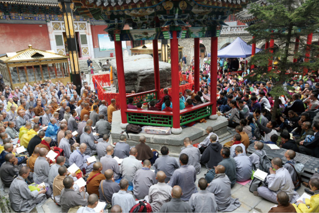
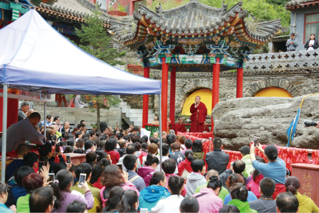

## 清凉寺授菩萨戒开示

2017年7月27日

今天一早，我有一种预感，今天应该早点找到个僻静的地方。还好找到了，前两天一直没有找到。

## 不要直冲直撞

管理寺院的老和尚不让我们待在寺院里，我们也理解，因为这里有特殊的规定。如果老和尚不赶我们走，他自己可能就要被赶走。大家应该知道，求法不容易，发愿也不容易。昨天太顺利了，我都有点不敢相信。

求法艰难啊！不仅现在如此，以前上师如意宝来这里的时候更精彩。我们做了很多的努力，包括一个月内，任何人都不能到台怀镇去。自己搭个帐篷，买一点粮食做饭。一直在山里闭关，一个月之后才开始出来。

我们学会了很多的善巧方便，所以遇到任何事情，都不会直冲直撞。求法需要善巧方便，不仅现代，古代也如此。翻看历代高僧大德的传记，他们的经历都说明了这一点。在今天这个特殊的日子，我们念《普贤行愿品》发愿，非常非常不容易。大家一定要好好地发愿。
