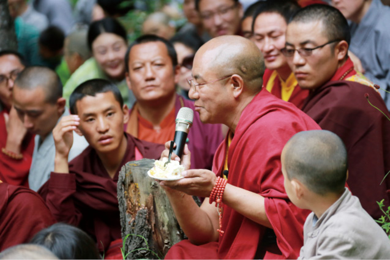

## 清凉石树林开示

2017年7月27日

## 菩萨戒的传授方法

今天，我们喇荣佛学院在举办普贤云供法会，非常殊胜。以前，法王如意宝在佛转法轮日这天，也在这个地方给大家传了菩萨戒。我们念诵《普贤行愿品》的时候，发菩提心很重要。菩萨戒是依靠发菩提心获得的，这一点，《入菩萨行论》的前三品，讲得非常清楚。学过《入菩萨行论》的道友，应该都知道。

按照我们前译派的观点，菩萨戒有很多传授方法，比如龙猛菩萨的观点、无著菩萨的观点、堪布根华的传承，等等。而华智仁波切菩萨戒的传法，被堪布根华继承并传了下来。我今天按照上师如意宝、德巴堪布的传授方法，给大家传菩萨戒。他们在时间充足的时候，会用广的菩萨戒仪轨，比如作花供等。宁玛派有很多传菩萨戒的仪轨。以前，法王如意宝在喇荣大经堂里，专门传过菩萨戒。那时候，所有的仪式、仪轨，都非常非常广。

今天，我们依照《喇荣课诵集》里的仪轨，给大家简单传一个菩萨戒。第一座早上已经念了，第二座刚才已经念了，现在是第三座，我给大家念菩萨戒的仪轨。

## 正式传授菩萨戒

### 1．祈请

大家这样观想：四方、四隅、上下十方三世一切佛陀，一地至十地之间的所有菩萨，以及所有的金刚传承上师垂念我、加持我、关注我。也就是说，要祈祷十方所有的佛菩萨。大家一定要好好观想。在这个特殊的日子，每一个人的相续中一定要生起无伪的菩提心，这个很重要。

要观想，十方所有世界的佛菩萨，和所有的金刚传承上师，都垂念我。这些圣尊在无缘的法界中，一直关注着我们这些可怜的众生。如果我们给他们发出信号，虔诚祈祷，他们马上就会知晓。就像我们用微信发信息，“叮——”，对方马上就知道了，我们对诸佛菩萨的祈祷也是如此。

比如说，我们祈祷文殊菩萨，文殊菩萨的信息系统比我们的先进得多。我们在信号不好的时候，就收不到信息，而文殊菩萨随时都可以收到。只要我们有信心，在心的转念之间，就会得到文殊菩萨的加持。这是一种非常特殊的沟通方式。佛教经常讲“加持网”，我们在佛菩萨加持的网中，随时都能获得加持。

再比如说，月亮挂在虚空当中，只要地上有相应的水器，月影即刻就会显现在水器当中。同样的道理，众生任何时候产生信心，诸佛菩萨都一定会垂念我们、加持我们。

今天念诵的仪轨是学院经常念的，大家都会念。等会儿我给大家传菩萨戒的时候，每个人都要发自内心地想：“今天是转法轮日，在五台山的清凉寺，在上师如意宝曾经转法轮的特殊圣地，我一定要好好祈祷以上师如意宝为主的所有传承上师，一定要得到诸位圣尊的加持！”

等一会儿，我念“效借纳犹波桑吉炯丹迪坛加当”，是十方三世诸佛的意思；“萨借拉内波香且森华森华钦波南当”，住于十地的大菩萨们；“喇嘛多杰怎巴钦波南”，所有的传承上师们；“达拉恭色所”，请垂念我，请关注我，我要受菩萨戒。这样来观想。

今天，我们没有美妙的词汇，唯一希望每一个人相续当中，能真正生起无伪的菩提心。以后你们再次来这里时，会想起这是自相续生起无伪菩提心的地方。也许那时，这里老一点的人已经离开，你会有一种不同的感受。

如果这一次，我们相续中什么都没有留下，只拍了一点照片，就很可惜。照片过一段时间就会过期，而相续当中如果有坚实的菩提心，永远也不会退失。下面大家跟我重复：（一遍）

效借纳犹波 桑吉炯丹迪坛加当

萨借拉内波 香且森华森华 钦波南当

喇嘛多杰怎巴 钦波南 达拉恭色所

我们刚才祈祷了十方的佛、十地的菩萨和所有的金刚上师，请他们垂念我们。大家要坚信，现在所有十方三世的佛菩萨和上师们，都在垂念我们。

### 2．皈依

下面是皈依。我们要发愿，乃至菩提果之间，我们都要皈依佛、法、僧。

今天的在家众中，有个别人想皈依。那你接下来就想：从今天开始，我皈依觉悟的佛，皈依觉悟的法，皈依所有跟随佛的大乘菩萨和四位比丘以上的出家僧众。这是皈依三宝。我相信，出家人的相续当中都有皈依三宝的戒，但居士当中以前皈依过的，也可以再次巩固。我给大家一起念三遍。

我们相续当中的皈依戒，按理说是有的，但有时候也不好说。在戒律方面，有时好像什么戒律都有，有时候又感觉什么戒都没有，因为有些戒条非常严格。比如说，皈依法以后，不能伤害众生，但我们可能有意无意地已经伤害了。有些玻璃心的人，你并没有故意伤害他，但他的心已经碎了，那这算不算伤害？如果别人真的因此而受伤害，我们的皈依戒是不是已经没有了？这方面确实是个问题。那我们出家人到底有没有皈依戒？就大多数情况而言，皈依戒应该是存在的，但有时候也比较危险。下面我们进行皈依。（三遍）

香且酿波其杰瓦

桑吉南拉嘉森且

秋当香且森华叶

措拉昂得银嘉森且

### 3．发菩提心受戒

接下来是发菩提心。三世诸佛怎么样发心，我们也如是发心；三世诸佛怎么样受戒，我们也如此受戒。这个很关键。我们在这里发愿，然后传授菩萨戒。接下来我们念三遍发心偈：（三遍）

结达温杰得夏基

香且特呢洁巴当

香且森慧拉巴拉

得达仁银内巴达

得银卓拉潘敦德

香且森呢洁杰样

得银德呢拉巴拉昂

仁巴银德拉巴杰

## 30年前的文章

以前，法王住在这里的时候，我们每个人都写了一篇文章。我写的是一篇祈祷上师的文章。这篇文章在30年中没有用过，也没有人看过——我没有给别人看。当时，每个人都把自己的文章念给上师听。我只在那个时候，给上师念过一遍。今天，我再在这里念一遍，算是一个缘起。因为找不到给别人念的地方，30年中没有人知道，直到今天。

（堪布念自己造的法王祈祷文，之后回向。大众为堪布庆生，吃蛋糕）
