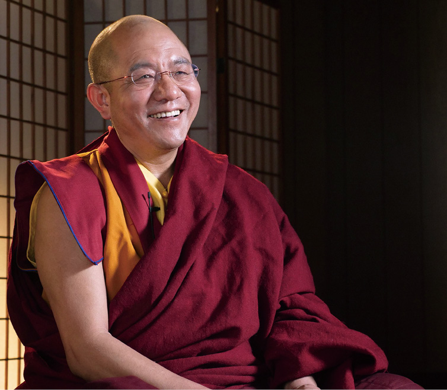

## 痛苦如何转为快乐

2018年9月2日

今天首先给大家念《般若波罗蜜多心经》的传承，为什么要念这个传承呢？因为很多人想获得快乐和加持，而依靠佛法不可思议的力量，可以让自己干涸的心灵得到滋润。

大家若想感受佛法的力量，主要有三种方法：第一，透过学习来理解法义，从而消除自己内心的痛苦，获得快乐；第二，对佛法甚深教义不断地串习、修炼，然后获得不同程度的验相、觉受和证悟；第三，虽然你不是完全明白佛法的甚深道理，但是以很真诚的心来祈祷佛、菩萨、三根本（上师、本尊、空行）、护法等等，依靠祈祷的力量，你的内心会自然而然地获得不可思议的加持和安慰，甚至原来心中难以堪忍的痛苦也会迎刃而解，生活中的一些难题也会很快得以解决。

## 多念《心经》或般若佛母心咒来遣除违缘

为什么今天给大家念《心经》呢？在传统中，人们通过诵经来获得保佑、加持。即便是没有信仰或信心的人，一旦听到诵经的声音，也会对他的生命和生活中的一切，带来不同程度的吉祥和护佑。很多佛教徒认为，不管是念诵、抄写还是携带《心经》，都会有不可估量的加持，所以想得到《般若波罗蜜多心经》的传承。

汉文的《心经》有多个版本，有广有略，广的版本跟藏文版《心经》是一样的。（略的汉文《心经》是现在广为流通的玄奘版本）

你们有些人已经得过很多次《心经》的传承，其实这个传承听得越多，对自己的相续越有利益，因为般若法门能摧毁我执、烦恼、痛苦和所有负面情绪。在日常生活中，大家应该经常以般若空性法门来对治自相续中的许多障碍，如此你的相续会变得更加清净、调柔和温和，这是很有意义的。

（堪布念《心经》传承）

我很小的时候经常跟隔壁的一位老僧人去放牛。他最爱念大白伞盖和金刚亥母的咒语，还有《心经》。当时宗教政策还没有开放，每次我们在山上的时候，他让我看看附近有没有人，没有的话，他就说“我要念经”，然后让我站在旁边看守。他每天都念：“没有眼睛、没有鼻子、没有……”每次我听到这里都会想：“他到底在念什么啊？”因为那时候我年纪很小，不知道《心经》中的“无眼耳鼻舌身……”藏文版本中是每个根门的前面都加了否定词，念起来是：“没有眼、没有鼻、没有耳、没有……”

当时我一直不理解，为什么我明明看到人们有眼、耳、鼻，但是他却每天念“无眼耳鼻舌身……”。我想他既然这么重视，那肯定很重要，于是问他：“为什么每天我们放牛的时候，你都念没有这个、没有那个，也没有色声香味触？如果什么都没有，你念的是什么？”他只说我不懂，没有跟我解释，因为那时候我年纪很小，还不到4岁。

（堪布继续念《心经》传承）

大家一起念这个咒语（般若佛母心咒）“达雅塔 嗡嘎得嘎得 巴Ra嘎得 巴Ra桑嘎得 波德索哈”。藏音的“嘎得嘎得 巴Ra嘎得……”和汉文的“揭谛揭谛 波罗揭谛……”是同样的咒语，只是发音不同，以后你们念哪一个都可以。

每个人因为自己的业力、外在环境、人和非人（包括罗刹、夜叉、阿修罗）的干扰，在日常生活中可能出现一些违缘和障碍，或者遇到一些不吉祥的事情，比如做噩梦、身体不适、做事不顺等等；此时如果我们念这个咒语或者《心经》，便能在短时间内把它们摧毁。

佛陀成道之前出现了很多魔障，当时世尊就是用般若咒语来降伏所有魔众。凡夫人还没有通达、证悟空性，不一定有降伏魔众的能力，但至少我们可以用这种咒语来维护自己、帮助别人，它的利益非常大。所以，若你经常遇到一些迷乱显现，包括心里莫名其妙地不舒服、不开心，或者产生各种烦恼，此时念诵这个咒语是非常管用的。

当然，如果你不相信经咒的力量，那就没有办法。比如，一位中医觉得这个药对这个病非常好，但病人对中医没有信心，也不愿意吃这种药，不愿意接受中医的治疗，那他的疾病很难通过中医来治好。所以，大家能够得到一些如甘露妙药般的咒语妙法，也是一种缘分。结上这种缘分可以遣除很多生活、修行中的违缘，这正是如今末法浊世众生所需要的。

就像《胜道宝鬘论》中说，我们修行要依靠咒语、方便法和缘起[^1]。缘起很重要！为什么有些人修行那么成功，做任何事情都那么顺利；而有些人却处处碰壁，做什么都不顺利？的确，一些人非常容易成就邪逆之事，而承办顺正之事，像修行增上和心里快乐，却连一个普通人也比不上。这跟我们前世的近取因业力有一定的关系，也跟我们今世的俱生缘（外缘）有非常密切的关系。

作为具有智慧的人，大家应该依靠各种方式来解决一些问题。比如，一个有智慧的人非常在意自己的身体健康，他会经常吃保健品和做各种保健治疗，也会学很多健康和养生方面的知识，最后效果也真的非常显著。同样，我们的内心是一个完整的系统，如果其中有些缺失或者有些部分无法正常运作，那我们要找一些合适、方便的解决方法，这方面佛教的理念就非常管用。

我并不是为了宣传自己的宗教才这样说，而是发自内心地觉得，当今世界上，佛法确实是人们的心灵良药。对于一些心里不快乐，甚至经常失眠、心理失衡或者负面情绪不断涌现的人，我特别乐意把佛教中的一些殊胜诀窍、咒语和秘诀无条件地提供给他们，至于接不接受，就看自己的缘分了。

（堪布继续念《心经》传承）

## 要养成观察自心的习惯

今天要讲的是“痛苦如何转为快乐”，这可能是个比较大的题目。

首先，非常感谢大家利用自己宝贵的时间来听课，因为今天是周日，本来你们应该好好地放松、休息和做一些自己的事情，但是大家都来学习；另一方面，我也没有什么可感谢的，因为你们学习不是为了我，而是为了你们自己或者其他众生。因此，不知道你们听到我说“感谢”，会有什么想法。

不管怎样，今天在现场以及在网络上看直播的各位，我们都是依靠特殊的因缘在这个时空相遇。“有缘千里来相会”，如果彼此有缘分，哪怕相距再遥远，就算你在太平洋的另一边，我们都有一起学习的机会；如果彼此没有缘分，即使你现在就在经堂外面——像我刚才看到的很多人一样，也不会进入现场。所以，大家彼此的缘分还是很重要。

今天的题目是“痛苦如何转为快乐”，如果依靠佛教的道理去剖析，相信大家会对痛苦有新的认识。若痛苦可以转为快乐，那就是说，痛苦的本性就是快乐；或者说，其实快乐和痛苦的本体都不成立，它们的本性都是空性和光明，此两者是无二无别的。理论上我们找不到任何痛苦，因为所有痛苦的根源是无明和我执，如果我们用自心观察无明和我执的本性，就会知道它们只是虚假的幻象，确实是不可得、找不到。这一点在藏传佛教的密宗中说得非常清楚。

以上的说法跟我的信仰无关，而是经过智慧剖析后的结论。如果大家用自己的智慧认真地分析，最后你会发现，痛苦就像芭蕉树，把一层一层的树皮剥掉后，里面是空的，没有任何实质。同样，对于自心正在产生的烦恼、恶心——像嫉妒心和傲慢心，或者自己始终摆脱不了的分别念等等，如果你依靠智慧去抉择，会很快发现它们没有本体。

你们当中一些人有信仰，一些人没有，但有没有信仰不是很重要，最重要的是每个人应该对自心的根本有所认识。现在，一些人包括大学毕业生、留学生，或者在某些研究机构里，认为自己的研究成果或论文非常棒的学者，自认为很有学问，但如果他们连自心的本体和本来面目都没有丝毫认识，能算得上真正的智者吗？这是一个问号。每个人都认为自己有一颗心，虽然认知心理学、生物学和其他科学领域各自有他们的研究和诠释，但是这些到底能不能让人们明白心是什么，或者真正见到心的本性呢？

在日常生活中，我首先给大家一个提议：要养成观自心的习惯。如果你经常观自己的心，那至少你的心态是非常平静、淡定的，自己也会感到快乐，这在当今时代是很难得的。现在，大家应该越来越感觉到，世界上很多人的心态非常复杂，尤其是整天沉迷在网络世界的年轻人、小伙伴们，他们的心态确确实实比较糟糕——Terrible，是吧？糟糕得难以想象。

经常有人跟我说：“我有吃有穿，生活不愁，什么都具足，可是我有烦恼，突然间会特别不开心，不管是独处还是跟其他人一起，都会莫名其妙地出现一些不正常的心态。”老实说，我自己完全没有这种经验，因为我不开心的话，总会有原因。比如，当我知道某件事情确实弄得很不好的时候，那我可能会不开心，心里不舒服。但是，现在有些人无缘无故就突然不开心，甚至出现突如其来的情绪崩溃。

在刚过去的7月，有一个在华山旅游的人，莫名其妙地从栈道上跳下去，引发了大量网友热议。其实，现在这种现象十分普遍，一个看来是非常正常、没有心理问题的人，可能会莫名其妙地不开心，情绪不好，然后就拿刀砍人，或者驾驶车辆的时候撞到电杆上，有诸如此类的可怕现象。

现在，很多心理学家在分析背后的原因，他们认为这跟我们的教育、网络游戏、一些社会导向等都有关。另外，很多东西方的学者和专家在不同的媒体上也有各种分析。

无论是出家前还是出家后，我想自己的心态算是很好的，不管自己处于什么环境，至少心里没有过不去的坎。其实，我的人生发生了很多事情，比如，过去几年或者十多年前，学院很多房子被拆了，这里的一些金刚道友不得不离开；还有父母的去世、上师们的涅槃……如果说人生有高山低谷，这些应该都是低谷，或者是自己最痛苦、最困难的时候。但是，我从来没有想过“我这次熬不住了，这个难关很难跨过去”，真的从来没有这些想法，包括自己生病的时候，也觉得这不算什么，应该能熬过去。

不过，现在很多年轻人的心态很复杂，突然间负面情绪来了自己也无法控制。不只是年轻人，一些学佛多年的居士或者出家人也有这种情况，有些道友不知不觉地心情就不好了。

## 不要滥用“崩溃”一词

偶尔有点心情不好，可能是普遍的现象，不太要紧；但严重的情况是，一个人的负面心情一直持续，缓不过来。很多人总是说：“你现在不要理我，我要冷静一段时间。”“你不要碰我，不要跟我说任何事情，我需要一个恢复的过程。”一些做完大型手术的人，可能需要一段康复期，但一些人自己莫名其妙地不高兴，还要一段时间来恢复，真的让人很难理解，但如今这种情况比较多。

另外，现在也有一些“双面人”，他们表面上看来非常成功，穿着打扮和外表等各方面都包装得特别好，大家都觉得他们没有任何心理问题，可是他们的内心其实非常痛苦。他们其中也有“微笑抑郁症”患者，在同事、家人、朋友面前经常带着微笑，给别人带来快乐，但他们只是非常成功的演员，自己的内心却很痛苦，也不堪一击、非常脆弱。别人的一句话、一个眼神或者一种表示，都能让他们受到非常大的打击，甚至觉得：“我崩溃了！”

实际上，大家不要滥用“崩溃”二字，不应该让它经常出现在我们的语言中，否则可能会给自己带来许多负面情绪。无论是《大藏经》、论著还是日常用语，藏语的词汇是非常丰富的，但到目前为止，藏语中确实没有跟“崩溃”意思非常接近的字眼。

今天这里可能有很多藏族同胞，“崩溃”的藏语究竟是什么？藏语中会用一些词汇来形容一个人处于低谷、无可奈何的状态、不知所措的环境、非常困难的时期，却没有特别明显的词汇来形容“我现在崩溃了，所有事情都做不动，没办法了”——如果一个人经常把这种负面的词语挂在嘴边，不知道潜移默化中会给自心带来什么样的伤害。

其实从人类历史来看，人心是非常强大的，这是人类跟其它动物不同的地方，依靠它，人们可以征服自然界，也可以对抗、反击所有怨敌。按照佛教“人身难得”的说法，这个人心难能可贵；按照进化论的说法，从动物慢慢地进化到人类的整个过程是很煎熬的。由此可见，人心应该是很强大的。

从另一方面看，很多缺少修行功夫的人，没有很好地训练自心并观察感受，他们的心可能特别脆弱。常言道：“良言一句三冬暖，恶语伤人六月寒。”有时候自己一句温馨的语言，可以让其他人非常快乐、增加很多勇气、获得安慰，即使在寒冬腊月，听者心里也觉得非常温暖。

很多人经常说：“请你给我们说一些好听的话，不然我们现在特别伤心，你能不能安慰一下啊？”一些男众的发心负责人经常跟我说：“你过来给我们的道友们一些安慰吧！现在很多人的心理特别脆弱，快承受不了了！”“有些人心里很难受，快熬不过去了。”“有些人可能坚持不下去了。”有时候男众的心理也比较脆弱，但我实在没有时间。我想，这些男众看来比较高大，应该不需要什么安慰吧。

另外，一些人确实是被恶语中伤，伤害到了心灵，有时候一句话就像一把利剑，直刺心灵的最深处，所造成的创伤过了很久也没法复原。也有一些情况是言者无心，听者有意——说话的人其实没有恶意，只是随便说了一句话，但是听者就因此受伤了，甚至无法站起来，即使送到医院抢救也没有用。在医院不管是用CT、彩超还是X光，医生也检查不到有什么伤口，因为这是由无形的利剑对无形的心所带来的创伤，即使住院也恢复不了。

## 直面痛苦，不要逃避

事实上，我们每个人都可能在某个时候产生脆弱的心理，此时我们需要什么呢？这值得大家思考。现在，除了很多人的心态比较特殊，还有一种人在生活中遇到一些矛盾和困难的时候，不想面对，只想逃避。

今天一些人跟我说，自己因为一些事情非常烦恼，所以来学院看看。在学院的坛城附近，一些人看来穿得很好、长得很不错，但内心可能很脆弱、很痛苦。当然，可能也有一些人觉得：“我很快乐，虽然我的相貌、衣着不怎么样，但我是世界上最快乐的人。”确实，按照佛陀所说，世界上每个众生的业力都不相同，因此所感受的果报也完全不相同。

现在的很多人，不论贫富贵贱，都把他们的快乐和成功寄托在外境上，比如财富。如此人们可能找不到快乐，找不到人生的方向。

一位著名的俄国作家写了一本书叫《地下室手记》，它是日记体的小说，1949年后出版了多次中文译本。书中有一句话：“把地球上的所有财富都用来满足他，让他沐浴在幸福之中，直至头发根：这个幸福表面的小水泡会像水面上的水泡一样破裂掉。”这句话非常明确地说明什么呢？说明一个人的幸福如果寄托在外境上，即使他拥有全世界的所有财富，若内心不平衡，他也不一定会快乐、幸福。

前段时间，新闻说在某个地方有50多位富二代因为吸毒被抓，情节非常严重。调查发现，他们有些正在留学，有些是海归，所有人的生活都非常富足，居住在高档的别墅，以豪车代步，从小就应有尽有，但是他们没有安全感，也不快乐，而且觉得生活非常无聊，然后就吸毒并做一些非法的事情。

一些人在觉得没有希望，或者没法得到快乐的时候，可能会麻痹自己，把不开心的事情暂时忘掉；一些人可能会逃避现实，去其他地方寻找快乐，比如去海边或者其他观光旅游点。其实，这些都不是解决自心痛苦的最好方法。

无论是按照佛教的教义，还是现代心理学的理念，当大家遇到痛苦的时候，应该勇敢地面对它，尽量去接受它，乃至把它转化。这样的话，也许你会发现，痛苦并不是那么痛苦，也不是没有解决办法；痛苦不会让你死去，或者让你走到绝路。

每个人在自己最痛苦的时候，总是会自救的。佛教中有“痛苦转为道用”的窍诀，世间人也有类似的说法。电影《冈仁波齐》的主题曲叫《无有畏惧》，其中一句歌词是：“坠入黑暗中，坠入泥土中的海阔天空。”当你坠落到泥土中的时候，实际上是另一片海阔天空。就是说，即使你已经陷入泥潭里——人生最痛苦的时候，只要转过身来，也会从另一个角度，看到大海和蓝天的广阔无垠。

所以，大家在人生痛苦的时候，不要总是想：“我失去了什么，我没有拥有什么。”比如：一些人现在成了穷光蛋，却总是想着以前是多么富裕；现在伴侣去世或者离开了，却总是想着以前两个人的感情多么好；现在容貌不那么庄严了，却总是想着以前长得很好看……

这时候，大家可以用佛教中的“减法”把痛苦转为快乐。比如，你现在没有以前那么富裕，那就想在目前的境况下，自己也可以很快乐：“有钱真痛苦，很复杂，带来很多争论。现在没有钱多好啊，没有复杂的事情，知足少欲，可以好好地修行、看书。只要有一点水果、一杯茶就好了，像前辈高僧大德那样过生活，多清净啊！”

如果你失恋或者遇到感情挫折，那可以想：“世间的争论太多了，谈恋爱真痛苦！现在清静多了。”或者想：“我虽然是在家人，但现在的生活很单纯，跟出家人差不多，我真快乐！”

如果你失去一些世间地位，那可以想：“哎，高际必堕，地位越高，堕下来的可能性就越大。我现在可以过一个非常清净的生活，多好啊！”

人们的很多痛苦是由于自己追求太多，以及不断地提高人生目标；到了某个时候，如果一个人的目标定得太高，同时他原有的待遇、福报因为外缘而正在减少，目标和现实间的落差就会让他接受不了。

为什么现在很多人感到痛苦呢？一是因为达不到自己追求的目标；二是因为不知道万法无常，在失去了原来所拥有的东西后，就特别痛苦。这也是当今大学生痛苦的主要原因：很多大学生担心将来可能找不到工作，现在为此已经非常痛苦；也有一部分大学生因为失去了原来所拥有的感情，或者学业上的优势，而感到十分痛苦。当然，你要知道如何让自己不痛苦，这很重要。但是，如果你没有痛苦，却浑浑噩噩地过日子，那也是不行的。

## 随缘、热情地过生活，不要抱怨

按照佛教最基本的理念，大家要有随缘的心——我可以接受一切事情，一定要接纳。外在的环境和自己的内心都在变化，它们不可能永远处于同一种状态，否则万法就有常有的过失——常有是绝对不可能的。然而，无论外境和自心处于什么状态，大家都不能丧失自己的积极性和热情。

现在有些人充满着激烈、负面的情绪。他们不论是站着还是坐着，白天晚上都在说别人的过失、抱怨别人，说其他人怎样坏，有时候甚至激动得跳起来；但若跟他们说一些正面的事情，他们就没精打采，提不起兴趣。其实这样不太好。生活本来就有正负两面，正如白天有阳光，晚上有黑暗。世界上任何一个地方，都有好人和坏人；你的工作和生活中，都有顺缘和违缘。

历史上，不管是从汉藏的历史，还是往昔大小人物的传记来看，人们在不同的年代总有很多是非、苦乐之事。每个朝代都有不同的人物，他们的烦恼其实都大同小异。我在欧洲的时候听过拿破仑的一些故事，相关情节很复杂，但其中的是是非非、人生起伏跟东方的历史人物没有什么差别。

我在非洲的时候，也问了一些非洲人关于非洲历史的故事。我对非洲人很感兴趣，虽然那里的经济条件不太好，但是他们热情奔放，载歌载舞，情感特别丰富。非洲历史上也有很多是是非非、恩怨情仇。所以说，世界上总有正面和负面的事情。

按照佛教的基本思想，对于有意义的事情，大家应该有精进和热情。在佛教的修行上，不要因为学久了就失去感觉，然后就逐渐退下来；做一些有意义的事情时，不能一直没有感觉和触动，这样也不太好。做人应该是积极的，如此你会有鲜活力。

也许你们认为我是假装的，但我身边的人应该知道：在学习方面，虽然我的热情可能没有刚来学院的时候那么高，但只要有时间，我就特别爱学习，这是真心话。虽然已经到了现在这个年纪，但不管是翻译、讲课还是做一些慈善或者其他善法，我都有很大的兴趣和意乐。同样，每次开会或者做其他事情的时候，我都是带着热情和正能量，不会垂头丧气的。我分享这些并不是为了自赞自夸，而是希望你们也可以从自身做起。

有时候人们随着年龄增长，可能因为身体变差或者人生阅历多了，就逐渐对生活失去热情，对修行失去兴趣，对人生失去指望，最后变成一直在等死的样子。如果你做任何事情都不想积极向上，那不太好。一方面，要有学习的心，不断地学习各种知识；另一方面，生活中的一些事情确实不会因为你的烦恼和痛苦而改变，所以应该把痛苦的心转过来，经常让自己处于开心的状态。

在日常生活中，大家要尽量减少抱怨，这非常重要，亦是我今天要强调的。现在，很多国内外的世间人虽然不是修行人，但他们也觉得抱怨对身体非常有害。跟我们佛教徒的发愿相似，他们会发愿在一段时间——比如在7天、21天或者一个月内，不抱怨别人。

刚实行的时候，大家会觉得很难，因为我们的抱怨不一定是言语上的，从肢体和态度上也可以看得出来。一些人可能用抱怨的语气说“哎哟”或者不耐烦地说“是这样的吗？”（堪布表情模仿，众笑）

一些人对任何人都看不惯，比如对领导的行为看不惯，对下属的行为也不满，甚至对自己也特别抱怨。抱怨自己的人也不少，他们觉得：“为什么我这样的人会来到这个世间？”“为什么父母生下了我？”大家不应该抱怨，困难并不会因抱怨而解决。实际上，你的负面心态会从语气、表情和态度表现出来，这会让很多人讨厌你、抛弃你。而且，如果你经常抱怨，也许别人对你的态度也会逐渐变差。

现在一些佛教徒所说的话，大概70%都是关于其他人的不是，其实这对听者和讲者的身心都不好。当然，有时候一些问题不说不行，那我们可以提出来一起讨论。现实生活中，大家用理性去剖析问题是很重要的。如果一个人总是戴着一副有色眼镜，那他看到的所有外境都只有一种颜色，由此判断得出的结论也肯定不正确。

因此，大家要有乐观、不抱怨的心态，无论发生什么，都要用智慧来面对。就像无著菩萨的教言，大意是说：患病、无病都快乐，因为前者可以消业，后者可以做很多善事；无财、有财都快乐，因为前者可以过知足少欲的生活，后者可以广结善缘；死亡、长寿都快乐，因为前者可以与来世结上善缘，后者可以增长善法[^2]。

我们要学习无著菩萨的随缘，如果你有财富，那可以想：“我有福报，可以好好地享受，不然临死的时候我的钱还没有花完，这是很痛苦的。”然后你可以去旅游、吃夜宵等等——但是最好不要杀生，不要造恶业，现在富人造的业比穷人更严重，这很可怜。如果你没有财富，那就想：“我可以过一个非常简单、清净的生活，就像以前的一些禅宗大德和修行人那样，多快乐啊！”

其实在很多方面，大家都可以把自己的心态转为道用，这样你的生活就有品质，而且自己的三观也会很正，如此就不会在这个时代中，找不到自己的人生方向。

## 快乐修行的方法

我们可以用以下的方法来快乐修行：

第一，是克什米尔班智达释迦西日的一个窍诀，我在讲解《无量寿经》的时候也介绍过。首先发菩提心，接着观察痛苦者（众生或者自己）的痛苦是源于身体还是内心。如果身体没有心的配合，那它就跟尸体一样，眼耳鼻舌、四肢和五官都没有任何感受，这样它不能感到痛苦；如果只是身体本身就能感受痛苦，那尸陀林的尸体也会痛苦，这是不合理的。

另一方面，如果痛苦源于自心，那我们以智慧来剖析这颗心。从心的本体、来源、住处、去处、颜色、形状等方面来观察，这颗心究竟是怎样的？最后你会明白：如果用智慧来观察，所谓的心就像虚空一样；除了虚空，你不可能找到自己的心，那依靠自心而产生的痛苦更不可能找得到——心如虚空，痛苦也不可得。

明白了以上两方面的道理后，大家可以经常安住于心无所有的境界中。当你用心来观察心的时候，你会发现以前给你带来痛苦的东西，究竟来说是不可得的。这种方法跟我刚才给大家念的《心经》相呼应，观修空性就是相应《心经》般若波罗蜜多的修法，很多道友也说这种修行方法非常好。

第二，在日常生活中尽量做利他的事情。寂天菩萨说，所有世间的快乐都是由利他而产生，所有世间的痛苦都是由自利而成[^3]。确实，世间人大多数都是为了自己的事情而流泪。大家应该扩大利他的心，平时多做一些慈善和有意义的事情。在伟大的利他思想面前，自己的我执和自私心最终会变得极其微小。事实上，具有利他心的菩萨和一些慈善人士的痛苦是非常少的。

因此，如果有些人经常觉得不开心，我建议你多参与放生和做慈善。即使你没有很多财物可以布施，但只要有利他的发心，一个小小的行为也会让你的痛苦逐渐减少。学会的一些爱心人士、志愿者、修行人，本来在生活中感到非常痛苦、没有生活质量，但后来因为信仰和善行有所改变，如今他们都非常开心，人生十分成功，也感到人生特别有价值。

所以，关于痛苦转为快乐的方法，我的建议是修空性或者利他心，如此你的生活会很有意义。

另外还有第三种方法，就是减少使用手机。人们的痛苦来自什么呢？分别念，如今这主要是由碎片文化带来的。现在，大部分人长期使用手机，最后也给自己带来许许多多的痛苦。有一个统计说，韩国和中国分别是全球手机使用率最高和次高的国家，两国都有近94%的人每天用手机来上网、打游戏等等。

现在，社会上有些人提议一律不让学生们使用手机和电脑，包括学院的一些法师。但执行层面可能有点困难，就算我们把这里常住道友的手机收回来，短期内应该可以实行，但长期来说恐怕做不到，工作量也很大。而且，一些道友可能把这部手机交上去，然后留另一部手机悄悄地用，这样他们经济上也有一定的消耗……

我们不得不面对现在这个特殊时代，跟以往的时代相比，这完全是翻天覆地的变化。但是大家也不要整天对着手机，除非你真的有一些利益众生和跟自己修行有关的事情。

这里很多道友上楼梯的时候还在看手机，包括一些上了年纪的出家人，他们本来眼睛就不太好，走路也不太方便，但还是边走路边看手机。有时候他们看不清手机，同时也因为高原反应而一直喘气。我经常在楼梯上看到这样的老菩萨，一边特别辛苦地爬楼梯，一边非常“精进”地看手机——真随喜你们的“精进”（众笑）。当今时代的出家人也弄成这样子，那在家人就更不用说了。

今天大家都是很开心的样子，希望你们以后不管怎样，都能始终保持着开心的状态。其实，不管是痛苦还是快乐，人生中的任何事情总会过去。遇到痛苦时，与其让自己沉溺在痛苦中，不如当下就好好地修行，念一些咒语——这是第四种把痛苦转为快乐的方法。如果大家多念咒，比如莲师心咒、观音心咒，那你的内心会非常充实。

虽然藏地很多老年人的文化水平很低，也没有什么财产，但是他们每天念很多咒语，并很虔诚地祈祷三宝，所以他们不会因为一些世间琐事而整天不开心、郁闷、痛苦、抱怨和经常发脾气。如果你真的没有时间去修行，也尽量不要在大众面前释放怨恨的“毒气”、扔坏脾气的“炸弹”。一个人内心的嗔恨“炸弹”一旦爆炸，会让周围很多人受到伤害。

所以，作为有智慧的人，大家为了保持内心的安静，经常禅修和念咒语是很好的。现在，瑜伽在全世界都很受欢迎，它不只有促进减肥、健康等好处，在调节情绪方面也是很好的，一些没有信仰的人也可以考虑。大家要保持身体和内心的健康，然后在这样的状态下尽量利益所有众生，这是最好的；如果你实在做不到这一点，也不要伤害别人。

## 让身语意流露慈悲

昨天，我说到小乘一切有部要求修行人好好地护持自己的身语意。如果把它引申到大乘佛教中，那是什么意思呢？身体方面，大家的行为应该带着慈悲，在跟别人交往的时候，彼此要和睦相处。比如，你坐了一个座位之后，不要再把你的衣服、包包放到旁边的座位上占着，否则，别人都不想跟你接近。

以前我旁听了一节心理培训课，课上大家都发自内心地感恩，并开心地握手，这确实让人有些触动。所以，大家应该用身体行为来表达慈心，如此你可以与他人和睦、温和地相处，跟什么人都合得来。

语言方面，大家尽量不要说伤害别人的话语。当然，别人可能无缘无故就受伤，这也没办法——像我有时候所讲的并不是针对个人，但有些人会觉得：“堪布今天在这么多人面前骂我。”那我也没有办法。无论如何，大家要多说慈爱和赞叹的语言。

内心方面，大家要尽量减少自己的贪、嗔、痴和嫉妒，而尽可能用慈悲心来对待他人。

如果你做到以上三方面——身语意都带有慈悲，那你自己和别人都会快乐。就算你对社会没有重大的贡献，也尽量不要做危害、扰乱社会的事情，这是做人的基本要求和原则。

希望从今天开始，大家不管遇到什么，开心的时候情绪不要太高涨，痛苦的时候不要觉得崩溃，任何时候都不要扰乱自己的清净心、欢喜心，应该保持着非常淡定的状态。这样不管你有没有信仰，我觉得都是很好的。

另外，对于和自己的前世今生有不可分割缘分的人，不管是你的孩子、父母等家属还是身边的亲戚朋友，你跟他们相处的时候应该有良好的态度。人们往往会忽视、不关心与自己最有缘的人，却很重视那些与自己缘分不深的人，这样不是很好。做人不要喜新厌旧，大家应该珍惜与自己最有缘分的人，比如家人、道友。

人生是有限的，到一定的时候每个人会各走各路。当你要离开世间的时候，如果别人觉得你非常好，那你也没有任何遗憾。为什么一些人死了大家会哭，有些人死了很多人会笑？这跟他生前的言行举止有关。

下面是授皈依。你们一些人不想皈依的话，也不用紧张、害怕；如果你想皈依，皈依的对境是上师和三宝——佛、法、僧。皈依有三种发心：一是为了自己即生中获得人天福报；二是希望自己从轮回中获得解脱；三是大乘的发心，就是从今天开始乃至生生世世为了利益众生而皈依。如果你的心态堪能，我建议你为了利益一切众生而皈依，这非常重要。当然，你也可以选择其他发心。

现在，我按照无垢光尊者的意趣给大家念四皈依的偈颂，念到最后一遍的时候，你就观想获得了皈依的戒体。

（堪布授皈依）

最后，我们将今天听闻正法的功德，回向给天下所有众生。大家一起念诵《普贤行愿品》来回向。非常感谢大家！

[^1]: 《胜道宝鬘论》当依之十法：“6．应当依止有益自他之物、妙药、咒语与甚深缘起法。”
[^2]: 《快乐之歌》：“自他虚幻此蕴身：如若患病当快乐，灭尽昔积诸恶业，修行正法众所作，皆为净除二障碍。如若无病亦快乐，身心舒适善行增，欲令人身具实义，三门奉行诸善法。如若无财当快乐，无有守护忙碌事，所有争端及恼怒，悉由贪执财物起。如若有财当快乐，广兴福德之善资，暂时究竟诸利乐，定是福泽之果报。如若速死当快乐，恶缘无机作阻挠，衔接来世之善缘，定入无误之妙道。如若久活当快乐，修行体悟之庄稼，长依教授温湿度，茁壮成长得成熟。无论如何皆快乐！”
[^3]: 《入菩萨行论》：“所有世间乐，悉从利他生，一切世间苦，咸由自利成。”
