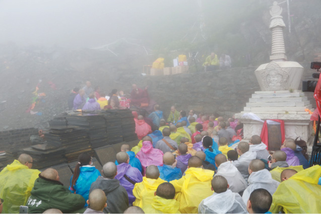
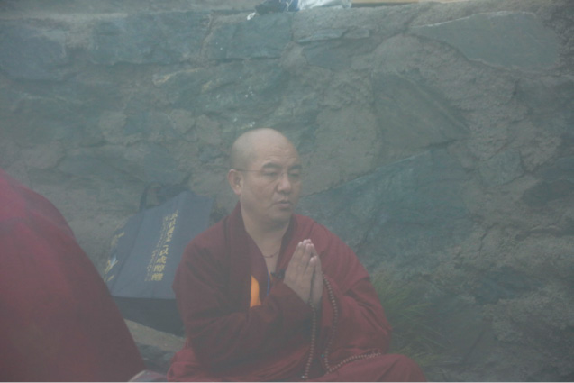
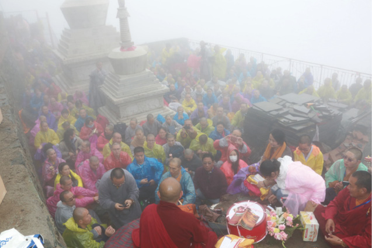
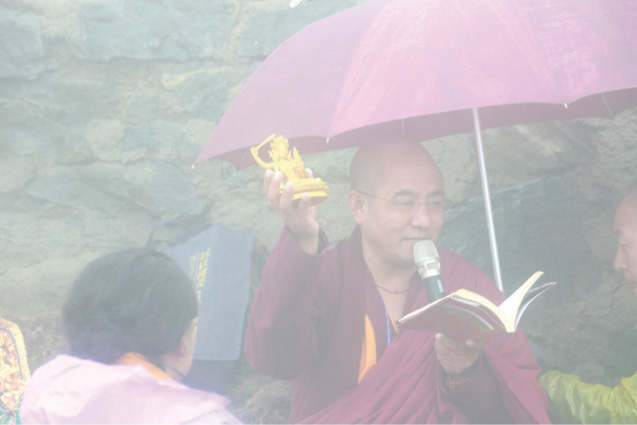
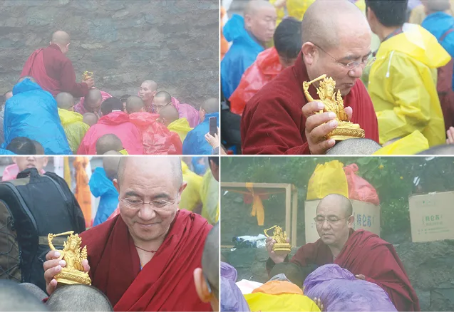

# 那罗延窟灌顶开示

2017年7月26日

今天慢慢地放松。当初法王讲课的时候，也在楼梯那边。我们每天都像爬山一样，爬上去听课。

今天，我先讲一些事，然后正常念诵，之后传授“文殊智慧勇识”的灌顶、念诵《文殊静修仪轨》的传承，最后念《普贤行愿品》《大圆满愿词》回向。

今天情况比较特殊，非常圆满。在座各位能共同发愿，也来之不易，其中不乏很多人的努力和护持。当前形势不方便，大家都清楚。

## 文殊菩萨常年在此

我先简单介绍一下那罗延窟。那罗延窟的藏文叫哲美普巴。《华严经》中讲，文殊童子及一万眷属，常年在这里转法轮，《五台山志》也有此记载。藏地贡布嘉著的《汉区佛教源流记》引用了这个教证：“汉地清凉山有一个山洞，名那罗延窟山洞，文殊菩萨及一万眷属常年在此。且那罗延窟一直延伸至龙宫，夏季也非常清凉。”诸如此类，有很多记载。

现在是学院开普贤云供法会的时间。我们今天在这里，也是非常殊胜的机缘。一会儿我给大家灌个顶，之后给大家发加持品。

我们特意给大家做了一尊文殊菩萨像，是纯银镀了足金的。以前我们来五台山的时候，很想找一尊能随身携带的文殊菩萨像，却一直找不到。这次筹备小组花了很长时间，用了很多钱，给每个人做了一尊小小的文殊菩萨像，在今天这个日子，作为纪念品发下来。你们以后可以放在嘎乌盒里，戴在脖子上可能太大了。我有一个嘎乌盒，里面装着法王如意宝给的小释迦牟尼佛像，还有其他几尊特殊的像。今天早上我给大家看的莲花生大士像，也一直随身带着。

还会给大家发一串六道木念珠，也是五台山的纪念品。我现在用的这串念珠，是五台山的六道木，但不是当时在五台山请的那串。当年，我们都请了五台山的六道木念珠。我请的那串，比现在用的这串要小，跟今天发给大家的大小差不多。那串念珠我用了10年，后来丢了，很心疼。

这一串是后来才得到的。1997年，我跟法王在成都中央花园。当时有个喇嘛朝五台山，用三元钱给我请了一串。我请法王加持后，一直用到现在，整整20年了。我用的时间比较长，不知道你们有没有这样的耐心，佛像、念珠20年后还依然带着。如果有，当然很好，没有也不要紧。

今天早上，我亲自给大家用莲花生大士像做了加持。待会儿的文殊菩萨像和念珠，我就不亲自发了，安排几个堪布给大家发。不然我有点累，我不是机器人。虽然人不是特别多，但也不少。

今天上午的主要任务是灌顶。完了以后，大家要多念一些《普贤行愿品》和《文殊礼赞》。相信大家都会念，我在这边控制时间。学院一天四座，也正在开法会。

这两天，这里来了很多人。本来有一些困难，后来我们做了一些协调，现在基本上没有问题了。这样的话，我们下午两点左右下去。在这之前按常规念诵，大家都要好好祈祷。

我想，文殊菩萨确确实实常住这里。其他方面我看不出来，但《文殊静修仪轨》《文殊大圆满》，还有一个续部，法王都是在这里造的。法王如意宝在这里闭了七天的关。当时特别特别冷，比现在还要冷。我们在刚刚下车的地方搭帐篷，每天下午来上师这里听法。今天在座的，只有诺尔巴堪布当时在，其他人不一定。我们当时还是很有意义的……（堪布突然哽咽）

刚才讲到，文殊菩萨常住在此，我自己没有智慧观察，但《华严经》和其他相关资料都是这么记载的。来五台山之前，我翻了很多藏文和汉文的资料。我写的《五台山圣地记》里，也记载了印藏很多高僧大德在这里见到文殊菩萨的情况。

据说，每一个来朝拜五台山的人，都能亲见文殊菩萨。有一种说法，叫“迎千里送八百”。凡是朝拜五台山的人，文殊菩萨都会以各种不同的形象，到千里之外的地方去迎接。离开五台山的时候，文殊菩萨又会遥送八百里路。两里是一公里，“迎千里”相当于到500公里之外的地方迎接。我自己在想，成都到五台山有一千多公里，如果坐飞机，文殊菩萨会不会接得远一点，跑到成都来迎接？反正，我在飞机上看到空姐，心里就在想：这些空姐会不会是文殊菩萨的化现？

接下来，我们按常规念诵。

（从加倍咒念至《文殊开智偈》）

## 翻译次数最多的灌顶

先给大家传法王如意宝造的“文殊智慧勇识”的灌顶。大概是上师如意宝去五台山之后造的。也跟五台山有关。

那时，法王住在四川省民委招待所，早期法王经常住在那里，现在它好像没有了。当时，有个陌生的汉族人，在上师面前显现各种各样的表情和行为。这时候，“文殊智慧勇识”的灌顶，突然显现在法王如意宝的智慧海中。

这一次，也是迎请文殊菩萨从五台山融入自己的身体。法王以前去印度、美国等，无论在哪里灌顶，都要通过观想，迎请文殊菩萨从五台山，融入自己的身体。那时，我们都觉得观想比较困难。今天，我们已经在五台山，就在文殊菩萨的门口，文殊菩萨一出来就能看见我们（众笑）。文殊菩萨这么有智慧，他肯定清楚。

今天在这里灌顶，也是为了大家和文殊菩萨结上一个智慧的善缘。法王如意宝造的文殊静修法门，特别特别殊胜。本来想灌“文殊大圆满”的顶，今年的密法班也会用到，但现场有些道友可能还没有修加行，所以就先灌“文殊智慧勇识”的顶。这对大家都有利。

刚才，我简单讲了一下“文殊智慧勇识”灌顶的历史。这可能是我翻译次数最多的一个灌顶。法王不管到哪里，都会传授“文殊智慧勇识”和“金刚橛”等几个自己造的灌顶。所以，我翻译过无数次，可以说逐渐得到了法王如意宝的加持。虽然我业力深重，但在法王身边待的时间比较长，而且一直坚持到今天，所以会有一点点加持的熏染。

我们来五台山的时候，跟任何一个旅行团队都不同。我们是有备而来，有目的而来。什么目的呢？求文殊菩萨加持，求开智慧。其他游客到了五台山，照相玩乐，大吃大喝，住好的宾馆。我们不是这样的，我们的吃住都非常简单。今天，我们也要秉持当年的传统。在座的各位中，以后会有很多是弘法利生的人才。大家弘法利生的时候，也要低调。

## 莲师像前，三点感想

今天早上，我在莲花生大士像前，突然想到了几点：

### 1．低调的心

这是世间的表达方式。以后你们要想弘法利生，一定要保持低调的心。如果高高在上，不一定能成办所愿。我个人也是如此。在座的道友，有些跟了我二三十年，有些跟了十几年、五六年。我今天给大家说句心里话，虽然讲法的时候，我不得不坐法座，而且坐过很高的法座，但下来之后，在大家面前应该不算高高在上吧？包括学院的男女众厕所、道路等，我都是以一颗服务的心去修建的。

在座的人里，以后可能会成为著名的法师、了不起的大德。但在弘法利生的过程中，一定不能自以为是，谁都不理，应该尽量虔诚一点、低调一点。讲法虽然不得不高调，但个人的傲慢心必须遣除。

### 2．虔诚的心

我们要想圆满弘法利生的事业，一定要以虔诚的心，将上师和本尊观为无二无别，经常在上师面前祈祷。我自己也是这样做的。这30年来，我对上师的信心从来没有变过。最近听说，国外有些仁波切的弟子跟随上师三十多年，最后居然背叛上师，给上师制造麻烦，真的特别遗憾。我个人跟随上师，虽然没有30年，但也有19年，跟随其他上师也有很多年。只要是对自己有法恩的上师，我从来都是恭恭敬敬地尽量祈祷。

### 3．坚强的心

弘法利生的过程，不会那么顺利。不要说我们，就连前辈的大德们，包括上师如意宝，以及汉藏等各个地方的大德，弘法利生都不是那么容易。这从他们的传记中可以了知。实际上，不要说弘法利生这样的大事业，就连在世间经营一家企业、办一所学校、建一座医院，也要经历各种各样的风风雨雨。

弘法利生的事业，是一般的世间人难以成办的，必定会遇到各种各样的麻烦。尤其是末法时期，邪魔外道非常猖狂，弘法利生不可能没有违缘和障碍。但不管怎样，我们在违缘面前不应该低头，而应该以一颗坚强的心，一心一意地坚持下去。这样的话，最后多多少少会有效果。

在做简单的结缘灌顶之前，跟大家强调一下。

## 文殊智慧勇识灌顶

接下来，大家观想上师跟文殊菩萨无二无别，观想上师是一切如来事业的创作者，然后在殊胜的上师面前祈祷，请求灌顶。我念的时候，你们一边观想，一边跟我念。

（众人跟堪布念诵仪轨）

大家祈请之后，上师开许说：具有信心与智慧的虔诚弟子，你具有非常殊胜的因缘；为了利益天下无边的一切众生，今天开许给你灌顶。

（堪布念诵仪轨）

下面是皈依、发心、受持密乘戒。

（众人跟堪布念诵仪轨）

接下来，将自己的身体观想为文殊菩萨。五台山的文殊菩萨有一万眷属围绕，观想无数菩萨融入自己的身体。

今天，我们有缘分来到这个道场，来到文殊菩萨的家门口，真的非常殊胜。我刚才说了，很多资料都记载文殊菩萨安住在那罗延窟。所以，大家观想很多文殊菩萨身体发光，融入自己的身体。

我今天带的文殊菩萨像，是以前上师如意宝在成都找人造的，并且作了装藏、开光、加持。我昨天到成都，因为一个特殊的因缘，得到了这尊像。我想，大概是文殊菩萨以像的方式来迎接我吧。今天也特意给大家作个加持。我拿在手里作加持，大家都可以得到。等会儿让大家传递一下也可以。

（堪布念诵仪轨）

接下来是正式灌顶。观想三世诸佛身语意三密的总集，就是文殊智慧勇识。看起来是用文殊智慧勇识的圣像给大家灌顶，实际上是文殊菩萨的身口意融入我们的身口意，成为无二无别，自己获得了究竟或殊胜的成就。这就是真实的灌顶。一会儿大家要这样观想。

等会儿给每个人发一尊文殊菩萨像，我下来一起发也可以。今天天气比较好。

（堪布念诵仪轨）

接下来，把文殊菩萨像和念珠分一下。大家一直念文殊心咒。

（大众念文殊心咒）

## 念诵传承

（堪布念诵传承）

这是法王如意宝《文殊静修仪轨祈祷文》的传承。我们每次祈祷上师的那四句祈祷文，就来自这里。当时祈请的人，有以前法王的侍者索顿喇嘛，还有红原的秋阳喇嘛——现在已经圆寂了。他们祈请后，法王在阿色绕，就是那罗延窟这里造的。

下面传《文殊静修仪轨》。这个仪轨非常完整，是法王如意宝在这个山洞闭关时，自然流露出来的著名仪轨。以前我每天都念诵一遍，尤其是去印度的时候。现在断了，一个月偶尔才念一遍。以前台湾有人翻译过一次。如果大家没有，我以后可以翻译，方便大家多念诵。

（堪布念诵传承）

法王如意宝在《文殊静修仪轨》中讲：《华严经》等相关经典授记，五台山东台顶的那罗延窟，文殊菩萨由金刚手菩萨等一万眷属围绕，常住于此。阿旺罗珠聪美的觉性智慧中自然流露出来，立成文字。

有人在这里一直“强迫”我，不念传承，就不准我下来。我爬上来有点困难，现在饿了，想下来又不准下来。（众笑）

法王确实是在这个山洞造的《文殊大圆满》。刚才的灌顶，一些刚刚皈依佛门的年轻人也参加了。希望你们以后变成很好的佛教徒，好好地修大圆满。你们都知道，我一般是比较严格的，如果没有修加行，要得“文殊大圆满”的灌顶有点困难。但今天这里，有很多发心人员，包括堪布堪姆，平时都比较辛苦。

今天的灌顶很圆满。

## 花絮

他把自己的手机压着，一直看着我。（众笑）

以前有一次，我们在觉姆大经堂会供。天气特别热，阳光直接晒到法王那里。诺尔巴堪布打开了一瓶雪碧，又觉得害怕，就一直这样挡着。刚才圆照堪布也是，把手机拿下来一直压着，看着我。

（堪布念诵传承，之后和大众一起念诵《文殊礼赞》和文殊心咒）

灌顶和传法都圆满了。下面我们念一遍《大圆满愿词》和《普贤行愿品》。然后大家休息半小时左右，11点半吃饭。不知道他们能不能按时送过来。如果吃饭的时间不出意外，12点半我们再在这里，一起做个简单的会供。

12点半，吃了饭的人都过来。大家都很关心吃饭，刚才好几个人在问，大家都听到了。吃饭很重要，文殊菩萨也会理解我们。一会儿在哪里吃饭？（下面人有答：没定。）

总体来说，安排得还可以，但还不够细致——今天上车也是随便上。按理说，应该分分组，一车坐多少人。我们虽然分了很多组，但目的好像不是为了秩序，比较乱。我坐的最后一辆车。幸好车多了一点，不然的话……

半年前，他们就每天在电脑上安排，结果今天连吃饭的地方都没订。很多负责人在管理上还可以，但可能从来没有带过团。带团跟管理还是有点差别。以后像这样的朝山，找有带团经验的人管理好一点。

早上就有人没喝到豆浆。刚才问了，中午好像没有饮料。我让人赶快订矿泉水。不然，早上中午都没水喝，虽然天上在降雨，但也不能解决我们肚子里的问题。不知道他们后来订了没有。我知道他们很辛苦，但如果没有专门安排，可能吃的准备了，喝的就忘了……也可以吧。等会儿下去的时候，他们肯定有办法。反正今天我们坐的车很空，只有两三个人。

很多人都专门修上师如意宝的《文殊大圆满》，一辈子念《文殊大圆满》和麦彭仁波切的《大圆满愿词》。这个地方是文殊洞，我们更应该念。念完这两个，再念《普贤行愿品》作回向。中间可能有一点时间，大家自由活动。吃饭后我们再在这里集中。

（回向善根）

现在离吃饭还有45分钟。这上面有个东台顶寺。原来我和慈诚罗珠堪布走路朝山，早晨从菩萨顶出发，到中台、西台，然后到北台，在路上看到很多放牛的人。晚上我们住在东台顶，结果煤气中毒，差点死了。这里的冬天一般都烧煤。

大家尽量注意安全。等会儿我们吃饭的地方在文殊殿，从这里过去一点。文殊菩萨请客。大家不要走太远，不然文殊菩萨也找不到你，这里雾很大。（众笑）
